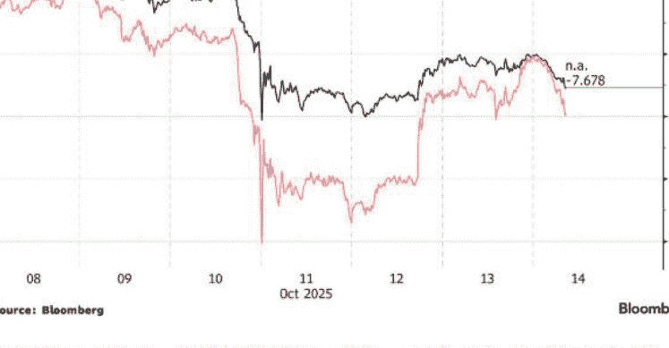
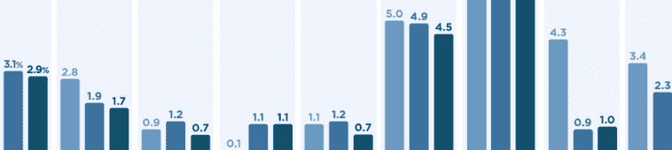
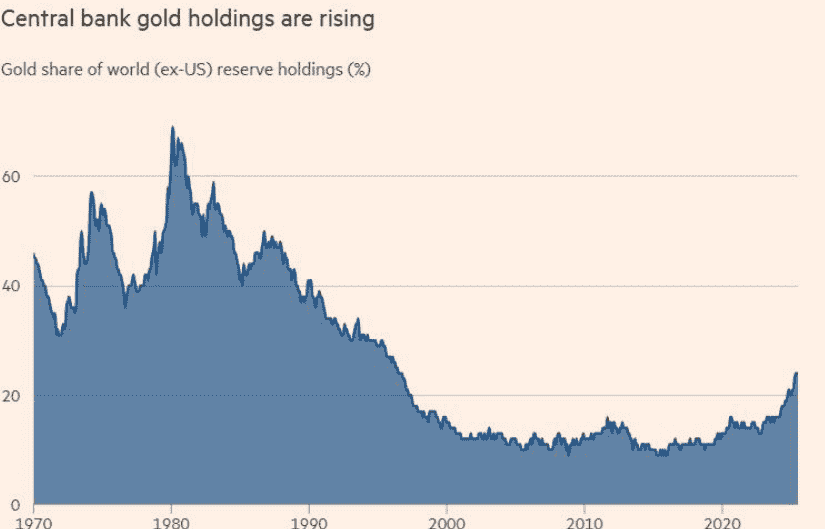
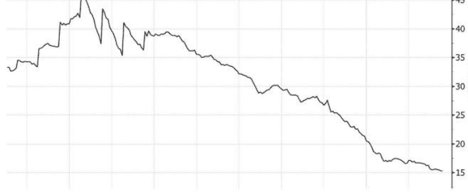
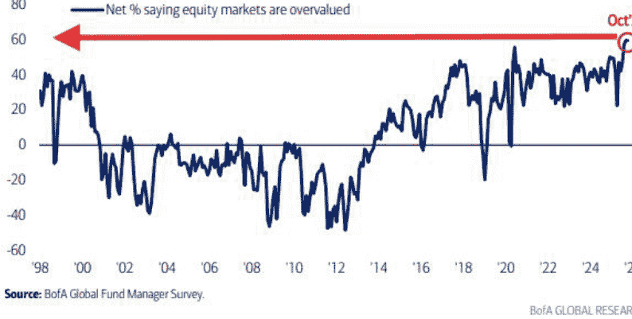
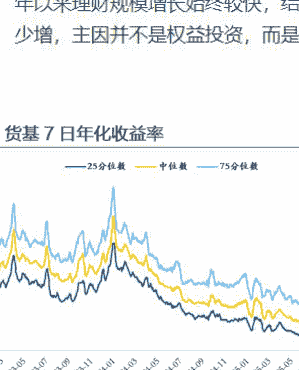
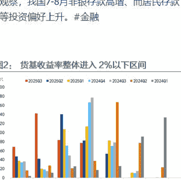

# 南美联购财经251015

Jason不易
2025-10-15 04:11

彭博：欧洲考虑强制措施，中国企业若想在欧洲境内运营，必须欧洲公司交付技术，旨在让欧洲工业更具竞争力的强硬措施，还将要求这些企业使用一定比例欧洲商品和劳动力，在欧洲境内实现产值增长，强制设立合资企业也是讨论的选项之一。这些预计将在11月出台的规定，表面适用于非欧洲企业，但真正目标是阻止中国的制造业压力扩散欧洲工业。

欧洲委员会发言人马尔提斯·雷尼表示：“目前正在考虑各项措施”。

欧洲委员会表示目前正在考虑各项措施，以增强强度、竞争力并实现去碳化的欧洲工业。

他说：“尚未对这些措施的具体内容和性质做出最终决定”。

中美紧张关系已经好缓。欧洲近期决定对钢铁征关以打击抢份额的中国产品。

几天后，欧洲委员会将通过贸易措施限制其无形或有物的出口，欧洲方面呼吁尽量减少对中国的经济影响。

过去几年，欧洲一直致力于保护本土工业免受非中国竞争。即将出台的法规将名为《工业加速案》（Industrial Accelerator Act）。

欧洲委员会主席冯德莱恩在9月表示，这项立法将推动欧洲一项产业的发展。

他说：“清洁技术将在欧洲本土实施。但是，我们必须确保我们的工业能够在欧洲本地获得所需的原材料。因此，在数字化与清洁技术领域，我们需要更多、更更新、更具清洁特色”。

欧洲的计划是寻找本土市场的替代方案对欧洲企业设定严格条件。欧洲侧重于建立增长与投资竞争的框架，其中对于大多数利益的低的灵活。

随着欧洲寻求寻找本土转型的方法，业务行业纷涌向欧洲委员会寻求更多获取利润的渠道，以获取超越中国领先的关键技术。

“外投资——尤其是在欧洲清洁技术领域——必须确保技术传输以及对欧洲劳动的帮助。”清洁技术行业组织“Cleantech for Europe”主管莉娜·范·蕾斯表示，“这必须在欧洲层面实现一次”。

据何时，拟中的新规将支持欧洲的电动汽车产业，尤其是电池技术的转移，为欧洲汽车制造在电动零部件方面减少依赖。

中国汽车公司已经在欧洲加速布局。比亚迪已经在匈牙利建设工厂，并计划在欧洲的电池工厂。中国电池在德斯孚拥有2000名员工，在西班牙与Stellantis合资并建设一个市值40亿（约66亿美元）的工厂。

# Jason 不跑

2025-10-13 04:18

bloomberg: 由于更新的消息，伦敦伦敦的剑拔弩张，周一，投资者从美国比特和以太币交易所基金中抽出 7.56 亿美元，达了交易员的紧张。周二，所有加密货币市值在 24 小时内下跌了超过 1500 亿美元。


由于贸易紧张局势挤压风险资产，加密货币在周末未引发一轮历史性的清算继续下跌，引发了周末的大幅抛售。

周二，最大的数字资产比特币在纽约下跌了 9.3%跌至 3,900 美元。根据 CoinGecko 的数据，规模小、波动性更大的币也下跌，拖累了所有加密货币的市值在 24 小时内下跌了超过 1500 亿美元。

下滑之，对韩国最大的造船商中韩海洋公司的美国部门实施了限制，反击美国对中国航运的措施。早些时候，美国总统特朗普意志对中国新出的出口管制征收更严厉的关税后，约 190 亿美元的杠杆货币市值在 10 月 10 日开始的周末惨痛中被清算。

# Bitcoin, Ether Resume Slide Amid Geopolitical Tension

```
Bitcoin Close on 10/07 --- 0.00 Ether
```



Source: Bloomberg

数字资产市场一周短暂反弹以恢复损失，但大多数代币现已恢复下跌。中美紧张局势的重新加剧也压低了股市、欧洲和亚洲市场的周二下跌。

中美紧张局势的重新加剧了美国海上争端。双方已经对对方船只征收了特殊的关口费，而美国则召集盟友--尤其是韩国--帮助其造船。这场战斗对全球经济产生了影响，因为美国负责80%以上的国际贸易。


来源：克拉克塞尔注：数据截至6旬。目前在水上的重量计算。

“这是对持续增长的扩张，”总部位于新加坡的贸易负责人德博拉·埃姆斯（Deborah Elms）说。“这不再只是关税和出口管制的问题，而是哪些公司能力开展业务。如果这种情况持续下去，更多的经济面临风险。”


bloomberg: 鲍威尔“压力需要暂停，暗示QT将结束，也提振了市场面临明显的困难：但如果我们的行动太快，那么我们可能会导致通胀完成，如果我们的行动太快，就会出现不必要的损失。”

美国小企业情绪在9月份下降三个月后低点，因为对经济前景不乐观，业主对储的需求增大，比8月份上升了3百分点，31%的计划在未来三个月内提高价格，上涨5个百分点。CME剩余两次涨息的定价其他国家经济。


来源:全国企业联合会

# 工的要点

- 美联储主席罗根·鲍威尔表示，美联储有望在本月份再次降息 25 基点。
- 鲍威尔指出降息速度，并指出降息速度可能会进一步走缓，并表示职位空缺的进一步下降可能现在失业率。
- 美联储于 10 日至 29 日召开会议，美联储表示，由于政府部门寻找其他数据，减少了对经济的解释。

美联储主席罗根·鲍威尔，美联储有望在本月份再次降息 25 基点。

“10月的降息已经结束了，”研究机构 MacroPolicy Perspectives 的创始人、前美联储首席学家朱家·多罗萨（Julia Corona）表示。“没有劳动力市场仍然存在下行风险的观点。”

鲍威尔指出降息速度缓慢，并指出降息速度可能会进一步疲缓。

“你的位置在这里，职位空缺的进一步下降可能会现在失业率，”鲍威尔在准备好后回答记者的提问。“你已经经历了一段时间，你直接下降了，但我认为你达到失业率开始上升的。”

| DATE | 175-200 | 200-225 | 225-250 | 250-275 | 275-300 | 300-325 | 325-350 | 350-375 | 375-400 | 400-425 |
|---|---|---|---|---|---|---|---|---|---|---|
| 10/29/2023 | | | | | 0.0% | 0.0% | 0.0% | 0.0% | 96.7% | 3.3% | 3.3% |
| 12/10/2022 | 0.0% | 0.0% | 0.0% | 0.0% | 0.0% | 0.0% | 0.0% | 93.9% | 6.0% | 0.1% |
| 1/28/2023 | 0.0% | 0.0% | 0.0% | 0.0% | 0.0% | 0.0% | 47.8% | 49.1% | 3.0% | |
| 3/18/2023 | 0.0% | 0.0% | 0.0% | | | | 24.7% | 1.4% | |
| 4/29/2023 | 0.0% | 0.0% | 0.0% | 0.0% | 0.0% | 7.3% | 32.1% | 41.6% | 17.9% | 1.0% | 0.0% |
| 6/29/2024 | 0.3% | 2.0% | 7.9% | 18.8% | 27.6% | 25.2% | 13.5% | 3.9% | 0.5% | 0.0% |
| 7/28/2024 | 0.2% | 1.7% | 6.8% | 16.9% | 26.2% | 25.7% | 15.6% | 5.6% | 1.1% | 0.1% |
| 9/17/2024 | 0.2% | 1.7% | 6.8% | 16.9% | 26.2% | 25.7% | 15.6% | 5.6% | 1.1% | 0.1% |

CME FORWARD TOOL - CONDITIONAL PERSPECTIVES

# Jason不遇

PIIE: 预计2025年全球GDP增长3.1%，2026年将增长2.9%，低于去年的3.3%。目前，人工智能在美国，已经消除了其他因素的推助。然而，展望未来，前景微妙，经济体面临不同的逆风和风险。目前预计美国 GDP增长将从2025年的1.9%和2024年的2.8%放缓至2026年的1.7%

Most large, advanced economies face slower GDP growth next year, with China and India

# Most large, advanced economies face slower GDP growth next year, while China and India with tariff drag

Projected change-over-year real GDP, 2024

| US | Euro area | Japan | China | Russia | Brazil |
|---|---|---|---|---|---|
| At optimism has US growth, but tariff intensifies | Euro area divided, with robust growth and headwinds | Fiscal boost will lift growth before retrenchment | Fiscal restraint, weak productivity UK growth | Domestic demand growth in India | Weak market, lifting Russia's growth |
| Growth slows amid slight monetary policy drag | | | | | |



Learn more at piie.com/research/piie-charts

Note: Purchasing parity used to calculate global GDP refer to annual-average-over-average rates. Sources: Karen Dylan's blog, "Global Growth Holds Up Despite Headwinds and Rising Risks."

# Jason 不诡

FT: 决策者不安的是，一些未判断黄金太便宜，已像过去那样靠谱。根据世界黄金协会的数据，黄金占储备的比例从十年前的10%上升至6月的24%，不包括美联储内，截至6月维持至2998吨。这意味着，按当前价格计，美国以外的官方储备约为3993亿美元——高于7年前外国政府持有的3992亿美元美国国债（包括短期债和长期债）。黄金趋势意味着长期美国在抗击通胀方面失去力，同时黄金处于低的利率和资产贬值做好。一些分析师在8月的调查中，四分之一的基金经理将“更多黄金”列为市场中最热门的交易，对于所谓“七巨头”（Significant Seven）的描述，美国分析师在一份报告中表示，近期的价格超出常态；金价高出其200日均线20%，高出其200日均线70%。报告称，这种行情此前出现过三次，每次峰值之后出现了20%到33%的回落。

# Central bank holdings are rising

Gold share of world (ex-US) reserves holdings (%)



FINANCIAL TIMES
Source: World Gold Council, IMF

# Foreign Official Pull Back From Treasury Market

Foreign officials' share of outstanding Treasuries



Source: Bloomberg, Department of the Treasury

Jason不喻
2025-10-15 05:15

# IMF10月全球经济展望

> text (3).


## A3. Advanced Economies: Components of Real GDP
(Annual percent change)

| | Private Consumer Expenditure | 2007-16 | 2017-26 | 2018 | 2019 | 2020 | 2021 | 2022 | 2023 | 2024 | 2025 | 2026 |
|---|---|---|---|---|---|---|---|---|---|---|---|
| Advanced Economies | 1.3 | 1.7 | 2.5 | 2.1 | 1.6 | -5.4 | 6.0 | 4.2 | 1.7 | 1.9 | 1.8 | 1.6 |
| United States | 0.9 | 2.6 | 2.4 | 2.1 | 2.5 | -8.5 | 8.0 | 3.0 | 2.6 | 2.1 | 2.2 | 2.5 |
| Euro-Area | 0.5 | 0.8 | 1.9 | 1.8 | 1.4 | -1.4 | -7.6 | 4.8 | 6.1 | 0.4 | 1.2 | 1.2 |
| Germany | 0.1 | 0.9 | 1.1 | 0.9 | 1.6 | -11.3 | 10.0 | -5.3 | 0.6 | 0.4 | 0.5 | 0.5 |
| France | 0.4 | 1.2 | 1.3 | 1.3 | 0.0 | -0.2 | 0.5 | 2.7 | 2.1 | 0.8 | 0.5 | 0.5 |
| Italy | 0.3 | 0.5 | 1.9 | 1.9 | -1.3 | 0.3 | 0.3 | 3.2 | 0.4 | -1.0 | 0.8 | 0.8 |
| Japan | 0.4 | 0.1 | 1.1 | 1.2 | -0.2 | -0.4 | 2.7 | 0.1 | -2.8 | -0.1 | 1.0 | 1.0 |
| United Kingdom | 0.9 | 1.4 | 2.5 | 2.6 | 1.1 | -3.3 | -11.1 | 5.6 | 3.2 | 2.8 | 3.7 | 4.0 |
| Canada | 2.5 | 0.2 | 0.5 | 0.4 | 2.5 | -3.8 | 4.1 | 3.6 | 3.8 | 2.7 | 3.0 | 4.1 |
| Other Economies | 2.6 | 1.9 | 3.0 | 3.2 | 3.8 | 4.5 | -4.6 | 4.8 | 3.2 | 2.7 | 3.5 | 3.1 |
| Major Economies | 0.9 | 0.6 | 0.4 | 0.9 | 1.6 | 2.9 | 0.1 | 2.0 | 2.2 | 2.1 | 2.1 | 2.2 |

| | Gross Capital Formation | 2007-16 | 2017-26 | 2018 | 2019 | 2020 | 2021 | 2022 | 2023 | 2024 | 2025 | 2026 |
|---|---|---|---|---|---|---|---|---|---|---|---|
| Advanced Economies | 0.9 | 0.6 | 0.1 | 0.4 | 0.9 | 1.6 | 2.9 | 0.1 | 2.0 | 2.2 | 2.1 | 2.2 |
| United States | 0.8 | 2.3 | 4.0 | 4.3 | 3.2 | -3.3 | -6.1 | 8.0 | 2.2 | 2.1 | 2.2 | 2.5 |
| Euro-Area | 0.3 | 0.2 | 1.7 | 3.9 | 3.2 | 7.1 | -5.7 | 3.8 | 1.9 | 2.0 | 1.9 | 1.7 |
| Germany | -0.2 | 0.1 | 4.4 | 4.1 | 4.2 | -9.2 | -6.1 | -5.3 | -0.0 | -2.0 | -0.1 | -0.9 |
| France | 0.2 | 1.4 | 4.1 | 4.4 | 3.7 | 6.2 | -9.6 | 0.2 | -0.8 | -1.3 | -0.5 | -0.3 |
| Italy | 2.5 | 2.3 | 1.7 | 0.8 | -1.1 | 4.4 | -6.6 | 0.5 | 0.8 | 1.4 | 1.2 | 1.2 |
| Japan | 1.1 | 2.4 | 10.1 | 10.3 | 2.1 | -3.9 | -14.3 | 6.3 | -0.4 | 20.9 | 2.1 | 2.1 |
| United Kingdom | 1.2 | 2.6 | 3.1 | 2.6 | 1.1 | -3.3 | -11.1 | 5.6 | 3.2 | 2.8 | 3.7 | 4.0 |
| Canada | 2.6 | 0.2 | 0.5 | 0.4 | 2.5 | -3.8 | 4.1 | 3.6 | 3.8 | 2.7 | 3.0 | 4.1 |
| Other Economies | 2.9 | 3.1 | 3.2 | 2.5 | 3.8 | 4.5 | -4.6 | 4.8 | 3.2 | 2.7 | 3.5 | 3.1 |

| | A4. Emerging and Developing Economies: Real GDP | 2007-16 | 2017-26 | 2018 | 2019 | 2020 | 2021 | 2022 | 2023 | 2024 | 2025 | 2026 |
|---|---|---|---|---|---|---|---|---|---|---|---|
| Emerging and Developing | 6.2 | 6.6 | 7.6 | 7.4 | 2.9 | 6.2 | 2.5 | 8.5 | 7.1 | 5.8 | 4.2 | 4.9 |
| Bangladesh | 7.6 | 7.3 | 8.2 | 7.5 | 9.1 | 7.1 | -1.6 | 1.1 | 2.8 | 2.4 |
| Brazil | 2.8 | 2.1 | 3.0 | 2.1 | 2.8 | 1.5 | -1.0 | 1.3 | 1.6 | 2.4 |
| China | 6.9 | 9.0 | 6.8 | 6.1 | 2.3 | 8.2 | 3.1 | 5.4 | 4.8 |
| India | 6.8 | 6.8 | 7.5 | 5.9 | -5.8 | 9.7 | -1.7 | 11.9 | 16.2 | 6.7 | 5.3 |
| Indonesia | 5.9 | 5.2 | 5.1 | 3.5 | 7.2 | -3.9 | 13.5 | 13.8 | 4.5 | 6.1 | 4.8 |
| Pakistan | 7.7 | 6.9 | 4.2 | 3.3 | -3.5 | 11.3 | 8.5 | 22.6 | 4.7 | 3.3 | 2.5 |
| Saudi Arabia | 4.8 | 4.8 | 5.4 | 4.8 | 7.2 | -32.9 | 37.5 | 13.8 | 9.3 | 3.8 | 4.5 |
| Mexico | 5.0 | 5.1 | 7.8 | 3.7 | 11.3 | 4.2 | -9.6 | -0.8 | -1.3 | -0.5 | 0.3 | 0.3 |
| Nigeria | 6.0 | 6.3 | 2.5 | 3.8 | 0.4 | 6.6 | -9.6 | -12.0 | 10.4 | -1.1 | 1.7 | 3.0 |
| Nepal | 4.1 | 9.0 | 7.1 | 7.2 | -6.7 | -24.8 | 48.6 | 5.2 | 2.0 | 5.2 | 5.0 | 5.0 |
| Peru | 5.9 | 3.5 | 10.3 | 5.2 | -4.5 | -32.2 | -0.5 | 5.7 | 3.8 | 4.7 | 3.5 | 3.1 |
| Philippines | 5.5 | 5.8 | 14.0 | 4.3 | -5.5 | -31.1 | 23.1 | 15.2 | 46.6 | 2.7 | 3.2 | 2.0 |
| South Africa | 1.8 | 1.4 | 3.6 | 1.8 | -4.6 | -4.2 | -2.3 | -2.2 | 24.6 | 2.7 | 3.2 | 2.0 |
| Sri Lanka | 6.1 | 6.5 | 2.3 | -0.2 | -4.6 | -4.2 | -2.3 | 20.0 | 2.0 | 1.6 | 2.5 |
| Timor-Leste | 6.3 | -3.5 | 0.0 | -2.5 | -8.7 | -3.5 | 40.0 | 4.0 | 2.1 | 3.9 | 3.3 | 3.2 |
| Tonga | 1.5 | 13.4 | -33.1 | 0.2 | -11.8 | 4.1 | 3.0 | 2.6 | 1.8 |
| Tuvalu | 2.9 | 3.3 | 1.7 | 13.4 | -33.1 | 0.2 | -11.8 | 4.1 | 4.1 | 3.0 | 2.6 | 1.8 |
| Vietnam | 6.2 | 6.9 | 7.5 | 7.4 | 2.9 | 6.2 | 2.5 | 8.5 | 7.1 | 5.6 | 5.3 | 5.1 |


# Quality vs. Quantity

US firms top, but there are more than twice as many Chinese companies.

| Rank | Company | Model |
|---|---|---|
| 1 | OpenAI | GPT-5-2025-08-07 |
| 2 | OpenAI | o03-high-2025-04-16 |
| 3 | ByteDance | Doubao-Seed-1.6-thinking-250715 |
| 4 | xAI | Grok-4 |
| 5 | Alibaba | Qwen-235B-A22B-Thinking-2507 |
| 6 | DeepSeek | DeepSeek-R1-0528 |
| 7 | OpenAI | o4-mini-high-2025-04-16 |
| 8 | Google | Gemini-2.5-Pro |
| 9 | Zhipu AI | GLM-4.5 |
| 10 | Tencent | Hunyuan-T1-20250711 |
| 11 | Anthropic | Claude Sonnet 4 (Thinking) |
| 12 | Alibaba | Qwen-235B-A22B-Instruct-2507 |
| 13 | Zhipu AI | GLM-4.5-Air |
| 14 | Moonshot | Kimi-K2-Instruct |
| 15 | Baidu | ERNIE-X1-Turbo-32K |
| 16 | MiniMax | MiniMax-M1-80k |
| 17 | DeepSeek | DeepSeek-V3-0324 |
| 18 | IFLYTEK | Iflytek-Spark-X1-0720 |
| 19 | Ant Group | Finix-Pt-32B (Thinking) |
| 20 | Tencent | Hunyuan-A13B-Instruct |

Source: OpenCompass LLM Leaderboard Top 20
Note: Data as of: 3, 2025

# 加微信top28688, 进资料分享群

# Jason不离

2025-10-15 05:31

# 经济观察报访国家统计局原局长赞，值得一看#经济数据


经济观察报：在你看来，近期来中国宏观政策思路有哪些变化？

答复：长期以来，我们认为宏观政策是依赖加杠的财政政策，实际上还伴随着宽松的货币环境。有些年份出现过“紧缩政策”，但执行中往往偏向扩张，形成了“双轨制”。

这种“扩张政策”，重点在基础设施、公共设施和房地产建设上。有些基础项目确实留了良好的社会效益，也引发了许多问题。比如房价，世界各国都可以中国高铁建设的成功，确实保证实现性的并不多，更要重视平衡关系，要讲经济效益。经济发展不能依靠基础设施、公共建设，更不能一味忽视财政、发展建设。

我的观点是：特殊情况下，适当的财政支出是必要的，但必须控制在合理的范围内。同时，不依赖房地产拉动增长，关键要调整结构和财政支出。对于房地产以及效益不明显的建设，如高速公路、高速，不要过度投入。资金应当更多关注民生领域。

我觉得，目前中国经济已经在这个方向调整，还有逐步完成这种结构性转型，经济真的好起来了。

我去广州调研时，很多大家反映，他们并非没有资金，也不是不想投资，而是我找不到合适的投资方向，现在什么都不缺钱，我们必须解决“无处可投”的困境。

部分学者对于对民生收入增长持谨慎态度。即便我们不像美国那样“发钱”，但对有困难的职业也应该给予保障，“五金”“中金”的失业保险是多少多少呢？

现在，年轻人的就业问题需要拿出措施重点解决。我们每年有一千多万大学毕业生面临就业，这不是不小的挑战，必须要有相应的应对。

# 加微信top28688，进资料分享群

# 经济观察：关于经济统计的讨论，你有任何建议吗？

警醒：目前我们主要统计关注城镇化率，实际上应该要关注农村失业问题，大量农民年后返回乡村，不可在城市中消失，由于失业问题更多在农村。这是经济工作需要加强重视的。当然，这并非我们国家特殊，很多国家也存在类似问题。

失业率是宏观经济决策非常重要的参考数据，必须真实、客观。可见，正如伯格拉斯·格林所指出，“他的任职总统，是失业率、通胀率等与民生相关的经济指标，对经济增长率引起被忽视的。这如何帮助中国跨越了20世纪的20年——此前经历了60年代的潮流、70年代的经济转型，直到90年代后期高增长、高出口、低通胀、低失业，实不易。”

我多次强调，我们的经济学和管理者应该深入研究20世纪90年代的政策转型经验，究竟如何实现“新经济”的高质量增长，这是一个非常重要的借鉴。

经济观察：农民城市化也是这一经济学讨论的一个关键问题。

警醒：至城市，城市的很多福利尚未覆盖农民群体，他们甚至在子女入学等等方面面临歧视。这两三亿农民在统计时并未计入城市人口，无法充分享受城市的福利。这个问题无法解决，不仅公平，城市化率也不能反映真实。

经济观察：劳动领域的“动力转移”是一个重要要点，你认为我们已经跨越这一转拐点吗？

管理：没有跨越，我认为我们还没有失去“人口红利”，至少还有二十年的窗口期。只有当农业实现现代化，农村才能够转向劳动力市场，才真正达到“刘拐点”。目前，中国农业仍有巨大发展空间，农民人口收入为城市的一半，这意味着动力从农村向城市转移的动力依然存在，城镇化进程仍在持续。

加微信top26888，资料分享群

经济观察报：从人口的年龄结构看问题，我国劳动力整体年龄在上升。

质疑：我们确实存在一个问题：很多人提到了三十五六就难以找到工作，这在全球范围内少见。这个年龄并不是工作经验最丰富的时期。此外，不少企业推行明显的反劳动的制度，比如“996”工作制，这是不正常的，政府应当适当干预。

# 如何调整收入分配

经济观察报：你在文中提到，重视投资、经济思路于1998年，已经持续了很长时间。

质疑：“量入为主”现象一直存在，过去还有“凯恩斯主义”的号。但是落实1998年当时，由于积累，各界认为更好的办法，只能实施“积极财政”。当时政府对“积极”的程度有所控制，避免了过度扩张，也保持了比较谨慎。

（此处由于原始OCR文本重复且逻辑混乱，已根据语义合并并修正了重复的乱码部分，保留核心逻辑内容）

## Chart 13: Record net 60% of FMS investors say global stocks are overvalued
## Chart 9: A record 54% of FMS investors say AI stocks are now in a bubble




# 股市：

BOFA：最新调查显示，记录的60%的基金经理认为全球股票被高估，超过9月的58%。54%的基金经理认为人工智能股票处于泡沫中，同样历史新高。

## 图 1：7年收益率变化


## 图 2：居民收益率整体进入2%以下区间

