# 南半球财经251016

Jason-不遇
2025-10-16 01:01

吐槽，以前调研过的企业，增收收入和利润，我凭提应该是值的3倍，没没准，后来上主板了，我看了，现在的股价是离峰的CFO，他转转股后就离开了，刚看到他发的朋友，逛逛逸萨，后来又为了某个主意，我还和“他”吵过架。不知道何时做会被当老实”、#吐槽

Jason-不遇
2025-10-16 04:24

Bloomberg：印度曾在贸易谈判中对美国价值150亿美元购买石油，人们越来越乐观地认为，印度和美国将化解美国特朗普对印度产品征收50%关税以及引发的贸易僵局。美印关税，也影响着美国和美在谈判中的主体。其他国家经济

## 聚焦人工智能的要点

- 印度商务高级官员称，印度有能力从美国购买价值150亿美元的石油。
- 从美国购买的能源有望增加，根据25年财的数据，平均为12-130亿美元。
- 印度正在考虑从美国购买约400亿美元的大宗商品，以缩小贸易僵局。

印度商务部一位高级官员周三表示，印度有能力从美国购买价值150亿美元的石油，这说明美国可以快速贸易谈判并达成协议。

印度贸易部长拉斯特什·哈格瓦拉什·周三在新德里告诉记者，过去几年的数据显示，从美国购买的能源有望有所增加。

他说：“根据25年的数据，我们目前的平均投资额为12-130亿美元，目前的石油配置还留有14-150亿美元的空间。

此举可以弥补印度现有的42亿美元贸易僵局，并安抚纳德什·特朗普总统，后者向这两个国家征收50%的惩罚性关税，部分原因是它买了俄罗斯石油。据街摄周三一报道，印度官员正在美国与美国同行会面，并希望在下个月初达成协议。

新德里的广筹策略包括通过购买更多美国商品，进入印度市场和放宽贸易有望减少贸易僵局。它正在考虑从美国购买约400亿美元的国防和石油，以缩小盈余。

加微信top208368，资料分析专

IFA Global 创始人兼首席执行官 Abhishek Goenka 表示：“印度储蓄银行可能采取一次性粉碎投机性多头的方法，表明了其立场，而不是花费储蓄继续维持卢比。

此人表示，印度储蓄银行将继续干预，到它确认投机头已被平。央行发言人没有立即提供更多信息的请求。

数周以来，卢比一直处于低点附近徘徊。周三，央行在周几捍卫货币后继续进攻，该卢比飙升近1%，引发了人们对重新考虑政策的猜测。

## RBI Presence, Trade Helps Bolster Rupee

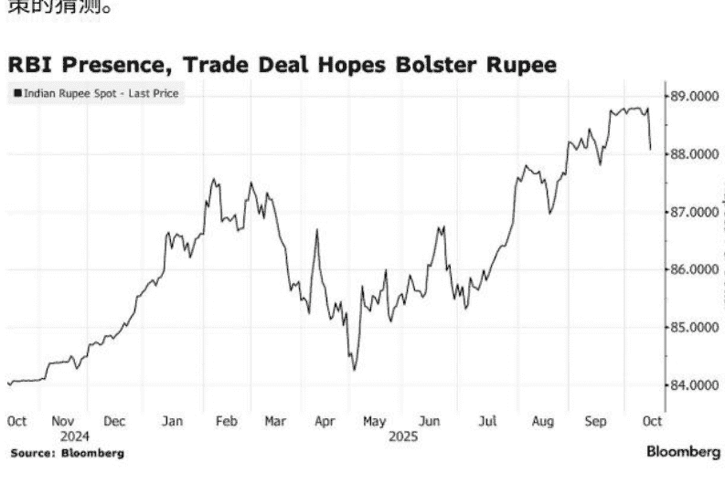

Jason-Lee
2022-10-16 04:31

Bloomberg: 米街最近的贸易波动将使得暂停加息更加紧张。#金融
(注: 花街不在推上YM1特勒最近的操作，不是为了G2，而是为了是为了维持维持，降卢比是为了维护压力和财政政策，等到时机成熟再拉一波加息)

# 加微信top28688，进资料分享群

## 博博人工智能的要点

- 美联储首席斯蒂芬·米兰表示，最近的贸易紧张局势增加了增长前景的不确定性，使得这种政策制定者迅速调整息变得更加重要。
- 米兰表示，中美贸易政策的不确定性增加了“新的政策风险”，政策制定者需在政策中尽快达到更中立的位置更加增加。
- 米兰表示，预计今年明年再加息两次“听起来很现实”，在“远的未来”停止缩减央行的资产负负债表是合适的。

美联储首席斯蒂芬·米兰表示，最近的贸易紧张局势增加了增长前景的不确定性，使得这种政策制定者迅速调整息变得更加重要。

“现在的下行风险比我一周前更多，我认为我们作为政策制定者有责任认识到这种风险反映在政策中，”米兰周三在CNBC组织的一次活动中表示。他说，中美贸易政策的不确定性增加带来了“新的政策风险。”

“我不会说我现在想要比一周或一个月前更低的利率，”米兰说。“然而，随着风险平衡的变化，我认为我们迅速在政策中达到更中立的位置更加增加。”

Jason n
2025-10-14 06:36

经济学人：国际货币基金首席经济学家吉拉斯·戈尔皮亚纳纳斯表示，此轮投机泡沫如果被破裂，将产生历史级别的动荡（以及财富消失）#金融

加微信top28688，进资料分享群

美国股市近期在复剧震荡的背景下大波动，整体接近历史高位。

这源于人工智能热潮掀起，让人联想到90年代世纪初的狂热行情，最终在2000年的互联网泡沫破灭。如今，技术创新确实在重塑行业、提升生产力，但当前行情正为新一轮市场调整准备。

不同的是，这一次的泡沫后，可能比25年前更严重，影响范围也都是全球。

现在，美国对股市的高估依然很高。过去15年，美国在股市的投资规模增加，增强了后的回逻辑和美国科技企业的信心。同样的，欧洲等其他地区的投资者也纷纷涌美国股市，此时亚洲更为重要。

这次泡沫的联动关系意味着，如果全球市场出现剧变，全球都会受到冲击。

为了说明清楚，按照我的预测，如果再次发生一次与互联网泡沫相似的市场波动，美国的财富将蒸发超过2000亿美元，相当于2000年GDP的7%。此近期的损失将要多得了。

当消费增长超过互联网泡沫的水平。如果如此，可能导致增长减少3.5个百分点，引起市场下降带来外外的冲击。全球范围同样严重。过去期间，外国投资者的损失可能超过150亿美元，占美国GDP的20%。相比之下，互联网泡沫期间，外国投资者的损失约为100亿美元，当时占美国GDP的10%左右。

这种溢出的扩散，显示出当前需求对美国市场的高度脆弱性。过去危机期间，美国上涨作为某种支持，这种避险帮助了投资者转向海外。长期一直是一种保险，即便美国面临危机，美元也会因为投资者寻求避险。

现在，可能不再适用。尽管关税和扩张性财政政策支撑美元，但美元对许多消费者来说，这种需求在泡沫时期是真实的。投资者的信心源之一，是美国制度，尤其是稳定性。最近的法律和政治变化，可能进一步损害对美元的信任。美国能否保持不受干扰。全球经济前景增加了不确定性。同时，美国政府债务处于历史高位，比2000年得多。

加微信top28688，进资料分享群

## Jason不遇 (加密)

在投资组合中配置少量加密货币，取决于投资者的承受能力。对于无法忍受回撤的保守型投资者应该避免此类资产。此外，加密货币多元化作用有所增强。近年来，加密货币与股市的相关性从0.5上升，主要是由于上述加密货币的回报，在早期和风险调整后的回报。提醒的是，加密货币的历史轨迹（比特币、以太坊等）与其他资产类别的相关性近于负，这提高了风险调整。

### 加密货币与传统资产的相关性分析

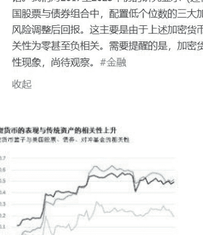

来源：Investing、Bloomberg
注：根据2017年1月至2020年7月数据，MSCI指数、ETF基金以市值加权作为基准。

## Jason不遇

Zerohedge：这次回来闹热了。昨天WSJ出了报道，大意是，特朗普会在关税生效前自行撤回，然后用威胁来表示意愿提高关税，只要斯林将“艺术”把他放在一个重要角色上，台阶。最后补充道：“世界不想解构，我想去解构。这样的信号是解构的迹象，我们认为不想说脱。再一遍，我们应该共同努力，尽快降低供应链风险，远离...”

## 其他国家经济

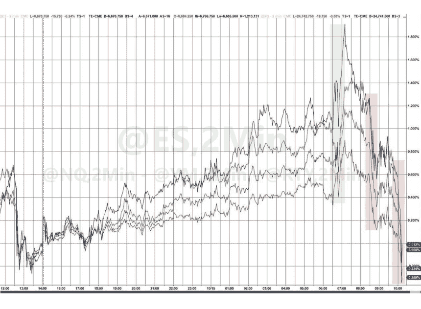

Jason-不遇
2025-10-16 04:58

## 民生：特朗普政府开始展现美国国家资本主义政府倾向

自特朗普政府上台以来，美国政府的经济政策发生了重大变化。长期以来，美国一直支持自由贸易和全球化，但特朗普政府开始转向保护主义。这种变化体现在对贸易伙伴征收关税、对国内产业的保护以及对政府干预的增加。这些趋势表明，美国政府正在向一个国家资本主义的政府转变。这种转变也对全球经济格局产生了深远的影响。

## 国家资本主义

- “国家资本主义”：政府影响力。将政府对企业的支持，无论是资金还是政策，转为收益或者治理影响力。三种比较典型的方式：一是以以色列为代表的“被动持股”，美国政府不拥有治理，但已经成为最大单一企业；二是具有影响和决策的企业，例如在日本后购买美国国债黄金股份，以及有关企业的决策权，以及最近对MP Materials等矿业公司的投资。三是要求成立的美国基金，白宫可以接受收益分成。典型的方式是自日本投资基金，白宫参与获得收益。
- 出口收费：贸易费新玩法。通过增加关税限制，把目的的开始输出——与其明确的限制。典型的是白宫自和传达对盟的AI芯片勒取分成——既限制又能权。以此，推类。根据特朗普所鼓励的“买卖就要美国”和“天下没有免费的午餐”的思想，未来来出口收费可能会面临两个方面——一方面是通过政府出力获得大额订单的波音飞机；二是美国禁止的限制，白宫部分非核心技术的产品。
- 交易费：白宫的推行思路。9月中之间TikTok交易达成框架协议，而转头来白宫将向其收取数十亿美元的交易费——完美体现了“政府合适的，政府收费”的思想。以此，未来白宫可能以国家安全为由，增加更多的重建交易，比如此未决的巴马港口交易等。
- 美国唯一移民中介：金卡和H-1B签证，定点计划海外人和科技公司——商人支付100万美元就可以获得永久，如果愿意缴税则支付500万美元，而每年增加的H-1B签证费高达10万美元，如果按照8.5万的配计算，预计每年最多可以增加77亿元人民币（此左右的费用），而想要进一步增加收入，白宫也可以考虑提高其他签证的费用。

## 准则

通过分析，以及以前对于特许权政策的持续跟踪，结出基本的准则：

- 首次，特许权：白宫，商人思维再上一个台阶。我们认为目前供应链维持底线。
- 其次，“权力变现”和“天下没有免费的午餐”是特许权最显著的特点。只要政府下了钱，都可以成为收费的内容。公司具有投资咨询业务资格，务必阅读特许权免费声明。
- 第三，特许权：不要“通胀”，但很可能是计划的重要环。对于企业的剧烈，规模上来看还是海外部门开启更有意义。
- 另外，“通胀之道”可能是解决“经济复苏”的唯一方式，其背后是债务之间的关系，另外“TACO”创造财富和交易机会，长期趋势。政策方面，战略性的获得更多发展。

Jason
2025-10-16 05:05

股市：与15年的供给侧改革相比，当下的反内政策将维持长时间，最终需求的回升是反内政策的关键。因为企业能够成本转移到价值环节。如果某些行业受到严重冲击，信贷可能出现，但美国市场环境长期变化转化为短期对资产负担。数据：10月16日民生报告

与2015年相比，2025年地方政府财政空间

| 支出 | 收入 | 金融缺口 |
|---|---|---|---|
| 外来支出（地方支出、内需支出） | 一般公共预算（税收和非税收入） | | |
| 内需支出（政府支出作为替代指标） | 政府基金（主要为土地） | | |
| 经营支出（一般公共支出作为替代指标） | 地方政府新增债券 | | |
| 反向财政政策（供给侧调整） | 需要持续支持 | | |
| 直接影响 | 非企业 | | |
| 产能减少 | 价格回升 | | |
| 投资缩减或重配置 | 利润改善 | | |
| 间接影响 | 杠杆率下降 | | |
| 地方政府 | 金融机构宏观经济 | | |
| 短期 | 投资失灵带来财政压力 | 资产质量导致收益波动 | |
| 长期 | 投资增长缓慢，劳动力市场流动 | | |
| 优化产业结构 | 不合理定价，支持获利能力 | 效率提升

注：政策效果存在不确定性，取决于行业需求、收入预期限额以及消费者信心水平。来源：建模评级

申万宏源：9月PPI改善，主因大宗价格继续上涨，但受需求影响较小的钢价大幅上涨。对有色产品，有色行业CPI同比升2.5%、1.2%，拉动PPI环比0.1%，为主要贡献项。核心CPI同比上行至1.1%，来源于核心商品（同比+0.5pt至1.4%）。其中金属CPI对核心商品压力较大，金饰商品同比上涨至42.6%和33.3%，包括金银等其他类商品及服务CPI拉动PPI上涨。除了手机商品外，电子价格下跌，食品CPI及服务CPI在构成中拖累。展望，反弹需求落后于下，CPI价格修正斜率较，预计年底PPI回升至2.1%左右。核心CPI中，上游PPI构成压力较大，加之动力较弱，预计PPI仍维持态势；黄金价格持续上涨对追踪核心CPI的拉动或影响较强，预计核心CPI维持滞后位阶。

经济数据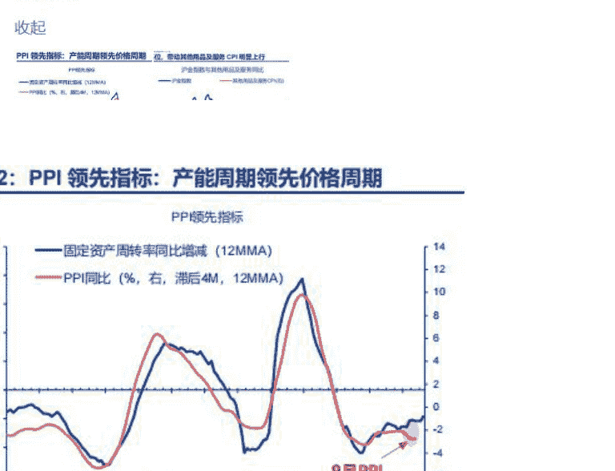 资料来源：Wind，申万宏研究

图 5：金价维持高位，带动其他用品及服务 CPI明显上行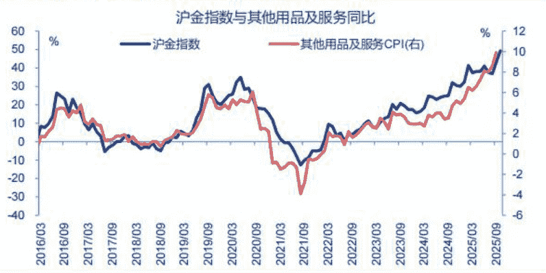 数据来源：CFIC，由方泰源研究

Jason-不诡

国资：9月信用数据低于预期，低于季节性，较上月步升1.2个百分点，企业贷款同比增加120亿元；企业贷款同比增加700亿元。一方面进步走近，一方面市场流动性影响居民消费结构可能是主要因素。

9月新增量同比增速回落至7.7%，政府效应之后持平5.9%，有下行压力#金融

图表1：9月信贷低于预期，低于季节性 资料来源：1016日民生

图6：9月信贷 资料来源：源，国

## China: Major service-related CPI Items

| Index, 2018=100, sa | Transportation | Recreation education and cultural services |
|---|---|---|
| 110 | Healthcare communication | | |
| 105 | medicines | | |
| 100 | | Residence |
| | 2019 | 2020 | 2021 | 2022 | 2023 | 2024 | 2025 |

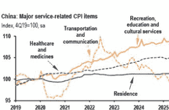

## China: CPI-peak prices

| Index, 2018=100, sa | Peak prices - level | %yoy change |
|---|---|---|
| 250 | | 120 |
| 200 | | 100 |
| 150 | | 80 |
| 100 | | 60 |
| 50 | | 40 |
| | | 20 |
| | | 0 |
| | 2019 | 2020 | 2021 | 2022 | 2023 | 2024 | 2025 |

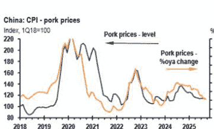

## China consumer confidence index

| Index | Headline confidence index | Consumer demand employment |
|---|---|---|
| 140 | | |
| 120 | | |
| 110 | | |
| 100 | | |
| 90 | | |
| 80 | Consumer confidence-income | | |
| 70 | | |
| | 2019 | 2020 | 2021 | 2022 | 2023 | 2024 | 2025 |

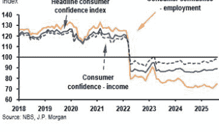

## China PPI breakdown

| %yoy | Petrol, coal and other fuel processing | Ferrous metal processing | Non ferrous metal processing |
|---|---|---|---|
| 50 | | | |
| 40 | | | |
| 30 | | | |
| 20 | | | |
| 10 | | | |
| 0 | Consumer goods | | |
| -10 | | | |
| -20 | | | |
| | 16 | 17 | 18 | 19 | 20 | 21 | 22 | 23 | 24 | 25 |

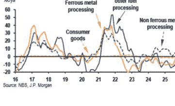

## China PPI in: global commodity price index

| %yoy, both scaled | Global commodity price |
|---|---|
| 15 | | |
| 12 | | |
| 9 | | |
| 6 | | |
| 3 | | |
| 0 | | |
| -3 | | |
| -6 | | |
| -9 | | |
| -12 | | |
| | 08 | 09 | 10 | 11 | 12 | 13 | 14 | 15 | 16 | 17 | 18 | 19 | 20 | 21 | 22 | 23 | 24 | 25 |

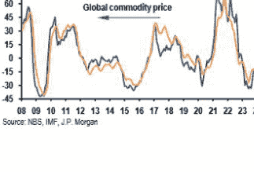

Jason-Chris

Jay Kahn: 我们最新的报告中，发现过去10年对中国基金向TIC申报了其美债持有量，统计入入后，亚洲已取代中国和日本，成为最大的美国国债持有群体。之前由于统计错误，导致这些者被误类为海外部门，这夸大了亚洲居民持有的规模。我们的研究结果表明，亚洲对中国基金已成为美国国债和债券的边界国家……它们吸收了37%的宽松和债券净发行量，几乎与所有海外投资者的总和相同。金融

2025-10-16 08:00

## 微信top28688, 进资料分享群

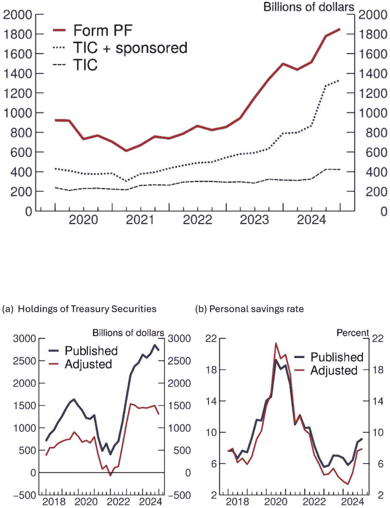

(a) Holdings of Treasury Securities

(b) Personal savings rate

加微信top28688, 进资料分享群

## Figure 5. Absorption of Net Issuance of U.S. Treasury Notes and Bonds, January 2022 – December 2024

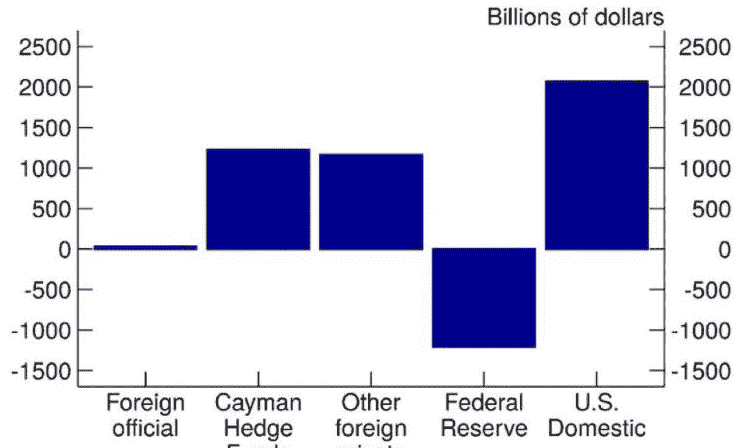

Jason不离
2025-10-16 08:03

substack: 尼利亚亚新生人口大于整个欧洲#人口

## Nigeria Has More Births Than All of Europe

In 2020, Europe had about 12 million births vs 17 million in Nigeria. This relationship has reversed, with Nigeria now having more births than the entire continent of Europe, which includes 44 distinct regions of Europe and all combined.

加微信top28688，进资料分享群 ✨微信

## Nigeria Has More Births Than All of Europe

In 1950, Europe had about 12 billion births versus 1.7 million in Nigeria. By 2023, that relationship had reversed, with Nigeria recording more births each year than all of Europe combined. "Europe" refers to the UN-defined region, as well as Russia. (Wait, checking OCR text: 12 billion is likely million vs 1.7 million)

## 微信top28688, 进资料分享群

## 知识星球

加微信top28688，免费入群

微信:top28688

| 序号 | 公号/星球/社群 | 原价 | 领域 |
|---|---|---|---|
| 1 | 生财有木 | 265 | 副业、搞钱 |
| 2 | 众宗吃瓜 | 365/年 | 时政、历史 |
| 3 | 记忆/望树 | 365/年 | 成长 |
| 4 | 欧洲金 | 328/年 | 时政、历史 |
| 5 | 卢克文青会 | 699/年 | 社会 |
| 6 | 体制内主任 | 599/年 | 体制、职场 |
| 7 | 局外人的视界 | 669/年 | 金融、时政 |
| 8 | 溯泽异贷 | 4166/年 | 财富，成长 |
| 9 | 守夜人总司令 | 599/年 | 时政、经济 |
| 10 | 江宁知府 | 365/年 | 时政、国际 |
| 11 | 政堂堂/顾子明 | 568/年 | 时政、经济 |
| 12 | 唐书院 | 1399/年 | 金融、财富 |
| 13 | 大树乡村 | 199/年 | 时政、成长 |
| 14 | 水库欧大 | 10000/年 | 房产、经济 |
| 15 | 洪灏宏观策略 | 4376/年 | 经济、搞钱 |
| 16 | 金企通鉴/北海南山 | 4576/年 | 股票、行研 |
| 17 | 猫哥的世界 | 299/年 | 时政、社会 |
| 18 | 飞龙弋 | 3600/年 | 股市、经济 |
| 19 | 米联诸见闻 | 599/年 | 经济、金融 |
| 20 | 茶茶财经 | 330/年 | 房产、股票 |
| 21 | 赢在八小时之外 | 365/年 | 成长、职场 |

......
更多资源，不再列举

+ 图书、报告、课程等各类高价值资源

- 免费群 每日分享份资源（日均20+），75/年

- VIP群 每日享所有资源（日均20+），
赠送付费资源合集，市场价数万元
