# 南半球聊财经251017

Jason不嵩
2025-10-17 02:14

bloomberg: 中国央行公布的数据显示，9月份家庭储蓄增加2.96亿元，为3月份以来最高水平，这表明他们已经开始回避当地股票，需求寻求下降的另一个迹象，通常用于保证资金的非银行金融机构存款在9月份以来首次下降。#金融

中国家庭上个月增加了现金持量，这表明他们已经开始回避当地股票，而市场受到新贸易紧张局势的挑战。

中国人民银行周三晚发布的数据显示，9月份家庭储蓄增加了2.96亿元人民币（415亿美元），为3月份以来的最高水平。增长较去年同月为平。

在低存款利率和微薄的政府债券收益率刺激投资者寻求更高的股票回报后，储蓄的重配置可能会导致股市的主要支撑来源。在中美贸易紧张局势有望缓解之际，家庭支持的减弱对中国股市来说是个坏头。

浙商首席经济学家李豪在一份报告中写道，“中国家庭存款向风险更高的资产的已经转换，这可能会缓解和股市的涨势。

## China's Household Savings Rise in September

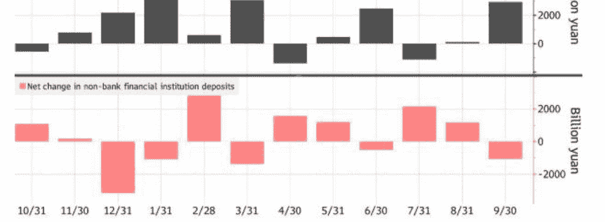

加微信top28688，进资料分享群

# Jason不离

2025-10-17 02:29

zerohedge: 特朗普表示和普京有了一次很好的交流，克里姆林方面，他发表了一份糟糕多的初声明，也同意这是一“极高而有效”的电话。这可能会缓解大家积累的神经，尤其是对于特朗普。#其他国家经济

特朗普结束了与俄罗斯总统普京·米尔维奇的“长”电话后，他在之后，乌克兰冲突和和平领域取得了巨大进展。

他认为这是一次非常富有的对话，特朗普在谈到和平协议时提到他要买中东和和平的巨大成就”。重要的是，特朗普赛后强调，“我实际上在中东的成功将有助于我们找到结束俄罗斯/乌克兰的战争的谈判”。

特朗普表示，美国和俄罗斯将举行一次高级别会，并最终举行另一场特朗普与普京的直接会面，他说最终将在葡萄牙利布斯顿举行。

根据特朗普声明的更多内容：

我们还花了很多时间讨论关于乌克兰的战争结束后俄罗斯和美国的贸易。在电话会谈时，我们同意将在下周举行一次高级别会晤。美国的侧会议将由俄罗斯的马可·普伯里（Marco）和其他人一起主持。这次会议值得期待。

然后，普京和美国将在芬兰讨论新的解决会，看到他们是否能够结束俄罗斯和乌克兰之间“不光的战斗。

泽连斯基和米基维将在办公室开会议，在那里他们将讨论关于普京的这些事宜。

我们相信这次电话取得了巨大的进展。现在实际上，特朗普并不意向俄罗斯交出领土（至少在公开场合，我们知道），还需要更有力的保证来确保不会加入北约。与此同时，特朗普一直在冲突中寻求突破。完全的明确……

# Jason不离

2025-10-17 02:35

bloomberg:今年目前为止，外人对印度股市市场抽出近 70 亿美元，对任何其他新兴经济体都少。投资者正在准备迎接另一个利年后失败的企业盈利。#股市市

# 微信top28688，进资资料分享

## 资本外流

今年，外国人从印度股票中撤出近 170 亿美元

- Year-to-date - Most-sold emerging market

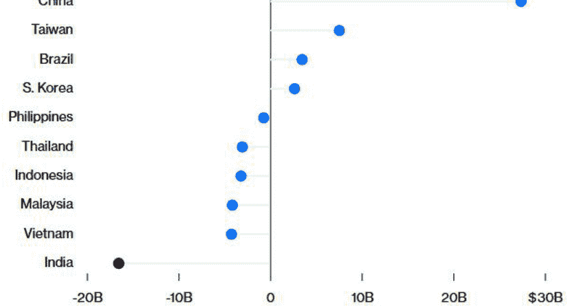

资料来源：彭博社
注：中国的数据截至 6 月 30 日。

## 阴沉的秋天

一年多，分析师一直在下调 Nifty 50 的盈利预期

- June 2025 Qtr. / Sept. 2025 Qtr. / Dec. 2025 Qtr. / Optimism Fades

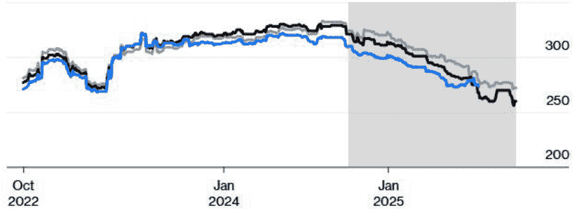

资料来源：彭博社

# 加微信top28688, 进资料分享群

# Jason不遇

2025-10-17 02:42

FT: 特阿美负责人警告称，全球石油已减竭。在过去十年，行业内部已不再寻找新石油田。从15年来，全球供应原油的美国页岩油紧可能不能重量。 #金融

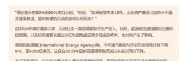

"增长部分的80%到90%来自贵美，”他说，“如果未来15年后，页岩油产量很可能平稳并逐渐衰退。新增长的石油从哪里来？”

2014年油价暴跌以来，他说，石油一直削减产量与生产投入。同时，能源迅速摆离石化燃料的供应，以及投资者要求分红和回购这么多现金，也对他产生了影响。国际能源署（International Energy Agency），今年石油探与投资预算预计下降6%，这是自2020年疫情以来首次下降。为了满足需求，行业并未投入资金复杂的项目，而是转而开发低成本。

然而，许多分析师认为由于清洁能源转型，石油消费将比此前预期强劲。全球石油市场在2024年出现近100万桶的缺口。沙特美未来将面临短缺，全球供应取决于企业内的执行。沙特美明年勘探上的支出为220亿美元。

"对我们来说，这是意外的增加。相反，人士预测油价将维持每桶，国家争夺市场份额，可能提供足够的供应。

尽管如此，评价引起业内对需求和长期关注。近期，英国石油（BP）、雪佛（Chevron）、埃克森美（ExxonMobil）和道达能源（TotalEnergies）希望增加产量与生产力。

# 微信top28688，进阶群

# Jason不跑

2025-10-17 02:49

# bloomberg: 在内卷会有爱#其他国家经济

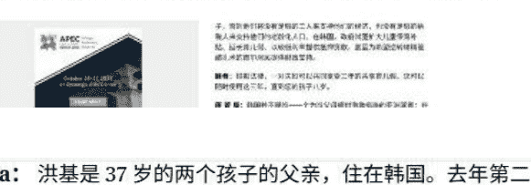

K. Cohn Ha:洪基是37岁的两个父亲，住在韩国。当第二个孩子出生后，他休了六个月带薪假来照顾孩子。为了新生儿—公司还给了他72000美元——没有任何附加条件。洪基说，当他得到这个消息时，他兴奋得睡着……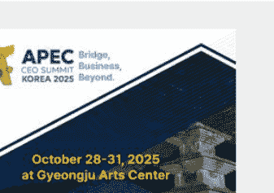

洪基（韩语）：我激动得睡着……医管局：好消息还不止此。洪基和妻子得知他的公司将把第一个孩子再给他们72000美元（追溯适用），该孩子是2021年出生的。洪基（韩语）：现在，有了这份礼物，我们就可以搬到稍微大一点的房子了……洪基说，多了这份礼物，和他妻子能够搬到更大的房子里。他们还在考虑第三个孩子。洪基（韩语）：如果发生，我不会避免。我觉得再生一个孩子就好了。洪基的公司是一家名为宝荣的建筑公司，是韩国数十向员工提供激励政策之一，如果员工生了孩子。彭博的

加微信info208868，进资料分享群

骨骼：因此，政府一直在花费千亿美元来解决这个问题。医管局：韩国这种出生率的发达国家让人担心，除非他们生更多的孩子，他们将没有足够的工人支持他们的经济，也没有足够的纳税人支持他们的老龄化人口。在韩国，政府试图扩大儿童保育补贴、延长育假、以低利率提供贷款，甚至希望扭转首尔居民财政支持。根据法律，一对夫妇可以共享三年的育儿假。您可以随时使用这三年，直到您的孩子出生。韩国并不是唯一的为父母提供激励措施的亚洲国家：在香港，居民可享有14周的带薪假期和2600美元的一次婴儿奖金。在日本，有三个或以上孩子的家庭有资格获得政府的大部分学费。韩国为解决出生率低下付出了许多国家愿意做的范围。现在，像宝荣这样的韩国公司正在加入自己的举措。他们是第一个做大的。创始人，他很老了。他已经84岁了。在过去的几年里，他一直在做很多慈善工作。而在2月，公司通常会举行新生儿的仪式。所以创始人来演讲的地方，本来应该只是一个常规的仪式，但他出人意料地宣布了医管局：这位创始人宣布，公司将向每位迎来婴儿的员工提供1韩元（约72000美元）。新政策适用于过去三年出生的所有婴儿。有一点沉默，然后有些人大喊起来，然后有些人几乎泪流满地。

加微微信28688，进阶资料分享群

医管局：对于一些夫妻来说，这就就像中了彩票。七万二千美元大约是韩国均收入的两倍。这笔钱直接进入员工的银行账户，政府不征税。你不能真的用它买房子，但你可以买一辆新车，然后你可以雇一些可以帮助你的孩子或你的房子的人。医管局：在宝荣，奖金没有任何附加条件——员工甚至可以获得婴儿补助并在第二天领走。但并没有人这样做。宝荣说，在获得奖金的100多名员工，所有都在工作。从多年前推行儿补助以来，公司相信已经看到效果。目前为止，宝荣向100名员工发放了奖金。去年支付工资，比三年前平均多。这家公司认为这项政策确实鼓励了一些孩子。韩国，企业文化很僵化。而且建筑公司，主要由男性主导。因此长时间的工作时间和家长式的文化。因为他们推出了这项政策，员工互相鼓励生孩子，然后结婚并休育假。因此，正在进行变化。医管局：宝荣的明显成功了。韩国其他大公司发现十万个工作岗位损失。每年损失400万美元。韩国，鼓励鼓励生孩子，金钱给员工提供额外的奖励。宝荣，更多与创始人的理念有关。他一直说他回馈社会。对于其他公司来说，将其视为企业责任的一部分。也有助于带来人才。最后，这些公司认为从长期来看，现在更便宜。加微信28688，分享更多

格尔：因此，例如，人口减少一段时间，日本的人均GDP继续上升趋势。因此，如果我们考虑个人拥有健康的生活意味着什么，那么该国经历人口下降，但个人层面的经济一直增长。此，各国的整体经济与其说是人口数量，不如国家内部的生产力。许多方法可以刺激经济生产。我们可以在教育方面投入资金。我们可以考虑如何改变经济计划，以便我们从相同数量获得更大的产出。为了维持稳定的人口——没有增长或减少——女性需要两个孩子。彭勃显示，韩国距离这个数字还有很长的路走。甚至政府承认，要缩小这一差距，还需要引入婴儿奖励。韩舒：他们的目标是2030年生育率提高到。现在是0.75。我们采取的政府小组，必须付出努力才能实现这个目标。专家说，金钱鼓励人们生子的办法，但你需要解决更多问题。因此，小的公司可能无法获得奖励，但它们更加灵活才能推动真正的变革。(img/772d8a3d3c2eba8e9e6df199d65b9372_7_0.png) 素正在成为地缘政治。根据奥锡对韩国产业的一个分析报告，最大的风险就是中国实施出口禁令，损失400万个工作岗位。这些领域对于韩国仍然非常重要：它们用于精密传感器、专用链和工程、国防、航空和航天至关重要的控制系统。这些领域，韩国的出口份额大部分将面临受损。虽然是行业分支报告，指出需求减少，核心技术部门100万个工作岗位可能会受到影响。这些行业可能面临150亿元的损失——这是一个首性和结构性的影响。

## 下游韩国生育危机不再维持稳定。韩国的生产商和消费者之间的行业面临着匹配的供给和地缘政治。奥锡估计，与中国的增长的影响正在下降。然而，报告显示韩国将面临300万个工作岗位的损失。在最极端的情况下，韩国面临400万个工作岗位的损失和每年370亿欧元的值损失——高达其GDP的9%。这是一个首性的影响，它证明了韩国政府政策的失败性。韩国的职业危机已经显而易见。从2018年以来，机械相关部门的就业下降了超过30%，工业生产力下降了约一半。26万个工作岗位面临消失的危险，韩国的出口缺口将对许多学生造成损失。

# 加微信3088268，资料共享

# Jason不涵

2023-10-17 03:09

bloomberg: 近期与担保回融资利率(SOFR)挂钩的期市场显示，交易员加大对美联储年底前一次下降半个百分点的押，10年期债收益率破4%，地区银行活跃度渐缓。金融

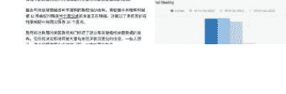

交易员们押，呼吁美联储在年底至少大幅降息一次，押注美联储可能比其他市场观察人士目前预期的更激进的政策。最近与担保融资利率挂钩的活动表明，美联储本月晚时候或12月会议降息半个百分点的准备正在增强。这超过了目前定价在利率措中的两次降息接近25个基点。虽然数周的美国政府推迟了就业和其他关键数据发布，但任何决议都将释放大量有关状况变化的信息。一些人预计，洪水将提供更多版本的证据，支持更多降息。同时，中美之间重新出现贸易紧张局面似乎提供了进一步的刺激。期权活动表明，交易者可以对冲半个百分点变动的可能性。

## SOFR看涨期末未合约飙升

- 交易员正在涌入以美联储年底更幅度降息为目标的头寸
- SOFR Dec25 96.50

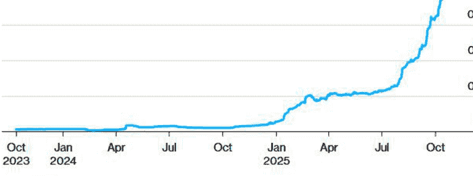

来源：彭博社

# 加微信28688，进阶资料分享

## Target Probabilities for 29 Oct Meeting

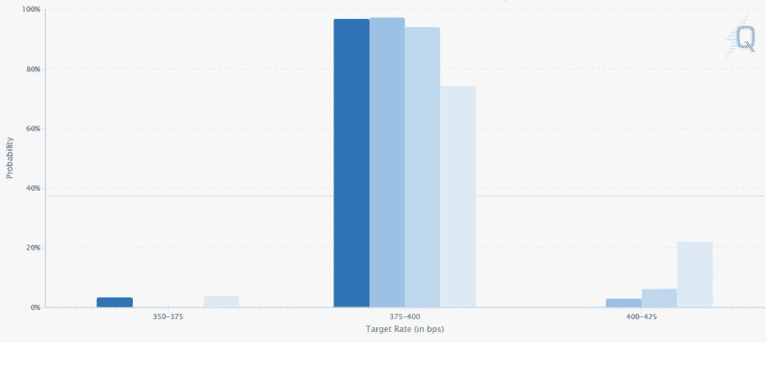

2018年至2022年，城乡家庭收入增长另外四下降。中产消费并非普遍现象，中产层的下降风险非常高，在四分之一的中产层清出了原来的层，中产层是非常显著的事实。(img/772d8a3d3c2eba8e9e6df199d65b9372_9_1.png)

- 下降0-25% | 下降25-50% | 下降50%以上 | 上升0-25% | 上升25-50% | 上升100% | 上升1倍 | 上升2倍

图2018年至2022年家庭均收入变动情况数据来源：CFPS2018年加权人均收入变动率（2022年至2018），剔除极少数家的

# Jason不遇

2025-10-17 03:21

bloomberg: 相比大豆，月至7月期间，中国仅向美国运送了387000吨（食用油），高于去年同期进口量的一半。如果特朗普完全关闭这些进口，对中国的影响可能有限，美国价值远不如大豆。即便直到2024年的纪录水平，销售额约为12亿美元，而美国对中国大豆出口销售额约为16亿美元。#经济数据

## 中国停止购买大豆

China's soy purchase commitments through mid-August 这个亚洲国家尚未新增购买任何货物

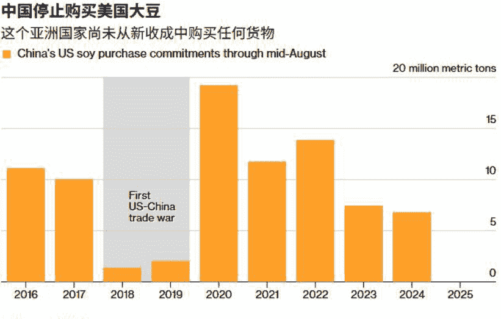

资料来源:美国农业部

# Jason不遇

2025-10-17 03:25

中银：悲观情绪下“TACO”交易的路径#A股

## 态势情形：“TACO”交易

在“TACO”态势下，该板块股票彻底结束了最后的熊市。由于监管政策的调整，市场不再要求购入，使得反转趋势显现。市场出现空头回补，由于空间限制，中国市场由于空头引发的“对冲”交易，多元化出口限制和限制政策的影响，带动了中国市场进入。资本市场开放，并更容易进行卖空参与并调整联动运作。一系列政策使得市场交易出现变化，双向节奏活跃，全行业出现流动性改善、产业发展利好成为常态。在全球背景下，市场获得支撑，市场情绪开始回暖。新兴市场表现强劲，压力逐渐释放。在此，中国出口导向型制造出现局部反弹，由于外需回暖和政策预期好，外需订单将持续改善，市场回暖有望持续。随着情绪修复、结构性机会，全球金融市场的波动与不确定性增加，使得A股的风险得到逐步释放，投资者有望转向新兴市场。

图8 2025年3月以来部分行业指数变化

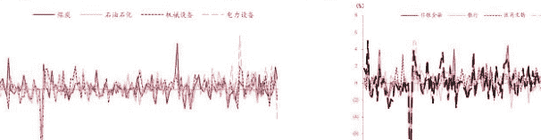

图9 2025年3月以来部分行业指数变化（归一）

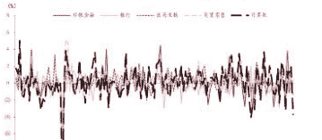

数据来源：同源、中信

数据来源：Wind、中信

在此基础上，A股市场风格将转向“红利+价值”为主，请聚焦具有高收益、低估值、现金流确定的品种成为资产配置首选。由于资金分流压力加大，白马、电力、煤炭、石油、有色金属等板块有望成为资金配置重心，市场通过分红和回购进行加码，红利将成为市场风格切换的核心，也可能在市场下持续，此时的A股市场有望转变为“以红利为主、以价值为主”的逻辑，即流动性将重新定义估值与收益。

# 加微信28688，进资料分享群

Jason 不藩
2025-10-17 03:27

《金融时报》最新调查，特朗普家族的加密业务在过去一年已实现超过10亿美元的税前利润，若计入账面膨胀，其净资产增长可能高达十亿美元。特朗普和梅拉尼纽约市销售和交易手续费创造了4.27亿美元收入；特朗普之子旗下发行的WLFI币销售额已达5.5亿美元；特朗普莱莱科技集团成立比特币基金，如今已创造超过30亿美元现金流。#金融

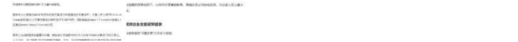

## “特朗普时刻”

特朗普的币圈内也引购了大量国外资本。

阿布扎比主基金GAXR投资3亿美元购买比特币与特朗普相关的稳定币；中国上市公司GD Culture Group宣布投入3亿美元购买比特币及TRUMP代币；阿联酋基基金Aqua1 Foundation也购入1亿美元World Liberty Financial代币。

令人惊讶的是加密富豪孙宇，他是在去年转型后转向World Liberty Financial投入7500万美元。

三个月后，SEC暂停了针对他的指控动作。此后，还在特朗普弗吉尼亚亚基亚俱乐部与总统进行进聘，并承诺再购1亿美元的$TRUMP代币。

特朗普的政策不仅赢得喜欢，也令家族与成员“拥有所有”。

商务部部长华盛普，特朗普家族的CantorFitzgerald正是全球最大稳定币Tether的主要托管方；总经理JD万斯，住房部长哈肖尔肖特朗普都持有加密资产。

特朗普长子小唐的特朗普更言：“制定加密规则的他自己也发行了加密货币——这对整个行业将是极利的。

## 比特币市值一亿美元？

在最近的一次演练中，埃隆·特朗普预测：“美国将储备比特币，但单币比特币的价值将达到十亿美元。

无论预言能否成真，特朗普家族确实已用行动证明，在加密牛市中，他们并不是“政策受益者”——更是最大的赢。

# 加微信top26888，进资料分享群

- 孙宇

在比特币的政策加持下，比特币价格层创新，美国加密货币粉粉回，行业进入历史上最火热阶段。

## 家族企业全面进军数字

比特币富豪的“华尔家族”分为两个领域：

- Meme Coins：“TRUMP”和“MELANIA”两款以美国姓命名的币，在街后掀起狂潮。英国《加密货币》引用，这些币种交易费共创造了4.27亿美元收入。
- 稳定币与DeFi合作：由比特币富豪之子创立的World Liberty Financial（世界自由金融）发行了治理WLFI与美元稳定币USD1，WLFI市值销售额达5.5亿美元，USD1发行规模更超2.7亿美元。
- 数字企业转型：比特币富豪旗下的Trump Media & Technology集团在去年签了4亿美元合约后，转型加密投资，成为比特币市场，如今已创造了30亿美元现金。特朗普宣布，比特币持有TMTG高达53%的股份，仅此一项市值就高达19亿。

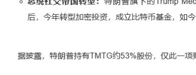

Jason-kason
2023-10-27 14:02

### 市场共认的“十大雷”

1. 不能用加密一预期的变化。
2. 与美股同，中国市场有很多GDP与企业盈利靠、CPI以及无风险利率背后的变化，美林特征模型和林肯框架在经济周期中对加密的积极响应；
3. 景气+科技风险：过去去年，加密领域的需求非常明显——越是好的，涨幅越大，也是市场风险性主要向外的，例如交叉、泡沫、等。
4. DCF可以视为PEG，PEG越低越价值的，涨幅对高、涨幅对PEG。
5. 周期性风险是科技板块泡沫带来的投资者变化，利率或无流动性紧缩对行业利好，但不断缩引发暴跌。
6. 资金流动性对市场的影响大于泡沫，流动性有效，当流动性同时，资金都可以流入市场，主要因素和市场，包括贷款、数据等，HIBOR对挂钩的影响和短期风险，主要通过挂钩HIBOR的收益来实现，快速上涨可能引发下跌，但周期后就不发生。
7. 汇率的可能在25%的范围内，但当前汇率125%的区间，已经不存在了。
8. 活跃的核心在于造成活跃周期，每年都会发生，但是红线之下，行业和地产，而二季度是基本投资，因此在2022年后活跃再次消失。
9. 价值占比代表运营在不同领域，风格规律的，但是没有资金的。
10. 基本面变化和波动的板块，对估值敏感或者估值有band，不可DCF或PEG。此外，如果经济中枢和利率中枢下，也会导致均值失效，例如80年代和90年代。A股

图2：传统的美林模型

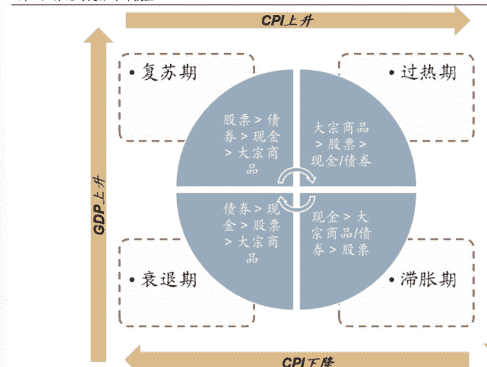
数据来源：Wind。广发证券

图4：增长率与收益的关系

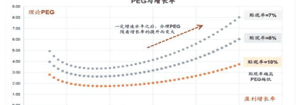
数据来源：Wind。广发证券

图5：S&P500近10年对比

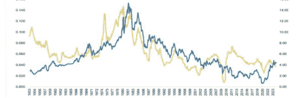
数据来源：Wind。广发证券 # 加微信28688，资料交流

作为验证，我们可以看到过去三年，景气依然暴涨。

- 有A股500多个公司分为十组，第1组代表增速最大的，第10组代表增速慢的，里面每一个数字代表当年的涨幅中。
- 我们回溯了许多财务指标（如增速、估值、现金、股息率），从过去的30年里，有效的还是增速，利润增速、营增速、ROE变化。也许就是单项景气的相对强度，决定了收益的后期。
- 市场是牛市、还是熊市，无风格是蓝筹还是成长，哪个板块是快还是慢，这一年度的涨幅与当年的景气呈现出密切。在2022-2023年历史来看，美国、德国、法国、韩国市场，轨迹始终终结的。

| 指标 | 2005 | 2006 | 2007 | 2008 | 2009 | 2010 | 2011 | 2012 | 2013 | 2014 | 2015 | 2016 | 2017 | 2018 | 2019 | 2020 | 2021 | 2022 | 2023 |
|---|---|---|---|---|---|---|---|---|---|---|---|---|---|---|---|---|---|---|
| 涨幅(百分比) | 4.1 | 127.1 | 286.5 | -222.9 | -498.3 | -50.2 | 16.5 | 15.8 | 9.2 | 23.1 | 44.1 | 19.9 | 2.3 | 15.0 | 14.9 | 14.3 | -9.6 | 27.3 | 7.4 | 0.8 |
| 景气增速 | -2.9 | 74.2 | 222.8 | -498.1 | -131.5 | 10.9 | -2.1 | -13.0 | -21.8 | 35.9 | 21.5 | 34.1 | -8.4 | -17.5 | -30.2 | 25.6 | 12.9 | 10.4 | 2.9 |
| 利润增速 | 8.3 | 168.0 | 179.2 | 14.1 | -15.3 | -10.1 | -13.3 | -33.4 | 5.5 | 29.8 | 65.2 | 15.0 | 13.5 | -21.8 | 62.1 | -14.4 | -30.3 | 9.5 | -9.8 | 5.7 |
| 营增速 | -14.3 | 71.1 | 145.1 | 116.3 | 16.7 | 48.9 | -46.7 | 48.9 | -14.9 | 26.9 | 34.9 | 53.5 | 6.2 | 2.2 | -7.5 | -27.7 | -23.7 | -4.1 | -11.5 |
| ROE增速 | 22.0 | 88.0 | 156.0 | 141.1 | 66.8 | 11.6 | -32.7 | -41.9 | -50.8 | -31.2 | 33.8 | 49.9 | 5.5 | 7.8 | -10.5 | 66.3 | 0.5 | 8.8 |

数据来源：财富，广发深度中心

| 净利润增速 | 市值（市值、中、%） | 市值累计增速（市值、中、%） |
|---|---|---|
| 80 | | |
| 70 | | |
| 60 | | |
| 50 | | |
| 40 | | |
| 35 | | |
| 30 | | |
| 25 | | |
| 20 | | |
| 15 | | |
| 10 | | |
| 5 | | |
| 0 | | |
| -10 | | |
| -20 | | |
| 2005-03 | 2006-12 | 2007-08 | 2008-12 | 2009-06 | 2010-03 | 2011-12 | 2012-06 | 2013-05 | 2014-12 | 2015-07 | 2016-03 | 2017-11 | 2018-06 | 2019-03 | 2020-12 | 2021-09 | 2022-04 |

数据来源：源，广发深度中心

# 加微信top28688，进资料群

## 图8：A与流动性关系图

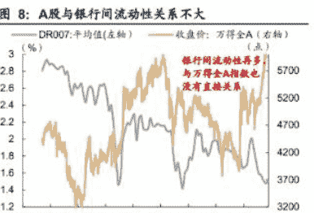
数据来源：Wind，广发业务中心

## 图9：A与储蓄流动性图

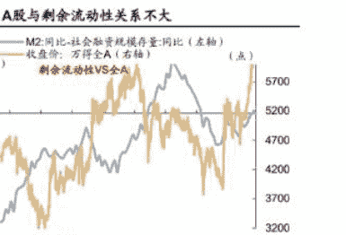
数据来源：Wind，广发业务中心

## 图10：行业与储蓄流动性图

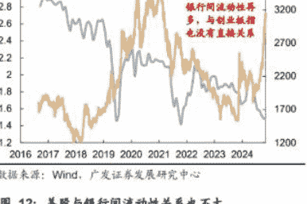
数据来源：Wind，广发业务中心

## 图11：行业与储蓄流动性图

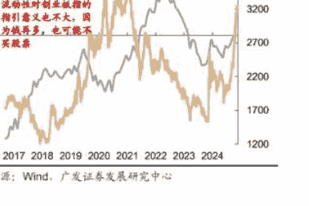
数据来源：Wind，广发业务中心

## 图12：美债与加信流动性图(SOFR)

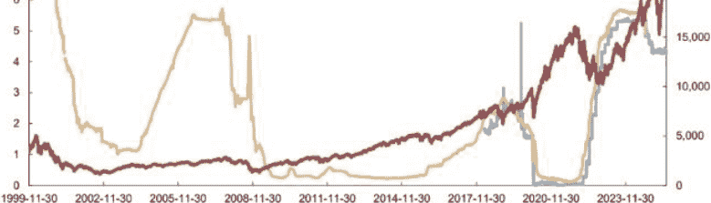
数据来源：Wind，广发业务中心

微信数字top28688，进资料分享群

## 图18：美国通胀数据在80年代的失败

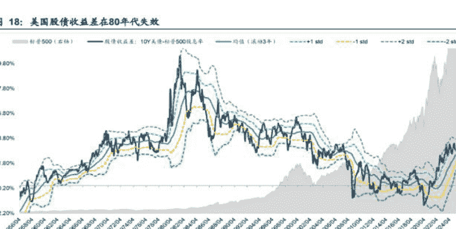
数据来源：Wind；华夏宏研究中心

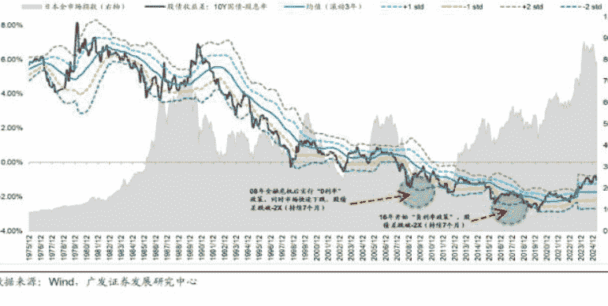
数据来源：Wind；华夏宏研究中心

# Jason 不嵩
2025-10-17 04:08

Bloomberg: 我们对当前流行的说法有所关注。第一说法是，人工智能正在推动GDP的激增。第二是，人工智能正在改变劳动力市场。第三是，美国近期支出的扩张主要在收入增长中。

首先，人工智能相关投资的增长长期被低估。这里，有一个关键很容易被忽视的前提：人工智能相关投资虽然很大，但其中一部分是填空的。这意味着AI投资的真实投入规模看起来还很小（为GDP的美国国内生产总值）。而数据显示AI投资的规模正在加速上进。

第二关于人工智能的说法，是正在改变劳动力市场，尤其是年轻的大学毕业生。确实已经做出了如此说法，也要看到它是否从市场上产生了结果，其实目前还没有确定的结论。

第三关于美国将迎来“AI革命”的说法非常无根据。然而，如果劳动力市场的转型确实是在放缓中，那么风险最大。对于消费支出的各种估算，尤其是来自某家私营机构的数据，我建议关注外溢效应。

注，这三种说法并不是完全空穴的，每一种说法都可能包含一个真事实。但每项的原文都很复杂，我只是提醒。**其他关注

关注微信资料共享中心

## AI Is Still a Big Deal, But Maybe Not for GDP

Investment in artificial intelligence has grown substantially, but a lot of it comes from abroad, which isn't measured as part of US GDP

- AI-related components of GDP
- All other

## A Tale of Two Quintiles

The bottom fifth's share of aggregate weekly wages has risen over the last two years, while the top fifth's has fallen

- Lowest quintile
- 2nd
- Middle
- 4th
- Highest

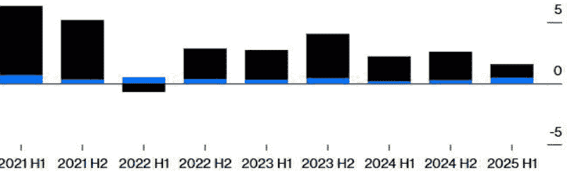
Source: Wind。广发证券

# Goldman Sachs

## What's Top of Mind in Macro Research

## China GDP vs. CAI

## Euro area GDP vs. CAI

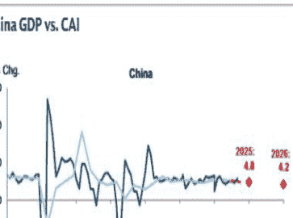

Source: Haver Analytics, Goldman Sachs Global Investment Research.

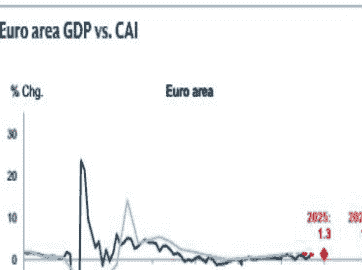

Source: Haver Analytics, Goldman Sachs Global Investment Research.

## Key GS economic and market forecasts

GS CAI is a measure of current growth. For more information on the methodology of the CAI please see "Technical Updates to Our Global CAIs," Economic Comment, September 1, 2025. Market pricing as of October 14, 2025.

Source: Bloomberg, Goldman Sachs Global Investment Research.

# 微信top28688，资料分享群

# 知识星球TOP

添加微信 资源分享群 免费入群

微信:top28688

| 序号 | 公号/星球/社群 | 原价 | 领域 |
| --- | --- | --- | --- |
| 1 | 生财有木 | 2765/年 | 副业，搞钱 |
| 2 | 众宗众吃瓜群 | 365/年 | 时政，历史 |
| 3 | 记忆亥/땡树西风 | 365/年 | 成长，财富 |
| 4 | 欧洲金轨 | 328/年 | 时政，历史 |
| 5 | 卢克青云会 | 699/年 | 时政，社会 |
| 6 | 体制内主任 | 599/年 | 体制，职场 |
| 7 | 局外人的视界 | 669/年 | 金融，时政 |
| 8 | 泽澎异迁 | 4166/年 | 财富，成长 |
| 9 | 守夜人总司令 | 599/年 | 时政，经济 |
| 10 | 江宁知府 | 365/篇 | 时政，国际 |
| 11 | 政堂/顾子明 | 568/年 | 时政，经济 |
| 12 | 唐书院 | 1399/年 | 金融，财富 |
| 13 | 大树乡村谈 | 199/年 | 时政，成长 |
| 14 | 水库欧大 | 10000元 | 房产，经济 |
| 15 | 洪灏宏观策略 | 4376/年 | 经济，搞钱 |
| 16 | 金政通鉴/北海南山 | 4576/年 | 股票，行研 |
| 17 | 猫哥的世界 | 299/年 | 时政，社会 |
| 18 | 飞龙弋 | 3600/年 | 股市，经济 |
| 19 | 米来联债见闻 | 599/年 | 经济，金融 |
| 20 | 茶茶财经 | 330/年 | 房产，股票 |
| 21 | 赢在八小时之外 | 365/年 | 成长，职场 |

...... 更多资源，不再列举

+ 书籍、报告、课程等各类高价值资源

- ★ 免费群 每日分享数字资源
- ★ VIP群 每日享所有资源（日均20+），75/年
赠送付费资源合集，市场价数万元
