# 南半球聊财经251018

Jason不离
2025-10-18 02:19

中指：9月十大城市二手房价环比下跌，武汉、天津、南京环比跌分别为1.18%、1.11%、1.05%；广州、重庆（主城区）环比跌幅在0.8%-1.0%之间，北京、上海和成都环比跌分别为0.4%（-0.6%之间），杭州二手住宅价格跌幅最小，为0.38%。#房价

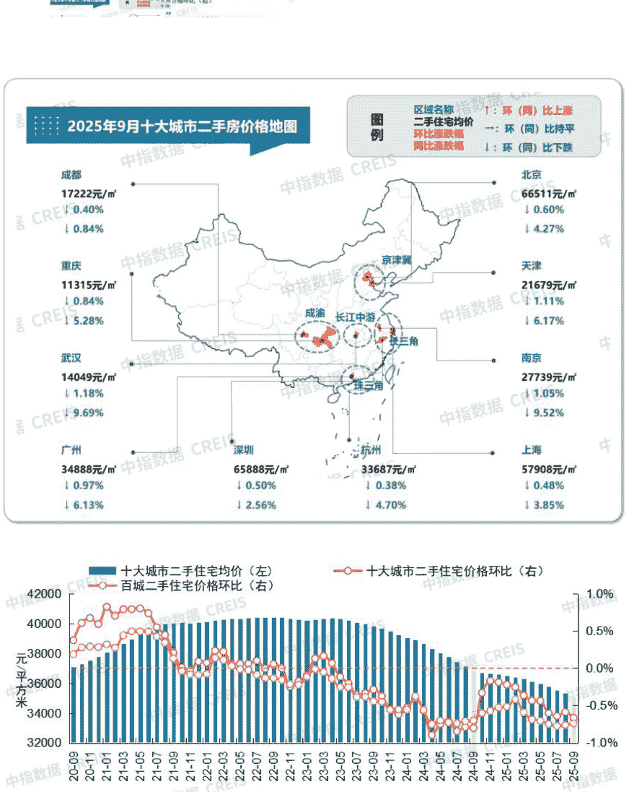

微信top28688，进资资料分享

# Jason-不妥

2025-10-18 02:23

2024年10月以来，国内流动性供给充足，但实体融资需求仍然偏弱，2024年2月开始，每月贷款涨幅比上月减少，企业中期融资已连续8个季度同比减少。深层次原因在于企业收入收缩利润困境，生产性融资需求持续萎缩。

从当前情况看，金融表现是实体经济的镜像，社会有效需求不足对金融的映射优势非常明显。企业盈利预期不稳定抑制了投资意愿，居民预期偏弱抑制了消费动力，再加上房地产市场调整，拖累了循环。#金融

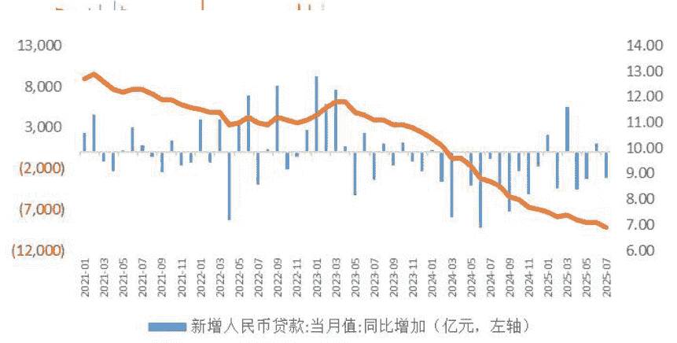

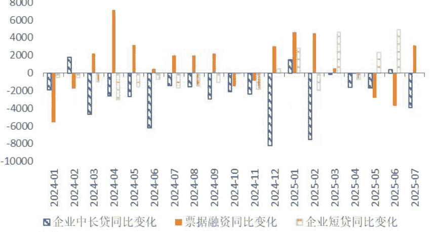

# 加微信top28688，进阶资料分享群

# Jason不遇

2025-10-18 02:27

西部：“十五五”期间GDP平均增速预估达到5.4%。随着人口总量回落，人口老龄化率不上升，我国劳动青年年龄人口持续下降，态势给增长率带来压力。“十五五”规划将会有经济增长目标，“十五五”规划可能不会设定。

“十五五”期间需要能够稳定的内需，要建立在稳定就业和持续收入增长的基础上，及时加快社会保障体系，提升养老、教育、医疗等公共服务质量。
“十五五”期间，中国占全球经济比重不断扩大，“十五五”将在巩固出口优势的同时，进一步扩大进口，促进国内贸易平衡。

## 经济数据

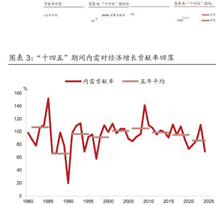

图 3：“十五五”内对经济增长增长率回测

数据来源:CEIC, 东方证券数据中心

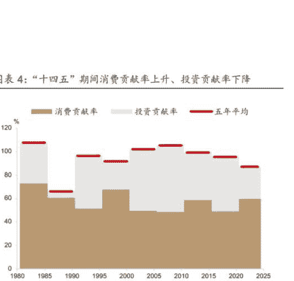

图 4：“十五五”内消费增长率、投资增长率下降

数据来源:CEIC, 东方证券数据中心

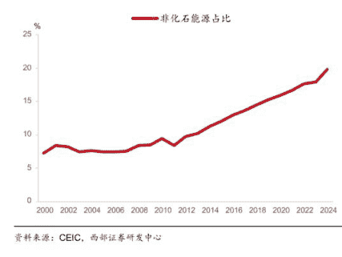

图 5:十五五期间内化石能源占比持续增长

数据来源:CEIC, 东方证券数据中心

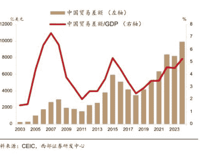

图 6：“十五五”期间，贸易总量占经济结构占比上升

数据来源:CEIC, 东方证券数据中心

# Jason不遇

2025-10-18 02:27

方正:10月17日，A股市市场出现幅度下调整，有明显的“再平稳”特征，即短期震荡后大板块反跌。#A股

# 加微信top28688，进资料共享

### 图表6:当前上市公司整体盈利处于下行触底修复阶段

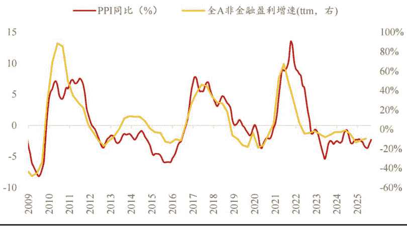

资料来源:Wind、方正证券研究所

# 图表5:A股融资余额流通市值重较2015年大幅下滑

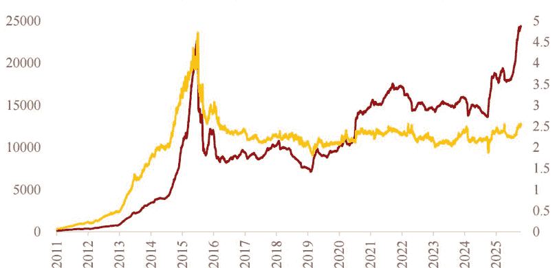

资料来源:Wind、方正证券研究所

加微信top28688，进资资料分享群

# Jason-不面

2022-10-28 02:36

BOFA: 全球已实施的123次降息，是推动股票市场高涨的主要原因，而投资者对债券的配置将至2022年10月以来的最低水平——正是本轮股市上涨的起点。

由于自诩首的对帮助拯救遭遇失败，那么那个市场高度高估的“许多新兴市场”可能遭遇滑铁。建议投资者买入30年国债继续涨。明年仍展望及股6000美元。香港指数仍有涨到33%，#金融

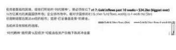

哈格特特殊，当前投资者面临的困难。他们必须在所有选项中进行配置：一个政府已达38万的美国债；企业市值中，对于美国债的收益率处于二十年来最低水平；市值调整后尚有高估的股市；或是一重水的黄金”。策略表示，当前并没有高涨的理由。另一种“时代特殊”或某些“K型指数”可能会在资产下跌时富裕阶层时转变。一旦股市或加密下跌，可能会削弱消费。“K型指数”，是指指数的部分反弹，而其他部分则滑落。他们担心的是，一旦股市或加密下跌，可能会削弱消费。哈格特恰认为，对投资者的风险太大——这并非最好的操作，因为在美政府10月的调查中，是最危险的交易。不过他们认为，如果美国政府暂停回购可能会引发收益率，但目前和投资者对黄金的配置较低，因此黄金的多头行情短期内仍延续。他们现在看到国际指数的上行。他们预计，在全球范围内经理指数突破50，近进入扩张区的背景下，由于中国基金获得改善，亚洲出现下跌，股市有望再度涨33%，达33000。

### Chart 7: Gold price flows past 10 weeks = $34.2bn (biggest ever) & silver flows, weekly vs 4-week ma (Sbn)

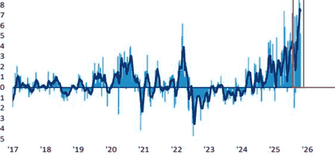

Source: BOFA Global Investment Strategy, GLOBAL RESEARCH

# 微信top28688，进资料群

# Jason-不离

2025-10-18

美国财政部公布了2025财年的政府收支情况，收入5.235万亿美元，支出7万亿美元，政府赤字1.775亿美元，比2024年的赤字下降580亿美元。赤字的下降是由关税收入的上升、教育/环境的支出导致；企业税也明显下降#其他经济

### Figure 2. Cumulative Receipts, Outlays, and Surplus/Deficit for Fiscal Year 2025

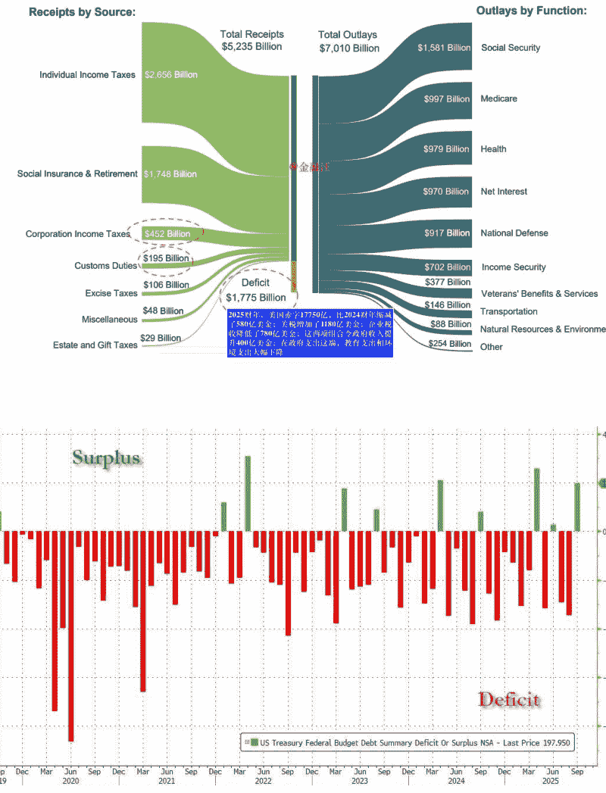

# 微信top28688，进资料分享群

# Jason不離

2025-10-18 02:50

JPM: 外汇储蓄黄金的份额从11%上升至23%，过去20年，劳动力市场的另一需要心的事情美国生育率与人口增长大幅下降#金融

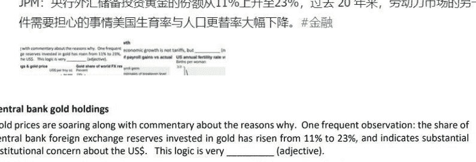

### Central bank gold holdings

Gold prices are soaring along commentary about the reasons why. One frequent observation: the share of central bank foreign exchange reserves has risen from 11% to 23%, and stands substantial institutional concern about the US. This logic is very.

| World reserve gold holdings & gold price | US per ton |
|---|---|
| Fine oz, millions | $4,200 |
| - World reserve gold holdings | $3,520 19% |
| - Gold price | $3,000 17% |
| | $2,500 15% |
| | $1,500 13% |
| | $1,100 11% |
| | $500 9% |

| Gold share of world FX reserves | Percent |
|---|---|
| Actual | Assuming no change in holdings since March 2009 |
| Assuming no change in gold price since March 2009 |

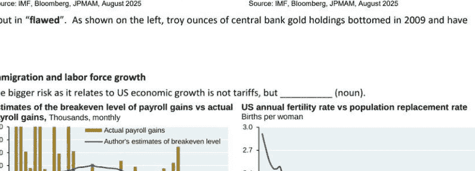

I put in "flawed". As shown on the left, tries of central bank gold holdings bottomed in 2009 and 2015

### Immigration and labor force

The bigger risk is as it relates to US economic growth of payroll gains vs actual is not. Estimates of the breakeven level of payroll gains vs actual US fertility rate vs population replacement rate

| payroll gains, thousands, monthly | per woman |

I put "immigration policy" wean the decline in the estimated breakeven level of labor force growth. The chart

# Jason不離

2025-10-18 02:55

CoinGecko: 比特币连续四个交易日跌至月以来的最低水平，自上周以来，加密市场已跌破6000万美元。#金融

| Cryptocurrency Crash | Price |
|---|---|
| FTX liquidation | $547 |

# 微信微信top28688，进资资料群

### Cryptocurrency Crash Total Market Capitalization

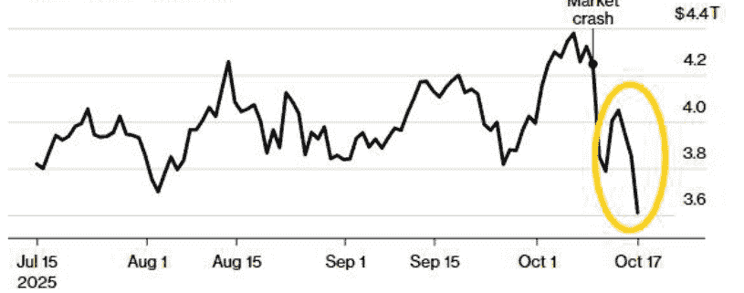

Source: CoinGecko

# Jason
2023-10-18 03:10

bloomberg: 尽管出口波动，但中国经济上季度的扩张速度可能为最慢，根据彭博调查的中值估计，统计一公布的数据显示第三季度同比增长4.7%，低于前三个月的5%。世界银行的数据，国内消费占GDP约为40%，低于全球平均水平。IMF维持了对中国今年GDP的预测，预计2026年增速至4.2%——这一预测与彭博调查的经济学家预测中，并警告GDP总量回后，经济仍面临压力#经济数据

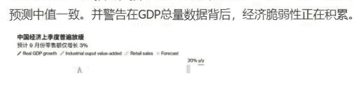

## 中国经济上季度普遍缓慢 预计9月份零售额仅增长3%

- Real GDP growth / Industrial output value-added

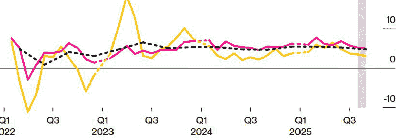

资料来源：中国国家统计局，彭博调查

# 微信top28688，进资资料群

# Jason-不离

2025-10-18 03:14

bloomberg: 特面表示，对中国征收100%关税是不行的。贝森特补充，我认为事情已结了。面对面仍在计划中。并不是不可持续的，“特朗普在周五播出的第一段视频中接受福克斯商业界采访时说，当被问他威胁要对中国征收的税是否可能对经济产生重大影响的情况下继续存在。“但就是这个数字，它可能站脚，他们将这样做，”他补充道。关注全球政治的最新动态。在《权力清单》时通讯中获取世界各地记者的意见。

随后，特朗普和财政部长贝长米特（Scott Bessent）表示乐观，即将与中国的谈判可能会达成更广泛的贸易协议，缓解美国威胁对中国商品的进口关税提高到45%的危机。结合起来，这些言论表明华盛顿正在努力对全球经济衰退和两国之间贸易中断的风险。

# Jason-不离

2025-10-18 03:18

bloomberg: 有效联基金利率在一个月内三次小幅波动，剧险短期金融市场压力加剧，可能涉及固定收益债。华尔街策略师现在越来越多预计，美联储可能不得不比预期更早放缓或停止缩减资产负债表——一些人士最早在本月结束#金融

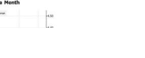

# 加微信top28688，进资分享群

## Fed Funds Rate Rises for Third Time in a Month Benchmark still within central bank's target range

■ fed funds rate ■ Lower bound of fed funds range Upper bound of fed funds range

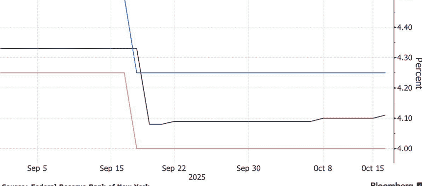

Source: Federal Reserve Bank of New York Bloomberg

Jason不离
2025-10-18 03:22

亚特兰大联储：截至17日，GDPNow模型对美国Q3经济增长预估为.9%#其他国家经济

Evolution of Atlanta Fed GDPNow real GDP estimate for 2025: Q3 Quarterly percent change (SAAR)

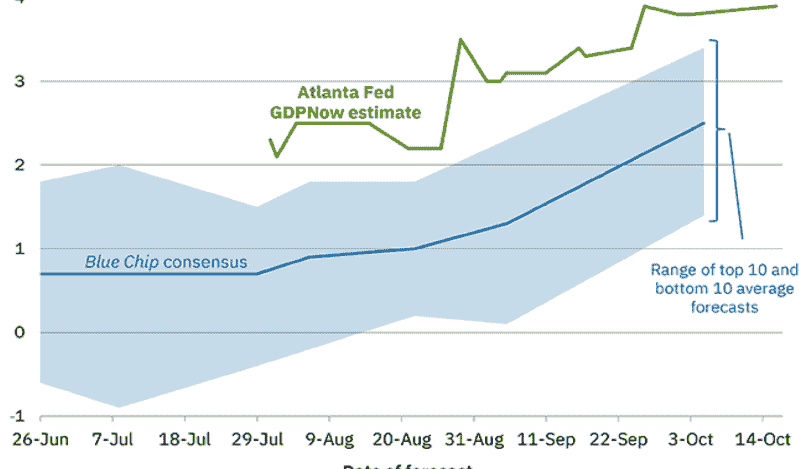

# 加微信top26888，资料分享群

# Jason不离

2025-10-18 03:27

Cointegraph: 比特币市场的一项指标delta skew已升至10%以上，表明专业交易正在以溢价购买期权。这通常被视为市场空情绪的典型信号。与此同时，矿工的动态引发了市场的关注。根据CryptoQuant的数据，从10月9日以来，矿已向交易所跌至月以来的最低水平，自上周以来，加密市场已跌破6000万美元。#金融

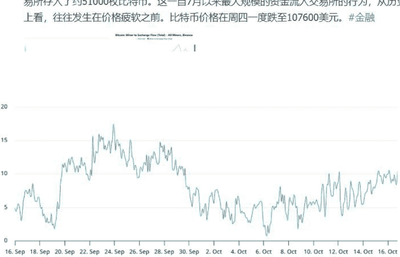

delta skew已升至10%以上，表明专业交易正在以溢价购买期权。这通常被视为市场空情绪的典型信号。与此同时，矿工的动态引发了市场的关注。根据CryptoQuant的数据，从10月9日以来，矿已向交易所跌至月以来的最低水平，自上周以来，加密市场已跌破6000万美元。

Source: CoinGecko

# 微信top28688，进资资料群

## 百城科研城市二手住房挂均价走势（元/m²）

| | 2024-08 | 2024-09 | 2024-10 | 2024-11 | 2024-12 | 2025-01 | 2025-02 | 2025-03 | 2025-04 | 2025-05 | 2025-06 | 2025-07 | 2025-08 |
|---|---|---|---|---|---|---|---|---|---|---|---|---|---|
| 55,000 | | | | | | | | | | | | | |
| 50,000 | | | | | | | | | | | | | | |
| 45,000 | | | | | | | | | | | | | | |
| 40,000 | | | | | | | | | | | | | | |
| 35,000 | | | | | | | | | | | | | | |
| 30,000 | | | | | | | | | | | | | | |

| 25,000 | | | | | | | | | | | | | | |
| 20,000 | | | | | | | | | | | | | | | |
| 15,000 | | | | | | | | | | | | | | |

 10,,000 | | | | | | | | | | | | | | |
| 5,000 | | | | | | | | | | | | | | |
| 一线城市 | | 一线城市 | | 二线城市 | | 三线城市 | | | | | | | |

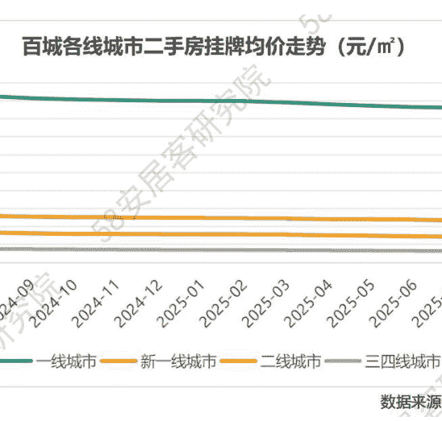

Jason-不澈
2023-10-25 19:08

中指：9月购房意愿调查，环境变软，情况就是这个情况#房房价

刚性政策影响：入市限购、限售、限贷，占比66%。其次是房价下跌、还贷压力、收入不稳定等主要因素如下：

- 入市约束仍影响明显：收入不稳定、房价下跌、还贷压力仍位居前三，占比35%。其中还贷压力占比出现提升，6月增加2.1个百分点，主要是受经济活力削弱影响，对未来就业环境预期出现下降，房价压力逐渐缓解，6月下降1.6个百分点。

- 约束：购房者的主要影响因素（多因素）

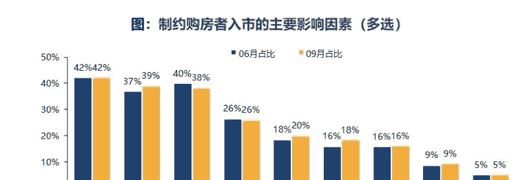

数据来源：中指居民购房意愿调查

# 加微信top28688，进阶资料分享群

- 特别居民房价预期较弱：房价下跌高位微整，9月居民房价下跌预期约为27%，环比下降1.0百分点。房价稳定预期中有所升，9月底居民房价稳定预期为55%，环比升1.0百分点。房价上涨持续低位，9月居民房价上涨预期约为13%，环比基本平持。

整体来看，短期居民房价预期较弱，下跌预期持续高位水平，房价上涨动力相对不足，项目分化趋势明显，优质项目持续投入，受区域均衡、存量项目、外围项目购价压力较明显。

图：居民房价预期变化

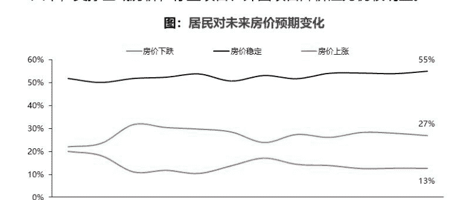

数据来源：中指居民意愿调查

居民储蓄意愿持续高：9月居民储蓄意愿有所下降，更多占比约为55%，环比下降0.4百分点，整体居民风险偏好仍然较弱，消费倾向向增加，9月占比环比上升1.4百分点；投资偏好相对较弱，更多投资占比约为21%，环比下降1.0百分点，股市表现低迷，房价持续下跌，居民储蓄意愿至低位水平。

图：资金倾向

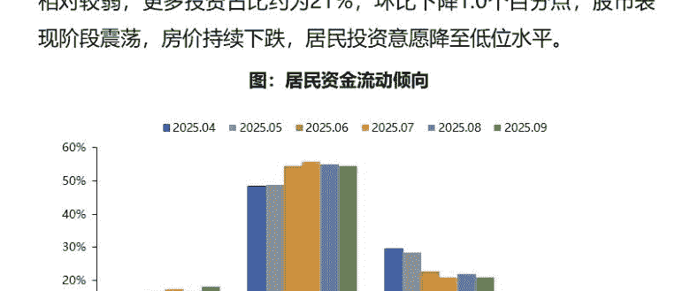

数据来源：中指居民意愿调查

# 加微信top28688，进阶资料分享群

- 特别：Bloomberg对2026年美联储降息路径有一样的想法，联储联邦委员会（FOMC）和市场对10月、9月降息意见一致，2026年的分歧。

- 投资者预计明年将稳息，联储联邦委员会（FOMC）和市场对10月、9月降息意见一致，2026年的分歧。

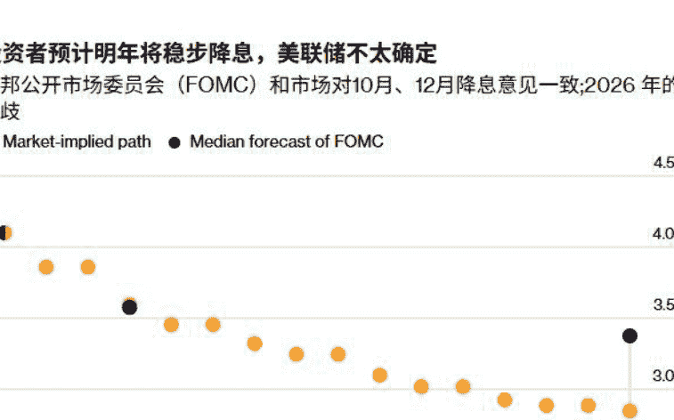

数据来源：美联储、彭博

- 2025年全球金本首次具有影响力的排名，新加坡是荷兰、丹麦、日本、瑞典、其他国家中的顶级团体。

- 访问：CFA协会全球养老体系排名（A、B、C、D、E分级）。

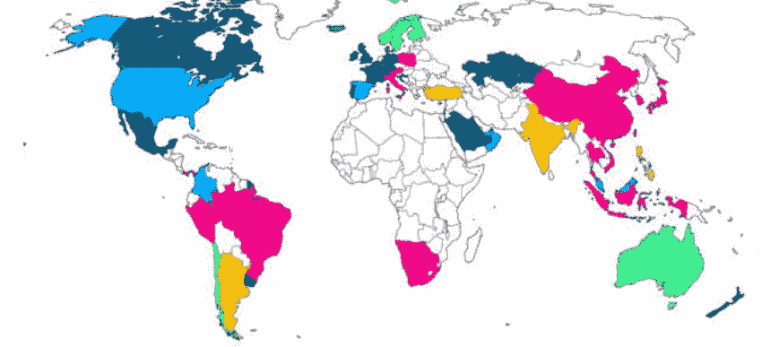

数据来源：美联储、彭博

# 知识星球 添加微信免费入群 top28688

| 序号 | 公号/星球/社群 |  | 领域 |
|---|---|---|---|
| 1 | 生财有木 | 2765/年 | 同业，搞钱 |
| 2 | 众宗吃瓜群 | 365/年 | 时政、历史 |
| 3 | 记忆巷/裁树风 | 365/年 | 成长 |
| 4 | 欧洲金轨 | 328/年 | 时政、历史 |
| 5 | 卢克文青会 | 699/年 | 时政、社会 |
| 6 | 体制内 | 599/年 | 体制、职场 |
| 7 | 局外人的视界 | 669/年 | 金融、时政 |
| 8 | 溯泽异昂 | 416/年 | 财富、成长 |
| 9 | 守夜人司令 | 599/年 | 时政、经济 |
| 10 | 江宁知府 | 365/年 | 时政、国际 |
| 11 | 政堂堂/顾子明 | 568/年 | 时政、经济 |
| 12 | 唐书院 | 1399/年 | 金融、财富 |
| 13 | 大树乡村谈 | 199/年 | 时政、成长 |
| 14 | 水库联大 | 10000/年 | 房产、经济 |
| 15 | 洪灏宏观策略 | 4376/年 | 经济、搞钱 |
| 16 | 金企通鉴/北海南山 | 4576/年 | 股票、行研 |
| 17 | 猫哥的世界 | 299/年 | 时政、社会 |
| 18 | 飞浅龙 | 3600/年 | 股市、经济 |
| 19 | 米联诸见闻 | 599/年 | 经济、金融 |
| 20 | 茶茶财经院 | 330/年 | 房产、股票 |
| 21 | 赢在八小时之外 | 365/年 | 成长、职场 |
