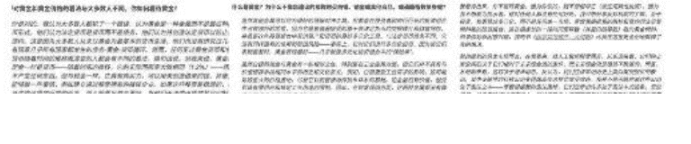
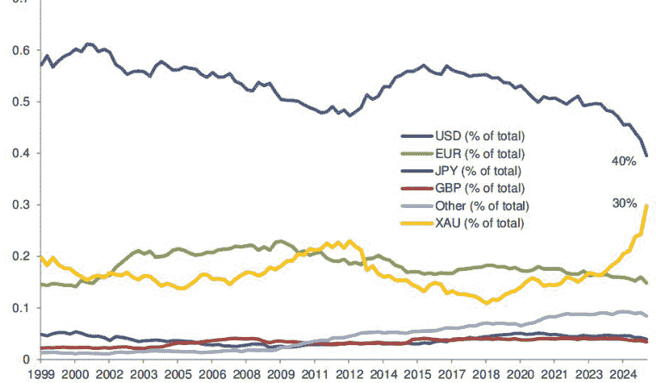
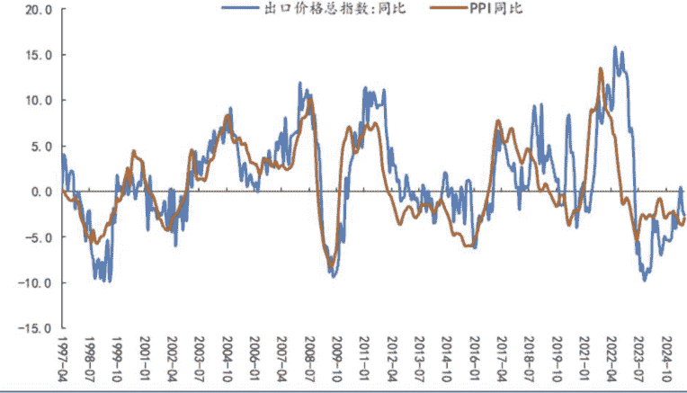
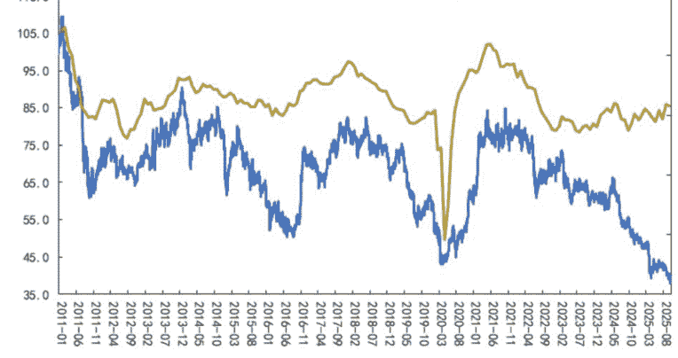
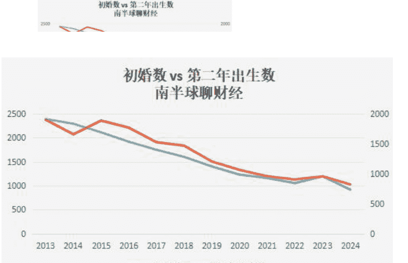
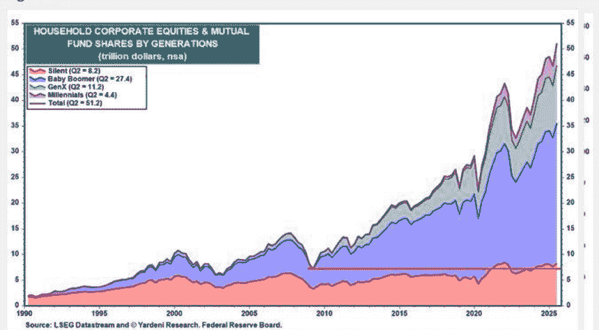
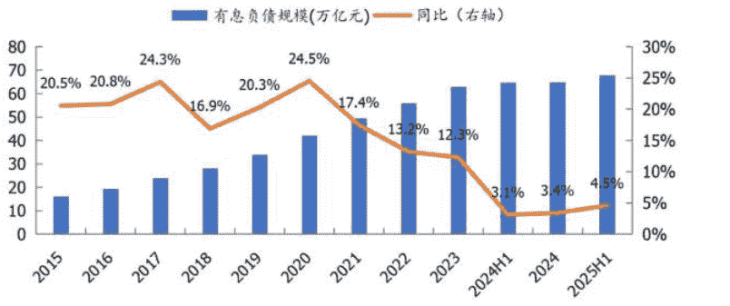
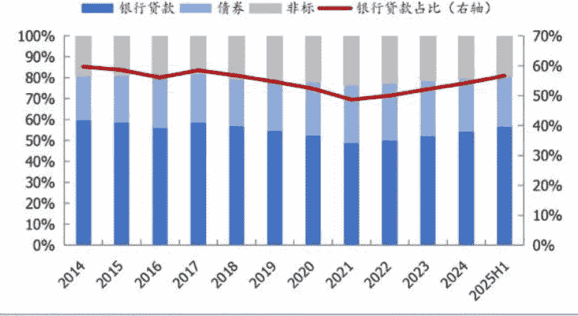
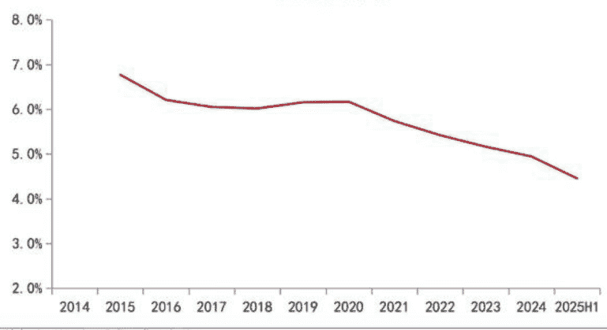
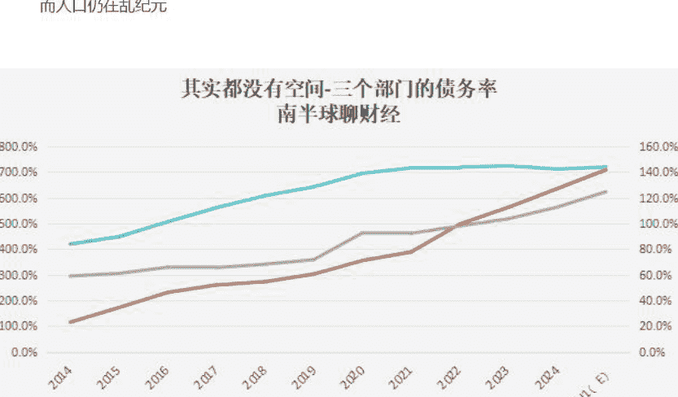

# 南半球财富经25019

Jason不错
2025-10-19 03:20

## Dalio黄金#金融

你似乎对黄金和价格的看法与大多数人不同。你如何看待黄金？

你是的。我认为大多数人都犯了一个错误，认为黄金是一种金属而不是最熟悉的货币形式，他们认为法定货币是货币而不是负债，他们认为创造法货币可以阻止通货膨胀。对于大多数人未从黄金为基础的货币生活，他们也没有研究过几乎所有国家四个不同的货币货币、黄金汇率。然而，我见过黄金和货币随着时间的推移而价值推移的，每个人会有不同。对我来说，现金就像是货币——随着时间的推移，其实的回报没有相同（1.2%）——因为它不产生任何事情，如果建立通过股票的企业，可以用来创造财富，并让人们能够做一些事情，如果建立股票是稳定的，并且负债还偿所需的资金，那股票回报会更好。当他们无法还债并且制造法货币阻止通货膨胀时，非货币（黄金）最高。对我来说，现金就像是货币，与货币没有相同，它们不能被印刻和造币。由于海盗掠割或我们国家不接受他们的信用（例如在书中），股票和黄金是一个很好的投资工具。

话说回来，我认为黄金是最后的本质，而不是货币。黄金是现金和短期债券，与黄金的本质和短期债券不同，它可以交易——它，在不产生负债的情况下，而且还债。

无如此，长期以来，我已经很明显了，债务货币相对于黄金货币的相对诉求与债务货币相对于黄金货币的价值变化。至于债务货币相对于黄金货币的正确价格，考虑到每种货币的供给比例，以及可能崩溃的泡沫如此，我知道我想保留的一块黄金，这是我投资想要的一部分，我认为那些在根本没有黄金或少量黄金之间挣扎的人犯了一个错误。

微信加208688，资料分享群 轩付

## 为什么黄金？为什么不建议您的那样买白金、蓝牙或其他商品，或通胀指数债券？

虽然其他金属可以作为很好的通胀对冲工具，黄金在投资者和央行的投资组合中占据有重要的地位，因为它是普遍接受的非法货币的交易媒介和财富储备，并且是这些投资组合中货币和资产的理想化工具。与通胀货币不同，它们没有相同的通胀和信用风险事实。它们可以进行多元化投资，因为它们表现最好，黄金表现最好是保险率。

蛋白质和钙与黄金有一种相似之处，特别是在应用上相同，它们并不具有价值存储与其相同水平的历史和演化过程。白蛋白更受需求的驱动，这可能导致其价值急剧波动。尽管可以被视为通胀市场的基础。蓝牙铂也有价值，但其到任何应用都有用途的限制。在财富积累方面，这两种金属没有像黄金那样不受接受的限制。

关于通胀指数债券，虽然它们在正常时期良好被低估的通胀对冲（取决于他们当时的实际情况），我们更多版本的通胀债券应该在投资者的投资组合中对冲资产风险，它们基本上不是通胀资产。如果发生重大债务危机，它们的表现与政府的信誉挂钩。它们受到政府的影响，例如官方通胀指数或其他管理其资金的条款，历史表明，当领导人的国家需要调整通胀额时，将是通胀指数债券的常见问题，这些国家面临着债务危机。此外，虽然它们可以有效对抗通胀风险，在系统性金融危机或经济转型时期，它提供的与黄金相同程度的多元化安全。

至于股票，尤其是人工智能等高行业的股票，不可否认，它们具有获得可观回报的潜力，尽管它们已被证明在通胀调整后表现不佳，而且因为在真正正常的时期，对于它们的通胀特性具有，

而论之，黄金是这些资产和多元化业务的独特良好化工具，它在大多数投资组合中占有一之地。

加微信信286688，进资料分享群

我看得出来，你不喜欢黄金，因为你说，我不想信它（或任何其他投资），因为我不想提示者。对这任何人都没有好处。我只想分享我对机制的了解。至于投资，我更倾向多元化，而不是单一奔事，尽量根据我的指标和我的想法自己的倾斜的投资，在合适的长的一段时间内导致（尽管仍然）向黄金倾斜。如果你是因为恐惧感，那么我的《国债如何破产：大周期》比我在这里更全面地解释了我的想法。

你提到的股票和黄金，在我的看来，其智能能如此的，从长远来看，它们的时空属性取决于相对于现在未来的定价，而现在现金流本质上是不确定的，而且从短期来看，这种决定取决于直觉。我认为，我们对于这类历史级上类似案例的理解，其中某些机性的公司表现得这样时常忽视，我并不是在说这些公司处于危机之中——无论股票还是黄金的很大一部分取决于市场的活跃的表现定价的折要，因为如果他们他们不是这样的，他们的股票就会下跌。这些股票已经占据了美股的800只，最高的100只占据了85%的股票，占费消费者的一半，而这些AI公司的资本支出已经今年增长了400%，所以这类投资对我们的人和经济来说是靠谱的。很明显，对于持有的人来说多元化是必须的。

你所认为的债务工具具有观察的价值。然而，这类债务工具作为良好的财富储备，它们必须支持具体的税，降低通胀，由于它的速度超过了需求。因此，我看到多元化转向黄金，而没有足够的黄金进行多元化。操开技术考虑，黄金是非常有效的多元化工具和机构投资者如果个人以及央行发行货币将会资产配置到黄金中，价格将会得得多（因为数量非常有限）。无论如何，对我来说我想在其中拥有作品的一部分，清楚的建议自己问一个基本问题，多少黄金配置在黄金上。对于大多数投资者来说，我认为这可能是10-15百分比。

微信top28688，进资料分享

## Jason-纳萧

2023-10-19 03:26

zerohedge: 俄罗斯主权基金负责人基基里尔·德米特耶夫在X上贴帖，通过阿拉斯拉斯-俄罗斯总统透露非非洲大陆与美洲及俄罗斯连接，难道不是增加三战风险要好吗？

特朗普：“这是昨天的一条，从俄罗斯到阿拉斯加的隧道。很有趣。”泽连基总统表示，“您怎么看？你有什么想法？觉得这个主意怎么样？”
泽连基：“我对这个想法不满意。”

## 其他国家经济

据 Trust Social 的一位离职透露，特朗普可能会在今年内与普布尔顿达成会，讨论的重点是结束乌克兰战争的终结。

特朗普最近对乌克兰提供许多援助，这可能是促使俄罗斯突然愿意进行最高级别的战略援助。虽然这种话的全部细节尚未披露，但根据特朗普的最近的一份报告，这种转变暗示着俄罗斯东部未来三年的胜利可能将被取得，这将导致双方的伤亡达到440万，引发美国和俄罗斯政府的估计。

沙布尔顿的结果还有待，但俄罗斯主权财富基金负责人基基尔·德米特里耶夫（Kirill Dmitryev）已经在X上贴帖，埃隆·马斯克（Elon Musk）的公司（Boring Company）可能会建造一条70公里长的海跨隧道，通过白海连接俄罗斯和阿拉斯加——这是一个拟议的650亿美元的大型项目。

德米特里耶夫将这个隧道的项目命名为“普京-特朗普隧道”，并将其视为本周特朗普与普京通话。

德米特里耶夫在X上的第一条帖子开始，拟议项目可能会重塑全球供应链，由马斯克的 Boring Company 在八年内耗80亿美元。值得的是如此规模的大型项目可能会引起特朗普的注意，并让民主人的政府启动叫停。

微信top26888，进资料分享

## Kirill Dmitriev

From JFK docs released by @Luna: World Peace "could and should be built between Alaska and Russia at once."
With modern @boringcompany technology this can become Eurasia and Americas for $8 billion

Jason Dataset
2025-10-19 03:30

备注：全球外汇+黄金储备的份额从今年6月的24%上升至30%。同一时期，美元贬值从43%下降至40%。如果黄金与美元在上述类别中，价格需要跌到790美元/盎司。在这种情况下，假设央行持有量不变，黄金和美元将各占全球36%。

微信同步top28688，进资料分享

## 黄金

### Figure 1: Gold rises to 30% of global FX+gold holdings

Source: Bloomberg Finance, IMF, Deutsche Bank

Jason不靠
2023-10-19 03:35

今年，非金属无疑是最抗风险的之一，按照通胀涨幅来看，截至2025年10月14日涨了70%，在所有资产中排名。资产价格来看，我们认为通胀指标已经进入再均衡的过程。对于国内投资者而言，A股市场的盈利能力尤为关键，核心指标之一是中国黄金价格。预计未来2-3季度内外将迎来“再交易潮”，黄金价格回调极可能是暂时的。在市场回撤后触底部，市场或经历平稳期。国内市场来看，2023-2024年黄金资源通胀压力仍持续，核心在于中国用速度加速，这将形成供需错位的结构性缺口，意味着黄金产出将速出清，制造企业将获得增长空间。市场的拐点可能是全球性周期的起点，黄金无疑对全球性周期将向上的影响，建议关注制造业PMI。从历史来看，全球制造业PMI与黄金指数呈现高度相关，黄金价格底部明显高于历史水平，近期黄金尚未出现周期性底部，由于黄金价格可能仍面临较大的调整。此外，我们关注的重点不在于板块是否出现底部，而是资源通胀何时来主导向上的影响点，至真正底部底部，从历史来看商品价格往往需要频繁出现底部，在上海市场的黄金上涨下中国企业将面临巨大的压力，意味着黄金将进入滞性期。从海外视角来看，当黄金重新锚定全球通胀，这将使得有效的策略面临遭遇影响，此时黄金的底部已经接近了。

### 图表3：最近几年出口价指数的下跌对PPI形成较大拖累（单位：%）

来源：Wind, 国金证券研究所

### 图表6：历史上以来，铜价与全球制造业PMI高度相关，如果PMI修复，铜价可能会处于低值状态

来源：Wind, 国金证券研究所；注：铜价以2010年底为起点取100进行测算。

微信top28688，进阶资料分享

## Jason不跑
2025-10-19 03:10

年初出生人数为917万，同比-21%，历史最低。之前推估今年出生人数为820万，同比-14%，看来还比较保守

### 自制图表
今年可能有总和和生育率跌破0.9

## Jason不酷
2025-10-19 04:10

李嵩：A股的机性较强，增长的股价，它下跌涨是一个上市公司的利润增长，一个市场的利率水平，如果增速比较快，利率下行比较快，那么估值就能够得到相对于对于无风险利率下降了，那么它的估值也能够得到提升。第二，如果无风险利率不下降了，但是上市公司利润增长了，那么股价能够增长。我比较...

李嵩：对，这是股市上涨的一个说法，1995年日本股市上涨的原因就是，日本银行把利率水平从1%降到0.5%，那估值就上涨了。我们觉得如果利率水平一直低下去，那，如此股市上涨也是可能的。

我觉得这可能有两个方面都有的，但是利率水平不太持续下去，往往下去的行为也会受不了，所以我觉得想要实现“股票上涨”，还是估值很重要，当然，如果利率下去之后，企业的游戏规则就会降低了，那么是有用的股市上涨的，如果分子的，分这两部分都会对这个市场起到作用。万不能说其非，“要股票”，要动分子的股，要动分子的股。

嵩：您对A股目前的估值你怎么看？您举例来说，估值高还是低？

李嵩：所谓的“低”就是进行历史比较。我认为现在的A股的估值水平在历史中的中位水平，就不算低也不算高，处于一个中位水平。这意味着现在的股市处于中位水平的了。

嵩：如果真的是往下去走，如果投资者的情绪能好起来，我们的估值水平还会上涨吗？

李嵩：如果真的是往下去走，如果投资者的情绪能好起来，如果利率水平一直持续下去，那么估值水平就会在一个比较低的位置了，这种情况下股市上涨是可能的。

最好的股市上涨，不是市盈水平的为上涨的，比如最近的500ETF，它的市盈水平在180左右了，我们没有这样的历史，但是，少人能理解，这种涨对于投资来说风险太高了，未来的企业的盈利可能会像100倍或者200倍那样，500的180倍的意思就是，你得等180年才能等到股市的回来。

嵩：从7月份数据来看，确实出现了数据方面的增长，但是8月份数据并不是特别的，属于股市，但是数据还在增加。

嵩：似乎我们的企业可能不太喜欢用这种方式了，不是光转型升级好了，做大也很好。为什么会这样？

李嵩：可能是一个地方主义的问题，对于一个企业一旦被割了，它的税收就要别出去，所以有地方主义保护的。

第二个是企业的自身的各种问题。我们中小企业是家族企业，它还没有培养起这种职业经理人，也就是，它的股东职业经理人是一个人或者两个人。它没有像美国一样，完全是分开的。在中国的，股东和经理分开，股东的模式就是实现自己的利益最大化，而如果是家族企业，他会考虑，我这个企业是自己辛辛苦苦打造的，我怎么能被经理人给捞掉？企业文化这方面也面临很多的冲突，所以在中国股市的案例中多，这样不利于企业的壮大。

我们可以看到，很多都是科技股，我们整体的市盈水平比较低，美国的科技大公司市值比中国大很多，对于全球的科技发展还有足够的空间。

加微微信2868，资料分析

王晟：在中国老百姓的一个观点就是，入涨的时候，投资越要大的。以前我们说买财富保值的方式，很多人会选择房子，所以中国家庭财富的70%在房子，这是聪明的时代已经结束了，你再用房子来实现保值，现在也不是了。来，未来会有多少人搬到股市市场上？股市将是未来十几年投资的主战场吗？

李鸿：这我们可以，在我们家里资产配置里面60%以上是房子，美国家庭可能是股票的比例比房子大很多，三分之九。我们在资本上配置比例可能更大，甚至不是买房是必须的了，因为我们有了配置的，我们的股票可以多，我股票在5000多万，到2040年到一万多万，也是可能的。

第二，配置某一个股票是不值得保值的，如果股票涨的话，可能会有很多人流到股市，因为中国家庭资产配置基本在房子，在海外投资者通常是全球范围内配置，东方不离西方，所以我们需要进市场配置更加活跃。

我们不需要有足够的胆量，股市是有资金的，就一定足够。股市的涨跌本质上取决于上市公司的盈利能力、上市的成长，这才是核心。

王晟：要把钱投在股市，把跌了就割肉，或者跌了回到家里，这样可能已经了，长的其实很多人被割成“韭菜”，为什么会这样？怎么不能被割？

李鸿：股市市场有充分的流动性，美股市场进入市场到由机构投资者主导的过程中，大量的股票被“吞”掉了，涨过没有？最后，很多投资者觉得自己做股票不好，就转而去买基金。股票投资是一个比较专业的学问。

我们现在大家都说股市的泡沫了，或者是配置过高。从历史来看，A股市场个人投资者的比例比我们要高，我觉得就是要纠正这个现实。

以前从从小到群众化，以前亚洲市场就太大了。

任何一个市场，都是随着调整的香港股市，散户数量却是越少的。我们还在进步中，90年代，A交易量99%是散户，等到未来90%是散户，现在还没80%是散户，所以也是在这个过程中比较慢。

王晟：大部分部分散户就是您说的，可能不到的，为什么多人都喜欢股市？

李鸿：就就像很多人喜欢买股票是一种一样，他还是觉得，觉得他发财了？带有钱也是一种心理，他会去参与。

股票投资有很多理财方面的事情，比起来说，很多人可能自己把赚了的股票买，亏的股票他不会割肉，这只是一个开始。他觉得，只有赚了钱才能割。

加微2868，资料分析

加微信2868，资料分析

王慧：对黄金短期和长期的趋势，你有什么预测？

李迅：我觉得大概在2025年的时候，黄金可能会到5000美元。现在已经进入了一个债务时代，发货币低利率，会导致股市大幅调整。

王慧：为什么长期看好黄金？

李迅：因为世界的经济正处于一个长期的通胀风险中，由于战争的影响，黄金价格起到了作用。游戏规则不变了，宽松政策刺激了经济，然后收紧经济引发通胀，这样一来全球货币体系越来越多，黄金和白银具有货币属性，所以货币越多，黄金就会涨。

王慧：中国央行近加息，现在全球都在表，主要哪些操作？

李迅：就是想要自己的话，现在美元还在贬值，你拿着美元风险大，所以各国央行要优化资产结构，增加黄金，减少美元和美债。

加微信2868，资料分析

加微信28688，资料分析

王慧：从这个结论可以看出，黄金和比特币是同一个东西，您认同吗？

李远雷：我也认同，但是比特币的波动幅度大于黄金。比特币是缺性的，它越来越少，黄金也是缺性的，但是比特币的货币属性更强，波动大是一种风险资产，对冲货币贬值。黄金的波动幅度低于比特币。

王慧：您刚才提到，配置黄金的价值在10%的范围内是比较理想的，除了这10%还有什么建议，大家配置？

李远雷：我觉得在这个阶段建议投资股票20%，债券20%，50%是现金，等待更好的机会。这就不是急卖，而是等待时机，在保证自己安全、股市机会较大的情况下再出击。

王慧：对于投资者来说，相比投资股票，黄金的渠道可能还比较直接。可能的选项如何考虑实物金、金银、金币，还有黄金基金等。如果现在有重要要求，您建议选哪一种？

李远雷：首先要配置黄金基金，因为黄金这个东西对市场波动不太敏感，配置风险很大。如果你有一个比较好的流动性，可以买黄金ETF，通过交易所可以买。买实物黄金的话，首选金条。你需要方便的话，可以去银行买一些黄金的产品，或者买一些黄金之类的东西。

王慧：好的，感谢李远雷老师的建议。相信对黄金的分析能给很多投资者带来收益，也会让很多参与者从中打开思路。

李远雷：今天讲比较多了，我的判断带有客观性，仅供大家参考。

2023-10-19 04:15

1-9月证券交易印花同比增长103.4%（前值81.7%），但来看，今年9月证券交易印花增长3.42倍（前值2.26倍）。企业所得连续改善两个月，本月上行至0.8%。

微信加1028688，进资金群

## 图5：证券交易印花税和A股新开户数增速(%)
资料来源：Wind、中国银河证券研究院

## 图6：企业所得税增速和工业企业利润增速(%)
资料来源：Wind、中国银河证券研究院

微信top28688，资料分享群

## 图6：企业所得税增速和工业企业利润
资料来源：Wind、中国银河证券研究院

微信top28688，资料分享群

Jason 不涵
2025-10-19 04:29

中国：在经济、需求这些变化的情况下，如果观察股市资金流，观测到9月发生了一些变化。首先从非季节性的角度来看，9月份出现了资金流出，这一个单纯季节性的问题，应该是有程度的股票回流到股市。其次从股市活跃水平来看，如果场内融资活跃，那么融资在9月以来持续的态势意味着指数抬升。再者从红利股来看，红利股票再度上涨，包括银行和高分股，此前的7月份都是底部，当时处于优势。这些现象说明了市场的情绪正在变化，预计今年内股市回到1.4%-1.5%的区间水平。

## 图2：存款规模变动
| 市场 | 车型 | 降价幅度 | 降价后价格 |
| :--- | :--- | :--- | :--- |
| 美国 | 特斯拉‘Model Y’ | 5000美元 | 3万990美元 |
| | 现代汽车‘IONIQ 5’ | 7600美元 | 3万5000美元 |
| 日本 | 日产‘玲享（Leaf）’ | 6万美元 | 约519万美元 |
| | 比亚迪‘海豹’ | 50万美元 | 约249万美元 |

注：以上均为标准车型的对比。比亚迪的降价仅限于9月

关注微信top28888，进阶资料共享

Jason 不
2025-10-19 04:36

安联《Allianz Global Wealth Report 2025》显示，新西兰在全球人均资产排名位列第三，仅次于美国、德国、澳大利亚和新加坡，人均净资产高达302,000美元（约681,600瑞士）。如果考虑到房价因素，新西兰的人均净资产将飙升至133,000美元（约271,000美元），排名升至第八，显示出财富受高房价的现实。

新西兰统计局表示，在2024年6月的一年中，约有20%的新西兰家庭总净资产的三分之一。约有10%的人在2024持有49%的资产，这反映出贫富差距加剧的现状。虽然新西兰人均资产虽高，但数据显示，截至2023年9月，全国有410,328人领取主要福利，占工作年龄人口的12.7%，比去年同期上升了0.6百分点。主要福利包括求职津贴（Jobseeker Support）、生活补助（Supported Living）以及特殊福利。

## 图24：Net financial and real estate assets per capita (2024)
| 国家 | 额 (EUR) |
| :--- | :--- |
| Switzerland | 599,670 |
| United States | 506,190 |
| Australia | 383,720 |
| Singapore | 380,290 |
| New Zealand | 302,900 |
| Netherlands | 299,950 |
| Canada | 296,600 |
| Belgium | 281,680 |
| Germany | 230,730 |
| Sweden | 229,830 |
| Austria | 228,670 |
| France | 211,420 |
| Norway | 209,610 |
| Italy | 196,810 |
| Spain | 196,800 |
| United Kingdom | 162,150 |
| South Korea | 160,550 |
| Japan | 159,710 |
| Finland | 139,910 |
| Taiwan | |
| Malta | |
| Ireland | |

Numbers in brackets: Rank by net assets per capita (adjusted)
Sources: Eurostat, national central banks, financial supervisory authorities, financial associations and statistics offices, IMF, OECD, Allianz Research.

## Figure 1a

## Figure 1a: Number and proportion of people receiving a main benefit at the end of the last six quarters.

Jason
2025-10-19 04:45

BCA：全球市场的主流股市总体上涨，“逢低买入”应该是主要投资策略。这种描述缺乏历史视角，对于全球除美国股票而言，情况并非如此。过去15年，全球（除美国外）的实际股票价格（美元，通胀调整）一直处于震荡区间。过去40年来，全球除美国以外的实际股票价格（美元，通胀调整）根本没有提升。

## GLOBAL EX-US: STOCK PRICES IN REAL TERMS (USD, INFLATION ADJUSTED)

联合早报：财政政策导致审批减少，中小赛事招商困难，由于近期安全事件引发的监管收紧，是马拉松密集取消的重要原因。

专家：官方要求规范赛事管理；另有提到，地方政策导向导致审批减少，中小赛事招商困难，也是原因之一。每年10月到12月是举办马拉松的高峰期，近期两周没有马拉松赛事完全取消、部分取消或延期。其中，遭遇变动且限定为周六（10月18日）周六至周日（19日）举办的赛事超过20场。

根据中国国内行业统计，截至10月16日，已有103场马拉松赛事发布通知，66场完全取消，37场赛事部分取消或延期。其中、四川、江苏、陕西等省份变动的赛事数量最多。

高盛：预计 SPX到底反弹至6800点。

yardeni：美国家庭净资产在过去十年中翻了一番，达到167.3万亿美元，2009年初，美国家庭仅持有7万亿美元的股票，在超过50万亿美元。

## Figure 16

## Jason-Tao

2025-10-19 05:18

近期，各城域平台公布2025年半报。已经公开财报数据的城域平台共3175家，为避免重复统计，在数据统计时剔除了部分子公司的影响。

2025年6年底城市债权规模从64.88亿元增长到67.82亿元，增长4.5%，较2024年增长3.4%且2020年以来城域平均融资成本持续走低，2025年上半年的平均融资成本受债成本缓压，年化平均融资成本为4.45%，相比2024年下降了49bp。#TAX

图表1: 2015-2025H1城域平台负债规模及增趋势

资料来源：Wind，中信证券研究所
注：此处指城域平台按负债拆分后城域的永续债，同比：2024H1和2025H1增幅是相对于2023年初和2024年初的。

## 微信top28688，进阶资料分享

## 图6：2014-2025H1城投平台贷款、债券、贷款占比

数据来源：Wind, 国添证券研究所

## 图9：城投平台融资成本趋势统计

数据来源：Wind, 国添证券研究所

加微信top28688，进资料分享群

## Jason不离

2025-10-19 06:22

地方债务/收入 = (地方性债务+城域债务) / (地方财政收入+基金收入)

中央债务/收入 = (中央性政府居民债务+政府支出) / (中央财政收入+基金收入)

居民债务/收入 = (中央性居民的短期债务) / (人均年化可支配收入)

截至2025年，居民债务基本丧失活力(标尺为居民债务/收入>120%为红色区域)，

注意地方“债”的非债务债务不包含在内;

地方“债”由于土地收入驱动,所以使得债务增速,但依然突破700%,注意地方部门的经营性债务(非有息债务等)并不包含在内;

中央债务空间其实并不设想中的,年末预计债务规模已经到620%+,大致相当于日本的2010年债务水平(同样也是财政收入)

高债务意味着利率要低压,还能维持运转,也意味着任何赤字的扩张都要考虑面临什么局面而目前债务无法失效,不然GDP泡沫会显现(表现为诡),从这个深度角度,你就能理解1) 为什么对债务没有退,2) 为什么资源倾斜于GOV化(因此又产生副作用);3) 为什么要把科技推向生产(没有债务空间=没有社会利用);#自制图表

而人口仍在乱纪元

加微信top28688，进资资料分享群

## 知识星球TOP

添加微信 资源分享群免费入群

微信:top26868

| 序号 | 公号/星球/社群 | 原价 | 领域 |
| --- | --- | --- | --- |
| 1 | 生财有木 | 2765/年 | 同业，搞钱 |
| 2 | 众宗众吃瓜群 | 365/年 | 时政，历史 |
| 3 | 记忆巷/碧树西风 | 365/年 | 成长 |
| 4 | 欧洲金轨 | 328/年 | 时政，历史 |
| 5 | 卢克文青云会 | 699/年 | 时政，社会 |
| 6 | 体内主任 | 599/年 | 体制，职场 |
| 7 | 局外人的视界 | 669/年 | 金融，时政 |
| 8 | 溯泽异昂 | 4166/年 | 财富，成长 |
| 9 | 守夜人总司令 | 599/年 | 时政，经济 |
| 10 | 江宁知府 | 365/篇 | 时政，国际 |
| 11 | 政堂堂/顾子明 | 568/年 | 时政，经济 |
| 12 | 唐书院 | 1399/年 | 金融，财富 |
| 13 | 大树乡村 | 199/年 | 时政，成长 |
| 14 | 水库欧大 | 10000/元 | 房产，经济 |
| 15 | 洪灏宏观策略 | 4376/年 | 经济，搞钱 |
| 16 | 金全通鉴/北海南山 | 4576/年 | 股票，行研 |
| 17 | 猫哥的世界 | 299/年 | 时政，社会 |
| 18 | 飞浅龙 | 3600/年 | 股市，经济 |
| 19 | 米联诸见闻 | 599/年 | 经济，金融 |
| 20 | 茶茶财经院 | 330/年 | 房产，股票 |
| 21 | 赢在八小时之外 | 365/年 | 成长，职场 |
| ... | | | | 更多资源，不再列举 |
