# 南半球聊财经251020

Jason+不遇
2025-10-20 04:20

VC: 在美国市值最慢的汽车（保值率较高），卡罗拉 Cross位居首，三年仅跌2.63%，其他车型，如4Runner、C-HR 和 Tacoma，在这方面也表现优秀。其他国家经济

# America's SLOWEST DEPRECIATING CARS

Average depreciation over 3 yrs (2022 model year)

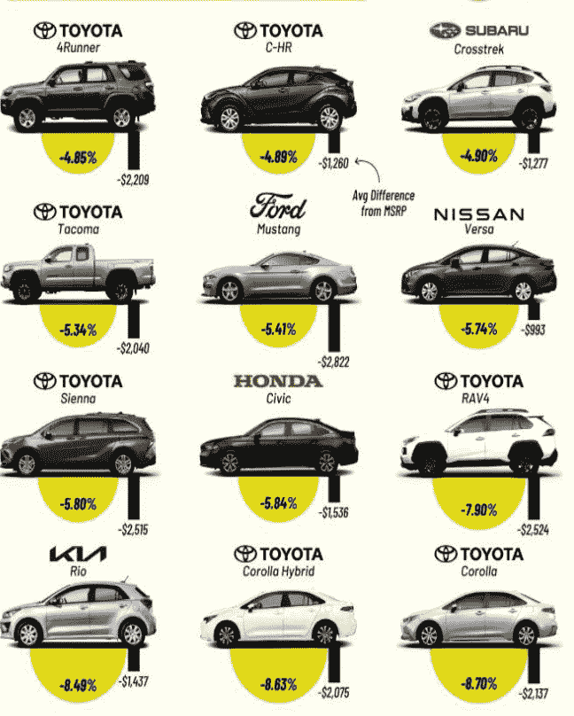

加微信进资料群

# 加微信top28688，进资料分享

VISUAL CAPITALIST

| Brand | Model | Avg 3-Yr Depreciation (%) | Avg Difference from MSRP ($) |
|---|---|---|---|
| Toyota | Corolla Cross | -2.63% | -$662 |
| Toyota | 4Runner | -4.85% | -$2,209 |
| Toyota | C-HR | -4.89% | -$1,260 |
| Subaru | Crosstre | -4.90% | -$1,277 |
| Toyota | Tacoma | -5.34% | -$2,040 |
| US Ford | Mustang | -5.41% | -$2,822 |
| Nissan | Versa | -5.74% | -$993 |
| Toyota | Sienna | -5.80% | -$2,515 |
| Honda | Civic | -5.84% | -$1,536 |
| Toyota | RAV4 | -7.90% | -$2,524 |
| Kia | Rio | -8.49% | -$1,437 |
| Toyota | Corolla Hybrid | -8.63% | -$2,075 |
| Toyota | Corolla | -8.70% | -$2,217 |
| Toyota | RAV4 Hybrid | -8.84% | -$2,989 |

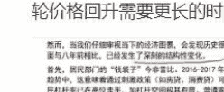

Jason不靠
2025-10-20 04:24

> 国信：大家对复制2016年经济回升的太乐观了，不知道在很多时候要积累与当年相同。此轮回升需要更长的时间，L型还是非V型 #经济数据

来源：国信研究院。在宏观环境变化时，企业需要更多的政策支持来增强信心。
数据：国信研究院，《2017-中国经济展望报告》，2017年；国信研究院，《2018-中国经济展望报告》，2018年；文中数据来源于国信研究院，图片数据不适用，数据不适用（此处不适用）。

然而，我们仔细审视下当前的经济形势，发现问题比想象复杂得多。当前的基本面与年前相比，已经经历了从底部回升的转变。

首先，景领先的“链子”行业已经开始复苏。虽然这些政策（财政、消费）可以提振需求，但目前，景民心的信心还需要额外的政策来提振，普通消费面临的不确定性较高，消费和投资面临着巨大的压力。

其次，总需的压力很大。需求缺口还在，政策可能侧力于“一把抓”虽然有效，但需要更大的政策广度，从链传到末端，产业结构才能真正解决问题。

最后，调整的差异性可能也很大。2016年的经济结构性调整主要集中在制造业、钢铁等行业。目前复苏已经扩散到许多行业，新兴行业仍处于高位，面临的压力依然，利益需要调整，解决的政策可能到位。

那么，出口在哪里？政策引导下，当前的景气已经发生了转变。过去是依靠“链子”出口来提振信心，我们需要从收入入手，政府支出市场化增强民众消费。在此之前，我们应该对中国经济回升的路径多一份判断。形势走势可能是收缩型的、改进型的“L型”、还是快速的“V型”？还需要更多时间来观察。

# 加微信top2868，进资料分享

Jason不靠
2025-10-20 04:26

从专项债投入来看，前三季度专项债资金有36%向基础设施建设，包括传统基建和新基建，33%向特殊用途，社会事业、保障安置等项目占比约为9%。与2024年相比，前三季度向基建投入有所减少，而向化债和特殊项目的比例显著提升（分别提高9个百分点），这解释了广义财政规模在2024年初投资增速未明显。

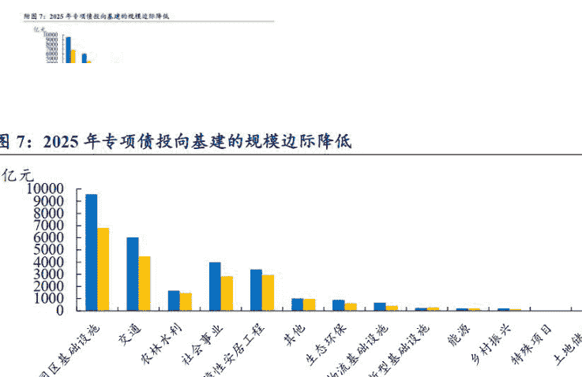

# 图：2025年专项债投入规模分布

| | 2024年1-9月 | 2025年1-9月 |
|---|---|---|
| 市政和产业领域基础设施 | | |
| 交通 | | |
| 林业 | | |
| 社会事业 | | |
| 保障性住房工程 | | |
| 其他 | | |
| 生态环境 | | |
| 仓储和制造 | | |
| 新型基础设施 | | |
| 能源 | | |
| 多领域 | | |
| 特殊项目 | | |
| 土地 | | |

数据来源：Wind、开源

Jason不靠
2025-10-24 04:31

FT：企业转型失败，变成弱势群体

最近，由于宏观环境剧烈变化和国际局势波动，面临的压力增加了，许多人变成了弱势群体，同时也面临了前所未有的核心挑战。

# 加微信top2868，进资料分享

最近，新闻报道重庆某投资工厂的新闻引起了很多人关注，大部分人都认为企业转型失败点，同时也获得了官方的说明。这件事背景我们做了调查，所以这里不做具体的评论，只是联想到相关事件：很多地方在“拆迁之后”拼打“投资市场”就是这么来的，我的东北家里方面需要加大投入，这确实涉及企业家的经历，国家计划限制进入市场，现在很多地方政府落实有所进步。

在装修期间他都想各种办法“按照有关办法在身上”，“按照有关办法在身上”。

这是我们多年的心血。从企业家的情况来看，确实是一个值得被有关部门关注的案件。这些年经济内卷之下企业家受到损害是非常多的，企业和商家的风险已经开始盛行，这是所有我们人类共同面对的事实。

事实上，企业家或者说商人人类群体已经成为了一个大群体：一方面，经济挑战让企业面临着日益增长的压力，很多时候让企业家受到巨大冲击；另一方面，社会多方矛盾之后，老板或者一部分人就成了妥协的方向。而且，网红频繁交流导致精力老化和应对举报等现象。更有甚者就是这种权力强制非法进入计划的案件，这些案件无疑破坏了改革开放以来长期积累的健康市场，企业家的留难以痛苦。监控观察建模。

> Jason·不靠
2025-10-20 04:36

bloomberg: 特朗普总统在6月26日宣布美联储主席鲍威尔·克里克表示（或许没有），黄金已上涨25%。对于黄金来说，景况比什么都重要。因为它有的机会是4%。美银依然在计划黄金明年将涨到5,000美元。理由很简单——交易需求。如投资者将增加购买及价格机会#金融

# 微信加top2868，进资料分享群

# 美联储独立性受到威胁后，黄金爆发

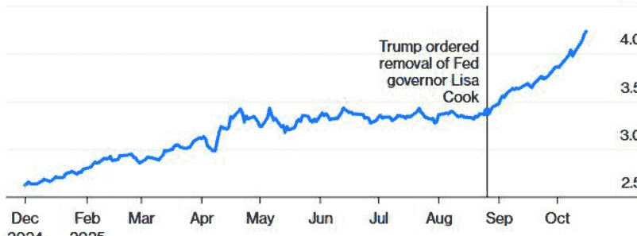

资料来源：彭博社

Jason不靠
2025-10-20 04:41

天风：当前金油比价是历史极高，核心原因是两者定价逻辑分化：原油由基本面主导，而黄金由宏观情绪驱动。历史上，比较的极端值由油价暴跌致，其回归始于实体改善带动油价反弹。值得注意的是，比价见顶回落后，金价往往4个月后再次见#图1：金油价（金价单位：美元/盎，油价单位：美元/桶）

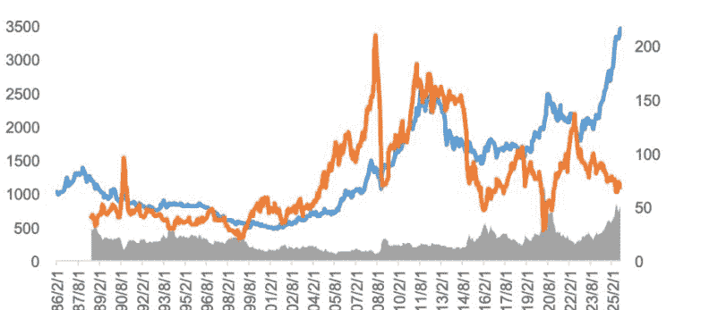

资料来源：Wind，天风证券

# 加微信拓2868，进资料分享

Jason不靠
2025-10-20 05:04

盈：中国可能通过向非洲出口规避关税。2025年上半年中国对非洲出口总额为103B，同比增长21.4%，绝对增长18B；2025年上半年美国从非洲同比增长24%，绝对增长4.5B#经济数据

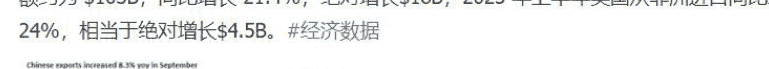

Chinese exports increased 8.3% y in September (2019=100)

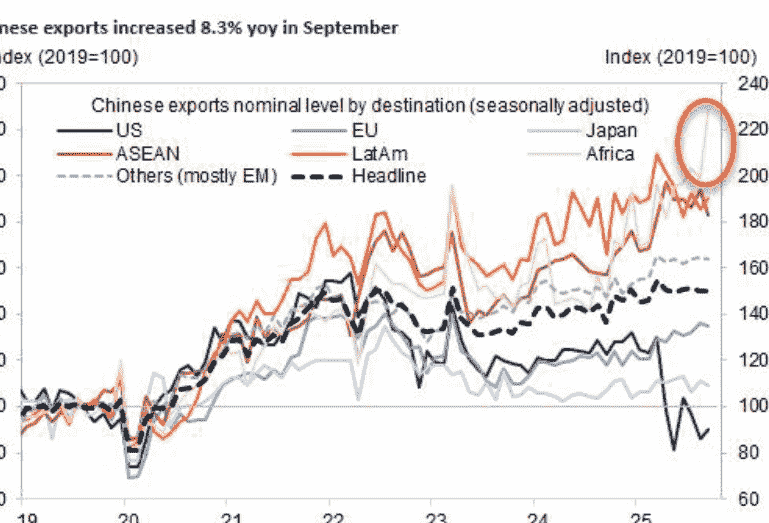

Source: Customs, Goldman Sachs Global Investment Research

Jason不靠
2025-10-20 05:10

B：如果特朗普推翻贸易关税，那么债券市场和股票可能会暴跌。具有讽刺意味的是，持有最多头寸的交易者必须为贸易政策欢呼才能维持涨势#美股

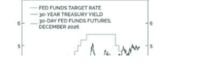

# 加微信top2868，进资料分享群

# FED FUNDS TARGET RATE
30-YEAR TREASURY YIELD
30-DAY FUNDS FUTURES, DECEMBER 2026

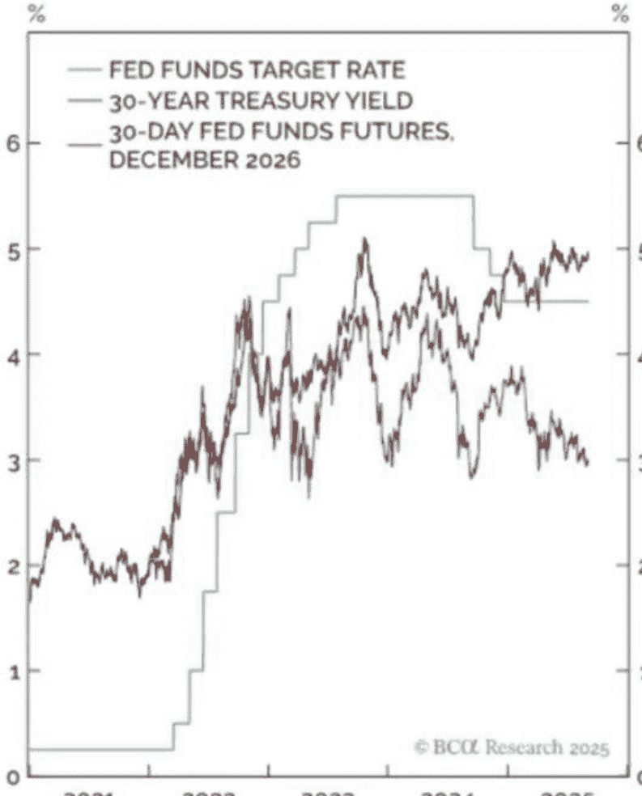

Jason不靠
2025-10-20 05:12

国缘：近半月经济变化有：一是产销链再度走弱，销售下降1.1%，弱于季节性，绝对值领先同期期间低，同比跌幅扩大至26.6%；销售下降16.4%，同样优于季节性，同比下降为21.8%；二是近半月化、沥青、水泥开工率较高环比回落，基建工作仍待形成；三是绿能外工业品价格多次下降，猪肉价加速回调，指向物价加速回调，政策力的必要性和可能性得到提升，紧盯定调#经济数据

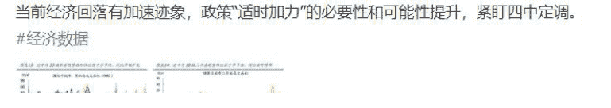

# 加微信top2888，进资料共享

# 图13：近月30天中值经理率对比图，环比扩大

# 图14：近月18天二净经理率对比图，环比收收窄

| 份值 | 30天中值；基金产品成收益(MA7) | 份值 | 18天二净及收益收益 |
|---|---|---|

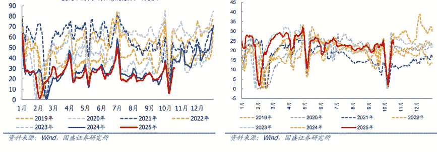

1月 2月 3月 4月 5月 6月 7月 8月 9月 10月 11月 12月
2019年 2020年 2021年 2022年
2023年 2024年 2025年

来源：Wind，同信研究所

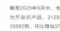

Jason不靠
2025-10-20 15:26

昔：到底各主要经理收益率较低，所以实际策略收益率较高，如果把经理持相对相对对，那么金融数据遇到极端情况；金麒

2025年9月，市场存续理财产品共41842只，环比增加347只，其中20557只开放式产品，21285只为封闭式产品。从投资性质来看，固收类产品最多，共有38990只，环比增加347只。

2025年9月，理财公司存续理财产品29397只，环比增加531只，占市场存续理财产品的70.26%。其中开放式产品存续收益理财产品（不含资金管理理财产品1）内个月收益率的平均水平为2.22%，环比下降0.21百分点。

2025年9月全市场共有7941只，环比增加1009只，其中7323只为开放式产品，618只为封闭式产品。从投资性质来看，固收类产品最多，共有7431只，环比增加865只，占市场78.5%。

2025年9月底，开放式与封闭式固收产品近个月收益率持续下降，整体回升至12.5%，近期持续走低，整体来看，各类理财产品收益持续下跌，且底层资产利息环境压缩了利润空间。

# 加微信top2868，进资料分

Jason不靠
2025-10-20 05:18

中信建：领先指标先触顶，同步指标拐点迹象（斜率有所萎缩），显示短期内仍在减。预计价格进入震荡阶段，消化前期的过度扩张与情绪买盘。

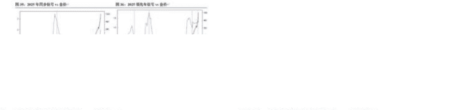

# 图35：2025年同一信号
# 图36：2025年领先信号

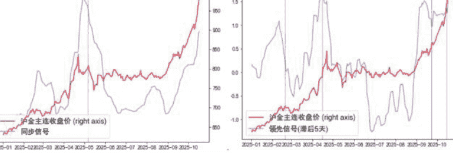

Jason不靠
2025-10-20 05:20

长期：与上半年相比，市场对外部冲击表现较为淡。国内应对方面，今年化债持续扩债。近期地方债压力有所抬头，城投减收，余额仍未改。后续热销将进一步逐步撤离地方土地收这必须强化化债力度的紧迫性。长期看来，对内政策将加快跨境投资，是我“十五五”期间应对外部冲击正常化的路径。

# 图1：市场对关税“钝化”

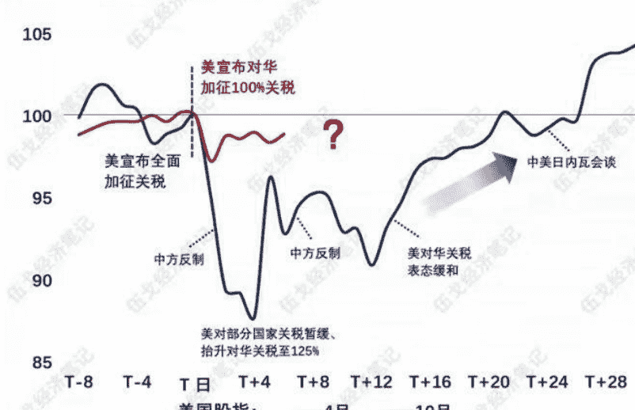

来源:WIND,聚源财经
注：美国加权为标普500指数。

# 图3：美债短期将缓解财政压力，长期均衡？

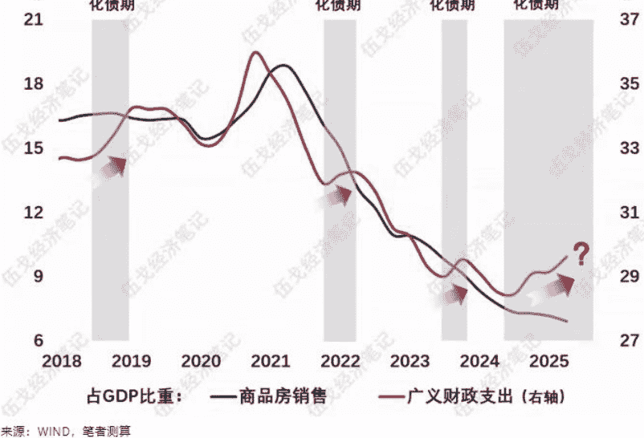

# 微信top2868,进资料分享

Jason不靠
2025-10-20 05:28

澳洲见闻：在澳洲，富人把养老金账户作为避税天堂，并且在富差距断裂、代际不公平的情况下越来越争议，这些都成为未来养老金可持续性的隐忧。正在推动一次养老金改革，向富人加税，减轻年轻人压力。

澳大利亚养老金制度是自90年代以来最大的改革中。从去年开始，政府开始执行相关的养老金改革措施：根据政府估计，这些调整意味着低收入者在退休时可能因此获得1.5万元养老金收益。所有收入在2万至4.5万之间的劳动者都将从中受益，税收减免支付平均均增加10万元。根据政府估计，这些调整意味着低收入者在退休时可能因此获得1.5万元养老金收益。

# 回本：税收减免与财富分配

澳大利亚养老金优惠的规模惊人。根据拉尔霍研究所的数据，仅养老金方面的税收减免，每年缴费就抵澳约500亿元，而且这些优惠优势比例地流向老年人和富裕的澳洲人。

澳大利亚研究所的数据显示了这些特许价值的增长速度——从世纪之初占经济的0.5%上升到目前国内总产值的约2%。令人担忧的是，这些税收优惠使得低收入群体受益。财政部估计，收入最高的1%的人在工作生涯中预计每人获得超过70万元的养老金优惠，到底10%的人在工作生涯中仅获得5万元的养老金优惠。

Jason不靠
2025-10-20 05:35

marketplace：市场对美股关门持续持续43天。这是历史上最。

# 中国产业政策：量化和错位的影响

由 尼尔·加西罗·米亚，蒙达·多科里，陶一叽

8月8日, 2023

下载PDF IMF 电子书上的更多格式 订购打印 创建分享 共享

免责声明：国际货币基金工作文件包含了作者正在进行的研究，并发表这些研究是为了寻求意见和观点辩论。货币基金工作文件中的观点仅代表作者的观点，并不一定代表货币基金、其执行董事会或基金组织管理层的观点。

## 总结

本文量化了中国主要产业政策的规模，并评估了它们对国内要素配置和产业生产的影响。产业政策工具的利用了上市公司财务报告和土地跟踪数据的收集。通过给补贴、税收优惠、税收信贷对受助部门（包括私营和国有企业）的补贴，产业政策的成本估计约为GDP的4%。随着时间的推移，税收优惠的幅度越来越大。接下来，本文使用结构模型估计了中国企业对产业政策与要素配置之间的关系。正如发现，各产业政策工具以不同的方式产生了结果。相反地，产业政策的要素错配导致了成本，并导致监管失效。国际货币基金组织（IMF）对中国应对产业政策和提高透明度的建议所出了。

要素产业配置导致错位约1.2%

Jason不泡
2023-10-20 10:55

bloomberg live: 外资怎么看第三季度经济数据#经济数据

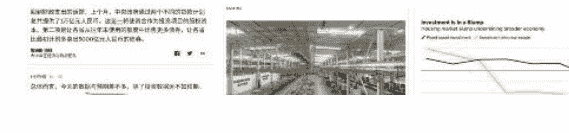

加微信top28688， 资料分享群

回到财政支出的话题：上个月，中央政府通过两个不同的贷款计划总共提供了1万亿元人民币。这第一项将资金作为投资项目的股权资本。第二项是让各省从今年未使用的额度中出售更多债券，让各省最初计划多卖5000亿元人民币的债券。

詹斯·梅格
大中华区经济与政府团队

总体而言软弱，今天的数据与预期差不多，除了投资数据远不如预期。

但“预期”并不意味着看好——之前较软的行业（尤其是住房和私人消费）仍然疲软，价格正在下降，而增加地方政府支出的努力尚未产生太大效果。

如果政府继续努力阻止过度竞争并削减产能，可能会恶化投资。但是如果没有这一点，价格通货紧缩可能会成为一个问题，并继续打击公司利润。

从好的方面来说，出口仍然强劲。

詹斯·梅格
大中华区经济与政府团队

更新10分钟前

加微信top28688，进资料分享群

工业产出的强劲结果--增长 6.5%，预期为+5%--可能有助于提振大宗商品情绪。伦敦金属交易所铜价现货上涨 0.9%，铁矿石上涨0.6%。

位于宁夏银川的银川威力传动技术有限公司的生产线。摄影：沈沫/彭博社

[马丁·里奇](https://www.example.com/user/martin-liqi)
大宗商品团队，上海

加微信top28688，进分享群

投资的下滑确实值得关注。问题不仅仅是住房。基础设施投资今年9个月增长1.1%，为2021年以来的最低表现。这通常由地方政府支持，但他们的收入正在下降，而且他们的支出没有那么多，这可能会削弱投资。

## Investment Is In Slump Housing market slump undermining broader economy

- Fixed-asset investment into real-estate

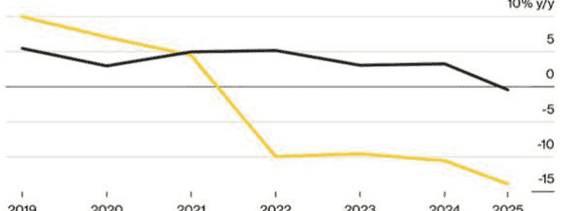

Source: China's National Bureau of Statistics
Note: data is through Sept.

詹姆斯·梅格
大中华区经济与政府团队

税收收入的缺乏和土地价值的持续下降（目前已降至40%左右）意味着截至9月，地方政府出售了约11.5万亿人民币（1.6亿美元）的新债券用偿还旧债，这意味着它的直接影响有限。

我不确定已经说了多久，但事实仍然是故事：销售增长进一步疲软，而产业产持续强势是中国的核心。今天最大的惊喜是固定资产投资变得更惨--今年9个月下降了0.5%，比2020年以来的任何时候都糟糕。

## China's Economic Activity Slowed Last Month

- GDP growth
- Industrial output value-added
- Retail sales

9月仅增长3%。

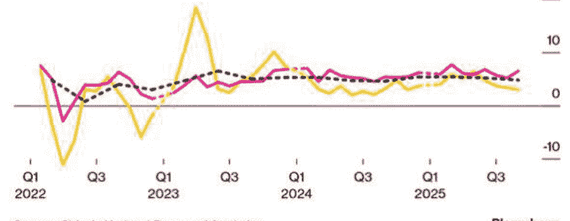

Source: China's National Bureau of Statistics

詹斯·梅格
大中华区经济与政府团队

中国经济连续两个季度放缓，以最弱的速度受到消费者和企业支出的破坏。

彭佩娜
彭博新闻总编辑

9月的房价再次下跌，并不是市场触底的好兆。与一年前相比，价格下跌幅度不像以前大，但仍然是负的。这使得买房子更便宜，但也削减了那些财富，他们不愿花钱。财富的下降是销售如此低迷的原因之一，而且这个周期似乎不会结束。

## Chinese Home Prices Still Falling Drops aren't as deep as before declines still hurting household wealth

新建商业住宅平均价格同比下降10%。

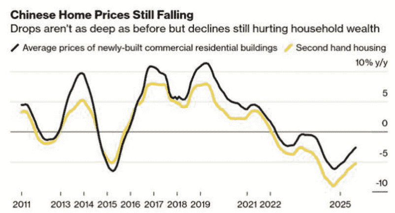

Source: China's National Bureau of Statistics, Bloomberg calculations

马丁·圣奎泽
大宗商品团队，上海

钢铁产量疲软：9月份同比下降4.6%至7350万吨

## 瑞银的张估计，中国第四季度GDP增长可能会放缓至4%。

Bloomberg TV @BloombergTV · Follow

China's economy grows at the weakest pace in a year. UBS economist weighs on what it means: bloomberg.com/news/live-blog...

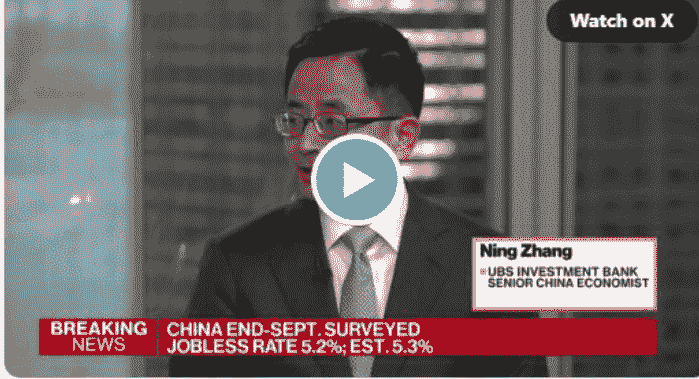

3:41 PM · Oct 20, 202

刘玉
亚洲经济及政府团队

加微信top28688，进享群

中国的房价在9月下降得更陡，尽管近期主要城市为了复苏疲软的房地产市场引入了宽松措施。

国家统计局周一显示，70个城市（排除保障性住房）的新房价格较8月下降了0.41%，是两个月来的最大跌幅。房价下跌了0.64%，是一年来最大的下滑。

中国四年的低迷拖累了经济，第三季度的增速为一年来最慢速度。持续的价格下跌阻碍了那些担心房地产作为财富载体可行性的买家。

“房地产市场仍然处于低迷，”Pantheon Macroeconomics高级中国经济学家Kelvin Lam在上周的一份报告中写道，“价格恢复可能直到2027年，届时库存将回到更合理的水平。”

二手房价在监测的70个主要城市中均为一年以来最低。

第三季度贸易GDP的比率略回落—净出口占名GDP的6.2%，远高于第二季度出的6.4%记录。尽管如此，这仍然是一个非常高的水平，远高于自2014年以来的任何季度。

## China's Exports Are On a Tear

- Net exports as percentage of nominal GDP

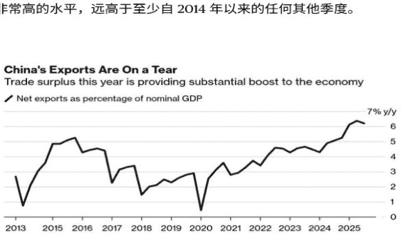

Source: China's National Bureau of Statistics, General Administration of Customs

加微信top28688，进群
