# 南半球聊财经251021

Jason-不霆
2023-10-21 04:31

bloomberg: 细观察中国Q3数据，家庭部门不愿意多买，企业投资减少，增长依赖于出口，这引发了外部贸易第三类的争纷。这种做法让内部经济困扰，名义GDP在第三季度放至3.7%的水平，GDP减缓指数连续10个季度为负。
高盛把全年GDP预测从4.8%上调至4.9%，打算政策制定者可能会推进今年预期的10个基点。#经济数据

## Chinese Exports Triggered Record Pushback Last Year
Trade remedy cases filed in 2024 are third-highest ever

- Trade remedy cases filed against Chinese goods through August Rest of the year

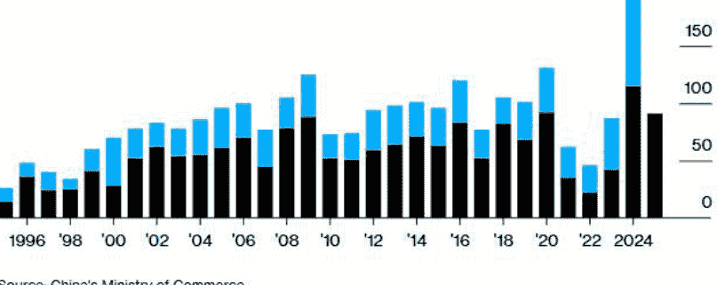

Source: China's Ministry of Commerce

# China's Economic Growth Moderates in Third Quarter
Industrial production expansion rebounded in September

- Real GDP / Industrial output value-added / Retail sales

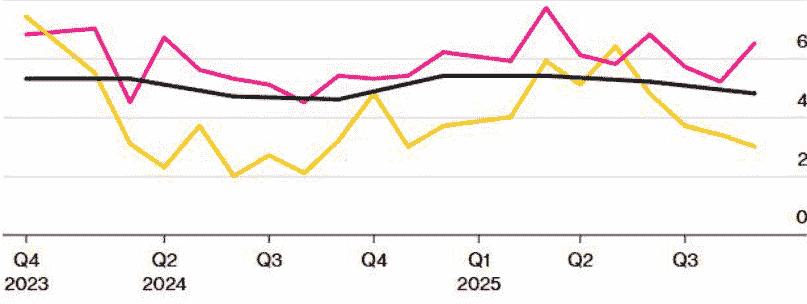

Source: National Bureau of Statistics
Note: NBS Data for January released combined with February.

## 加微信208688，资料分享群

## 中国投资自2020年以来首次萎缩
九个月投资额同比下降0.5%

- Fixed-asset investment

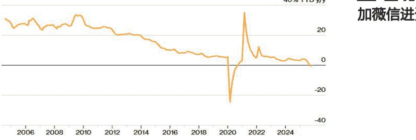

微信进资料群

数据来源：国家统计局

Jason/磊磊
2023-10-21 04:41

高：中国消费增速由8月的3.4%放缓至9月的3.0%，主要受线下商品销售及餐饮收入零售增速拖累。然而，汽车和通信设备销售额的同比增长长度从8月的0.8%和7.3%上升至9月的1.6%和16.2%。

9月份销售额零售增速受拖累，大分类消费活动指标同比收缩。我们的跟踪数据显示，截至10月份，城市的房屋交易依旧不温，与此同时，国家统计局和私营统计数据均显示9月份房价价格持续下行压力，这对于居民财富积累影响不容小。

中国出口商的利润竞争激烈，进一步增加了利润的压力，许多出口商不得不削减工资甚至到位才能竞争，这使得消费者信心指数持续下降。#经济数据

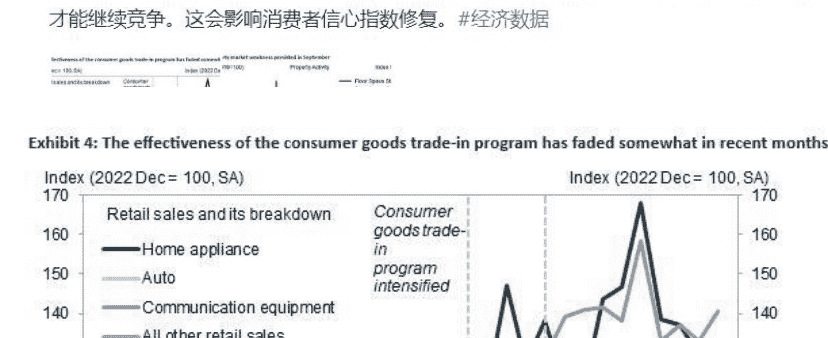

| Index (2022 Dec = 100, SA) | Index (2022 Dec = 100, SA) |
|---|---|
| 170 | | 170 |
| Retail sales and its breakdown | Consumer |
| 160 | goods trade- | 160 |
| - Home appliance | in | 150 |
| - Auto | program | 140 |
| - Communication equipment | intensified | 130 |
| - All retail sales | intensified | 120 |
| | | 110 |
| | | 100 |
| | | 90 |
| | | 80 |
| Dec-22 | Apr-23 | Aug-23 | Dec-23 | Apr-24 | Aug-24 | Dec-24 | Apr-25 | Aug-25 |

Source: NBS, CEIC, Haver Analytics, Goldman Sachs Global Investment Research

## 微信信28688，进资料分享群

## Exhibit E: Property market weakness persisted in September

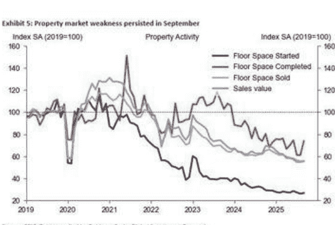

Source: CEIC, Data compiled by Goldman Sachs Global Investment Research

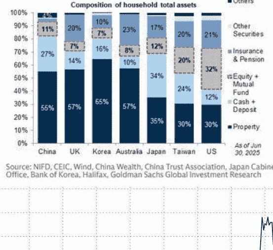

Source: NBF, CEIC, Wind, China Wealth, China Trust Association, Japan Cabinet Office, Bank of Korea, Goldman Sachs Investment Research

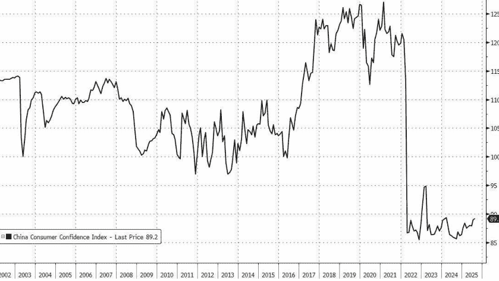

## 微信信28688，进资料分享群

## Jason不霆
2023-10-21 04:44

bloomberg: Pantheon Macroeconomics 认为2027年库存降至合理的水平，价格可能回升。

尽管主要城市最近推出了宽松措施来重振困境的房地产市场，国家统计局周一的数据显示，包括补贴住房在70个城市的新房价在8月份下降4.1%，为以来最大。转售房屋价格下降6.4%，为以来最大。

- Used Home Prices
- New Home Prices

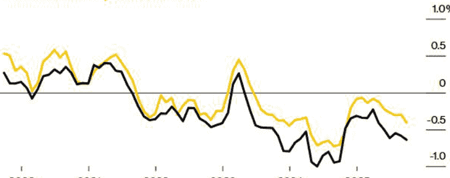

资料来源：国家统计局

中国房地产低迷一直拖着经济，第三季度增长速度为最慢。购房者担心房地产作为财富存储手段。“房地产市场仍处于低迷，”Pantheon Macroeconomics 高经济学家 Kelvin Lam周在一份报告中写道，“直到2027年库存降至合理的水平，价格可能回升。”

## 加微信28688，进资料分享群

## 9月不同口径二手房价对比
南半球财经

| 统计 | 二手挂牌 | | 新公寓 |
|---|---|---|---|
| -5.25% | -8.35% | -7.38% | -8.03% |

Jason不霆
2023-10-21 04:48

bloomberg: 追踪中国股票的交易所基金连续两周资金流出，其中Harvest300中国A股 ETF上周获得3.亿美元资金流出，这是自4月份以来的最大。## 中国ETF记录的资金流出金额

- KraneShares CSI Internet ETF
- iShares China Large-Cap ETF
- Xtrack Harvest CSI300 China A-Shares ETF
- iShares MSCI China ETF

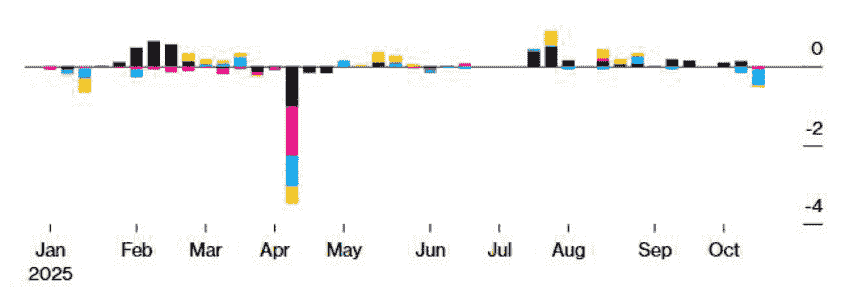

资料来源：博社

## 微信信28688，进资料分享群

## Jason不霆
bloomberg: 越南政府的目标是在未来五年内实现至少10%的GDP增长。目前美国对越南的关税率为20%。

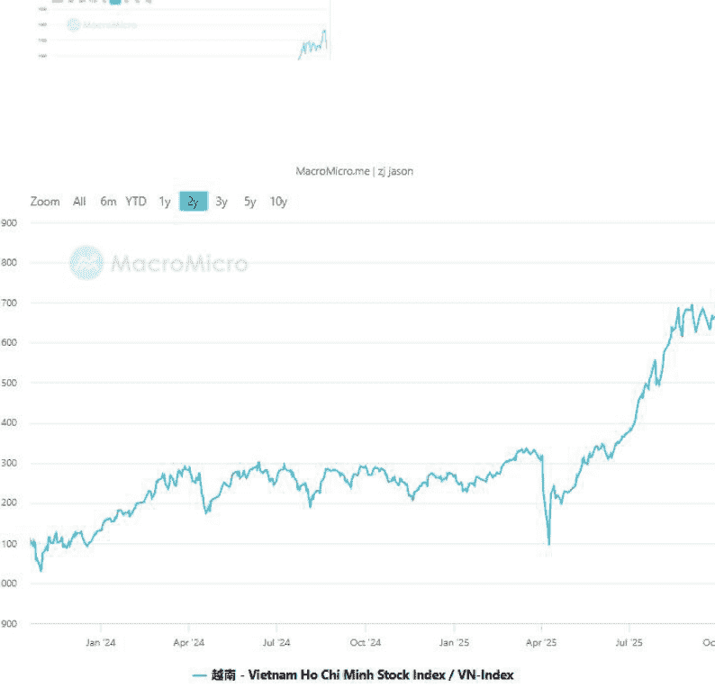

## Jason不霆
bloomberg: 美国签署了一项新协议以加强关键矿产的获取，两国在未来六个月内为项目支付超过1亿美元。特朗普在白宫表示，“从我们开始一年后，我们将拥有如此多的关键矿物和你不知道如何处理它们”

## 加微信28688，进资料分享群

澳大利亚表示，该协议将由美国和澳大利亚在未来六个月内各支付超过1亿美元用于初始项目，两国将进行一些进一步的项目，其中一项开发项目包括日本。该文件没有说明哪些实体将提供这种融资的细节。

据白宫称，作为这项协议的一部分，五角大楼将资助在西澳大利亚建设一座年产100万吨的先进精炼厂。美国出口银行也正在关键矿产项目签署了22亿美元的意向书。

这次是来自澳大利亚的特尔布拉斯重新获得主权以来首次访问白宫，而澳大利亚领导人正寻求与美国建立关系，利用其国家在关键矿产方面的财富作为筹码。中国对稀土出口实施前所未有的限制的举动震惊了全球经济，美国财政部长贝斯特·贝森特上周表示，包括澳大利亚在内的盟友正在就此联合应对。早些时候：澳大利亚将成为美国解决中国稀土限制措施的问题

澳大利亚拥有世界第四大稀土储量，致力于将自己定位为中国的可行替代，为半导体、国防技术、可再生能源与其他行业提供至关重要的供应。中国也是中国以外唯一通过赛纳稀土有限公司生产所有稀土的基地。

## 澳大利亚稀土储量排名第四

| | 44.0M |
|---|---|
| Brazil | 21.0M |
| India | 6.9M |
| Australia | 5.7M |
| Russia | 3.8M |
| Vietnam | 3.5M |
| United States | 1.9M |

## 微信信28688，进资料分享群

## Jason不霆
2023-10-21 05:01

摩根丹利：通过分析过去25年中，标普五指数、10年收益率和美元指数同时发生极端波动（超过2.5标准差）的交易日，发现明确指向美元在未来六个月内走强。历史数据显示，“金姑娘”情境出现后，许多英镑表现出最佳收益。“金姑娘”是第二可能的收益信号。“金姑娘”指标标普五指数、美元指数和10年收益率同时超过2.5标准差。这在过去25年中共有26次胜过“金姑娘”情境。虽然收益率较高，但隐含的风险较大。数据显示，在“金姑娘”情境的六个月内，美元指数平均下跌2.7%，存在某种程度的盈利支持美元走强。作为唯一的风险资产和大商品中首选。

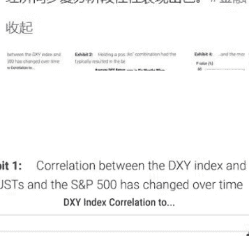

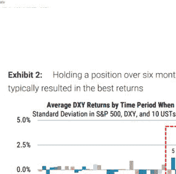

## 加微信28688，进资料分享群

## Exhibit 3: The 'goldilocks' combination had the best average return
## Exhibit 4: ...and the most reliable return

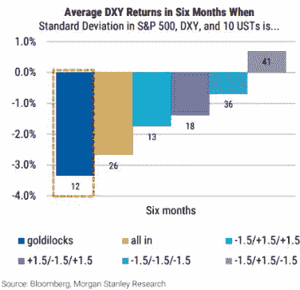
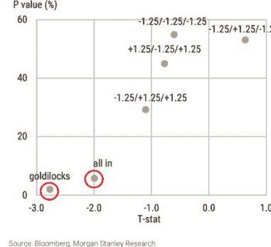

## Exhibit 7: The "Goldilocks" short USD strategy had an 83% hit rate

Long or Short USD when Std. Dev in SPX, DXY, and UST is +1.25/-1.25/-1.25

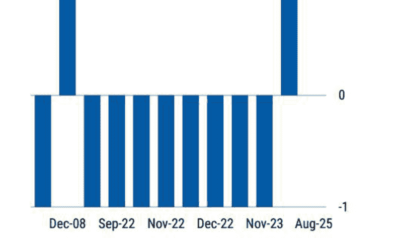

Source: Bloomberg, Morgan Stanley Research

## 加微信28688，进资料分享群

## Exhibit 9: GBP outperforms against USD on the 6-month time horizon following “Goldilocks”
## Average Change in USD/CCY

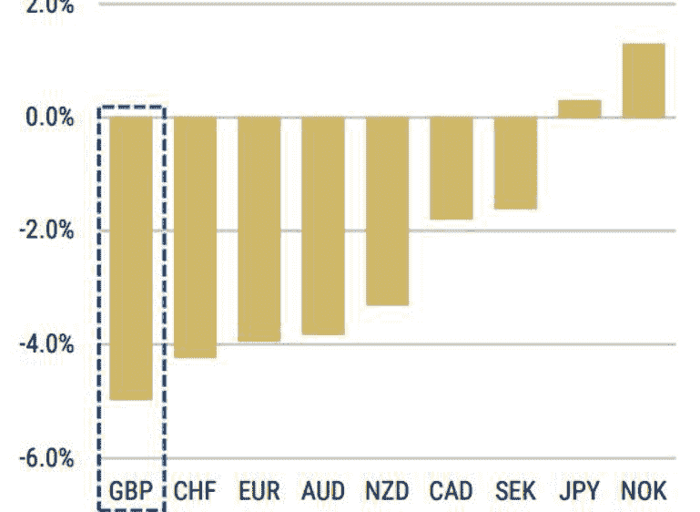

Source: Bloomberg, Morgan Stanley Research

## Exhibit 5: DXY underperformed most on the six-month time horizon following a “Goldilocks” occurrence
## Exhibit 6: ...as well as following the “all in” occurrence

DXY Return when move in SPX, DXY, and UST is +1.25%/-1.25/+1.25 σ

| DXY Return when move in SPX, DXY, and UST is +1.25%/-1.25/+1.25 σ |
|---|---|---|---|---|---|
| 0.0% | | | | | | 2 |
| -0.5% | | | | | | |
| -1.0% | | 12 | | | | |
| -1.5% | | | | | | |
| -2.0% | | | | | 26 | |
| -2.5% | | | | | | |
| -3.0% | 11 | | | | 25 | |
| | Six months Three months One month One week One day | | |

Source: Bloomberg, Morgan Stanley Research

## 微信信28688，进资料分享群

## Exhibit 10: AUD outperforms against USD on the 6-time horizon following "all in in"

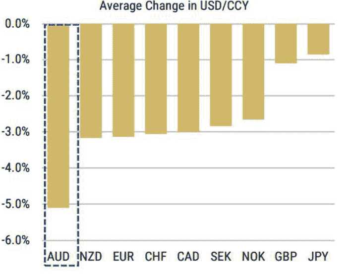

Source: Bloomberg, Morgan Stanley Research

Jason不霆
2023-10-21 05:06

日经：Wealth-X的报告显示，按人口和资产规模计算，亚洲拥有全球最大的超级富豪人群。截至6月，亚洲赢家积累达14.8万亿美元，与欧洲的14.7亿美元相比不下，增长速度约超过欧洲的两倍。其中亚洲尤为突出，全球增长最快的十大大城市中，新加、罗比、得比和印度占比最高。

花薇亚洲9月发布的报告显示，亚洲豪族办公室的资产配置中，股票占比最高为32%，全球平均的27%，现金配置也为13%，高于全球水平。亚洲进入周期后，亚洲投资者对多元化的需求上升。黄金与传统资产相关性低，已成为客户多元化配置中的关键工具，通常建议不超过5%的比例。三井信托银行私人部门表示。

## 加微信28688，进资料共享

## Fastest-growing cities by UHNW population
(Projected average annual growth over H1 2025-2030, in percent)

| City | 0 | 2 | 4 | 6 | 8 | 10 | 12 | 14 |
|---|---|---|---|---|---|---|---|
| Oslo (Norway) | | | | | | | | |
| Bengaluru (India) | | | | | | | | |
| Hyderabad (India) | | | | | | | | |
| Delhi (India) | | | | | | | | |
| Chongqing (China) | | | | | | | | |
| Mumbai (India) | | | | | | | | |
| Hefei (China) | | | | | | | | |
| Brisbane (Australia) | | | | | | | | |
| Stockholm (Sweden) | | | | | | | | |

Source: Wealth-X

## Family-office wealth allocation by asset class
(In percent)

- Public equities
- Fixed income
- Cash & cash equivalents
- Real estate
- Private equity
- Private equity
- Hedge funds
- Private credit
- Real estate funds
- Others

| Region | 0 | 20 | 40 | 60 | 80 | 100 |
|---|---|---|---|---|---|
| Global | | | | | | |
| APAC | | | | | | |

Source: Citigroup

加微信28688, 进资料

Jason不离
2025-10-21 05:12

湘沪：居民消费未累，7月公布的育儿贴和逐步免费学教等消费政策生效

向稳，社会消费零售增速继续回暖。高基数下，名义GDP经济增速达到4.4%，全年经济增速就可以达到5%，这就意味着，可能会出台的刺激政策或为空。

我们预计今年内还有若干季度刺激，基准10-20个基准点的预测。从内部条件，9月数据显示经济增长末出现回升：名义人民币贷款去年同期减少3000亿元，从外部政策来看有望提升。

## 经济数据

图表1: 三季度实际和名义GDP经济增速均下降，但实际GDP增速回暖四次

| | 同比% | 名义GDP增速 | 5 |
| :--- | :--- | :--- | :--- |
| | 实际GDP增速 | | 4 |
| | 实际-GDP增速(环比) | | 3 |

图表2: 分行业者，今年第三季度二产业经济增速明显回升，第三产业增速有所下降

| | 同比% | 第一产业 | 第二产业 |
| :--- | :--- | :--- | :--- |
| | 第三产业 | | |

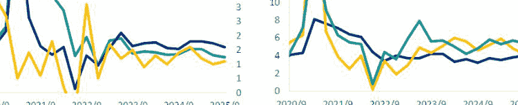

数据来源: 亮丽、财信数据

数据来源: 亮丽、财信数据

### 图表7: 30大城市商品销售额10月比去年同比20.7%，强于9月的17.0%正增长

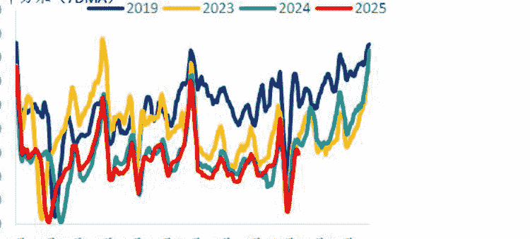

数据来源: 亮丽、财信数据

# 加微信top28688，进阶资料分享

### 图表13: 新增人民币货币贷款较去年同期下降明显，中长期贷款若微减少

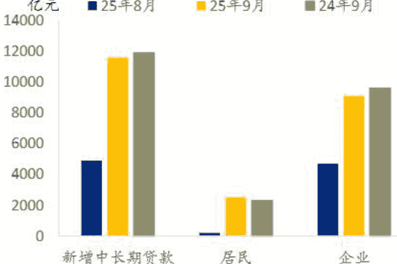

数据来源：央行、同花数据

> Jason不周末
> 2025-10-21 05:19

民生：居民收入增速放缓至经济增速持平，为2023年二季度以来首次。这一变化表明内需与消费的复苏之路漫长，需要政策由短转向加大应对。前期亮频的“以旧换新”相关类社会萎缩已连续放缓，部分行业也在9月再度陷入“内卷”态势，季度工业产能利用率从74.0%升至74.6%，说明内需反复发展，四季度是考验政策连续性的关键阶段。#经济数据

加微信top28688，进阶资料分享群

### 图2：三季度人均可支配收入增速与经济增速持续持平

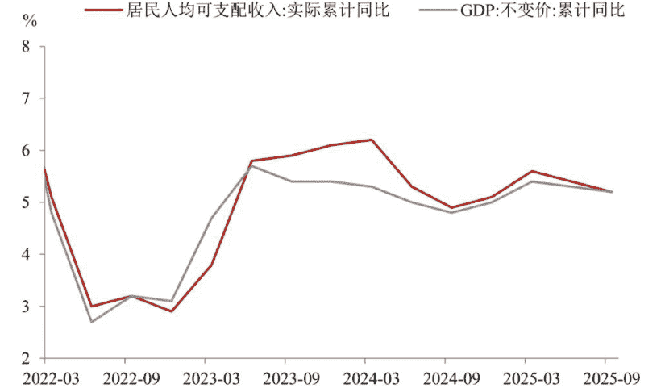

资料来源：iFind，民生证券研究院

### 图3：“以旧换新”类和其他类类走势分化

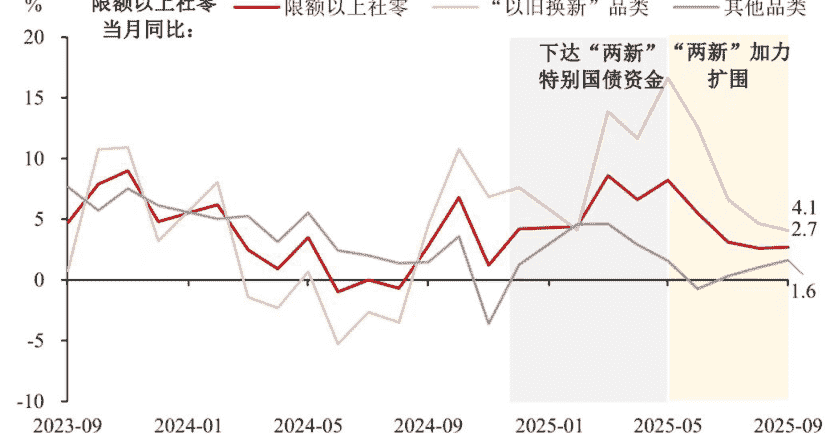

资料来源：iFind，民生证券研究院

微信top28688，进阶资料分享群

### 图9：9制造业增速趋势扩散

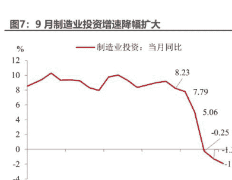

数据来源：Wind, 民生证券研究院

### 图8：当制造业投资活动整体依然偏偏

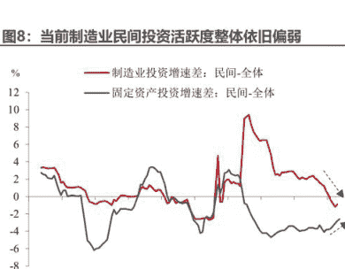

数据来源：Wind, 民生证券研究院
注：9制造业投资数据发布

### 图6：相比8，9月更多回归到第二象限

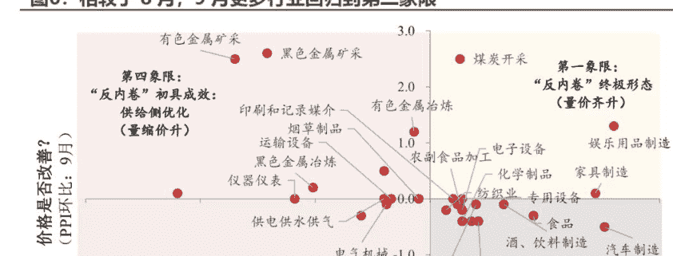

数据来源：iFind, 民生证券研究院
Jason 2025-10-21 05:31 东：人均收入增速从Q2的5.1%降到Q3的4.5%，关注净收入增速从2.3%降至3.3%，反映出Q3压力加大。不论是人均消费，还是服务，相同的Q3增速低于Q2。

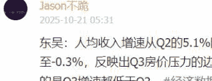 加微信top28688，进阶资料群

### 图8：人均收入和消费变化的决定性指标

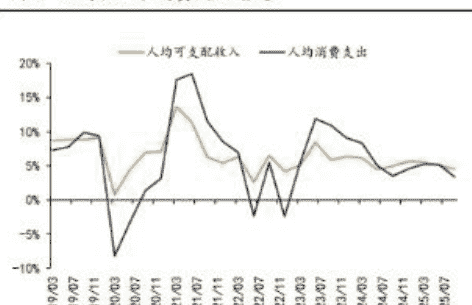

数据来源：Wind，东华研究所
Jason 2025-10-21 05:51 财经：跨境交易流动性的决定性指标，领先指标，我们通过过去一年人民币波动幅度来衡量。首次看到人民币波动率1.79%，较年初下降。若采用清算模式，人民币流动性枯竭，若采用清算模式将带来更大的压力，预计海外银行继续参与。全部结论。

### 图9：测算人民币交易回报——10Y债收益率（美国、中国）

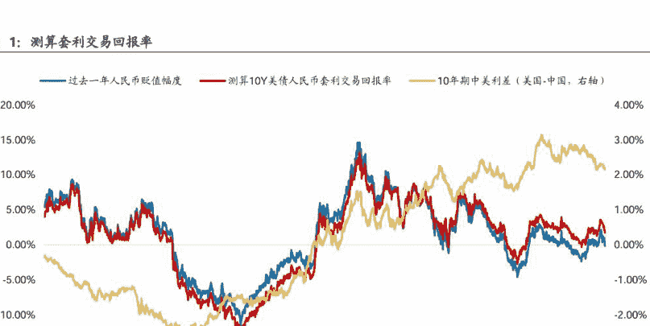

数据来源：iFind，广发宏观研究中心
加微信top28688，进阶资料群

### 表1：测对外贸易规模（百亿元）

| 年份 | 进口 | 出口 | 差额 | 全球占比 | 进口增速 | 出口增速 | 差额增速 |
| :--- | :--- | :--- | :--- | :--- | :--- | :--- | :--- |
| 2021Q3 | 13,666 | 9,323 | -2,343 | -20.08% | 906 | -1,437 | 69.71 | -2.06% |
| 2021Q4 | 15,599 | 11,681 | -4,309 | -26.93% | -917 | -5,226 | 65,739 | -7.95% |
| 2022Q1 | 14,441 | 9,008 | -5,333 | -5.64% | -2,340 | -2,872 | 120,494 | -2.38% |
| 2022Q2 | 13,985 | 11,269 | -2,716 | -15.00% | -1,459 | 41.13 | 88,694 | 20.74% |
| 2022Q3 | 17,378 | 13,433 | -3,945 | -22.70% | -6,871 | -8,016 | 67,908 | -19.53% |
| 2022Q4 | 15,241 | 11,717 | -3,525 | -29.52% | 4,795 | -8,270 | 42,034 | -20.74% |
| 2023Q1 | 14,695 | 12,843 | -1,852 | -31.70% | -3,819 | 7,527 | 145,453 | 11.1% |
| 2023Q2 | 15,243 | 11,289 | -3,986 | -27.53% | -2,586 | -6,482 | 70,074 | -9.25% |
| 2023Q3 | 15,867 | 11,915 | -4,672 | -29.44% | -7,560 | -13,232 | 77,971 | -15.69% |
| 2023Q4 | 13,035 | 8,884 | -4,151 | -31.84% | -3,938 | 14,390 | 54,633 | 4.33% |
| 2024Q1 | 17,913 | 11,684 | -6,229 | -35.17% | -6,615 | -12,915 | 52,960 | -24.39% |
| 2024Q2 | 18,363 | 11,183 | -7,180 | -37.83% | -15,570 | -18,051 | 65,954 | -28.74% |
| 2024Q3 | 19,469 | 17,047 | -2,442 | -12.22% | -12,323 | -14,796 | 151,638 | -9.72% |
| 2024Q4 | 22,533 | 15,765 | 6,768 | 30.65% | 10,523 | -17,726 | 76,718 | 24.57% |

数据来源：测算数据，广发证券中心

### 图2：测算对外需求波动（百亿元）

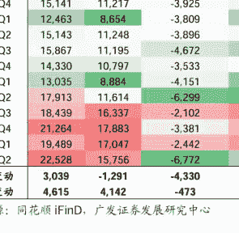

数据来源：测算数据，广发证券中心

### 图3：钢铁行业出口需求（百亿元）

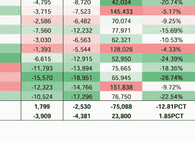

数据来源：测算数据，广发证券中心
2023-10-25 10:47

第一财经：广州农行的员工需要退回过去3年的过费，人均差不多要退一万四。第一笔就交两千，差掉的从每个月工资里扣缴。#八卦

# 向广州农行。就此，第一财经

第一财经发现，上述传闻指向广州农行。就此，第一财经曾向其询求，广州农行回应：“一方面，这是我行进行调整津贴发放符合相关规定；另一方面，我已向全体员工说明了情况，绝大部分员工理解和支持。”

Jason 2025-10-21 05:54 财经：收入增长增速对低收入群体形成较大制约，就业收入增速显著，9月份低收入群体收入受国内消费萎缩影响，月上回落0.6个百分点，对出口的拉动回落0.4个百分点，拖累较大。相反，受益于出口政策带来的财富效应，汽车、化妆品、通讯材料类商品需求有所回升。第四季度实际GDP增长4.6%，全年5.0%左右#经济数据

作为消费出的组成部分，今年加速下降，6月降幅3.3个百分点，而整体通胀水平持续压力。

### 图10：居民边际消费倾向仍在下降

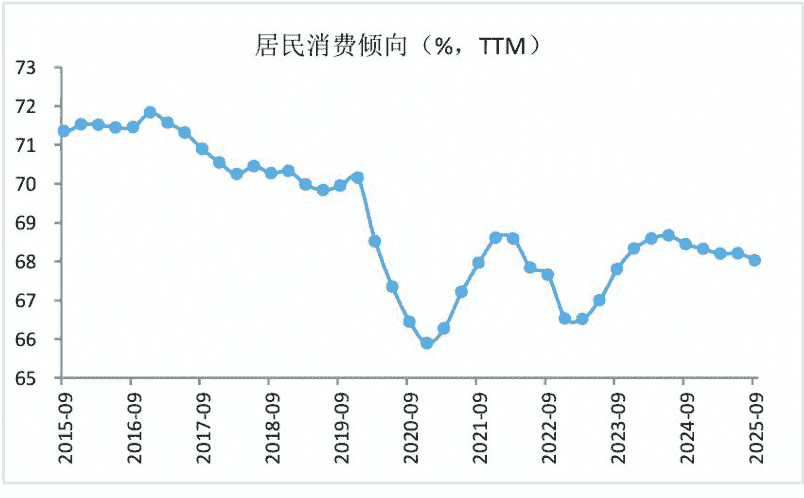

资料来源：WIND， 财信研究院

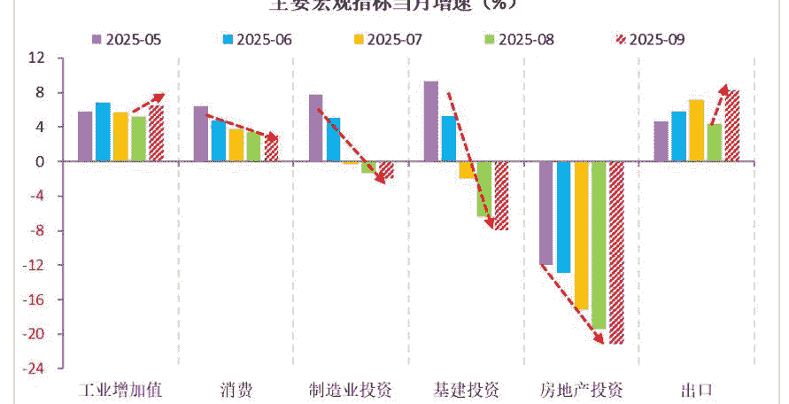

加微信top28688，进阶资料分享群

### 图8：三季度农村外出务工收入增速明显回落

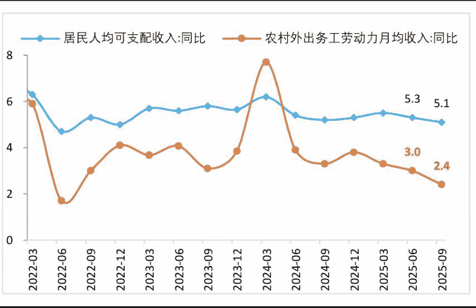

资料来源：WIND, 财信研究院

# 图9：外来农业户户籍失业率持续高于去年同期

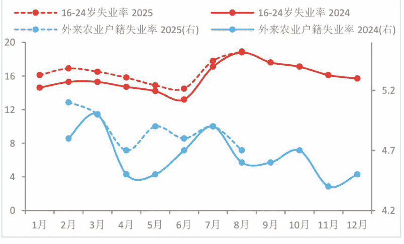

资料来源：WIND, 财信研究院

加微信top28688，进资料分享群

### 图19：预计四季度 GDP 增长 4.6%左右，全年平均增长 5.0%

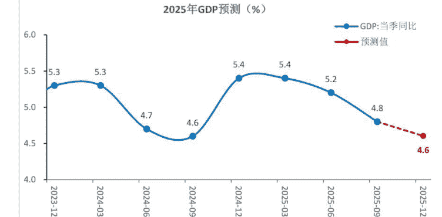

数据来源：WIND财信研究院

# 知识星球
添加微信
微信:top28688

| 序号 | 公号/星球/社群 | 原价 | 领域 |
| :--- | :--- | :--- | :--- |
| 1 | 生财有木 | 2765/年 | 副业，搞钱 |
| 2 | 众宗吃瓜群 | 365/年 | 时政，历史 |
| 3 | 记忆巷/裁树风 | 365/年 | 成长 |
| 4 | 欧洲金轨 | 328/年 | 时政，历史 |
| 5 | 卢克文青云会 | 699/年 | 时政，社会 |
| 6 | 体制内主任 | 599/年 | 体制，职场 |
| 7 | 局外人的视界 | 669/年 | 金融，时政 |
| 8 | 溯泽异妄 | 4166/年 | 财富，成长 |
| 9 | 守夜人总司令 | 599/年 | 时政，经济 |
| 10 | 江宁知府 | 365/年 | 时政，国际 |
| 11 | 政堂/顾子明 | 568/年 | 时政，经济 |
| 12 | 唐院 | 1399/年 | 金融，财富 |
| 13 | 大树乡谈 | 199/年 | 时政，成长 |
| 14 | 水库联大 | 10000/年 | 房产，经济 |
| 15 | 洪灏宏观策略 | 4376/年 | 经济，搞钱 |
| 16 | 金政通鉴/北海南山 | 4576/年 | 股票，行研 |
| 17 | 猫哥的世界 | 299/年 | 时政，社会 |
| 18 | 飞浪龙 | 3600/年 | 股市，经济 |
| 19 | 米联诸见闻 | 599/年 | 经济，金融 |
| 20 | 茶茶财经圈 | 330/年 | 房产，股票 |
| 21 | 赢在八小时 | 365/年 | 成长，职场 |
