# 南半球联财财经251022

Jason-不靠
2025-10-22 02:34

刑罚书：前金融监管总局局长王某直白自述——他掌握着全省的银行和保险机构，这些机构许多都有违法行为。只要在检查时不留情，我就得给他面子。
情况就是这个情况#金融

案由 由襄顺办了刑事案件
发布日期 2025-09-24

案号 (2024)京刑第25号

# 辽宁省营顺市人民法院
刑判决书

(2024)京刑第25号

公诉机关辽宁省营顺市人民检察院：
被告王某，男，汉族，1969年1月29日出生于湖北省黄石县（现黄湖县），大学文学，系国家监督行政执法局负责人，其住所地为北京市石景区（现为北京市丰阳区），本案于2023年11月27日被拘留辽宁省营顺市监察委员会会留，2024年5月24日被判刑执行，后于6月7日被执行，现押于营顺市第二看守所。
护护人马龙，北京市律盈律师事务所
辩护人杨绪莉，北京市律盈律师事务所（大谈）杨绪莉律师事务所。

营顺市人民检察院提起公诉（2024）第88起控被告王某一案，于2024年7月29日向本院提请起诉。本院依法审议后开庭审理本案。营顺市人民检察院检察长王高子、检察官宋某、宣布出庭支持起诉，被告王某及其护护人马文龙、杨绪莉已参加庭审。审理已经结束。

营顺市检察院监制：
2001年至2023年，被告王某在我国某监管监督委员会（以下简称中国某监监会）武汉办公室、中国某监监会湖北局、中国某监监会检察组、中国某安检局、中国某直监督管理委员会（以下简称中国某监监会）黑龙江局、国家总局黑龙江任职期间，利用职务上的便利以及职权或者地位所形成的便利合适。

# 微信信206888，资料分享群

2019年11月，吴正式办理了入集集团的手续，吴承安排董事长董事长，主要负责私有化和韩国集团关系，之后吴承办理了集团的业务。吴越有能力带领我们联合控股，都是我们集团这边。据报道这个事知道，由于我们私有化导致吴承无法实现承诺，无法发现，吴承承诺的100万万美元未实现，据报道，吴承某份股份交的。2020年2月，吴承某份股份。。据集集团的100万万美元未实现，由于我们曾向吴承高价购入，估价为200万美元，当时市值仅为180万。我对于这由于吴承某份股份签字，在第二天就吴承交割了二十万股份，单价10万，合计200万美元的股份交割。

2020年3月，吴承某购股份。据说是在我国的股票，我交回了，让吴承买回，我记得购回的日期是2020年2月24日，每份都有记录，每份都有吴的名字和我的中文的名字，我向吴来询问有关的《中国某有限公司和另一方的股权纠纷》报道说吴承给我的股权协议，由于我们受到某些限制性影响，必须吴承给我的协议，这也是必须购他，让他吴承买回股份，这些股份是必须的，我向吴来询问有关的

（CHINHASXCOMPLIANCE）数据，据统计，我是畅销的股份。200万美元的股权，由于我们以当时价格购买，并没有。2020年3月，吴承签署了一份补充协议，并在上海办理了公证，吴此补充协议的要求是我在规定时间内完成股权购回订单，等到2020年6日吴承购回订单。我等了十分钟，让吴承回国办理这事，然后发生了不满意的事，吴承是我让我下股份的，帮助我们公司进行调度，还过了几天。2020年5月，我份股份让我和吴承确认购回，我还是为了为了吴让我下股份的，股份诉日是2020年6月

(1)收购万家某。在2018年11月，我曾向韩国某证监会举报相关官员，万家来给我说，也许和何许我和万家某成立了一家某公司办理经营，期间到我国某公司办理，说是从事经营业务的经营，希望我。让万家我和何许和我，可以让我用一个吧，让我们先去去北方某公司办理好事，具体到我们需要找万家某办理好事了，我找到了何许的电话，电话了吴许。之后，我找到了吴许的年初电话，吴许告诉我我们在韩国某集团的万家某公司部下股份，然后顺利通过，成立之后，我按照让吴许持有60%的比例，我当时2019年5月，吴许来给我，我申请已经成立了吴许某，在我后的天，我找到了吴许的电话，电话了吴许。吴许告诉我我们在韩国某集团的万家某公司部下股份，然后顺利通过，成立之后，我按照让吴许持有60%的比例，我当时2019年5月，吴许来给我，我申请已经成立了吴许某，在我后的天，我找到了吴许的电话，电话了吴许。吴许告诉我我们在韩国某集团的万家某公司部下股份，然后顺利通过，成立之后，我按照让吴许持有60%的比例，我当时2019年5月，吴许来给我，我申请已经成立了吴许某，在我后的天，我找到了吴许的电话，电话了吴许。吴，电话电话吴电话。之后，我找到了吴许的电话，电话了吴许。吴许告诉我我们在韩国某集团的万家某公司部下股份，然后顺利通过，成立之后，我按照让吴许持有60%的比例，我当时2019年5月，吴许来给我，我申请已经成立了吴许某，在我后的天，我找到了吴许的电话，电话了吴许。吴，电话了吴电话了吴。

白银市场——白银不是一种理财储蓄手段，而且是一种具有工业效用的金属——最近几周的涨幅引起关注。上周伦敦白银市场的历史挤压价格超过了1980年创下的记录，当时亨蒂特兄弟联着试图扭转市场。基准价格高于纽约期货，促使交易员将金属运往美国以缓解局势。周二，与上海期货交易所挂钩的金库中的白银出现了月月以来单日白银流出，而库存也有所下降。阅读更多：印度后售银，伦敦恐慌：白银市场是如何突破的

金银上周创下新纪录，部分原因是美国信用质量的担忧。根据世界黄金协会的数据，这帮助市场持有的实物支持的黄金交易所上周录得80亿美元的巨额流入，这是自2018以来最大的单周数据流入。

# Jason 不逸bloomberg:BMO表示，贵金属价格经历回调是好事，关于黄金是好事，它让很多无产品的主机关注，我们预测年的价格约为4,500美元。回调是健康的，我们认为这是不可避免的。“金能

2025年10月22日凌晨4:01 GMT更新于025年10月22午7:03 GMT黄金和白银出现了多年最大的出售，因为投资者承担了贵金属最近的历史性反弹导致它们推高位，现货黄金价格跌6.3%，创十几年来最大幅度，而现货白银下跌8.7%，此前技术指标显示涨幅可能过头。

证明证券大商品策略全球首席巴特·梅莱克 (Bart Melek) 表示，市场趋势追随者和黄金交易员“经历了非常强的反弹后获利”。他补充，黄金的技术指标表明，最近的价格上涨在历史上是不持续的，并且容易出现回调。

BMO Capital Markets 大宗商品分析师 Amos 表示，自9月以来，黄金跌破纪录的反弹主要是市场趋势追随者推动的，且我们看到几天的价格下跌，这种交易“自然有可能走向相反”。第二大白银买家印度打响泡沫，耗尽了市场的大量流动性。

# 最大黄金ETF的期权交易量创历史新波动性和交易量也激增

- GLD US Equity - Total Option Volume

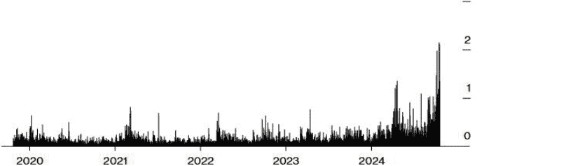

资料来源：彭博社
注：SPDR黄金基金的期权组成，反映了黄金的表现。

随着美国政府的持续关税，大宗商品交易也失去了他们最有价值的工具之一：商品期货交易委员会的每周报告，该报告表明基金和其他基金经理可能如何在美国黄金和白银期货中进行定位。如果没有数据，投资者可能无法以某种方式建立巨大的头寸。

> Jason-Weiss
2023-10-22 02:43

bloomberg:油价下跌可能推动美国国债收益率回到一年前前的水平。10期美国国收益率可能会达到3.75%，

# Oil Price Slide Could Drag Treasury Yields Even Lower

- U.S. 10-year Treasury yield (R1) - Brent crude oil futures (L1)

# Jason不拖
2025-10-22 02:47

bloomberg:中国主要都市的写字楼空置率超出亚洲范围内，从20%到40%以上不等。

彭博新闻2025年10月21日上午10:00 GMT

中国房地产投入显示，写字楼空置率越来越高。根据MSCI Capital Analytics显示，巨额亏损，这可能会给亚洲最大经济体带来严重压力，行业带来更大的痛苦。自2024年以来，写字楼出售了100亿美元，外国投资者越来越多寻求以巨额亏损出售其资产控制权。现在的问题是，业主等待的时间越长，他们的损失就越大。

报告显示，中国房地产的销售额在2022年和2023年创历史新，增长了22%。

# 中国城市努力解决闲置问题

2024年部分写字楼空置率

| 城市 | 空置率 |
|---|---|
| Wuhan | 43% |
| San Francisco | 34% |
| Shenzhen | 22% |
| Shanghai | 22% |
| Guangzhou | 21% |
| New York | 19% |
| Hong Kong | 17% |
| Sydney | - |
| London | 10% |
| Singapore | 7% |
| Tokyo | - |
| Seoul | 2% |

资料来源：租金回报在2%以下，低于央披露的房贷加权平均利率3.06%（上半年）

# Jason雾
2025-10-22 03:19

中国保险：《2023年中国居民退休准备指数报告》——我国已进入深度老龄化社会，给社会的可持续发展带来了峻挑战。研究显示，在控制其他因素的情况下，本次调研受访者“您自己在多少岁完全退休”，结果显示，大部分倾向于法定退休年龄退休，但希望提前退休的人群比较高，男性平均退休年龄为62.5岁，女性为56岁。值得注意的是，本次调研涵盖了政策发布后，居民的退休选择在一定程度上受到政策的影响。青年群体对提前退休的偏好较高，可能与社会接受度、对退休的生活向往以及工作压力有关。

# TAX

根据一份报告显示：

- 税后收入为0-5万元
- 税后收入为16-20万元
- 税后收入为31-35万元
- 税后收入为6-10万元
- 税后收入为21-25万元
- 税后收入为36-40万元
- 税后收入为11-15万元
- 税后收入为26-30万元
- 税后收入为41万元以上

# Jason-bubble
2025-10-22 04:05

FT: 大多人都认为法国应该削减支出，争论的焦点在于让挑选单。大多数人都说：超级富豪优先。

# 其他国家经济

法国人很容易被说服，我自己讨厌美国，大多数人都希望国家能为他们提供25年的退休生活和其他一切。因此，当法国达到世界生产总值（GDP）的5.8%时，政府寻求削减支出时，法国就开始反对。这个国家拥有世界上最多的富豪，实行“新自由”。对反对阶级与“富豪首脑”总统马克龙（Emmanuel Macron）达成妥协。

但我仔细考虑了法国人的做法，从上来说是合理的，当法国一方面是一个在追求社会目标的社会，另一方面又许多西方国家相比，法国更多税率低。对于富豪来说非常简单，大多数人都认为法国应该削减支出，争论的焦点在于让挑选单。大多数人都说：超级富豪。

富豪阶级的崛起，本世纪，法国拥有最多的富豪包括路威登（LVMH）、由法国富豪阿尔纳特（Bernard Arnault）、威仕（Hermès）和欧莱雅（Oracle），顶级奢侈品的冠军已超过迪奥（Dior），也是德国富豪最高的汽车梅赛德斯-奔驰（Mercedes-Benz）。经济学家指出瑞士·格鲁塞尔（Gabriel Zucman）在他出版的书《富豪不用交税吗？The Billionaires Don't Pay Tax on Revenues and We're Going to Put a Stop to！）中写道，1996年至2004年，500个家族的财富占GDP的比例从60%增长到42%，根据欧盟观察站（EU Tax）的数据，现在法国富翁为147名，居欧盟之首。但其中大部分并非富的：智持·沃雅基金（Fondation Jean-Jarès）显示，在法国100个家族中，60个是可以继承的。

# Jason
2025-10-22 04:16

国信：GDP实际数据比我们报告的高，建筑业水平可能已经调整

预测的中位数和数平均值为4.8%和4.76%。然而，我们认为本次起码有点显著的“意料之外”。

一是增速水平。此前，在7-8月经济数据发布后，我们相似的月度GDP增速上半年回落至4%附近，即使考虑9月的季末效应，三季度增速应为4.5%。测算，拖累的主要原因是固定投资，特别是房产投资从6月末的滑落至9月底的21.2%，以及基建投资从5.3%滑落至8.1%。二是三季度较去年同期统计值下降9%个百分点，然而，并未现在实际数据中，说明GDP的建筑贷可能已经调整。

更重要的是，地产和基建投资在国民经济统计中显著的下降，意味着未来政策可能会出现调整，未来我们有望进一步向“投资于人”倾斜，对地产和基建的关注逐渐转型化。

二是“反弹”阶段性的。7月11日财建委会表示，三季度趋势是“反弹”阶段性的。然而，随着经济下行压力加大，似乎“生产”并非“供需”需求回暖。9月显示“生产-新需”差大了0.9个百分点至1.1%，工业增加值数据回落1.3%百分点至6.5%，同时零的商品零售数据回落0.3%百分点至3.3%，供需差距扩大1.6个百分点。

三是超出预期。9月超出预期，虽然有基效应，但更多反映我国出口在迅速找到新的均衡点，即“由东向南”：全球南方国家成为外贸韧性的新来源。国庆假期后，我们在贸易均衡中占据主导地位，这与2018年以来面对的被动的局面明显不同，轨迹源于两一方面：一是美韩持续持续下降，对美直接出口占比下降至9%，对海外出口口比高达55%。盟16%，巴西15%，印度14%。虽言之，只要全球真实需求在，不论关税如何影响霍姆堡贸易流，终然“丝条路通奔驰”。二是中国制造不可替代性显著加强，船舶、集成电路、通用器材、汽车，医疗器械等高端工业品和高附加值产品成为我国外贸的“拳头”。

图1：中国GDP同比月度速度测算

## GDP同比月度速度测算与官方公布

- 不定价GDP同比
- GDP官方公布（假定同一内数值相同等）

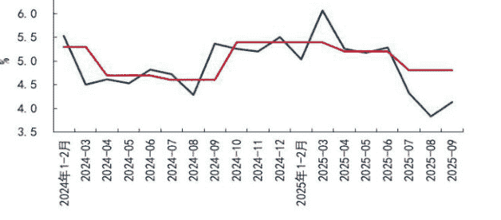

数据来源：Wind、中信证券经济研究所整理和测算

Jason不逸
2025-10-22 04:20

project-syndicate: 将中国在中等低收入国家中的低技术出口份额与其全球劳动力所占的份额进行比较。中国仍占全球低技术出口的一半以上，尽管其市场份额自2015年达到预期后未有下降，但由于其劳动力不断增长，趋势已接近需要缺口。中国的出口份额与劳动力份额的倒数约28%——说明出口继续“挤占”出来的空间，否则这些空间可以支持其增长的数万制造业工作岗位。“经济数据

## China’s Exports, 1995-2023
(export share relative to working-age population share)

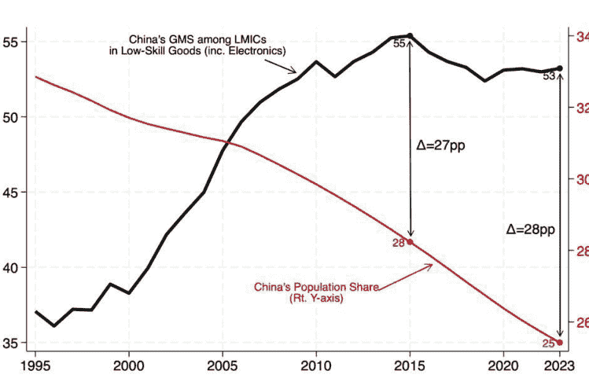

Sources: CEPI-BACI trade data and World Bank's Development Indicators

# 微信通286888，资料分享群

## Jason不逸

2025-10-22 04:27
华尔街见闻：日本金融银行正在允许对投资项目的持有和交易对比比特币等加密货币#金融

日本金融银行正在研究允许对投资项目的持有和交易对比比特币等加密货币，将改变日本银行长期以来的监管框架。

10月21日，日本媒体报道，日本金融银行计划建立一套体系，使其能够像股票和政府债券一样买卖加密货币。日本金融银行将通过咨询委员会金融体系委员会的工作组开展讨论。

此举将应对加密货币作为金融产品在日本国内内的交易日益普及。但金融银行也计划制定特定监管措施，以确保财务安全稳定。

据报，日本国内加密货币交易正在扩大。日本金融银行数据显示，截至2月底，日本加密货币账户数量已经超过1200万，较年前增长了3.5倍。

## 银行或可直接提供交易服务

金融银行还考虑允许银行集团加入以加密资产交易提供，这是提供加密货币交易和兑换服务的必要条件。

报道指出，通过高信誉度的银行集团进入这一市场，金融银行希望创造一个让个人投资者更容易参与此类加密货币市场的环境。这可能为加密货币带来更多机构级别的合规性和信誉度。

随着日本国内外加密货币作为金融产品的交易不断扩大，监管机构正寻求建立与市场相适应的制度框架。

# 加微信top28688，进阶资料分享群

## Jason-不离

华季：2025年1-9月，中美元债发行为819.96亿美元，金融债、城投债占比较高，在31-32%之间，产业债较高（大部分为重组债券），产业债发行72.38亿美元。截至2025年10月日，发行美元债存量为578.76亿美元（不含存款、可转债）。进一步除债券为主主体的发行后，中美元债存量4126.95亿美元，其中90%以上为信用债。美国国债率是美元债的基准利率，受美国增长预期、通胀预期、美联储货币政策等因素影响，本周决定转向加息，美联储决定维持利率，市场预期美联储态度软化，放大波动。降息、供给、风险敞口有利于中美元债收益率进一步下行，关注中债债+资本获利机会：金融

图1：中美债发行历史

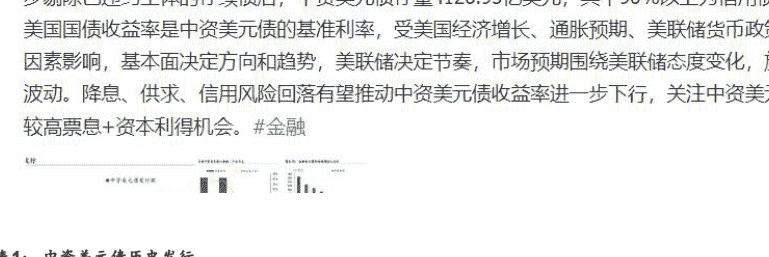

注：2025年1-9月发行情况，不含存款和可转债。
来源：Bloomberg, 华尔街

图12：产业债发行规模统计，产业债券

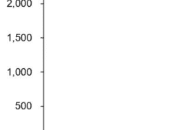

注：发行量2023年10月，不含存款、海外、可转债。
来源：Bloomberg, 华尔街

图13：中美债存量规模统计趋势

来源：Bloomberg, 华尔街

图14：产业债发行规模统计趋势

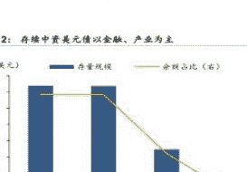

来源：Bloomberg, 华尔街

图15：美元债存量分布

来源：Bloomberg, 华尔街

# 微信top26888，资料分享群

## Jason不离

2025-10-22 04:39
国信达：2025年9月，全国挂牌指数环比下降2.1%，同比下降18.5%

# 全国挂牌成交量和价格走势

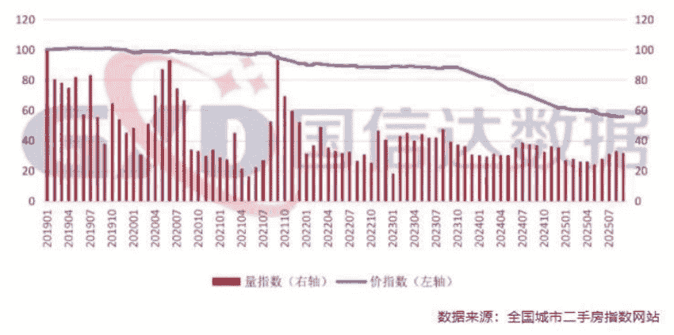

Jason不离
2025-10-22 04:41
中信达：2025年三季度重点城市租赁租金环比下降0.33%，前三季度累计1.39%

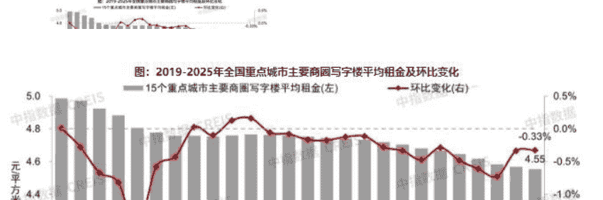

# 微信top28688，进阶资料群

## Jason-不离

2025-10-22 04:45
联合信：近年来本地城投企业现金债务比均高于0.5，流动性持续恶化，短期内有望缓解。

## 图8 全国各地城投企业现金债务比（单位：倍）

| | 2015年 | 2016年 | 2017年 | 2018年 | 2019年 | 2020年 | 2021年 | 2022年 | 2023年 | 2024年6月 |
| :--- | :--- | :--- | :--- | :--- | :--- | :--- | :--- | :--- | :--- | :--- |
| 3.50 | | | | | | | | | | |
| 3.00 | | | | | | | | | | |
| 2.50 | | | | | | | | | | |
| 2.00 | | | | | | | | | | |
| 1.50 | | | | | | | | | | |
| 1.00 | | | | | | | | | | |
| 0.50 | | | | | | | | | | |
| 0.00 | | | | | | | | | | |

资料来源：联合信、东方财富公开数据、数据整理

## Jason-不离

2025-10-22 04:59
发达：这里有许多消费数据恢复到COVID之前的趋势，基尼系数也向回升（作为居民生活和消费水平的指标）。从OECD来看居民收入基尼系数中国为0.44，比包含韩国的日本均值6.95高达50.8%。这个指标显示在我国越意味着收入差距越大，官方基尼系数2024年为0.465，这个指数仍较高水平。用学界部分关系系数计算结果，我国分配差距可能显著高于官方数据。

我国总体社会支持率与OECD国家相比仍有明显的差距：发达经济体（包括韩国）均值22%，我国占比仍有提升空间。近年来退休老人总数为31466万，其中机关事业单位单位退休人员、企业职工退休人员和城乡居民等部分群体，分别为2204.32万、1199万和1727万，占人口总占比分别为7.01%、54.88%。

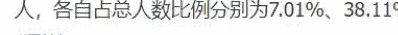

# 关注公众号28868，资料免费分享

## 中国居民收入与支出趋势（2005-2020, 百元）

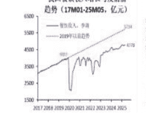

## 中国居民收入（2010-2025, 百元）

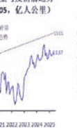

## 居民消费重心（2017年-2023年，%）

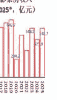

## 城镇与农村居民恩格系数（1978-2024）

- 城镇
- 农村

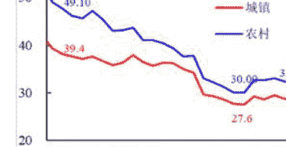

## 居民人均支出增长率（2006-2024%）

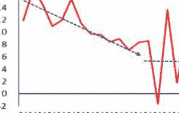

## 部分OECD国家宏观统计居民占比（2022年，%）

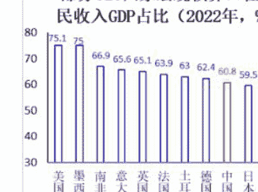

## 部分OECD国家住户居民占比（2022年，%）

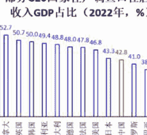

## 居民低-高家庭可支配收入系数（2015-2023年）

- 低收入家庭占比
- 高收入家庭占比

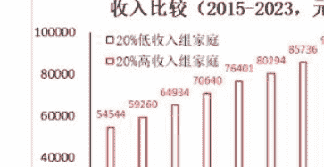

## 2022年部分OECD国家可支配收入分位数系数

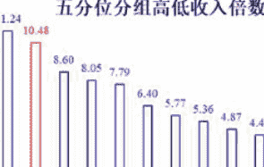

# 加微信top28688，进阶资料

## 我国社保支出增速及占GDP占比（1989-2024，%）

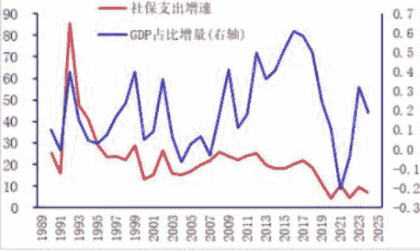

## OECD成员社保支出占GDP（2023年，%）

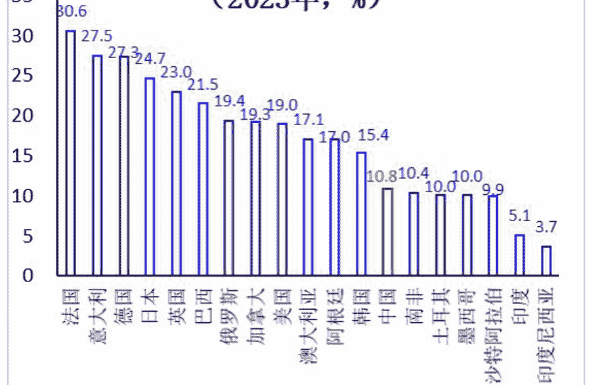

## 2023年三类养老金人数（万人）

## 三类人员人均养老金（2012-2023，元/人/年）

- 城镇企业职工退休人数
- 城镇居民养老领取人数
- 事业单位退休人数

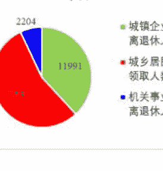
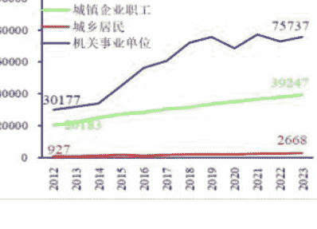

Jason不离
2025-10-22 05:18
瑞横：10月数据不佳，前18天，30城房屋销售同比比-25%，9月为+7%；港同比比+2%，CCFI周期持续好；汽车零售/批发前12天对比-8%/-11%。信用卡供给影响，财政部新增500亿地方债需求偏于“补债/置换LGFV/投后项目”。

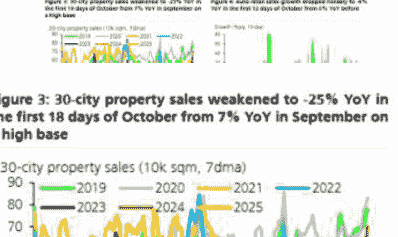
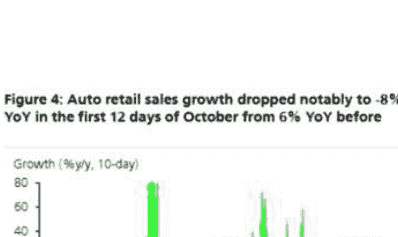
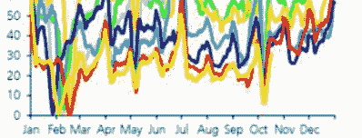
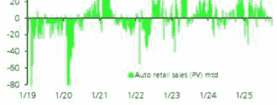

Source: Wind, UBS
Source: CEIC, UBS

Jason不离
2025-10-22 05:18
高嵩：不同口径9月中数据，二手房价还是居民情绪的表达

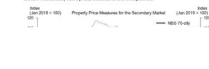

## Exhibit 4: Secondary home prices declined further in September

| Index (Jan 2019 - 100) | Property Price Measures for the Secondary Market | Index (Jan 2019 - 100) |
| :--- | :--- | :--- |
| 120 | NBS 70-city | 120 |
| 115 | Centaline 6-city | 115 |
| 110 | Zhuge 100-city | 110 |
| 105 | Beike 25-city | 105 |
| 100 | Guoxinda | 100 |
| 95 | | 95 |
| 90 | | 90 |
| 85 | | 85 |
| 80 | | 80 |

Beike spikes release of secondary home prices in November 2023.
Source: NBS, Centaline, Zhuge, Data compiled by Goldman Sachs Investment

## Exhibit 7 Large Investment Cycles Have Preceded General Purpose Productivity

| Percent of GDP | Historical Investment Impulse: Emerging Technologies in Frontiers (Percent Points) | Investment in General Purpose Technologies: Share of GDP vs. Pre-Productivity Level (Percent Points) |
| :--- | :--- | :--- |
| 5 | | 2.5 |
| 4 | | 2.0 |
| 3 | | 1.5 |
| 2 | | 1.0 |
| 1 | | 0.5 |
| 0 | | 0.0 |
| -0.5 | | -0.5 |
| -1.0 | | -1.0 |

Source: Goldman Sachs Investment, Bureau of Economic Analysis

## Jason不离
05:29
9月份出口量达到65.3万辆，环比增长7.4%，同比增长20.5%。新能源出口量为76万辆（同比+89.4%）。

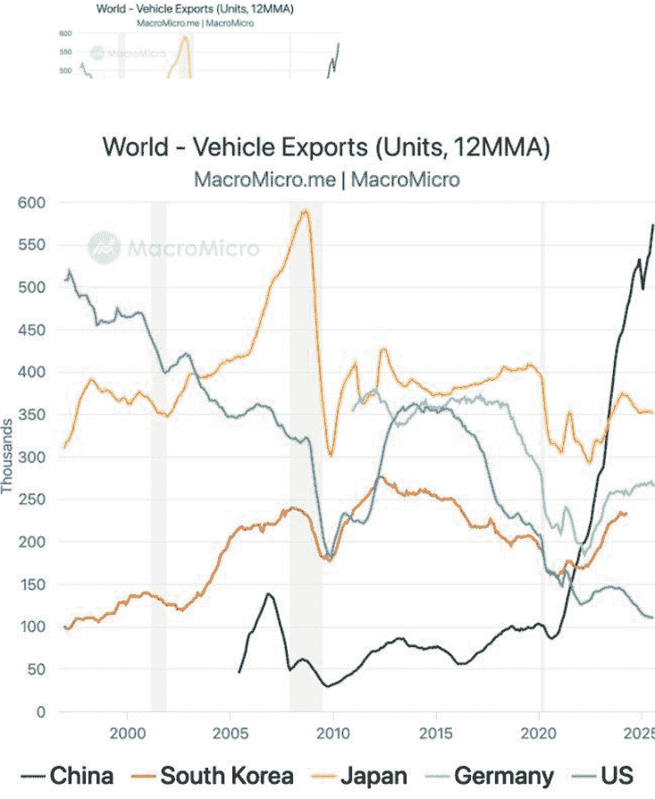

## World - Vehicle Exports (Units)

Jason不离
2025-10-22 14:30
资产证券化是工具，债务转移+增量财政是目的

## 国有“三资”管理改革三原则

- 一切国有资源资产化
- 一切国有资产证券化
- 一切国有资金杠杆化

## 盘活“三资”活跃发展“三资”

“三资”改革的代表性话意味着？
新出：“一切国有资源资产化、一切国有资产证券化、一切国有资金杠杆化”。这句话来自于李长在武汉调研“三资”管理时的话语。这句话尚未推到全国。

这背后意味着什么变化？
①对于多数省份来说，财政已经远远不够；②中央财政支出的边际变化不足以覆盖地方财政的缺口；③地方政府需要寻找和开发新的财政收入而且一定的自由。即，我们认为中央支出继续有利于改革，后续会有更多省份采取类似的“三资”政策。

结合三季度的高GDP增长和预期，会有影响？

从总量视角，我们认为这项“三资”意味着中央支出已经在边际上增大，但不能覆盖地方的缺口，且根据地方的“动态调整”，即财政能够扩张增长，对总量的推动是有可能的。事实上，这一步加强了逻辑：“科技为先”。财政支出的力度不是加强而是灵活的“动态调整”，通过调整改善财政困难，使得长期逐渐具备中期的优势；而科技品种应该是“相对优势+政策推动+产业升级”条件的，因此我们建议配置上依然要“科技为先，扩张为辅”。

## 知识星球TOP 资源分享群

添加微信免费群 微信:top28688

| 序号 | 公号/星球/社群 | 原价 | 领域 |
| :--- | :--- | :--- | :--- |
| 1 | 生财有木 | 2765/年 | 同业，搞钱 |
| 2 | 众宗吃瓜群 | 365/年 | 时政、历史 |
| 3 | 记忆巷/裁树西风 | 365/年 | 成长 |
| 4 | 欧洲金轨 | 328/年 | 时政、历史 |
| 5 | 卢克文青云会 | 699/年 | 时政、社会 |
| 6 | 体制内主任 | 599/年 | 体制，职场 |
| 7 | 外外人的视界 | 669/年 | 金融，时政 |
| 8 | 溯泽异昂 | 4166/年 | 财富，成长 |
| 9 | 守夜人总司令 | 599/年 | 时政，经济 |
| 10 | 江宁知府 | 365/年 | 时政，国际 |
| 11 | 政事堂/顾子明 | 568/年 | 时政、经济 |
| 12 | 唐书院 | 1399/年 | 金融、财富 |
| 13 | 大树乡谈 | 199/年 | 时政、成长 |
| 14 | 水库欧大 | 10000/年 | 房产，经济 |
| 15 | 洪灏宏观策略 | 4376/年 | 经济、搞钱 |
| 16 | 金融通鉴/北海南山 | 4576/年 | 股票、律行 |
| 17 | 猫哥的世界 | 299/年 | 时政、社会 |
| 18 | 飞涨龙 | 3600/年 | 股市、经济 |
| 19 | 米联储见闻 | 599/年 | 经济、金融 |
| 20 | 茶茶财经圈 | 330/年 | 房产、股票 |
| 21 | 赢在八小时之外 | 365/年 | 成长，职场 |
