# 南半球聊财经251024

Jason不赢
2025-10-24 03:56

国信：我们认为，建立“反垄断”长机制为关键，其核心在于有效市场+有为GOV，特别是别为GOV。“有为”的关键在于不在不为，“反垄断”而言，一方面，还需要“投资”扭转循环”、地方保护主义与“违结构”损害投资商，真正将需求转化为生产和投资的指挥棒；另一方面，又需要政策大力扩大需求”，从供应两国都需要发力精准。

“扩大需求”无法如何提高居民收入的关键命脉。在“外需”和“投资”后，市场急需寻找自己的一个性突破，让农业人口城市化。户口城镇化率不到50%，在城市可能只会获得更多的转移和社会保障，将释放其耕作土地，提升农民劳动收入的基础。

## 经济数据

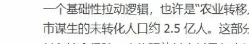
图7：我国生产周期已处于相对底部

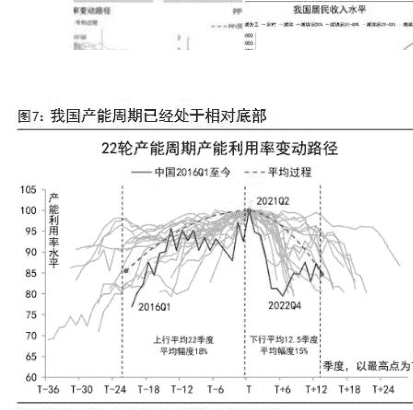
图6：PPI明年可能转底

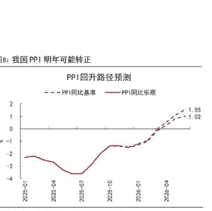
资料来源：Wind，国信经济研究所整理
资料来源：Wind，国信经济研究所整理
图10：农业转移人口在城镇居民的位置

## 我国居民收入水平

| 农村人口—农民 | 城镇 | 城镇前20% | 城镇前20%-40% | 城镇前20% | |
| --- | --- | --- | --- | --- | --- |
| 120000 | | | | | |
| 110000 | | | | | |
| 100000 | | | | | |
| 90000 | | | | | |
| 80000 | | | | | |
| 70000 | | | | | |
| 60000 | | | | | |
| 50000 | | | | | |
| 40000 | | | | | |
| 30000 | | | | | |
| 20000 | | | | | |
| 10000 | | | | | |
| 0 | | | | | |

资料来源：Macrobond，国信经济研究所整理

## 微信信top28688，进资资料分享群

# Jason不懂
2025-10-24 03:58

东望：尽如“十五”可能没有五年定量目标，但2035年目标要求是价格和名义增速变得更加重要，“十五”期间名义增速可能不低于5.5%。按照2035年“人均GDP达到中等发达国家水平”的远景目标来看，未来十年GDP增速不低于5.4%，“十五”期间不宜低于5.5%，需要2025-2035年实际GDP增速不低于4.4%，“十五”不低于4.7%。

## 经费数据

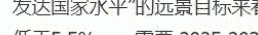

## 表2：“十五”和“十四五”重点任务排序的对比

| 十五 | 十四五 |
| --- | --- |
| ①现代产业体系 | ①科技创新 |
| ②科技创新 | ②现代产业体系 |
| ③扩大国内市场 | ③扩大大国内市场 |
| ④构建高水平社会主义市场经济体制 | ④构建高水平社会主义市场经济体制 |
| ⑤乡村振兴 | ⑤乡村振兴 |
| ⑥区域发展 | ⑥区域发展 |
| ⑦文化建设 | ⑦文化建设 |
| ⑧社会民生 | ⑧对外开放 |
| ⑨安全发展 | ⑨社会民生 |
| ⑩防险建设 | ⑩安全发展 |
| | ⑪防险建设 |

数据来源：新华社，东望证券研究所

# Jason不懂
2025-10-24 04:02

结论：根据既往数据指出生产和生活在PPI中的权重75%和25%。由于生产权重较高，加上波动率高于生活，PPI的整体走势主要由生产驱动。进一步分解，按行业划分，原材料、工业三大类在PPI整体权重分别为53.3%、24.5%、46.2%。在行业领域，计算机、通信和其他设备制造业权重最高（10.84%），然后是汽车制造（7.3%）、电气及制造业（6.94%）、原料和化学制品制造业（6.61%）、黑色金属冶炼及加工、电力生产行业（6.39%）。行业并未受到影响，如计算机、通信和其他设备制造业领域权重较高，但波动率为1.24%，对PPI的影响对于主导PPI走势的行业为黑色金属、石化（石油）、焦煤、有色金属。

## 微信信top28688，资料分类

## 图 1: PPI的走势主要由生产主导
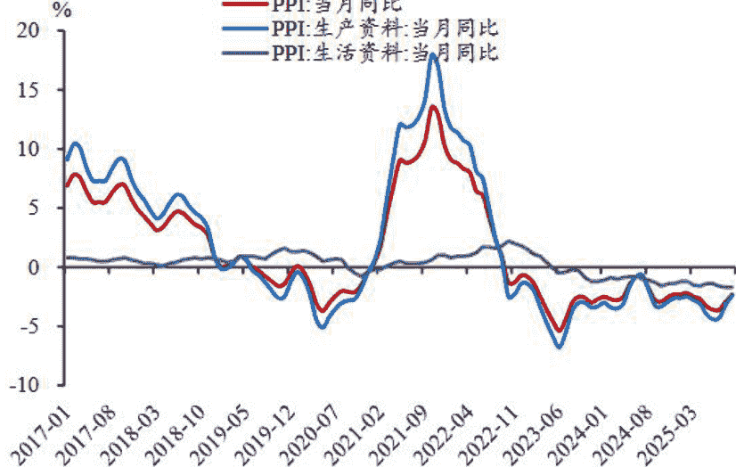
资料来源：信达，信证券研究中心

## 图 4: 二分法PPI占比
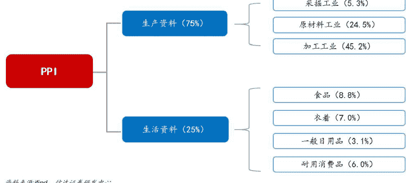
资料来源：信达，信证券研究中心
注：图中数字为权重占比

## 图 6: 煤、钢铁、有色行业和PPI的走势基本相同
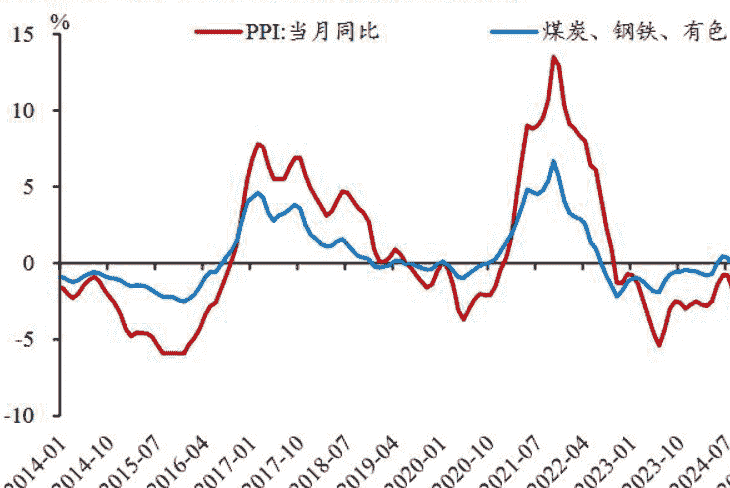
资料来源：信达，信证券研究中心

长期来看，由于美国赤字的增长模式没有变化，以美元计价的黄金将继续上扬，作为对抗美元贬值和国际利率的核心资产代表。

## 金融数据

## 图表1：近50年黄金年度涨幅 (%)
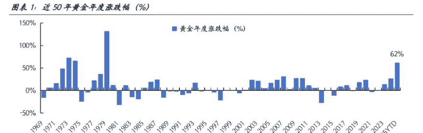
来源：Wind，融安证券市场

## 图表2：截至10.21，金价溢价、长期交易幅度处于100%溢价水平
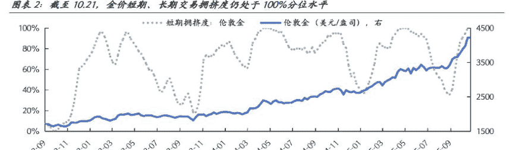
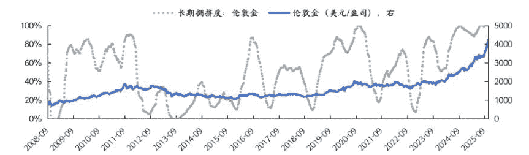
来源：Wind，融安证券市场

## 图表 7：10月16日美联储利率会议后首次到期期内利率低于100bp的可能性，此后重新定价75bp
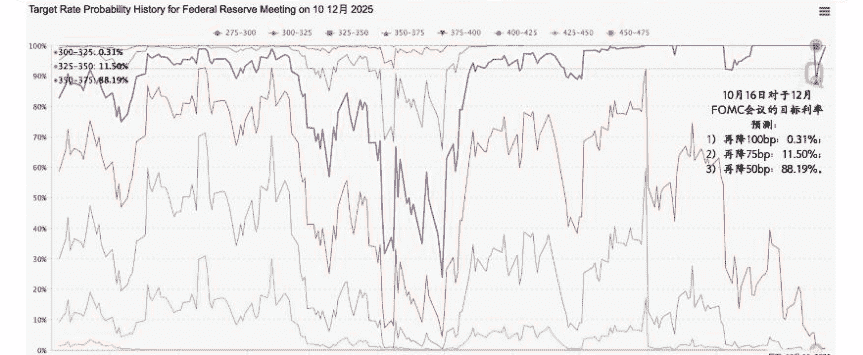
来源：CME-FedWatch，融安证券市场

## 图表11：纳斯达与黄金指数强度正相关
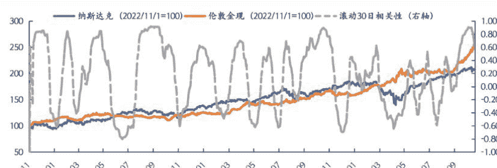
来源：Wind，融安证券研究所

## 图表12：美国在赤字化道路上“一去不复”
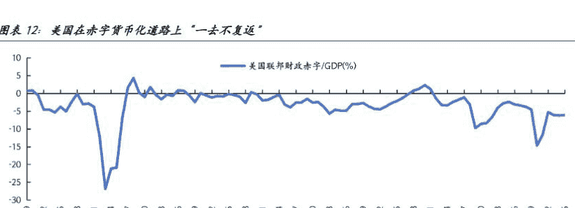
来源：融证券研究所

信达：股市资金跟踪，从各项数据来看，2025以来公募基金仍然疲弱，私募基金有一定净流入。每年一、二、三季度是回购和分红季节性频繁的时间，为资金提供一定支撑。行业资本净减持规模明显增加。

## 财经

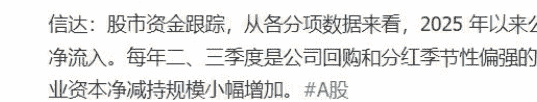

## 表1：A股资金净流入数据趋势（亿元，年度）
# 股市资金流入流出趋势（亿元，年度）

| | 2025年 | 2024年 | 2023年 | 2022年 | 2021年 | 2020年 | 2019年 | 2018年 | 2017年 | 2016年 | 2015年 |
| --- | --- | --- | --- | --- | --- | --- | --- | --- | --- | --- | --- |
| 资金流入 | 2025 | 2024 | 2023 | 2022 | 2021 | 2020 | 2019 | 2018 | 2017 | 2016 | 2015 |
| 资金流入 | 7500 | 5732 | 2748 | -2375 | -2300 | 4765 | -2545 | -2722 | -826 | -2356 | 1450 |
| 资金流入 | 7500 | 5299 | 2291 | -1568 | -2299 | -1791 | -1841 | -496 | -748 | -1551 | 1774 |
| 资金流入 | 5000 | 5000 | 1348 | 1346 | 1117 | 608 | 1003 | 1051 | 2222 | 5884 | |
| 资金流入 | 6000 | 4796 | 110 | 799 | 111 | 1391 | -1975 | -1987 | -3045 | -3463 | 9358 |
| 资金流入 | 6000 | 4000 | 228 | 119 | 229 | 223 | 1229 | 1553 | 1533 | 4011 | 8221 |
| 资金流入 | 6000 | 3000 | 329 | 158 | 323 | 269 | 223 | 361 | 1267 | 802 | 7995 |
| 资金流入 | 6000 | 2000 | 417 | 192 | 196 | 312 | 116 | 96 | 116 | 775 | 9381 |
| 资金流入 | 6000 | 1000 | 558 | 272 | 265 | 452 | 433 | 244 | 241 | 788 | 6213 |
| 资金流入 | 6000 | 500 | 691 | 365 | 368 | 567 | 544 | 521 | 331 | 1044 | 5034 |
| 资金流入 | 6000 | 0 | 968 | 542 | 582 | 771 | 816 | 918 | 976 | 1496 | 3502 |
| 资金流入 | 6000 | 0 | 1068 | 642 | 682 | 971 | 1016 | 1118 | 1236 | 1638 | 3802 |
| 资金流入 | 6000 | 0 | 1168 | 742 | 782 | 1071 | 1116 | 1218 | 1336 | 1738 | 4002 |
| 资金流入 | 6000 | 0 | 1268 | 842 | 882 | 1171 | 1216 | 1318 | 1436 | 1838 | 4202 |
| 资金合计 | 48314 | 41932 | 39508 | 34733 | 31723 | 35953 | 39968 | 40513 | 42233 | 48117 | 53193 |

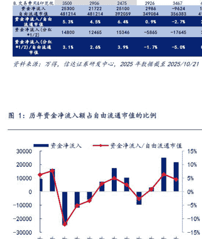
资料来源：方财富，迎达财研中心
注：2025年资金流入数据2025/10/26

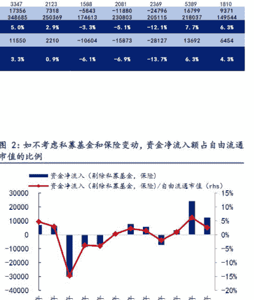
资料来源：方财富，迎达财研中心
注：2025年资金流入2025/10/26

## 表2：A股资金净流入趋势（亿元）

| | 2025年 | 2024年 | 2023年 | 2022年 | 2021年 | 2020年 | 2019年 | 2018年 | 2017年 | 2016年 | 2015年 |
| --- | --- | --- | --- | --- | --- | --- | --- | --- | --- | --- | --- |
| 资金流入 | 2025 | 2024 | 2023 | 2022 | 2021 | 2020 | 2019 | 2018 | 2017 | 2016 | 2015 |
| 资金流入 | 3247 | 6810 | 6132 | 7176 | 7399 | 8336 | 846 | 1668 | 3033 | 5411 | |
| 资金流入 | 499 | 1290 | 2768 | 3146 | 5519 | 5388 | 1227 | 1117 | 198 | 309 | |
| 资金流入 | 575 | 304 | -269 | -945 | -963 | -1447 | -1781 | -111 | 649 | 532 | |
| 资金流入 | 2173 | 5216 | 2641 | 2291 | 2299 | 1791 | 1841 | 116 | 826 | 1574 | 4672 |
| 资金流入 | 5000 | 5000 | 1348 | 1346 | 1117 | 608 | 1003 | 1051 | 2222 | 5884 | |
| 资金流入 | 6000 | 4796 | 110 | 799 | 111 | 1391 | -1975 | -1987 | -3045 | -3463 | 9358 |
| 资金流入 | 6000 | 4000 | 228 | 119 | 229 | 223 | 1229 | 1553 | 1533 | 4011 | 8221 |
| 资金流入 | 6000 | 3000 | 329 | 158 | 323 | 269 | 223 | 361 | 1267 | 802 | 7995 |
| 资金流入 | 6000 | 2000 | 417 | 192 | 196 | 312 | 116 | 96 | 116 | 775 | 9381 |
| 资金流入 | 6000 | 1000 | 558 | 272 | 265 | 452 | 433 | 244 | 241 | 788 | 6213 |
| 资金流入 | 6000 | 500 | 691 | 365 | 368 | 567 | 544 | 521 | 331 | 1044 | 5034 |
| 资金流入 | 6000 | 0 | 968 | 542 | 582 | 771 | 816 | 918 | 976 | 1496 | 3502 |
| 资金流入 | 6000 | 0 | 1068 | 642 | 682 | 971 | 1016 | 1118 | 1236 | 1638 | 3802 |
| 资金流入 | 6000 | 0 | 1168 | 742 | 782 | 1071 | 1116 | 1218 | 1336 | 1738 | 4002 |
| 资金流入 | 6000 | 0 | 1268 | 842 | 882 | 1171 | 1216 | 1318 | 1436 | 1838 | 4202 |
| 资金合计 | 48314 | 41932 | 39508 | 34733 | 31723 | 35953 | 39968 | 40513 | 42233 | 48117 | 53193 |

特朗普当选以来，赵安也成为特朗普家族“世界自由金”加密项目的重要支持者。这个项目极大提升了特朗普对个人的人才。

美国司法部对赵安处以48亿美元罚款，并实施了严重的监管措施，指控其在赵长领导下沦为巨大的洗钱平台，为恐怖组织和集团转移数十亿美元非法资金。

赦免可能会提前诉讼为第三期，确保赵安遵守美国犯罪辩护的安协议。不过，如果没有特朗普或财政部的进一步推进，财政部设立的另一项监管措施可能被取消。

市场表现活跃，赵安今年与财政部官员见面，讨论其对业务的运营。在法律方面，赵安与竞争对手的交易中已处于不利。

市场早已领先，赵安于年底频繁接触特朗普盟友，与特朗普家族达成合作协议，作为公司发展美国计划的一部分。

特朗普家族代表已就与赵安美国公司股份进行过。

当时，赵长表示他与赵安美国公司进行了交流，在X平台发言：“没有人会介意被赦免。”

此后，他正式提交赦免申请，并请美国政府游说团体协助。

过去去年，“世界自由金”的规模在扩大，大到超过特朗普家族项目每年产生数亿美元的收入。

赵安是推动特朗普家族的“世界自由金”打造全球最大的加密货币USDT快速发展的关键。今年春天，这个平台接受一个价值20亿美元的海外投资，拨款直投USDT，这是“世界自由金”首次获得巨大成功。

赵安在自己控制的平台上提供贷款，促进USD的使用。

“世界自由金首席，”赵长表示与赵安公司仅有过私人交流，维多夫是特朗普，后者的父亲史蒂夫·维多夫是特朗普的。该项目与赵安没有任何业务涉及。

赵长居住阿布扎比，于2017年成立，成为全球最大的加密货币交易平台，全球用户达3亿。

去年，他因违反规定被判入狱两个个月。检察官表示，赵长监管下的赵安涉及的非法活动对美国国家安全造成严重影响。

赵长是最新一位获得特朗普赦免的加密货币市场领。今年3月，特朗普赦免了BitMEX加密交易所联合合伙人阿尼斯·海斯，赵承认违反了法律规定。

今年市场发展迅速，其BNB价格上涨近80%，优于为比特币、以太以及稳定币达市第四加密货币。

尽管如此，赵长的犯罪记录一直是业务拓展的阻碍，影响其在申请监管牌照和开设银行账户。

赵长获得赦免，预计会引起美国国会民主党的关注。今年由于赦免的操作细节，民主党要求特朗普政府披露与赵安及赵长关于赦免的细节，币市与赵安及赵长之间的金融关系涉及风险敞口。由于共和党在国会的控制下，特朗普不会会有任何实质伤害。

## 微信top208688，资料全共享

### 一

### Jason 不
2025-10-24 04:57

FT: 俄罗斯方面一直在向新德里施压，要求其停止从俄罗斯进口原油，印度最大石油企业表示，将按照指示转向“俄俄油”。#其他国家经济

另外，美国对俄罗斯最大的石油公司实施制裁，普京曾说，“我们和弗拉基米尔交谈，谈得还不行，但还没有被这样了。”

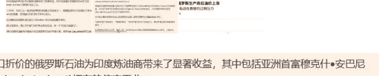

进口的俄罗斯石油为印度炼油带来了显著收益，其中包括亚洲首富穆什·安巴尼（Mukesh Ambani）拥有的Reliance。

过去三年间，信实行业一直是俄罗斯原油的最大受益者之一，根据数据与咨询公司Energy Aspects的数据，其进口折价高达60亿美元。

印度石油和天然气的进口石油（Indian Oil）未完成清算。

特朗普上周曾表示，俄罗斯可能不会“停止”购买石油，但一个“进程启动”。

分析印度进口石油将大幅减少对俄罗斯石油的依赖。孟Yes Securities的印度天然气分析师Harsh Agggarwal表示：“如果印度对俄罗斯石油的进口占比是40%，它们可以爬到30%。对各公司也是如此。”他补充道，俄罗斯是印度的供应国。

在印度，信实行业和俄罗斯石油有关的Nayara Energy夺下了大部分石油，但已由于美国和国际制裁，Nayara并未列入美国制裁名单。新德里过去执行过“单边制裁”。

俄罗斯与印度的关系有望在普京12月出席印度峰会期间会晤。印度外交发言人丹苏尔（Randhir Jaiwal）称，作为一个大型石油进口国，印度需要确保能源格局和可靠供应，他补充道，印度将在适当的时候实现能源多元化。印度政府数据显示，自2022年以来，该国购买了价值约40亿美元的俄罗斯石油，然后由信实工业等加工汽油，供应国内与国际市场。

## 加微信30828，资料共享

### 十五

更新于2025年10月23日17:46，《金融时报》美国对俄罗斯最大的石油公司（Rosneft）和卢克石油（Lukoil）实施制裁，目的是“削弱”普京（Vladimir Putin）战斗机器并支持乌克兰。此举标志着美国政府因俄罗斯的全面入侵方面直接施加代价。“这些制裁力度非常大，”美国总统，“我们希望它们持续太久。我们希望这场战争能够解决。”在政府发布公告后，油价上涨。布伦特（Brent）原油周四早每桶上涨64.5美元，上涨3%。

美国财政部长斯拉斯特·贝森特（Scott Bessent）表示：“普京拒绝结束无意义的战争，制裁将为乌克兰战斗机器提供资金。”贝森特表示，美国政府已做好进一步行动的准备。“我们鼓励盟友携手……并遵守这些制裁。”

## 美国制裁俄罗斯生产商后油上涨迫在眉睫

- WTI futures

资料来源：NYMEX. 路博社。

## 加微信顶2688，资料分享群

### 十六 摩根通、美国表示美联储本月提前停止资产负债表

### Jason 不跑
2025-10-24 05:01

bloomberg: 摩根通、美国银行表示美联储本月将停止资产负债表缩减

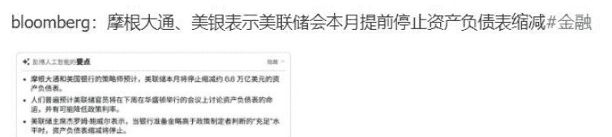

### 金融要点

- 摩根通和美国银行的策略转向，美联储本月将停止缩减约6.6亿美元的资产负债表。
- 人们普遍预计美联储官员将在下周在华盛顿行的会议上讨论资产负债表的适配，并有可能推低政策利率。
- 美联储主席鲍威尔表示，当央行储备金高于政策制定者判断的“充足”水平时，资产负债表缩减将停止。

摩根通和美国银行的策略转向，美联储本月将停止缩减约6.6亿美元的资产负债表，从而消除金融市场流动性的进程。两国都提出了对美联储何时结束量化紧缩的呼吁——解除美国国债和抵押贷款支持市场——理由是最近美元金融市场的成本已上升。他们此前预测，2022年6月的径将在12月或年初结束。

人们普遍预计美联储官员将在下周在华盛顿举行会议上讨论资产负债表的适配。政策利率有利于降至3.75%-4%，尽管华尔街并不确定政策制定者何时会撤回量化紧缩——美联储将用来控制利率的另一种工具。工具表明证券和策略ICAP在内的其他策略师已将涨期权上调到10月，而巴克莱银行和高盛集团的分析师则认为该债权将晚时候结束。

### Jason 不跑
2025-10-24 05:06

bloomberg: 最近在非洲的债务重组显示在一个较高的汇率下人民币，因为人民币利率高于美元，债成本在重组中得益（减少了利息）。比如肯尼亚，通过中国铁路减美国美元，每年将债成本减少了2.15亿美元。

## 加微信不通，资料免费共享

### China's Money-Market Rate is Lower Than US
Analysts expect monetary easing by PBOC to keep rates low

- One-week OIS for the SOFR rate - China's seven-day repo rate

### 海外借款可以通过债务转换为人民币获得更多

| 贫穷国家 | Estimated outstanding debt owed to China |
| :--- | :--- |
| 肯尼亚 | 3.5 |
| 埃塞俄比亚 | 4.4 |

来源：彭博。数据加拉尔（Kevin Gallagher）估计，肯尼亚和埃塞俄比亚代表2024年付还金额为78亿美元。

## 加微信30828，资料共享

### 十七人民币

- Bonds in yuan
- Loans in yuan

## 加微信top2688，资料共享

### Jason 不跑
2025-10-24 05:24

### 中泰解读

近期中泰两国高层频繁互动，中泰经贸合作不断深化。目前中国已成为泰国最大的伙伴，双方还积极对接“一带一路”倡议，在基础设施、产能、数字经济、旅游等领域开展大量合作。近期中泰在签证方面有了进展，包括免签范围扩大，我们将持续加强中泰沟通，共创美好未来。

## 加微信top2688，资料分享群

### 知识星球TOP
添加微信；免费入群

| 序号 | 公号/星球/社群 | 原价 | 领域 |
|---|---|---|---|
| 1 | 生财有木 | 2765/年 | 副业，搞钱 |
| 2 | 众宗吃瓜群 | 365/年 | 时政，历史 |
| 3 | 记忆Legacy/碧树西风 | 365/年 | 成长 |
| 4 | 欧洲金轨 | 328/年 | 时政，历史 |
| 5 | 卢克青云会 | 699/年 | 时政，社会 |
| 6 | 体制内主任 | 599/年 | 体制，职场 |
| 7 | 局外人的视界 | 669/年 | 金融，时政 |
| 8 | 泽湃异迁 | 4166/年 | 财富，成长 |
| 9 | 守夜人司令 | 599/年 | 时政，经济 |
| 10 | 江宁知府 | 365/年 | 时政，国际 |
| 11 | 政堂/顾子明 | 568/年 | 时政，经济 |
| 12 | 唐书院 | 1399/年 | 金融 |

### 中策策略

- 风险防范、谨慎。这次是“十四五”规划及重大会议，会议对期间任务阐述中，首次提到“要对风险做好强调至关重要”，对“十四五”规划和当五年目标，国家形势依然处于机遇与挑战并存时期，既要看到机遇，也要看到风险。
- 产业体系转型升级是十四五规划的重点任务，明确指出“要以制造业为核心的现代化产业体系”，坚持数字化管理，过去五年中国制造业在全球竞争中逐步确立了重要竞争力地位。消费的需求增长，与人口发展密切相关。本次会议指出，要以“供给侧结构改革”来激发消费需求，新的增长点将出现，并在“十四五”规划中要应对人口结构变化，适应人口结构性转型（本次会议提到“人口总量变化”），许多面临的问题将。十四五规划的重点任务中，本次会议指出，要坚持“科技自立自强”作为发展战略方针，并指出，在当前阶段，对比全球化的“中国拥有强大的产业能力”，我国产业亟需实现从中强的转型，“质量升级与本土市场化”是当前紧迫的问题。在美债高位震荡不回落的背景下，黄金具有较强的支撑。其次要密切关注全球内部的变化，重点关注：中国全球资产配置有望有利几个方向；如黄金、矿产、科技类、中股A+股以及关注机会的（多、风险、机会、中等）等或变化。在美元和美股市高位震荡的背景下，加大“美元+黄金”为主配置，灵活组合资产（如：黄金、科技股、国产）以及有色（稀土、贵金属）等。
- 风险展望：黄金及贵金属短期将面临不确定性增加。

Jason Wang
2023-10-24 25

高离：从9月起黄金大涨26%，创了纪录的9378美元/盎司，回落6%，目前为4100美元附近，虽然惯性上涨节奏的调整可能致缓，但我们认为结构性买涨将进一步推进，并由于对黄金视为配置组合中多元工具的光景日益深厚，对于2026年4000美元的预测仍存在。

GS Forecast of Prices of Gold
| $oz | Realized | GS Forecast |
|---|---|---|
| 5000 | | |
| 4500 | | |
| 4000 | | |
| 3500 | | |
| 3000 | | |
| 2500 | | |
| May 2025 | | |
| Sep 2026 | | |

Source: LBMA, Goldman Sachs Global Investment Research.

### 提问答

Jason哥，你好，看来我也要当妈妈了，跟另一个经济学博士（同时，我有英国经济学士学位）毕业后回国工作五年（金融行业），已经过去3周了，现在有一个孩子，发现接孩子生活很熬，工作压力也不小。现在找工作门槛都不高，毕竟我在新西兰工作入职稳定，暂时修移民，打算了回听一下哥的建议。

- 新西兰目前两种教育模式，公立确实稳妥，私立走路线，相对高，但程度不如国内：每年有很多孩子回国，很多华人选择把孩子接回国内造成“基底”，很多地方都看家长怎么安排孩子？
- 新西兰PR确实比澳洲高，你所的问题没有。金融工作在本地不是太多，我了解了一些本地行业，业务模式太大，如国内金融市场。我之前有过考虑在国内，很多东西都不挣。它一直很准，不过说某天我费力够了，就回国再创业🙂 篮球财经在家里的人很少...
