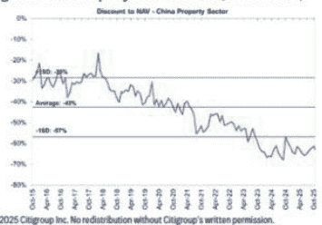
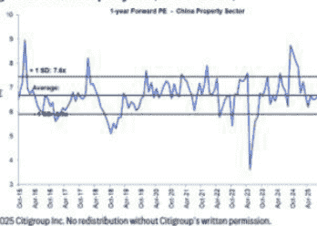
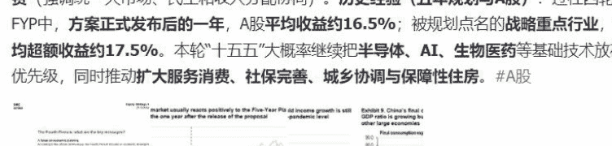
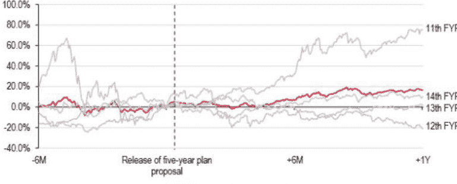
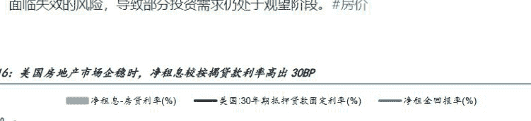
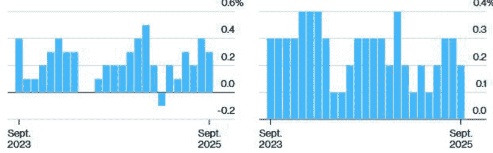

# 南半球聊财251025

Jason不赢
2025-10-25 03:09

花湖：看得政策不会再大水漫灌，经济对房地产的依赖继续减少，考虑到住住房资产居民占比66%，房价下跌会影响信心和消费，需要收入/住房层面的保障才能护民信心。#经济数据

China Property
24 October 2025

加微信进资料群

Citi Research

> Refer to our previous report on China Property - 15th Five-Year Plan: Accelerate to Establish A New Development Model for details

2025 Clipgroup Inc. Noredistribution without Clipgroup's permission. Source: Datasets, Citi Research Estimates
2025 Clipgroup Inc. Noredistribution without Clipgroup's permission. Source: Datasets, Citi Research Estimates

Jason不赢
2025-10-25 03:16

龙丰：规划对市场有两个两条：①科技自立自强创新（直击“卡脖子”）；②提振消费（强依赖一线市场，民生收入分配调整）。过往六年（年份与A）FYP，方案正式发布后的一年，A平均收益的16.5%；知名重点的赛道行业，平均超收益17.5%。本报告“十五五”核心聚焦半导体，AI，生物医药等基础技术放在优先，同时推动服务消费、保障养老，城乡与保障住房性#A股

# 微信信top28688，进资料分享群

## The Fourth Plenum: what are the key messages?

A focus on economic planning

According to the official communique, the Fourth Plenum focuses on economic development and modernisation by 2035 FYP (see China 4th Plenum concluded: Strategic direction set, details later, Jing Liu, 23 October 2025). A list of focuses have been mentioned in the communique, with tech innovation and self-sufficiency among boosting consumption as the key tasks for the next stage.

- For tech innovation and self-sufficiency: the increasing uncertainty around the external environment, including trade trends with the US, A key difference between the Fourth Plenum this time and the Fifth Plenum of the 19th Party Congress in 2020 (which suggested the 14th Five-Year Plan) is a more focus on comprehensive innovation, which we believe to target bottlenecks.

- For boosting consumption: the communique mentioned removing barriers to a unified market, improving people's livelihoods, and enhancing income distribution. A comparison against the Fifth Plenum of the 19th Party Congress suggests more determined efforts (from "comprehensively promoting consumption" to "vigorously boosting consumption" with more balanced coordination of consumption, people's livelihoods and investments.

Moreover, our high frequency analysis on the communique suggests there is more focus on modernisation, high-quality development, and technology. Moreover, the communique also outlined 12 important areas for the upcoming 15th Five Year Plan (FYP), including building a modern industrial system and accelerating high-level science and tech self-sufficiency.

## Exhibit 4. A-share market usually reacts positively to the Five-Year Plan, with an average return of 16.5% in the one year after the release of the proposal

加微信top28688，进资料分享群

## Exhibit 8. Household income is growing slower than the lower-premium level

## Exhibit 9. China's final consumption to GDP ratio is growing but still lower than other large economies

--- YTD household disposable income (% y-o-y)
--- Pre-pandemic average (2015-2019)
Source: Wind, HSBC Global Securities

China S Korea Germany Japan US
■2023 ■2013
Source: Wind, HSBC Global Securities

Jason Wang

2025-10-25 03:30

中国：当前房地产市场的现状虽有无量，二手房价回归合理，房子正在经历由投资向消费的转型。金租回报政策导致居住房价估值“倒错”。次贷住房危机下，美国房地产市场处于下行周期，自2011年以来房价均值和价格胶升，此对于美国扣除持有成本后的金租回报率为4.75%，高于30年平均收益率30BP

Wind径，全国首金租回报率为2.37%，目前中国5年LPR为3.5%，各地套房利率处于LPR-500BP。

金租回报率为房价的“锚点”。中期研究认为50的城市过去几年受政策驱动持续增长，对于房地产市场而言，当金租下降时，高息策略可能失效的风险，投资需求仍处于观望阶段。房价筑底时，金租回报率收益率为30BP，净房价-30年付按揭示租金值

来源: Wind, Federal Reserve Bank of Dallas, HSBC & Forbes (2015), 中国房地产报告(3.2%)

# 微信微top8688，分享群

## 图表20：价格转向

来源：中海宏观，国泰证券

Jason羁
2025-10-25 03:40

bloomberg: CPI低于预期，美股缓了10月份的涨幅，标普500指数创历史高，回归政策转向推动企业经济，交易员押美债在未来12个月内跌120个基点。这将美储利率推到9%，低于大关——认为是既不刺激也不限制的中性水平。

## 标准普500指数CPI意外创历史高

- Last Price

资料来源：彭社

## AI的要点

- 总体CPI和核心CPI均预期低一个百分比，月度涨幅分别为0.3%和0.2%。
- 季节性调整的油价格上涨导致总体数据快于核心数据，而住房成本是核心增长后的之一。
- 弱于预期的CPI报告了美储在下周会议上降的预期，增加了2月进一步的可能性。

以下是五周内的美国CPI消费者指数的主要要点：

- 总体CPI和剔除食品的核心CPI与预期低一个百分比，月度涨幅分别为0.3%和0.2%。以2月为基础，总体CPI涨3%，快于8月份的%，核心CPI也为3%有所放缓。
- 季节性调整的油价格上涨导致总体数据快于核心数据。与一样，住房成本是核心增长后的之一，相比0.2%的增幅并不大。机票和二手车是人数下降的主要之一。
- 似乎在某些类别中显而易见，为2023年以来的最高水平。1.6%，为2021年以来的最高。剔除住房成本的“超级核心”服务通胀率加速至月度0.35%，是今年的最高之一，与2024年的平均值基本持平。
- 虽然通胀远高于美国2%的目标，但弱于预期的CPI报告锁定了美储在下周会议上降的预期，增加了1月进一步的可能性。

10月份的通胀不太可能在下个月公布，使得的数据与12月美储的决定更加相关。

加微信top88，进资料群

## 美国通胀意外涨较小，美储继续降低

Change in consumer price index (MoM)
Change in CPI ex-food, energy (MoM)

Change in goods prices ex-food, energy (MoM)
Change in core services prices ex-housing (MoM)

资料来源：劳动统计局

Jason 2025-10-25 03:45

bloomberg: 中国控制作为药物核心成分的活性药物成分（API）的全球供应，美国需重复进口工具。中国直接贡献了2024年原料药8%的份额，医药制造污染严重，该行业的利润微薄，将这种生产转移到环境法规严格的地方是没有意义的。#其他国家经济

中国制造的十大药物China Index (以十亿美元)

# 微信top88，进瓷资料分享群

## 中国制造的十大原料药市场

2024年出口额（以十亿美元计）

| Country | Value |
|---|---|
| India | 6.1 |
| USA | 4.5 |
| Korea | 2.1 |
| Brazil | 2.0 |
| Japan | 1.9 |
| The Netherlands | 1.9 |
| Germany | 1.8 |
| Russia | 1.4 |
| Vietnam | 1.2 |
| Indonesia | 1.1 |

来源：中国药品保健品出口商会

Jason不准
2025-10-25 03:54

> ...

> bloomberg: 密西根州的调查结果显示，美国消费者“对持续的高价格感到沮岌”，近一半的人指出他们的个人的财务状况因此受到影响。

对于摩根大通来说，这就是一个功能的业务扩张，也代表着重大的语义转变。该行首席执行官Jamie Dimon将比特币为“被虚假操作的骗局”或“石头”，但如今，该行正准备将其视为股票、债券和黄金相似的合格抵押品。摩根大通的发言人对此拒绝置评。

## 摩根大通加速加密货币，华尔街精英纷纷入场

摩根大通直接将加密货币作为抵押品的转变，经历了从怀疑到逐步接纳的过程。该行首席执行官Jamie Dimon近来的立场所有转变，尽管他本人仍维持怀疑态度。Dimon在今年5月的摩根大通投资者大会上表示：

> 我们不认为你应该被惩罚，我们将忽略你的权利，我们将忽略你购买比特币的权利，去做空吧。

据知人士透露，摩根大通早在2022年就开始探索为比特币提供服务的业务，但该项目后来被抛弃。此后，随着市场增长和监管的逐步扩大，整个华尔街的客户需求急剧上升，使该行重新开启并推进了这一计划。

在特朗普政府对加密货币友好态度和之后的监管松宽之下，华尔街的传统金融巨头对数字资产风险的接受度日益提高，纷纷加速入场。

Jason不懂
2023-10-25 04:43

## 蔡纳：如何落实养老怎么具体？#TAX

第一：模式或由雇主和员工共同决定，养老金计划选择可能不同。根据市场情况，养老金计划可以让个人选择基金，根据个人年龄和风险偏好人口与风险承受能力进行配置，并灵活地适应养老业务发展中最重要目标进行调整。

第二：我们可以在自己的养老金账户中，自由（如法律允许）进行投资，来增加养老收益。

加微信208688，进资料分享群

模式，或者说什么样的参数调整，很大程度上取决于这两个问题。在2025年后，，中国金融四十人论坛委员会主席、中国社科学术委员郭毅谈到我国人口与劳动力市场的三个新趋势，并针对养老金改革过程中需要注意的问题和建议。

第一，我国国养老金的群体中，超过50%的是城乡居民养老保险，但关于养老保险改革和完善的相关讨论更多侧集在职工养老保险上。在此基础上加上第二支柱、第三支柱，“我觉得这个太不了，因为（这样）把很大一部分群体排除了在外。”郭毅说。

第二，城乡居民养老保险覆盖了老年人，这种，很多“非就业或灵活就业”群体越来越多选择城乡居民养老保险。“比如，现在私企业的活跃者、许多劳动者或者在单位工作，但是并不是为了自己的工作的这部分占比越来越大，这个比例超过了60%，这部分超过3亿。此外还有灵活就业的概念，另有2亿人。还有许多新就业形态，”郭萍说，这些群体的共同点是养老保险覆盖率很高，

> “我们不能解决养老人的问题，把他们纳入第一支柱，其实第二支柱、第三支柱就谈不上了。或者，没有第一支柱，我们的养老保险就不公平，而第三支柱在体系是不公平的。”郭萍说。

第三，随着数字经济、平台经济、人工智能的发展，广义活跃就业的现象日益明显，就业形态越来越多越来越多，构成了传统的养老保障模式思路无法再有效，所以必须有新的思路。

“人工智能的发展是必然性的，养老保险的模式选择和进一步完善也应该与之同步。”他来说。

Jason bbox
2025-10-25 04:50

NIFD：三季度宏观杠杆回升至302.3%，由于名义GDP下降低于实体经济债务增速，2025年前季度，宏观杠杆被动抬升11.6个百分点，超过2024全年增幅(10.1个百分点)。

间接融资开始反映，只能直接融资。“金鑫鑫

| 养老账户分类 | 2020年 | 2021年 | 2022年 | 2023年 | 2024年 |
|---|---|---|---|---|---|
| 职工养老 | | | | | |
| 居民养老 | | | | | |

# 微信信top28688，进资料群

## 提振资产价格/盘活存量资产，修复微观主体资产负债债表

### ——2023年三季度宏观杠杆率报告

### 摘要

- 2023年三季度，实现宏观杠杆率上升1.9个百分点，从上季的300.4%提高至302.3%。前三季度实现宏观杠杆率上升11.6个百分点，超过2022年全年增幅（10.1个百分点）。居民部门债务增速再创历史新低，企业部门债务增速仍处于历史低位，政府部门债务增速持续放宽。
- 实体经济信用扩展有所放缓。一方面，房地产市场触底基础不牢和消费增长动力不足，从2023年三季度以来，房贷增速持续拉长，居民部门连续两个季度去杠杆。另一方面，“内需”政策有利于改善供需错和企业盈利，但也引起行业投资增加和信用收缩，从而居民部门杠杆率增长慢。

图 5 居民部门贷款增速数据来源：中国银行

# 微信信top28688，进资料群

## 提振资产价格/盘活存量资产，修复微观主体资产负债

## 6 实际利率数据来源：中国银行

# 微信信top28688，进资料群

## 提振资产价格/盘活存量资产，修复微观主体资产负债

# 微信信top28688，进资料群

## 提振资产价格/盘活存量资产，修复微观主体资产负债

# 微信信top28688，进资料群

## 进资料群

## 知识星球

| 序号 | 公号/社群 | 原价 | 领域 |
|---|---|---|---|
| 1 | 生财有木 | 275/年 | 副业，搞钱 |
| 2 | 众吃瓜群 | 365/年 | 时政，历史 |
| 3 | 记忆碧树 | 365/年 | 成长 |
| 4 | 欧洲金轨 | 328/年 | 时政，历史 |
| 5 | 卢克文会 | 699/年 | 时政，社会 |
| 6 | 体制内 | 599/年 | 体制，职场 |
| 7 | 局外人的视角 | 669/年 | 金融，时政 |
| 8 | 溯泽异 | 416/年 | 财富，成长 |
| 9 | 守夜总司令 | 599/年 | 时政，经济 |
| 10 | 江宁知府 | 365/年 | 时政，国际 |
| 11 | 政事堂顾子明 | 568/年 | 时政，经济 |
| 12 | 唐书院 | 1399/年 | 金融，财富 |
| 13 | 大树乡村谈 | 199/年 | 时政，成长 |
| 14 | 水库欧大 | 10000/年 | 房产，经济 |
| 15 | 洪灏宏观策略 | 4376/年 | 经济，搞钱 |
| 16 | 金企通鉴北海南山 | 4576/年 | 股票，行研 |
| 17 | 猫哥的世界 | 299/年 | 时政，社会 |
| 18 | 飞浅龙 | 3600/年 | 股市，经济 |
| 19 | 米联诸债见闻 | 599/年 | 经济，金融 |
| 20 | 茶茶财经圈 | 330/年 | 房产，股票 |
| 21 | 赢在八小时之外 | 365/年 | 成长，职场 |

...... 更多资源，不再列举

+ 图书、报告、课程等各类高价值资源

* 免费群 每日分享份资源
* VIP群 每日分享所有资源（日20+），75/年
* 赠送免费资源合，市场价数万元
