# 南半球联财经251028

Jason不赢
2025-10-28 03:18

bloomberg: 韩国房地产泡沫是定时炸弹 #其他国家经济

## 博客内容的要点

- 韩国总统警告说，该房地产市场是一个即将破裂的泡沫。
- 李硕表示，更便宜的借贷可能会进一步推动房地产价格上涨，韩国中央维持利率不变是正确的决定。
- 李在警告说，如果这种趋势延续下去，泡沫将不可避免地破裂，韩国将面临严重的危机，并将其与日本的泡沫危机相提并。

韩国总统李在警告说，该房地产市场是一个即将破裂的泡沫，因为他上周支持韩国中央行维持利率不变的决定。

在担心更便宜的借贷可能会进一步推动房地产价格上涨的情况下，李在表示，必须避免引发类似日本数十年的那种经济萧条魔。

> “事实是，韩国正处于非常危险的潜在危机中，这是一颗定时炸弹——那就是过度的房地产投资，”李在接受韩国博电台采访时说：“如果我们要降低利率，这可能会刺激房产价格，对我们来说已经是一个问题。韩国中央行做出了正确的决定，维持利率不变而不是降息。”

加微信top288688，进资料分享群

李在报告，更便宜的借贷可能会进一步扭曲房地产经常成为爆发点的经济。

长期以来，房地产一直是投资者的首选工具，导致价格令人望目观止，许多普通家庭无法购买自己的房屋，而那些过度杠杆化的房产则处于领先地位。

截至10月20日，首尔的公寓价格已连续38周攀升，延续了连续上涨势头，尽管韩国政府在6月在前总统尹锡悦被弹劾之后，推推出了多轮房地产措施。这一趋势凸显韩国政府采取了限制措施，但房地产市场仍需持续劲。

李在说，韩国走上与日本类似的道路，房价位居世界前列。他警告说，如果不解决这一趋势，可能会出现剧烈调整，并强调需要资本转向生产力更高的部门。

> “如果这种趋势持续下去，泡沫将不可避免地破裂。这种情况发生时，我们不仅在经济上，而且在所有部门都将面临严重的危机，”李说，“我们必须防止这种情况发生。”

## Seoul Home Prices Keep Rising

The Bank of Korea kept rates steady amid heated housing market

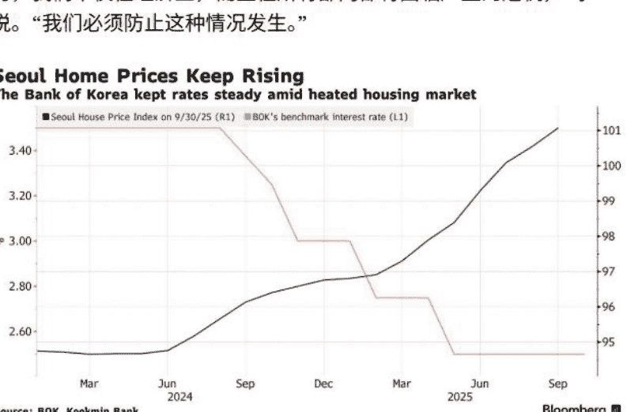

Source: BOK, Kookmin Bank

Bloomberg

Jason Lee
2025-10-28 04:10

bloomberg: 菲律宾政府正在从腐败中获得了胜利，菲律宾最近处于基建爆发风口边缘，财政部表示，如果没有腐败，菲律宾GDP更高#其他国家经济

# 加微信top26888，进资料分享群

## 人工智能的要点

- 货币委员会成员本明-奥迪克诺 (Benjamin Diokno) 表示，随着避险需求的缓解，菲律宾央行应该售出部分“过剩”的黄金持有。
- 黄金占菲律宾央银行国际储备总额的13%，奥迪克诺表示，已经超过了其他地区的黄金。
- Diokno表示，理想行的黄金持有应该在储备的8%-12%之间，鉴于它每一盎司2000美元左右的价格买入黄金，并且此后价格已经上涨，应该考虑抛售。

一位政策制定者表示，菲律宾央行应该售出其部分“过剩”的黄金持有量，随着避险需求的缓解，黄金将进一步从历史高点回落。

货币委员会成员本明-奥迪克诺 (Benjamin Diokno) 周在菲律宾接受采访时说，黄金占菲律宾央银行国际储备总额的13%。这已经超过了其他地区黄金，他在东盟首届市场汇率期间表示。

> “我们持有的黄金已经多次了，”前 BSP 行长 Diokno 说。他说，理想情况下，黄金应该占央行黄金的8%-12%，大约在央行储备1090亿美元（截至2025年9月），是近年来最多的。”

随着BSP以每盎司2,000美元左右的价格买入黄金，金价创下4,000美元的历史新高，“你不应该卖出吗？”奥迪克诺说，“如果金价下跌会怎么样？”

周一，中美贸易压力削弱了对避险资产的需求，黄金跌至每盎司4,053美元附近。尽管有迹象表明金价已超出，金价大幅上涨至稍高处的4,380美元，金价今年上涨上15%，央行的买家有助于提供支撑。

（马尼拉参与公共工程和工程曝露水污污染，高达70%防洪项目资金因腐败而流失，导致菲律宾过去两年内资金损失高达1200亿比索（约27亿美元）。财政部长克雷斯星期二（9月27日）在国会参院听证会上说，2023年至2025年公共工程项目因腐败造成的平均损失高达43亿比索。他说，如果没有腐败，菲律宾过去两年的经济增长率将从6.7%达到政府设定的6.5%，小总统马科萨在围爆发后，独立小组调查范围内的异常。）

加微信top0588，资料共享

## Jason Zhou

国金：一系列发行将公开市场买卖。我们预计10年国债收益率可能维持在2.7%左右。但考虑到通胀回落的趋势仍在，国内水平未回升，同时海外制造业周期结束，债市可能会反弹参与到2.7%下方阶段性机会。

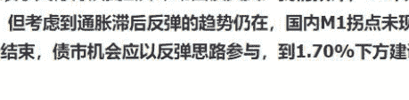

- 央行公开市场购买债券：10月27日，在债市论坛上，央行将继续公开市场购买债券。
- 我们这次调整有什么影响？市场操作活跃，整体利率曲线已转窄。从债市重心来看，央行对短期利率及中长期利率已成常态。从追踪利率与基本面来看，10年国债利率与基本面并没有太偏离，由于前期流动性缺失导致短期出现偏离。
- 政府政策影响：在9月首次召开货币政策工作会议后，双方对国债买卖开展了密切沟通。在9月初股市持续活跃，对于维持债市水平具有重要意义。在当前环境下，配合流动性波动较大的时期，国债买卖可以增强政府灵活性。10月份通常是季节性窗口，增加流动性投放有助于平衡资金市场。
- 对市场的影响：消息发布后，国债收益率出现回升，尤其是长端下行幅度窄。我们认为这一市场反应符合逻辑，长端的底部依然加强。市场恐慌计显示回撤至30个点以下，处于近两年的低位。在这种情况下，容易出现获利状态，这对长端提供了技术支撑，并且由于收益率持续偏离，长端修复了预期的偏差。其次，央行主要采取买入使得收益曲线大幅收窄。本次操作中，若国债买入力度加大，将维持对整体体结构的影响。

## 图表2：央行持有国债规模
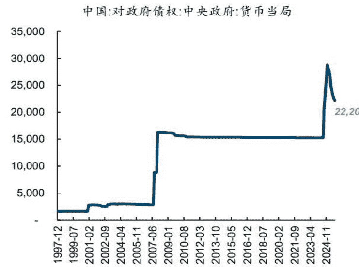
Source:Wind，国金证券研究所

## 图表3：两线较央行暂停国债买卖时明显上移
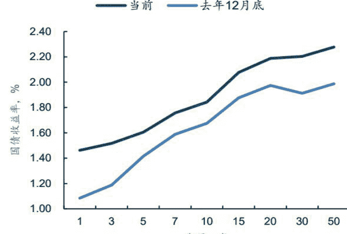
Source:Wind，国金证券研究所

## 图表5：若额外发行，年末社融或回落约0.8pct
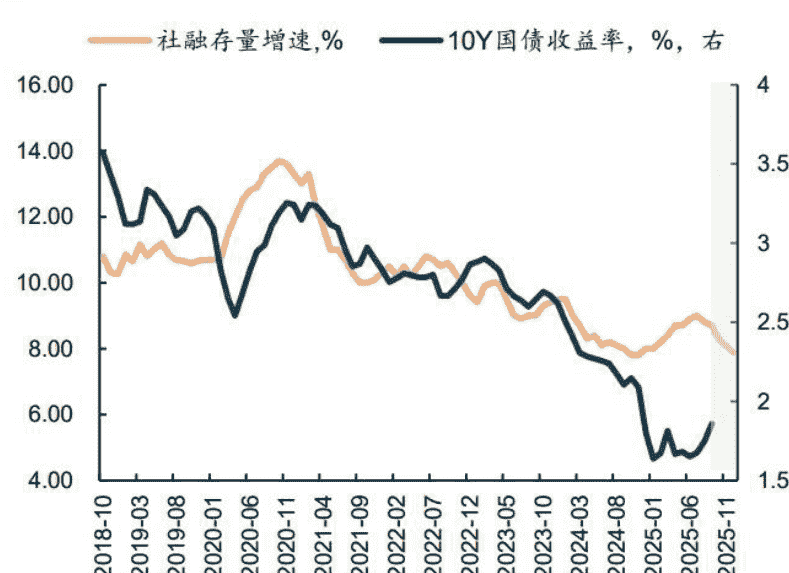
Source:Wind，国金证券研究所

## Jason不逊
2025-10-28 04:24

bloomberg: 彭贝特对日本首相高市的扩张性财政立场给予了好评，周一日元美元汇率一度跌破153。本月初，日本表示，能够解决安全问题为理由，打算停止购买俄罗斯液化天然气。500亿美元投资可能是可能的。德国约8%的液化天然气进口自俄罗斯。周二他们将讨论国防开支。

## 博客内容的要点

- 美国财政部长拉斯托尔·贝斯曼 (Scott Bessent)对日本首相高市早暮 (Sanae Takichi)的扩张性财政政策给予了好，并告诉他的首相片山纪月 (Satsuki Katayama），这有助于东京股市创下纪录的上涨。
- 片山，贝斯曼告诉她，“Sanaenomics”似乎运作良好，并发出了非常积极的信号。
- 两位首脑讨论了对俄罗斯的制裁问题，但片山没有发表意见。

美国财政部长拉斯托尔·贝斯曼 (Scott Bessent)对日本首相高市早暮 (Sanae Takichi）的扩张性财政政策给予了好，并告诉他的首相片山纪月 (Satsuki Katayama），这有助于东京股市创下纪录。

“贝斯曼告诉我，继续承信经济精神的‘Sanaenomics’似乎运作良好，并发出了非常积极的信号，”片山在第一次面对面告诉记者。说，片山被任命为日本第一位女大臣不久后，进行了一次简短的电话通话。

“很荣幸今天超过5000人的一天来到这里，”贝斯曼在会议开始时告诉片山，他指的是日经225指数。股指当天早些时候收历史新高。

她补充说，这两位财政官员没有涉及财政政策的细节，也没有涉及9月份签署的美日外交联合声明的详细细节。

片山对贝斯曼言论的描述是：扩张性政策提供了积极看法，这可能让美元弱。

## Jason Brock
2025-10-28 04:49

bloomberg: 一名为“美国工作质量”的研究发现，40%美国人表示他们拥有“优质工作”，62%人对自己的安排没有感。参与者被问“财务稳定”或“收入增长”是否重要？77%的人选择了稳定，也不希望更多。

## 一份好工作根据他们的身份和教育水平

| Worker | Low-quality work schedule | High-quality work schedule |
| :--- | :--- | :--- |
| Part-time | 34% | 39% |
| Full-time | 25% | 35% |
| High school diploma or less | 52% | 32% |
| Some college | 30% | 33% |
| Bachelor's degree | 22% | 38% |
| Graduate degree | 22% | 41% |

来源：美国工作调查
注意：如果员工无法控制时间并且缺乏稳定性，则工作时间视为低质量。

## 2023年各地市人口保检情况

| 地区 | 活人数 | 管理率 | 出生率检查率 | 出生率访率 | 人口流率合计 | 人口流率市/县 |
| :--- | :--- | :--- | :--- | :--- | :--- | :--- |
| 总计 | 8748524 | 94.6% | 97.2% | 99.0% | 100.0% | 99.9 |
| 北京 | 128529 | 97.9% | 98.4% | 98.2% | 100.0% | - |
| 天津 | 613857 | 95.1% | 98.9% | 98.0% | 100.0% | - |
| 河北 | 404733 | 93.7% | 97.9% | 95.5% | 100.0% | - |
| 山西 | 209123 | 92.4% | 98.3% | 96.0% | 100.0% | - |
| 内蒙古 | 113811 | 96.1% | 98.4% | 100.0% | 100.0% | - |
| 宁夏 | 161885 | 93.0% | 96.5% | 96.2% | 100.0% | - |
| 吉林 | 894536 | 96.4% | 98.4% | 98.6% | 100.0% | - |
| 辽宁 | 847181 | 95.4% | 98.6% | 97.2% | 100.0% | - |
| 上海 | 1036902 | 97.0% | 98.4% | 98.5% | 100.0% | - |
| 江苏 | 8365716 | 97.2% | 98.5% | 99.1% | 100.0% | - |
| 浙江 | 6851716 | 97.4% | 98.6% | 99.2% | 100.0% | - |
| 安徽 | 3748524 | 94.5% | 97.0% | 99.9% | 100.0% | - |
| 湖北 | 5824516 | 96.2% | 98.3% | 99.5% | 100.0% | - |
| 湖南 | 6359629 | 96.5% | 98.4% | 99.6% | 100.0% | - |
| 陕西 | 3951234 | 95.8% | 98.1% | 99.7% | 100.0% | - |
| 云南 | 4669016 | 94.8% | 97.5% | 99.3% | 100.0% | - |
| 海南 | 3923613 | 94.2% | 97.2% | 99.0% | 100.0% | - |
| 广东 | 12306358 | 98.5% | 99.2% | 99.8% | 100.0% | - |
| 江西 | 4540529 | 96.8% | 98.2% | 99.4% | 100.0% | - |
| 广西 | 5021356 | 95.5% | 97.8% | 99.1% | 100.0% | - |
| 新疆 | 2585474 | 95.2% | 97.6% | 98.8% | 100.0% | - |
| 青海 | 5998211 | 93.5% | 96.5% | 98.2% | 100.0% | - |
| 蒙古 | 2499072 | 96.3% | 98.0% | 99.5% | 100.0% | - |
| 河肃 | 2345216 | 95.4% | 97.9% | 99.3% | 100.0% | - |
| 山东 | 8601712 | 97.5% | 98.8% | 99.6% | 100.0% | - |
| 甘肃 | 2419743 | 94.9% | 97.3% | 99.0% | 100.0% | - |
| 云贵 | 4859716 | 94.6% | 97.1% | 99.2% | 100.0% | - |
| 海西 | 2610116 | 96.0% | 97.7% | 99.4% | 100.0% | - |
| 内蒙古 | 2400000 | 96.5% | 98.2% | 99.7% | 100.0% | - |

# China, Export prices by currency, SA, 2019=100

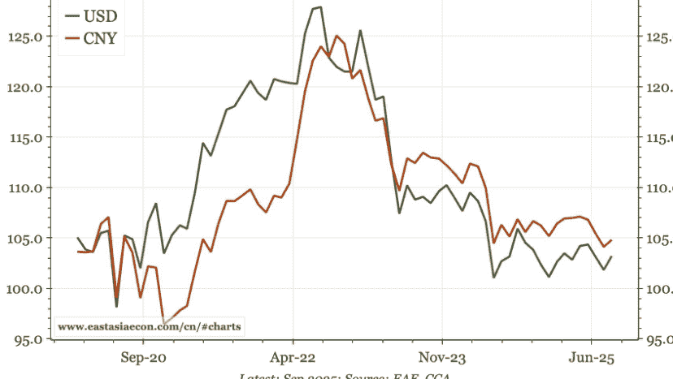

# China, Manufactures imports and exports, % YoY, 3mma

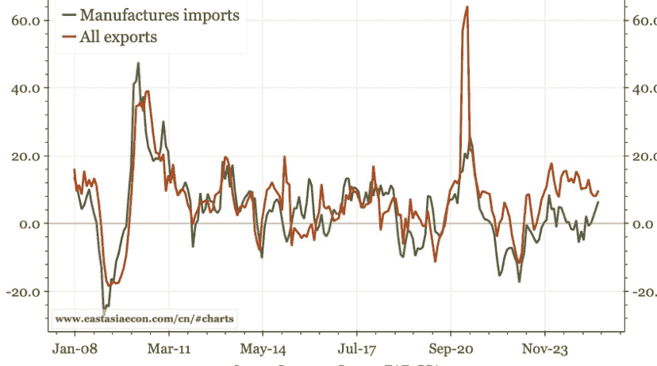

Jason-不遇
2025-10-28 06:59

bloomberg: 中国签证将会将采取的措施涵盖合格投资者的许可和注册流程，为主权财富基金、养老基金和慈善基金引入“绿色通道”，以及提高资金转移和客户运作效率。#金融

# 加微信top286688，进资料分享群

- 中国市场监管机构计划简化其海外机构投资者计划的规则，以吸引更多长期资金进入中国资本市场。
- 监管机构将允许海外机构交易新产品，并承诺提高政策透明度和对短期交易规则的平等对待。

中国市场监管机构推出了简化其海外机构投资者计划的规则，以吸引更多长期资金进入中国资本市场。

中国证监会公布了完善合格境外机构投资者（QFII）制度的两年战略，承诺要让全球投资者更容易、更快捷地进入国家证券市场。监管机构在一份声明中表示，目标是更好地协调在岸和离岸融资资源，提高QFII计划对中长期资金的吸引力。

“方案聚焦改善市场准入，助力提升投资效率，拓宽融资渠道”，证监会董事吴昊说官方媒体新华社报道，周一在北京金融街论坛上。

中国证监会计计划的措施包括简化合格投资者的许可和注册流程，为主权财富基金、养老金和慈善基金引入“绿色通道”，以及提高资金迁移和账户运作效率。

加微信top28868，进资料分享群

##人工智能的要点

- 中国央行将推动人民币国际化，扩大人民币在贸易中的使用。
- 中国人民银行致力于深化全球金融市场双向开放，进一步发展离岸人民币市场。
- 官员们在支持上海和香港发展成为国际金融中心，加强多边和双边货币金融合作的。

中国央行正在更加自信地传达其推动扩大人民币在全球货币体系中的作用。

中国人民银行周五晚表示，中国将推进人民币国际化，扩大人民币在贸易中的使用，通过深化金融市场双向开放，进一步发展离岸人民币市场。

这份声明是在中央工作会议政策实施会议后发布的，标志着从近年来的谨慎转向转变、消除了某些常规的定调。2020年，中共的五年计划要求“审慎、稳健的方式”推进人民币的作用，今年也呼吁“稳健、谨慎、务实”取得进展。

> “我们预料到了人民币国际化的种种措施，”来自银行大中华华区和亚亚区域首席经济学家说，“在全球替代安全资产的同时，中国人民银行官员今年更加不讳地表达了他们将人民币推为全球主要货币之一减少对美元依赖的决心。”

Jason不愁
2025-10-27 07:02:00

民生：9月企业利润增速达到21.6%，在排除低基数的影响后，9月企业利润增速屡现惊艳亮点（若用两年平均复合增速排除低基数的影响，工业利润增速回升从8月的8.5%至9月的9.8%）。我们看到9月更多企业回到第二梯队（后者“内在”为“较为活跃的状态”），说明近期“内需反弹”的力度逐渐缩小，若企业回更高量的非韧性状态，很有可能将再次承受压力，这也从侧面表明“内需反弹”的以后需要更大力度的重构设想；经济数据

# 微信仿top28688，进资料分享群

## 图1：9月基数相对于8月更低，进一步放大企业利润增速

| | 工业企业利润:当月同比 | 2024年 | 2025年 |
|---|---|---|---|
| 30 | | | |
| 20 | | | |
| 10 | | | |
| 0 | | | |
| -10 | | | |
| -20 | | | |
| -30 | | | |
| | 1月 | 2月 | 3月 | 4月 | 5月 | 6月 | 7月 | 8月 | 9月 | 10月 | 11月 | 12月 |

资料来源：IfInd，民生证券研究院

## 图2：相较于8月，9月更多行业回到第二梯队

| 有色金属矿产 | 有色金属矿产 | 第一类行业 |
|---|---|---|
| 3.0 | 钢铁开采 | “内耗”形成 |
| | 钢铁制品 | “钢铁” (重量影响) |
| 2.0 | 电子设备 | |
| | 家具制品 | 黑色制品制造 |
| | 印刷和包装设备 | -1.0 | 电子设备 |
| | 有色金属海运 | 仪器设备 |
| | 电力供应 | 化学制品 |
| | 专用设备 | 金属制造 |
| | 机械 | -1.0 | 防织制造 |
| | 通用设备 | 石油、天然气开采 |
| | 原材料: -2.0 | 第二类行业 |
| | “内耗”下的行业 | 仍在“内耗” (重量影响) |
| -10 | -5 | 0 | 10 | 15 | 20 | 25 |

价格是否反转？（同比：9月）资料来源：IfInd，民生证券

# 微信top28688，进资料分享群

Jason不离
2025-10-28 07:15

BCI指数：10为52，与2025年9月的51.1相比微幅上升，企业利润指数出现微下降，本月的指数为47.4，上月为48.3，指数出现小幅上升，本月为54.9，上月是50.5

| 财富指数(BCI) | 企业利润指数 | 上月 |
|---|---|---|
| 52 | 47.4 | 48.3 |

## 图表1
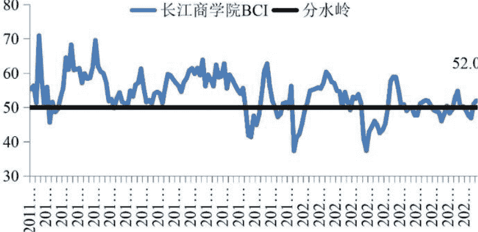
资料来源：长江学院案例研究与大数据前瞻中心。

## 图表3
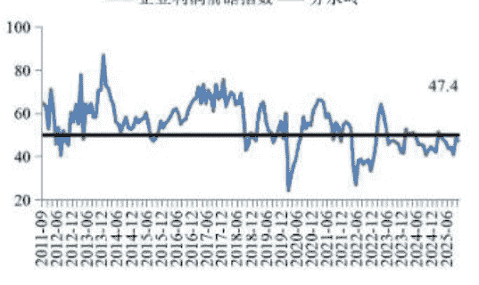
资料来源：长江学院案例研究与大数据前瞻中心。

# 加微信top28688，进资料分享群

## 图10
Jason不离
2025-10-28 07:22

中信建设：发达经济债务的可持续性与基础剩余和利率增长率（r）紧密相关。目前除日本外，英国、法国、意大利的中期债务预测高于名义增长，要实现财政剩余才能确保债务不变。英国的r-g差异显著，利率超过名义增速快约1个百分点，其次是法国，大约0.5个百分点，日本的成本低于名义增速。从长期来看，由于主权维持债务的意愿和轨道并立的背景，美国的债务动态仍是发达经济中最具挑战性的。根据建模结论，美国债务占GDP的比重每增加一个百分点，将长期利率上升2-3个bp，如果美国债务占GDP的比重从100%上升至120%，意味着债务可能导致长期利率约0.4到0.6个百分点，从而进一步推进利息支出。这意味着某个时刻，即使美国实现基础剩余，债务率也会面临利息支出的增长而上升，鲍威尔多次提及的美国财政正处于不可持续的路上。

## 其他国家经济

# 微信top28688，进阶分享群

Jason不离
2025-10-28 07:45

高溢：9月上游（多晶/硅片）涨价后，10月涨势暂停；银价月+18%抬高电池加成本（占比30~40%），低价接受力走弱。全产业链产出>需求、库存持续积累，短期可能在上持平、下优化后，若产能不退出，行业中长期低利润常态“大概率”。

## 行业
CHINA SOLAR: TRACKING PROFITABILITY INFLECTION
Goldman Sachs | Equity Research | October 27, 2025 | 8:01 CST

Upstream price keeps braved in Oct, downstream price likely weakened by higher silver price. Our Solar Profitability Tracker follows monthly supply/demand dynamics and spot prices/input costs for companies under coverage. Key highlights in Oct:
- Upstream price hiked in Oct (+5% vs. month), due to weaker downstream demand.
- Continued increase for Poly and Glass inventory by +7% vs. month to 27 days in Oct (40 days at Poly and Glass side jumped by 6.3% vs. End-Sep). But supply cut progress into year-end) Monthly production in Nov-Dec expected to decline by 6% vs. Oct as Silicon, mainly driven by capacity suspension in Western China (due to peak price), and capacity increasing in Oct with multiple new lines to be launched in the near term, as Cell/Module export volume declined by 10%/4% month to 11GW due to restocking activities as overseas peak season (in EU and Middle East), and therefore monthly export is likely to further decline in forthcoming months.

# 微信top28688，进资料分享

Jason-不离
2025-10-28 07:49

JPM: 在“BTC龙头”、ETH分化的格局下，短线考虑BTC-ETH相对对冲框架（或重利差及时调整）。

Table 2: October 24, 2023, BTC Flow: Two Active Walks on Friday (Fidelity's BTC and BlackRock's BIT) Not out of Size in Sales

| Symbol | Name | Inflows (Daily) | Net Inflow (Current Week) | Seed Capital | Current Assets | Fair Value on | Volatility | Return |
|---|---|---|---|---|---|---|---|---|
| BTC | Fidelity Bitcoin Trust | $914.7M | $1.1B | $50.2B | $20.8B | - | 0.0% | 0.0% |
| BIT | BlackRock Bitcoin Trust | $876M | $1.0B | $53B | $52.B | - | 0.0% | 0.0% |
| GBTC | Grayscale Bitcoin Trust | -$819M | -$1.2B | $30B | $8.1B | - | 0.0% | 0.0% |
| BTCV | Bitwise Strategy ETF | $210M | $300M | $2B | $1B | - | 0.0% | 0.0% |
| WBTC | ARK 21Shares Bitcoin ETF | $50M | $60M | $0 | $0B | - | 0.0% | 0.0% |
| DBIT | Invesco Galaxy Crypto ETF | $10M | $20M | $0 | $0B | - | 0.0% | 0.0% |
| ETC | Grayscale Ethereum Trust | -$370M | -$500M | $15B | $2.5B | - | 0.0% | 0.0% |
| ETH | Grayscale Ethereum Trust | $420M | $600M | $20B | $10B | - | 0.0% | 0.0% |
| Total | Total Bitcoin Flow | $1.2B | $2.1B | $135.2B | $31.4B | | |

Source: J.P. Morgan, Bloomberg Finance L.P.
Note: Grayscale's BTC capital reported January 10

Kenneth K. Washington, CFA
10/24/23 08:42 AM
keneth.b.washington@jmorgan.com

North America Equity Research
J.P. Morgan

## Exhibit 2: AUD gains notably in the USD bear regime

## Exhibit 3: Our rates forecasts imply AUD outperformance

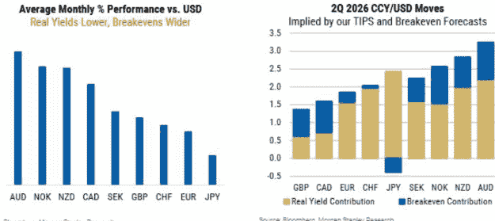

We also expect US-RoW differentials to materialize materially through 2026. Our current rates forecast imply that 2-year US yields *will decline to* 2.0% by next year (from 3.50% today) and 2-year German yields *will decline to* 1.6% (from 1.99% today), narrowing the spread from 1.6% to 0.4%.

Exhibit 3 shows the magnitude of moves in G10 currencies USD implied by our real yield and TIPS forecasts. We use correlation based estimates here.

Our rates forecast for yield compression reflects our economists' forecast for policy rates. We see the Fed cutting over the coming year and the ECB cutting.

The degree of yield compression we expect has historically correlated with broad USD underperformance. Interest rates other than euro area matters for USD, we focus on the spread between the US and Europe because the ECB's correlation to USD and versus USD has been similar to the DJI's weighted basket of USD. Both correlations remain elevated (Exhibit 4).

- Risks: USD positive risks stem from our expectations for either the Fed or ECB path – and any unexpected changes to our rates forecast

For any example, USD *may rise* if we anticipate markets price a slower and shallower pace of Fed cuts, especially if the administration reacts to tariffs by raising price costs, boosting protection and hiring. A deeper and faster pace of ECB cuts could provide rebound USD support while emerging from a large dislocation.

European inflation in January or significant wage deceleration in wage data released in late November.

## Exhibit 4: USD remains highly correlated with yield differentials

## Exhibit 5: Our USD forecast reflects US rates vs. Europe

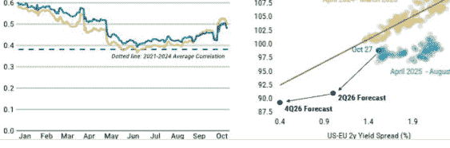

## Jason von
2025-10-28 08:05
特朗普签署搁置1st协议check

commitments under the Phase One Agreement, and what actions should be taken in respect of China's failure in meeting the agreement. The substantial gap between China's commitments and actual purchases could trigger another round of tensions going forward. 
©2021

Fig 1: China imports from the US product categories covered in the Phase One trade deal

| Unit | Manufactured Goods | Agriculture | Energy | Non-services | Services | Total |
|---|---|---|---|---|---|---|
| 2020 | USD bn | 32.2 | 12.5 | 18.5 | 63.9 | 12.8 | 76.7 |
| 2021 | USD bn | 44.8 | 19.5 | 33.9 | 98.2 | 25.1 | 123.3 |
| 2020-21 total | USD bn | 77.0 | 32.0 | 52.4 | 162.1 | 37.9 | 200.0 |

Nomura / Asia insights
27 October 2025

commitments under the Phase One Agreement, and what actions should be taken in respect of China's failure in meeting the agreement has incurred damage to US commerce. In view of the substantial gap between China's commitments and actual purchases, based on our estimate, the investigation and potential follow-actions could trigger another round of tensions going forward.

Fig 1: China's imports from the US product categories covered in the Phase One trade deal

| Unit | Manufactured Goods | Agriculture | Energy | Non-services | Services | Total |
|---|---|---|---|---|---|---|
| Additional US exports to China since 2017 actual | 2020 | USD bn | 110.5 | 36.5 | 25.5 | 172.6 | 68.9 | 241.5 |
| | 2021 | USD bn | 122.4 | 43.5 | 40.9 | 209.6 | 81.2 | 288.1 |
| | 2020-21 total | USD bn | 232.9 | 80.0 | 66.5 | 379.4 | 150.2 | 529.6 |
| 2017 actual | USD bn | 77.6 | 24.0 | 7.0 | 108.7 | 56.1 | 164.4 |
| 2020 actual | USD bn | 66.1 | 23.6 | 9.9 | 96.3 | 41.2 | 136.4 |
| 2021 actual | USD bn | 71.7 | 38.9 | 21.3 | 131.9 | 39.7 | 169.8 |
| | 2020-21 total | USD bn | 133.5 | 62.5 | 31.2 | 227.2 | 80.8 | 306.3 |
| | 2020-2021 actual | % | 57.3 | 48.1 | 59.9 | 53.8 | |

Note: Goods-based trade data is from China, and services data is from US. As codes listed in the Phase One deal not cover China's imports from the US, the total value of goods covered in the Phase One deal in 2017 (USD 108bn) is less than the total value of China's imports from the US (USD 150.7bn).
Source: China General Administration of Customs, US Commerce Department, and Nomura Global Economics

Jason von
2025-10-28 08:05
财政政策是今年接近的原因，新西兰走势的根源，新西兰后期转向财政，推迟了利率，但是12个月如此，存在通胀风险，澳大利亚对通胀仅为2.5%，新西兰利率更为宽松，但澳货币政策与两国FY25=0.4%/GDP，贬值大幅通胀。

Figure 2: Fiscal policy explains why NZ rates have diverged so far from Australia; we think this is unlikely to be structural with a NZ election in ~12 months.

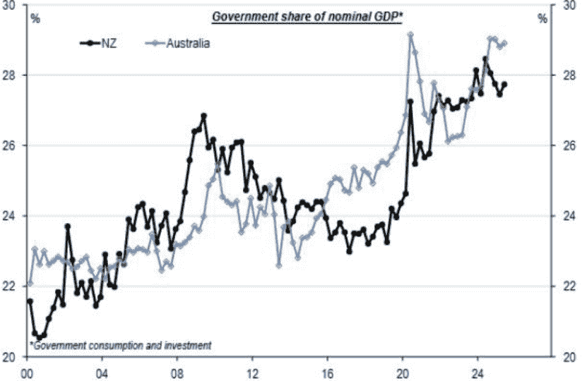
Source: Macrobond, Stats NZ, UBS

Jason
2025-10-28 08:20
高频数据显示，中房销售在10日前见缓，均线抬头回升。港口运运不大，集装箱运费砍8%（基数）。新增性银行专项债预计5000亿元（已接近3000亿元），预计未来3-4季度合计增20bp，最早Q4/2025或减10bp。Q4 GDP放缓至4%，全年2025E=4.8-4.9%。

## Figure 1: China Container Index (CCFI) and Shanghai Container Freight Index (SCFI)

## Figure 2: Weekly issuance of CGB and special LGB (Week 43 of Oct 20-26)

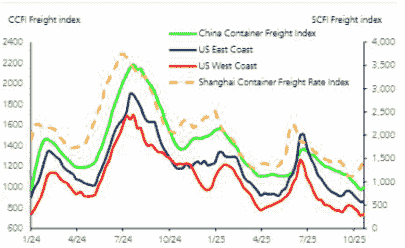
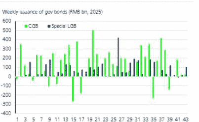
Source: Wind, UBS

## Figure 3: Pro-city property sales weakened to -2% YOY in the first 25 days of October from 7% YOY in September on a high base

## Figure 4: Auto retail sales growth notably dropped to -6% YOY in the first 19 days of October from 6% YOY before

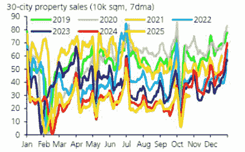
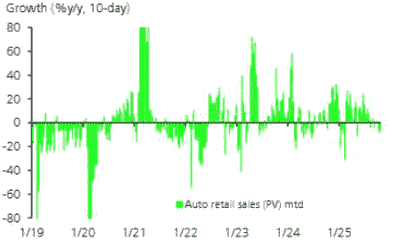
Source: Wind, UBS, CRIC, UBS

Jason
2025-10-28 08:22
国信：2025年9月全国四四线城市租赁市场呈现筑性格局。房价

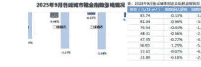

表：2025年9月重点城市租金及指数涨幅对比情况

| 城市 | 租金（元/月·m） | 指数环比幅 | 指数同比涨幅 |
|---|---|---|---|
| 上海市 | 83.74 | -0.33% | -1.80% |
| 北京市 | 81.04 | -0.96% | -3.91% |
| 深圳市 | 76.54 | -0.43% | -3.91% |
| 广州市 | 48.41 | -0.56% | -2.75% |
| 杭州市 | 47.35 | -0.22% | -3.56% |
| 南京市 | 36.90 | 1.25% | -5.23% |
| 福州市 | 33.61 | 0.07% | -4.2% |
| 成都市 | 31.89 | 0.18% | -3.24% |
| 天津市 | 29.81 | 0.91% | -1.40% |
| 大连市 | 29.26 | 0.77% | -3.38% |
| 武汉市 | 27.60 | 1.16% | -5.44% |
| 西安市 | 26.85 | 0.85% | -4.98% |
| 青岛市 | 23.85 | 1.4% | -4.84% |

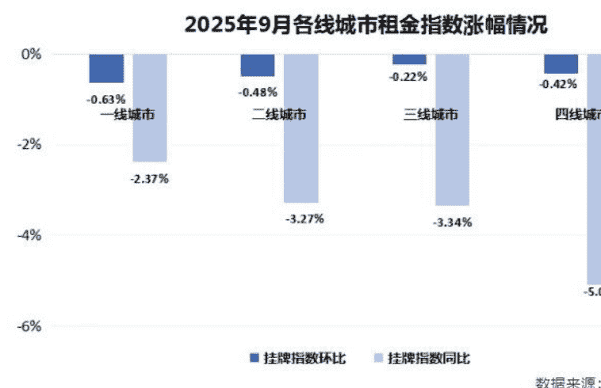
数据来源：国信
