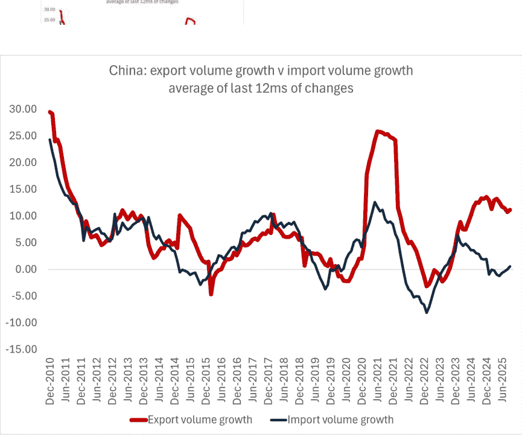
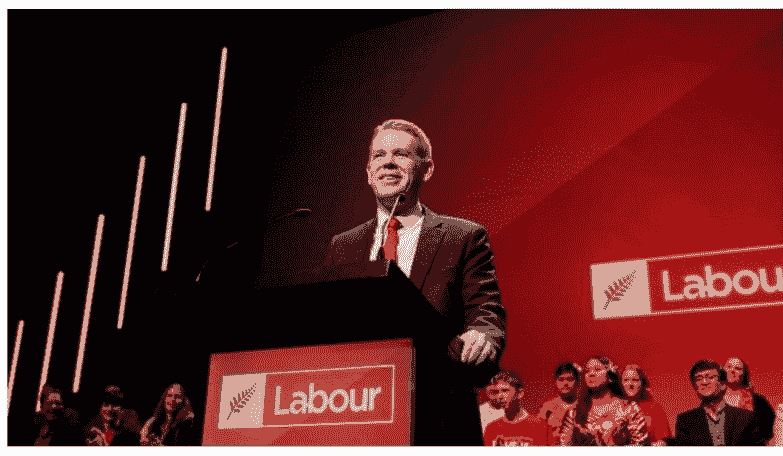
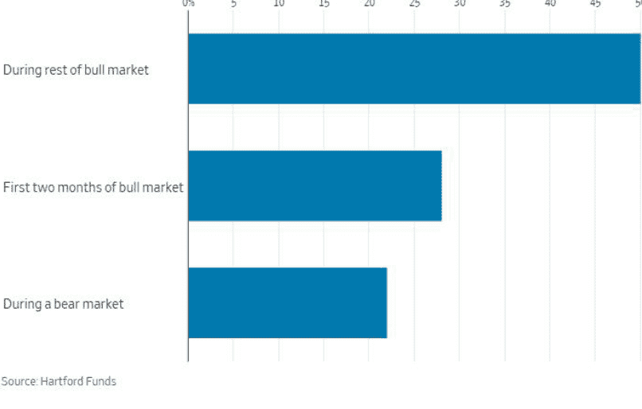
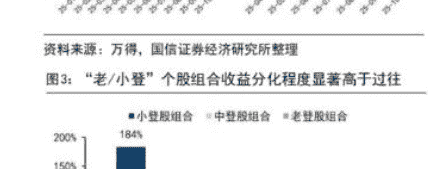
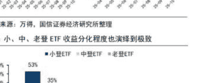
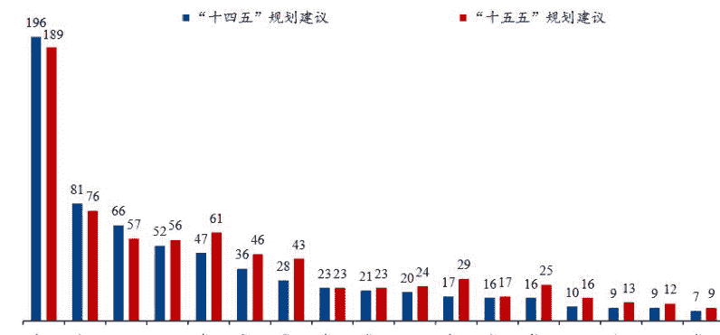

# 南半球聊财经251029

Jason不赢
2025-10-29 01:24

Pettis: 我同意Brad Sester的观点。中国经济从来不是真正的出口驱动型，人们说，其实中国经济已经转成了出口驱动型，更准确的描述是，中国经济是投资驱动型，净出口增长只是内需加上外部的结果。#经济数据

Jason不赢
2025-10-29 02:52

interest NZ: 新西兰计划对投资的资本利得税，给每个新西兰人每年3次的免费看医。其他国家经济

- GP stats: like the most progressive change to New Zealand's tax system in a generation
- 新西兰计划对投资的资本利得税，给每个新西兰人每年3次的免费看医
- 其他国家经济
- 医疗改革，正在进行

# 微信顶top28688，进资料分享群

# A 28% tax on investment property transactions after 2027 will fund free GP visits; 'the most progressive change to New Zealand's tax system in a generation'

[UPDATED]

28th Oct 25, 7:50am
by Dan Brunskill

Labour leader Chris Hipkins speaks at the 2023 campaign launch in Auckland

加微信top28688，资料分享群

## 4) 财政可持续性与“用途绑定”

收益波动：CGT 对市场周期高度敏感（成交量、价格涨幅、持有期限）。文中给出逐年上升的模型预测，但现实中出现成交低迷/价格横盘，每年7亿元的均值化目标未稳。

支出承诺：将全国3免费GP与CGT强绑定，虽政治上易传播，但财政上更脆弱。

达预期时如何补位？举债、调税还是限？

## 5) 与财富税 (Wealth Tax) 的取舍

工党此案明确选择 CGT 而非财富税（绿党与毛利党倾向财富税/更强再分配）。按你之前的判断：CGT 对普通人更温和、对投机更确定，实施复杂度与资本外流风险也低于财富税。文章也提到“让住宅买卖回归理性、投资实实体经济”的政治叙事。

加微信top28688，进资料分享群

- 税率与起算点：
  - 税率 28%，与公司税率对齐；
  - 在出售环节征收，仅对 2027 年 7 月之后产生的增值部分征税（文中示例：两个合伙人各持 50%，净增值 10 万纽币，则各自对 5 万亿缴 28%）。
- 收入用途与模型：
  - 所得全部回流医疗体系，包括通过“Medicard”系统为全民提供每年 3 次免费 GP 就医；
  - 预测收入：2027/28 年 1 亿元，2028/29 年 3.85 亿元，2029/30 年 9.65 亿元，2030 年及以后 13.5 亿元，预测年均约 7 亿元。
- 政治回应：
  - 工党：强调“公平、合理、定向且有助于修复医疗问题”；
  - 国家党 (Nicola Willis)：批评为“掠夺式加税”，伤害储蓄、投资与增长；
  - 绿党 (Chloé Swarbrick)：认为是“稀释版”的 CGT，强烈反对。

微信top28688，进资料分享群

# Jason/不离

2025-10-29 02:55

Bloomberg: 一项调查显示，多数英国人支持财富税，但财政大臣再次拒绝征收财富税的想法。其他国家经济

2025年10月29日 23:53 GMT+13 调查显示，多数英国人支持财富税，该调查强调了财政大臣

2025年10月29日 23:23 GMT+13 调查显示，多数英国人支持财富税，该调查强调了财政大臣瑞蕾·里维斯 (Rachel Reeves) 在下个月预算之前已经排除了这项政策。根据YouGov的调查显示，64%的成年人支持引入这样的税——该机构将其定义为对1000 万英镑（130 万美元）以上的资产征收1%，对超过10 万英镑的资产征收2%，与绿党的提议一致。调查显示，工、保守党和改革党多数都会支持此举。

# Jason/不离

2025-10-29 02:58

Bloomberg: 法国政府反对财富税提案，各国内部都在辩论“对征税”。其他国家经济

| 英国财富调查 | 财富税 |
| :--- | :--- |
| 调查显示，多数英国人支持财富税，这项调查主要针对征收超过1000 万英镑的富人 | |
| 多数富人对这项提议表示反对，如果政府将采取任何财富税措施 | |
| 有50%的富人认为他们倾向于支持政府实施任何财富税 |

加微信top28688，进资料分享群

## 人工智能的要点

- 法国政府仍然反对左翼财税，预计此税将超过1000 万欧元（1300 万）的个人缴纳相当于3%的税。
- 预计本周将对修正案进行投票，社会党劝说，如果不大幅增加富人的税，他们将推翻总理巴斯安·坎尔多。
- 2026 年预算的关键投票将在下周二举行，国民议会将分裂成两个对峙的集团，没有一个占据多数。

法国政府仍然反对左翼财税，尽管社会党劝说，如果不大幅增加富人的税，他们将推翻总理巴斯安·坎尔多。社会党在会中拥有巨大影响力，预计本周将试图修正法案进行投票。该提案将缩小经济学加布尔·祖曼 (Gabriel Zucman) 命名的财税范围，“创新型”企业除外。你可以称之为 Zucman-lite，但如果它影响生产、工厂或新的初创公司，我们将反对它，”政府发言人莫德·弗雷在 BFM 电台上说。在上述评论后，社会党领袖维利尔·福瓦周日表示，如果预算失败，将拒绝通过投票，随后可能会解散国民议会并举行立法选举。社会党也将处于劣势地位，因为民意调查显示左翼在这方面的表现不符合理想。

# Jason/不遇 (03:02)

ZeroHedge: 特朗普连夜会见了当选的保守派首脑首相早川，他赞扬了首相将国防支出提高到 GDP 的2% 的计划，并承诺美国坚定支持日本，称伙伴关系是“最强大的盟友”。特朗普特别感谢日本的大规模投资承诺，强调了丰田在韩国的持续扩张，并指出该汽车制造商“在美国各地建立超过100 亿欧元的汽车工厂。”特朗普还其他国家经济 U.S. Technology Prospect Deal Implementation of the Agreement A New

加微信top28688，进资资料群

# U.S. - Japan Technology Prosperity Deal | Articles | October 28, 2025
# Implementation of the Agreement Toward a NEW GOLDEN AGE for the U.S. - Japan Alliance | Briefings & Statements | October 27, 2025
# United States - Japan Framework for Securing the Supply of Critical Minerals and Rare Earths through Mining and Processing | Briefings & Statements | October 27, 2025
# President Trump Opens Asia Trip by Securing Landmark Wins for America | Articles | October 27, 2025

Jason Noble
2025-10-29 03:08

WSJ: 我们很难准确判断市场的顶部或底部。过去10年，美国共同基金和ETF中的平均投资收益率为7%。比基金总的回报低了1.2个百分点。这种收益缺口源于股市暴跌之后。未保持充分投资，使投资者错过了市场表现好的日子，而是在这些日子里，有一半人在市场期间或结束后落后了。想要忍受，就必须在别人恐慌时增加加股，投资者往往选择持有大量现金。好上自己还能挣得。另一个景象，现金占资金的比例接近十多年来最低。在2000 年初期，就在科技泡沫破裂之前；早一次是在70年代后期，直接接着是一轮惨的股市。基金现金水平是不明的，确实增加了市场可能出现反转的迹象。它的线还接近历史高位的，以及缺乏经验的投资者买入杠杆的行为。#美股

# 8 In

# Gotta Be In to Win It

Distribution of S&P 500's best days from 1995-2024

# Jason不离 (03:12)

# 加微信top28688，进资料分享

## 财富税 (Bloomberg)

# Jason不离 (03:47)

我发现黄金的最低点（在自由货币时代）出现在1999年8月，即欧元推出的那一年，令人唏嘘。同样，时任英国财政大臣的戈登·布朗 (Gordon Brown) 臭名昭著地开始出售英国一半的黄金储备，以便再投资于其他债券资产，上述欧元。为什么这里很有趣？好吧，如果你仔细细想，欧元是终极的法定货币实施。这种对权量的信念如此强大，以至于一群不同的民族国家意愿将自己团结在一个货币联盟中，尽管这显然不适合多成员。其目标是创造一种与美元相媲美的货币作为储备资产。正如美元取代了金本位制一样，欧元可能会削弱美元的一些主导地位——也会创造一个更加多极化的本位制。欧元幸存下来，这比许多怀疑者的预期多得多。更广泛的欧洲项目发现，民族国家的溶解度可能比设计者所希望的要低得多。可以说，正是这些内部矛盾，比其他任何事情都能阻止欧元成为美国的严重挑战者。

## 金融

# 博客人工智能的要点

- 过去一周黄金的暴跌并没有削弱人们对长期期的乐观情绪，因为各国银行和投资者发出了持续的需求。
- 行业代表预测，到明年，金价接近每盎司5,000美元，一项调查预计价格为4,980.30美元，比当前水平高出约27%。
- 韩国央行表示，可能十多年首次增加黄金储备，支撑市场历史性上涨的政府买险。

黄金在大幅反弹后，过去一周的暴跌并没有削弱人们对长期期的乐观情绪，因为各国银行和投资者发出了持续的需求。在京都举行的伦敦金市场会议——行业最大的年度会议——行业代表预测到2026年10月5日的会议，金价接近每盎司5,000美元。这项调查基于106份回复，预计价格为4,980.30美元，比当前水平高出约27%。贵金属在上周触及历史高后已回落至3,900美元左右，因为美联储息预期、央行持续买黄金和美元软弱的推动下，交易员在连续数月上涨后获利结。尽管如此，今年价格仍上涨了50%左右，这受益于投资者寻求避货币和财政压力增加保护。除了涨基调外，韩国央行暗示可能十多年首次增加黄金储备，支撑市场历史性上涨的政府买险潮。

加微信top28688，进资料分享群

# Jason-不遇

2025-10-29 04:01

国信：2025年“老/小龄”资产表现呈现分化趋势。“小龄”长期压“老龄”。我们以光伏模块、硬件设备、机器人等分赛道龙头类构建“小龄”组合，以金融、制造、军工与权重类等权重构建“中龄”组合，以消费龙头构建“老龄”组合，2025年以来“小龄”上涨183.8%，显著优于“老龄”组合的3.9%。从4月7日以来“小龄”组合ETF上涨200%，远高于“老龄”组合的13.6%，外优于行业整体，“小龄”ETF成交占比升至33%，而老龄行业整体成交占比不足2.8%，两者涨幅到2019年以来98%分位，仅略于二月末二初DeepSeek狂潮带来的分化。时效性、行业特征，阶段性重重视价值。

图1：“老/小龄”年初以来收益分化趋势

图2：小、中、老ETF 领先程度同向相似

资料来源：万源，国信证券经济研究所
资料来源：万源，国信证券经济研究所
图3：“老/小龄”个股收益分化程度高于老龄

图4：小、中、老ETF收益分化程度也接近极致

资料来源：万源，国信证券经济研究所
资料来源：万源，国信证券经济研究所

# Jason-不遇

2025-10-29 04:04

民生：规划建议对“十五五”时期的经济会有哪些明确指引？我们从“后挑选”战略主动和重大突破三大核心任务出发，在产业、就业、科技、金融、开放这五个领域。首次提高居民负担能力，“金融强”战略的提升，对比“十四五”，“十五五”规划将高水平对外开放的需要得到落实，且调试也从基础的实行转向更广的扩大”政策分析。

# 微信top28688，资源资料分享

> 明确需要提高消费支出，解决需求供给不足的“十五五”集中举办大事的着力点。

当前我国居民消费收入落后于全球其他主要国家，成为经济均衡发展的短板。对此，本《意见》中强调提高居民消费支出作为“十五五”时期经济社会发展的一大目标。预留“刚要”空间可能会提出相关针对性措施。

消费升级提升还有巨大空间。到2035年我国人均GDP将达到等中发达国家水平，主要要靠经济在均衡发展中人均消费占比在54%左右，这意味着我国居民消费收入仍有10百分点左右的空间，若能突破，未来年后居民消费增长有望提升7%以上，增长潜力可见。

如何怎样？激发居民消费意愿需要优化供给，在消费侧更加激发，如“清理汽车”、“住房消费无限制性措施”、“落地新消费新体验”、“消费场所质量优化等。

“金融国战‘十五五’规划中仍有可为。“金融国战”高层级的建设，不仅体现在今以来已相关部门的加强工作中，近日金融国战将全面实施时明确“蓝图”。

一方面，当前中美消费战已进入胶着状态，美国在经济、科技等领域的影响力已显事实，其正的态势可能集中于消费领域，但优势难以削弱，这要求我们在消费战中争夺主动权。另一个，“金融国战”的建设可以实现“十五五”与“财富”的双重突破——同时成为居民收入的重要来源，可以进一步落实。最后，要在“国际斗争”中实现高水平开放”。

图五：‘十五五’规划与‘十四五’：目标路径（基于《意见》）

| 序号 | “十四五” | “十五五” | 目标路径 |
| :--- | :--- | :--- | :--- |
| 1 | 创新性增长，加速消费升级 | 建设现代化消费体系，巩固实体基础 |
| 2 | 加快恢复需求，激发内动力 | 加速消费侧技术创新，引领新生产增长 |
| 3 | 形成统一市场，构建新型格局 | 扩大国内市场，加快完善市场体系，提高活跃度 |
| 4 | 改革消费政策，加快多元化市场 | 加快我国市场一体化建设，提高活跃度 |
| 5 | 激发城乡活力，培育区域增长 | 实现高水平开放，形成新格局 |
| 6 | 升级消费结构，培育新型业态 | 加快产业转型，逐步推进服务 |
| 7 | 发展文化文旅，提升文化内涵 | 优化消费结构，深度推进增长 |
| 8 | 激发数字消费，加速消费融合 | 加强数字经济，激发活力，实现共同富裕 |
| 9 | 丰富居民消费，加快建设体系 | 加快发展蓝图转型，构建安全体系与引领 |
| 10 | 完善收入保障，加快建设体系 | 实现建成百年目标，高度聚焦与未来引领 |
| 11 | 完善就业保障，建设更稳固中国 | 提升国家安全保障和能力，维护发展安全 |
| 12 | 加强国防建设，实现强国和军队现代化 | 坚决实现一流军队目标，高质量推进国防军队现代化 |

数据来源：财经日报，图表绘制

# 微信数字28868，资料分析

# Jason-不离

2025-10-29 04:07

# 十五任务排序政策分析：“十四五”规划建议的12大任务

图2：“十四五”和“十五五”规划建议的词云

数据来源：新华社、广东规划设计研究院

图表1：“十四五”和“十五五”规划的12大任务排序

| 序号 | 十四五 | 十五五 |
| :--- | :--- | --- |
| 1 | 坚持创新发展，全面恢复增长 | 调整产业结构，实现竞争力升级 |
| 2 | 加强科技创新投入，培育现代化产业体系 | 高质量科技自立自强，引领新质生产力 |
| 3 | 固守国家安全，维护发展安全 | 建设国家安全格局，构建新格局 |
| 4 | 改革区域经济，加快全国统一市场建设 | 深度激发市场活力，实现高质量发展 |
| 5 | 推进城乡融合，实现城乡共同富裕 | 优化城镇化进程，促进区域协调发展 |
| 6 | 推进文化建设，构建新型文化体系 | 增强文化自信，实现文化繁荣 |
| 7 | 坚持绿色生态文明建设，推进绿色低碳发展 | 推进生态文明转型，实现生态保护与绿色协调发展 |
| 8 | 提升社会保障水平，基本公共服务均衡 | 完善全民社会保障，实现社会公平正义 |
| 9 | 推进农业农村现代化，实施乡村振兴战略 | 提升农业科技水平，实现城乡农业共同发展 |
| 10 | 改善民生生活，提高人民健康水平 | 促进经济社会全面发展，建设高质量中国 |
| 11 | 加强国防建设，实现强国和军队现代化 | 提升国家安全保障和能力，维护发展安全 |
| 12 | 加强国防建设，实现强国和军队现代化 | 坚决实现一流军队目标，高质量推进国防军队现代化 |

数据来源：新华社、广东规划设计研究院

# 微信微top28668，进资料分享群

# Jason不离

2025-10-29 04:19

脚注：我喜欢跟大家聊人口，很多人会说你是个投资的，你是一个千Hedge Fund (对冲基金)的吗

| 年份 | 城镇人口规模 | 城镇化率 |
| :--- | :--- | :--- |
| 2010 | | |
| | | |

同时它拆到另外一个东西，就是基建。有一个数字大家可能不知道，主力劳动力群，也就是24岁到45岁的人，主要劳动力简直就是全社会主要的纳税群体。他们占人口的比例非常关键，这个比例不能低于25%，当城市里只有几个人纳税的时候，我可以告诉大家。

人口变化是一个再分配的过程，这个过程简单就会导致努力短缺。

这涉及到城镇化率的峰值。当城市里只有几个人纳税的时候，我可以告诉大家，人口比例的下降，城镇化的顶峰就会出现。

虽然城镇化的数据出来好像还往上，但注意城镇化率这个数字，它等到最后的时候，不是城市大带动城镇化，而是农村消失。日本当城镇化率高的时候，农村消失。

人口从100万减到80万减到60万，这些公共支出再需要维持，可能因为这个过程。

# 微信info28668，进资料群

财富是一样的，分蛋糕的动作还没有传递给你，所以你就被分蛋糕坏了。其实各国都一样，不光是中国，因为所有的国家在战争后的人口都存在这样的规模性问题，所以都会出现类似的问题。

隔壁日本、隔壁韩国，甚至东南亚也会同样的问题。所以我以前讲过一个叫代际分配的，财富人口之间实际上是一个再分配的过程，但是这个过程很简单，快了就会使得一部分人分多了，另一部分分少了，慢了就会导致。

我跟很多人讲，你们看到过日本举行加息会议，日本就会出现通胀，很多人不理解它的经济增长从0到1就出错了，它怎么能出现通胀，这就是一个巨大的错误。

对于多数的劳动力来说，你的劳动收入到什么样的决定了？市场告诉你你决定定了，简单人的供给大了，市场的需求小了，人的劳动价值就低了，这就是通胀的根源。如果人的供给少了，需求可能保证增长，人少了就会出现短缺，价格还是上来。

这涉及到人口的周期调整至关重要。现在的问题是，人口的下降，我们现在看到的人口变化。刚才其实提到了人口的问题，到了个人的问题。

# 微信top28668，进资料群

# Jason-不霉

2025-10-29 04:38

摩根士丹利：数据显示新能源企业，新订单增长率高。摩根士丹利：高政转向“民生化+质量”，在待温、高端需要长时间。

这涉及到人口的比例，人口比重低于25%。

# 微信top28688，进资料分享群

# Jason-Lee

2025-10-29 04:47

摩根士丹利：高数据显示新能源企业，新订单没有增长。

# Key Takeaways

- Weekly intake (Oct 20-26) of major EV players was mixed...
- It's worth monitoring the long-awaited rollout of the final batch of subsidies in 2025 could help Q4 sales close.
- Promotions continue aggressive. Inventory -2.1% from end24 level, with inventory months at 6.3 (average 25.7) in Sep, 2.9%/-4.6% yoy vs end24 total inventory to c1 tier.
- seeing more OEMs continue promotions amid mixed trends.

Exhibit 12: 1/2/3 inventory balance was -0.1%/-0.5%/-0.1% wow,
Exhibit 13: 1/2/3 inventory month was +0.6%+0.6%/-0.2% wow, inventory months:OEM rolling breakdown to c1 tier

Source: CRES, Goldman Sachs Investment Research
Source: CRES, Goldman Sachs Investment Research

# 微信top28688，进资料群

# 知识星球TOP

添加微信资源分享群免费入群

微信:top28688

| 序号 | 公号/星球/社群 | 原价 | 领域 |
| :--- | :--- | :--- | :--- |
| 1 | 生财有木 | 2765/年 | 副业，搞钱 |
| 2 | 众宗吃瓜群 | 365/年 | 时政，历史 |
| 3 | 记忆巷/饕树风 | 365/年 | 成长 |
| 4 | 欧洲金轨 | 328/年 | 时政，历史 |
| 5 | 卢克文云会 | 699/年 | 时政，社会 |
| 6 | 体制内主任 | 599/年 | 体制，职场 |
| 7 | 局外人的视界 | 669/年 | 金融，时政 |
| 8 | 澎沛异迁 | 4166/年 | 财富，成长 |
| 9 | 守夜人总司令 | 599/年 | 时政，经济 |
| 10 | 江宁知府 | 365/年 | 时政，国际 |
| 11 | 政堂/顾子明 | 568/年 | 时政，经济 |
| 12 | 唐书院 | 1399/年 | 金融，财富 |
| 13 | 大树乡谈 | 199/年 | 时政，成长 |
| 14 | 水库欧大 | 10000/年 | 房产，经济 |
| 15 | 洪灏宏观策略 | 4376/年 | 经济，搞钱 |
| 16 | 金企通鉴/北海南山 | 4576/年 | 股票，行研 |
| 17 | 猫哥的世界 | 299/年 | 时政，社会 |
| 18 | 飞浪龙 | 3600/年 | 股市，经济 |
| 19 | 米联储见 | 599/年 | 经济，金融 |
| 20 | 茶茶财经圈 | 330/年 | 房产，股票 |
| 21 | 赢在八小时之外 | 365/年 | 成长，职场 |

...... 更多资源，不再列举

+ 图书、报告、课程等各类类高价值资源

- ★ 免费群 每日分享资源
- ★ VIP群 每日享所有资源（日均20+），75/年
