# 南半球财经251030

Jason 不鑫

2025-10-30 07:32

bloomberg: 鲍威尔对金融市场的预期，我们在观点分歧中，我们并没有做出决定。12 月降息。鲍威尔的言论似乎在金融市场的预期表示“这比预期的更激烈。”在发表讲话后，美国国债收益率近五个月最大，导致 10 年国债收益率回到 4% 以上。

鲍威尔笃然相信降息在 2% 的范围内，过去三周市场状况出现收紧的迹象，表明他对未来三年的预期发生了变化。金融

- 彭博智能的监管基准利率下调至 3.75%-4%，美联储主席鲍威尔在12 月降息表态后，美国国债下跌。
- 鲍威尔的言论使投资者重新调整对未来的预期，交易员减少了对 12 月再次降息 25 个月的押注，尽管他们仍然认为降息的可能性很大。
- 债券拍卖竞逐。大亚和新西兰的收益率升压，投资者等待美国政策的会议决定，以寻找对全球市场的走向方向。

在美联储主席鲍威尔对 12 月降息表示怀疑后，美国国债创下五个月来的暴跌，尽管劳动力市场活跃促使政策制定者周三降低了成本。

试图将基准利率下调至 3.75%-4%，鲍威尔的鹰派前景限制了 30 万亿美元美国国债。鲍威尔在周二下午的发布会上表示，在 12 月会议上进一步降息“并非板上钉”，使期限内的收益率达到了 6 月以来的最高水平。

摩根资产管理公司固定收益行业董事凯塞尔·贝贝罗（elsey Berro）表示：“市场上有意外的是，他正在重置与 12 月降息相关的期权。”这看起来像是故意试图让 12 月更像是一场现场会议。”

鲍威尔表示，政策制定者将不得不重新评估劳动力市场的下行风险，迫使投资者重新调整对未来的预期。交易员减少了对 12 月再次降息 25 个月的押注，尽管他们仍然认为降息的可能性很大。

# 微信inftop28688 资源资料共享群

它震动了收益率在今年附近接近的市场。对于货币政策预期变化更敏感的两年期国债利率跃升 11 个点至 3.6%，为一个月来的最高水准。

交易员未来一年的降息路径从 2026 年 9 月的 3% 调整为 3.15%。

> “我们认为利率不会会抛售过多，”华盛顿堡投资顾问公司高级投资组合经理丹·卡特（Dan Carter）表示。劳动市场“放缓”——一直是削减过去两次会议的理由，从现在到 12 月，这种情况不太可能改变。

# 鲍威尔讲话时，市场信心减少了降息押注

交易员对 12 月降息的把握较小，因为主席鲍威尔表示这“远未成定局”。

- Cumulative rate cuts priced by FOMC meeting date

| | December 2025 | January 2026 | March 2026 | April 2026 | June 2026 |
| --- | --- | --- | --- | --- |

资料来源：彭博社
注：价格截至美国东部时间 10 月 29 日下午 3 点

# 加微信top28688，进资分享群

# 分裂的观点

在鲍威尔早些时候表示就业可能进一步疲软后，周三的举动受到了广泛的预期。他说，职位空缺的进一步下降“很可能会体现在失业率的上升上”。

然而，美联储官员对于还放宽多少政策存在分歧。几位政策制定者警告，在通胀率仍高于美联储 2% 的目标的情况下，不要快速降低贷款成本。

上个月引发的利率预测显示，9 位政策制定者中有 1 人在上月降息后不再愿意降息一次，其中 7 人愿意在 2025 年进一步降低。

阅读更多：对进一步降低时，美联储的分歧将加大。该声明对官员限制了他们获取经济数据的事实表示认可。在描述劳动力市场时，美联储的工作变得越来越困难，因为官员被迫在没有依赖部分数据的情况下做出决策。然而，政策制定者确实收到了一份消费者价格报告。它显示 9 月份通胀比三个月来慢。这些数据可能引起价格压力的欢迎，但显示核心通胀率比美联储的目标远高于 2%。

# 加微信top28688，资料分享群

古拉：在美联储主席鲍威尔于周三宣布降息 25 个基点后，我对委员会决策的了解。

恩达·柯兰：到今年 7 月左右，美联储还愿意就业市场表现良好，但近几个月来，我们看到明显的证据表明速度放缓。与此同时，有迹象表明通胀可能朝着正确的方向发展。目前还没有达到，但降息提供了窗口。因此，这就是为什么今天连续降息，反映出他们现在更多地关注就业市场而非对通胀。

古拉：最近发生了什么事？政府已经关闭了。这并不意味着其工作人员完全不受影响。美联储倾向于劳动力市场和经济分析等这些机构已经被取代了。这意味着关键指标和报告可能没有根本。

结论：我认为美联储政策制定者更愿意拥有官方数据。他们会在会议期间听到许多人所说的劳动力市场疲软。鲍威尔表示，数据已经表明劳动力市场“仅仅”正在逐渐降温。有些关于裁员的重大新闻（亚马逊周透露很遗憾），也许这就是令人震惊的原因。但头条新闻只是条新闻，正如他所指出的，最初的数据（在加州一级收集和报告）没有闪任何黄色色彩。

鉴于通胀来说美联储经历过热，这些持续的“逐步降温”甚至仍然受到欢迎。当然，人们担心的是，一开始是渐进的事情很快就会变得先进和尖锐，而美联储时已经。鲍威尔表示更加满意。

首先他是非常强势在 12 月会议上降息“远未”确定。他多次使用了这句话，所以这显然是不起兴的。正如 Inflation Insights 的 Omair Sharif 指出的，鲍威尔认为可以说政策不是在“预设路线”上，这是央行喜欢用来建立灵活性的标杆语言。

股市因此波动了一点，并没有在交易结束时，标准普塞尔 500 指数（几乎）完全封持。鉴于鹰派信号，以及利率跨越曲线飙升的事实，风险资产并没有出现售卖之多，但无论如何，这可能有些令人惊讶。

我感兴趣的另一件事是对于就业的描述。抛开我们处于非农业报告后（由于政府部门）的事实不谈，鲍威尔表示，数据已经表明劳动力市场“仅仅”正在逐渐降温。鉴于通胀来说美联储经历过热，这些持续的“逐步降温”甚至仍然受到欢迎。当然，人们担心的是，一开始是渐进的事情很快就会变得先进和尖锐，而美联储时已经。当我们谈论这种可能已经有一段时间了。你可能已经没有听到提到规则。从历史上看，可靠的先兆是失业率三个月移动平均线从 0.5 点。从那时起，我们没有看到失业率连续上升，但不是很多。这是渐进。

由于一些人认为，当你去掉关税效应时，通胀潜在趋势更低。因此，你看到美联储政策制定者确实接受了所有息，并且好吧，我们愿意再次强调资产负债表反映到 2019 年的水平这就是成功的“量化紧缩”的样子。

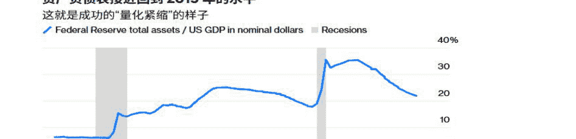

来源：彭博社

# Fed's Balance-Sheet Unwind to Conclude Next Month

此举出台之际，流动成本一直在上升，而流动性正在枯竭，导致许多华尔街银行警告，如果美联储不想避免 19 年 9 月那种扭曲，就应该放弃这一过程。当时，随着短期利率上升，美联储向金融体系注入了五万亿美元。然而，周三没有迹象表明美联储这次需要立即向金融体系增加流动性。

“他们似乎并不急于直接增加储备，”美国利率策略主管根纳迪·戈德堡表示——鲍威尔似乎没有显示美联储已准备好增加资产债表。

自央行于 2022 年 6 月开始削减 6.6 万亿美元的投资组合以来，已有超过 2 万亿美元的资金离开金融体系。这几乎清空了其主要的流动性晴雨——逆回购工具——像巨大短期债务正在在吸引资金。

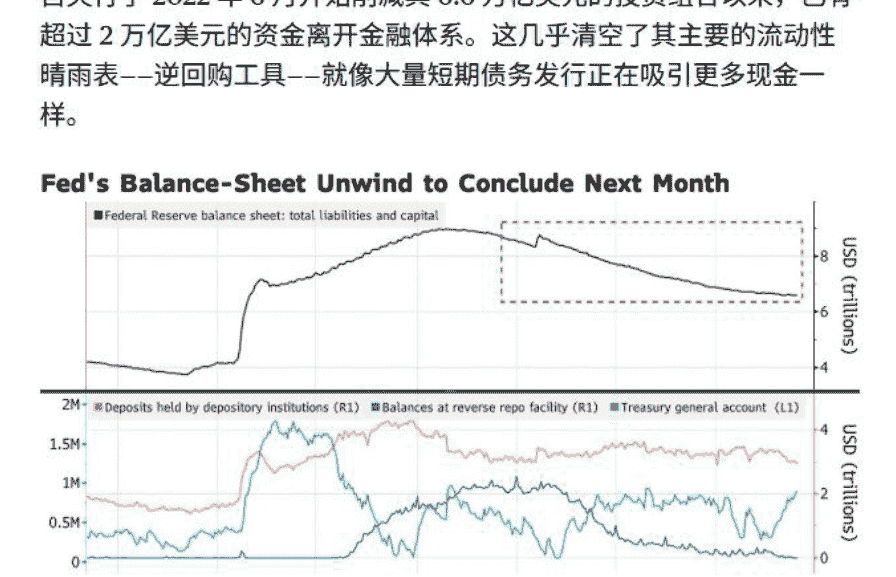

# 加微信top28688，资料分享群

立法者霍克·西奥蒂（Éric Ciotti）领导的中右联盟首次向法国国会提交一项支持加密货币。这项拟议立法将法国的目标是在未来七到八年内购买比特币供应量的 2% (420,000 BTC)。为了管理存储，建议建立一个公共机构，其结构类似于基金和货币持有。资金将来自多个来源。剩余的电力为比特币行业提供动力，并为矿工运送。

# 加微信top28688，资深分享群

# 中国的美国豆产量

bloomberg: 美国农业部布鲁克斯·罗林斯（Brooke Collins）在 X 上新闻，中国已经购买了至少两个美国豆，这是其本已知的首次购买，这可能标志着流量的复苏，作为两个最大经济体预计在本周达成的广泛解决方案的一部分。

美国商务部部长华德·普特尼奇在韩国亚太经组织会议期间表示，这一消息对周四的会议来说是一个“美妙”的迹象。

交易员保持谨慎。截至上午 0.3 点 10.9225，芝加大豆期货下跌 7% 至 59 美元。

“这个消息无疑是积极的，但市场将等待待议的细节，”澳大利亚农业经营公司 Advantage Grain 总经理 Chris Nikolaou 说。“这对国际需求、生产商和中国消费者绝对是对好事。”

# 加微信top28688，进资分享群

特朗普曾在社交媒体上发表赞韩国的投资和降低关率，但除了首尔提供的细节之外，几乎没有提供其他细节。特朗普表示韩国已“大量购买我们的石油和天然气”，该企业在美国的投资将超过 6000 亿美元。

关注全球政治的最新动态。在《权利定价》时事通讯中获取各地各地者的意见。推特可能会向我发送优惠和促销活动。提交我的信息，表示我同意隐私和服务条款。美国总统说他“已经批准他们建造一艘核动力潜艇，而不是现在拥有的老式的、灵活性差得多的柴油潜艇。在随后的帖子中，特朗普表示，韩国将在“费城造船厂”建造核动力潜艇，并吹嘘它对美国造船业的推动力。李明哲向特朗普施压，要求韩国为潜艇再加核燃料，以取代其航队中的柴油动力潜艇。在取得突破之前，韩国和美国双方可能拟定该协议的想法，该协议将使美国在特朗普访问期间将韩国商品的关税限制在 15%。

# 加微信top28688，资料分享群

# Jason不离

翰译调研大数据研究：10月100个重点城市二手住宅市场价为1361元/平方米，环比跌0.48%，同比跌3.5%，环比较上月扩大10个百分点。政策效应边减加上10月成交量环比季节下跌，价格行情未改善。截至本月，百城二手住房房价环比连续下降32个月，同比下降34个月。

## 房价

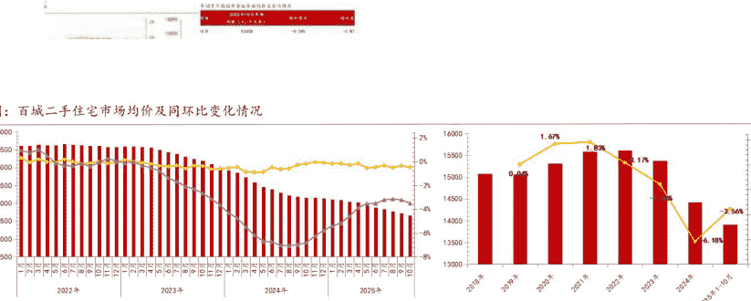

图：百城二手住宅市场价及环比变化情况

数据来源：翰译调研数据研究

### 表：2025年10月不同城市市场均价及变化情况

| 城市等级 | 2025年10月市场均价（元/平方米） | 环比变化 | 同比变化 |
|---|---|---|---|
| 一线城市 | 53408 | -0.54% | -3.87% |
| 二线城市 | 16218 | -0.53% | -3.30% |
| 三线城市 | 8729 | -0.37% | -3.63% |
| 100二线住宅 | 13661 | -0.48% | -3.50% |

数据来源：翰译调研数据研究

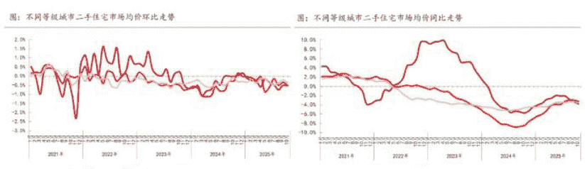

数据来源：翰译调研数据研究

# 加微信top28688，进资资料共享

# Jason不离

2025-10-30 08:16

bloomberg: 特朗普在亚洲三次之旅中多次提到在印度和巴斯坦所扮演的角色，每次重点都会增加很多侧角，但印度边界并不是特朗普调整了印度的，对特朗普普这种叙事有些生气#其他国家经济

## 影博人工智能的要点 隐藏内容

美国总统特朗普表示，他今年早时候威胁印度和巴斯坦征收250%的关税，以帮助缓解解决冲突。

特朗普将印度总理莫迪描述为“最亮亮的家伙”，同时也是一个愿望战斗的“杀手”。

特朗普的愤怒激了印度官员，他们拒绝了他在冲突中进行调整的说法，并恶化了莫迪和特朗普之间的密切关系。

在 WhatsApp关注影博，获取万亿万富翁、企业和市场正在做什么的独家内容和分析。在这里。

美国总统特朗普表示，他今年早时候威胁收250%的关税威胁印度和巴斯坦，以帮助缓解解决冲突，并将印度总理莫迪描述为“最亮亮的家伙”，同时也是一个愿望战斗的“杀手”。

特朗普在周日在华盛顿举行的经济合作组织会议上向企业领导会议发表讲话时发表了上述评论。

特朗普一再声称解决冲突是为了为期四天的武装冲突，这激怒了印度官员，他们拒绝了他的调解主张。知情人，莫迪本周出席了在马来西亚举行的领导人峰会，因为印度官员担心特朗普会重复调解冲突。

印度外交部门没有立即回应评论

# 微信信top28688，进资分享群

# Jason不腻

2025-10-30 08:20

国信达：2025年第43周，全国二手房挂价指数环比下降0.2%，深圳今年累跌近-10%。#房价

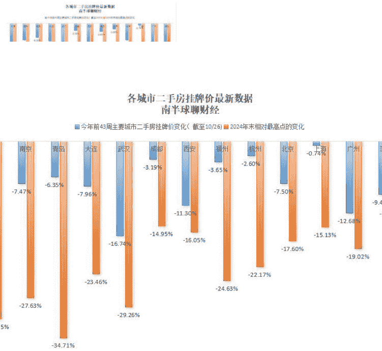

## 各城市：二手房挂价最新数据
南球财经

# Jason不腻

2025-10-30 08:23

高盛：我们改进的工资追踪指标显示，中国城镇员工增速进一步放缓，从第二季度的同比4.0%降至第三季度的3.8%。家庭储蓄从第二季度的31.3%升至第三季度的32.4%。消费增长不是胜利的。

# 加微信top2688，进资料分享群

### Exhibit 11: Our wage tracker suggests urban growth moderated to 3.8% yoy in Q3

Source: Wind, Haver Analytics, Goldman Sachs Investment Research

### Exhibit 15: The household savings rate rose above pre-Covid trend in Q3 2025

Source: NBS, Goldman Sachs Investment Research

# 微信top2688，进资料群

## China Consumer Confidence

May is the latest data available.

Source: NBS

# Jason不离

2025-10-30 08:30

## 时寒冬：下探是为了起金

由于近期宏观环境的变化，黄金市场出现了一定回调。这种调整在短期内是必然的，但长期趋势并未改变。我们需要耐心等待，金将迎来反弹。

## 黄金完了了吗？

当然没有。

我在《时寒冬：全球投资的机遇》中所分析的，决定黄金、白银价格走势的逻辑并没有丝毫改变。所有支撑黄金、白银上涨的力量仍然很好。那么，黄金的方向也不会改变。中美节奏与众多资金的获利引发了这次的调整，而众所周知，中美两个大国的博弈已经全面展开，斗争是常态，且只是小插曲。因此，这次的调整看起来是一种技术性的调整，或许更为恰当。

从上图可以看出，2023年10月6日，黄金（连续合约）最低价格还是1823.5美元，到今年10月20日，已经涨到了2398美元，此间屡创纪录，很少有像样的调整。我们知道，拉长时间线来看，几乎所有商品的运行都随着波动而起伏，而不能回头地一口气走到终点。这一波黄金的上涨至今，已经走了一波波澜壮阔的行情，它出现调整是正常不过的事情了。这种调整不仅意味着黄金牛市的终结，恰相反，调整以后将走得更健康，也能走得更远。

# 微信:top2688，进资料分享群

资源价格的走势在这个周期内日趋清晰。

黄金、白银的走势将大幅度上涨，这种涨幅绝非此前人们记忆中的幅度所能想象

471 / 第34章 世界的2023-2034

一个人的习惯是用过去的走势来预判未来的趋势，但在2023年开始的周期内，过去的经验将变成想象的阻锁，只有不断打破。

由于资源价格上涨和需求转变的周期恶化，北半将成为一个新的争夺焦点。北半蕴藏着铁、镍、铜、钢、锌、硅，还有340万吨石油和169万吨天然气。北半分为若干国家：美国、俄罗斯、加拿大、丹麦，这些国家将成为争夺焦点，面临的是黄金、白银价值大幅上涨。这种涨幅绝非此前记忆中的幅度所能想象——一个习惯是用过去的走势来预判未来的趋势，但在2023年开始的周期内，过去的经验将变成想象的阻锁。只有不断打破，才能看到未来的终点。

《时寒冬：未来二十年后经济大趋势（未来）》是在第470页和471页中的描述。当我根据周期理论原本用于过去分析的总结，但我根据利益预测了未来趋势与实际相结合，通过灵活运用参照周期，赋予了周期预测功能。这应该是周期理论的一次实质性的突破。进一步通过周期分析方法与实际相结合，加以完善，让趋势预测更加精准。这就是精妙之处。这个金银周期正处于资源时代。

# 加微信微top2688，进资料分享

强化，未来，白银可能像黄金一样有更大的上升空间，至少金银值难以持续下去。

简单来说，黄金将比白银更快地进入上涨轨道，而在未来，白银将卖出泡沫，表现出更强的强势。换句话说，黄金领先，白银随着时间的流逝值得期待。

“未来，白银可能像黄金一样有更大的上升空间。”《时寒冬：全球黄金银投资策略》第101页。

在一个周期的开头，白银的表现非常精彩，无论是黄金还是白银，都属于它们的黄金时代。在这一时期，没有低高，只有更高。在10年后的《时寒冬》中书中，已经预见到人们对这次走势的困惑。所说，“在023年这个周期内，过去的经验将变成想象的枷锁。当枷锁打开，才能看到未来的趋势”。

# Jason不离

2023-10-30 08:37

bloomberg: 中国金融的盈利增速超过预期，8月以后，对银行和保险公司的预测有望提升。MSCI市场指数中国金融的盈利增长率已升至3.2%，而中国股票的整体盈利增长率将升至1.7%。

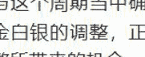

# 微信微top2688，进资分享

## 金融公司将跑赢中国整体盈利 / China Financials

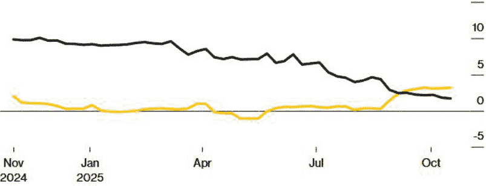

来源:彭博资讯

注：基于盈利对比增长预期中国行业的良好态势。一项在香港上市的中国保险公司指标今年上涨了63%，是中国企业指数涨幅的两倍多。

## Chinese Insurance Stocks Outperform Broader Market

Normalized As Of 12/31/2024 Hang Seng China Enterprises Index ■ China Insurance Shares
Source: Bloomberg

包括工商银行股份有限公司、中国建设银行股份有限公司、中国农业银行股份有限公司在内的主要机构也看到了改善的迹象，其前期部分取决于中国经济增长的计划。中国银行股份有限公司周二报告称，由于该银行设法稳定了其净差，净收入增长率为5%。

对银行的乐观情绪上升，因为利润的改善让投资者获得了更好回报的机会。

“在将到来的银行息支付、稳定的利率、PPI反弹和工业企业的支持下，我们看到了中国在第四季度银行的好机会，”包括Richard Xu在摩根士丹利的分析师在一份报告中指出。

加微信top2688，资料分享群

# Jason观察

2025-10-30 08:48

东方：中国在国内旅游消费支出巨大，但入境花费较少。另外，吸引入境的花费也相对少。经济数据

## 宏观深度报告 20251029
文旅投资为什么不赚钱？

- 背景：国内文旅投资规模大，回报不高，才能拉动消费和投资增长。2023年，由于只考虑政策，那么文旅投资回报率低则制约行业发展。2024年，约83.5%的样本中，ROE低于4.48%。
- 对比：供给限制。主要原因可能是国内优质文旅供给不足。2023年，由于只考虑政策，那么文旅机构的自供给率平均值为48.7%。2024年，中国国内出游人均花费下降3.4%。与日本相比，2024年，中国大陆游客人均花费为1372元，是日本1107元的10倍以上，考虑到国内游客购物支出，特别是奢侈包、美妆等，深受国内消费。
- 观察：需求释放。从表面来看，国内文旅需要市场化以提高附加值。2023年，由于需求驱动，国内出游增长率33%。2024年，中国大陆游客希望通过旅行获得幸福感，文旅活动是必要途径，包含增加假期与潮流展览、热门项目，中国游客的需求高出12至15个百分点。

# 微信top2688，进资料分享

文旅投资规模大但回报不高制约行业进一步发展。从具体数据看：

- 2023年，如果考虑非财政性收入（从财政拨款、补助收入），全国文化机构（场所、图书馆、美术馆等）的自供给平均值为48.7%，文化机构（博物馆等）的自供给平均值为19.1%。
- 2023年，以“非财政性收入/资产总额”衡量，全国文化机构平均值为15.6%，其中文化类、图书馆、博物馆对应收益在以下%。
- 2024年，A股上市公司ROE约为4.48%，期间55企业ROE高达83%，其中16家企业ROE为负值，占比24%。

图1：2023年，全国文化机构的“非财政性收入/营业总额”平均值为15.6%

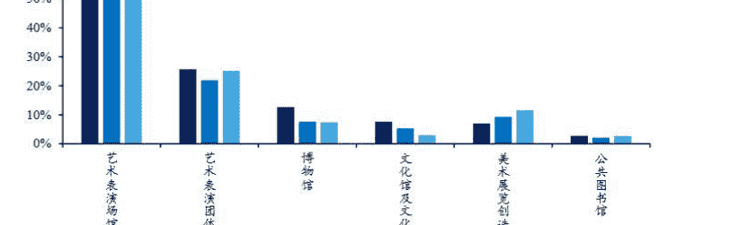

数据来源：中国日报，吴世亚研究所

图2：2024年，国内上市或发行文企业的ROE高于A股上市公司ROE为4.48%

数据来源：Wind，吴世亚研究所

注：样本文娱选取A股上市公司中属于文化类地方企业，行业分类为旅游及辖区的18家企业，以及国内发行文体主体涵盖文娱的48家地方企业。

# 加微信top2688，资料分类

与海外对比，无论是吸引海外游客的数量，还是海外游客的支出方面，中国大陆的文旅吸引力还有待提升。2024年，删除港澳台入境限制后，中国大陆共接待国际游客2690万人次，分城市，上海、广州、北京、杭州等城市吸引海外游客数量在700万人以上，许多如江苏、福建等地区代表性城市。基于国土面积、人口等条件，中国大陆入境的海外游客数量未出现优势。

海外游客的支出方面，2024年中国大陆入境游客人均支出仅为714美元，在亚太地区，这一数字不仅优于日本、新加坡城市对应的1459美元、1334美元，还低于亚洲的1519美元，马来西亚对应的634美元也高出12.7%。虽然海外游客的人均支出受价格、汇率等因素影响较大，但中国大陆的人均支出仍有待提升。

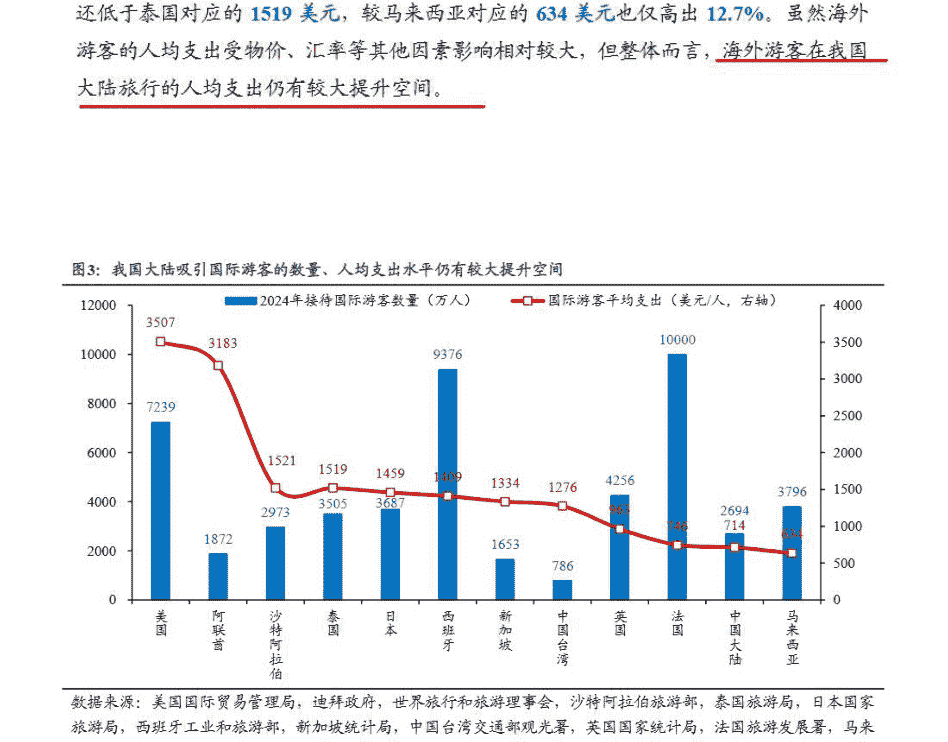

数据来源：美国国际贸易管理局、携星、世界旅游理事会、沙特阿拉伯旅游局、日本国家旅游局、韩国观光及旅游局、新加坡入境数据、中国文化和旅游部、美国统计局、法国发展署、东亚研究所
注：台湾、香港、澳门均为行政地区，文中的“中国”指中国大陆、香港、澳门。2024年中国大陆接待国际游客2690万人次，分城市，上海、广州、北京、杭州等高等城市吸引海外游客数量在700万人以上，许多如江苏、福建等地区代表性城市。

从大陆游客在海外旅行的行为来看，住宿、餐饮、购物是三大主要领域，尤其是与其他国家或地区的相比，大陆游客于购物的支出明显较高。2024年，无论是在日本还是中国台湾，大陆游客在住宿、餐饮、购物三大领域的支出占比均接近甚至超过80%。其中，大陆游客在日本、中国台湾旅行时，分别为43%、22%的支出用于购物，这一比例明显高于其他国家或地区的游客。

## 图7:住宿、餐饮、购物是大陆游客在海外旅行的三大支出领域

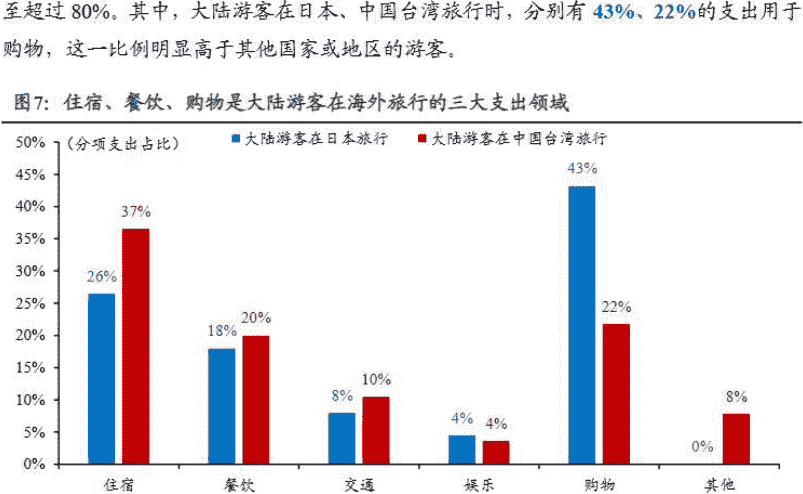

数据来源：日本国家游客局、中国台湾交通部观光署、东证研究所

## 图8：2024年，在日本接待的外国游客中，中国游客的购物支出占比最高，达43%

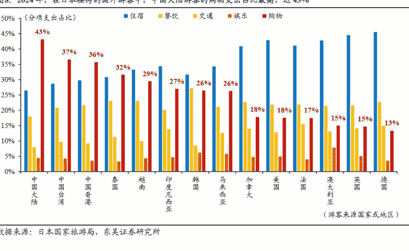

数据来源：日本国家游客局、东证研究所

## 微信top28688，进阶资料分享

## Jason 不涵

2025-10-30 08:51

BOFA: 自1970年以来的历次黄金牛市中，超过10%的月度回调并不罕见。在这些回调之后，金价往往重新回升，继续走牛。黄金牛市的真正因素，并非由于技术性超买或短期回调，而是其后的驱动因素发生了根本变化。例如，从债转向通胀加剧，或者非常经济政策走向传统。目前的回调可能是为未配置黄金的投资者提供了机会。只要驱动本轮市的流动性没有变化——只要美国没有“回”正的经济政策和传统的保守财政政策，或者美联储“未”转向离宽松立场”，那么黄金价格宏观趋势依然稳固。

金融

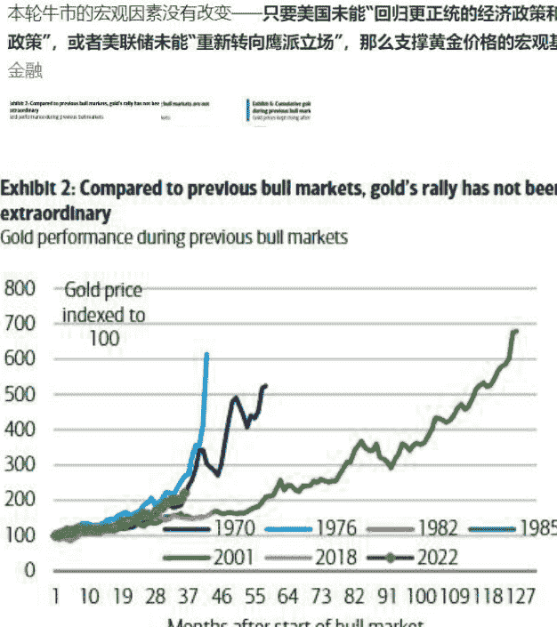

Gold performance during previous bull markets

Exhibit 2: Compared to previous bull markets, gold's rally has not been extraordinary

Source: Bloomberg, BofA Global Research

BOFA GLOBAL RESEARCH

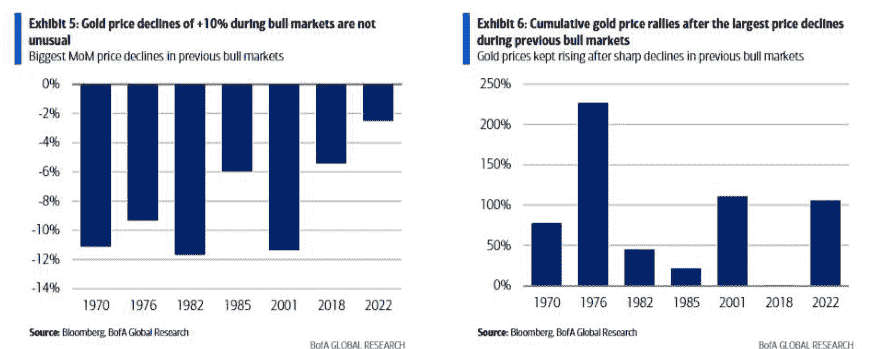

Exhibit 5: Gold price declines of +10% during bull markets are unusual

Exhibit 6: Cumulative gold price rallies after the largest price declines during bull markets

Biggest MOM price declines in previous bull markets

Gold prices kept rising after sharp declines in previous bull markets

Source: Bloomberg, BofA Global Research

Source: Bloomberg, BofA Global Research

BOFA GLOBAL RESEARCH

BOFA GLOBAL RESEARCH

## 微信顶28688，进资料分享群

## Jason不离

2025-10-30 08:57

JPM: 美国人工资涨已降至十多年来的最低水平，美国工人受到经济衰退的影响更大。职业生涯早期收入增长的动力已经丧失。如果没有更强的收入增长，他们可能需要等待更长的时间才能使预算削减于他们的财务目标。#其他国家经济

(所以更处于风险加中？)

## 最年轻的工人工资涨放幅度最大

- 薪资增长中位数峰值的下降幅度比任何其他年龄组都大
- Age 25-29 * Age 30-34 * Age 40-44 * Age 45-49 * Age 50-54

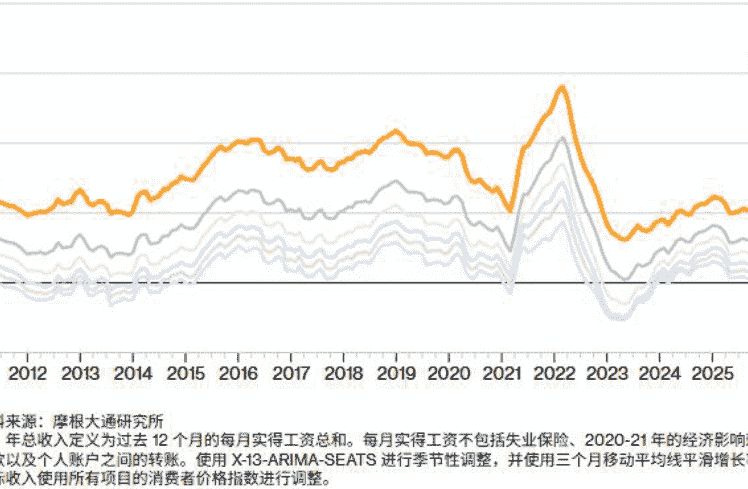

来源:摩根通研究所
注：年收入定义为过去12个月的每月实得工资总和。每月实得工资不包括保险、2020-21年的经济影响刺激付款以及个人账户之转换。使用X-ARIMA-SEATS进行季节性调整，使用三个月移动平均平增长率。实际者使用所有项目的消费者指数进行调整。

## Jason不离

2025-10-30 08:57

bloomberg: 俄罗斯消费者的黄金购买量与西班牙或奥地利的国家储备持平，今年零黄金购买量达到62.2吨，随着金价接近历史纪录的45000美元以上，购买放缓，但自2022年以来，零售黄金总量预计达到282吨。这种趋势显示俄罗斯如何与欧美等传统市场相比选择避险，在寻求更增长的方法来保值财富。黄金已成为他们首选的避风港。#金融

## 加微信top28688，进资料分享群

## 俄罗斯继续购买黄金

自 2022 年以来零售购买买加剧

■ Consumer gold purchases

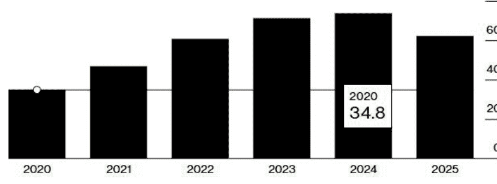

资料来源：世界黄金协会(2020-2024) Jason不离 2025-10-30 09:04

2025年1至9月，全国纪检监察“连续”立案78.9万件，相比去年64.2万件，同比23%；67.7万件，相比去年同期同比15%。

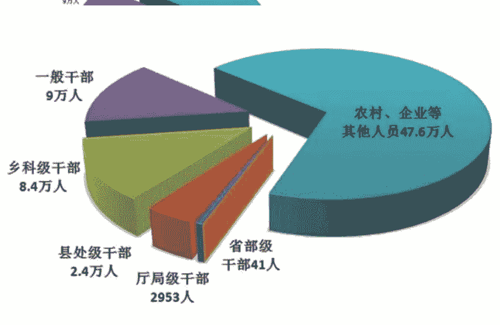

一般干部、企业等人员、农村科级、省部级、县处级、厅局级图1：全国纪检监察处级分面

## 微信top28688，资料分享群

## Jason-腾

2025-10-30 09:12

经济学最新意愿显示，特朗普的支持率下滑快于近年来的历任总统。两次支持率转为负，比第一任期内的任何时候都低。YouGov的数据显示，美国人对移民问题的处理方式满意，共和党基盘如今对特朗普的支持态度令人冷。

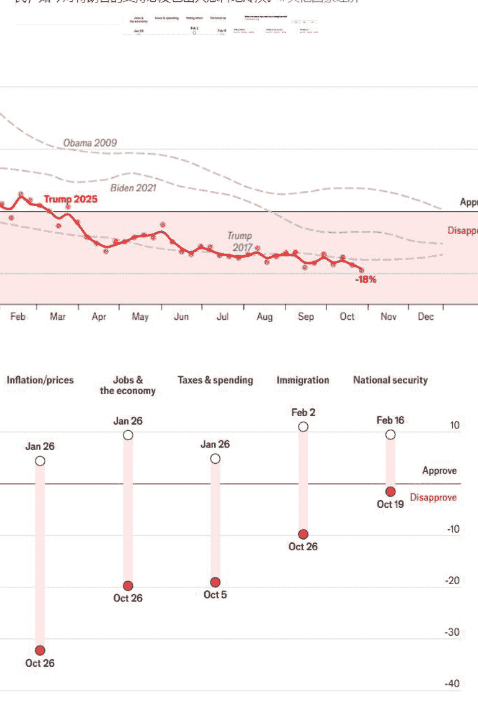

加微微信28688，进资料群

## What is the most important issue facing America? responding by party

| Issue | All | Rep | Dem |
| :--- | :--- | :--- | :--- |
| 1. Inflation/prices | 20% | 24% | 22% |
| 2. Jobs and the economy | 12% | 10% | 14% |
| 3. Health care | 16% | 8% | 11% |
| 4. Civil rights | 16% | 11% | 9% |
| 5. Taxes and government spending | 3% | 12% | 8% |
| 6. Immigration | 3% | 11% | 7% |
| 7. Civil liberties | 12% | 1% | 7% |
| 8. Climate change and the environment | 8% | 2% | 5% |
| 9. National security | 1% | 11% | 5% |
| 10. Education | 3% | 3% | 3% |
| 11. Crime | 2% | 5% | 3% |

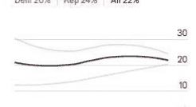
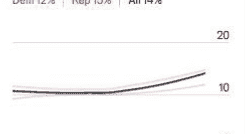
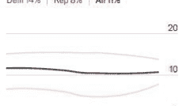

Jason-不遇 2025-10-03 09:15

广发:上海小区真实走势-上海重点小区相对历史点下降30.9%，深圳则是41.7%。#房价

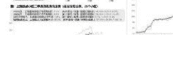

## 加微信top28688，进资料分享群

## 上海小区真实房价走势

如何删除成交均价对房价的干扰

选取上海热门的25个小区，时期、楼层、户型等明显小区（参考数据），剔除一项后成交平均涨幅+2.2%，通过回归分析模型计算，可以对大部分的波动性进行调整。

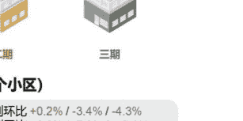

图：上海热点小区房价分布（总价分类，25个小区）

25年9月，上海热点小区跌幅-5%，其中卖豪/房屋/分割同比+0.2% / -3.4% / -4.3%
25年9月，上海热点小区跌幅-5%，其中卖豪/房屋/分割同比+0.2% / -7.6% / -10.2%
25年年初至今，上海热点小区跌幅-3.8%，其中卖豪/房屋/分割分别为-4.3% / -8.1%

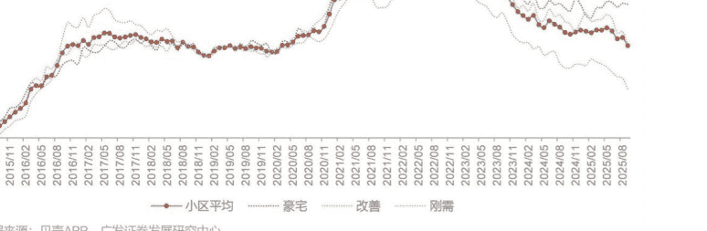

图：上海热点小区真实房产价格指数（样板小区）

| 小区名称 | 区域 | 房型 | 均价 | 涨幅 | 跌幅 | 环比 |
| :--- | :--- | :--- | :--- | :--- | :--- | :--- |
| 联华 | 浦东 | 2室 | 5.2万 | -3.5% | -4.8% | -2.1% |
| 联华 | 浦东 | 3室 | 6.5万 | -4.1% | -5.2% | -3.0% |
| 金豪 | 浦东 | 2室 | 4.8万 | -2.8% | -3.1% | -1.5% |
| 金豪 | 浦东 | 3室 | 7.2万 | -3.8% | -4.5% | -2.7% |
| 锦源 | 浦东 | 2室 | 8.5万 | -3.2% | -3.9% | -2.2% |
| 锦源 | 浦东 | 3室 | 10.2万 | -4.5% | -5.4% | -3.1% |
| 碧云 | 浦东 | 2室 | 7.1万 | -2.5% | -3.0% | -1.8% |
| 碧云 | 浦东 | 3室 | 11.5万 | -3.7% | -4.2% | -2.5% |
| 锦和 | 浦东 | 2室 | 5.9万 | -3.1% | -3.6% | -2.9% |
| 锦和 | 浦东 | 3室 | 8.8万 | -3.5% | -4.1% | -2.4% |
| 华润 | 浦东 | 2室 | 6.4万 | -2.9% | -3.4% | -2.0% |
| 华润 | 浦东 | 3室 | 9.2万 | -3.6% | -4.3% | -2.6% |
| 景苑 | 浦东 | 2室 | 5.5万 | -2.7% | -3.2% | -1.7% |
| 景苑 | 浦东 | 3室 | 8.1万 | -3.4% | -4.0% | -2.3% |
| 翡和 | 浦东 | 2室 | 7.8万 | -3.0% | -3.5% | -2.1% |
| 翡和 | 浦东 | 3室 | 10.8万 | -4.2% | -4.8% | -2.8% |
| 远景 | 浦东 | 2室 | 6.3万 | -3.3% | -3.8% | -2.2% |
| 远景 | 浦东 | 3室 | 9.5万 | -3.7% | -4.4% | -2.6% |
| 嘉悦 | 浦东 | 2室 | 5.7万 | -2.8% | -3.3% | -1.9% |
| 嘉悦 | 浦东 | 3室 | 8.9万 | -3.5% | -4.1% | -2.4% |
| 锦和 | 浦东 | 2室 | 7.4万 | -3.1% | -3.7% | -2.2% |
| 锦和 | 浦东 | 3室 | 11.2万 | -4.3% | -4.9% | -2.9% |
| 宏景 | 浦东 | 2室 | 6.6万 | -3.4% | -3.9% | -2.3% |
| 宏景 | 浦东 | 3室 | 9.8万 | -3.8% | -4.5% | -2.7% |

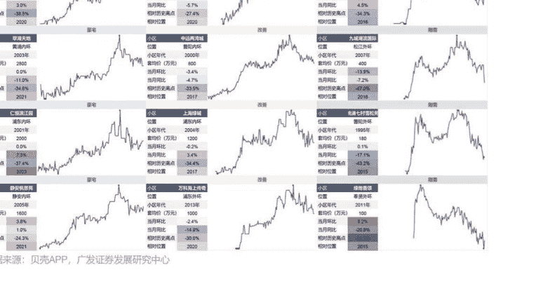

## 广发地产深圳小区房价趋势 25M9

什么样的户型对价格的影响？选择成交量最大的样本，通过户型、面积、层高对当年价格的影响，筛选一次a1-c3进行回归分析

| a1 | b1 | c1 |
| :--- | :--- | :--- |
| a2 | b2 | c2 |
| a3 | b3 | c3 |

考虑到时序过合问题，对成交量进行技术处理，以足够大的样本进行回归分析

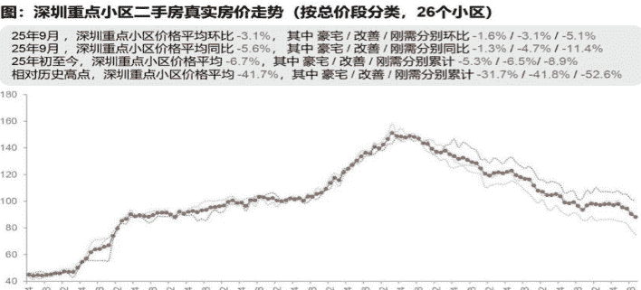

25年9月，深圳重点小区平均-3.1%，其中豪宅/改善/刚需分别为-1.6%/-3.1%/-5.1%
25年8月，深圳重点小区平均-5.6%，其中豪宅/改善/刚需分别为1.3%/-4.7%/-11.4%
25年7月，深圳重点小区平均上涨12.5%/4.8%
相对历史低位，深圳重点小区平均涨-41.7%，其中豪宅/改善/刚需分别为-31.7%/-41.8%/-52.6%

数据来源：广发APP，广发证券研究中心
样本范围：近一次成交的金额大于1200万，600-1200万，小于600万

## 图：深圳重点小区二手房价格指数（样本本小区）

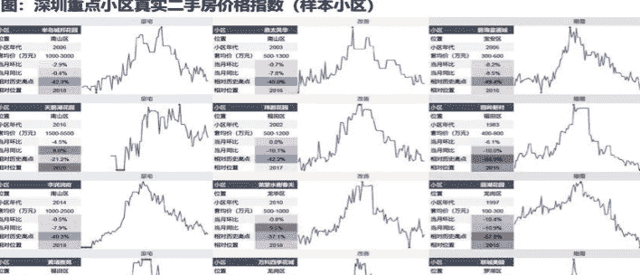

数据来源：广发APP、广发证券研究中心

## 图：深圳中介成交统计（按成交均，万）

25年9月，500万以下占比5%，500-1500万，1500万以上占比为75%
25年8月，低价（单套250万以下）占比33%，占比持平，25年以来占比提升10.7pct

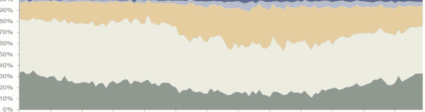

数据来源：广发APP、广发证券研究中心
