# 南半联购财经251031

Jason 不嵩
2025-10-30 15:44

倾源运住大数据研究院：10月全国40个大中城市租金挂钩价为34.01元/m，环比跌0.08%，今年1-10月2024年租金水平下降1.71%，为近三年租金下幅以来最大。从基本面来看，租金跌趋势短期内已逆转，一方面，房产供应仍在持续释放，二手房由售转的压力未减；另一方面，人口增长、经济预期恢复需要时间，需求端快速反弹。#房价

图：40个大中城市租金均价月变化

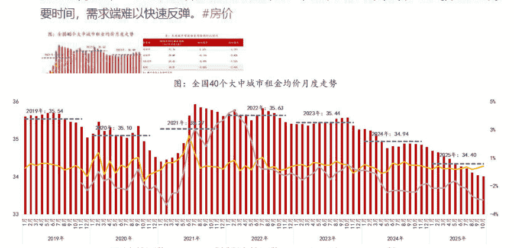

表：城市等级等租金均价环比情况

| 城市等级 | 2025年10月均价(元/m²/月) | 环比变化 | 同比变化 |
|---|---|---|---|
| 一线城市 | 83.34 | 0.32% | -2.35% |
| 二线城市 | 29.89 | -0.14% | -2.80% |
| 三线城市 | 24.45 | -0.49% | -1.52% |
| 四线城市 | 34.01 | -0.08% | -2.49% |

数据来源：倾源运住大数据研究院

图：各等级城市租金均价同比变化

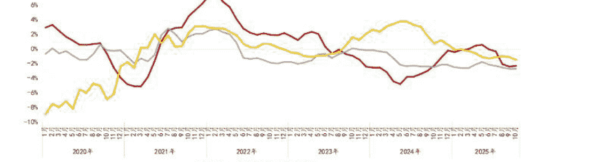

数据来源：倾源运住大数据研究院

微信：top28686，资料分享群

# Jason不遇

2025-10-31 02:13

bloomberg: 美国在2028 年之前购买 8700 万吨大豆，中国暂停许可出口至少一年，美国降低对中国商品20%的关税，11/1日100%也将取消，除之外在软出口、船运收费放松、#政策分析

# 更新于2025年10月31日午6:26 GMT+13

美国表示，中国同意在2028年之前购买百万吨大豆，这为焦急等待恢复这个亚洲国家出口的美国农民提供了一些缓解。

美国农业部长布鲁克·罗斯林(Brooke Rollins)在X上的一个帖子中显示，中国已同意至少购买1200万吨美国大豆，未来三年每年至少购买2500万吨。她补充说，中国还将将取消包括出口在内的多数美国农业的“无理关税”。

这些细节证实了财政部长斯科特·贝斯斯特早些对福克斯商业频道的评论，导致大豆期货跌幅高达2.2%。截至芝加哥中午12点3分，期货上涨1.6%，至每浦耳11.0725美元。

# Jason不遇

2025-10-31 02:19

bloomberg: 在美元软和鲍威尔派的推推下，美元飙升至三个月末的最高水平，新兴市场遭遇险运。#金融

# 微信息top28688，进资分享群

# Rallies After Powell Casts Doubts Over December Cut

![Bloomberg Dollar Spot Index Close on 10/27 ---- 1212]

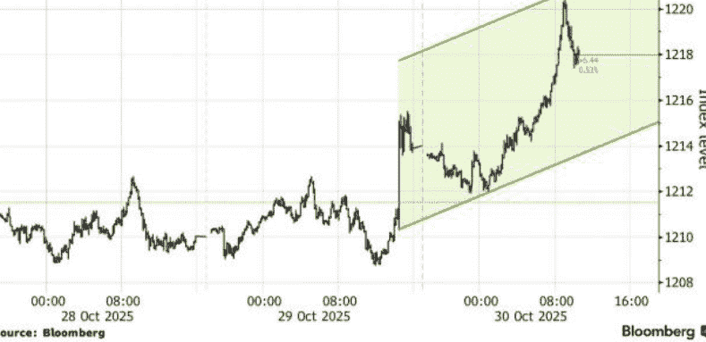

日本银行政策委员会维持基准利率不变，推动日元走低，尽管行长田稻和微妙地暗示加息措即将临近。

白宫纪宽松官员高桥早自任首相以来，央行的首次发表声明，日本银行在试图衡量下一步行动的时机必须保持微妙的行为，不受货币软弱或国内政治转变的影响。日本银行在为期两天的会议结束时政策利率维持在0.5%。两名董事对决定持有不同意见，这一结果符合彭博社调查90%经济学预期。

# BOJ Stays Cautious as Fed Cuts Narrow Gap

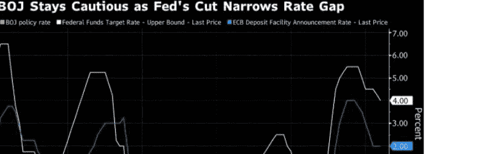

植田在决定后的新闻发布上表示：“今天举行会议是因为希望看到更多关于国内经济的数据，而海外的不确定性仍然很高。如果我们认为无论形势如何，我们都会调整利率。”

# 微信top28688，资料共享

# 博客的要点

- 日本银行行田东表示，日元汇率可能会走至120至130左右。
- 田东表示，当前日元汇率过于疲软，日本银行继续加息的条件已经具备，并指出通胀目标已经实现，经济正在增长。
- 日本银行行田东表示，预计美利差将缩小。“目前的日元汇率，即153美元这太弱了，”田东周四在新加坡论坛期间接受彭博电视采访。“在某个阶段，日元汇率将回升至120或130左右，”他说周四下午后，日元汇率约为153美元。”田东补充说，美国降息和日本银行的反向措将缩小经济体之间的利差，帮助日元回到两年前的水平。
- 周四，由于美联储主席鲍威尔（Jerome Powell）抑制了12月降息预期的言论，股市在全球市场引起反响。
- 中美双方达成为一年的贸易协缓，美国削减关税，延长了现有的销售额。中国主要发展MSCI指数多数回落.5%，止住了四天的涨势，韩国领先。周四，由于美联储主席鲍威尔（Jerome Powell）抑制了12月降息预期的言论继续在全球市场引起反响，新兴市场资产暴跌，陷入了中美休战。

# Jason不再

Bloomberg: 各央行在第三季度加速黄金购买，世界黄金协会报告，各国央行7月至9月购买了220吨黄金，比季度增长28%，俄罗斯银行成为最单一买家，巴西央行四年来首次购买黄金。该机构估计本季度66%的购买需求尚未被公开。与此同时，金第三季度珠宝消耗量推至2020年以来的最低水平，使WGC下调了全年预期。#金融

各国央行在第三季度加速黄金购买，因为一些海外买者冒着创纪录的高价购买价值以对冲脆弱的美元。

根据世界黄金协会的报告，7月至9月期间购买的220吨比季度增长28%，扭转了去年的缓慢趋势。俄罗斯是最大的单一买家，巴西央行四年来首次购买黄金。

截至9月的一年里，各国央增加了增加了34吨金条储备，低于过去三年的同时期，远高于俄罗斯入侵乌克兰之前的2022年平均水平。WGC预测2025年黄金采购量在750至900吨之间。

# 央行黄金买盘在开局缓慢回升

- Gold purchase volume in tons

| Q3 | Q4 | Q1 | Q2 | Q3 |
|---|---|---|---|---|
| 2024 | | | 2025 | | |

资料来源：世界黄金协会

“地缘政治紧张局势不断加剧、坚固的通胀压力和全球贸易政策的不确定都刺激了人们对避险资产的兴趣，”WGC高级市场分析师Louise Street在周四报告发布的一份声明中表示。

# 加微信top28688，资料分享群

# Total quarterly demand by sector in tonnes and US$bn

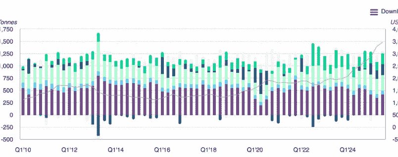

Jason 不嵩
2025-10-02 02:35

银行：发达国家老龄化通常发生在较高收入段。与许多发达国家不同，中国进入初步老龄化前人均 GDP仅为959美元（发达国家多在2000美元以上），进入中度老龄化前人均 GDP 为1.2万美元（发达国家多在3万美元以上）。中国劳动人口占比为74.5%，我国人均 GDP仅为5647美元，低于美国、英国等发达国家。未来需要应对老龄化带来的养老金支付、医疗保障、劳动力短缺等压力。#人口

# 图9：劳动占比与人均GDP比较（美元）

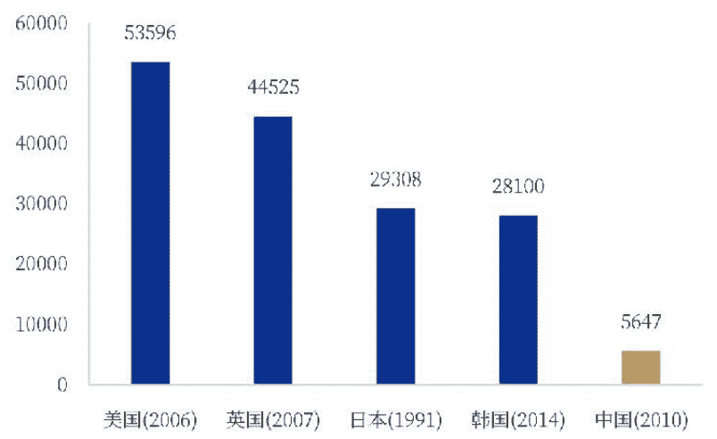

资料来源：银河证券

加微信top28688，资料分享群

# 图23：部分国家成年人口与GDP比值

| | 德国 | 英国 | 法国 | 日本 | 美国 | 加拿大 | 瑞典 | 韩国 | 中国 |
|---|---|---|---|---|---|---|---|---|
| 养子指数 | 2.08 | 2.91 | 3.31 | 3.66 | 4.1 | 4.34 | 4.55 | 5.25 | 7.79 |

资料来源：OECD

# 图28：中国平均年龄与房价趋势（元/平方米）

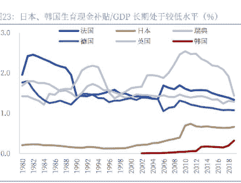

资料来源：Wind，中国国际证券

注：房价价格为商品销售额除以销售面积所得

加微信top28688，资料分享群

# 图30：部分国家和地区15岁以上女性参与率(%)

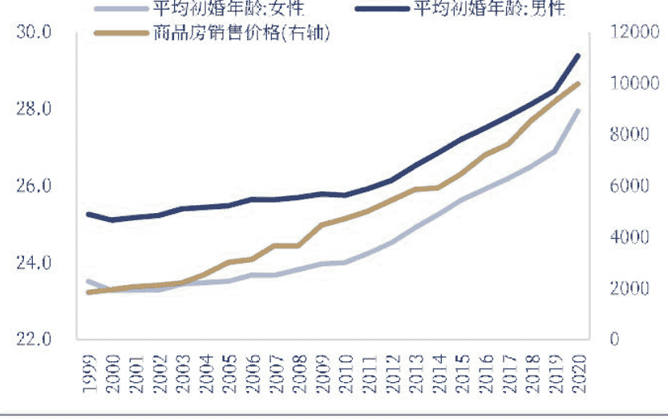

资料来源：Wind, 中信证券

Jason 不遇
2025-10-31 02:37

独享：在本轮判断中，美方的措施趋于缓和，中方掌握了更多的筹码#政策分析

具体来说，美方的措施将趋于缓和，并将部分针对性的非关税施压。

- 1、美方将取消对中国产品加征的24%等关税所谓“美国关税”。
- 2、美方对中国产品加征的24%等关税将继续暂停，并延长大部分关税排除措施。4月2日，特朗普对全球发动“贸易战”，其中中方加征对美等关税5%，4月12日，中方加征34%的对等关税的24%暂停90天，但仍保留继续延征。
- 3、美方将暂停9月29日发布的出口管制50%违规规定。此前美方发布的出口管制50%违规规定，对列美国“安全清单”中的企业加等。此举是美方使用“长臂管辖”对中国企业进行无理施压的典型实例。
- 4、美方将暂停对海事、物流造船业301调查措施一年。此前英国，自2025年10月14日起，对中国企业拥有或经营的船舶、中籍船舶及中国制造船舶港口服务对等，中方同时也调整了关税措施，暂停实施管制。

- 1、中方相应调整对美方美国关税的反制措施。当时的中国的反制措施包括对农产品、能源产品加征10%或15%的关税，对对方分类入不可实体清单等。
- 2、中方对美方商品加征的24%反制对等关税继续暂停，并继续延长大部分关税排除措施。
- 3、中方将暂停10月9日发布的稀土相关材料管制实施一年。
- 4、美方将实施对华加征“30%港口费”后，中方也将相应实施针对美方的反制措施一年。2025年10月14日起，对于美国的企业、其他组织和个人拥有或持股25%以上的企业将征收美制船舶港务费。

此外，双方还就芯片合作、扩大产品贸易、相关企业案件处理等问题达成共识。双方进一步确认了马来西亚经磋商成果，美方在投资等领域作出积极承诺，中方将与美方妥善解决 TikTok相关问题。

微信抖音28688，进资共享

## （二）还有哪些问题没有解决

1、美国以亚太关税为借口，对华累加征20%的关税，本次只降10%关税，还保留了10%。
2、尽管双方对等关税将继续暂停一年，期间仍保留了10%对等关税。
3、特朗普1.0对华加征了四轮“301关税”，前三轮分别加征25%，第四轮加征7.5%。据美国彼得研究所（PIIE）测算，对华平均加税为19.3%，并随着出口结构调整，到2024底平均加税为10.7%，仍得到妥善解决。4、新能源、光伏等高科技行业的封锁和限制。例如软件设计（EDA）销售，对华平均加税率为10%~30%。其他南亚经济体加税为19%，欧盟、日本为35%，加拿大、墨西哥为25%。美国为15%~28%。

## 摘要：对40个象限的行业进行分析，通过构建“利润-债务增速”四限矩阵，通过分析各行业的盈利能力与财务指标变动的平衡和发展状态，揭示不同行业的稳定性。我们认为对于第一象限的行业在扩张压力下表现良好，具有良好的发展和需要深入其实际扩张的原因。这些行业分为三类：

- 第一类：“周期-强扩张型”构建行业的长期特征。不受监管的公用事业、交通、基础设施等，这类行业在周期中表现相对稳定，较多处于第一象限，我们认为其具有代表性的行业。
- 第二类：需改善消费的行业，运输、资本、技术硬件和半导体、消费品等。此类行业本身具有很强的周期性或竞争激烈特征是在需求波动季节处于第一象限，信用表现较高；在需求衰退或技术变化时往往走向第二象限，开始面临盈利和债务压力。我们认为此类行业的周期性虽处于行业中较好位置，但属于第一类中的部分行业内更多得到补救政策的支持，可持续性存在较大不确定性。
- 第三类：利润修复主要来源于其他因素，如资本价格加速下降。典型的行业是建筑材料和金属制造。我们认为这两个行业利润改善更多益于上游成本下降、供给压缩等问题，修复的持续性仍有待观察。

在第二类中的行业表现出重大差异，属于“危机存储”。长期留在此，往往看到春天甚至可能引发行业性衰。从债务和利润的变化来看，我们认为对于2024年的表现，受监管的公用事业、资本品、周期性运输这二行业出现好趋势。

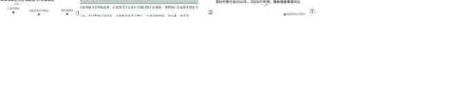

图 1

### 2025年下半年企业利润增速 vs 债务增速

| 日均利润增速 | 受监管的公用事业 | 耐用消费 |
| :--- | :--- | :--- |
| 15% | | |
| (2) | | (1) |
| | 10% | 周期性消费 |
| 建筑工程 | | 贸易 |
| | 综合行业 | 市场变化及天然气 | 周期性属性 |
| 基础化 | | 金属制品 |
| | 物业具有高周期性及基础设施 | | 建筑材料 |
| | 零售 | 技术支持及服务 | | |
| | | 汽车零部件 | | 软件技术及服务 |
| | 车辆 | 环境链 | |
| | 房产 | 商业 | |
| | (3) | 特化 | | |
| -30% | 特化 | -10% | 20% | 30% |

(出处：PIIE)

数据来源：PIIE、中信证券

版权©2025后世预测（中国）有限公司。保留所有。

# 加微信top26888，资料分享群

## Jason-不遇

2025-10-31 02:48

中信投资：可以结合债市预期对未来中期的国债利率点位进行估计。当前7日OMO利率为1.44%，预期2026年利率降120BP，10Y国债长期中枢将在1.68%附近，即1.65%-1.70%区间；涨至20BP，10Y国债长期中枢将回到1.52%以下，即1.50%-1.55%区间。就基本面位而言，预计11月基本面支撑利率为1.82%。考虑到股市市场的联动效应进行调整后，2026年11月利率高值约为2.2%。

| 图1：不调整参数的OMO利率走势（单位：%） | 图2：调整参数后的OMO利率锚有效效果（单位：%） |
| :--- | :--- |
| 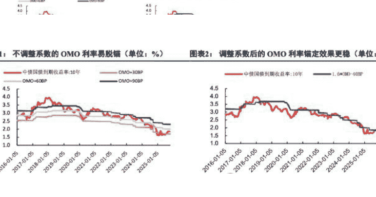 | |

## Jason-不遇

2025-10-31 02:51

## Dalio：你应该将黄金视为一种基本货币#金资产

由于全球宏观环境的复杂性，通胀压力和地缘政治风险并存，黄金作为资产配置的作用日益凸显。黄金作为一种稀性资源，在对抗货币贬值方面具有天然的避险属性。

在当前全球货币政策转向不确定性的背景下，黄金的配置价值正在进一步释放。为了提升投资组合的抗风险能力，建议投资者在资产配置中适当增加黄金比例。

加微信top28688，进资料分享群

### 黄金是最安全的货币

最近很多人问我很多关于黄金的问题，所以我邀请任何关心我问我关于黄金的问题的人这样，我回答了大部分。然后我把它们放在两个常见问题答案枢关于黄金和我的数字孪生（数字线条），以便数字线条可以尽可能与人类进行完整的对话，只要只想进行黄金的对话（您可以注册数字线条测试版这里）。

我想而言之分享我对黄金的看法，这就是本文的目的。

在我看来，黄金是一种货币，而且是被贬值和/或被收风险的小货币，这无可争的。

这就是为什么我相信这是真的。

几千年来，在几乎所有国家，黄金被视为货币，而所有其他货币都来去。

它是过去和现在的工作原理。

纵线历史，所有货币（即货币）都是:

- 1) “挂钩/硬币支持”货币，即与黄金挂钩或与供应量类似具有全球价值的东西挂钩，如白银。这些货币是政府承诺允许个人或政府以固定汇率将他们的“货币”兑换成黄金（或其他“硬”东西，如白银），或

加微信top28688，进资料分享群

- 2) “法定”货币，却不受任何联系/支持的货币，它们的供应不受限制。

纵观各国的历史，当存在一种与黄金挂钩/支持的货币，并且相对于现有的黄金数量而言，债务过多（即交付黄金货币的承诺太多）时，货币体系就会崩溃。发生这种情况是因为这些国家的领导人要么 a）坚持用黄金支持货币的承诺，这导致了债务违约和货币紧缩膨条，要么 b）违背了承诺提供黄金的承诺，使得他们能够创造大量货币和信贷，这会导致货币贬值和通胀和金价上涨。

在引入黄金银行之前（1913年在美国），通常做法是 a）通胀紧缩路径，但在中央银行成立后，遵循 b）通胀扩张路径。在这两种情况下，大债务/货币崩溃/危机之而来，使得对债的的减少了债务，从而将事情定在新的、更高的水平。（这就是价格随着时间推移而上涨的原因）。与黄金挂钩/支持的货币体系的最新操作发生在1923年和1971年。

1971年，我们停止了挂钩/支持的货币体系，转而采用法定货币体系。这就是我们所拥有的，所以研究过去体系发生的事情的教训，当债务相对于支付所需的金额而言，债务过多时，与现在发生的事情相关。在这种情况下，央行行长是创造大量货币和信贷，这通常会导致通胀上涨和金价上涨。

在这些情况下，黄金作为“纸货币”的替代货币都表现良好。在很一段时间内，它是持有我们购买的最佳记录的货币。这就是为什么它现在是在央行持有的第二大储备货币。

这并不意味着随着时间的推移，其他货币的财富储备黄金更为佳。这是因为“纸质债务”提供利息，而金币则不提供。因此，当利率相对于纸质债务市值的下降速率速度较高时，这些纸质债务货币市会产生更高的回报。

微信扑208688，进阶分享群

如果人们选择市场时（我建议不要这样做），就是在利率足够高以补偿持有货币的违约和贬值风险时持有纸质债务货币。但是，当纸币的贬值和违约风险又没有得到充分补偿时，持有黄金是明智之举。

或者，人们可以选择不要尝试时此类运动，而是始持持一些黄金。黄金与现金一样，实际回报率较低，约为1.2%，并且与现金负相关。由于于这个原因，人们可以将黄金和现金一起认为是适合有流动性的任何类型的环境的好孩子。

黄金一直是受青爱的资产，因为它依赖于货币和其他资产具有更低的贬值风险。因为它依赖于某人得到，而不是某人或政府难以从那里走的。这是最难住的，因为它可以由自己安全，与其他需要支付黄金它们价值不同。由于 a) 金危机导致非常高的税收和 b) 国家之间的战争而巨大的货币贬值时，黄金价值大幅上涨（或者更准确地说，是货币没有贬值）。这就是为什么随着时间的推移，黄金仍然是最基本的，其价值在长一段时间内与生活成本同步。

加微信top28688，进变形

### 黄金作为投资

作为一种投资资产，我在整理资产组合时像看待其他资产一样黄金，即通过其预期回报、风险、相关性与其他资产的流动性以制定组合。然后我会考虑，纠正正在发生的事情，我想从组合中做出什么偏差，因为它影响市场。我认为黄金作为一个组合的一部分，即拥有一定数量的资金，具有某些特征，就像拥有一定数量黄金具有其特征。

此外，如果你不同意我的想法，请告诉我，以便我们可以尝试找到真实的，以便我们很好处理它。

当我想考虑一个人应该在投资组合中有多少黄金时，我认为是最重要的资产配置，而不是战术/市场机决定。我认为每个人的出发点应该是属于投资组合中，而不受市场的观点的影响。只有当投资者认为自己有更好的能力来预测投资比其他资产时，才会有与投资组合的调整。大多数投资者不具备这种能力，因此他们应该坚持策略。

由于这个原因，当投资者问自己应该认为黄金上涨还是下跌入卖黄金时，我告诉他们这是一个术性的次要问题，因为他们已经在资产配置中拥有。当我在分析中查看时刻，是在5到15%之间，具体取决于组合中的其他资产和投资者的偏好。

至于战术机在投资组合中过度和减少黄金，如所述，在货币体系崩溃、通胀和经济战争（例如）的高风险时，黄金应当持有，在很一段时间内，黄金是一种相对差资产（如现金），因为它不是生产资产。

加微信+2888，进资料群

## Jason-不离

2025-10-31 02:56

看了G2面坐在一上的视频，记者“突然”对提问：你改变了计划，为什么要进行更多实验。谢谢。

## Jason-不离

2025-10-31 03:05

BIS: 全球流动性指标显示，今年上半年在美元贬值的情况下，以美元计的外币信贷相比增长6%

| US dollar credit outside the States | US dollar exchange rate |
| :--- | :--- |
| 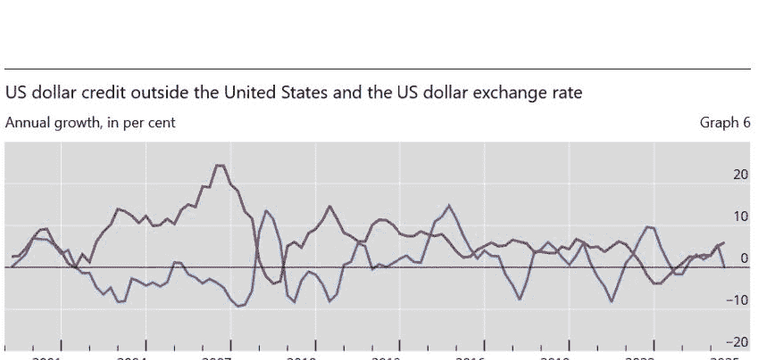 | An increase indicates an appreciation of the US dollar NEER. |

Sources: BIS effective exchange rate statistics; BIS liquidity indicators; BIS calculations. 

## Jason-不离

2025-10-31 03:15

JPM: 中国“反内”政策可能将房地产软着，不能通过政府手段限制企业之间的激烈竞争，而要缓解结构性周期波动，而非导致价格减少（如房地产市场的长期低迷），并将经济复苏。“新经济”正进入化——依赖政府支持地方，可能迎来持续增长。建议将增值税征收环节改为消费，促使政府支持消费。

China's anti-inflation risks heading the housing way.pdf.

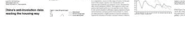

加微微信28888，进资料分享群

## J.P.Morgan

Global Economic Research

30 October 2021

## China's anti-inflation outlook nearing the housing away

- Today's overcapacity issues are more widespread and severe than in the past
- China's economic rebounding is challenged by excess capacity in the new economy, leading to the incomplete housing market adjustment
- Anti-inflation policy execution focuses on limiting investment and deleveraging risks, as this has become the focus
- Rebalancing excess capacity requires deeply involving local governments and the party
- Shifting consumption to support structural demand, but reform could be costly

China's tax system also plays a big role in the creation of excess capacity: VAT-based tax revenue is shared between central and provincial governments. However, as the tax is collected at the point of production, local governments have incentives to produce more goods than they consume. This incentive makes it possible to expand the tax base, just as on land sales helped central and local governments in alleviating the excess crisis in the housing market.

## This time the problem is harder...

The problem is broader and more severe than in previous episodes. Issues such as coal, steel, and cement are spreading. While reduction measures in 2015-2018 were not fully addressed, new overcapacity in batteries, chemicals, and electronics (EVs), e-commerce, and robotics is emerging. With overcapacity, the government has avoided using anti-inflation policies for over a decade (except in 7 years). This suggests that the “severe-

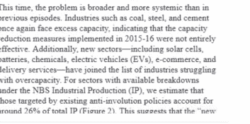

A notable difference from previous instances is that the current excess capacity is managed through intense competition rather than price cuts, which led to hyper-competition. Now, hyper-competition is occurring across.

While the share of the economy from real estate remains small (10%–15% of GDP), the net contribution of the two has been a drag of 2%–5 percentage points.

However, this represents a significant challenge. If the drag is already affecting large parts of the economy—leading to severe price cuts and reduced profitability—consumer and production expectations will be harder to follow. If the real estate contraction continues,

随着最后一个季度经济放缓的加剧，中国工厂活动在10月份恶化，到了九多年来最长的降幅。

国家统计局表示，官方制造业采购经理指数为49，而9月份为49.8。彭博社的经济学家估值中值为49.6。

建筑和服务非制造业活动指标在9月份下滑至50.1，小幅回升至50.1，这很大程度上收缩有所扩张。季节性因素可能在起作用，因为2025年10月的固定假日比去年更长。

## 中国工厂活动连续下滑

### 制造业指标显示连续七个月收缩

- 制造业采购经理指数

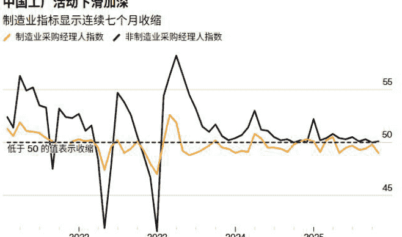

资料来源：中国物流与采购联合会、彭博社

MSCI中国指数10月下跌，结束了连续五个月的上涨。这次远低于 MSCI亚太指数4.2%的涨幅。

## MSCI China Set For First Monthly Loss Since April

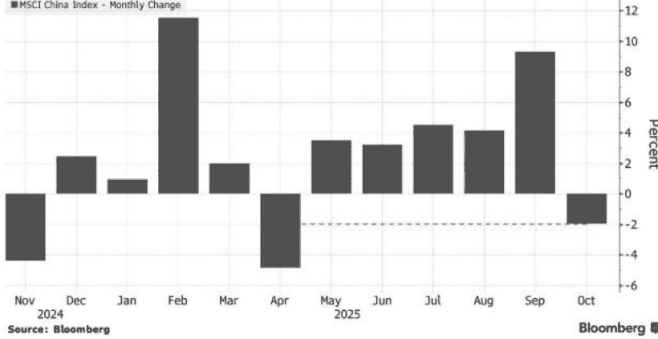

## 加微信top28688，进资料分享群

## Jason-No赖

2025-10-31 11:41

bloomberg: 日本受到了汇率的压力，对冲美金押注日元在年底跌至 160。其他国家经济

- 日本政府正在以强烈的力监控日元，财务大臣片山周称。
- 片山表示，政府正在密切关注外汇市场的无序走势，包括投机势力驱动的走势。
- 在日本央决定维持利率不变后，片山发出警告后，日元美元汇率升至 153.65。

日本财务大臣片山岳表示，日本政府正在以强烈的力监控日元，这是她以来首次就货币走势发出明确警告。

“我们最近到了非常剧烈和快速的货币走势，”片山周告诉记者。她说：“政府正在密切关注汇市场中无序的走势，包括那些由投机走势驱动的走势，”他说。

## Currency Moves
Katayama gives warning after yen weakens post-BOJ

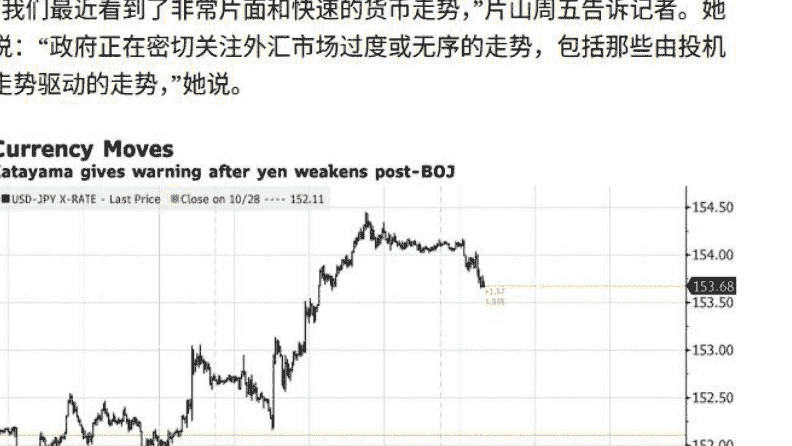

她补充，货币以稳定的方式走势很重要，这反映了经济基本面。在片山发出警告后，日元美元汇率在上午早时候触至 154.17 后升至 153.65。

片山发表上述言论之时，日本央行周维持利率不变后，日元处于八个月低点附近。尽管增长植田和男在决定后的新闻发布会上微妙暗示即即将临近，但市场似乎并不相信，导致日元走弱。

加微信top208688，进资料分享群

## Jason Na Yan

2025-10-31 11:46

bloomberg: 关税缓和对于中国的出口，他们的产业利润将会轻松一些，但从长远看，也为将来的波折做好准备。每个人都在多元化。经济数据

周四，美国同意将中国进口商品的关税从之前的 57% 降至 47%，远低于威胁的 157% 的关税。

美方决定对华某些特定进口商品征收 20%的关税，将中国出口。

## 周四，美国同意将中国进口商品的关税从之前的 57% 降至 47%，远低于威胁的 157% 的关税。

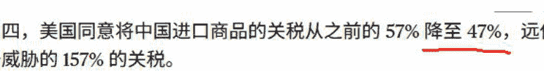

彭博新闻采访的几家中国出口商观点认为，贸易关系的改善将导致全球经济体之间的订单流动增加，从而缓解近三个月以来美国对中国进口商品超过 50% 关税而受到挤压的盈利能力。

“我们将与美国客户达成更好的交易，”在一家销售拖把家里等家用清洁产品的公司的销售经理安德烈·陈黄说，该公司来自中国东部的出口基地宁波。

## Jason Na Yan

2025-10-31 11:50

亚洲经济研究所：欧盟对中国的汽车出口处于自由贸易浮动状态。有一段时间，北美市场为欧洲汽车制造商提供了中国制造的重要抵消。由于欧洲的保护主义，这种缓冲在正在消失。其他国家经济

## 加微信top28688，进资料分享群

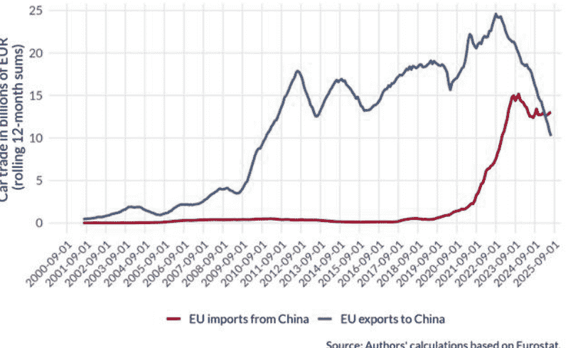

加微信top28688，进资料分享群

## 知识星球TOP

添加微信
免费入群

微信:top28688

| 序号 | 公号/星球/社群 | 原价 | 领域 |
| :--- | :--- | :--- | :--- |
| 1 | 生财有木 | 2765/年 | 副业，搞钱 |
| 2 | 众宗吃瓜 | 365/年 | 时政 |
| 3 | 记忆巷/裁树风 | 365/年 | 成长 |
| 4 | 欧洲金轨 | 328/年 | 时政，历史 |
| 5 | 卢克文青会 | 699/年 | 时政，社会 |
| 6 | 体制内 | 599/年 | 体制，职场 |
| 7 | 局外人的视界 | 669/年 | 金融，时政 |
| 8 | 溯泽异迁 | 4166/年 | 财富，成长 |
| 9 | 守夜人总司令 | 599/年 | 时政，经济 |
| 10 | 江宁知府 | 365/篇 | 时政，国际 |
| 11 | 政堂堂/顾子明 | 568/年 | 时政，经济 |
| 12 | 唐书 | 1399/年 | 金融，财富 |
| 13 | 大树乡谈 | 199/年 | 时政，成长 |
| 14 | 水库联大 | 10000/元 | 房产，经济 |
| 15 | 洪灏宏观策略 | 4376/年 | 经济，搞钱 |
| 16 | 金政通鉴/北海南山 | 4576/年 | 股票、行研 |
| 17 | 猫哥的世界 | 299/年 | 时政、社会 |
| 18 | 飞浅龙 | 3600/年 | 股市、经济 |
| 19 | 米联诸见闻 | 599/年 | 经济、金融 |
| 20 | 茶茶财经 | 330/年 | 房产、股票 |
| 21 | 赢在八小时之外 | 365/年 | 成长，职场 |
