## 南半球购财经2511108

Jason不易国盛：10月出口增速大幅回落，为今年3月以来新低，应是基数较高拉动的异常值。删除基数影响后增速复合增长为5.5%，仍保持平缓增长态势（9月为5.3%，4-9月为6.1%）；此外，出口价格回落和电子新品发布时间错位等可能有一定程度。进口增速同样大幅回落，为近五个月以来新低。与生产、消费领域无关。在10月出口转弱的背景下，当月贸易顺差仍维持在900亿美元的较高水平，并未收窄，预计出口增长也有利于贸易顺差维持高。

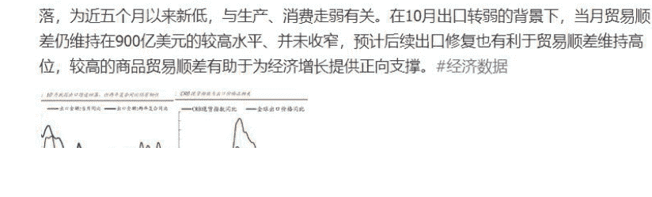

图表1：10月出口增速回落，位年初复合比仍有韧性

| 出口金额:当月同比 | 出口金额:两年复合同比 |
| :--- | :--- |
| 资料来源：Wind，国盛证券研究所 | |

加微信top2868，进资料分享群

### 图表2：CRB现货指数与出口价格正相关

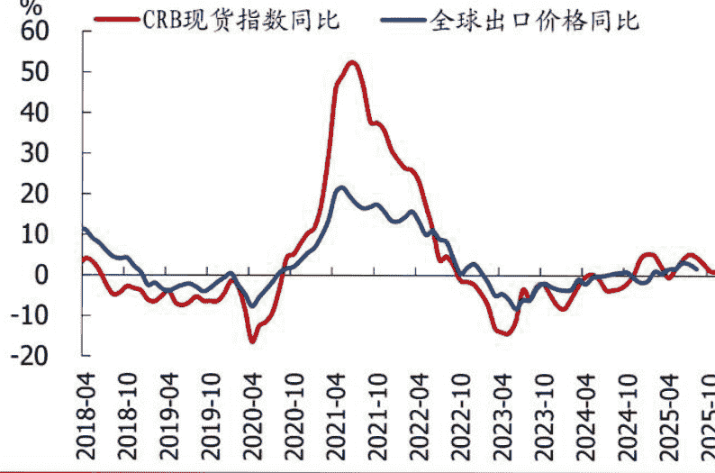

资料来源：Wind，国证泰研究所

### 图表3：剔除服装数据后，非美市场仍是10月出口主要支撑

| | 中国对主要经济体出口两年复合同比 | 2025-10 | 2025-09 |
| :--- | --- | --- | --- |
| 30 | | | |
| 20 | | | |
| 10 | | | |
| 0 | | | |
| -10 | | | |
| -20 | | | |
| 美国 欧洲 日本 韩国 加拿大 东亚 俄罗斯非洲 印度 拉丁美洲巴西 其他新兴市场 出口 | | | |

资料来源：Wind，国证泰研究所；注：其他新兴市场主要包括中亚、东欧、中东等地

加微信top2868，进资料群

### 图表5：10月进口增速同幅回落

| % | 进口金额:美元;当月同比 | 进口金额:美元;累计同比 |
| :--- | --- | --- |
| 60 | | |
| 50 | | |
| 40 | | |
| 30 | | |
| 20 | | |
| 10 | | |
| 0 | | |
| -10 | | |
| -20 | | |
| -30 | | |
| -40 | | |
| 15-04 | 15-11 | 16-06 | 17-01 | 17-08 | 18-03 | 18-10 | 19-05 | 19-07 | 20-02 | 21-09 | 22-04 | 22-11 | 23-06 | 24-01 | 24-08 | 25-03 | 25-10 |

资料来源：Wind，国证证券研究所

Jason-瀚邈
2025-11-08 03:05

bloomberg: 10月份中国出口的下降让所有预测者都感到意外，彭博社调查的预测中值为2.9%。巴克莱表示如果出口的下降强劲势头不能持续，中国的增长可能面临房地产行业长期萎靡以及出口表现疲软的三重打击。但贸易顺差依然保持纪律水平，2025年至今已达到9650亿美元，由于需求充足挑战了经济景气，10月份的原材料进口量回落走势，中国茶叶库存支撑了今年的国际价格。

加微信top2868，进资料分享群

bloomberg: 10月份中国出口的下降让所有预测者都感到意外，彭博社调查的预测中值为2.9%。巴克莱表示如果出口的下降强劲势头不能持续，中国的增长可能面临房地产行业长期萎靡以及出口表现疲软的三重打击。但贸易顺差依然保持纪律水平，2025年至今已达到9650亿美元，由于需求充足挑战了经济景气，10月份的原材料进口量回落走势，中国茶叶库存支撑了今年的国际价格。

### 美国需求下滑拖累中国出口
- Total exports To the US To the rest of world

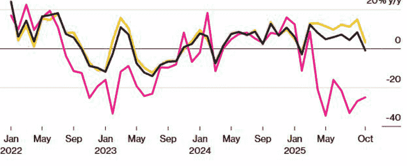

资料来源：中国海关总署

### 商品出口激增推动贸易顺差再新高
- Current account balance (quarterly)

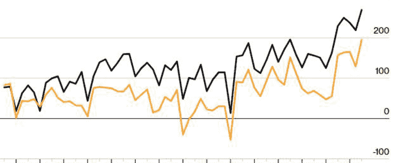

资料来源：中国外汇管理局

加微信top2868，进资料分享群

bloomberg: 中国表现出令人深刻的韧性，克服了全球偏好回调，股市接近近来的最高水平。显示，中国的增长比预期更具弹性，人民币在三个月和六个月的前景分别为。华华表示，中国股市在过去十年中几乎持平，使得估值具有吸引力，预计资本将流向更广的亚洲地区，中国和印度等地市场，未曾这样的投资者正在建立并进行交易。

Jason不易
2025-10-08 03:11

美国仍是最大的市场，但与此同时投资者正在寻求一些配置。中国电力迎来多年最好的一年，创下2023年以来的最佳表现。瑞报显示，中国需求处于多个加速周期，并将20年的预测更新为8%。随着基础设施需求的释放。

### 股市接近四年新高
| Shanghai Shenzhen CSI 300 Index - Last Price |
| :--- | --- |
| 2022 2023 2024 2025 |

Source: Bloomberg

加微信top2868，进资料分享群

### China's Power Equipment Makers Sharp Rally
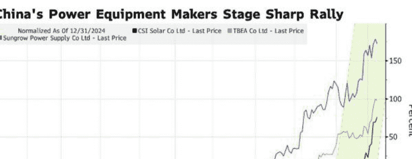

| Normalized As 12/31/2024 | |
| :--- | --- |
| CSI Solar Co Ltd | TBEA Co Ltd - Last Price | Sungrow Power Supply Ltd - Last Price |

Source: Bloomberg

Jason
2025-11-08 03:16

国泰海外：从高领先指标显示，11月出口增速或回升，12月将回到。总体而言Q4产能缩小、增速中枢下移，结合出口的低基数，明显差异对增长的拉动作用加速回，两个股对投资形成底部，Q4可能是2026年上半年的预测。

近年来对出口总量和全球中制造业的表现非常重要，2026年出口能否有5%，决定出口能否增强国际影响力，进一步影响对国内需求的判断，可以说2026年出口的预期还是关键的，从有的宏观证来看，很难增长5%以上的水平，但2026年出口增速表现由于因素密切通过窄被提预测，我们至少可以说出口增强“国际影响力”和拓展国际循环的要求下，期间出口的增长将进一步连续、与全球宏观周期所需程度增加是值得期待的，未来出口对增长应当承担关键的拉动作用。但是对于2026年出口能否表现出来，可能还需要一步

加微信2868，进资料群

### 图13:11月出口增速预计回升
(%) ---三个进出口数据均值（实线） ---出口金额：同比增速（点线） (2019年1月）

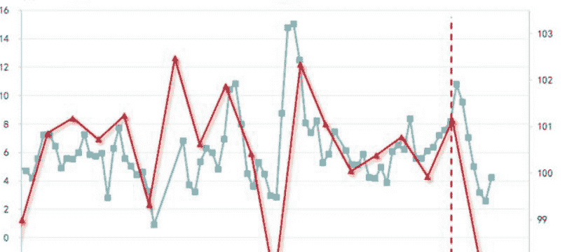

数据来源：Wind, CEIC, 国内海运数据

绍约时：特斯拉的股东在周四的哈罗会议中通过了马斯克的薪酬计划，意味着公司在十年内将实现心志的劳动力运营目标，他将获得亿万美元的股票期，可能成为世界上第一个亿万。就在今天，人们刚刚筛选出了一位主张高薪的候选人担任任何一市长。这个看似无事的事，展现出美国对于财富分配截然不同的理念。

# 其他国家经济

虽远不是完全相同的领域，这种“完美实现”，反而反映出资本与政治治理之间的巨大裂痕。一方面像马斯克这样的富豪及其支持者，他们关注少数人取得的经济效益，社会福利制度却被忽视。

另一个是像桑德斯这样的进阶民主主义者，他们呼唤美国效仿西方发达国家的社会福利制度。桑德在近来主张教育和医疗的免费，并让政府提供免费服务和公共交通。绍约时：特斯拉的股东在周四的哈罗会议中通过了马斯克的薪酬计划，意味着公司在十年内将实现心志的劳动力运营目标，他将获得亿万美元的股票期，可能成为世界上第一个亿万。就在今天，人们刚刚筛选出了一位主张高薪的候选人担任任何一市长。这个看似无事的事，展现出美国对于财富分配截然不同的理念。

这项计划从18年开始，分为几个个月，要求马克思每年完成一系列目标，销售了万辆车辆，以及获得了万个具有特殊许可。我们将开启新的，不仅是特斯拉的未来，而是全新的一。感谢股东和投资者表示，特斯拉董事会和监事罗洛公共，这项计划把马斯克积累的财富，他已经是世界上富有的人。

### 特斯拉分析

这项计划的设计，只要斯克面临风险。但马斯克的批评者，包括纽约州和塞州的养老基金，强烈反对该方案，认为这将让大量财富和企业权力集中到一个人手中。纽约州州长霍塔马斯克在投资者的会议上表示。“这不是按激进签署的，这对权力控制不利。”列斯利豪曾在接受纽约新闻Crux采访时提到，马斯克的反响引发了恐慌。根据特斯拉提交的证券文件，24年员工的平均收入为7万美元，外界预计该计划推迟。路透报道，类似方案规模远小于此，除了一外其余都将通过。按照特斯拉提交的，马斯克被允许使用自己的股票。他持有15%的股份。如果他完成所有目标，他的权力可能会增加29%，尽管可能出售部分股份以缴税。不少股东可能支持马斯克，即使在经历后一切放弃。哈佛商学院组织是教授德兰·彼格。大型投资基金包括特斯拉第二大股东先锋、第三和第四大股东富国、德普财富管理机构表示反对。“虽然我们认可发展方面的意见，但我们对奖励总额、稀释股权以及人类风险方面的披露担忧。”其他反对者指出，该计划的条款将限制特斯拉董事会的自由权力，即使马斯克创造产品目标，也可能赋予他们投票。这些理由：董事主席罗伊·汀纳上周二在发布的信中称，这项计划有一个核心目的：推动特斯拉进入一个快速增长、创造更多创新的阶段，“并不是易的，但马斯克在现实如今的市场值和监管目标上，能够获得额外的。可以肯定的，马斯克的胜利将民主党继续将其视为政治对象。“共和党最大的金主变为控党军队的，”康星州民主党主席霍克说，马斯克在今年春天向州最高法院竞入了数千万美元。“如果选民的已经过，让他们的生活不再负担，那么民主党主人物将面对对手时，将会增加压力。”

加微信top2868，资料免费共享

Jason Li
2022-11-08 03:39

bloomberg: 美国消费者指数接近记录以来的水平，11月初步措下降3.3点至50.3，高于22年6月的50，这是根大学自1978年以来数据中最低的。——衡量当前经济状况的指标下降6.6点至52.3的历史新低，由于人们对政府未来政策影响的焦虑增加，71%的受访者预计未来失业率将上升，是同期的两倍。对明年的预测上涨。

同时，纽约储备银行的月调查显示，美国就业市场的状况在10月份恶化，而他们对通胀的预期下降。失业率连续三个月上升，失业一年后的可能高达43%，这是从月以来的最高水平。对未来消费者价格涨幅的预期从9月的3.4%降至10月份3.2%。对财富状况的预期继续恶化，更多的受访者表示他们的财务状况比上一个季度糟糕。

这些数据可能会加剧美联储官员之间的分歧。上周，他们将利率下调了四个百分点，但此后一些政策者对宽松周期进一步扩大表示忧虑。

# 其他国家经济

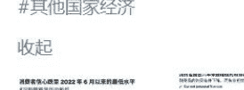

### 美国消费者信心跌至22年6月以来的最低水平
当前状况跌至历史新

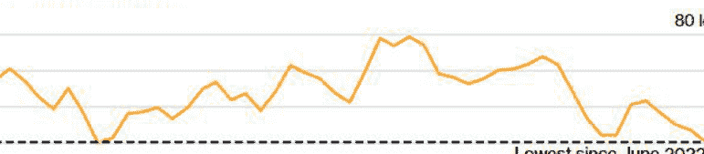

Sentiment

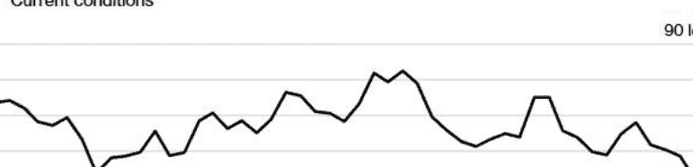

资料来源：根大学

加微信top2868，资料分享群

### 消费者报告六年来最稳健的财务状况
- Personal finances
- Buying conditions (durables)
- Average chance of losing job

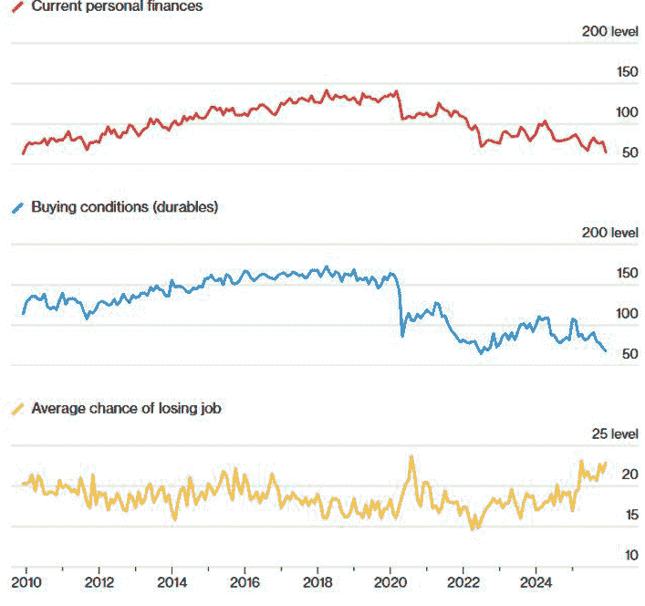

资料来源：根大学

Jason
2025-11-08 03:47

花盈：美股近期波动的主要原因是流动性下降。一个有效方式是观察表现。本周陷入区间，从近期创下的低点跌超过20%。财政部一般账户（TGA）是指财政部在市场上积累蓄，用于日常开支、保险、政府费等。当财政部增加账户时，意味着从市场上流向财政部，实质是从市场上抽取了资金）。7月中旬以来储下降了约900亿。按照传统，利率下降会对股市造成负面影响，这种趋势对科技股来说好消息是，美国财政部一般账户余额已超过900亿，这一水平通常意味着财政部停止增加账户，这意味着未来流动性状况有望。

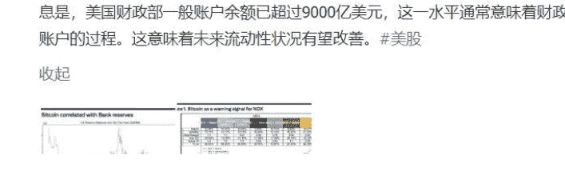

加微信top2868，进资料群

### Figure 2. Bitcoin correlated with Bank reserves
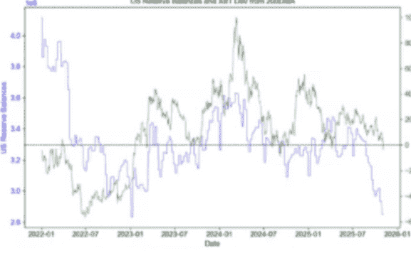

Source: CITI

### Figure 1. Bitcoin as a warning signal for NDX
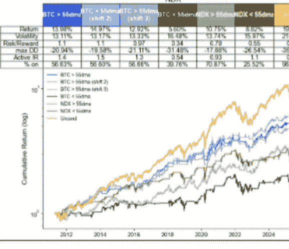

Source: CITI

微信2868，资料群

Jason不磕
2025-11-08 03:50

日经：已成为制裁对象的部分俄罗斯LNG正以市场2~3的价格流入中国，加强制裁正在中国行业受调研查询pler的船跟踪信息显示，俄罗斯船只的LNG运输船靠鲁于10月30日进入中国南部广西自治区的北海进口码。卸了俄罗斯北极2号项目迎的LNG。

# 经济数据
中国停止国产LNG维持来自俄罗斯的进口

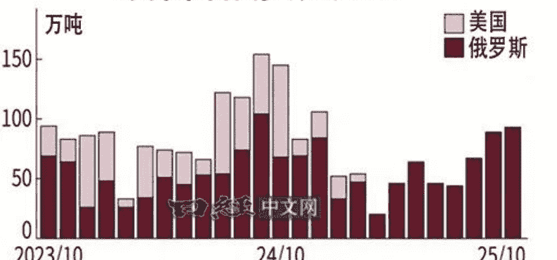

Jason不磕
2025-11-08 03:54

正方：从国内PPI22年10月进入良好区间至今已3年，时长已与上一轮PPI底部接近（12年3月至15年，39个月）。PPI持低位为首，导致了工业企业利润持续当前行业非金融企业活动年ROE（25年Q3为6.5%）已低于15年Q4低（6.9%）水平。从行业数据显示，本轮利润筑底期PPI回升力度与上一轮周期有明显不同。以煤炭和石油天然气采为代表的上游资源行业，ROE明显高于15年水平，而以电子设备、纺织、化学品、电力设备为主的制造行业ROE及。

在本轮利润筑底期，盈利靠的行业表现较优，大多为营收比比较高的行业，通过行政化手段实现均衡需衡难度增大，后续反弹增长更多靠法治化与市场手段。

# 经济数据

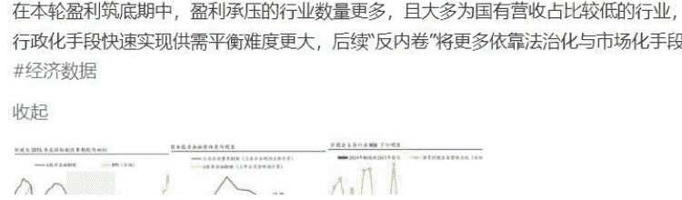

加微信top2868，进资料分享群

### 图表1:当我国实现国家绿色环境转型与15年供给侧改革较为为明显
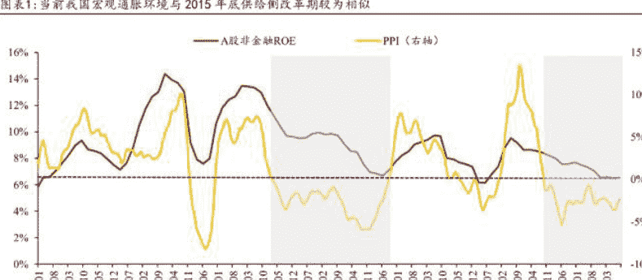

资料来源：Wind，方正研究所

### 图表2: 改革后，中国出口行业
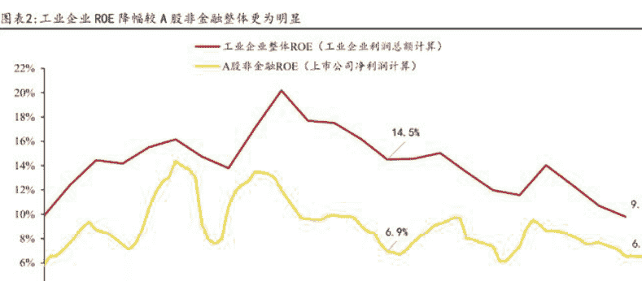

资料来源：Wind，方正研究所

### 图表3: 改革后，中国出口行业对比
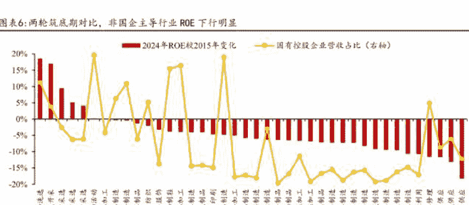

资料来源：Wind，方正研究所

加微信top2868，进资料分享群

### 图1:中国对非洲出口“一类均衡”

| | 中国对非洲地区 | 总额 | 美国 | 欧亚 |
|---|---|---|---|---|
| 出口增长计划 | | | 东亚 | 拉美 |
| 40 | | | | |
| 30 | | | | |
| 20 | | | | |
| 10 | | | | |
| -10 | | | | |
| -20 | | | | |
| 25/01 | 25/03 | 25/05 | 25/07 | 25/09 |

资料来源: ifind, 民生证券研究院

 

### 图2:非洲对我国出口拉动大幅提升

| | 对我国出口拉动增速: 2024年 | 2025年1月 |
|---|---|---|---|---|---|
| | 总额 | 非洲 | 欧亚 | 拉美 | 美国 |
| 6 | | | | | |
| 4 | | | | | |
| 2 | | | | | |
| 0 | | | | | | |
| -2 | | | | | | |
| -4 | | | | | |

资料来源: ifind, 民生证券研究院

 

### 图4:非洲对我国出口产品结构以原材料为主

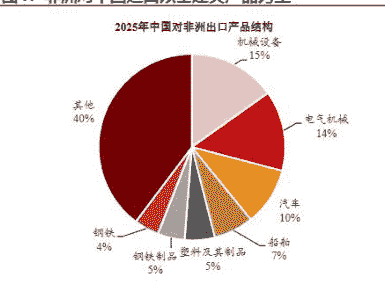

资料来源: TRADE MAP, 民生证券研究院
注: 数据为2023年1月1日

 

### 图5:机械、汽船、钢铁对非出口主要拉动

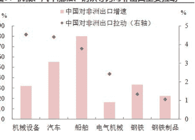

资料来源: TRADE MAP, 民生证券研究院
注: 数据为2025年1月8日

 

### 图7:尼日利亚、南非、埃及、利比利亚为非洲主要增长市场

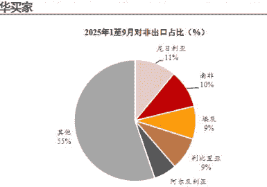

资料来源: TRADE MAP, 民生证券研究院
注: 数据为2025年1月

 

### 图8:其中，尼日利亚、利比利亚或南非为高速增长

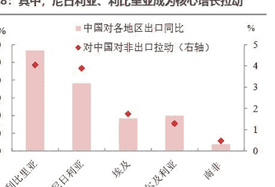

资料来源: TRADE MAP, 民生证券研究院
注: 数据为2025年1月

 

- 微信top28688，进资资料分享群

 

### 图17: 中国出口价格增速偏慢

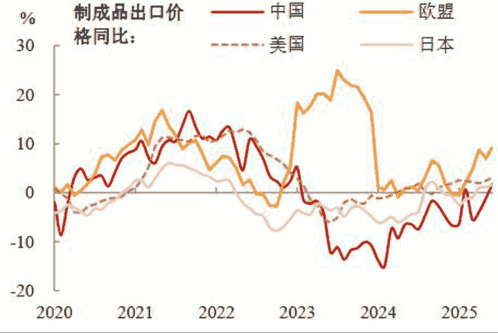

来源：ifind，民生证券研究院

Jason 不2025-11-08 04:11

上海证券：我们认为指数的表现与上市公司的市值相关，与上市公司负债相关#股市

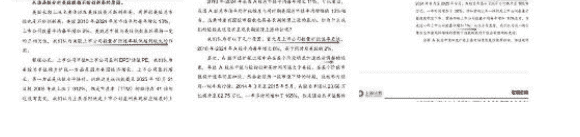

- 加微信top28688，进资资料分享群

 

# 解构股指上涨与三个关键变量

我们认为股指的表现与上市公司的市值成相关，与上市公司数量负相关，而上市市值又是由上市公司盈利和估值水平共同决定的。可以通过以下公式来实现：股指=F（上市市值/上市公司数量）=F（上市公司EPS*估值PE）/上市公司数量）。

从估值角度分析股指不断创新高的原因

美股长期上主要体现在股指不断创新高，同样的美股总市值也是不断创新高。美股2010年-2024年市值平均每年增长13%，上市公司数量平均每年增长2%。美股总市值与股指表现保持着正的相关性，我们认为美股市值数量增长率远低于大多数的水平。

根据公式：上市公司市值=上市公司EPS*估值PE，我们认为美股估值提升一方面是因为美国经济增长、上市公司盈利增长，另一方面是估值水平提升。纳斯达克指数至2025年10月21日自2009年以来上涨了912%，但估值维持在41倍附近没有变化，我们认为主要原因是上市公司盈利出现足够幅度的上涨。

美股尤其纳斯达克集中度，强化了盈利贡献的作用。美股其是纳斯达克交易所表现最为显著的集中度。截至2025年11月4日美股纳斯达克最大的8家公司总市值为23.87万亿美元，占纳斯达克市值的53%，占美股总市值的26%。由于8家企业是全球范围内的巨头，盈利能力。以苹果公司为例，2020年8月苹果公司PE（TTM）为37.78倍，但是截至2025年9月股价涨了103%，但是估值仅提升1%，在其中EPS增长了96%。高集中度导致纳斯达克体量能力强，虽然指数大幅增长但是估值较为稳定。

- 加微信top28688，进阶资料分享群

 

另外两大板块出现了明显的提升。深证与标普500指数从2009年至2025年10月21日上涨了350%和49%，市盈率分别增加了98%和27.46%，导致了估值大幅提高。

A股在过去十五年表现未能呈现长期上涨。我们认为有以下几个原因：首先是上市公司数量扩张更快，2010年-2024年A股市值平均每年增长8%，高于同期水平。其次，市值扩张过程中存在某个阶段加速后调整，A股与指数新高时间间隔远于A股，这被称为一轮牛行情。2013年至2015年5月，A股市值从23.66万提升至62.75万，一年时间内增加了65%，然后是市值整体下跌，截至2016年5月总市值下降至39.61万。2018年12月至2021年12月，A股市值从43.50万提升至91.61万，期间增加了11%，但是之后市值整体回落，截至2024年1月总市值下降至69.42万。虽然A股市值均增长幅接近同期，但是A股创新高月份较短。相比之下，A股由于存在加速上升后下降的情况，市值创新高时间间隔较长。2015年5月市值高点直到2020年6月才突破，2021年12月市值高点直到2025年7月才突破，花费左右。再考虑到上市公司扩张幅度大，指数新高时间间隔可能增长。

- 加微信顶28688，进资资料群

 

未来还能否持续上扬？

最近一年A股市值提升，但是上市公司数量未增加。2024年8月至2025年9月，A股市值从70.07万亿提升至105.16万亿，一年时间内增加了50%。和前两次不一样，上市公司扩张速度明显变慢，范围内上市公司平均每年增长10%左右，是近一年数量增幅的1%。从这个角度来看，我们认为在市值同比例增长的前提下，指数的表现可能会行情更快。

当前A股市值增速还主要由市值恢复性提升驱动，市值绝对

# 宏观趋势

水平仍不够。其中Wind A股市值从2024年9月至2025年9月提升50%，其中水位水平提升44%，至2025年Wind A股市值仅为22倍左右，可见水平仍然低位，可见市值扩展还是恢复性提升带来的。

我国经济持续增长为上市公司盈利增长提供了大环境，表现有望迎来长期上涨趋势。我们认为A股市值提升属于正常现象，但是如果上市公司盈利能够维持增长，市值水平可能不会快速提升甚至可能下降，市值扩展的持续性也会更强。由于我们国家GDP增长。

格峻：53度航天火箭首发报价破历史新低，较年初超跌31%。部分出口斯堪基低至1484元，经销商出口成本都在1600-1700元。

# 经济数据

| 数据火箭发射价格 (周) |
|---|---|
| 数据发射报价1620万-周下限1180万 |

 

- 加微信top28688，进资料分享群

 

# 散装飞机天批价

散装飞机天批价1620元-本周下跌110元

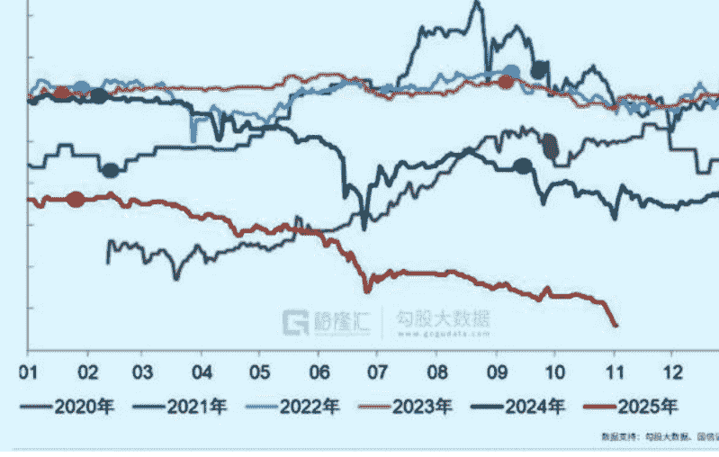

Jason不赢2025-11-08 04:40

整理了历年1-9月的失业保险基金支出，今年创新高，甚至超过了2020和2022年。

 

# 前三季度失业保险支出

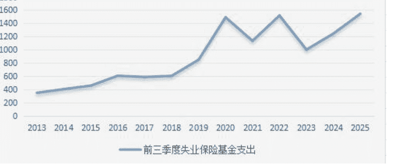

- 微信top28688，资料共享

 

## JPM:2025年10月中国外汇储备增加47亿美元至3343亿，其中黄金储备连续12个月上升，占总储备至8.9%（2022年为3.7%）。在常规账户净流入751亿美元条件下，预计隐含汇率损失290亿美元，低于9月的618亿美元。这表明资金外流压力有所缓解。未来出口下滑或收益持续走高，9月以来人民币结率回升，上升至63.1%，汇率跌至58.5%，资金外流压力有所缓解，未来外流可能反弹。净结率（-卖出）上涨4.6个百分点，为近年来最高。反映企业卖出美元持有较高，人民币基本面依然稳定，还需要应对产跌。

 

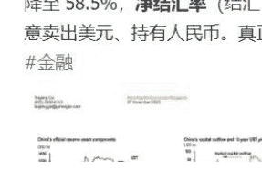

 

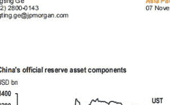

 

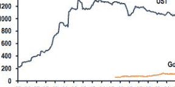

 

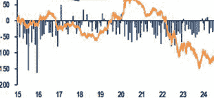

 

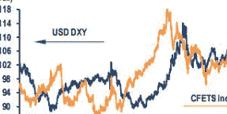

 

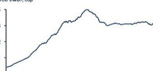

 

摩根经理：MSCI中国与A股在2025第三季度的整体表现较第二季度优。金板块在MSCI中国和A股双预期，周期板块在MSCI中国同样出现“双”，而可选的、必选的、医疗保健及信息技术四个行业，在两大市场中出现“双 miss”（公司数量与加口径双低于预期）。

 

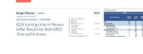

- 微信微信top28688，进阶资料群 关注我

# Morgan Stanley | RESEARCH
November 7, 2025 05:13 PM GMT

# China Equity Strategy | Asia Pacific

# 3Q25 Earnings Interim Review: Softer Results for MSCI China and A-shares

Both MSCI and A-shares delivered softer 3Q25 results vs. MSCI China saw a net miss by company count, but a beat by weighted-surplus, while A-shares recorded a wider miss by count yet tied in line by weighted results. Financials and Materials out with solid earnings.

Takeaways from our 3Q25 earnings season (based on 29% of MSCI China and 74% of A-share market cap report):

For MSCI, 3Q25 interim cut miss, with an 8.8% net miss by companies but a 6.3% net beat by weighted surplus, partly largely to outcomes in 2Q5 (+2.7% and +2.7% respectively). While some big players like Tencent and Alibaba have not reported, we will wait to see if these trends can be sustained through the end of 3Q25 (Exhibit 11).

For A-shares, 3Q25 showed a wider miss by number of companies (-20.3%), while remaining broadly in line a weighted surplus bases (-2.9%), softening from a 13.8% net miss by number of companies and 0.2% in line by weighted surplus in 2Q5 (Exhibit 12).

In revenue terms, both A-shares and MSCI China have missed consensus estimates by number of companies, but posted in-line results by weighted surplus, softening vs. 2Q25 revenue (Exhibit 9, Exhibit 15).

Sector observations: Only Financials in both MSCI China and A-shares posted solid

- Chloe Liu @morgan-stanley.com
- Laura Wang @morgan-stanley.com
- Vicky Wu @morgan-stanley.com
- Jonathan Garner @garner@morgan-stanley.com

Morgan Stanley appreciates your support in 2026 (re-institutional) Asia Research. Survey. opens 12 November 2025.

Exhibit 1: History of Chinese market earnings by number of companies

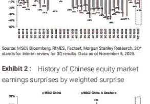

Source: Morgan Stanley Research, FactSet, Morgan Stanley* interim review for 30 results. Data of November 7, 2025.

Exhibit 2: History of Chinese market earnings by weighted surplus

### Exhibit 12: MSCI China Onshore listed sector and industry-level 3Q earnings - Mean by number of companies and in-line result by weighted surprise

| Sector Industry Group | % Cos Reported | % Wt Cap reported | Above In-Line | Below Not-rep | Market Cap Wt Surprise (%) |
|---|---|---|---|---|---|---|
| China | 315 | 50% | 74% | 29% | 51% | (28.2) |
| Financials | 315 | 54% | 74% | 31% | 53% | (7.6) |
| Banks | 280 | 54% | 74% | 32% | 53% | (11.3) |
| Media & Entertainment | 35 | 54% | 74% | 31% | 55% | (7.6) |
| Consumer Discretionary | 160 | 70% | 79% | 26% | 60% | (17.2) |
| Consumer Staples | 100 | 77% | 88% | 30% | 50% | (20.2) |
| Food & Beverage | 70 | 77% | 88% | 38% | 50% | (3.2) |
| Consumer Discretionary & Retail | 35 | 54% | 75% | 33% | 53% | (5.1) |
| Real Estate | 25 | 100% | 93% | 50% | 40% | (5.7) |
| Consumer Staples Distribution & Retail | 25 | 100% | 93% | 50% | 40% | (5.1) |
| Household & Personal Products | 15 | 100% | 93% | 40% | 50% | (0.4) |
| Energy | 30 | 75% | 82% | 33% | 52% | (14.3) |
| Gas & Utilities | 30 | 75% | 82% | 33% | 52% | (12.2) |
| Oil & Gas Exploration & Production | 20 | 67% | 78% | 33% | 50% | (12.2) |
| Oil & Gas Services & Marketing | 10 | 67% | 78% | 33% | 50% | (0.0) |
| Materials | 45 | 75% | 86% | 33% | 52% | (9.9) |
| Chemicals | 35 | 75% | 86% | 33% | 55% | (10.3) |
| Construction Materials | 25 | 100% | 93% | 50% | 40% | (13.1) |
| Others | 10 | 44% | 56% | 30% | 50% | (14.0) |
| Health | 145 | 75% | 80% | 33% | 52% | (14.4) |
| Pharmaceuticals & Biotechnology | 90 | 75% | 80% | 33% | 52% | (15.0) |

# Global Markets Strategy
**07 November 2021 | J.P. Morgan**

# China Local Markets Weekly
### RMB internationalization gains prominence in 15th FYP

#### Executive summary

- RMB internationalization looks to have gained prominence in the 15th Year Plan. The government reported more positive assessments on RMB funding costs and incentives to build a self-sustaining cross-border RMB payment system in the coming years.
- Yuan's usage in trade settlement has accelerated further. According to the Piper, CNY seen a steady increase from 12% to 18% in ASEAN, Latin and China countries have seen particularly strong growth in CNY-dominated cross-border transactions. This growth has continued, with regulators becoming increasingly active in RMB usage-income transactions, in order to facilitate financial institutions to intermediate more yuan-denominated settlement gaining ground.
- The expanded use of the yuan has also gone beyond trade settlement to yuan-denominated financing for overseas outlay. Credit liquidity has risen since 2022, with total outstandings for more dollar bonds and Panda bonds both have reached record levels. While Chinese-related entities still account for the majority of inflows, non-Chinese financial institutions and companies have become increasingly active in the market.
- The RMB continues to push for RMB internationalization, entirely de-dollarization from the public sector looks to have quickly met, with falling share of CNY assets of U.S. Treasuries/securities accounting for 22% of China's foreign reserves, down from 35%–45% in 2019. While the USD share is marked higher at 46% if potential other holdings of U.S. Treasuries are included, the de-dollarization trend...

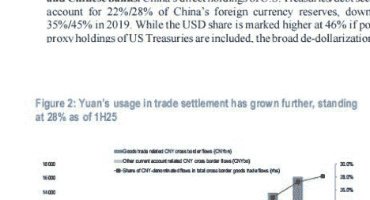

Source: J.P. Morgan

**Figure 4:** CNY FX has seen the largest increase in the share of global CNY turnover in the period of 2022-23
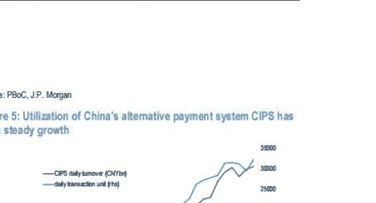
Source: BIS, J.P. Morgan
Source: J.P. Morgan

### Figure 10: USD share of Chinese foreign currency reserves continued to decline
### Figure 11: while de-dollarization is also visible in external assets held by Chinese banks

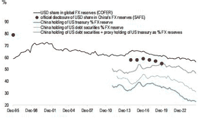
Source: SAFE, IMF, TIC, Haver, J.P. Morgan

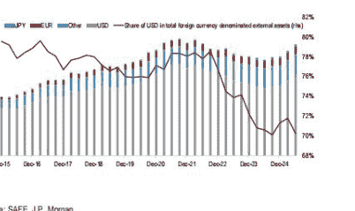
Source: SAFE, J.P. Morgan

---

# 国信：投资者短期储蓄情绪波动，居民养老配置受制于长期，衡对财产收入的要求日益重要，未来需要通过政策激励和制度设计，进一步提升居民养老配置的质量，尤其是养老金、三养老。

在美国1974年、1978年推出个人退休账户（IRAs）和401K，以IRAs和401K为代表的美国是资本市场最重要的资金来源，推动了居民大资产配置转向股市。1980年后，美国结构转型，居民养老配置具有巨大的背景，美股走出长牛行情，使得居民收入预期增长和消费增长。长期来看，A市场长期回报难以超越。2005-24年A股年化收益（含）为9.8%，高于长期收益4.1%。

### A股

图22: 我国居民资产配置比例对比

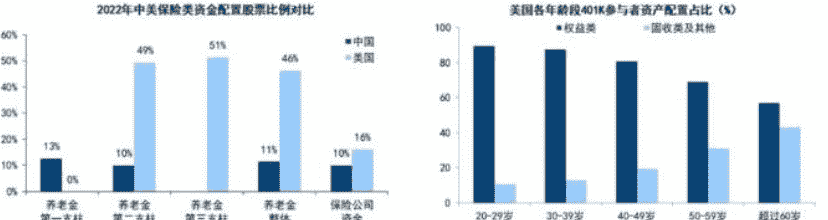
图24: 美国401K参与者与资产配置情况

2023年中国养老资产配置对比：
美国养老年龄与资产配置占比
数据来源：美联储、ICICI、人社部、国泰证券研究所

---

# 深度报道：越多的海外客户要求拉长账期让刘锐倍感压力

刘锐是一个资外贸从业者，经营着一家家具及装修设计企业。企业拥有40多个合作海外客户，遍布中东、南亚及非洲地区。当下，约五成的海外客户做出了将账期拉长到90至120天的要求，这是在过去20年的外贸历程从未出现的情况。“都是合作多年的老客户，而且经历过此的合作结束，如果我遇到这种情况，我要面临更多的资金周转压力与更高风险。”刘锐感如临其。

多名外贸企业主透露，他们也遭遇过不少海外客户突然提出将账期拉长到90至120天的情况。客户给出的原因是宏观经济波动导致居民消费意愿和消费能力下降，房产销售额增长，所以他们太能拉长外贸尾款的账期。这些外贸企业主并不十分担心，自己一旦遭遇海外客户的要求，等于将自己置于危险处境——一旦部分海外客户在持续拉长账期的“恶意欠款”，他们将遭遇不小的订单损失。

刘锐表示，一旦出现两三处海外订单的恶意欠款，自己一年的业务利润都会被吞噬。更让他害怕的是，海外客户付账账期拉长，日益影响海外企业与上游供应商的资金周转，可能导致海外产业链陷入资金紧张的旋涡。
