# 南华联购财经251114

Jason-luck
2025-11-14 03:08

国信证券：牛市三阶段包括孕育期、爆发期、狂热期，当前处于第二阶段。A股

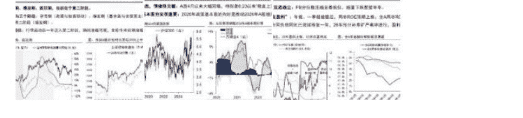

## 4000点后如何看？牛市进入“第二阶段”

- 牛市三阶段包括：孕育期、爆发期、狂热期，目前处于第二阶段。
- 一完整牛市分为三个阶段：孕育期（估值修复驱动）、爆发期（基本与估值修复驱动）和狂热期（情绪驱动）。目前市场正处于牛的第二阶段（爆发期）。
- 牛市在“5199”调整后会进入第二阶段，期间震荡较缓，牛市孕育期频繁涨跌时更加温和。

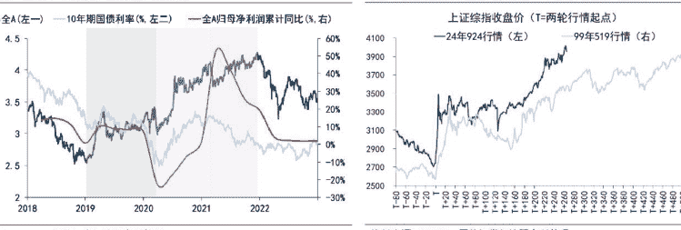

图：牛市阶段：孕育期、爆发期、狂热期。
图：当前A股自2000年以来历史处于第二阶段

| 上证指数 | 2460 |
| :--- | :--- |
| 5199高点 | 5550 |

来源：万源、国信证券行业研究研究所

## A市场6400点以后还会涨吗？来源于数字基本面

- 快牛、慢牛三部，情绪驱动，A442以后进入牛市，关键是6.23是“跟上上行情”。
- 牛市二阶段，基本面重心转移：2026年政策基本是驱动A股走势的核心因素。

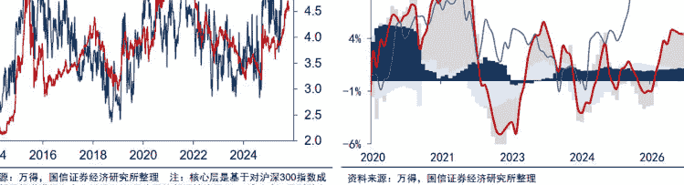

图：基于基本面预测，A442以后进入牛行情

## 如何看20688，进阶资料分群

### 从“情绪”到“盈利”，稳不失节奏

- “924”债市底部：BP分位值至最低，缩量下跌半年。
- “情绪”到“盈利”：年、季披露后，ROE上移，全ROEQ3上，利润率开始恢复，26年有序，盈利性增强。

图：“924”债市底部：25Q3表现

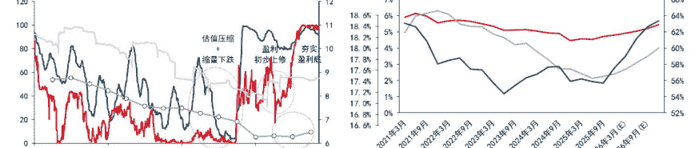

来源：WIND，国信证券研究研究所

### A资产隐含，收益率尚未回归

- 当市场处于底部：信用溢价尚未。
- 市场情绪底部，贷款尚未修复，活跃度与投资者仍严峻，尚未筑底。
- 收益率指标“9Y”以来维持2Y的下行趋势，向上趋势，但并未回归均值。

图：收益率指标尚未回归

| 收益率指标 | 100天内12个月均值 | 当前值 |
| :--- | :--- | :--- |
| -2Y | 57.92% | |
| 全品种 | 50.73% | |
| A股(含债) | 62.91% | |

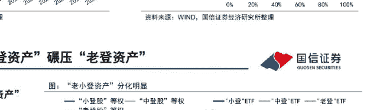

来源：WIND，国信证券研究研究所

### 市场分化，“小资产”压制“老资产”

- “资产”分化逻辑
- 2025年以来“小资产ETF”上涨18%，“老资产ETF”上涨12%。
- 2024年以来“小资产ETF”上涨54%，“老资产ETF”上涨13%。
- “资产”分化程度超2016-2024年均值，“小资产ETF”波动程度也超2021年来的平均水平。

来源：WIND，国信证券研究研究所

### 非衰退行情，长期受益

- 美股曾三次衰退表现，半年至一年内表现良好：1995年、1998年、2020年3月，“衰退行情”开始后一年，均获得数字增长。
- 利率型资产“衰退行情”受益提升：全球金融指数扩张，为风险资产提供流动性支持，以债、股为代表的利率型表现活跃，前瞻估值逐步打开。

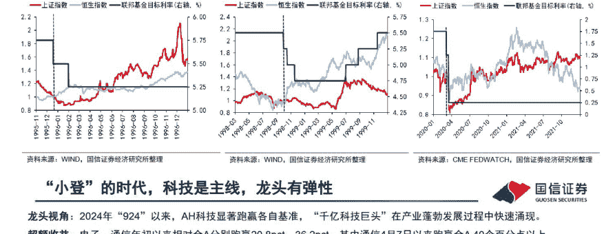

| 上证指数 | 肯尼500指数 | 纳斯达克100指数 | 上险指数 | 某指数 | 标普500指数 |
| :--- | :--- | :--- | :--- | :--- | :--- |
| 2.2 | 6.0 | 2.4 | 5.79 | 1.3 | 1.7 |
| 2.1 | 5.5 | 5.1 | 5.75 | 1.2 | 1.8 |
| 2.0 | 5.3 | 5.5 | 5.73 | 1.2 | 1.7 |
| 1.9 | 5.2 | 5.4 | 5.71 | 1.1 | 1.6 |
| 1.8 | 5.1 | 5.3 | 5.69 | 1.1 | 1.5 |
| 1.7 | 5.0 | 5.2 | 5.67 | 1.0 | 1.5 |
| 1.6 | 4.9 | 5.1 | 5.65 | 1.0 | 1.4 |
| 1.5 | 4.8 | 5.0 | 5.63 | 0.9 | 1.3 |
| 1.4 | 4.7 | 4.9 | 5.61 | 0.9 | 1.3 |
| 1.3 | 4.6 | 4.8 | 5.59 | 0.9 | 1.2 |
| 1.2 | 4.5 | 4.7 | 5.57 | 0.8 | 1.2 |
| 1.1 | 4.4 | 4.6 | 5.55 | 0.8 | 1.1 |

数据来源：WIND，国信证券行业研究中心

## “小个”的科技，是主流，龙头

- 2024年“924”以来，AI表现强势，“巨头”在产业过程中快速增速。
- 超额收益：越小市值，今年科技股跑赢沪深300%，其中科技股近涨40%。
- 聚焦成长：沪深领先科技股因子占比10%，其中AI算力板块净涨30%。
- 转型：科技股成长因子提升至30%，一季度涨幅50%。
- “924”以来，市值百亿的依然是主流，在AI核心赛道持续领先。

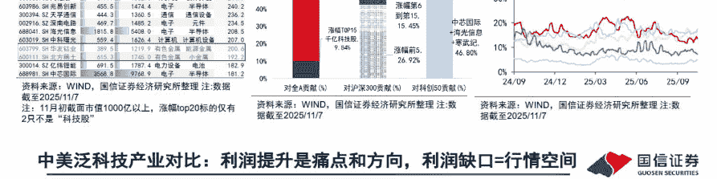

| 行业名称 | 行业代码 | 行业名称 | 行业代码 | 行业名称 | 行业代码 |
| :--- | :--- | :--- | :--- | :--- | :--- |
| 电子 | 002760 | 计算机 | 004100 | 通信 | 000570 |
| 传媒 | 002283 | 医药 | 000660 | 电力 | 000688 |
| 钢铁 | 001700 | 建筑材料 | 008911 | 机械 | 000340 |
| 汽车设备 | 000506 | 农林 | 000061 | 食品饮料 | 005409 |
| 纺织 | 000135 | 银行 | 001238 | 证券 | 000066 |
| 保险 | 001291 | 建筑 | 001902 | 交通运输 | 000870 |
| 商用 | 000673 | 环保 | 001688 | 采矿 | 000700 |
| 能源 | 000698 | 电子设备 | 002416 | 物流 | 000929 |
| 食品饮料 | 005409 | 金融 | 001238 | 软件 | 002355 |
| 医药 | 000660 | 纺织 | 000135 | 传媒 | 002283 |
| 建筑 | 001902 | 电子设备 | 002416 | 机械 | 000340 |
| 环保 | 001688 | 钢铁 | 001700 | 计算机 | 004100 |

数据来源：WIND，国信证券行业研究中心

## 中美科技股对比：利润提升是首位，利润回升是行情

中国科技股的利润回升速度快于美国科技股，ROE也优于美国科技股。ROE为28.5%，比科技股高很多。中国A500股中市值最大科技型股ROE为10.3%，和韩股科技股超额收益、韧性，中国科技型企业生命周期优于美国，生命周期更早、近期进入n后，表现的是最好之一。

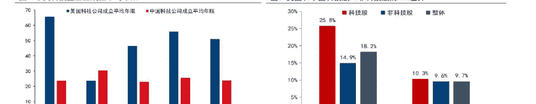

数据来源：WIND，国信证券行业研究中心

## “十五五”开局，政策动力超预期

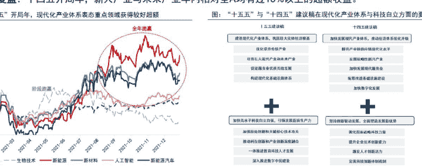

资料来源：国泰、中信、中国证券研究中心

**bloomberg:** 泽连斯基希望将被冻结的1400亿元俄刚钻石产矿化，他说时间在流逝。如果明年第二季度没有新的钻石源，乌克兰将面临巨大的压力，没有明确的战争困境。

## 其他国家经济

微信诚信资料群
微信top28688，进阶资料分享群

## 乌克兰腐败要点

- 俄罗斯针对能源基础设施遭遇袭击后，乌克兰总统泽连斯基（Volodymyr Zelensky）承诺对统治精英（包括他的商业伙伴）不断扩大的腐败问题进行调查。
- 泽连基要求两名部长辞职，腐败调查已经让他们离开，他要求制裁他的商业伙伴和另一名参与商人。
- 泽连基告诉电视采访，“最重要的有罪的人判罚，”且“每个人都必须法律法律上责任。”
- 泽连斯基（Volodymyr Zelensky）承诺对统治精英（包括他的商业伙伴）不断扩大的腐败问题进行调查。
- 铁木·明迪奇 (Timur Mindich) 是电视制作公司的所有人，该公司在泽连基选举之前，周二被指嫌挪用达12亿美元。
- 泽连基要求两名部长辞职，腐败调查已经让他们下台。调查显示，人员将建造防御工程以保护设施免受空袭的承包商。
- 泽连基周三在基辅接受影像采访，“处于战争状态的国家没有任何朋友。”加微信top20688，进阶资料群

## 乌克兰腐败调查事实公布

- 泽连基自欺事实公布，他没有与明迪奇谈过。
- 泽连基早些时候限制两个机构的独立性后，这引发了乌克兰升级的重大考虑。这引发了大规模街头抗议活动，并迫使总统在欧盟盟友的批评下改变方向。
- 能源基础设施遭遇袭击后，乌克兰正在应对大面积停电，这项调查引起了公众的愤怒，认为腐败正在削弱乌克兰。
- 泽连基恳求欧盟盟友尊重，利用被冻结贷款对乌克兰继续援助。
- 匈牙利总理欧尔班（Viktor Orban）迅速抓住了丑闻，强调他长期以来反对帮助乌克兰。“把纳税人的钱投入这场混乱中，”欧尔班周四在脸书上发表，他的政府一直受到腐败指控的困扰。“无论他们在战线使用什么，黑手都可以走。”
- 泽连基访问德国与德国总理朔希·梅尔讨论，德国已成为乌克兰援助的最大支持者。
- 梅尔的发言人特芬·科内利乌斯（Stefan Cornelius）表示：“总理强调，德国政府希望乌克兰大力开展反腐斗争和进一步改革，特别是在法治领域。”

国家反腐局（NABU）和专门腐败检察办公室（SAPO）周一宣布，他们已经扣留五人作为对能源部门“大规模”贪污行为为期15个月调查的一部分。

## 金融

- Bloomberg: 我们预计上个月中国零售额同比增速2.8%，为近四年来最低。周四发布的金融数据显示上个月的信贷扩张多年来最低。10月融资总额增加850亿元，为2024年7月以来最低水平，低于经济预测。作为抵押贷款代表的家庭中长期贷款再次增加，表明购者连续购。企业不愿进行投资或扩张，长期企业贷款仅为310亿元，不到五分之一。这可能有一些水分。

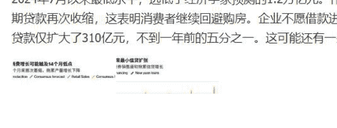

## 中国10月消费增长可能低于4月低点

- 出口出现八个月来首次萎软，产量增长下降。
- Industrial production / Consensus forecast / Retail Sales / Consensus forecast
- Exports

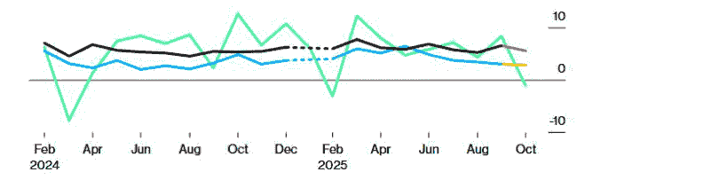

来源：国家统计局、中国海、彭博社
注：国家统计局统计今年两个月的工业生产和零售销售综合数据。

## 中国创作一年来最小信贷扩张

- 贷款和政府债券销售趋势软缓增长。
- Aggregate financing / New yuan loans

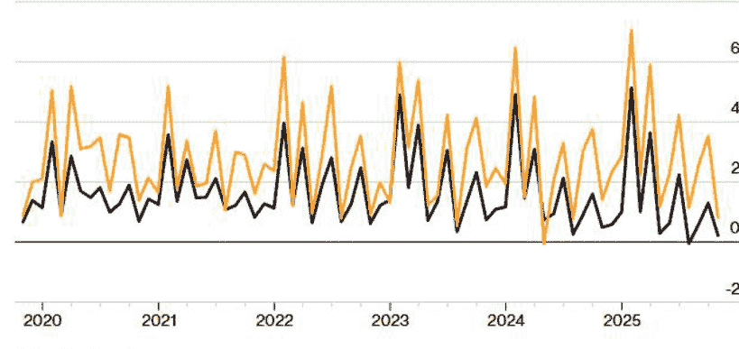

来源：中国人民银行

## 其他国家

bloomberg: 在截至9 月的 12 个月，新西兰的公民离开人数创下历史新高，因为经济低迷导致更多人向海外寻找新的工作。这些离开的人中，有58%去了澳洲。

- New Zealand Losing Record Numbers of Citizens
Annual departures vastly outpace returnees
Departures / Arrivals

- New Zealand Losing Record Numbers of Citizens
Annual departures vastly outpace returnees
- Departures / Arrivals

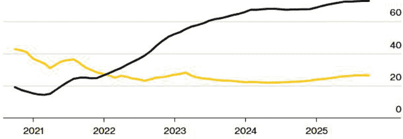

Source: Statistics NZ

Brad Sester: 中国的出口向型制造业正在挤压出口向型制造业经济体的生存空间，包括德国等发达经济体，以及一些新兴经济体。

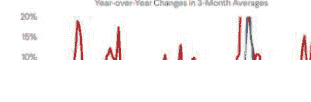

## 出口量

Year-over-Year Changes in 3-Month Average

- 北京: 10月居民短贷，中长贷同比为-0.3亿、2亿。企业部门信贷改善来源于增量，短贷，总量同比持平+0.3亿，注意的是，中长贷已连续4个月同比缓。M1增速期回落，末期M1数据回升，且升加快，M1增速持续下行。

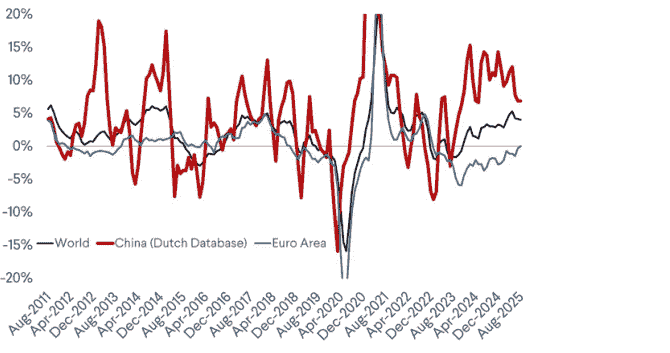

来源：Wind，长江证券研究所

- 图8: 居民、企业、财政、非银同步比变化。

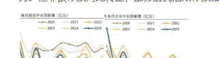

来源：Wind，长江证券研究所

- 图9: 居民活期存款、企业活期存款同步比增速（%）。

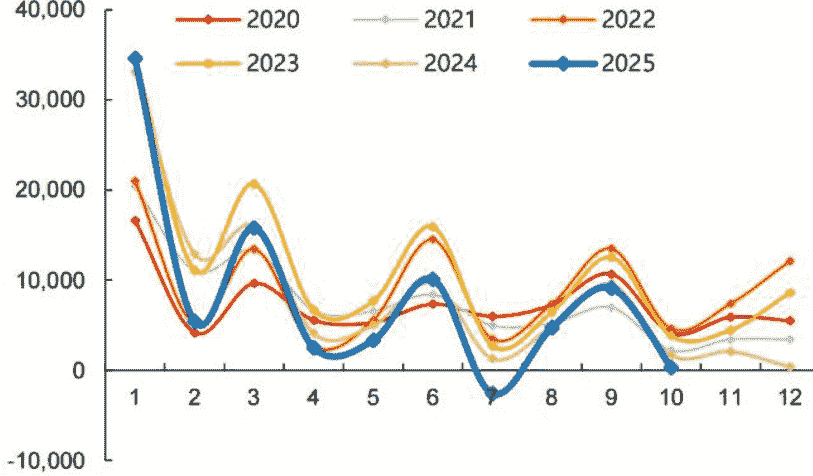

来源：Wind，长江证券研究所

- 图6: 历年各月企业分项同比变化（亿元）。

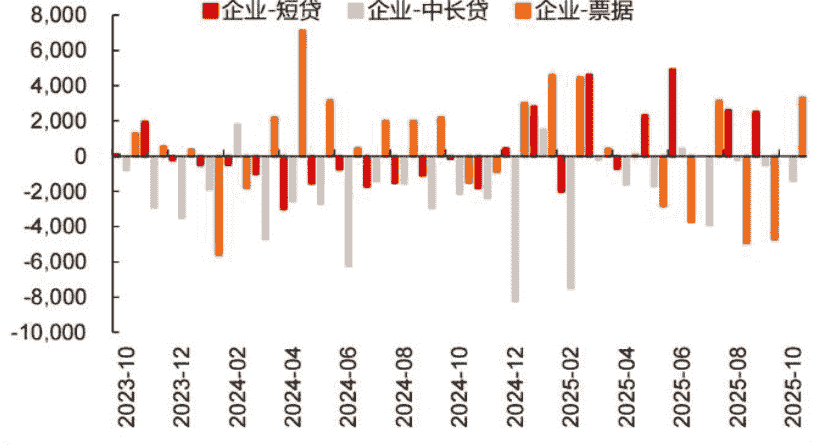

来源：Wind，长江证券研究所

## 10月居民购房意愿调查

房价（和季度跟踪数据一样，投资积极的抬升，消费的下降，这不是好事）

注：文中数据来源于Wind，本文仅供参考，不构成任何投资建议。
* 居民活期存款-企业存款同步比来源于Wind；
* 企业活期存款-非银存款同步比来源于Wind；
* 居民活期存款-非银存款同步比来源于Wind；
* 数据来源：长江证券研究所

## 居民购房意愿持续下降：10月居民购房意愿为上月占比约为13%

13%，环比下降1.7个百分点，购房意愿弱于上月占比出现，10月底占比为35%，环比增加2.5个百分点，处于阶段高水平；购房意愿稳定小幅下降，环比下降1.2个百分点。整体来看，楼市运行相对较弱，居民购房需求释放后，置业意愿出现下降，住宅产品迭代后，居民购房意愿延续下降态势。其中，三四线城市居民购房信心下降最为明显，环比下降2.9个百分点；二线城市居民购房心中涨，环比下降1个百分点。

图：居民购房意愿变化

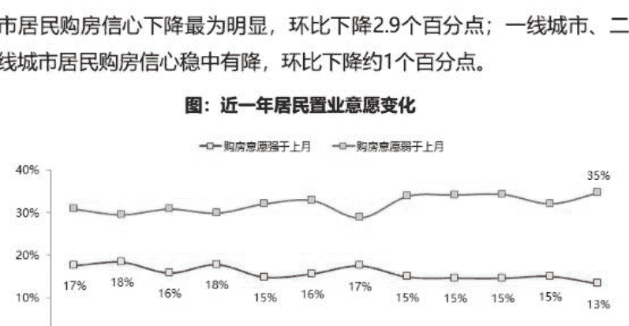

数据来源：中国居民购房意愿调查

居民收入预期有所改善：根据调查显示，10月收入预期超出低位，占比为40%，环比上升4.1个百分点。收入预期出现下降，收入稳定占比为38%，环比下降2.2个百分点。收入减少和失业风险出现，占比为19%，环比下降1.9个百分点。整体来看，居民对未来收入回，一方面中美贸易易于取得重要进展，部分贸易措施有望暂停，推动贸易关系缓和，形成中期经济运行良好；另一方面部分生产活动活跃相对较高，制造业投资增速加快，带动预期预期改善。

图：居民对未来收入预期变化

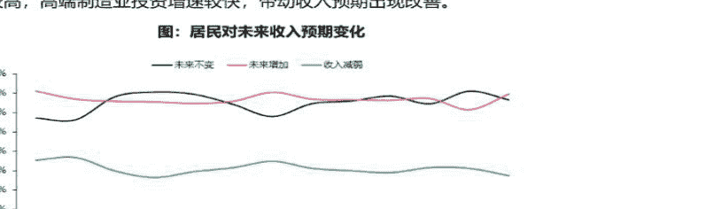

居民房价预期延续趋势：房价下跌预期中有升，10月底房价下跌预期约为27%，环比改善0.3百分点，持续处于高位。稳定预期出现下降，10月底房价稳定预期约为54%，环比下降1.3百分点。房价上涨预期维持低水平，10月底房价上涨预期约为14%，环比下降1.0百分点。整体来看，短期居民房价预期延续趋势，下跌预期中有升，上涨预期维持低水平，前期预期持续优于良好状态，市场延续以销量为主，短期房价下跌压力极大。

图：居民未来房价预期变化

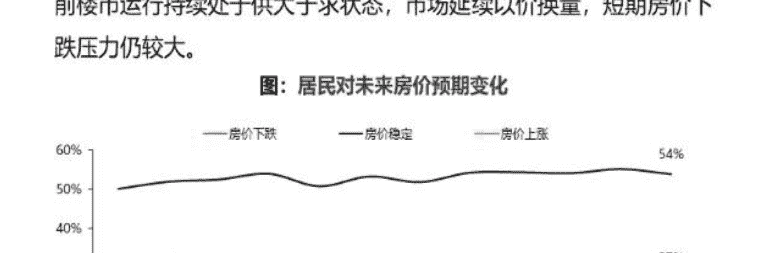

居民储蓄意愿维持高位：10月居民储蓄意愿明显下降，更多储蓄占比约为54%，环比下降0.2百分点，整体居民风险偏好仍然相对较弱；消费倾向于下降，10月占比下降9百分点；投资偏好低位微升，更多投资占比约为22%，环比上升1.3百分点，但整体处于对低位水平，居民房与投资意愿相对较均衡。

图：居民储蓄资金流向

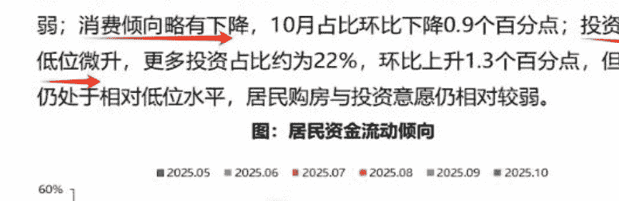

数据来源：中国居民商业意愿调查

## 微信top26888，进资料分享群

## Jason-不诡
2025-11-14 06:11

克瑞：10月成交法拍牌的平均折价率为32.7%，环比上升0.4个百分点，挂牌法拍牌的平均起折价率为29%，上升了二季度以来新高。本月买卖双方价向均有所上，其中挂牌的变卖竞源牌溢价幅度最大，10月份平均折价率达到32.7%，较月增加了1.2个百分点，回到国内。房价。

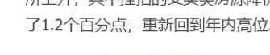

图: 挂拍和成交源挂起折价率发展趋势

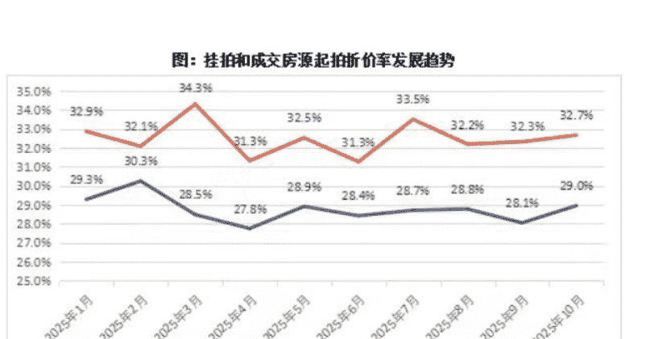

注：折价系数为比较比例。
数据来源：CRIC测

## Jason-不诡
2025-11-14 06:14

bloomberg：韩元接近近个月全球金融危机爆发以来的最低水平，这给发行增加了货币的压力；韩国银行行长韩国表示，如果当看到足够波动，他们愿意进行干预，韩元在过去三个月下降了6%，亚洲最大的市场，原因是股票资金持续流出和居民海外投资增加，债务也承压，本10年期债收益率回升至16个月高，原因是人们对疫洛刚刚结束的情绪不断循环。#其他国家经济

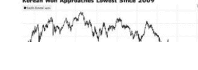

## 加微信top26888，进阶资料共享

## Korean Won Approaches Lowest Since 2009

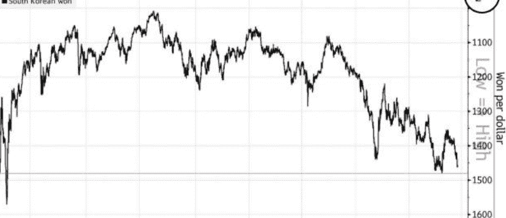

'09 '10 '11 '12 '13 '14 '15 '16 '17 '18 '19 '20 '21 '22 '23 '24 '25
Source: Bloomberg

## Jason-不雅
2025-11-14 06:17

Marketplace Pulse：中国卖家占全球活跃卖家数量 50.03%，这标志着他们首次在亚洲市场拥有国际卖家突破50%的门槛。
2015年中国卖家仅占 Amazon.com 新注册量的7.1%，而美国的这一比例为70.6%。到2024年，Marketplace Pulse，数字几乎完全旋转，中国卖家占新注册的62.3%，而美国卖家则高达26.8%。此此，中国卖家最大的优势是跨境能够恰当地美国卖家的韩国源和图像。现在，人工智能的大规模处理、优化，甚至文化化。亚洲卖家自己接近的人工智能功能，已用于专业内容创作的 Creator Studio，已经消除了曾经有利于本土人士的品牌。
但是，尽管中国卖家赢得了数量，但美国卖家在创作方面保持优势，美国卖家占 Amazon.com 3050亿美元第三方 GMV中的1570亿美元，而中国卖家为1320亿美元。美国的平均价为884,958美元，是中国家的393,557美元的两倍多。经济数据。

## 加微信top26888，进资分享群

## New Amazon.com Seller Registrations
by year and business country

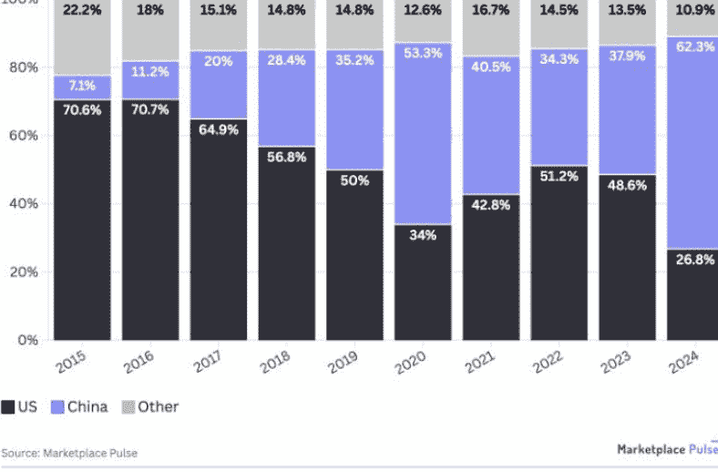

## Share of Global Amazon Active Seller Base by Country of Business
top ten by share

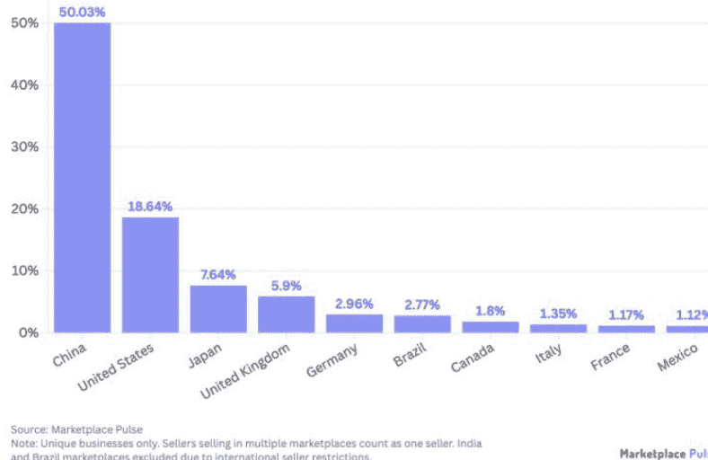

加微信top28688，进资料分享群

## Jason-不涵
2025-11-14 06:27

四年期间，中国消费者的品牌理念发生巨，从国际品牌完全转向国内品牌，55%的中国消费者更偏好品牌，频繁比较多个品牌，相比2021年上升了13个点。年轻群体在资源丰富的时代，正处于职业的早期，缺乏财富和阅历，由于他们对未来关注，健康和财富是最保障。而情感、个人成长更符合理想。中群体（70后、80后）近几年轨迹回归了努力工作就能带来回报的信念。新一线一方面，他们意识到健康的重要性，另一方面通过财富积累来寻找安全感。中国消费者的购物渠道在全球范围内线上为主，43%线上买，线下占比9%，低于20%。

## 图1：四年期间中国消费者市场格局巨变
2021年中国消费者的品牌转向2025年中国消费者的品牌

| 美妆护肤 | 76% | 10% | 12% | 37% | 43% |
|---|---|---|---|---|---|
| 营养保健 | 53% | 20% | 27% | 30% | 46% |
| 3C数码 | 63% | 14% | 28% | 17% | 55% |
| 母婴用品 | 53% | 18% | 29% | 23% | 55% |
| 服饰鞋 | 49% | 14% | 37% | 12% | 60% |
| 食品饮料 | 26% | 15% | 10% | 26% |
| 家用电器 | 55% | 12% | 33% | 16% | 69% |

数据来源：埃赛哲2025年中国消费者调研(N=5000)，2021年中国消费者调研(N=1040)
问题：您在购买前会考虑哪些品牌？您的倾向是？

## 加微信top26888，进资料共享

# 图2：超过一半的一线城市受访者在3C类向国际品牌
## 图3：超过一半的高收入群体在美妆护肤类向国际品牌

2025年一线消费者品牌偏向

| 美妆护肤 | 47% | 19% | 40% |
|---|---|---|---|
| 健康保健 | 36% | 22% | 43% |
| 3C数码 | 54% | | 28% |
| 母婴用品 | 24% | 19% | 57% |
| 服饰鞋 | 18% | | 54% |
| 食品饮料 | 10% | 25% | 64% |
| 家电 | 22% | 16% | 62% |

2025年高收入群体（家庭收入>3万元）品牌偏向

| 美妆护肤 | 52% | 20% | 28% |
|---|---|---|---|
| 健康保健 | 37% | 22% | 41% |
| 3C数码 | 36% | 13% | 51% |
| 母婴用品 | 30% | 20% | 50% |
| 服饰鞋 | 19% | 24% | 56% |
| 食品饮料 | 9% | | 68% |
| 家电 | 27% | 17% | 60% |

* 优先选择国际品牌·没有闲·优先选择国产品牌
注：百分比数据为四舍入后的结果
数据来源：埃赛哲2025年中国消费者调研(N=5000)
问题：您近期倾向哪些类的商品？未来会购买哪些类的商品吗？您的意向是？

## 图4：品牌忠诚度被稀释
有心仪品牌时，是否会持续选择（2021年vs.2025年）

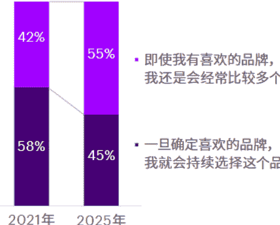

数据来源：埃赛哲2025年中国消费者调研(N=5000)，埃赛哲2021年中国消费者调研(N=140)
问题：以下两个描述中，您更认同一项？

## 微信顶26888，进资料分享群

## 6. 消费者理性与信任发生改变

### 被品牌吸引的原因
2025年vs. 2021年(百分比)

| | 2025年 | 2021年 |
|---|---|---|
| 产品有特色 | 61% | +10 |
| 营销力大 | 48% | +10 |
| 营销方式新颖 | 42% | +9 |
| 主播/博主/UP主推荐 | 37% | -3 |
| 店面服务好 | 29% | +11 |
| 代言是我喜欢的 | 25% | -4 |

*2025年 * 2021年
注：百分比数据为人数的平均值
数据来源：2025年中国消费者调研(N=5,000)、2021年中国消费者调研(N=10,140)
回：您认为最能受品牌吸引的方法，除了自身朋友之外，还有哪些可以让你产生购买意愿？

### 当下的优先(2025年vs. 2021年)
选前三名的因素占比

| | i+9 | i-1 | i-8 | i+12 | t+1 | i+3 | i-6 | i-2 |
|---|---|---|---|---|---|---|---|---|
| 2025年vs. 2021年(百分比) | 87% | 79% | 78% | 61% | 53% | 47% | | |

注：百分比数据为四舍入后的结果
*2025年年龄段的出生年份

| 年龄 | 健康 | 家庭 | 财富 | 审美 | 情感 | 友情 | |
|---|---|---|---|---|---|---|
| 00后 (18-24岁) | 16 | -6 | 4 | 18 | 0 | -11 | -9 |
| 96-00 (25-29岁) | 14 | 1 | 5 | 15 | -1 | -12 | -7 |
| 91-95 (30-34岁) | 9 | 7 | -3 | 8 | 0 | -12 | -6 |
| 86-90 (35-39岁) | 12 | 6 | -6 | 9 | -3 | -10 | -5 |
| 81-85 (40-44岁) | 11 | 2 | -11 | 13 | 1 | -8 | -6 |
| 76-80 (45-49岁) | 8 | -1 | -8 | 11 | 1 | -8 | 0 |
| 71-75 (50-54岁) | 9 | -1 | -17 | 13 | 6 | -5 | -3 |
| 66-70 (55-59岁) | 2 | -10 | -15 | 12 | 10 | 0 | 1 |
| 60-65 | 2 | -15 | -8 | 9 | 14 | 1 | 2 |

## 微信top28688，进资料分享群

## 图10：85%的中国消费者“在线”，仅有9%“线下”
中国及全球消费者的购物渠道
85%的中国消费者“在线”

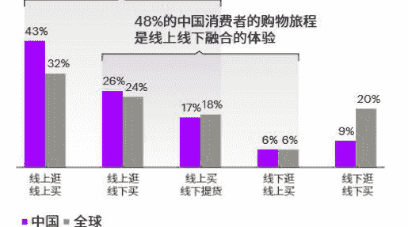

注：百分比数值为四舍入结果
数据来源：埃赛哲2025年中国消费者调研，2025年1月

## Jason-不离
2025-11-14 06:38

bloomberg：随着储政策制定者延迟发布的信号，他们似乎倾向于谨慎，倾向于下个月暂停息，这最终会对股市造成下压力。之前首席经济学家凯文·哈塞（Kevin Hassett）告诉华尔街日报，10月份的就业报告将揭示过失业率。

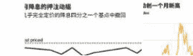

## 对美联储12月暂停息的押沽变动
交易员已经从几乎全价的降息预测中的一个基点中撤回

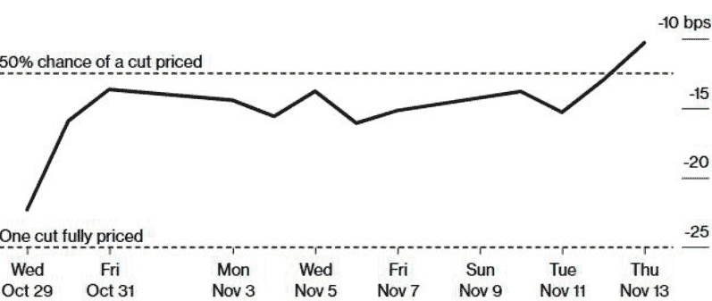

50% chance of a cut priced
One cut fully priced
数据来源：彭博社

## 加微信top26888，进资料分享群

## 美债市场波动创一个月高
The MOVE Index

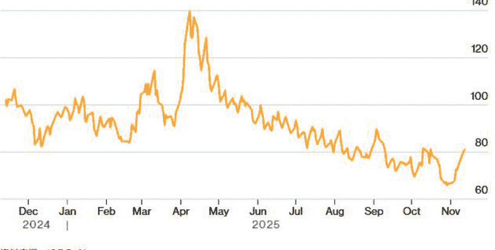

数据来源：ICE BofA

## 10年期国债收益率稳居4%以上
Yield Level

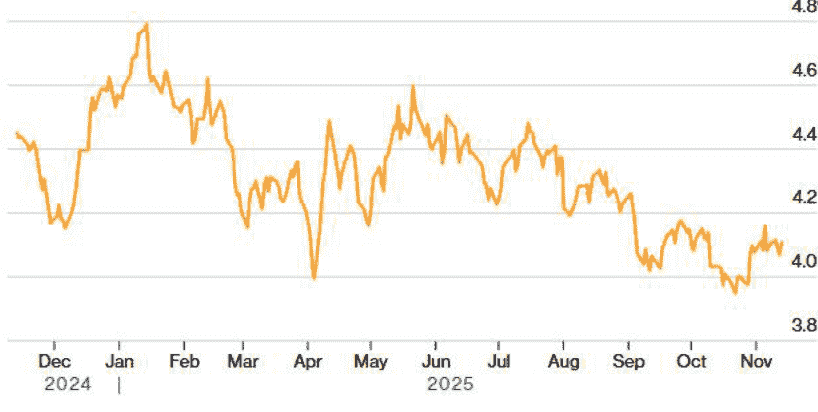

数据来源：彭博社

加微信top28688，进资料分享群

## Magnificent Seven Loses Momentum
Last Price

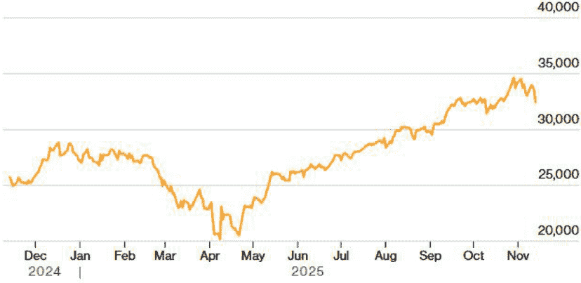

Source: Bloomberg

## Jason-不离
2025-11-14 06:43

银河：10月政府债融资增速连续三个月下滑，增速为19.2%（前值20.2%），除去政府债的社融增速为5.92%，由于基数效应，四季度政府债融资对社融增速的拉动作用可能减弱。有效10月企业债明显下调，可能存在一定的政策中。非银贷款较少164亿元。展望2026年，全年有望调整政策利率至10-20BP，并提升货币政策传导效率，推动存款利率的同步下调。以配合50BP的降准以约银行成本。同时，发行已重建债券买入机制。我们预计债买入将成为2026年实施货币宽松的重要路径，央行资产负债表也将2026年年初呈现稳健节奏。金额。

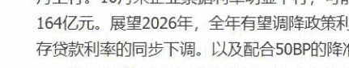

## 微信top28688,进资分享群

## 图5：社融增速（去除政府融资）和政府融资增速（%)

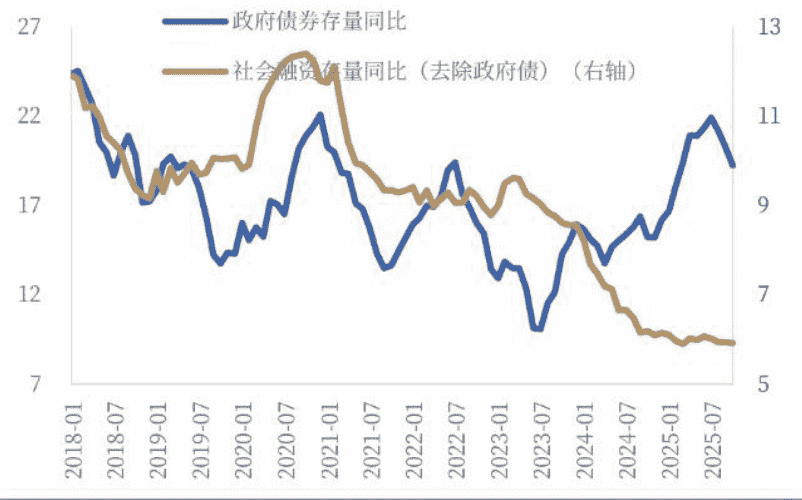

资料来源：Wind, 中国河证券

Figure 1: Stock screen of A-share listings by market cap($USbn) in auto, battery materials, lithium, solar, chemicals, coal, steel, dairy, hogs, liquor and logistics

| Name | Industry | P/E (ttm) | 3mo Acc | Current growth (%) | FTM growth (%) | PE growth (%) | LTM growth (%) | LTM PE (%) |
|---|---|---|---|---|---|---|---|---|---|
| 600519 | Yangtze Technology | Special Chemicals | 2 | 562 | 81 | 54 | 19 | 10 | 4 |
| 600194 | Shanshanful New Energy Technology | Special Chemicals | 4 | 239 | 79 | 21 | 29 | 11 | 7 |
| 600025 | Huagai New Material | Special Chemicals | 6 | 338 | 94 | 63 | 89 | 50 | 5 |
| 601196 | Zhongrui New Material | Special Chemicals | 4 | 338 | 93 | 62 | 85 | 9 | 4 |
| 600265 | Ganfeng Lithium | Special Chemicals | 10 | 718 | 64 | 11 | 54 | 11 | 3 |
| 600772 | Nocan Lithium | Special Chemicals | 15 | 588 | 75 | 65 | 11 | 45 | 9 |
| 688009 | Green Energy Technology | Semiconductors | 17 | 547 | 72 | 38 | 79 | 28 | 4 |
| 601195 | Sanxing New Energy | Semiconductors | 20 | 433 | 79 | 28 | 78 | 39 | 8 |
| 300758 | Huayou New Energy | Semiconductors | 24 | 312 | 89 | 52 | 95 | 21 | -1 |
| 600438 | Artlux Carbon | Construction Materials | 27 | 106 | 81 | 12 | 26 | 10 | 5 |
| 600000 | SHANXI JINENG | Construction Materials | 34 | 161 | 88 | 17 | 31 | 33 | 6 |
| 601169 | Yanshan | Construction Materials | 37 | 117 | 62 | 18 | 39 | 27 | 4 |
| 601089 | Baoshan Group | Construction Materials | 41 | 128 | 77 | 23 | 45 | 33 | 2 |
| 600354 | Wanhua Chemical | Special Chemicals | 42 | 318 | 88 | 73 | 13 | 11 | 11 |
| 600539 | Ningbo Everbright | Special Chemicals | 45 | 125 | 96 | 11 | 24 | 23 | 29 |
| 600002 | Tongfeng Chemical | Special Chemicals | 48 | 155 | 99 | 24 | 56 | 22 | 30 |
| 601548 | Hengtai Chemical | Special Chemicals | 53 | 168 | 76 | 19 | 38 | 10 | 8 |
| 600015 | Shushan Chemical | Chemicals | 55 | 186 | 86 | 16 | 36 | 21 | 13 |
| 601699 | Yuyuan Chemical | Chemicals | 57 | 193 | 88 | 21 | 30 | 26 | 16 |
| 600018 | Yichuan Chemical | Chemicals | 59 | 167 | 77 | 11 | 25 | 12 | 11 |
| 601898 | Longyuan Gold | Gold | 67 | 233 | 95 | 11 | 68 | 11 | 5 |
| 601698 | Yushan Gold | Gold | 72 | 207 | 85 | 15 | 61 | 15 | 4 |
| 600896 | Shandong Gold | Gold | 75 | 237 | 83 | 14 | 84 | 13 | 3 |
| 601000 | Anigang Steel | Steel | 78 | 245 | 79 | 25 | 73 | 7 | 1 |
| 601998 | CITIC Pacific | Steel | 81 | 364 | 88 | 18 | 19 | 18 | 5 |
| 600109 | Baotou Steel | Steel | 84 | 357 | 91 | 19 | 82 | 22 | 6 |
| 601168 | Tianshi | Steel | 87 | 215 | 92 | 45 | 81 | 4 |
| 600006 | Shandong Iron | Steel | 90 | 212 | 85 | 18 | 86 | 5 |
| 601008 | Xiangtan Iron | Steel | 93 | 351 | 73 | 51 | 96 | 7 |
| 600018 | Hefang Group | Logistics | 95 | 348 | 79 | 30 | 99 | 3 |
| 601088 | Yunda | Logistics | 98 | 331 | 84 | 29 | 94 | 7 |
| 601618 | Zhongyuan | Logistics | 101 | 315 | 85 | 28 | 96 | 5 |
| 600557 | Shenfeng | Logistics | 103 | 295 | 86 | 23 | 99 | 6 |
| 601136 | Anhui | Logistics | 106 | 290 | 69 | 19 | 98 | 8 |
| 601888 | Yanhai | Logistics | 109 | 288 | 68 | 12 | 81 | 3 |
| 600908 | Yandiao | Agriculture | 112 | 148 | 87 | 18 | 81 | 6 |
| 601366 | Juyuan | Agriculture | 115 | 151 | 85 | 15 | 82 | 5 |
| 601166 | Yifeng | Agriculture | 118 | 153 | 86 | 16 | 83 | 7 |
| 603596 | Masterfeng | Food | 121 | 163 | 82 | 23 | 99 | 7 |
| 603597 | Shanhua | Food | 124 | 163 | 82 | 23 | 99 | 7 |
| 603598 | Changjiang | Food | 127 | 170 | 86 | 25 | 99 | 7 |
| 603511 | Juhua | Food | 130 | 173 | 87 | 25 | 99 | 7 |
| 603512 | Yuhua | Food | 133 | 176 | 88 | 26 | 99 | 7 |
| 603513 | Weifang | Food | 136 | 178 | 89 | 27 | 99 | 7 |
| 603514 | Janhua | Food | 139 | 181 | 90 | 28 | 99 | 7 |
| 603515 | Shanhua | Food | 142 | 183 | 91 | 29 | 99 | 7 |
| 603516 | Yanhua | Food | 145 | 185 | 92 | 30 | 99 | 7 |
| 603517 | Jinhua | Food | 148 | 188 | 93 | 31 | 99 | 7 |
| 603518 | Yanhua | Food | 151 | 190 | 94 | 32 | 99 | 7 |
| 603519 | Shanhua | Food | 154 | 192 | 95 | 33 | 99 | 7 |
| 603520 | Yanhua | Food | 157 | 195 | 96 | 34 | 99 | 7 |
| 603521 | Jinhua | Food | 160 | 197 | 97 | 35 | 99 | 7 |
| 603522 | Shanhua | Food | 163 | 199 | 98 | 36 | 99 | 7 |
| 603523 | Yanhua | Food | 166 | 201 | 99 | 37 | 99 | 7 |
| 603524 | Jinhua | Food | 169 | 203 | 100 | 38 | 99 | 7 |
| 603525 | Shanhua | Food | 172 | 205 | 101 | 39 | 99 | 7 |
| 603526 | Yanhua | Food | 175 | 207 | 102 | 40 | 99 | 7 |
| 603527 | Jinhua | Food | 178 | 209 | 103 | 41 | 99 | 7 |
| 603528 | Shanhua | Food | 181 | 211 | 104 | 42 | 99 | 7 |
| 603529 | Yanhua | Food | 184 | 213 | 105 | 43 | 99 | 7 |
| 603530 | Jinhua | Food | 187 | 215 | 106 | 44 | 99 | 7 |

Jason 2025-11-14
2012年后，日本持续数据报告，有助于修复经济。其他国家
img/18276f755904b15340f588721c2325.png

Figure 34. Net emigration of foreigners to Japan has risen since 2012
Negative values mean that the number of departures exceeds that of entrants
img/18276f755904b15340f588721c2326.0.png
Source: Compiled from Population Estimates, Statistics Bureau, Ministry of Internal Affairs and Communications.

Figure 35. The number of foreign workers in Japan is rising
img/18276f755904b15340f588721c2326.1.png
+1 Includes (permanent) residents and spouses of Japanese or (permanent)
2 Persons who have permission to engage in activities outside their visa status. This group consists primarily of international students.
3 Includes teachers, artists, religious, journalists, business management (including corporate intra-industry), legal and accounting services, health and nursing care, entertainment, engineers and specialists in humanities and international services
Source: Ministry of Health, Labour and Welfare (2023). Summary of Status Indicating "Employment of Foreigners"

## Debt-to-Income Ratio (%)
img/18276f755904b15340f588721c2326.2.png
Source: OECD, various years, OECD Economic Outlook.

Jason 2025-11-14
## 《离日本》书籍推荐
img/18276f755904b15340f588721c2327.0.png
本书探讨了日本作为一个在全球化背景下被关注的消费的国家，回顾了日本三十年的经历。作者从日本的视角，探讨了范围内物与消费的变迁，以及日本的心理转型和心灵重建。他在书中探讨了日本人的生活方式、未来。作者回顾了外界对日本的观察、技术和产业发展的轨迹，分析了转型后的日本的现状，并探讨了个人、社会和国家的问题，从多位专家的角度思考了转型后日本的未来。

## 离日本，我们为何断联？
img/18276f755904b15340f588721c2327.1.png

## 4. 世代的差异
在《离日本》这本书中，我们看到了对“日本”的看法

“大家都认为日本是一个便宜的国家（500美元），但现在人们觉得变贵了”。

“如果在东京消费的话，我觉得日本很便宜，如果你在东京以外的地方，比如大阪、中部以外的城市都非常便宜，但是日本从2000年后变得越来越贵了”。

“在现在的物价水平下，我觉得日本不便宜了，因为我觉得以前的日本更便宜，但是对于在海外生活的人，我觉得日本已经变贵了”。

在海外的日本生活中，我们特别感受到“日本的贵”。

有一家经营日本旅游的公司的报告指出，“2010年后日元汇率贬值，使得外国游客去日本变得便宜了”。对于外国游客来说，由于汇率的影响，日本确实变便宜了。但是后来我们发现，在海外生活的日本人并没有变便宜，相反，他们发现“要在日本生活的成本是变得越来越困难了”。

40多岁的日本妈妈表示：“我经常带着孩子去旅游，但是东京的物价和费用每年上涨。我认为以前便宜，但回到东京后发现，现在变贵了”。

### 从“离日本”看来消费的差异
在《离日本》这本书中，我们发现日本生活者的消费具有差异（25页）。例如，虽然在海外生活的人觉得便宜，但回到东京后发现，其实变贵了。

“离日本”生活者的未来。比如，如果你每个月花费6400美元，觉得便宜；但是在东京生活，每个月花费5000日元（约4300美元），这就会变成贵。对于日本生活的人来说，只需要1000美元，就会觉得便宜了。

### “日本购买力”下降的原因
造成日本购买力下降的原因并不是汇率贬值（日元贬值），而是十年的通货胀。

日本购买力之所以不断下降，是因为日本消费者对通货胀有抵触，以至于企业稍微涨价，他们的产品就会变得不可接受。消费者的收入没有提高。在美国，尽管物价每年上涨，但劳动者工资每年上涨%。

有一个指标叫做“实际汇率”，它涵盖了国内物价、海外物价、名义汇率的变动，能够准确反映日元作为购买力。观察日元的实际汇率，在25年间日本购买力下降了五成，与20年前相比，日本购买力也下降了40%。

伊藤教授总结：“购买力的下降，也可称之为流落”。

## 6. 超市的价格下跌
在日本，与消费者更近的“下游厂商”，也面临持续的通缩。

“POS情报”统计了日本约400家超市的销售数据，利用该数据调查了自2000年以来食品及日用品共780个品种（并非单一商品，而是酱油等大类的）的平均价格（不含税）。POS是“Point Of Sales”（销售信息管理）的简称，是商店通过商品读取条形码管理销售信息的系统。零售店可以利用该数据进行销售管理及预测。

通过对比780个品种在2019年和2000年的价格，发现下跌的品种有903个，占据近一半。

价格下跌的品种中，最为明显的是饮料、日用品等主打产品。比如，啤酒2019年的价格与2000年相比下跌了75%，汽泡水下跌了74%，洗衣涤剂下跌了52%；瓶装碳酸饮料下跌了40%，速溶红茶下跌了37%，盒装牛奶下跌了24%，蔬菜、盒杯等也下跌了10%。

img/18276f755904b15340f588721c2329.0.png

虽然如此，但企业的经营成本在增加，企业必须通过“精简成本”作为经营策略。由于不涨价，日本超市不得不通过减少员工、减少运营成本来应对日益严峻的竞争压力。

尽管如此，一些企业的产品策略发生了变化。虽然企业通过减少产品种类（SKU）来应对，但在持续的竞争压力下，减少开支和收缩经营规模成为当务之急。“在2018年减少了20%的员工。为了降低成本，我们关闭了利润不佳的门店。由于劳动力短缺，招人也变得尤为困难。”

在尝试各种调整策略的同时，我们也一直在调整渠道。结果是价格并没有提高，反而消费者在不断下调。为此，我们通过调整渠道包括增加自助柜台来减少成本，另一方面通过增加精选商品种类，但这仍未能有效降低经营成本。

img/18276f755904b15340f588721c2329.1.png

第二是，日本超市面临着“在经营中获得利润”的困境。这是因为日本超市与其他企业之间的竞争日益激烈，消费者对价格非常敏感。此外，日本消费者已经习惯了“不涨价”，而且对价格上涨的接受度较低。

由于日本超市市场高度集中，导致了价格战。在一个竞争激烈的市场中，价格战是不可避免的。

## #1 日本的产业变化

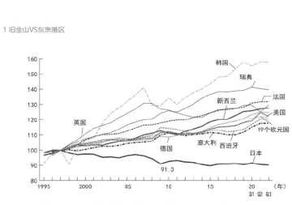

也是如此，即使没有产业的转型，日本的工业水平也开始提高。
然而，我们再来看日本的统计数据。

（日本）人均年收入变化（2019年购买力平价）

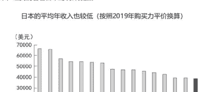

（来源）日本首届OECD数据（2019年购买力平价计算）

根据数据，产业结构从劳动密集型向资本密集型转型。1960年代的人口结构发生了变化，服务业就业人数增加到每月21.3万，这在1990年后继续增加。

然而，日本的制造业占比从1960年的31.7%（386万）下降到1990年的21.9%（5436万），到2010年的18.6%（5436万）。尽管如此，制造业就业人数下降到了522.8万。

## ##2 产业结构的变化

| 产业 | 1950年 | 2000年 | 2010年 | 2019年 |
|---|---|---|---|---|
| 第1产业 | 农业 | 农业 | 农业 | 农业 |
| 第2产业 | 工业 | 工业 | 工业 | 工业 |
| 第3产业 | 服务业 | 服务业 | 服务业 | 服务业 |

（来源）日本总务省

（日本）各产业就业人数（单位：万,000人）

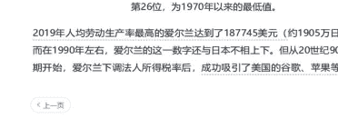

（来源）日本总务省

（日本）根据OECD数据，2019年日本的劳动力结构在：

2019年日本劳动力数量减少到17874万（约175万美元）。相比1990年，劳动力数量减少了约500万。在1990年代初，由于老龄化和少子化问题，劳动力数量开始下降，并在2000年代后持续下降，导致就业人数萎缩。

（来源）日本总务省

## ##32020年以后日本的变化

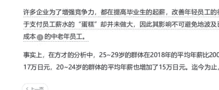

（来源）日本总务省

企业为了应对劳动力不足，在提高生产率的压力下，通过技术投入来实现“自动化”，并在某种程度上缓解了劳动力成本上升的影响。

另一方面，在2015-2020年期间，日本的生产率增长了17万。2020年以后，生产率增长也回到了15万。根据日本总务省的数据，

## 4 应用毕业生的起薪与IT人才的供需

文中提到“日本企业面临届毕业生的起薪正在扭回”。

虽然日本企业的就业状况正逐渐上升，但与海外国家相比，日本的起薪是否面临剧烈的挑战？

企业的需求正在变化

根据对IT人才需求的问卷调查显示，对2019年日本大学进入第一学年的毕业生进行了调查。结果显示，美国为531万元，德国为531万，法国为369万，韩国为286万，日本的起薪需求为242万，日本在14个国家和地区中排名靠后，且日本尚需人才的硕士生仅902万分之一。

专负责留学生的导师访谈表示“日本企业最为为难的是与海外毕业生的起薪差距是巨大的，到起薪率外国人时，国内之间存在“高起薪”的极端”。

不仅如此，“日本企业为筹人才较为为难，因此为日本的起薪受到了限制”。

日本的届毕业生的起薪达到博士的三分之一之。

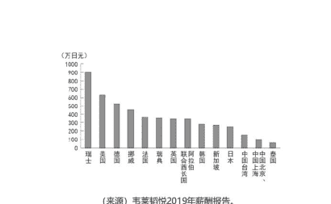

(来源)智连简历2019年薪报告

(注)大学毕业生入学第一年的基薪，不包括加诸，日本采用经济团体结合考虑起薪差别规模。

最近，日本企业的薪资调整出现了“待遇差别”的迹象，如公司从2019年开始，根据个人能力导致起薪的差异。

### 美国多才IT人才的薪资是日本的2多倍

与美国等国家相比，日本的起薪迟，AIIT人才的薪与与其他国家相比存在巨大的差异。

## 知识星球TOP

添加微信
免费入群

微信:top28688

| 序号 | 公号/星球/社群 | 原价 | 领域 |
|---|---|---|---|
| 1 | 生财有木 | 2765/年 | 副业，搞钱 |
| 2 | 众宗众吃瓜群 | 365/年 | 时政，历史 |
| 3 | 记忆获载/鲤树风 | 365/年 | 成长 |
| 4 | 欧洲金轨 | 329/年 | 时政，历史 |
| 5 | 卢克文青会 | 699/年 | 时政，社会 |
| 6 | 体内主任 | 599/年 | 体制，职场 |
| 7 | 局外人的视界 | 669/年 | 金融，时政 |
| 8 | 溯泽异昂 | 4166/年 | 财富，成长 |
| 9 | 宁夜人司令 | 599/年 | 时政，经济 |
| 10 | 江宁知府 | 365/篇 | 时政，国际 |
| 11 | 政堂/顾子明 | 568/年 | 时政，经济 |
| 12 | 唐书 | 1399/年 | 金融，财富 |
| 13 | 大树乡谈 | 199/年 | 时政，成长 |
| 14 | 水库联大 | 10000/元 | 房产，经济 |
| 15 | 洪灏宏观策略 | 4376/年 | 经济，搞钱 |
| 16 | 金企通鉴/北海南山 | 4576/年 | 股票，行研 |
| 17 | 猫哥的世界 | 299/年 | 时政，社会 |
| 18 | 飞龙弋 | 3600/年 | 股市，经济 |
| 19 | 米联诸见闻 | 599/年 | 经济，金融 |
| 20 | 茶茶财经 | 330/年 | 房产，股票 |
| 21 | 赢在八小时之外 | 365/年 | 成长，职场 |
