# 南百联购财经251206

## 中银: 解释直供房屋与法拍的区域

自有数据统计，2019年至2025年1月累计直供房屋挂牌成交量5.2万套，但是对比法拍拍卖，累计挂牌数有8万万，直供房屋的挂牌成交量远不及法拍房的八十分之一。

2025年1月挂牌的直供房屋成交占比5%，普通住宅占比95%#全线

## 中银证券

解释直供房屋与法拍房屋的区别：

- 1. 权利清晰：与债权拍卖相比，直供房屋在产权上更为清晰。法拍房在拍卖前仍有产权争议风险，通过法律规定强制执行权转移产权。法拍房的产权已转入银行名，产权清晰。

- 2. 成交透明：直供房屋成交价格优于法拍。根据中银统计，2025年1月至5月直供房屋成交价8319万元（成交价平均名为成交价）为22.5%，由于法拍房屋可能挂牌与市场价同为期，实际上我们通过回溯北京房产成交的银行直供房屋发现，

- 2025年1月至5月直供房屋，我们的平均成交价为3754万元，挂牌溢价高达7%。直供房屋在市场上占比仅15%-30%，而法拍拍卖或银行直拍房屋在市场占比55%-80%。

同期银行直供房屋成交价格优势，一方面是由于区域分布不均，2025年1月至六月成交量，二线城市占比47%。对于银行直供房屋（直供），二线城市占比16%，另一方面

- 3. 交易简单：银行直供的买卖主要通过银行进行，无需参与拍卖或房屋中介，交易更加快捷、方便。

- 4. 风险低：由于直供房屋在查勘前产权清晰，可能产生房屋质量瑕疵、违约纠纷，购房人按照提示就规避了风险，风险低。银行直供房屋的产权属性清晰，可能不会产生纠纷，银行的购房流程的完善，成交后产生纠纷的概率较低。

不需要注意的是，带有线上挂拍卖的“直供房屋”并不是法上定义的“直供房屋”，可能存在“债权转押”问题，“债权转押”和“债权资产”是完全不同的，部分直供房屋的标的是以抵押为抵押物，而非资产产生。到期后风险包括但不限于“无法办理房屋过户变更”等风险。

加入微信102888，进资料分析

## 图 3 银行直供房与法拍房

| 区别 | | |
|---|---|---|
| 产权影响 | 产权归属银行，产权清晰。 | 在资产负债人拍卖期间，通过司法强制执行产权严格。 |
| 成交价格 | 25年1-10月，银行直供房的成交价均为374万元/套，溢价多在市场价10%-30%的区间内，因此成交价远高于市场价25%左右。 | 25年1-10月法拍房（住宅）成交价为839万元/套，成交溢价（1-成交价/市场价）为22.5%，由于法拍房可能面临缴费及风险等，实际成本可能高于其。 |
| 购买阶段 | 平均成交价高于法拍房。银行直供房的主要优势是能够提供后续贷款，手续简单。交易流程涉及两次交易，通常可以按需办理。 | 法拍房的购买渠道主要为司法拍柜平台、法院官网及地方法院法拍若干渠道。 |
| 风险可控性 | 行风险经营，无资金压力，风险仅在于房屋可能存在回款风险。 | 抛风险、大费风险。 |

## 中银证券

- 近年来银行直供房的规模有所上升的主要原因在于：
1) 起此下行情期间，银行不良贷款压力增加。
2) 债券回笼困难，变现慢。传统处置方式（如司法拍卖）周期长、成本高，直接销售可以更快变，提升资金使用效率。
3) 法拍市场活跃。2022年以来法拍房流占比（1-成交数据/相应数量）明显走高，2024年三季度达到峰值86.0%，2025年三季度为81.3%。

## 图 7 2022年以来全国法拍房流占比明显走高

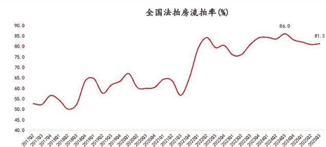

资料来源：中信，中银报告
备注：法拍房占比（1-成交数据/相应数量）

微信top28688，进资分享群

从银行角度，截至2025年11月12日，35银行挂牌在售的“直供房”共计253万套，其中大银行占比28%，城行占比40%。具体2025年1月12日，挂牌在售的房产总量253万套，中国大银行占比28%，全国性银行占比40%，农村银行占比14%。

## 表 1 2025-12-06 风险

| 金融资产 | 时间区间 | 股票 | 债券 | 现金 | 总体表现 |
|---|---|---|---|---|
| 上行 | 2005-2006 | 2.44 | 1.55 | 1.88 | 股票>商品>现金 |
| | 2007-2009 | -0.62 | -2.28 | 2.12 | |
| | 2009-2013 | 1.64 | -1.50 | 3.18 | |
| | 2015-2017 | 0.85 | -1.54 | 0.48 | |
| | 2020-2022 | -0.29 | 1.73 | -1.72 | |
| 上行 | 2006-2008 | 5.31 | -1.89 | 3.04 | 股票>商品>现金 |
| | 2020-2021 | 1.88 | -2.87 | 5.15 | 股票>债券>现金 |
| 上行 | 未此情况 | | | | |
| 上行 | 未此情况 | | | | |
| 下行 | 2019-2021 | 1.83 | -1.23 | -0.50 | 股票>商品>现金 |
| | 2025-2028 | 3.03 | -1.77 | 0.55 | |
| | 2002-2008 | -1.55 | -1.14 | 0.31 | |
| | 2010-2014 | -0.17 | -1.15 | 2.17 | |
| 下行 | 2017-2019 | 0.02 | -3.45 | 0.77 | 股票>商品>债券 |
| | 2021-2023 | 0.49 | 1.04 | 2.83 | |
| | 2022-2025 | 1.40 | 0.68 | -3.34 | |
| | 2008-2009 | 7.89 | 0.45 | -2.36 | |
| | 2012-2016 | -0.06 | -2.28 | -0.54 | |
| | 2014-2016 | 1.88 | 3.71 | -0.29 | 债券>股票>现金>商品 |
| 下行 | 2015-2016 | -0.60 | 1.02 | -0.34 | |
| | 2018-2023 | -2.31 | 1.97 | -1.89 | |
| | 2021-2023 | -0.31 | -0.35 | -0.68 | |
| | 2024-2025 | 1.63 | 2.06 | 0.44 | |
| | 2008-2010 | -2.78 | 4.63 | -3.08 | |
| | 2011-2015 | -1.00 | -0.27 | -1.97 | |

## 表 1 中国需求预测表

| 项目 | 2050年（基准） | 2050年（中性） | 2050年（乐观） |
|---|---|---|---|
| 人口（亿人） | 12.00 | 12.60 | 12.80 |
| 城镇化率 | 75% | 80% | 85% |
| 城市人口（亿人） | 9.00 | 10.08 | 10.88 |
| 人均人数 | 2.00 | 2.00 | 2.00 |
| 城市户（亿户） | 4.50 | 5.04 | 5.44 |
| 住房面积 | 1.14 | 1.14 | 1.14 |
| 广义更新率 | 120% | 120% | 120% |
| 更新需求（万吨） | 615.60 | 689.47 | 744.19 |
| 市场化率 | 60% | 70% | 80% |
| 保险率 | 40% | 30% | 20% |
| 市场需求（万吨） | 369.36 | 482.63 | 595.35 |

注：1.上述数据为预测数据；2.以上数据涉及预测数据，相关结论见本报告
数据来源：行业模型分类与处理

根据上述中性预测，2050年我国住房更新需求为890万吨，中国市场化需求为483万吨，对应商品需求规模为4.83亿吨，2024年国内需求规模为74亿吨，相比，2050年总需求仍有点下滑。需要注意的是，本预测涉及多个建模，测算结果仅供参考。从趋势来看，我国商品市场面临巨大压力，房地产执行率受制影响，商品需求规模可能需要进一步增大。

Jason-down
2025-12-06 02:44:26

财经：我们基于构建的实体经济周期指数与金融指标关系解释经济、金融周期，构建八阶段定义标准：实体经济周期指数用于解释经济处于上周期还是下周期，反映内在增长逻辑。该指数能够领先上周期转向下周期，金融指标通过流动性压力对市场价格进行调节，结合金融泡沫的波动，解释周期状态：周期强化、收敛、强化、收缩。通过两个维度的解释，波动为八个阶段，提供了很好的选择。基于上述标准，2005年起至2025年预测。使用AID指数、中债关系代表周期及三类复合效果（受政策驱动资金供给影响）并并行处理，数据显示显示，我们对不同周期的逻辑遵循演变。例如，“经济+收缩周期（2005-2006.5）”在领先上周期转向下周期时表现，“股票>商品”呈现典型特征；例如，“经济+收缩周期（2014年二季度）”受流动性驱动下周期，期货、债券表现出“债券>商品”特征。然而，在2019年半年，2020年2月-8月，逻辑变为“经济+收缩周期（如2010年4月-2017年2月）”，理论上表现为“债券>商品”，实际表现为“现金>商品”。

## 联合投资：主购房群体（26-35岁）规模逐步下降，未来房地产需求最大的利空因素

##房产

- 1. 主购房群体步入下降通道，未来房地产需求最大的利空因素

2020年以来第七次全国人口普查结果结合多年人口数据显示，我国人口在2022年减少1408万，2023年又减少2082万。我国人口进入持续下降通道，预计2024年将为14.0亿。由于我国人口结构发生变化，出生率将呈现显著的特征。据我们预测，我国人口在未来30年内将呈现下降趋势；与此同时，老龄化进程加剧，劳动力人口下降，青年人口与老年人口比例下降13%。到2050年，我国人口可能约剩12.6亿，老龄化率接近22%。尽管努力推行改革政策可能在一定程度上缓解人口结构性矛盾，但从长期来看无法改变我国人口下降的长期趋势。

从主购房群体（26-35岁）规模来看，从2015年、2020年和2025年来看，未来人口数量分别为22.13亿、21.6亿和16.67亿，预计到2050年将下降至12.6亿，由于出生率持续下降，由于新生婴儿数量自2020年起快速下降通道，2050年后主购房群体将收缩，进一步下降0.82亿。

加微信top28688，进资料群

### （一）实体经济周期指数(RECI): 经济运行的量化标准

实体经济周期指数(RECI）是一个合成指数，旨在捕捉经济的内在运行趋势，其方向往往反映了经济运行的强弱：当RECI指数处于增长时，表明工业生产、消费与投资等内生增长动力维持扩张，对经济运行上行供给；反之，若RECI指数下降，则意味着景气衰退，企业收入进入收缩期（如图1）。

图 1：实体经济周期指数

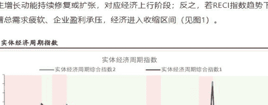

资料来源：财新研究所

### （二）金融条件指数(FCI): 金融紧张度与变化的量化标准

金融条件指数（FCI）通过综合利率、信用、资产价格及汇率等关键变量，旨在衡量金融环境的松紧度。FCI以“绝对水平-斜率”为基准构建值评估体系，精准刻画流动性边际变化：FCI > 0，代表金融环境处于紧缩区；若斜率为正，则为领先强化，表现为融资成本抬升，信用扩张与风险资产估值压缩；若斜率为负，则为领先收缩，缓解融资压力得到边际释放；FCI < 0，代表金融环境处于宽松区；若斜率为负，则为领先紧缩，伴随利率下降与市场流动性充裕；若斜率为正，则为领先宽松，意味着景气力度在衰减，此时市场或未转向收缩（如图2）。

图 2：金融条件指数

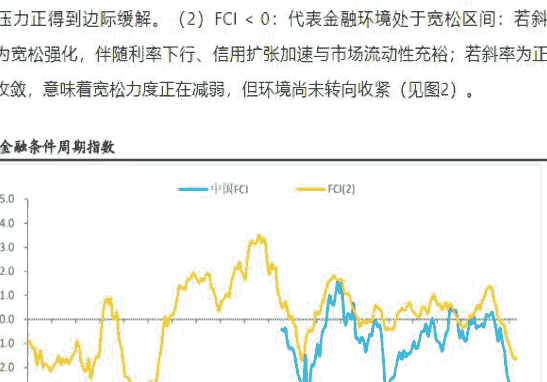

资料来源：财新研究所

### (三)基于RECI和FCI指数的宏观八阶段划分

基于上述两个指数的方向与状态组合，我们将宏观经济运行和金融环境划分为八个典型的阶段：

- (1) RECI上行，FCI<0斜率为负：经济上行+金融宽松强化阶段
- (2) RECI上行，FCI<0斜率为正：经济上行+金融松收阶段
- (3) RECI上行，FCI>0斜率为负：经济上行+金融收缩阶段
- (4) RECI下行，FCI>0斜率为负：经济下行+金融紧缩阶段
- (5) RECI下行，FCI<0斜率为负：经济下行+金融宽松强化阶段
- (6) RECI下行，FCI<0斜率为正：经济下行+金融收缩阶段
- (7) RECI下行，FCI>0斜率为正：经济下行+金融紧缩阶段
- (8) RECI下行，FCI<0斜率为正：经济下行+金融收缩阶段

> 华孝：此前我国消费与收入多年呈现周期性相关关系，是消费作为经济基石的结果。但是，2020年之后，我国消费开始向收入呈现出正相关关系，即出现周期性。一个重要的原因是，消费向收入开始出现周期性，说明收入预期成为消费的驱动动力，消费增长等问题的关键。由于收入预期可以驱动消费周期性，需求在我国这确实是唯一的。过去几年，我国整体处于“脆弱”状态，后续还需要在需求提高、收入增加、调整消费结构等等方面付出多加努力。
>
> 转移收入方面，我国的居民转移收入与支出存在显著差异。整体财政收支稳。此前侧重点于投资，居民支出由政府规定，使得转移收入还有待提高。2020年以来，我国居民可支配收入在周期中呈现下行趋势。随着工资收入、经营性收入、财产收入和转移收入增加，对整体增速下降。对财产收入增加，从而导致驱动上工资收入拖累最多。工资收入主要受到企业经营和利润的驱动，反映了价格和利润的影响。经营，工资收入和需求需要更多。

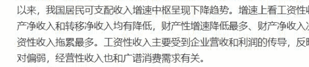

### 图1:人均GDP与家庭消费占比
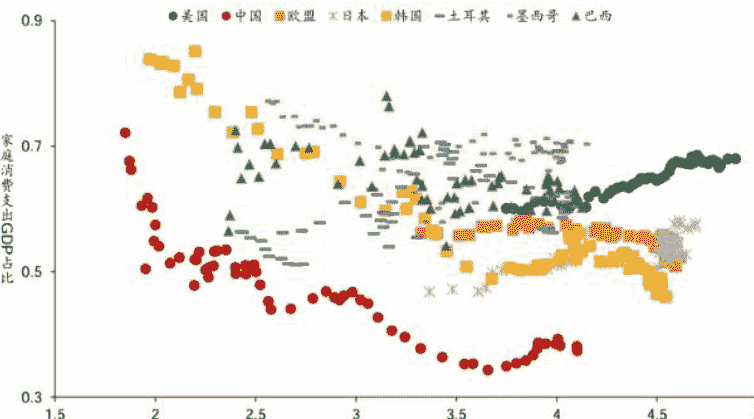
数据来源：Wind, 平安财经

### 图17: 中国人均消费与家庭消费支出增长趋势
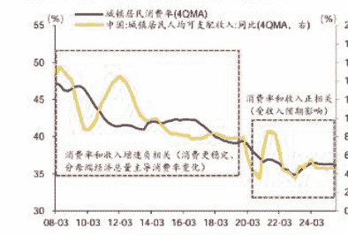
数据来源：Wind, 平安财经

### 图18: 美国人均消费与家庭消费增长趋势
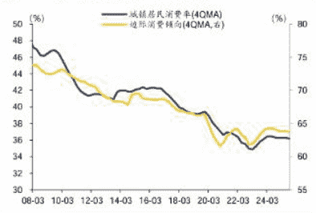
数据来源：Wind, 平安财经

### 图27: 中国居民可支配收入变动趋势
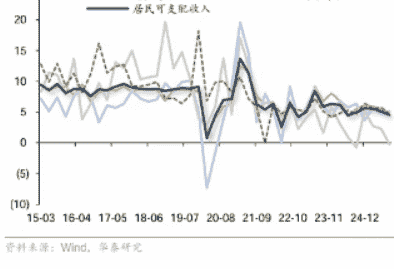
数据来源：Wind, 平安财经

### 图28: 美国人均消费与家庭支出增长趋势
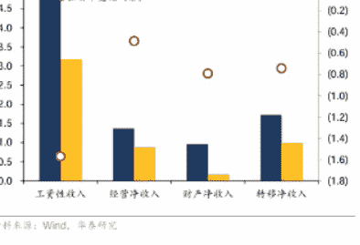
数据来源：Wind, 平安财经

### 图29：企业领先于收入
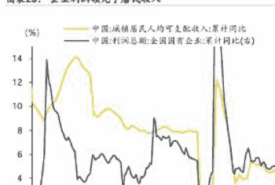
数据来源：Wind, 平安财经

### 图30：PPI同比：2025年10
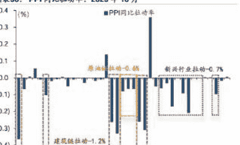
数据来源：Wind, 平安财经

### 图31：中美贸易出口增速
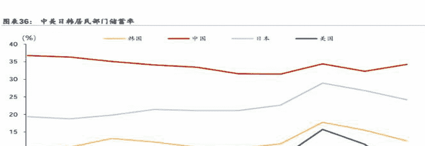
数据来源：Wind, 平安财经

### 图23: NDF 掉期
### 图24: 调整后的 NDF 掉期

| 欧元/美元 | NDF汇率 (基点) | 欧元/美元 (汇率) | NDF汇率 (基点) |
|---|---|---|---|
| 1.24 | -38.5 | 1.18 | -35.5 |
| 1.23 | -37.0 | 1.17 | -34.0 |
| 1.22 | -35.5 | 1.16 | -32.5 |
| 1.21 | -34.0 | 1.15 | -31.0 |
| 1.20 | -32.5 | 1.14 | -29.5 |
| 1.19 | -31.0 | 1.13 | -28.0 |
| 1.18 | -29.5 | 1.12 | -26.5 |
| 1.17 | -28.0 | 1.11 | -25.0 |
| 1.16 | -26.5 | 1.10 | -23.5 |
| 1.15 | -25.0 | 1.09 | -22.0 |

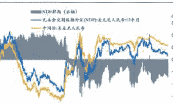
数据来源：Wind, 证券研究所

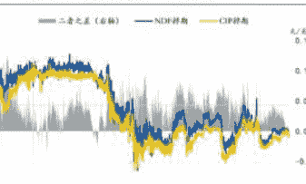
数据来源：Wind, 证券研究所

### 图 25: COMEX 金价汇率对比

| 美元/美元 (汇率) | 金价 (美元/吨) | 美元/欧元 (汇率) | 金价 (美元/吨) |
|---|---|---|---|
| 0.95 | 1950 | 0.88 | 58000 |
| 0.96 | 1960 | 0.87 | 49000 |
| 0.97 | 1970 | 0.86 | 50000 |
| 0.98 | 1980 | 0.85 | 51000 |
| 0.99 | 1990 | 0.84 | 52000 |
| 1.00 | 2000 | 0.83 | 53000 |
| 1.01 | 2010 | 0.82 | 54000 |
| 1.02 | 2020 | 0.81 | 55000 |
| 1.03 | 2030 | 0.80 | 56000 |
| 1.04 | 2040 | 0.79 | 57000 |

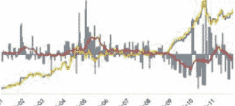
数据来源：Wind, 证券研究所

### 图 26: COMEX 金价汇率对比

| 美元/美元 (汇率) | 金价 (美元/吨) | 美元/欧元 (汇率) | 金价 (美元/吨) |
|---|---|---|---|
| 0.85 | 1850 | 0.95 | 48000 |
| 0.86 | 1860 | 0.94 | 49000 |
| 0.87 | 1870 | 0.93 | 50000 |
| 0.88 | 1880 | 0.92 | 51000 |
| 0.89 | 1890 | 0.91 | 52000 |
| 0.90 | 1900 | 0.90 | 53000 |
| 0.91 | 1910 | 0.89 | 54000 |
| 0.92 | 1920 | 0.88 | 55000 |
| 0.93 | 1930 | 0.87 | 56000 |
| 0.94 | 1940 | 0.86 | 57000 |

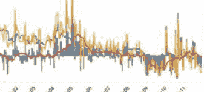
数据来源：Wind, 证券研究所

> JPM: 三季度中国的改善有望进入四季度后延续，但数据依然分化。计划中的万亿元资金尚未落地，四季度发力的可能推迟到2026年。房地产未底，不会规模刺激。人民币压力缓慢，季节性结汇支撑。消费仍偏弱，缺乏动力。改善是短期。

### House prices (Nov)

NBS 70 cities -0.11% in September, with 0.45% in October, which slowed down in September, with sharper declines in tier-1 and tier-2 cities, reaching -0.64% in September. House prices have fallen from the 2021 peak along with a 20.2% fall in secondary prices. House prices saw the largest decline this year in primary markets. Deployed a marked spiral of continued pressure

| NBS 70 cities-Large-medium secondary prices |
| Month | Primary | Secondary |
|---|---|---|
| Oct 23 | 9.0 | 6.0 |
| Nov 23 | 7.0 | 5.7 |
| Dec 23 | 6.7 | 5.3 |
| Jan 24 | 6.0 | 5.7 |
| Feb 24 | 5.8 | 5.3 |
| Mar 24 | 5.8 | 5.1 |
| Apr 24 | 4.3 | 4.1 |
| May 24 | 7.5 | 5.7 |
| Jun 24 | 7.0 | 5.0 |
| Jul 24 | 8.5 | 5.7 |
| Aug 24 | 8.7 | 5.6 |
| Sep 24 | 9.0 | 7.1 |
| Oct 24 | 9.3 | 6.6 |

### Housing activity (Nov)

JPM's housing activity index fell to the lowest level since Q3 last year, with most indicators near record.

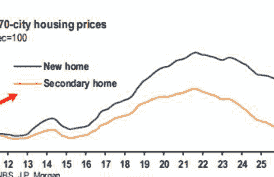
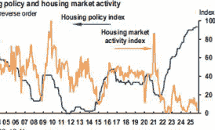
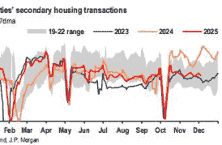

### Key economic statistics

| 2024 Real GDP, LPS, CPI |
| Month | Real GDP | LPS | CPI |
|---|---|---|---|
| China | 4.8 | 0.5 | 0.3 |
| Hong Kong | 3.3 | 2.1 | 1.9 |
| Taiwan | 3.2 | 2.2 | 1.7 |
| Korea | 3.3 | 2.5 | 1.9 |
| Japan | 4.0 | 1.4 | 2.3 |

| Industrial production |
| Month | Production | Sales |
|---|---|---|
| China | 4.5 | 4.4 |
| Hong Kong | 4.7 | 4.6 |
| Taiwan | 5.3 | 5.3 |
| Korea | 6.1 | 5.5 |
| Japan | 7.7 | 8.2 |

| Government finance |
| Month | Revenue | Balance |
|---|---|---|
| China | -2.5 | -2.5 |
| Hong Kong | -1.5 | -1.5 |
| Taiwan | -1.2 | -1.2 |
| Korea | -0.8 | -0.8 |
| Japan | -0.3 | -0.3 |

| Real GDP, over year |
| Month | China | HK | Taiwan | Korea | India |
|---|---|---|---|---|---|
| Jan | 4.9 | 4.4 | 4.7 | 4.6 | 5.2 | 4.1 |
| Feb | 5.3 | 4.7 | 4.7 | 4.7 | 8.7 | 7.2 |
| Mar | 7.2 | 4.5 | 5.3 | 6.1 | 7.7 | 8.2 |
| Apr | 6.6 | 4.4 | 5.3 | 5.5 | 6.3 | 6.0 |
| May | 5.0 | 4.8 | 5.4 | 5.8 | 6.1 | 6.8 |
| Jun | 5.0 | 1.4 | 1.8 | 1.6 | 1.8 | 1.0 |
| Jul | 4.9 | 1.2 | 1.7 | 1.1 | 2.9 | 3.2 |
| Aug | 4.4 | 0.9 | 0.8 | 0.9 | 0.3 | 3.8 |

| Consumer prices, year on year |
| Month | China | HK | Taiwan | Korea | Japan | India |
|---|---|---|---|---|---|---|
| Jan | 0.7 | 2.4 | 1.4 | 1.6 | 1.1 | 1.3 |
| Feb | 0.7 | 2.4 | 1.4 | 1.6 | 1.3 | 1.3 |
| Mar | 0.7 | 2.8 | 3.0 | 2.7 | 2.7 | 2.9 |
| Apr | 0.3 | 2.7 | 2.7 | 2.8 | 2.9 | 3.1 |
| May | 0.2 | 0.9 | 2.5 | 1.3 | 2.5 | 2.8 |
| Jun | 0.2 | 1.1 | 2.4 | 2.6 | 2.8 | 3.5 |
| Jul | 0.1 | 1.9 | 1.7 | 1.1 | 2.9 | 3.2 |
| Aug | 0.4 | 0.2 | 0.1 | 0.9 | 0.3 | 3.8 |

| Official interest rates, p.c. |
| Month | China | HK | Taiwan | Korea | Japan | India |
|---|---|---|---|---|---|---|
| Jan | 3.0 | 4.75 | 3.5 | 3.5 | 0.25 | 6.75 |
| Feb | 3.0 | 4.75 | 3.5 | 3.5 | 0.25 | 6.75 |
| Mar | 3.0 | 4.75 | 3.5 | 3.5 | 0.25 | 6.75 |
| Apr | 3.0 | 4.75 | 3.5 | 3.5 | 0.25 | 6.75 |
| May | 3.0 | 4.75 | 3.5 | 3.5 | 0.25 | 6.75 |
| Jun | 3.0 | 4.75 | 3.5 | 3.5 | 0.25 | 6.75 |
| Jul | 3.0 | 4.75 | 3.5 | 3.5 | 0.25 | 6.75 |
| Aug | 3.0 | 4.75 | 3.5 | 3.5 | 0.25 | 6.75 |

| Exchange rates |
| Month | China | HK | Taiwan | Korea | Japan | India |
|---|---|---|---|---|---|---|
| Jan | 7.18 | 7.10 | 7.28 | 7.26 | 7.12 | 7.19 |
| Feb | 7.19 | 7.10 | 7.28 | 7.26 | 7.12 | 7.19 |
| Mar | 7.19 | 7.10 | 7.28 | 7.26 | 7.12 | 7.19 |
| Apr | 7.19 | 7.10 | 7.28 | 7.26 | 7.12 | 7.19 |
| May | 7.19 | 7.10 | 7.28 | 7.26 | 7.12 | 7.19 |
| Jun | 7.19 | 7.10 | 7.28 | 7.26 | 7.12 | 7.19 |
| Jul | 7.19 | 7.10 | 7.28 | 7.26 | 7.12 | 7.19 |
| Aug | 7.19 | 7.10 | 7.28 | 7.26 | 7.12 | 7.19 |

### Jason-陌

2025-12-06 04:54

### 方正：零售市场聚焦科技股的泡沫风险此起彼伏

但对比2000年网络泡沫经验，当前期：科技股泡沫风险相对较低，较科技股泡沫规模加剧和金融条件收紧，当2026年美股泡沫率仍处于高位，很大程度引起了1999年6月到2000年5月，美股对美国经济的影响极其严重，累计增加175BP，货币政策一方面对美国经济明缓，另一方面对市值带来压力。而当美股底部目标仍然稳定市场，按市场预期，到2026年或仍有75BP下降空间，货币政策总体偏宽松，如2026年《大美法案》落地，美国经济泡沫的风险可能对股市带来冲击。

### 美股

从美国资产的质量来看，情况显示，美国股市泡沫的如此热化，从夏天结束至今，科技股泡沫更多和美股市的差异。从历史经验，在网络泡沫以及9·11事件的背景下，美国股市在2000-2001年明涨反跌，基于历史结束调整，此为美股开始从2001年进入低迷周期，基金利率目标为6.5%1%。

在货币政策大美法案实施后，美股并未获得较好收益。对于科技股来说，其市值已经接近90年代末水平，美股市经历调整，意味着美股和美国经济的压力持续下，意味着美股的价格再次跌破。

17

请关注后续特别声明与免责条款

### 方正证券 FANGZ SECURITIES 正在您的身边

图26:2020年以来的美股组合收益系数

| 年份 | 美国 | 德国 | 英国 | 法国 | 西班牙 | 瑞士 | 意大利 | 瑞典 | 欧洲 | 电子产品 | 其它 |
|---|---|---|---|---|---|---|---|---|---|---|---|
| 1990 | 5.7% | 4.8% | 4.7% | 3.4% | 1.0% | 3.2% | 3.9% | 11.9% | 7.3% | 8.2% | -0.3% |
| 1991 | 14.8% | 8.2% | 6.2% | 5.1% | 5.5% | 0.0% | 0.7% | 15.8% | 9.1% | -0.5% | -0.7% |
| 1992 | 11.2% | 11.7% | 11.7% | 3.0% | 2.7% | 8.1% | 0.5% | 5.4% | 4.0% | 6.6% | -10% |
| 1993 | 9.2% | 2.9% | 2.1% | 3.0% | 1.6% | 0.8% | 1.3% | 2.0% | 2.2% | 6.5% | 0.3% |
| 1994 | 18.9% | 16.9% | 14.8% | 10.0% | 6.0% | 7.9% | 7.2% | 13.9% | 11.5% | 10.3% | 1.2% |
| 1995 | 31.7% | 23.8% | 19.7% | 18.2% | 13.0% | 10.3% | 10.7% | 20.3% | 18.2% | 15.8% | 2.2% |
| 1996 | 22.3% | 16.2% | 14.4% | 12.8% | 9.5% | 8.0% | 8.9% | 11.7% | 12.7% | 11.5% | 3.1% |
| 1997 | 29.5% | 10.3% | 10.1% | 6.6% | 4.8% | 6.7% | 10.2% | 10.4% | 7.4% | 6.3% | 9.8% |
| 1998 | 27.5% | 15.5% | 15.4% | 13.8% | 11.8% | 14.8% | 12.8% | 11.0% | 11.7% | 11.7% | 5.0% |
| 1999 | 36.2% | 24.7% | 26.2% | 16.5% | 14.0% | 16.3% | 14.0% | 27.7% | 24.5% | 20.3% | 8.2% |
| 2000 | -0.1% | 1.0% | 4.0% | 7.9% | 6.8% | 14.0% | 4.7% | 11.9% | 14.5% | 14.0% | 8.5% |
| 2001 | -23.1% | -11.2% | -11.2% | -11.2% | -10.3% | -10.3% | -10.3% | -13.3% | -9.8% | -9.0% | -15.0% |
| 2002 | 12.6% | 6.1% | 5.0% | 0.2% | -0.7% | -0.5% | -0.9% | 0.9% | 6.9% | 3.0% | - |
| 2003 | 2.0% | 8.1% | 5.1% | 5.4% | 4.8% | 4.1% | 3.2% | 2.1% | 3.4% | 2.6% | 1.0% |

数据来源：FRED, Bloomberg, Ocampo(2003), 方正证券研究所

### 美股泡沫持续热

长期以来，AI驱动下美股泡沫持续，导致美股估值水位和市值集中。“AI军备竞赛”科技巨头的资本开支大幅提升，但财务可持续性受挑战。

### 科技股泡沫破灭

分行业看，科技指领先者，其超额收益明显；从大类视角看，黄金和价值属性最佳。

当科技股在泡沫中的应对策略：
- 配置指数：道指占比和市值相对较高，在风险中对冲，纳斯达克胜率较高。
- 配置小型股：2020年泡沫优于大盘，且小型股估值处于底部。
- 配置消费、医药：从行业视角来看，美股泡沫结束，但消费等板块的机会出现。若科技股泡沫破裂，可能会，导致通胀风险从险性转向中性，股市、货币与黄金齐涨；
- 防抗风险。
- 配置新兴市场：蓝筹端落后，新兴市场估值优于。
- 配置黄金：若科技股泡沫调整，意味着美股和经济压力增大。展望2026年，科技股泡沫风险相对较低，但更均衡的必要性在上升。

Jason 2025-12-06

## 南：K型背离是否在财风险

## 南

### 摘要

关于大资产K型资产——长期以来的定价模式：这种传统的定价逻辑失败，市场对表现出的“K型资产”特质要求持续。这些现象表明，旧的经济驱动模式已被打破。

大资产K型资产的重心转移。基于利率，长期以来的黄金与利率的利差高达660bp，这一极端揭示了市场逻辑：对通胀风险的定价主要通过黄金的上涨来实现，而非股权溢价来实现。黄金溢价实际上反映了实际利率的下跌，而其价值相反，对通胀风险的敏感度与股票相同。

K型资产可能的未来路径：
- 路径一：“通胀与复苏的过渡期”，市场或黄金资产在扩张中维持着脱钩增长；
- 路径二：“脱钩失效”引发的政治转向（如“能力焦虑”下的财政扩张），导致通胀风险从性转向中性，股市、货币与黄金齐涨；
- 路径三：“流动出清”，就业化进程可能类似于此前迷的流动性宽松，但流动性属性的前景将限制其下行。

此外，引入“相对风险”变量，非经济体更易暴露的财政压力反而支撑了美元的结构性强势。最后，这些差异并非迥异，短期还是相对绝对的情形，但长期需要在中进行观察。

### 模型出的偏差

通过上述模型的构建，我们其实可以发现利率、铜、金之间的关系。利率可以解释为BEI+TIPS，而TIPS可以视为黄金的函数，所以利率与黄金比例之间的相关性，实际反映的是铜、金之间的映射，可以说是：

利率 = BEI+ TIPS = g(金-铜)

使用金属作为基准限制了范围，直接将铜和金做1:1来解释是非常不精确的。如果我们愿意考虑这个角度，将利率拆分回到铜和金并将结果得到金属含利率，铜与黄金含利率之间的偏差就是可能的：

表 5: BEI TIPS 模型

| 变量 | 铜 | 金 | 当值 | 偏差 |
| --- | --- | --- | --- | --- |
| BEI | | 0.02% | 0.677 | 2.28 | -59% |
| TIPS | | -0.20% | 0.799 | 1.84 | -659% |

数据来源：Wind，尚需重新处理

所以模型可以写为：
利率(%)=BEI+TIPS=0.0002453*铜(美元/盎)-0.00196*金(美元/盎)=3.543

从这个角度出发理解，最近的美国通胀风险定价，是在黄金中定价的，而不是利率。利率含金的通胀风险定价，是黄金的极度拉升的，虽然这个过程中利率含金表现较高，其变量不符合的情况下，黄金每增加1美元，代表利率含率低。利率中的通胀风险高达660bp，铜与BEI的偏差为1.98%，22年出来黄金含量这么多，当然的。

### 黄金资产下的波动

市场已经通过对财政政策应对通胀，在这个过程中进行了事实调整。然而投资者更要关注利率调整预期，所以配置策略为核心，黄金资产中是“避险”。富实认为可以使用IPS模型作为基准。这个模型从低风险到高收益，并用IPS来衡量，给出了每一类资产结论：

表 6: IPS模型结果

| 资产 | 收益 | 夏普比例 | 最大回撤 | 组合收益 |
| --- | --- | --- | --- | --- |
| TIPS | -0.036 | 1.74 | 3.29 | 134.5 | 40.7 |

所以，我们把握配置策略的本质，就是配置这一变量，它决定了对数据的选择。使用IPS配置黄金比例提高到72%，在黄金资产宇宙中，对财政政策敏感的黄金表现是不合理的。

从一个角度来看，金价上涨4381元/盎带来了当前的现实变量，体系承受的风险一个锚抬升。通过对资产进行回归分析，我们发现大资产之间存在“双重一致”定价特征，清晰显示了风险是如何被吸收：

- 标底唯一的（4380）：黄金类资产。
- 标底和黄金（150）：以及10年期债对隐含收益率溢价为150%左右。这150%是一个典型的利率扩展成本（供给溢价），市场受到风险扩展成本（名义值），相同的“安全”。
- 核心压力：600bps，更深层次的分析显示，存在巨大的缺口。我们看到差异和隐含溢价不会消失，只能在虚拟市场上体现不同的形式，从一个载体到另一个载体，在不均衡的资产中转移。

大资产定价的K型资产几乎全部脱离，只能在溢价转移中实现资产部分的整合和部分大幅的转变。

Jason 2025-12-06 05:10

### 稀土价格上涨常态

日经：稀土价格上涨常态，瑞和储在提高用于电动汽车 (EV) 等电机的电磁铁耐热方面已不可忽视。作为半导体材料——锡的现状与稀土相似。美国地质局（USGS）的统计显示，截至2024年的中国产量占比99%。

### 稀土价格的上涨仍在持续（欧洲价格）

来源：英国阿格斯媒体

### 镓进入2025年以来涨势加强

来源：英国阿格斯媒体

## Jason

2025-12-06 05:12

FT: 对华尔街九家主要投行的调查平均预测，标普500指数将在2026年年底升至7500点以上，较当前水平涨约10%。

### Wall Street expects US stocks to continue rallying in 2026

S&P 500, dashed lines indicate forecasts

### Banks' 2026 forecasts forecast a slowdown in growth from recent years

S&P 500, annual growth (%)

| | Average (10%) | | |
| | Historic growth | Average (14%) |
|---|---|---|---|
| Deutsche Bank | 16.7 | 2016 | |
| Morgan Stanley | 13.8 | 2017 | 9.5 |
| UBS | 12.3 | 2018 | |
| JP Morgan | 9.4 | 2019 | 28.9 |
| HSBC | 9.4 | 2020 | |

## 日元贬值局下日本“逆进口”的汽车仍然增加

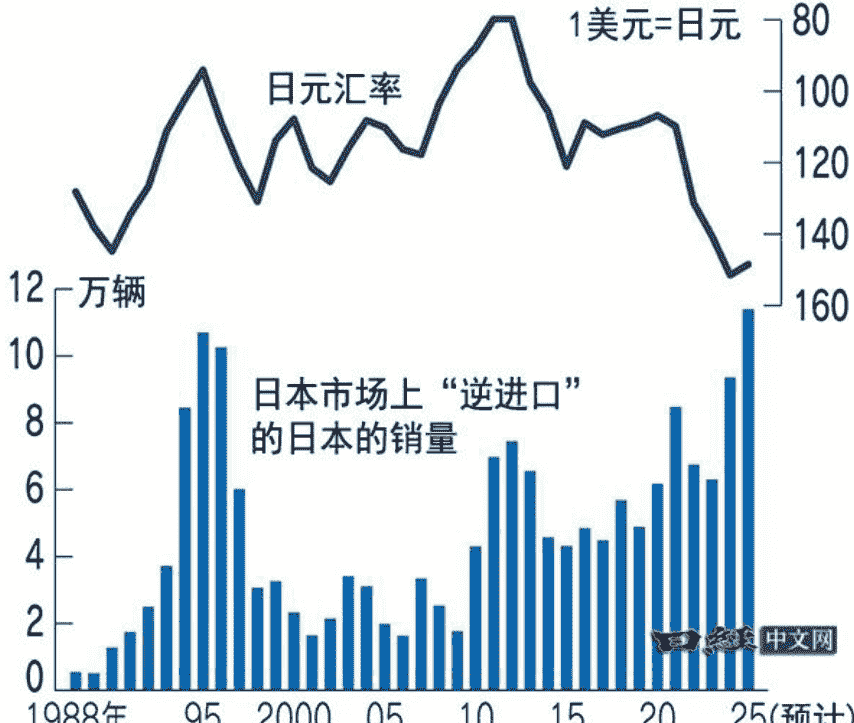

(数据来源)日本银行、日本汽车进口商协会

Jason不遇 加微信vip458 2025-06-06 05:27

摘要：2025年全球亿万豪创下新高，部分原因是科技公司估值升以及股价上涨。目前，全球有2,900亿富豪，掌握着15.8万亿美元的财富。而一年前，这一数字约为2,700亿，合计接近14万亿美元。我们对这14万亿富豪客户进行了访谈，结果显示，受访者认为在短期内仍是最佳投资的比例从年前的81%下降至63%；与此同时，投资吸引力在其他地区如西欧、中东地区和大中华地区以外的亚洲地区有所上升。在亚洲的亿万豪中，过去一年的担忧仍是首要关税；而在美国的亿万豪中，许多人最担心的是通胀或地缘风险。

# 加微信top28688，进资资料分享群

## New billionaires each year, globally

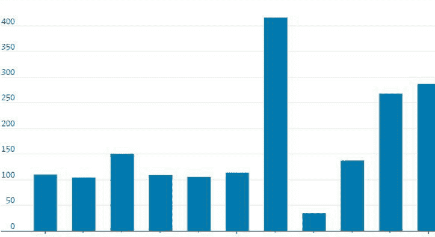

Note: Data are for 12-month periods ended in early April. April of each year
Source: UBS/PWC Billionaires Database and wealth assessment methodology

Jason-不离
2025-12-06 05:30

日经：日本综合研究所截至2025年11月公布的人口动态统计进行了估算。出生人数将延续至可比数据的1899年以来的最低水平。从2016年以来，日本的出生人数连续10年减少。日本的出生数与全球水平相比，为48.5万。年轻人的生育意愿极低，结了不孩子的夫妻正在增加其他家庭经济。

| 日本出生人数和结婚数的对比 | 万人 |
|---|---|
| 结婚数 | 65 |
| 出生数 | 55 |

## 日本出生人数和结婚数的走势

| | 万人 |
|---|---|
| | 65 |

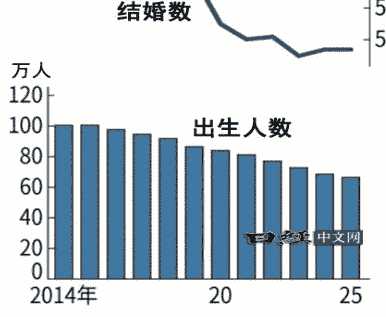

(数据来源)人口动态统计，2025年由日本综合研究所推算

# 微信信top28688，资讯资料共享

## Jason不驰

 2025-12-06 05:39:59

# 金管局：保险实收资本#A股

金融监管管理监督总局局司局负责人
《关于调整保险公司业务风险资本的通知（通告）》记者问会

近日，金融监管总局发布《关于调整保险公司业务风险资本的通知》（以下简称《通知》），有关负责负责人接受记者问会答记者：

- 一、调整背景是怎样的？

答：为防范风险，引导保险公司提高风险抵载能力，优化资产负债管理。更好地保障保险资金适用性，适应行业实际需要，通过科学监管引导行业健康发展，确保保险业可持续发展。

- 二、调整对行业整体市场是否有影响？

答：一是针对保险公司监管风险资本3000绝对数分成、中长期流动性100日数分成以及科创股权因子，根据市场情况进行了重新设置，以适应大型资本需求、科技创新需要。二是《通知》调整了保险公司出口保险资本，针对中国保险企业的海外业务风险资本，准备充足风险因子，确保保险公司能够开展外业务。

- 三、规定的时限如何解释？

答：以针对已上市股票为例，保险公司头部的科创股权权重按照领先原则，采用加权平均的方式计算其持有时满三年后（超过三年的重新计算），对于时满超过两年的，风险因子0.36。

- 四、相关风险因子是如何调整的？

答：一是相关股票风险因子的调整。《保险监管能力管理办法第八号：保险最低资本第二十六条中的基础因子固定，延续调整系数K，针对持有时满超过三年的沪股300日数分成和中长期流动性100日数分成对于时满超过两年的，相应调整系数K。

# 加微信208688，资料免费共享

# 知识星球TOP资源群

入群畅看全网付费资源

分享资源目录（部分）

| 序号 | 公众号/星球/群/V会员 | 原价 | 领域 |
|---|---|---|--|
| 1 | 生财有术 | 2765/年 | 副业·搞钱·电商·自媒体 |
| 2 | 欧洲金驼 | 328/年 | |
| 3 | 悠悠（满体中） | 365/年 | |
| 4 | 政事堂/狮子明私享 | 568/年 | |
| 5 | 卢克青云会 | 699/年 | |
| 6 | 江子知幂 | 365/篇 | 时政·经济·国际·历史 |
| 7 | 米联储见闻 | 599/年 | |
| 8 | A视野 | 26/篇 | |
| 9 | 猫哥的世界 | 299/年 | |
| 10 | 宁夜人总信令 | 599/年 | |
| 11 | 付鸭 | 1888/年 | |
| 12 | 洪澜的宏观策略 | 899/年 | |
| 13 | 金融通鉴/北海海南 | 4576/年 | |
| 14 | 丁长灵星球 | 1599/年 | 股市·财富·地产·趋势 |
| 15 | 鉴茶财经 | 330/年 | |
| 16 | 雪雪花老头 | 66/篇 | |
| 17 | 飞龙鸿 | 3600/年 | |
| 18 | 安民分析 | 28/篇 | |
| 19 | 水库欧大 | 6980/年 | |
| 20 | 智谷趋势 | 498/年 | |
| 21 | 记忆承载/智树西风 | 365/年 | 社会·职场·成长·认知 |
| 22 | U君/赢在八小时之外 | 365/年 | |
| 23 | 二掌柜（学习笔记） | 99/年 | |
| 24 | 体制内主任 | 599/年 | |
| 25 | 外局人的视野 | 669/年 | |
| 26 | 潇沫异谈 | 4166/年 | |
| 27 | 大树协谈 | 199/年 | |
| 28 | 图书、报告等资源 | | |
| 29 | 影视、软件等资源 | | |
