# 南丰球购财经251207

Jason不离
2025-12-06 17:29

资金中心暴雷

昨天开始，小书上又推送了很多关于资金中心暴雷的帖子。先是有发现免不了，评论区还有冷静闹的，接着有人上传了现场视频，再久还给粉丝纷纷表示“已收到信——”

终于坐呆。
我也是很无奈，2025年都要结束了，竟然还有那么多人在买这种资产池产品。
在这条报信中，有三个主体。
先看资金中心，全称是“浙江金融交易中心”，它在2013年查到批时的股东——

## 资金暴雷：

Jason不离
2025-12-06 02:32

原因企业治理策略（回购）加美元吸引海外资金+估值仍优。

中国（A+H美股ADR）出现风险提升但买入依然很少，综合后净配置下降至 7.8%（5年33%分位），偏离选择性。

FTSE China Index趋势如图4，
新兴市场整体连续8周资金流入，过去8周EM合计流入+53bn USD，中国基金贡献+25bn，但中国国内用专用基金单周流出-3.1bn USD，说明纯中国策略遭遇回暖。结构上，被动资金+主动资金。

印度全年外资净-17.2bn（在EM范围内），股市上涨主要靠本土资金，而非外资。#股市

## 微信微206888进资料分享群

# Goldman Research Sachs

Portfolio Strat
5 December 2025

EM WEEKLY FUNDS MONITOR

## Full buying by North Asia: Hedge funds allocation to Japan close to 5-7 wide, while China exposure trimmed moderately in Nov; EM funds saw 8th consecutive weekly inflows

## Foreign (BI) flows / positioning

- EM equities-China markets saw buying of US$1.5bn w/w, led by Japan (+US1.3bn) and Korea (+US1.1bn). India (+US1.bn) saw inflows w/w.
- Non-Asia EMs saw buying of US$270m, led by China outflows (-US7bn)

## Focus: HF Positioning: FTSE China Rebalancing

- HF Positioning: According to Prime Services, Asian equities continue to see strong risk on flows coupled with moderate heating in Nov. Japan led the rally, while Hong Kong and China partially offset by selling in Korea, Australia and Taiwan. Net allocation to Japan in the GS High Quality equities decreased by 6-2%, while high quality China showed more combined strong risk with marginal net inflows, led by A-shares.

## HK/China Connection, Domestic retails

- Southbound inflows in Asia EMs saw US1.5bn this w/week.
- Taiwan (+US2bn) and Korea (+US1bn) saw selling this w/w. Asian markets saw US2bn inflows.
- FTSE China: FTSE Russell saw underperformance of index funds for the FTSE China Index Set off after lows on 3 November (Wednesday). For the FTSE 500, CATL (3750), Hnglu Permera (1760), and Honglao (13718) saw decline U (2015), Great Wall Motor (2318), and China also saw FTSE China decline. CMC (603993) and Sunflower Power (300274) will replace Bank of Jiangsu and S.F. Holding (002032).

## Global equity market flows

- Global equities globally saw buying of US$8bn (w/w, US$1bn inflows in Nov). China and Europe saw buying of US$7bn. Japan (+US3bn) and Europe (+US2bn) saw inflows w/w.
- EM AEJ flows (+US1bn) saw inflows, while EM funds seen several strong weeks of inflows. (YTD: +US2bn; +US13bn over the past 8 weeks)

Sohil Kaur
Mark Huiz
Goldman Sachs Intl
Alin So
Goldman Sachs Intl
Si Fa, P.
Goldman Sachs Intl
John Kwan
Goldman Sachs Intl
Amit Gahl
Goldman Sachs Intl
Taran Lwani
Goldman Sachs Intl

Exhibit 2: Japan led the net inflows, followed by India, Hong Kong and China; partially offset by selling in Korea, Australia and Taiwan.

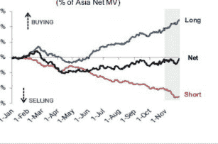

Source: Goldman Sachs FFIC and Equities

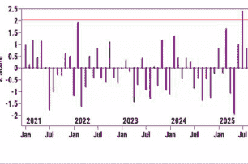

Exhibit 1: October when net buying in Japan was led by short in mare products; Nov month saw activity led with modest deining

# Asia Gross Flows - Monthly

Source: Goldman Sachs FFIC and Equities

Exhibit 3: October when net buying in Japan was led by short in mare products; Nov month saw activity led with modest deining in stocks

# Japan Equity - Cumulative Gross Flows

 Net Allocation: Japan

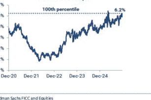
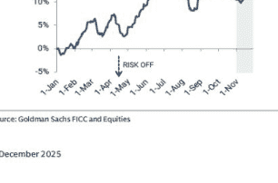

Exhibit 4: Net allocation to Japan increased to 6.2% (close to year-high)
Source: Goldman Sachs FIC and Equities

5 December 2025

## 微信top28688，资料分享群

Goldman Sachs
EM Weekly Fund Monitor

Exhibit 5: Chinese equities (onshore + offshore) saw strong activity with marginal net inflows
Exhibit 6: Net buying in A-shares and a lesser net was offset by net selling in H-shares

# China - Cumulative Growth Flow (of China)

# China - Cumulative Net Flow (of China)

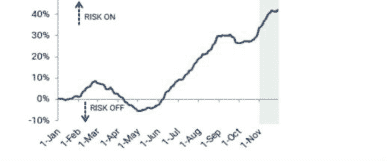
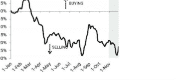

Source: Goldman Sachs FIC and Equities

Exhibit 7: Gross allocation to China remained flat at 6.7% (75th percentile 5-year)
Exhibit 8: Net allocation declined by 4% to 7.8 (33rd percentile 5-year)

# Gross Allocation (Onshore + Offshore)

# Net Allocation (Onshore + Offshore)

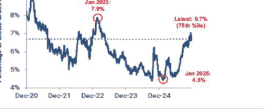
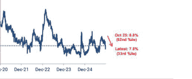

Source: Goldman Sachs FIC and Equities

Goldman Sachs
EM Weekly Fund Monitor

## Focus FTSE China Index A500: Stocks that may experience the most significant net buying or selling follows the FTSE China and Global Equity Index rebalancing

FTSE China A500 Stocks with no net buying or selling following FTSE China and Global Equity rebalancing

| Ticker | Company Name | Sector | Market Cap (B USD) | Market Cap (B USD) | Top 10% | Top 5% | Top 25% | Top 50% | Top 90% |
|---|---|---|---|---|---|---|---|---|---|
| 601398 | ICBC | Financials | 219.5 | 219.5 | | | | | |
| 1716 | China Hong Group | Financials | 45.1 | 45.1 | | | | | |
| 600059 | Hangzhou Pharmaceutical | Healthcare | 32.6 | 32.6 | | | | | |
| 002594 | BYD | Consumer Disc. | 94.8 | 94.8 | | | | | |
| 601019 | Solar Energy Power A | Utilities | 24.7 | 24.7 | | | | | |
| 601938 | Ping An Bank | Financials | 63.2 | 63.2 | | | | | |
| 600519 | Kweichow Moutai | Beverages | 210.3 | 210.3 | | | | | |
| 601888 | State Grid | Utilities | 88.4 | 88.4 | | | | | |
| 600036 | China Merchants Bank | Financials | 158.2 | 158.2 | | | | | |
| 369019 | Meituan | Consumer Disc. | 110.5 | 110.5 | | | | | |
| 07000 | Tencent | Tech | 410.2 | 410.2 | | | | | |
| 098888 | Alibaba | Tech | 190.4 | 190.4 | | | | | |
| 601398 | Bank of China | Financials | 230.1 | 230.1 | | | | | |
| 601238 | CCB | Financials | 245.5 | 245.5 | | | | | |
| 601666 | China Life | Financials | 120.4 | 120.4 | | | | | |
| 601897 | China Petro | Energy | 215.7 | 215.7 | | | | | |
| 601988 | China Refine | Energy | 185.2 | 185.2 | | | | | |
| 000001 | Yanzhuang | Financials | 15.4 | 15.4 | | | | | |
| 600519 | Moutai | Beverages | 210.3 | 210.3 | | | | | |
| 600036 | Merchants Bank | Financials | 158.2 | 158.2 | | | | | |
| 601398 | ICBC | Financials | 219.5 | 219.5 | | | | | |

Note: Data is based on the average of estimates from Morningstar. Flows are derived from FPI and report. Pricing is as of Dec 5, 2023.
Source: FactSet, Refinitiv, Bloomberg, Equity Investment Research
For details, please see Asia Strategy: China Index Review and Implementation Flows (December 2023).

# Goldman Sachs Recap

Exhibit 14: The EM region (ex-China) has seen selling of $22bn, after $40bn outflow from April 2023

# EM Asia-China Cash Flows since 2022

| Markets | YTD | 1M | 3M | 6M | Oct |
|---|---|---|---|---|---|---|
| China | (-2.1) | (-3.5) | (-1.2) | (-4.5) | (-10.2) | (-2.1) |
| Hong Kong | (-8.7) | (-5.4) | (-2.1) | (-3.8) | (-15.4) | (-8.7) |
| Taiwan | (-2.3) | (-1.1) | (-0.5) | (-2.1) | (-5.8) | (-2.3) |
| India | (2.8) | (1.5) | (2.1) | (4.5) | (8.2) | (2.8) |
| Philippines | (0.1) | (-0.5) | (0.2) | (1.1) | (2.5) | (0.1) |
| Malaysia | (1.5) | (0.2) | (0.4) | (1.8) | (3.2) | (1.5) |
| Thailand | (-2.4) | (-1.8) | (-1.1) | (-2.5) | (-4.1) | (-2.4) |
| ASEAN | (-0.8) | (0.1) | (0.3) | (0.9) | (2.1) | (-0.8) |
| EM Asia CN | (-3.4) | (-3.7) | (-1.8) | (-4.2) | (-7.5) | (-3.4) |

Source: Bloomberg, Goldman Sachs Global Investment Research

Exhibit 15: Within Asia, Southbound has the largest buying (+US$179bn) YTD Cumulative FI flows/congest YTD USD (bn)

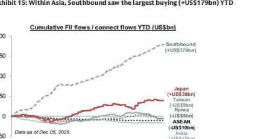

Source: Bloomberg, Goldman Sachs Global Investment Research

Exhibit 16: EM Asia-China markets saw buying of US$1.5bn, led by Taiwan (+US$3bn) and Korea (+US$1bn), outflows in China (-US$22bn)

Exhibit 17: EM Asia-China markets saw flows out of US$37bn YTD

| Markets | 2020 | 2021 | 2022 | 2023 | 2024 |
|---|---|---|---|---|---|
| China | 110 | 120 | -150 | -210 | -22 |
| Taiwan | 45 | 50 | -30 | 40 | 15 |
| Korea | 30 | 35 | -25 | 35 | 10 |
| India | 80 | 90 | 10 | 80 | 20 |
| Philippines | 15 | 20 | -10 | 15 | 5 |
| Malaysia | 20 | 25 | -15 | 20 | 8 |
| Thailand | 10 | 15 | -12 | 10 | 4 |
| ASEAN | 25 | 30 | -20 | 25 | 12 |
| EM Asia CN | 50 | 60 | -100 | -150 | -10 |

Source: Bloomberg, FactSet, MSCI, Respectively Local Stock Exchanges

Southbound flows are driven by Institutional investors buying HK shares, de-domestic flows in HK stocks
Source: Bloomberg, FactSet, MSCI, Goldman Sachs Global Investment Research

长期来看，随着日美加息进程近表面，日本为我们在资本流动方面相对于外债的优势日益削弱，美日利差的收窄正在逐渐。。此时日本债的高利率对日本国内的投资者仍具有吸引力并可能推动收益率上升。在日本债泡沫破裂后，日本国内投资者的需求相对减少，日本大量对外投资，随着日债利率上升且稳定，将为本国投资者提供更多的投资机会，相应，日本投资者可能会更多从转债中获得收益。

运营上，考虑到日本国债收益率曲线的平坦程度仍处于高位（图15），这意味着长短期收益率之间的倒挂的空间仍有限，若市场预期未来持续为宽松，日本未来经济和通胀将加大，长短期收益率的上升空间有限，由于金融机构的套利导致收益曲线增加，金融流动性可能枯竭。

日央一方面可能对全球市场带来压力，另一方面可能加剧日本财政负担，引发市场对日本国债可持续性的担忧。过去二年中，日本国债存续期限以每年约4%的速度回落，平均利率从2005年的4%回落到2022年的低点0.76%，某种程度上由于去年日本通胀加速，10年期国债收益率到短端利率在0%左右，也加剧了日本的财政负担，相比之下支出在过去二十年来平均增长速度不到2%，占财政收入比例整体下降至5%以下。但是随着日本货币政策的转向，日央开始并延续加息进程，日债收益率整体呈现持续上升趋势，期限利差也逐渐拉开，长端收益率上升更为明显，也逐渐带动日本一般国债加权平均利率自2023年开始抬头，利息支出占财政收入比例在2024年可能回升，日本政府付息负担将增加压力。

## 金融

表5：日本企业利润维持高

| | 250000 亿元 | 营业性利润:所有企业(含金融和保险) |
|---|---|---|
| 2013 | | |
| 2015 | | |
| 2017 | | |
| 2019 | | |
| 2021 | | |
| 2023 | | |
| 2025 | | |

资料来源：日本财务省，中金公司研究部
注：数据来源截至2025年3季度

图7:日本工资持续上涨

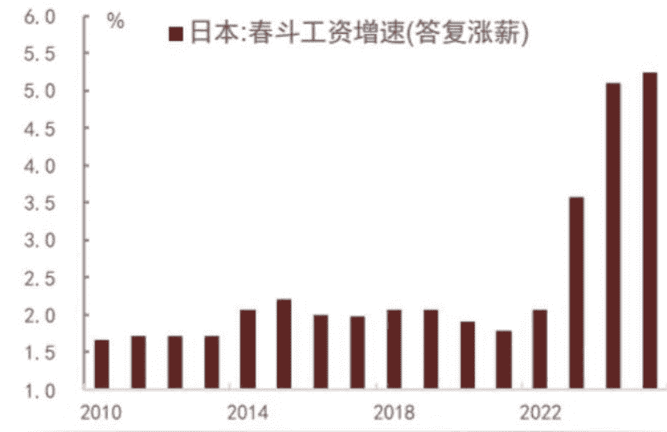

资料来源:Wind, 中金公司研究部

图8:投机日元净寸（上）资管公司和杠杆基金的日元净寸（下）

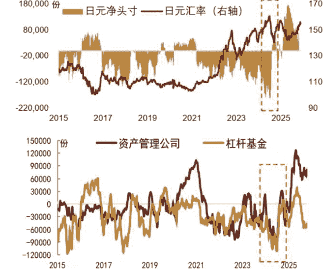

资料来源:CFC, 中金公司研究部 注：数据截至2025年10月21日

## 图表14: 日本投资者持有美债金额

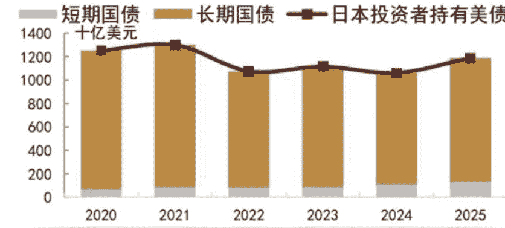

资料来源：Wind, 中金公司研究部
注：数据截至2025年9月

## 图表15: 日本国债收益率曲线形态（上）日本国际投资头寸：证券资产

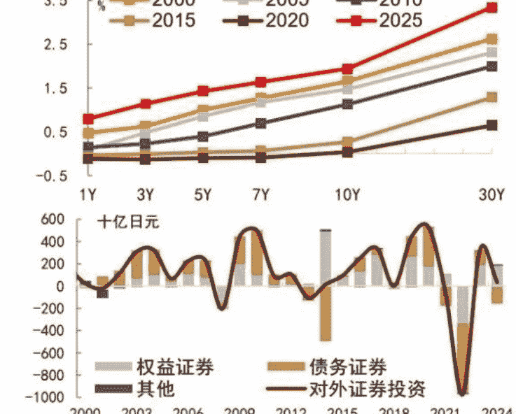

资料来源：Wind, 中金公司研究部
注：上图数据截至2025年12月5日

## 全球加息/降息统计

| | Jan-25 | Feb-25 | Mar-25 | Apr-25 | May-25 | Jun-25 | Jul-25 | Aug-25 | Sep-25 | Oct-25 | Nov-25 | Dec-25 |
|---|---|---|---|---|---|---|---|---|---|---|---|---|
| 发达市场 | | | | | | | | | | | | |
| 美国 | | | -0.25 | -0.25 | -0.25 | | | | | -0.25 | | | |
| 欧元区 | | | -0.25 | | | | | -0.25 | | | | | |
| 日本 | | | -0.25 | | | | | | | | -0.25 | | |
| 英国 | | | -0.25 | -0.25 | | | | | -0.25 | -0.25 | | |
| 加拿大 | | | | | | -0.25 | | | | | | | |
| 澳大利亚 | | | -0.25 | | | -0.25 | | | | | | -0.25 | |
| 新西兰 | | | -0.50 | -0.25 | -0.25 | | | | -0.25 | | -0.50 | |
| 瑞士 | | | | | | -0.25 | -0.25 | | | | | |
| 瑞典 | | | -0.25 | | | | | | | | | |
| 中国 | | | | | | | | | | -0.10 | | | |
| 新兴市场及其他 | | | | | | | | | | | | |
| 印度 | | | -0.25 | -0.25 | -0.50 | | | | | -0.25 | | | |
| 印尼 | | | -0.25 | | | | | -0.25 | -0.25 | | | | |
| 马来西亚 | | | | | -0.25 | -0.25 | -0.25 | | | -0.25 | | | |
| 埃及 | | | | -0.25 | | | | | | | -0.25 | | |
| 韩国 | | | | | -0.25 | | | | | | | | |
| 巴西 | | | -1.00 | | | | | | | | | | |
| 墨西哥 | | | -0.50 | -0.50 | -0.50 | -0.25 | | | | -0.25 | | | |
| 智利 | | | | | | | | | | -0.25 | | | |
| 哥伦比亚 | | | | | | | -0.25 | | -0.25 | -0.50 | | | |
| 俄罗斯 | | | | | | -1.00 | -2.00 | -1.00 | -0.50 | | | | |
| 乌克兰 | | | -1.00 | -1.00 | | | | | | | | | |
| 南非 | | | | -0.25 | | | | -0.25 | | | -0.25 | | |
| 土耳其 | | | -2.50 | -2.50 | 3.50 | | -3.00 | | -2.50 | -1.00 | | | |
| 沙特 | | | | | | | | | | | -0.25 | -0.25 | | |

资料来源：Wind, 金公司研究部
注：数据截至2025年12月5日

## 图表17: 日本国债存续规模及平均付息利率

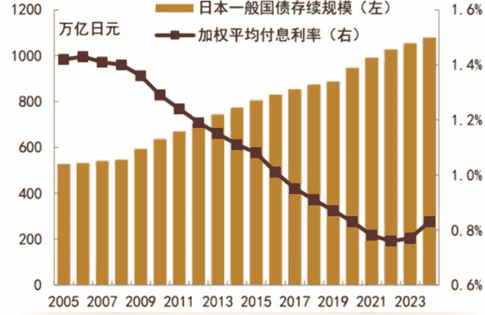

资料来源：日本财务省，中金公司研究部
注：标准为日本财年，数据截至2024财年

## 图表18: 日本政府支出占财政收入比比例

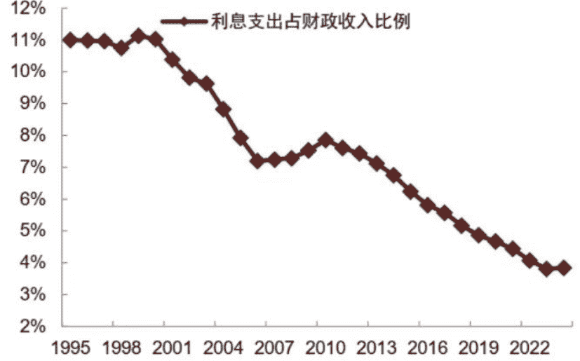

资料来源：CEIC，中金公司研究部
注：标准为日本财年，数据截至2024财年

对于中国金融机构而言，随着日债收益率逐步抬头，日债相较中债的吸引力开始抬头，可以关注配置日债的机遇。其实2024年11月，30Y中债收益率快速下行日债收益率回落，30Y中债收益率已开始维持高位，截至12月5日，30Y日债收益率回升至3.36%，而30Y中债收益率在附近，30日中利差已升至110bp，而10Y日债收益率在12月以来已超过10Y中债收益率，目前二者差为10bp左右（图20）。虽然人民币与美元交易可能会活跃，进而中日汇率对冲成本相对更高，考虑到后日元利率仍会抬头，在这个过程中人民币对汇率可能保持稳定，有望降低人民币对日元对冲成本，那么在中日利差走势可能延迟的情况下，我们认为将长期、长期日债对冲后收益率将维持足够中债有吸引力，可长期、长期日债对冲维持在合适点。

图20：10Y、30Y日债收益率
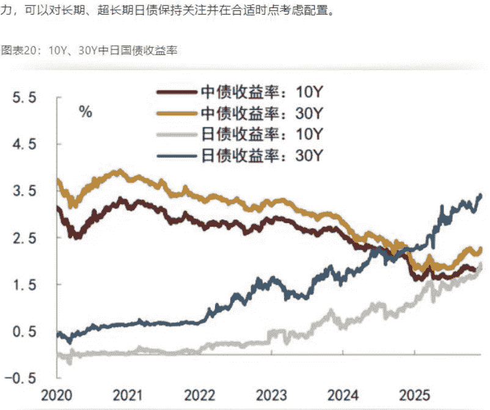

## 金融

BOFA: 美联储将降至近2%，使10年期美国债收益率降至3.0%至3.5%区间。
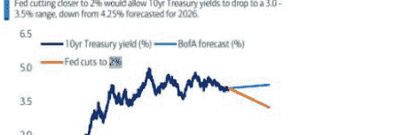

Source: Bloomberg, BofA Global Research 2025-12-07

高: 近40%的大企业(员工数>250)预计将在未来6个月内使用人工智能，消费者情绪在不同收入群体之间差异很大。

## 其他国家

## 其他经济

## Exhibit 11: Nearly 40% of All Large Firms With Over 250+ Employees to Be Using AI within the Next 6 Months

| Percent | Current Adoption Rate* | | Percent | Current vs. Expected Adoption in Six Months** | Percent |
|---|---|---|---|---|---|
| 30 | 1-4 | | Next Six Months | 40 | |
| | 5-9 | 30 | November 2025 | 35 | |
| 25 | 10-19 | | | 30 | |
| | 100-249 | | | 25 | |
| 20 | 250+ | | | 20 | |
| | | | | 15 | |
| 15 | | | | 10 | |
| | | | | 5 | |
| 10 | | | | | | |
| | | | | | |
| 5 | | | | | | |
| Jan-24 | May-24 | Sep-24 | Jan-25 | May-25 | Sep-25 | Jan-26 | |

*Current survey moving average. **Follows new question wording.
Source: Census Bureau, Goldman Sachs Global Investment Research

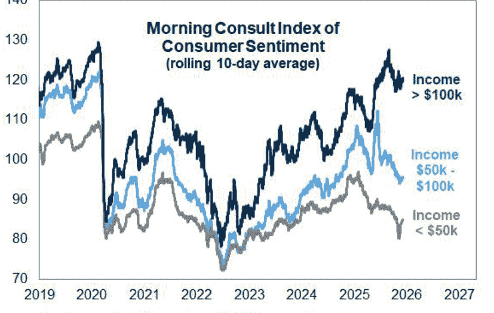

Source: Morning Consult, Goldman Sachs Global Investment Research

## Exhibit 35: YTD asset return and return/volatility ratios

| Total return (%) | | | Risk-adjusted return (Return/realized volatility) | |
|---|---|---|---|---|
| | | 60 | Gold | 3.3 |
| COMM SERVICES | 35 | | HY Credit | 3.1 |
| MSCI Emerging Markets | 31 | | MSCI DM ex us | 2.0 |
| MSCI DM ex us | 30 | | MSCI Emerging Markets | 1.8 |
| INFORMATION TECHNOLOGY | 23 | | IG Credit | 1.6 |
| Russell 1000 Growth | 20 | | COMM SERVICES | 1.5 |
| INDUSTRIAL | 19 | | 10-year Treasury | 1.3 |
| INDUSTRIES | 18 | | UTILITIES | 1.1 |
| S&P 500 | 16 | | INDUSTRIAL | 1.1 |
| UTILITIES | 15 | | Russell 1000 Value | 1.0 |
| Russell 1000 Value | 15 | | Nasdaq | 1.0 |
| Russell 2000 | 15 | | S&P 500 | 0.8 |
| HEALTH CARE | 13 | | INFORMATION TECHNOLOGY | 0.8 |
| FINANCIALS | 12 | | Russell 1000 Growth | 0.7 |
| Equal-weight S&P 500 | 11 | | HEALTH CARE | 0.7 |
| ENERGY | 10 | | Russell 2000 | 0.7 |
| 10-year Treasury | 10 | | Equal-weight S&P 500 | 0.7 |
| HY Credit | 8 | | ENERGY | 0.7 |
| IG Credit | 8 | | MATERIALS | 0.6 |
| MATERIALS | 7 | | MATERIALS STAPLES | 0.4 |
| CONSUMER DISCRETARY | 6 | | CONSUMER DISCRETARY | 0.2 |
| CONSUMER STAPLES | 4 | | REAL ESTATE | 0.2 |
| REAL ESTATE | 3 | | Return | |
| Crude Oil (S&P GSCI) | 1 | | (0.2) |
| US Dollar (TWI) | | | Crude Oil (S&P GSCI) | |
| | | | US Dollar (TWI) | (1.0) |
| (40) (20) 0 20 40 60 80 | | | (4.0) (2.0) 0.0 2.0 4.0 | |

Source: FactSet, Goldman Sachs Global Investment Research

## Exhibit 5: Treasury rates could decline if Fed cuts to 2%

Fed closer to 2% would allow 10yr yields to drop to a 3.0 - 3.5% range, down from 4.25% forecasted for 2026.

Source: Bloomberg, BofA Global Research

## Exhibit 29: Realized and consensus growth for select equity indices

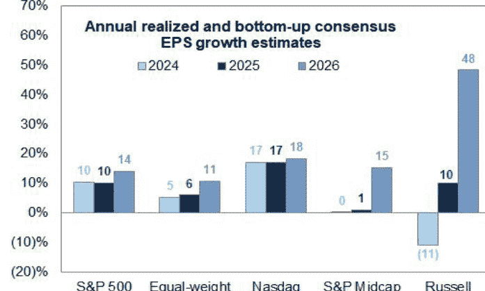

Source: FactSet, Goldman Sachs Global Research

...the combination of lower volatile rates, lower dollar, and cheaper carry trades in the markets, not just in swaps but also European Government Bonds and fixed income. We have a long bias on US SOFR most of 2025, and stay long 10y with a target of 3.5%.

There is some disagreement on the balance sheet outlook though Dallas Fed President Logan says that the Fed will have to reverse policy instead of financing to either more or slightly lower the interest rate on reserve balances. But President Logan does not WANT the FOMC to make a mechanical approach. This is also a topic which we expect more discussion within the FOMC.

预计 12 月 19 日日本央行将加息，外汇效应短暂、有限。

## Positioned higher: JPY rates in 2026

We think that the JPY peaks in Dec, and expect further performance of our short JPY 10y. JPY 2y is one of our Top Trades in 2025, and JPY 10y is one of our Top Trades for 2026. We expect 10y JPY swaps to trade above 2% next year, and also in coming weeks. Spillover from bond markets into other G10 markets have spiked lately, but remain at relatively low levels - albeit with spikes in Australia and New Zealand. Historically volatile has not been persistent over the last three decades. More details are here.

Figure 1: Rates forecast versus forwards

| Rates (%) | Current | Forecast | Fwds | Gap/w forecast & forwards | End-2026 Forecast | Fwds | Gap/w forecast & forwards |
|---|---|---|---|---|---|---|---|
| Fed Funds | 3.88 | 3.63 | 3.67 | -0.04 | 3.13 | 2.93 | -0.19 |
| US 2-year | 3.48 | 3.20 | 3.41 | -0.21 | 3.25 | 3.50 | -0.25 |
| US 5-year | 3.57 | 3.57 | 3.56 | -0.01 | 4.00 | 4.23 | -0.16 |
| US 10-year | 4.00 | 3.70 | 4.01 | -0.31 | 4.00 | 4.21 | -0.21 |
| US 30-year | 4.40 | 4.20 | 4.66 | -0.26 | 4.23 | 4.46 | -0.23 |
| UK 10-year | 3.74 | 3.50 | 3.60 | -0.16 | 3.10 | 3.84 | -0.74 |
| German 2-year | 4.44 | 4.30 | 4.53 | -0.23 | 4.05 | 4.74 | -0.69 |
| German 5-year | 2.03 | 2.01 | 2.05 | -0.04 | 2.21 | 2.39 | -0.21 |
| German 10-year | 2.26 | 2.10 | 2.28 | -0.18 | 2.60 | 2.47 | -0.13 |
| German 30-year | 3.72 | 3.00 | 3.29 | -0.29 | 3.50 | 3.38 | -0.12 |
| 10y France spread to Germany | 0.72 | 0.80 | 0.65 | 0.15 | 0.80 | 0.71 | -0.09 |
| 10y Italy spread to Germany | 0.71 | 0.50 | 0.45 | 0.10 | 0.70 | 0.75 | -0.05 |
| 10y Spain spread to Germany | 0.48 | 0.50 | 0.45 | 0.05 | 0.50 | 0.50 | 0.00 |
| Swiss 10y bond yield | 0.13 | 0.20 | 0.19 | 0.01 | 0.50 | 0.28 | 0.12 |

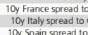

2025-12-07 04:33

## 中房报告这是在点万利的谁？#八卦

> 当当下，全球回调为首选。高利率、通胀、回归正常。如果美元贬值走强，那么这或许是可以避免的，但不必避免它。

## 加微信top28688， 进资料分享群

为高质量发展大局支撑一把“安伞”。当下，个别房企因为些年高杠、高负债、高周转问题，正在溢出一些影响市场秩序运行的风险因素，但是是可以破解的，不必分担心。关键是这些出房企的地方，要按照市场化、法治化的原则部署，胸中有大局，铁肩担责任，地方精力化解风险，不在这些房企“三高”的时候享受“世界500强”的光环和经济收益利，而在其风险溢出的时刻“等”、慢半拍或者“先质押拿优质资产”，任由风险影响整体市场回稳和给将来市场化解决问题留下阻碍。对于严重不抵债、失去经营能力的房企，也要遵循该重组的要重组、该房法处置的积极司法处置的法治精神，并追究相关责任人的责任，不让一些制造问题的人蝉脱壳混过关。房地产发展是有法、有原则的。

## 核心华创：明年存款花落，是重中重。

2025-12-07 存款复苏

大家都欢迎来聊，其实我们明年存款花落，是重中重。首先我们要看的是估值，总市值是否到位？今年M2的增长幅度较去年的8.8%，估计将回落（7.4%以上），主要是内货币释放的效果，二者作用的结果。

从总市值来看，有两个关键：第一个，今年的股市回升的幅度特别大，明年估值越高，很难再回升。

其次，从底部来看，居民存款回升的难度极大，只要万方齐涨，走势是非常不对。另一方面，居民存款在活化，资金在流动，这就很难住。如果还是明年，M2想要增长，存款活化几乎不可能（排除反转的概率）。如果还是明年，将比今年更难。

从以上两个维度的收敛，我们看到2026年，存款应该是安全的。边上还要多一看具体的品种（比如银行等）。我之前提到的，明年利率是否对M2形成底部，或许是一个？另外，以及一些国外政策的重大变化，也可能是一个触发点。刚刚说的逻辑是，接下来来拆解：存款花落谁非常重要，到底是在企业里还是在居民家里？如果是M2，那在居民家里，这就非常重要。如果还是明年，就需要来支持的动力：在企业里？企业可以创新，去投资，去CAPEX，资本支出，就是短期周期的压力。在银行需要配置。

按照这个逻辑，我们可以构建两个关键框架：一个是定价的核心逻辑；另一个是从居民家里，就是股市交易量和牛市氛围。关注微信32868，进资料分享群

## Jason不离

政治经济学Christopher Sandmann的一项发现，几乎每个欧洲国家的出生与生育率之间存在显著的相关，生育率是由内在信仰而非单纯教会所推动的。这表明欧洲的世俗化是其生育率下降的主要之一。不仅通过支持帮助合男女之间的文化鸿沟，从而提高生育。

Does Prayer Explain Fertility Differences?
To study the link between declining fertility and rising prayerness in Western Europe since the early 2000s, I analyzed panel data from the European Social Survey combined with World Bank fertility and GDP data. I controlled for country-specific historical factors (like Communism and war experience) and time-specific shocks affecting all countries simultaneously.

The results are just as the theory of transformational prayer predicts—where women stop praying see fertility decline the effect is statistically significant and substantial: 1 percentage point increase in the share of women who never pray is associated with a fertility decline of 0.0072 per woman. To put this in perspective: 2% increase in GDP per capita raises fertility by 0.0081—the same effect as a mere 1.12 percentage point increase in the share of women who pray. This suggests that faith is as important—if not more so—than economic fundamentals in determining fertility rates. 加微信top28688，进资料分享群

## Jason不诡

Polit最近发布了一项调研，结果46%的人认为美国的生活成本处于他们记忆中糟糕的时期。他们说如果看到这个数据，应该已经开始。FED需要发表表的描述，让大家感受到至少在范围内喘息和降价。因为经济学家和普通人所看到的通胀完全不同。有意的是，经济学家要警告真实生活中的人应该怎么感受。

## Why Is 46% of The Public Saying This Is The Worst Cost of Living Ever?
5-Year Change In CPI
Nov-80 to Sep-25

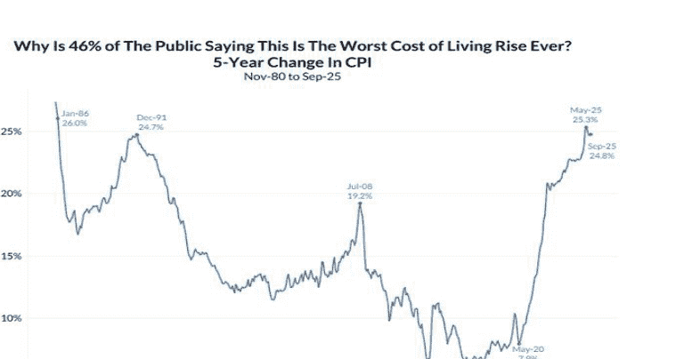

Source: The Bureau of Labor Statistics, Bloomberg
© 2025 Bianco Research, L.L.C.

## The Last Times Prices Had A Similar Rise To Now, The Red Part Followed
5-Year Change In CPI
Jan-47 to Sep-25

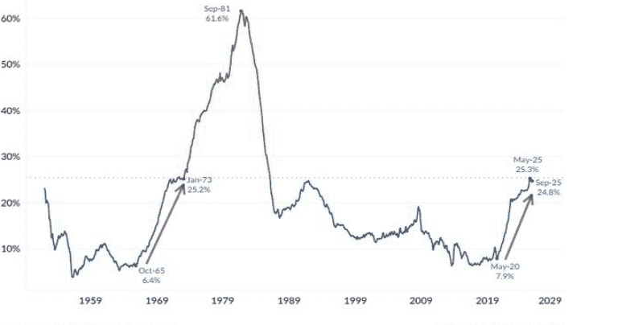

Source: The Bureau of Labor Statistics, Bloomberg
© 2025 Bianco Research, L.L.C.

## Two Views on Inflation
5-Year Change In CPI
Apr-20 to Sep-25

Source: The Bureau of Labor Statistics, Bloomberg
© 2025 Bianco Research, L.L.C.

| 序号 | 公众号/星球 | 原价 | 领域 |
|---|---|---|---|
| 1 | 生财有术 | 2765 | 股市 | |
| 2 | 乌树 | 365/年 | |
| 3 | 悠悠 | 399/年 | |
| 4 | 政事堂 | 599/年 | 政·经济·国际 |
| 5 | 宁夜 | 699/年 | |
| 6 | 智树西风 | 365/ | 社会·职场·成长·认知 |
| 7 | 乌君 | 365/年 | |
| 8 | 咪视野 | 26/篇 | |
| 9 | 进的 | 299/年 | |
| 10 | 体制内主任 | 599/年 | |
| 11 | 付鸥 | 1888/年 | |
| 12 | 洪灏的宏观策略 | 899/年 | |
| 13 | 金融通/北海 | 4576/年 | |
| 14 | 丁沐星球 | 1599/年 | |
| 15 | 鉴茶财经 | 330/年 | 股市·房地产 |
| 16 | 雪雪老头 | 66/篇 | |
| 17 | 飞龙黍 | 3600/年 | |
| 18 | 安民分析 | 28/篇 | |
| 19 | 水库欧大 | 6980/元 | |
| 20 | 智谷趋势 | 498/年 | |
| 21 | 记忆承载/智树西风 | 365 | 社会·职场·成长·认知 |
| 22 | U君/赢在八小时 | 365/年 | |
| 23 | 贰掌柜（学习笔记） | 99/年 | |
| 24 | 卢克文 | 599/年 | |
| 25 | 局外人的 | 669/年 | |
| 26 | 溯泽异谈 | 4166/年 | |
| 27 | 大树协谈 | 199/年 | |
| 28 | 图书、报告等资源 | | |
| 29 | 影视、软件等资源 | | |

**VIP群：特惠88/年 + 每日分享所有资源+入群送资料**（原价数万元）

**免费群：可免费进群+每日享一部分资源**
