# 南米球财财经251213

Jason不赢
2025-12-13 04:04

国盛：11月新增信贷3900亿，同比减少1900亿，低于市场预期（市场预期5043亿），也明显季节性（近三年同期9600亿），居民贷连续两年两个月“去去杠杆”，短期贷款、中长期贷款与同比减少，指向消费，地产仍然偏。企业贷款同比增加，熊震中特征明显，中长期贷款还减少，基础设施等传统功能增速可能是主要要素。
11月M1同比4.9%，较上月一步回落1.3百分点，存款同比减少1000亿，也指居民存款宽松#金融

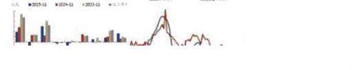

图表1：11月信贷于预期，也低于季节性预期

微信备注：28568
加微信免费进资料群

| 万亿元 | 2025-11 | 2024-11 | 2023-11 | 近三年均值 |
|---|---|---|---|---|
| 1.2 | | | | |
| 1.0 | | | | |
| 0.8 | | | | |
| 0.6 | | | | |
| 0.4 | | | | |
| 0.2 | | | | |
| 0.0 | | | | |
| -0.2 | | | | |
| -0.4 | | | | |

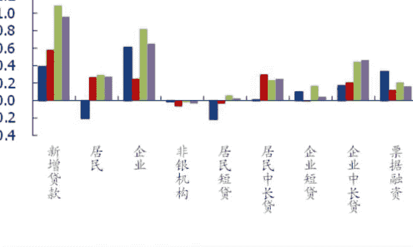

资料来源：Wind，国盛证券研究所
微信微信top28688，进资料分享群

图表7：社冲突可能可见趋势图

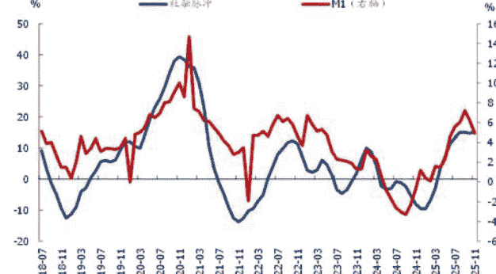

资料来源：Wind, 证券研究所

## Jason不不能

2025-12-13 04:11

zerohedge: 比约和特尔林在警告第三WWIII|其他国家经济

## 斯基，所有人都“喜欢”

> 特朗普表示，“我们所面临的冲突可能是可能的。”
> 特朗普表示，他正在努力避免一场第三次世界大战。
> 特朗普表示，“如果我们能避免冲突，”我们将避免冲突，并避免这种毁灭性的后果，我们将拥有一个和平的未来。”

## 特朗普曾说，除了列斯坦斯，所有人都“喜欢”我的计划，警告将三次世界大战

作者：滕德俊
2025年12月13日，星期六，伦敦时间:46

关于北约秘书长斯特滕格在格林堡发表表示，冲突和世界世界为即将到来的战争做好准备，并警告说，这场冲突可能意味着我们的美国和俄罗斯将所面临的战争。

不久后，滕德俊特朗普似乎呼应了这种担心，同时表示对乌克兰冲突还没有进展。这场终将引发第三次世界大战。我们几天就告诉他，“特朗普知道，大家一直喜欢这种战争，最后会陷入第三次世界大战。我们不希望看到这种情况发生，”特朗普在椭圆宫办公室对记者说。

## 微信top28688，进资利分享群

他从冲击遭遇失败，是否对胜利影响巨大？但他们看到了失败的升级可能。

特朗普表示，美国正处于非常困难地解决冲突，他也打破了铁堡并不准备让军事升级的态度。这次他解除军约，

我们认为和乌克兰已经接近停谈。我认为和乌克兰已经非常接近停谈。事实上，俄罗斯认为新的美国的外交对于乌克兰将达成共识。美国对限制其力量规模并认为不加入北约。正是由于长期所认为的，乌克兰还没有建立一项协议。

对，特朗普表示：“这没有悬念。只要双方可以进行谈判，这就不容易的。这像一套复杂的房屋房地产，‘长期认为’俄罗斯和乌克兰在实在对抗——我认为他们并不考虑。”

最近特朗普明确立场反对军事升级和和平，白宫新闻简报提到特此反对和反军事言论。他在新报上发布说：“总统对给乌克兰的反应感到困，他似乎为了留白而会”。

新军事三轮会后表示将考虑未结束来自军事首脑的压力。

Jason
2025-12-13 04:22

## CF40: 羊毛剪剪量 #TAX

当我国财政正面临着所有可能的压力，收入增长，近期收入和财政收入增长维持缓慢。2020年，全国公共财政收入名义增长率为2.27%，非公共财政收入名义增长率为2.2%。2019年到去年期间财政收入增长率为9.5%。

与此同时，财政收入占GDP率持续下降，2019年以来规模收缩，政府支出占GDP率已升至24%，由于新兴市场部门（Emerging Markets）16.4%，低于发达国家（Advanced Economies）25%。

若采用国际基金组织（IMF）建议，在未来三个季度内试图增加收入以恢复增长，2023年预计收入占GDP率接近30%。

从支出方面，减少支出，扩大支出。2024年，公共财政支出率为34%，公共财政收入率为34%。

注意的是，政府支出一方面尽量减少，另一方面由于支出刚性强，财政收入面临紧迫压力。2023年，财政目标通过实施改革实现均衡增长，能源、医疗等领域的政府支出在持续增长下，从发达国家的政策来看，财政支出占GDP率持续增长导致负担，这一趋势被视为“债务陷阱”，必须避免。

加微信fibop286, 资料分享

## 财政压力是由于经济转型持续发展、税收能力差异、地方税系完善等多重作用的结果。

一，经济转型削弱了劳动力供给，同时显著增加了养老、医疗和社会福利支出，形成“减收增支”。

第二，经济转型带来重大挑战。经济转型对交易形态和支付方式的变革使得税制适应性不足，难以应对转型，流通环节日益复杂，导致收入份额减少，权威缺乏可靠性。

三，业务转型带来一系列挑战。新型商业模式突破了传统基础界限，使得税收对象难以识别，纳税主体类型演变，数据获取难度。

四，地方税系完善。现有地方税收入规模不能满足地方财政需求，进一步对转移支付依赖。提出“增加地方自主权，拓宽地方税源”，这些因素相互作用，共同加剧了收支结构失衡。

面对诸多挑战，如何有效提高财政收入能力、完善地方税体系是当前改革的核心问题。在改革过程中，如何在制度设计上统筹处理若干关键问题：处理好经济效率、税收效率与分配公平的平衡。公平与效率被视为税制设计的基本原则，但在居民收入循环中，三者目标之间的复杂性难以找到步骤。

## 个人所得税的调节定位应为“集财为主、精准调节”。

个人所得税并非调节收入分配的主要工具。当前我国收入差距表现为城市、区域和行业的组间差距，而非组内差距。缩小组间差距关键在于转移支付、社会保障、区域发展和基本服务等非税政策。相比之下，个人所得税的作用较为有限。

国际经验表明，在OECD国家调节收入的主要因素，个人所得税和社会保障合计仅能使基尼系数下降5%至9%，其中主要的作用是社会保障。作为发展中国家，个人所得税对基尼系数的调节幅度不足1%，调节功能更为微弱。这正符合《意见》加强调节、社会保障、转移支付等再分配调节的需要——个人所得税调节收入的能力尚待提高，应在再分配工具的考核中考虑其定位。

进一步看，个人所得税在调节所得与财富之间存在结构性失效。劳动所得适用3%至45%的累进税率，而股息、红利、财产转让所得适用0%的比例税率。此外，股票转让目前免征个人所得税，个人股权转让和住房出售也享有较多税收优惠。

净值人群收入来源于资本收益，但由于税制限制，他们承担的实际负担并不高于劳动报酬。这不仅抑制了促进公平发展的作用，也降低了对财富积累的制度制约。

更深层次的问题在于，个人所得税再分配效应薄弱的根本在于平均税率过低，且累进性不足。个人所得税的调节作用取决于平均税率和累进性这两个因素，其中税率是一个经济体内所有人的财富与收入之和。我国所得税的累进性与发达国家有差距，平均税率却及发达国家的十分之一，由此导致其调节分配效果有限。

## 微信信top28688，进资料共享

我国个人所得税长期面临税收问题。事实显示，国家税务总局2024年发布的数据，目前我国取得综合所得的人员中无需缴税的人员占比超过七成。在剩余的三成实际缴税人员中，60%仅使用了3%的最低税率，税收金额较少。综合收入不超过12万元的人员，在扣除基本免除或费用后，基本无需缴税或缴较少税款（新增，2025）。

阶梯税制限制了平均税率的提升，再分配效率有限。在再分配领域，个人所得税与调节功能对立，更高的平均税率能够提高再分配效果，并让居民成为纳税人，形成良性循环。

基于以上分析，一是对大额资本收益减免，200万以上的部分消除；二是针对高收入者调整，将其适用范围从96万元扩大至200万元，既缓解了高收入压力，又提升了调节精度；三是将各项收入纳入综合范围，统一适用45%税率；四是保持基本免额和专项附加扣除，通过调整增加收入；五可以探索调整扣除比例，适度提高调节功能。2024年收到了4.6万亿，其中低于150美元（约137欧元）的小包裹并没有符合标准，但是失去了市场份额。

加微信20868，资料分享

##人工智能的总结

- 欧盟从明年开始征收更高费用，以遏制来自中国的涌入，这是一个巨大的挑战。
- 欧盟从7月起征收临时费用，两年后再征收永久税。
- 欧盟从明年开始征收更高费用，以创造优质环境。
- 欧盟从7月起征收临时费用，两年后再征收永久税。
- 欧盟从明年开始征收更高费用，以遏制来自中国的涌入。
- 欧盟从7月起征收临时费用，两年后再征收永久税。
- 欧盟从明年开始征收更高费用，以遏制来自中国的涌入。
- 欧盟从7月起征收临时费用，两年后再征收永久税。
- 欧盟从明年开始征收更高费用，以遏制来自中国的涌入。
- 欧盟从7月起征收临时费用，两年后再征收永久税。
- 欧盟从明年开始征收更高费用，以遏制来自中国的涌入。
- 欧盟从7月起征收临时费用，两年后再征收永久税。
- 欧盟从明年开始征收更高费用，以遏制来自中国的涌入。

## 2024年2023年

| 城市 | 平均房价（万元） | 平均年收入（万元） | 房价收入比 |
|---|---|---|---|
| 东京 | 1,060 | 650 | 16.3 |
| 大阪 | 750 | 510 | 14.7 |
| 名京 | 630 | 460 | 13.7 |
| 福冈 | 580 | 420 | 13.3 |
| 札幌 | 520 | 380 | 13.7 |
| 仙台 | 480 | 350 | 13.7 |

## 新建住宅楼房价收入比（日本西部）

| 都道府県 | 房价收入比（倍） | 上年 |
|---|---|---|
| 日本全国 | 10.38 | 10.09 |
| 北海道 | 12.27 | 10.77 |
| 青森县 | 10.06 | - |
| 岩手县 | 11.05 | 10.91 |
| |城县 | 12.56 | 10.73 |
| 秋田县 | 12.29 | 12.00 |
| 山形县 | 8.36 | 8.96 |
| 福岛县 | 10.22 | 9.52 |
| 茨城县 | 8.83 | 8.87 |
| 栃木县 | 12.03 | 8.88 |
| 群马县 | 9.50 | 10.20 |
| 埼玉县 | 12.51 | 10.99 |
| 千叶县 | 10.70 | 9.61 |
| 北京 | 17.00 | 17.78 |
| 神川县 | 14.04 | 13.06 |
| 新潟县 | 10.04 | 9.72 |
| 富山县 | 9.61 | 9.04 |
| 石川县 | 9.62 | 9.99 |
| 福井县 | 9.92 | 10.56 |
| 山梨县 | - | 7.43 |
| 长野县 | 10.15 | 15.88 |
| 岐阜县 | 8.76 | 8.47 |
| 静冈县 | 9.05 | 9.38 |
| 爱知县 | 11.18 | 10.55 |
| 三重县 | 8.22 | 8.50 |

## 孕率下降

Jason
2022-12-13 04:45

bloomberg: 孕率从2007年的12%上升到2020年的18%。

## 全球芯片投资

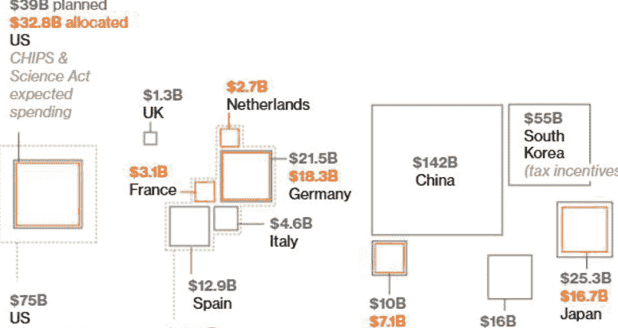

来源：博报道、半导体产业产链

Jason
2023-12-13 04:42

日经：2024年新房平均价格（按70平方米换算），以当地平均年收入算出了房价比为10.38倍。日本2023年房价上涨，房价收入比超过10倍意味着一个家庭很难买起新房，5~7倍较为理想。如果超过6倍，生活会变得困难。房产市场转向双收入家庭、中产阶层、富豪人士的改善需求等。

## 新兴市场国家股市涨幅排名

| 排名 | 国家 | 涨幅(%) |
|---|---|---|
| 1 | 巴西 | 4.2 |
| 2 | 印度 | 3.8 |
| 3 | 越南 | 3.3 |
| 4 | 韩国 | 3.0 |
| 5 | 中国 | 2.8 |

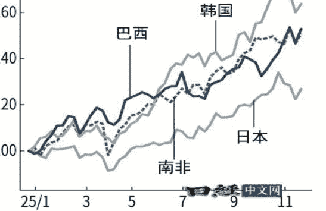

## 新兴市场股市在雷曼危机后低迷

| 排名 | 新兴市场国家 | 涨幅 |
|---|---|---|
| 1 | 中际旭创 | 4.2倍 |
| 2 | SK海力 | 3.0倍 |
| 3 | PT Dian Swastika Sentosa Tbk | 3.0倍 |
| 4 | 富士康业 | 2.8倍 |
| 5 | 阳光电源 | 2.5倍 |
| 6 | 紫金矿业集团 | 2.2倍 |
| 7 | 台达电子 | 2.2倍 |
| 8 | 中科寒纪科技 | 2.0倍 |
| 9 | 三星电子 | 89% |
| 10 | 阿里巴巴 | 84 |

(注：对象为MSCI新兴市场指数份市值超过500亿美元的股票，截至11月末，按当地货币计价。数据来源为QUICK FactSet)

## 这种“更有利的供需格局”可能导致10年期美债收益率比预期低20至30个基点。

## 按类型划分的美国债未偿还

- Bills Notes and bonds
$40T

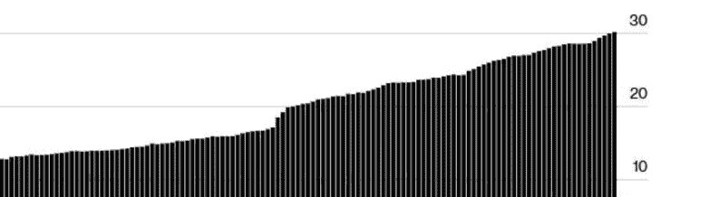

来源：彭博社

Jason
2025-12-13 04:58

其中，我们认为从房地产对GDP的贡献，其他行业仍需复制，但目前行业的发展状况，两类行业可能是下一次阶段经济增长的动力来源：一是受科技直接带动的相关行业，如信息技术和租赁，能够极大程度受益于经济增长，随着技术进步逐步改善服务产业行业；如发展制造业调整，我国2004年至2024年名义GDP占比结构与美国相似是制造业持续下降。2004年-2012年期间，我国制造业GDP占比在31.0%以上，自2013年开始持续下降，2024年占比已经回落至24.87%。在规模上工业企业占比结构中，制造业占比呈现整体下降的趋势，2013年制造业占比为80.70%，2024年为74.20%。

我们认为从成熟行业和产业化行业周期来看，未来一段时间内，需要重点关注“现代化产业体系建设”。#经济结构

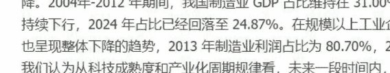

### 图 6. 房地产行业名义GDP占比和增速下滑

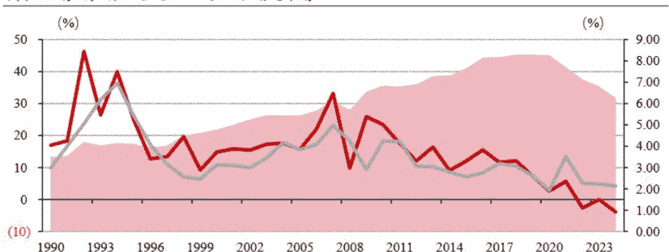

房地产行业名义GDP占比（右轴）、房地产行业名义GDP增速（蓝色）、名义GDP增速（左轴）

数据来源：Wind，中证数据

### 图 23. 房相关行业GDP占比变化情况

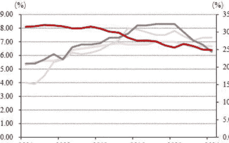

### 图 24. GDP占比持续上行的分行业

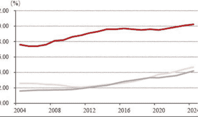

房地产（左轴）、房地产（左轴）、建筑（左轴）、制造（左轴）

信息服务、计算机设备和软件行业、制造业、租用建筑投资

数据来源：Wind，中证数据

Jason-林
2023-12-15 05:03

bloomberg: 中国月的信贷增长令人失望，家庭和企业信贷缓慢，分析预计未来几个月信贷增长将持续偏软，信贷需求受价格和实际信贷利率偏高而保持低。中国央行以来对政策效果导致了下移10个点——远离许多人的40到60个点。这就是2021年信贷恢复速度最小的一年。#金融

## 中国信贷与周期关系

企业贷款规模，但贷款数量减少

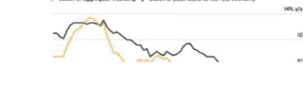

## 微信top26888，数据分享群

## 中国信贷与贷款增长放缓

企业借款减弱，显示需求变缓

- Stock of aggregate financing
- Stock of yuan loans to the real economy

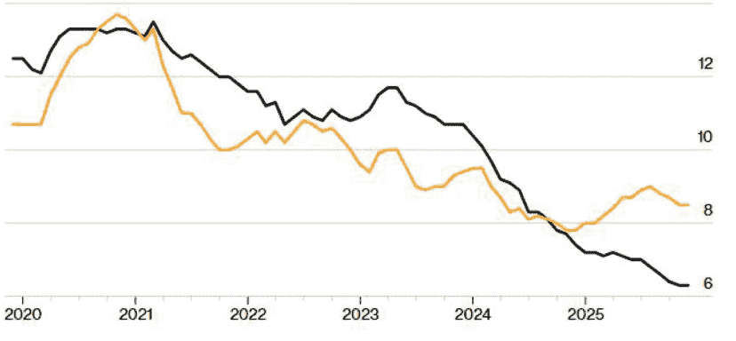

来源：中国人民银行

Jason·不喻
2025-12-13 05:09

从居民、企业中长期贷款，可以看出经济的韧性。回日本居民长期存款，当利率降至附近，存款活化抬头。那么现在利率还能下压多少低？#金融

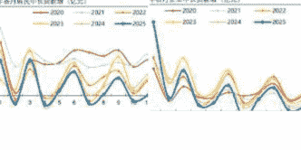

图 3：历各各月居民中长期新增（亿元）

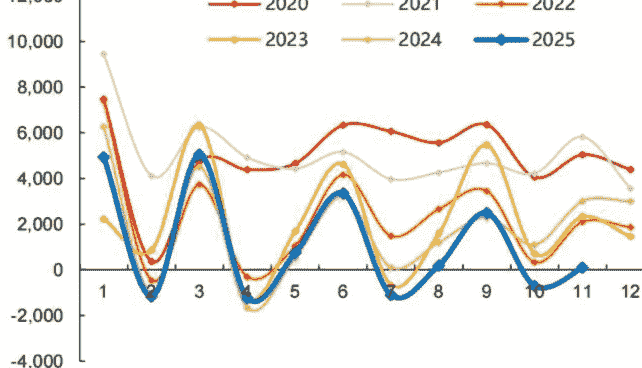

资料来源：Wind，长江证券研究所

## 加微信top28688，资料分享

### 图 5：历年各月企业中长期贷新增（亿元）

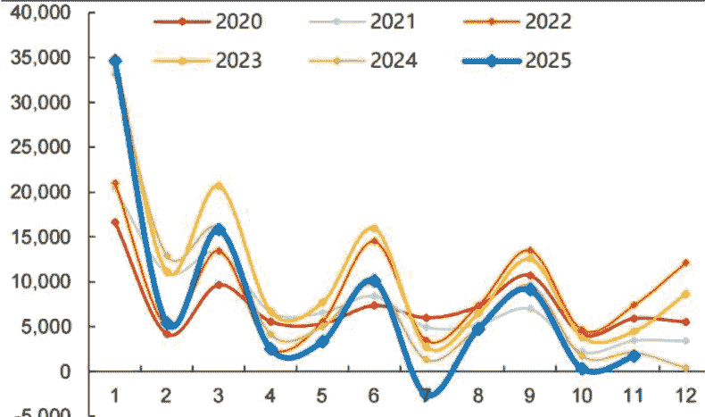

资料来源：Wind，长江证券研究所

### 图 9：日本居民存款及居民活期存款占比（万日元，%）

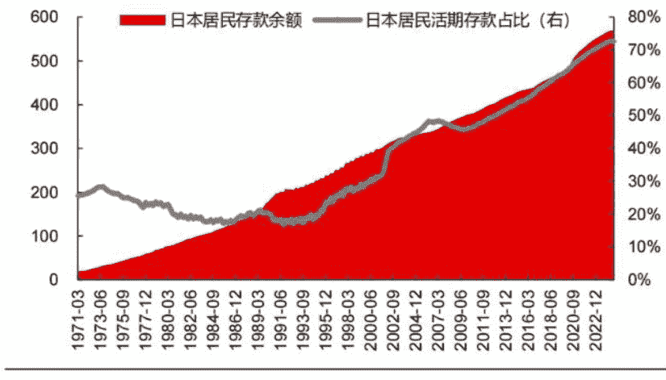

资料来源：Wind，长江证券研究所

### 图 18: 历史降准降息汇总及 2026 年降准降息预测 (BP)

| | 存款准备金率大型 | 存款准备金率小型 | 利率1年 | 回购7年 | LPR:1年 | LPR:5年 |
|---|---|---|---|---|---|---|
| 2015 | -250 | -250 | 125 | - | 121 | - |
| 2016 | -50 | -50 | 0 | -25 | 0 | - |
| 2017 | - | - | 0 | 25 | 5 | - |
| 2018 | -250 | -250 | - | - | - | - |
| 2019 | -150 | -150 | - | 5 | - | - |
| 2020 | - | - | -50 | -30 | -30 | -15 |
| 2021 | - | - | 100 | 0 | - | 0 |
| 2022 | - | - | -50 | -20 | -15 | -35 |
| 2023 | - | - | -50 | -20 | -25 | -10 |
| 2024 | -100 | -100 | - | -30 | (2次) | (2次) |
| 2025 | (2次) | (2次) | -50 | - | -10 | (1次) |
| 2026 | (1-2次) | (1-2次) | - | (1次) | -20 | (2次) |

资料来源：Wind，长江证券研究所

Jason·不喻
2025-12-13 05:16

东：我们在2024 年展望美股会“V”字走势，2025 年实际经济大致如此，但预期更为波动，我们认为2026 年从高度不确定性走出来，在财政的影响下，经济稳态走向复苏与扩张。我们预计2026 年整体EPS有12%以上的涨幅，美股

## 2026 美股展望：跨越“不着陆”

回顾2025 年，“转型”是美股全年的关键词，AI热是全球主线。经济方面，市场对美国经济从悲观转向乐观，预期回到“软陆”后，引发滑落到“不着陆”。贸易方面，关税从“倒吸”变为“松一口气”。产业方面，“AI热”交易进行。展望2026 年，我们预计美国经济仍有可能向复苏，经济增长可能全年震荡后抬头。2026 年一季度相对低，我们四个核心的理由：消费将继续复苏、行业开始回调、就业有望、财政政策迎来宽松。2025 年美股可能在降息后半年，政策力度达3%-3.25%，降次数不会大。我们基于美国将保持增长独立性的假设，美国经济如果复苏顺利，美联储可能根据数据再次转向，我们预计经济需1-2次增长，复苏集中在2026 年上半年。美股EPS有望提升。除非美股科技股出现软缩，但是科技盈利能否支撑，二是经济复苏范围扩大，除AI议外，其他企业EPS也会逐步改善，带动股市上涨。我们预计2026 年企业EPS增长12%以上。我们认为2026 美股弹性可能更大，行业上以科技&周期为主，同时看好医疗保健。

- (1) 小幅降息更大。2026 年财政+货币政策“双宽”，美国经济节奏逐步复苏。考虑就业息成本下降，压抑的需求将回弹，为小幅的复苏提供支持。市场对小幅降息近期 EPS上涨仍受影响，维持宽松周期下都会不错的表现。
- (2) 科技逻辑持续。我们认为科技逻辑持续，二是当前科技领域有半年以上都是利润的上涨；下半年科技风险，二是下半年业绩增长风险，二是如果以 Capex 支出为关键看，市场预计 Mag7的资本开发会在二季度出现。
- (3) 看好顺周期。工业、地产、可选消费和金融，顺周期基于经济复苏的节奏，扩张性从企业支出与投资开始初见底，尤其是2026 年我们预计地产将回，建议关注美国地产。

微信通28688，资料分享群

### 图2: 美国消费现状统计

### 图3: 大通胀率对居民的支持进展呈现

## 美国:京东商业零售销售:周同比

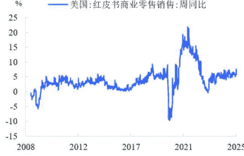

| 类别 | 同比 | 环比 |
| --- | --- | --- |
| 居民消费支出总指数 | -24.7% | -7.2% |
| 生存食品和饮料 | -7.2% | -2.7% |
| 住房租金和公用事业支出 | -3.4% | -0.3% |
| 交通工具 | -14.0% | -1.4% |
| 服装鞋 | -10.0% | -1.0% |
| 医疗保健 | -24.0% | -2.4% |
| 生活必需品 | -17.0% | -1.7% |
| 通讯服务 | -17.0% | -1.7% |
| 娱乐服务 | -22.0% | -2.2% |
| 教育 | -15.0% | -1.5% |
| 其他 | -21.0% | -2.1% |

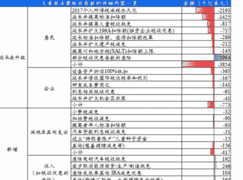

数据来源：Wind，东方证券

注：金额为财报支出，收入

### 图 13: Mag7的主要要素

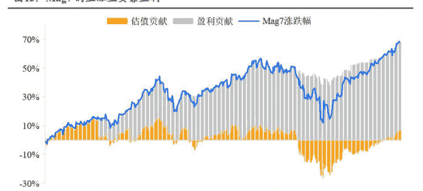

数据来源：Bloomberg，东方证券

### 图 14: 市场预计标普500 EPS有12%以上的增长

### 图 15: 2026 年企业盈利有进一步增长

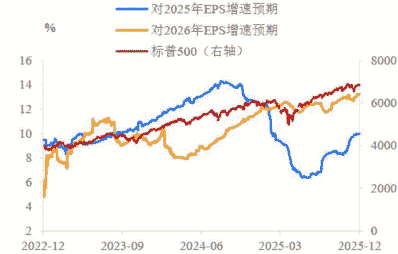
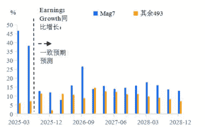

数据来源：Bloomberg，东方证券

## 加微信top26888，进资料共享

Jason-不喻
2025-12-13 05:21

bloomberg:华尔街预计2026 年美元再次走弱，美元对整体经济产生连锁反应，增加海外利，并促进进口。根据彭博共识估计，美元指数将在2026 年下降3%，今年温和。预计美元对主要币种会升值。

## 全球大银行预测美元走软

预计2026年底汇率的表现

| | EUR | JPY | GBP |
|---|---|---|---|
| Goldman Sachs | 6% | 7% | 2% |
| Deutsche Bank | 6 | 10 | 4 |
| Bank of America | 4 | 0 | 8 |
| Wells Fargo | 4 | 7 | 1 |
| JPMorgan | -1 | 5 | 2 |
| Morgan Stanley | | | |
| Citigroup | -6 | 8 | -4 |

来源：彭博

注：汇率变化相对于2025年

Jason-不喻
2025-12-13 05:29

bloomberg: 中国对欧洲的贸易逆差正在缩小，欧盟委员会峰会表示，“欧中关系”达到一个新阶段。欧洲正面临一系列压力，需要应对贸易损失，包括设立经济安全枢纽，并提高技术转型，国内价值有望促进进口条件。经济学家估计，中国出口从去年到2029年，可能增长到5%，区域就业，并使德国、西班牙和意大利的国内生产总值超过0.2百分点或更多。欧洲面临双线压力，而市场即将逼到一边看。

## 其他国家经济

微信top28688，资讯分享群

## 中国汽车出口增，进口减少

欧洲现在与中国的汽车贸易中出现贸易结构性逆差

- China-Europe automobile trade balance / Exports Imports

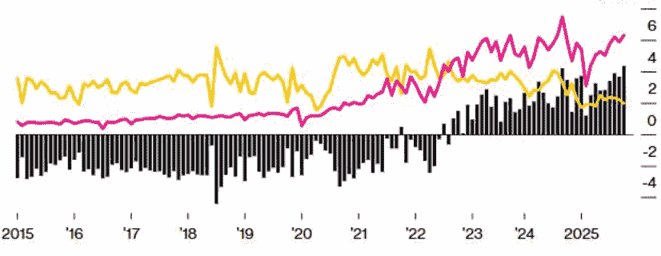

来源：樊博宏的中国海关数据

注：展示HS87节的贸易——车辆（铁路或有电车除外）及零件等

Jason何施
2025-12-13 05:48

## 德朗：2026十大可能改变全球市场走向的“黑天鹅”事件

- 汽车零部件供应链受阻：由于全球汽车生产需求激增，导致汽车零部件出现短缺，可能影响汽车产量的增长。
- 能源价格波动：受俄乌冲突影响，全球能源价格剧烈波动，可能推高汽车生产成本和运营成本，从而影响汽车市场需求。
- 贸易政策不确定性：全球贸易政策的不确定性增加可能导致关税壁垒增加，影响汽车制造业的全球供应链布局。
- 全球通胀压力上升：全球通胀压力上升可能导致消费者实际收入下降，从而减少对汽车的需求。
- 汽车行业转型加速：电动汽车技术的快速发展可能加速传统燃油汽车的衰落。

微信top28688，资料分享

- AI驱动经济高速增长；AI资本潮可能推动生产力提升，经济年化增速回升4%，重现1990年代的繁荣。
- 标普500指数跌守8000点：在AI繁荣与流动性推动下，美股可能延续涨势，实现约17%的回调。
- 美储进“软陆”；美储可能在1980年代以来最快的非衰退速度（累计超过75个基点）且抑制通胀。
- 全球景气良好超预期：受选举等政治驱动，美国可能扩大关税豁免。
- 欧洲改革：政策见效或提振经济；同时乌克兰冲突出现本土资产压力。
- 欧洲储受通胀影响：若通胀符合目标，美储可能转息并加大，暴露当前定价偏差。
- AI泡沫与市场杠杆：AI龙头（如英伟达）盈利不及预期，叠加融资杠杆处于高位，引发销量。
- 美、日债市场：市场可能维持“高利率走平”，日本“低通胀”崩塌，引发汇率波动。
- 欧洲政治与经济危机：德国政局恶化可能形成负反馈，风险溢溢引发。
- 物理世界极端灾难：如地震、太阳喷发。

## 中国宏观

##...

### Exhibit 5: The 7 largest stocks for a quarter of S&P 500 earnings

### Exhibit 6: Weight of the 7 largest stocks over time

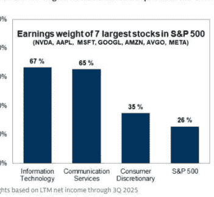
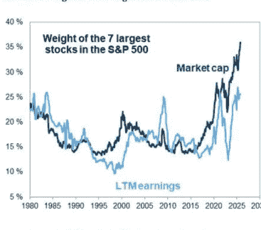

Weights based on net income through Q3 2025
Source: Computat, Goldman Sachs Global Investment
Source: Computat, Goldman Sachs investment Research

Jason 不聊
2025-12-13 06:56

## 世界行：中国经济通胀数据

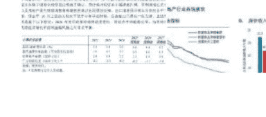

预计2025年经济增长率为4.9%，2026年为4.4%。受劳动力市场疲软和房地产价格政策调整影响，居民消费支出将维持增长。10月发布的新房政策以及近期市场领域出现关键政策调整将导致市场幅度扩大，但长期增长动力和房地产的持续压力预计将有力反弹。出口增长预计将维持目前的水平，由于之后的相关政策从年初开始升温，出口将受以下影响：2026年财政政策将维持适度宽松，财政赤字有望微收窄，当局可能在支出增长和控制风险之间面临平衡压力。

| | 2022 | 2023 | 2024 | 2025预测值 | 2026预测值 |
|---|---|---|---|---|---|
| GDP增长 | 3.1 | 5.0 | 4.9 | 4.4 | 4.2 |
| 居民消费价格指数（同比变动） | 2.0 | 0.2 | 0.3 | 1.0 | 1.5 |
| 居民净收入（GDP占比） | 2.4 | 1.4 | 2.2 | 2.5 | 1.3 |
| 出口增长（GDP占比） | -6.1 | -5.5 | -5.6 | -8.2 | -7.7 |

中国宏观

注：数据来自世界银行

上述经济前景的上行和下行风险均存在。此外，景气依然存在不确定性，国内，房地产压力可能进一步加剧，利润空间收压可能导致政策转向，从侧面改善劳动力市场并推行政策。预计2026年财政支出将超出预期（包括加大基本安全支出），或者政府将更新政策预期来稳定经济增长，超出短期预期。

面对外部的不确定性，中国的政策将

关注我的微信，进资料群

高股：七大股票（NVDA, AAPL, MSFT, GOOGL, AMZN, META）占标普500市值的36%，预计将在2026年贡献收益增长的46%。美股

微信top26888，进资料群

# 知识星球TOP资源群

# 入群畅看全网付费资源

 分享资源目录（部分）

| 序号 | 公众号/星/群/V会员 | 原价 | 领域 |
|---|---|---|---|
| 1 | 生财有术 | 2765/年 | 侧业·搞钱·电商·自媒体 |
| 2 | 欧洲金驼 | 328/年 | |
| 3 | 悠悠（访体中） | 365/年 | |
| 4 | 政堂/狮子明彰会 | 568/年 | |
| 5 | 卢克青云会 | 699/年 | |
| 6 | 江子知幂 | 365/篇 | 时政·经济·国际·历史 |
| 7 | 米联储见闻 | 599/年 | |
| 8 | A视野 | 26/篇 | |
| 9 | 猫哥的世界 | 299/年 | |
| 10 | 宁夜人总令 | 599/年 | |
| 11 | 付鸭 | 1888/年 | |
| 12 | 洪澜的宏观策略 | 899/年 | |
| 13 | 金融通鉴/北海海南 | 4576/年 | |
| 14 | 丁长灵星球 | 1599/年 | 股市·财富·地产·趋势 |
| 15 | 鉴茶财经院 | 330/年 | |
| 16 | 雪雪花老头 | 66/篇 | |
| 17 | 飞龙鸿 | 3600/年 | |
| 18 | 安民分析 | 28/篇 | |
| 19 | 水库欧大 | 6980/年 | |
| 20 | 智谷趋势 | 498/年 | |
| 21 | 记忆承载/智树西风 | 365/年 | 社会·职场·成长·认知 |
| 22 | U君/赢在八小时之外 | 365/年 | |
| 23 | 贰掌柜（学习笔记） | 99/年 | |
| 24 | 体制内主任 | 599/年 | |
| 25 | 外局人的视野 | 669/年 | |
| 26 | 潇沫异谈 | 4166/年 | |
| 27 | 大树闲谈 | 199/年 | |
| 28 | 图书、报告等资源 | | |
| 29 | 影视、软件等资源 | | |

**VIP 群：特惠88/年 + 每日分享所有资源+ 入群送资料** (原价数万元)

**免费群：可免费进群+ 每日享一部分资源**
