# 南亚购财经25124

Jason-不赢
2025-12-14 01:43

民生：最近几年，美在结束下年的美元走势容易行情。如果今年未能走崩，美强可能是明年的基本形态；如果明年再次出现连涨的预期，那么什么原因可能导致美元外升？首先是货币政策的周期问题。美国的宽松可能未必是明年美、欧、日的宽松周期。次则是还是财政政策问题。欧洲或许仅只有两个国家，其他比如德国和意大利，政府债务占比重，德国美国也是并肩者。如果以德国为代表的国家决定收缩政策，两国的通胀差异，会导致欧元走弱，美元反弹的重要重心。第二则是非美国经济的周期问题。同样是这个相对的周期。毫无中国的经济周期很难避免。但并不意味着全年都是强的，末资金的表现可能会比较弱。我们认为，明年中国的表现可能会比较均衡，是否会在回涨和震荡。

所以，结论是，明年预计还处于调整期中，但是可能没有想象中那么久。金融收起

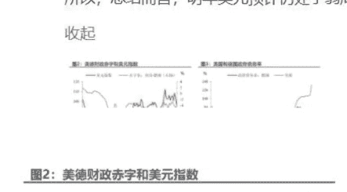

来源：国信证券研究院

加信微信资料共享

Jason-不赢
2025-12-14 01:51

花熵：中美市值都在“科技化”，中国在2025年走了美国2022-24的路，中美模型性能差异在收敛，近几年科技领域增长率带来足够冲击，“jobless”就业“味”，比如规模上工业企业自2014年以来由于自动化而减少约2300万，另外工作时长并没有明显下降，用IMF的框架数据面临巨大压力，并指出约6400万岗位可能面临直接影响的风险。经济转型

加微信top28688，资料免费共享

## Tech-driven growth doesn't seem to bring more jobs

- Urban employment appears to be peaking out in the 2020s despite solid GDP growth;
- 23mn jobs have been lost to automation in large industrial enterprises since 2014 peak

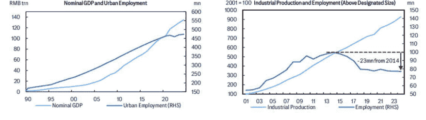

## Jobless growth?

- Job descriptions have been owing with 52mn jobs at national level in the past decade;
- The employed are working longer hours

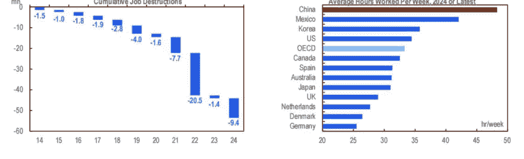

## How many jobs could be at risk?

- ~64mn jobs could be at direct risk of displacement;
- AI perhaps already shown its early impact with new jobs having lower AI exposure

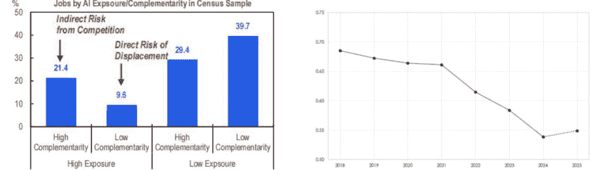

微信top28688, 资料分享

## Jason不离

JPM: 11月新增人民币贷款是自2009年以来最差的11月表现，贷款同比增速达至6.4%，创历史新低。M1-M2 剪差扩大，市场热闹，但实体循环受阻。不要过度解读会议关于价格回升的表述，并不意味着政策立场转向激宽松，货币宽松更多是信号意义，而非独立动物的工具。,金融 进群加微信pe854

Ting Ge
ting.ge@jpm.com
Asia Pacific Economic Research
12 December 2025

J.P.Morgan

## China: Money supply and loan growth

| Credit impulse | TSF growth - nominal GDP growth |
| :--- | :--- |
| 25 | 45 |
| 20 | 40 |
| 15 | 35 |
| 10 | 25 |
| 5 | 20 |

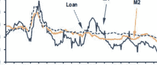
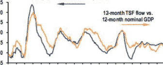
Source: PROC, J.P. Morgan

### Aggregating financing by type

| Nov 23 | Nov 24 |
| --- | --- |

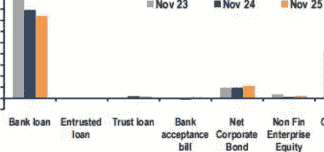
Source: PROC, J.P. Morgan

加微信top28688，资料分享

## Jason不离

2025-12-14 02:16

中国：近年来，MSCI指数涨幅达28%，显著优于MSCI新兴市场同步，但与美国、英国、韩国等市场相关性较低。自2020年以前印度指数与全球指数同步，仍是内需型经济体，居民消费占比超过60%，及服务业PMI处于扩张区间，显示国内经济活跃。2021年以来，中央债务占比从59%减少到55%，观测到债务被转嫁至地方，地方债务存在隐忧。自2014年推出“制度计划”以来，制造业的发展远不及预期。“制度计划”目标将制造业增加值占比提升至25%，实现这一目标的年份从2014年至2024年，向外直接投资更多流向服务业，服务业直接投资占比仅为2%，实际上，制造业增加值占GDP并未回升，从2015-16年高点17%下滑至2024-25年。制造业创造的就业占总人数比例维持在12%左右。其他国家：

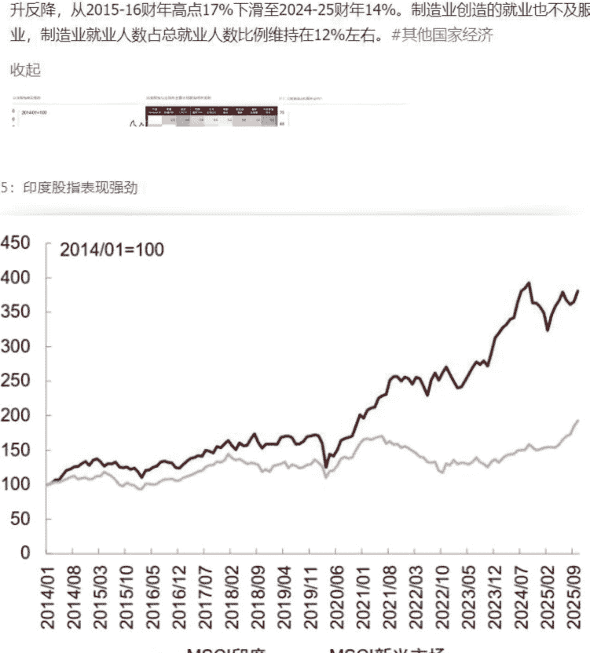
数据来源：Haver，中金研究院

加微信top28688，进资料群

### 图6: 印度指数与全球股票指数相关系数

| 印度Sense30 | 美国标普500 | 英国CAC40 | 德国德国特100 | 日本日225 | 韩国综合 | 新加坡海登 | 澳洲指数 | 中国领先生 | 中国大陆沪深300 |
| :--- | :--- | :--- | :--- | :--- | :--- | :--- | :--- | :--- | :--- |
| 印度Sense30 | 0.5 | 0.6 | 0.6 | 0.4 | 0.2 | 0.5 | 0.5 | -0.2 | -0.3 |
| 美国标普500 | 0.5 | 0.6 | 0.8 | 0.4 | 0.3 | 0.6 | 0.7 | 0.0 | -0.3 |
| 英国CAC40 | 0.6 | 0.6 | 0.8 | 0.4 | 0.3 | 0.6 | 0.7 | 0.0 | -0.3 |
| 德国德国特100 | 0.6 | 0.8 | 0.4 | 0.3 | 0.5 | 0.7 | -0.2 | -0.2 |
| 日本日225 | 0.4 | 0.4 | 0.3 | 0.3 | 0.3 | 0.3 | 0.3 | -0.1 | -0.2 |
| 韩国综合 | 0.2 | 0.3 | 0.2 | 0.3 | 0.3 | 0.3 | 0.3 | 0.1 | -0.1 |
| 新加坡海登 | 0.5 | 0.5 | 0.6 | 0.4 | 0.3 | 0.3 | 0.5 | 0.1 | -0.1 |
| 澳洲指数 | 0.5 | 0.7 | 0.7 | 0.3 | 0.3 | 0.5 | 0.2 | -0.1 |
| 中国领先生 | -0.2 | 0.0 | 0.0 | 0.2 | -0.1 | 0.3 | 0.1 | 0.6 |
| 中国大陆沪深300 | -0.3 | -0.2 | -0.3 | -0.2 | 0.3 | -0.1 | -0.1 |

注：为2020年1日至2020年11月相关系数
数据来源：Wind，中金研究院

### 图11:制造业和服务业PMI

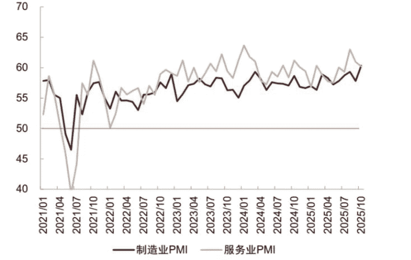
注：PMI在50以上为扩张区域
数据来源：Haver，中金研究院

加微信top28688，进资料群

### 图表14：政府债务占GDP比例

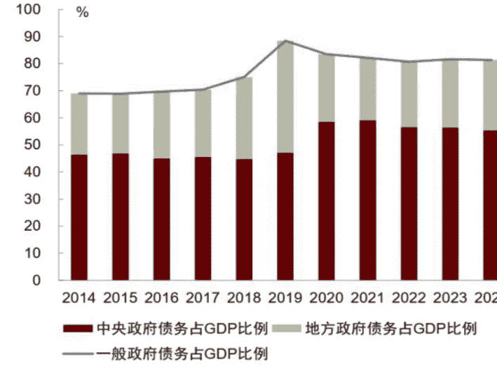
注：年份为财年
数据来源：Haver, IMF，中金研究院

### 图表23：制造业增加值和就业占比

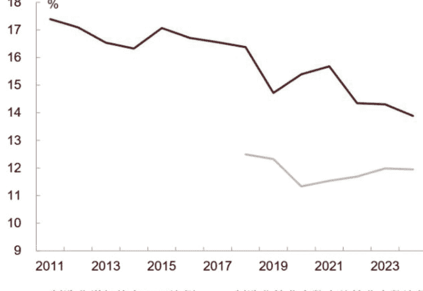
注：以上制造业增加占比为财年
数据来源：Haver, ILO，中金研究院

加微信top28688，资资料群

### 图表27:十年期国债收益率

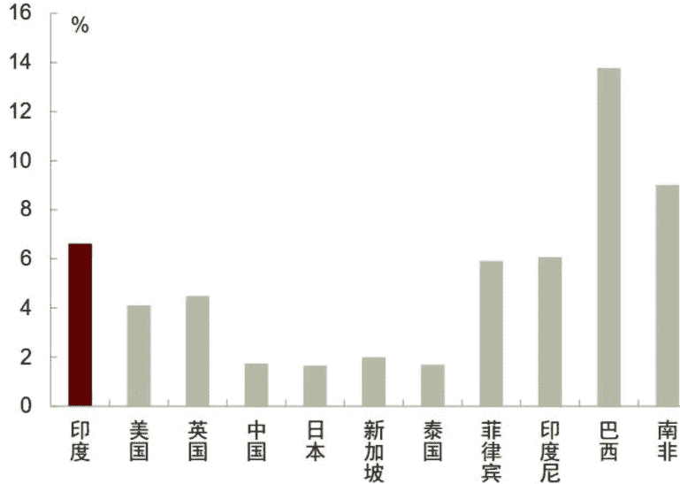
注：以上数据为2025年10月数据
来源：Haver，中金研究院

## Jason不离
2025-10-14 02:29

Bloomberg:随着新年的临近，华尔街策略师建议客户购买市场中受欢迎的领域，如医疗、工业和资金转向被低估的周期性股票、小型股票。自1月20日美国股市接近低点以后，小型罗素2000指数飙涨了11%，同期M7一半。摩根士利预计2026年将有“大牛年”，今年表现不佳的金融和非必需股票以及小型股

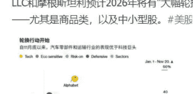

## 轮换开始

自1月以来，汽车零部件和运输行业的表现优于科技巨头

- Tech Eco Risk-on Defensive Sectors

Jan - Nov 20. 60%
- Alphabet Semiconductor
- Auto components
- Transports

Since Now. 21
来源：智博社

Jason-不离
2022-12-14 03:39

### bloom: 美、欧、中实际有效率(2020=100)

- Real effective exchange rate - Chinese yuan dollar Euro
- Real effective exchange rate - Chinese yuan dollar Euro
120 index (2020=100)

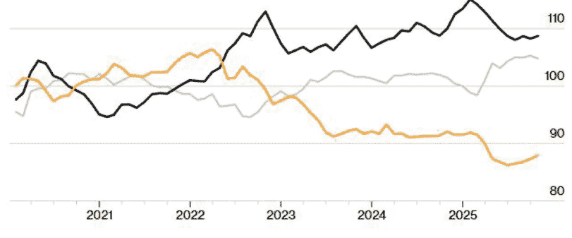
来源：国海证券

加微信微信28688，进资料群

## Jason不赢
2025-12-14 03:24

韩文提到GDP连续过110万亿、120万亿、130万亿，今年预计达到140万亿。没有提到的是，最近5年增长的GOV债务，也是年均10万亿+，未含平台经营性债务、经营性国国企业自制数据

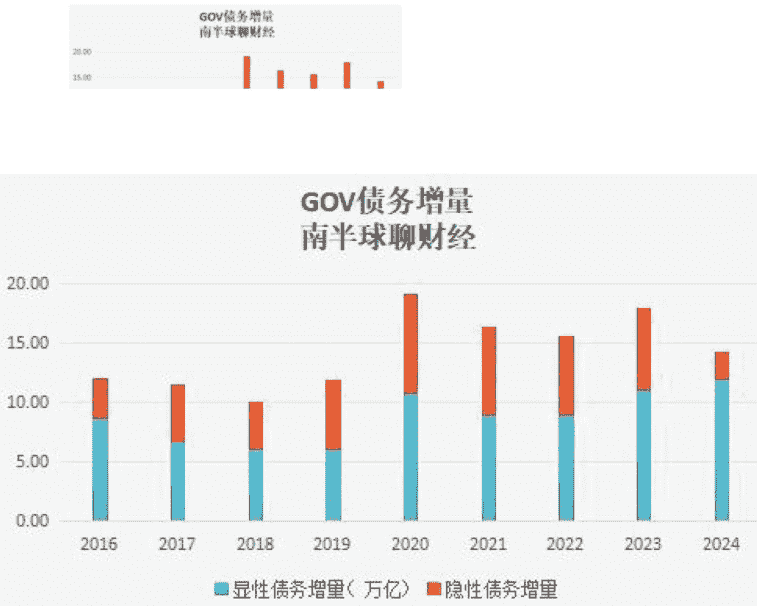

## Jason不赢
2025-12-14 03:33

不同属性的工业企业利润率自制图表(by统计年鉴2025)

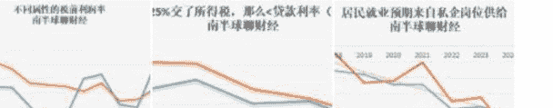

加微信top28688，进资资料群

### 不同属性的税前利润率

### 假设按25%交了所得税，那么利率(1.1倍）

### 居民就业预期期间企业供给

## Jason不离
2025-12-14 04:26

买房人口变化
25-49岁人口（by昔）静态推估
每年进入79岁（城市）
25-49岁人口（by昔）静态推估

| 25-49岁人口（万人） | 每年进入79岁（城市） |
| :--- | :--- |
| 25-49岁人口（净增） | 每年进入79岁（城市） |

## Jason不离
2025-12-14 04:42

农村人口结构，2020年后最多的50-59岁年龄段（约900万人口），他们对社保产生压力自制图表

## Jason不离
2025-12-14 05:48

BOFA: 从1900年以来，美国60/40投资经历了六个“失落的十年”

### Exhibit 3: US 60/40 portfolios endured "lost decades" since 1900
Cumulative performance of a 60/40 portfolio, real prices, log scale

Source: BofA Research Committee, Global Financial Data. Note: 60/40 = 60% S&P 500 total return and 40% US 10-year bond total return.BofA GLOBAL RESEARCH

## 知识星球TOP资源群
入群畅看全网资源分享资源目录（部分）

| 序号 | 公众号/星球/V会员 | 原价 | 领域 |
| :--- | :--- | :--- | :--- |
| 1 | 生财术 | 2765/年 | 副业·搞钱·媒体 |
| 2 | 欧洲金轨 | 328/年 | |
| 3 | 悠悠（满体） | 365/年 | |
| 4 | 政事堂/狮子明私享 | 568/年 | |
| 5 | 卢克青云会 | 699/年 | |
| 6 | 江于知否 | 365/篇 | 时政·经济·国际·历史 |
| 7 | 米联储见闻 | 599/年 | |
| 8 | A视野 | 26/篇 | |
| 9 | 猫哥的世界 | 299/年 | |
| 10 | 宁夜人总令 | 599/年 | |
| 11 | 付鸭 | 1888/年 | |
| 12 | 洪澜的宏观策略 | 899/年 | |
| 13 | 金融通鉴/北海南山 | 4576/年 | 股市·财富·地产·趋势 |
| 14 | 丁长灵星球 | 1599/年 | |
| 15 | 鉴茶财经院 | 330/年 | |
| 16 | 雪雪花老头 | 66/篇 | |
| 17 | 飞龙谈 | 3600/年 | |
| 18 | 安民分析 | 28/篇 | |
| 19 | 水库欧大 | 6980/年 | |
| 20 | 智谷控势 | 498/年 | |
| 21 | 记忆承载/智树西风 | 365/年 | 社会·职场·成长·认知 |
| 22 | U君/赢在八小时之外 | 365/年 | |

加微信top28688，进资料群
