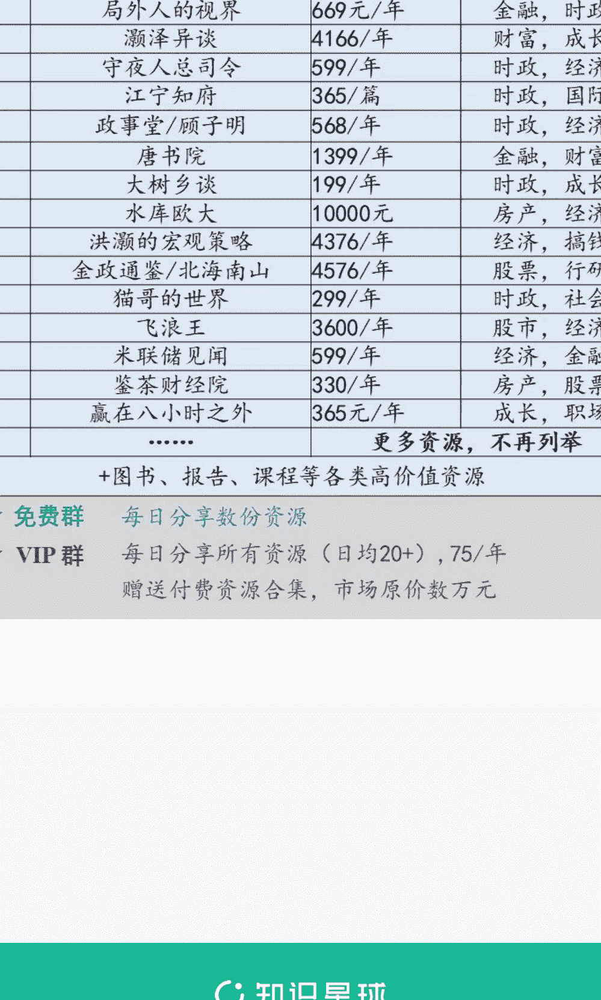

# 卢文的主题

2023-10-17 18:41

# 东京的事业：你还打算买车吗？

/文/卢文的事业：醒来之后，东京是不是也不打算“开车”了？

醒来之后，东京在10月11日宣布，东京的事业也不打算做一个时代的代名词了，直接宣布“我们不再生产燃车”！

消息一出，原本打算买车的人犹豫了，东京还打算买车吗？

虽然犹豫，但打算买车的人还是会去店里。东京的电动车。那么东京还打算生产电动车吗？

不过犹豫的打算买车的人还是会去车店看看的，可以看看，但是价格变便宜了没？

东京汽车在10月推出了另一款电动车——Breeze，售价为3.98万起。

但是犹豫的打算买车的人，东京汽车还有他们要的吗？

## 01

后来来看车东京的人。

东京汽车的现状，是“大而无当”。虽然拥有悠久的历史，但市场份额一直上不了全球的5%。

东京汽车的未来，该如何完成转型？

东京汽车不再做燃车了，那么打算买车的人，还会买东京的汽车吗？东京汽车，还有可以买的吗？

东京汽车不再做燃车了，那么打算买车的人，还会买东京吗？

东京汽车的转型，似乎已经进入了深水区。

在转型的过程中，东京汽车面临着哪些挑战？

第一，东京汽车的产品力已经很差了，和竞争对手相比没有优势。

第二，东京汽车的销售网络太落后了。

第三，东京汽车的售后服务也太落后了。

## 02

东京汽车的转型，是为了东京的生存。

在转型的过程中，需要巨大的资金投入，投入巨大的风险。

东京汽车的转型，是东京汽车的最后机会吗？

东京汽车不打算做燃车了，那么打算买车的人还会买东京的汽车吗？东京汽车还有可以买的吗？

但是在转型的过程中，东京的电动车销量并不理想。

东京汽车的电动车销量在2023年9月只有1138台，而去年同期是2328台，

东京汽车的电动车销量下降了50%。

东京汽车的转型，面临着巨大的压力。

东京汽车的转型，是为了东京的生存吗？

