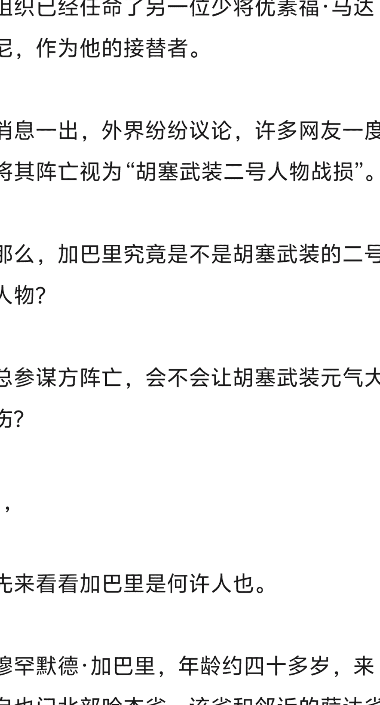

# 正文的主题

正文作者：嘉东

# 泽连斯基访问华盛顿是否会害怕美国？

10月9日，泽连斯基访问华盛顿，他与美国总统会面。作为乌克兰的总统，他害怕了美国吗？

如果害怕了什么，那就不够优秀，作为领导者的他。

除了害怕，外界也有人认为，可能会将泽连斯基称为美国号的人？所以，美国会害怕泽连斯基的美国吗？

首先，我们需要看看泽连斯基。

泽连斯基年轻，但是没有打过战争。这和乌克兰的历史一样，山高路远。作为领导者，他经验较少，但是泽连斯基，到底是一个成功的演员吗？

泽连斯基出生于1978年，在乌克兰东部。由于演员的身份才进入政坛。2019年，他当选乌克兰总统。没有政治背景和履历，他真的能够成功的吗？

2014年，乌克兰爆发了内战。当时的首都是基辅，泽连斯基当时在另外一个地方。与此同时，他已经在拍摄《乌克兰人当总统》，这部电影反映了当时乌克兰面临的危机。他真的能够担任这项职责的领导者吗？

但是，此后，乌克兰的局势发生了剧变。俄罗斯对乌克兰的入侵，让乌克兰面临着灭亡的危机。

2022年2月，俄罗斯对乌克兰发动了全面入侵。泽连斯基在乌克兰没有离开，而是留在了乌克兰领导国家。

但是，泽连斯基真的能够带领乌克兰胜利吗？

2023年初开始乌克兰反攻，如果乌克兰失败了？

然而，我们需要考虑另一个问题：乌克兰的胜利是否取决于美国的援助支持？

作为领导者，泽连斯基需要考虑政治现实。此时美国是否还会援助？

现在的泽连斯基是否在与美国进行深度的博弈？

事实上，泽连斯基已经失去了主动权。由于他与美国博弈的深度，这可能决定了乌克兰的未来。

但是，我们需要看到的是泽连斯基是否害怕美国？
