# 椭圆形办公室的背后：特朗普政治斗争大起底

源创 岱山 卢克文工作室 2025年10月31日 11:34 四川

# 序

本文截于10月11日，从特朗普一天的视角，重点描述特朗普背后的资本力量及其美国外交的关系。

# 一、失去2025年诺贝尔和平

2025年10月11日，诺贝尔和平奖揭晓的时候，华盛顿的天窗亮透半边，凌晨5点的白宫静静得只剩听风声，79岁的特朗普被床头的一通电话叫醒。

电话那头是他的苏西·威尔斯。这位美国首位白宫女首席秘书长，在政坛混了40多年，为人低调，性格沉稳，是特朗普最贵的“操盘手”，江湖人称“造王者”，特朗普称她为“骗子”。

此时，苏西·威尔斯的心有些如翼，“总总统先生，按照您的吩咐，第一时间打电话告诉您消息。令人遗憾的是，今年的诺贝尔和平奖……不是您。”

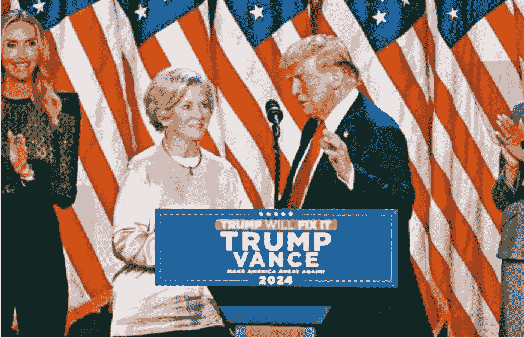

只睡了四个小时后的特朗普，立刻没了睡意。一股不服气的火从脚底蹿到头顶，他跟着被子爬起来，手指在“真实社交”上打得飞快：“我才是真正的和平导师！”三次感叹压不住特朗普的憋屈。

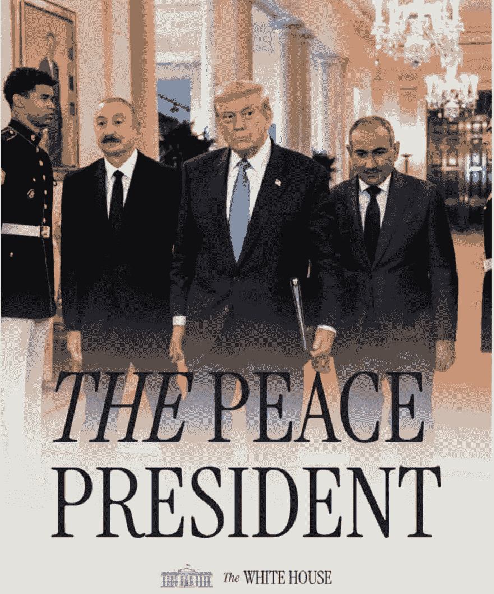

## THE PEACE PRESIDENT

特朗普每天起床的第一件事不是处理家事大事，而是看报纸、看电视，紧接着从二楼的总统套房下楼，急匆匆前往一层西侧的圆形办公室。

是的，特朗普每天起床的第一件事不是处理家事大事，而是看报纸、看电视，紧接着是发推文。美国的政策，就是被特朗普的推文推动的，一通过特朗普的挥气，了解各类事件的最新进展。

路过白宫西翼柱廊“总统光大道”的时候，特朗普突然停住脚步。这是他按照好莱坞“星光大道”改造的杰作，两个星球期刚刚落成。

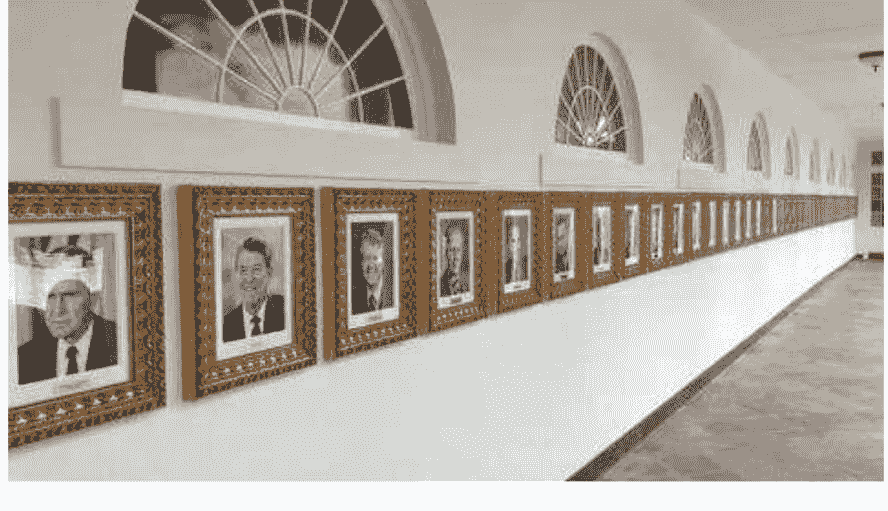

特朗普的视线停留在西奥马尔·罗斯福的肖像上。那是他的偶像。老罗斯福1906年靠调停日俄战争获得诺贝尔和平奖，是第一个获得该奖的美国人。

特朗普2025年1月的就职演说，满篇只提到了两位美国总统，一个是麦金莱（老罗斯福担任副总统），另一个就是老罗斯福（在麦金莱遇刺后继任总统），这两位都是美国“进步时代”的代表人物。

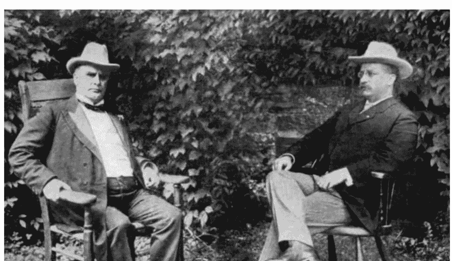

## 麦金莱和老罗斯福

老罗斯福的大外交是特朗普外交思想的理论源泉。老罗斯福说“稳在口，大握在手”，“赢在口，大握在手”，老罗斯福修筑了巴拿马运河，特朗普也要收购巴拿马。麦金莱和老罗斯福支持高关税政策，特朗普也要大搞“关税战”。

“老罗斯福能拿到的，我也想要。”特朗普对着像子喷了句，接着被玫瑰洒走。九月的玫瑰全妥协了，露出头衔的，像极了老罗斯福此刻的心情。

等进圆形办公室，特朗普的火气消失了一些。这里几乎装修完的一天，金色窗帘、金色地板、金色墙、电视遥控器都套着金色外壳，让人心情大好。特朗普坐下，这金闪闪的圆形办公室是美国“黄金时代”的预兆。

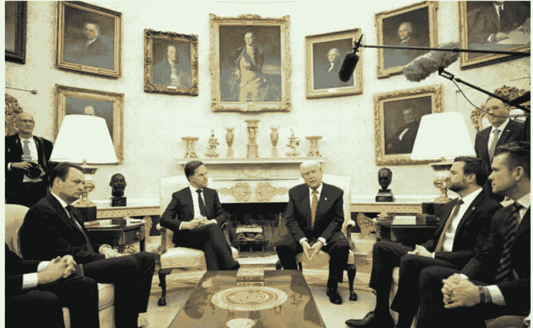

在金色闪闪之中，特朗普开始了一天的工作。按照特朗普的话，开始了一天的战斗！

> 《椭圆形办公室的背后：特朗普政治斗争大起》，由从事国际政治研究的行业专家卢克文写作，通过多年访谈，有着三十年的国政研究经验，是美国政治的一把手。但对于专家来说，双方曾多次沟通，才合成了近半年时间，才写了《椭圆形办公室的背后：特朗普家族崛起》这样的佳作。大家看到这段话，应当知道特朗普对国际局势的深度达到了很高水平。融合了通俗与深度，作品既保证了深度，又促进了可读性。这篇《椭圆形办公室的背后：特朗普家族崛起》，作者卢克文跟特朗普反复修改了一个月，但是依然保持了上水平，以及提供了有趣的阅读体验。

# 二、威特夫、房地产、中东

上午时，特朗普看完了白宫办公室上的“总统每日”。以前的“总统每日”多是重要情报，如今白宫官员善于看脸色，根据特朗普的喜好专门挑选关于特朗普的报道和慰藉。为了获得诺贝尔和平奖，特朗普显然对今天的局面不满意，转手发了一条推：“决定了7场战斗，即将解决洛杉战斗，还在推进俄乌冲突，我应该获得诺贝尔和平。”

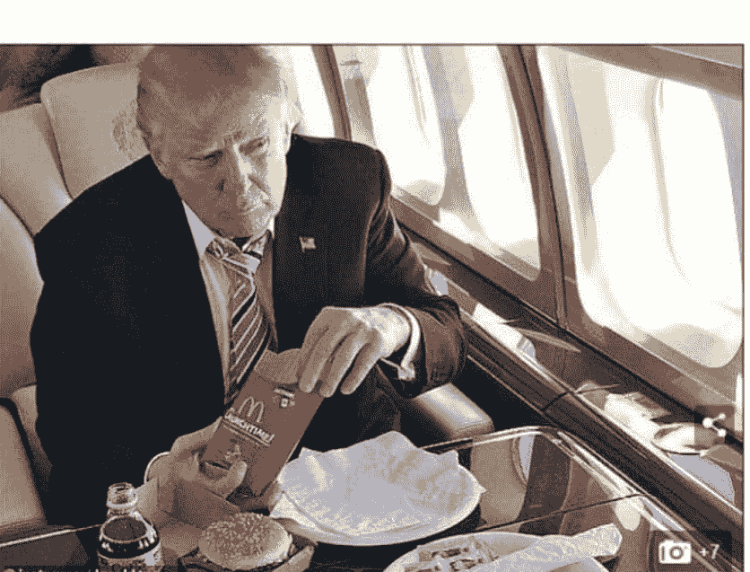

生气的时候最容易，但汉堡解决不了事的。特朗普按了一下桌子金色“核按钮”，立刻叫人来最喜欢的麦当劳“总统套餐”：两个巨无、两个麦香鱼堡，外加一杯巧克力牛奶。大口吃的时候，特朗普看了今天的日程，早上8点，他将会见到威特夫。这让特朗普想到了一些陈旧事。他与威特夫的相识也同汉堡有关。1986年的纽约街头，特朗普买堡忘记带钱，威特夫为他购买了一块奶酪三明治，从此为“汉堡之交”，之后在纽约地产打拼，结下深厚友谊。某种程度上，威特夫实际上是特朗普家族的主理人。

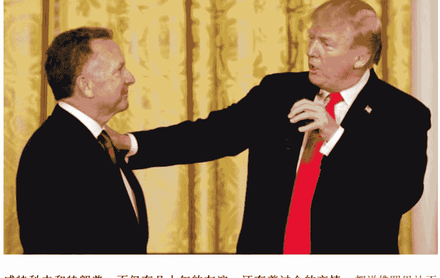

威特夫和特朗普不仅有几十年的友谊，还有过命的情交。都说佛里达不养闲人。特朗普2024年9月刚遭遇宾夕法尼亚的枪杀，紧接着9月又遭遇罗里达州的枪杀。特朗普和威特夫喜欢周末一起去罗里达州俱乐部打高尔夫。一位穷巧的大叔在高尔夫俱乐部附近潜近12小时时试图射特朗普。68岁的威特夫担任助手，帮助特朗普的人身安全。

威特夫的忠心得到了特朗普的高度认可。于是，特朗普把最重要的对外问题交给了威特夫和特朗普的儿子库什安排。第一期，特朗普把中东问题交了库什，饱受家人批评。第二期特朗普很隐晦，搞了个“明里暗里”的组合，威特夫在明，库什在暗，一个政治，一个搞京。

上面，特朗普让威特夫在美国总统任期内处理对外问题，负责斡旋以免冲突。威特夫和库什带领，深入政策解析，最终实现了

诺贝尔和平奖公布前天，以色列共和与哈马斯停火。

私下，特朗普家族在中东规模扩张房地产版，目前正在推进沙特吉尔达、沙特普莱、阿曼特普、以及以及卡塔尔高尔夫度假村等项目，还计划在沙贾地区、艾兰高地等地区建房地产，而库什的私募股权公司Affinity Partners获得了沙特等中东国家的巨额投资，这为特朗普在中东开发房地产提供了支持。

2024年，特朗普集团拿到了4460万美元的外国许可和开发资金，比2023年增长了倍。威特夫、库什纳中东“铁三角”。如此，沙阿拉伯主权基金曾于2024年2月在美国迈阿密举办“未来投资峰会”，这是专门为特朗普量身打造的一场峰会，威特夫和库什全程陪伴，在会上制定了一项目标：沙特资助超级高尔夫联赛（LIV Golf），而特朗普和库什纳深度参与其中。8点，威特夫西装准时出现在门口，特朗普见威特夫主要是为了两件事：一是筹备在埃及举行的和平峰会，特朗普希望更多领导人参加；二是筹备白宫新建宴厅，募资2.5亿美元。两场活动越好。

## 媒曝光特朗普开始“拆白宫”

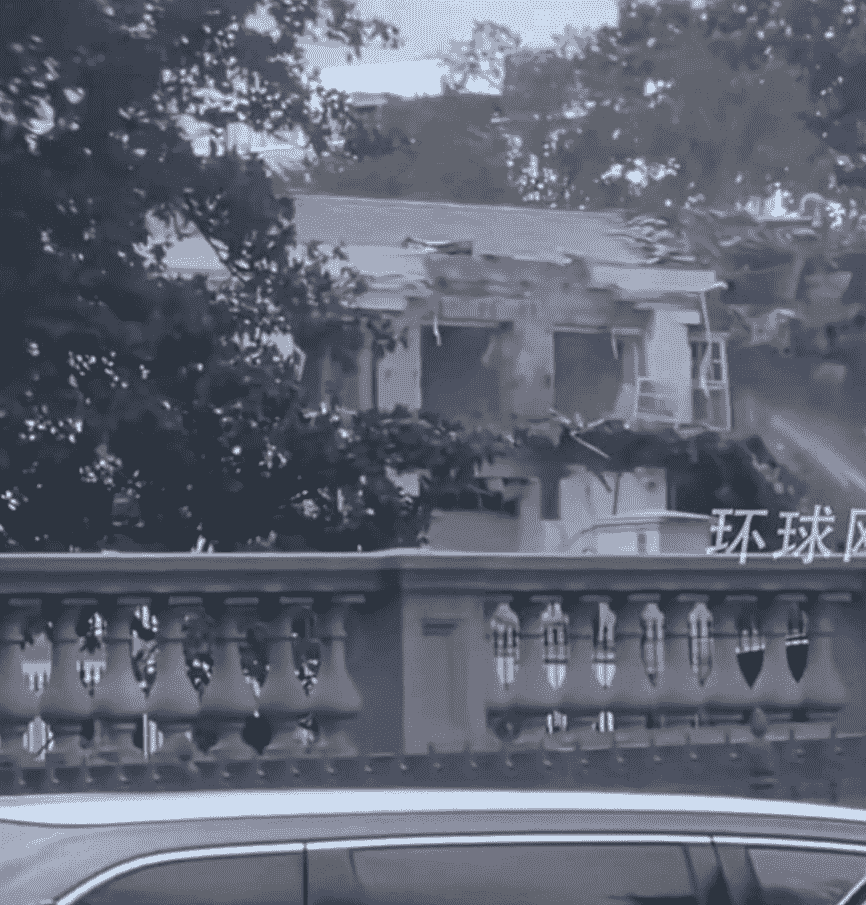

据报道，特朗普决定为白宫新建一座面积达9万平方尺（约8300平方米）的宴厅。威特夫二话不说，应了下来。后来10月13日，特朗普飞往俄罗斯出席峰会，联合国秘书长、英国首相、德国总理、土耳其总统等多个国家和国际组织领导人给特朗普排了面。10月15日，特朗普在白宫举行豪华晚餐，邀请了数十家企业代表和亿富翁，预估造2.5亿美元白宫新建宴厅。

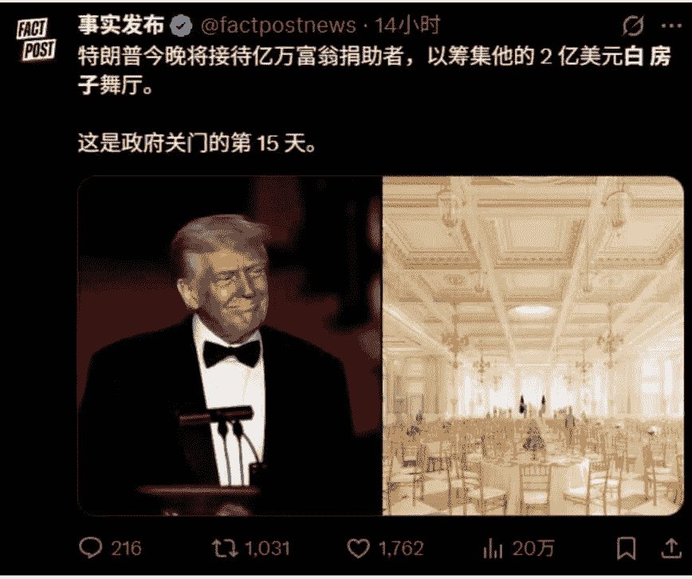

大佬总是把重要的事情交给放心的人。实际上，威特夫还看着俄乌冲突，光莫斯科就飞了次。上午9点，马斯克一身西装走了。威特夫没走，陪着特朗普一起见到了美国几个特使。

# 三、马斯克、新科技资本、俄罗斯

华尔街的科技资本多倾向于民主党，马斯克在2020年大选公开投了拜登一票。但2022年发生了什么使马斯克改变立场？最近一段时间，特朗普曾一见马斯克，立马热情地抱上去，还拉着他看椭圆形办公室的棒球展示柜。特朗普指其中一项红色棒球帽说道：“我最喜欢这一款。”另一面特朗普和马斯克相视一笑，这顶棒球帽上写着，“特朗普在所有事情上都是对的”。大家彼此心明如肚，他们的关系堪了。美国政治与金钱的关系如融合，特朗普和马斯克的关系就是如此。

一方面，特朗普的竞选活动需要马斯克的金钱支持。马斯克是特朗普2024年竞选最大的金主，个人政治捐高达2.5亿美元，也是支持特朗普的最大科技资本。硅谷的科技巨头如微软等往往倾向于支持民主党。马斯克2022年收购X后的第一件事，是恢复特朗普的魅力。

另一方面，马斯克的商业版需要政府政策的背书。马斯克的的公司太空探索项目（SpaceX）、特斯拉等需要政策采购合同。当特朗普通过“大而美”法案，削减电动车的补贴时，马斯克自然免不了绝望。吵吵闹闹，生意不能闹。马斯克此前说要和特朗普决裂，成立《美国党》，但迟迟没有提交。相反，马斯克6月底向支持MAGA、“拯救美国”等政治行动委员会捐款1500万美元，作为好特朗普的举动。

特朗普接了马斯克的桃子，自然也向马斯克继续回报李子。今年9月，美国总管理局宣布将马斯克的xAI公司合作，推出“政府Grok”，给马斯克送了份官方订单。

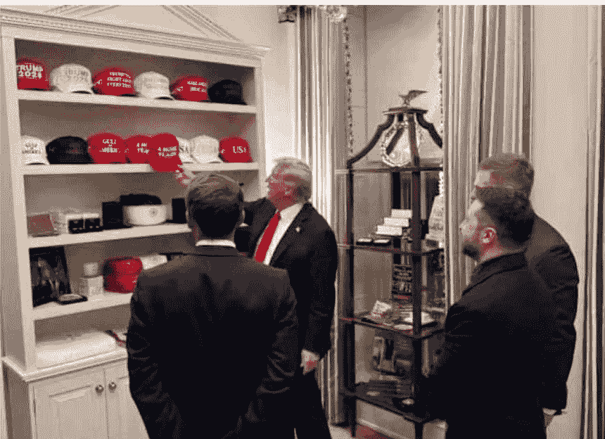

## 关系回暖? 外媒：特朗普与马斯克“再联手”，联邦机构推出“政府Grok”

【环球网报道】据福克斯新闻、英国《独立报》等媒体报道，美国总管理局于25日宣布将与知名企业家马斯克旗下的人工公司合作，联邦机构能够以最低价格使用该公司的人智能（AI）模型。《独立报》此评，特朗普与马斯克的关系似乎回暖，二人再度联手。本质上，特朗普和马斯克是一类人，他们代表了美国政治权力的趋势。特朗普的主题是继续乌克兰战争，没有马斯克的“星链”，乌克兰在战场上就是“瞪眼”。马斯克倾向于继续乌克兰战争，以便向欧洲出售武器。因此，特朗普不得不考虑这部分精力。马斯克的SpaceX还在使用俄罗斯研发的火箭发动机。当年苏联发射第一颗人造卫星，震惊了美国上下，这就是著名的“斯普尼克时刻”。

因为因为想做生意，马斯克极力劝特朗普尽快从乌克兰抽身。马斯克公开批评乌克兰的腐败，并在里面回复：“乌克兰是个烂国家”。这番言论把泽连斯基气炸了，却让俄罗斯乐了。不光马斯克，马斯克的父亲对俄罗斯的态度更为积极。马斯克多次称赞俄罗斯，夸奖莫斯科是世界上美的首都，多次表达对普京的钦佩之情。2025年6月，马斯克专门赴俄罗斯参加“未来论坛”，并与俄罗斯外长拉夫罗夫会面。马斯克一家的友好态度令俄罗斯大。俄罗斯前总统梅德韦德和马斯克在X社交平台互动，甚至邀请马斯克出席莫斯科“胜利日”活动。俄罗斯直接投资基金总裁崔米特里邀请马斯克。

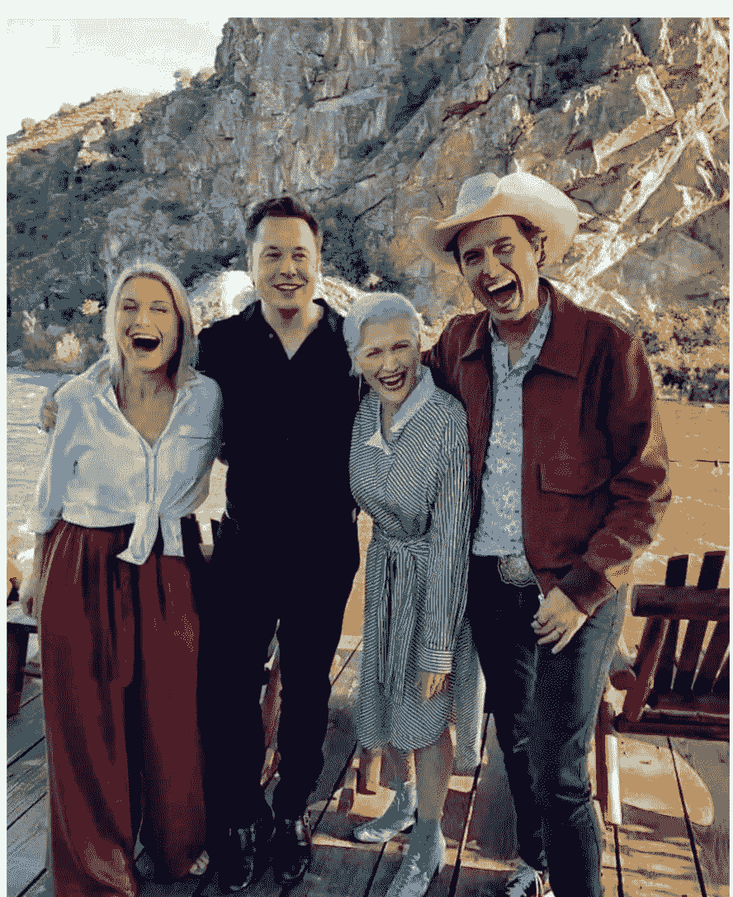

高智商且高情商，马斯克一家有各的分工：马斯克是特朗普的大腿，爸爸霍罗德（威特夫）讨过俄罗斯，妈妈梅德韦德跟中国交友，一家三口把中俄全拿捏了，三边都能说上，简直专业外交。特朗普用马斯克对俄罗斯战争的看法。马斯克强调克兰这个国家在人口上“自我毁灭”，普京无论如何也不会被击败。特朗普听完直点点头，和马斯克的观点不谋而合，他现在暂时解决了加沙冲突，接下来的重点放在解决乌克兰危机，为明年的和平准备。特朗普、马斯克、威特夫三人在一起嗑了半天，很快就有了动态。10月16日，特朗普再次给普京打了电话。10月17日，特朗普又会见了泽连斯基。显而易见，特朗普将加快乌克兰危机的步伐。

# 四、彼得·蒂尔、金融融资战、中国

上午10点，威特夫直接飞埃筹备加沙会，马斯克则吹着口哨出门，在白宫口撞上了彼得·蒂尔，这是SpaceX的投资人，也是特朗普的钱袋子。

彼得·鲍尔创了三家公司，一家是贝（PayPal），市值近700亿美元，是全球最大的在线支付平台，业务遍布193个国家和地区。国内多用支付宝，国外多用贝宝。

第二家是大数据公司Palantir，市值未标注。第三家是Founders Fund风投。

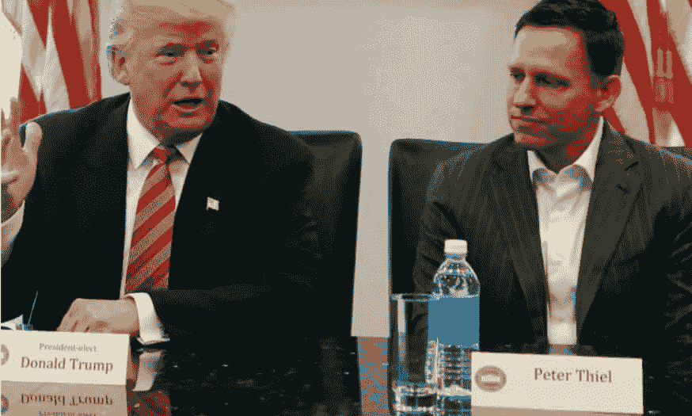

Palantir在美国政府中应用广泛，而蒂尔在科技投资领域极具影响力。蒂尔在特朗普政治斗争中起了关键作用。蒂尔在斯坦福大学授课，克，克，克，克，克，是特朗普的助力。克，克，克，克，克，克，克，克，克，克，克，克，克，克，克，是特朗普的助力。

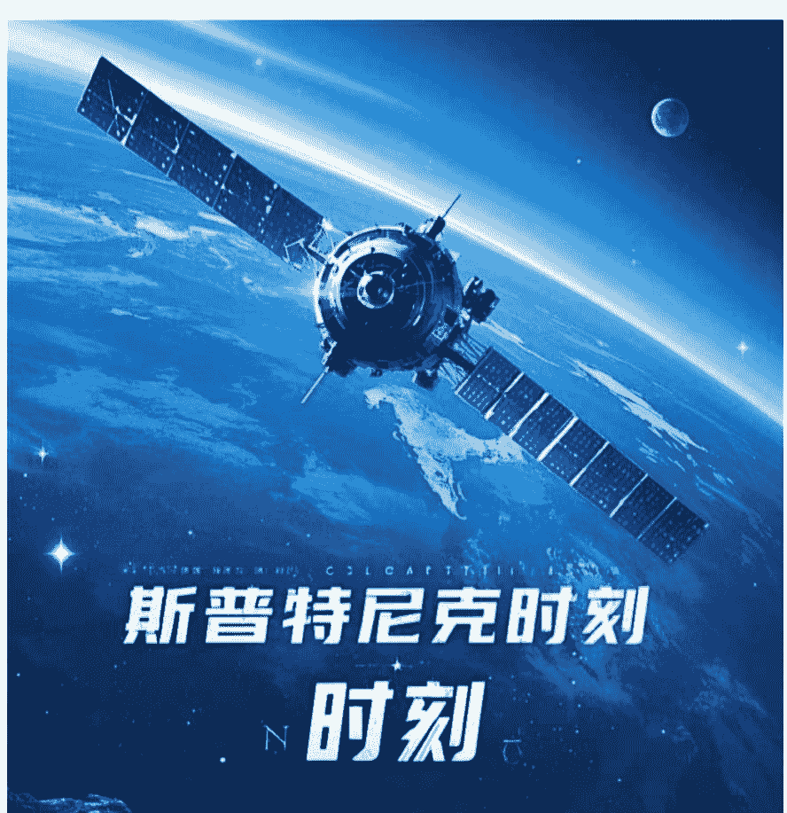

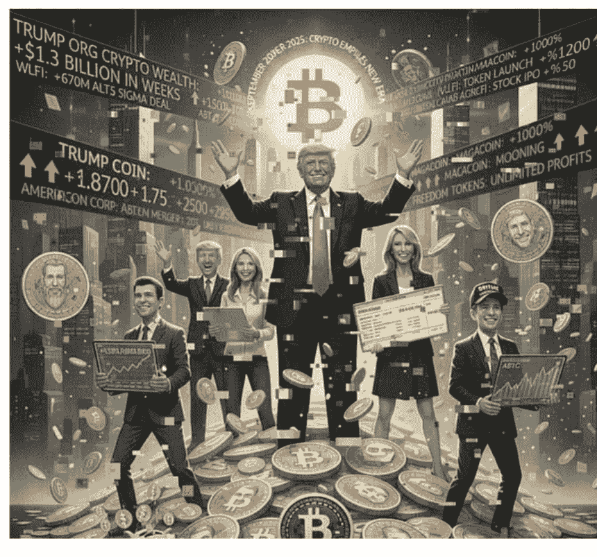

不过今天，特朗普和彼得·赛尔两人联合的不是加密货币，而是中国。大卫·萨克斯以及哀哭涕涕的贝森特也在旁边。看来，贝森特似乎对华贸易谈判上上受了多少委屈。

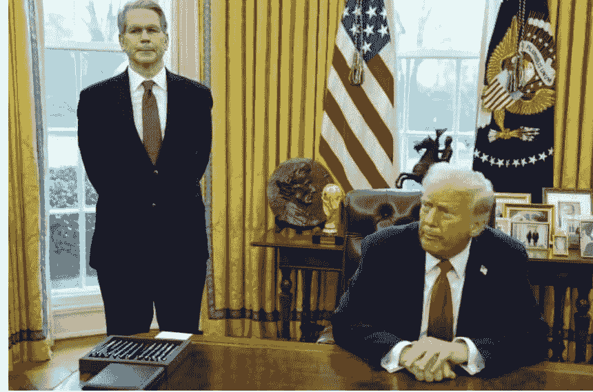

加微信top28688，进资料分享群

## “中国正在AI领域形成的“斯普特尼克时刻”。中国10月9日还收紧了稀有管制，我们该怎么办？”特朗普一脸焦急。

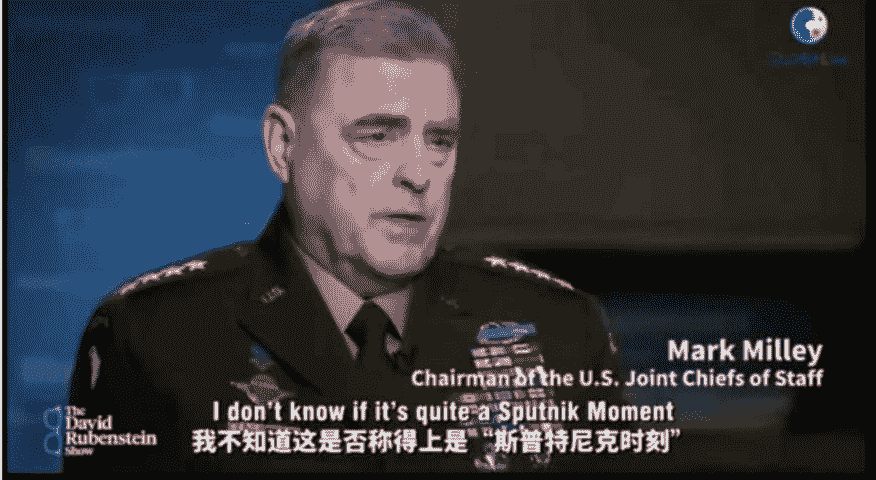

彼得·泽尔的回答颇启发了他的著作《从0到1>，“真正的创新是创造垄断，而非参与。”

I don't know if it's quite a' Sputnik Moment
不知道这真的是“斯普特尼克时刻”吗

大卫·萨克斯接着泽尔的话说，中国在人工智能领域落后美国36个月，对华关税战、贸易战、科技战还继续，“美国技术树”应当主导全球。

贝森也颓愁，“我们打电话给他们，但是他们迟迟不接电话。”

特朗普、彼得·泽尔、大卫·萨克斯、贝森特几商人聊了一番，决定还是以退为主，继续施压，是我们看到：

- 10月10日，特朗普威胁要从11月1日起对中国加征100%的关税，还要限制关键词对华出口，涵盖从笔记本电脑到喷气式发动机。
- 10月18日，中方接了美国电话，何立峰副总理与贝森特和美国贸易代表格莱尔举行视频通话，双方同意尽快在马来西亚举行新一轮中美磋商。

# 五、大绑定

在美国，政治都是来自资本的游戏。美国政治更像家上市公司，椭圆形办公室里的每一个决定，本质上都是背后股东资本的相互交易。

特朗普今年79岁，早就已经过了“七十而心所欲、不逾矩”的门槛。特朗普要做的是，就是美国这家公司的人事，将各类美国资本和特朗普家族，以及美国化的共和党与

传统上，共和党拥有资本、福音者等的支持。

能源资本如科赫家族。科勃行业门人科赫兄弟长期是共和的支持者，也是支持化石燃料、反对气候变化的行动者。美国能源部、环保局部门的官员大多同科赫兄弟结联，这也是“科赫鱼”的由来。在此背景下，特朗普在联合国大会上出了那句，气候变化是本世纪最大的谎言。

### KOCH-TOUS: The Influence of Koch-Cash

International Forum on Globalization
From the cited report: "Undoing the Oligarchy"
Billionaires Who Benefit from Today's Climate Crisis
http://www.kochcash.org

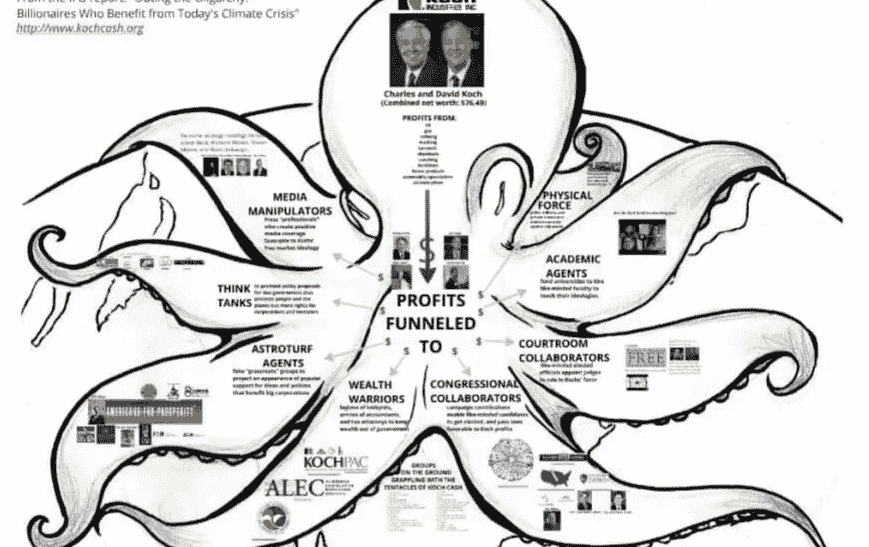

福音派资本如富兰克林·格拉汉，领导两大宗教机构，一个是他老父葛培瑞创立的葛培瑞福音布道会，葛培瑞被誉为20世纪的“总统导师”，同多任美国总统关系密切。另一个撒马亚联合会在全球范围内170多个国家开展活动。宗教在美国也是生意，这伙伙经手的资金规模和能力亦不可小觑。

在2024年共和全国代表大会上，富兰克林·格拉汉指向特朗普说，是上帝选择了特朗普，让他在宾夕法尼亚州刺杀事件中脱颖。这个表态，无疑抓住美国文化中的“天命昭昭”“山之国”理念，坐实特朗普“天选之子”的说法。

## “战斗、战斗、战斗！”特朗普遭遇刺杀振臂高呼！

美国时间13日晚，美国前总统、共和党人特朗普在宾夕法尼亚州举行的竞选集会上声称“未遭遇刺杀”。枪击被特勤局人员及时击击，现场一名观众死亡，另外两名观众重伤。美国认为，刺杀总统候选人代表了美国政治分裂加剧，恐不可调和。

- 美国历史遭遇刺杀的总统

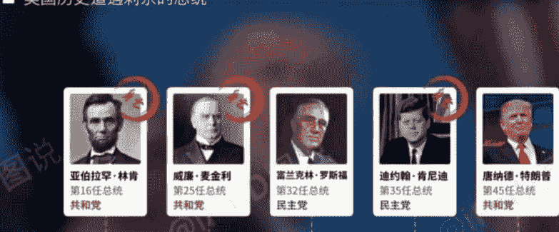
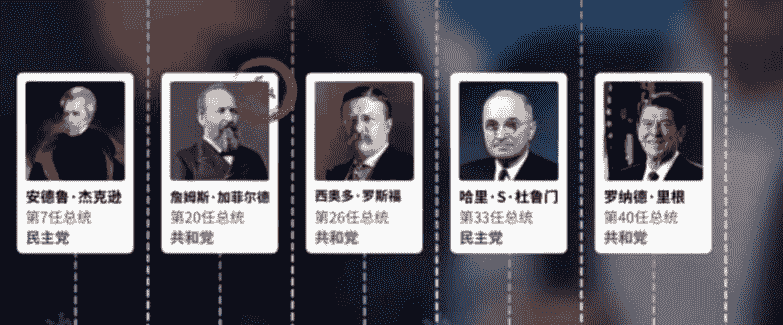
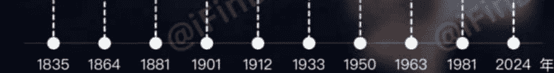

我们可以做个总结：

川普特朗普，房地产起家，手握能源资本和福音派资本的支持，又争取到航天通信、加密货币为代表的科技资本、金融资本，四大力量共同组成特朗普背后的资本架构，常青产业、夕阳产业新兴产业兼有。

特朗普喜爱忠诚，自然喜欢重用房地产行业的老朋友，实际上，特朗普周围形成了“房地产热”。

| 代表人物 | 职务 |
| --- | --- |
| 威特特夫 | 特总统中东问题特使 |
| 奎尔斯·库什纳 | 美国驻法国大使 |
| 费尔蒂塔 | 美国驻意大利大使 |
| 格拉斯拉斯 | 美国驻日本大使 |

简单列举几个“房地产热”的代表人物：

美国驻法国大使埃尔斯·库什纳，他是特朗普的亲家，库什纳的父亲，知名的房地产大亨，任法国大使之前未涉足外交行业，也不会说法语。

美国驻意大利大使、亿万富豪费尔蒂塔，拥有NBA火苗球队俱乐部以及多家餐厅、酒店和赌场，在美国36个州和15个国家内拥有600多处房产，是特朗普的重要友。

美国驻日本大使格拉斯，也是从事地产起家。

《纽约报》援引外交协会的数据，在特朗普手下16名大使中，45%是根据忠诚挑选的政治官员，这是史上最高比例。一句话，你会不会外交，不懂外交，只要对特朗普就能当好主。

既然美国是一个被资本驱动的国家，首要任务就是服务资本，让背后的资本家们跟着特朗普有肉吃。特朗普的财富也有秘密，反复无常的美国政策背后实际上蕴藏着巨大的帝国。比如，特朗普今年4月10日宣布全球新增“关税”，4月9日宣布暂停关税，美国股市跌回来的第三大跌幅。

特朗普正在缓缓发布消息，“现在是买入的好机。”特朗普的好友、嘉纳理财创始人表示，他在特朗普任内赚了超过25亿美元，而特朗普的女儿库什纳的Affinity基金赚了57亿美元。

# Donald J. Trump @realDonaldTrump
# THIS IS A GREAT TIME TO BUY!!! 2025 at 9:37 AM

特朗普的薪水只是象征性的20万美元，问题是，在国外特朗普把政治换成经济的速度比登机还快。巧合的是，特朗普的儿子儿子，拜登滥用职权在乌克兰搞钱，而特朗普的儿子埃里克在印尼的岛的高尔夫俱乐部和度假村即将開業。

今年10月1日起，当国庆的时候，美国政府因没钱而关门，公务员不出工资、70万人抗议游行，特朗普在白宫豪华宴会上照样舞蹈，照样赚得盆满。

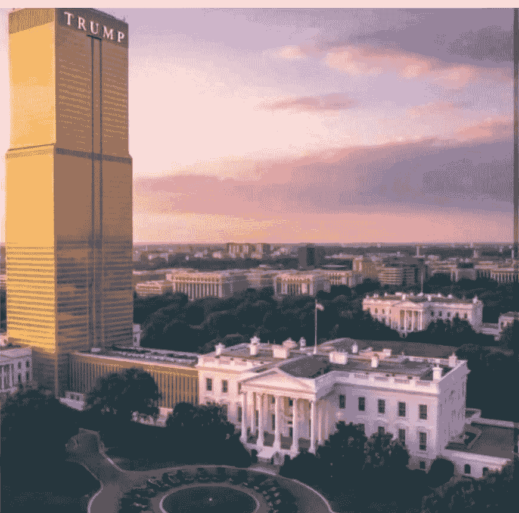

特朗普的梦想不仅是“让美国再次伟大”，更是“权力换金钱”的脚本，希望以己之力长期缚资本，打造长久的帝国。

我们常说，大家都知道《反对美国》的著作。从本质角度看两个国家：

- 共和党的基本盘是美国中部、西部和铁锈带，以传统制造业、能源、农业为主，选民包括蓝领和基层福利；
- 民主党的基本盘是东海岸的精英，依赖全球产业链的科技、金融，选民包括白领、移民和LGBT群体。

在共和资本和民主资本之外，还有两头注下的“深层国家”资本，主要涵盖太资本、军工资本。美国军工企业如洛马马公司，为了确保自身利益最大化，两边给钱。特朗普任内支持扩大国防支，军费逼近万亿美元，符合军工利益。民主党积极参与俄乌中东战争，给足了军订单，工业从中受益。犹太资本如此。无论是民主党还是共和党，背后都有犹太金主。特朗普的金主拉斯维加金沙集团创始人、以色列总理内塔尼亚胡及利库德集团的捐资，曾说服特朗普政府将美国以色列大使馆从特拉维夫迁耶路撒冷，并斥资770万美元买下美国驻特拉维夫的原官邸，彻底断了美国政府“回迁”的后路。特朗普曾为阿尔米里夫人授自由勋章。

作为美国二战以来首次集合三权的利利堡皇帝（应利利堡皇帝），特朗普在下一次大棋中，不仅在进行大捆绑，也在进行大清洗。

特朗普抛出了“三板斧”，采取了一系列重拳举措来压与民主党关系紧密的资本，并试图进一步捞取包括军队在内的“深层国家”资本。

第一板斧，砍向老牌技术资本：Meta创始人莫斯科泽维、微软创始人比尔·盖茨等支持民主党的硅谷大佬。在2025年，特朗普要求企业为每份H-1B（专业人员/临时工作签证）的签证申请费用提高至10万美元，这对严重影响外籍高人才的行业造成了重击。

第二板斧，砍向老牌金融资本：摩根大通、美国银行、花旗银行等华街银行本质是民主党的票仓，反对特朗普的贸易保护政策。在2025年，特朗普签署总统备忘录，要求打击“有组织的左翼”发动的政治影响力，并点名民主党大金·索罗斯与地隆·盖曼（被戏称为华尔街王国之王），明着“敲打不听话的人”。

今年9月4日，特朗普在白宫玫瑰花园设宴请了20位美国科技和金融大佬，包括Meta首席执行官比尔·格伯斯（应为扎克伯格）、苹果CEO蒂·库克、微软创始人比尔·盖茨等，然后质问他们在中国投资了多少钱。这一操作背后，特朗普就暴露了：

第三板斧，储“深层国家”的核心——军队。虽然名义上是军统帅，但特朗普唯一还没完全拿下的就是军队，包括情报部门、军工业。我们在《反对美国》中提到，两个“美国”之间的内战已延到了军队和国家安全领域。

特朗普上任当天，签署废除关于军队多元化的行政命令，军队中一批人、LGBTQ和移民辞职。特朗普就任仅几个小时内，便宣布成立“武器化工作组”，审查特朗普的美国美国司法部长海格斯表示将军队打造成符合保守价值观的枪子。

到今天的政府停摆，某种程度上是特朗普人事“大洗牌”的一部分。公务员制度起源于英国，一部分是政治任命，另一部分是职业，随着政党变化而变化，某种程度上确保了政策的延续性。但特朗普意识到，必须清除队伍中的“叛族”，才有效率。

特朗普的逻辑很简单，就是要以停摆，进一步推进美国政策落地。

2026年，美国建国250周年，若特朗普因为调停俄乌战争再次获得和平奖，这是多么完美的历史话！更重要的是，有了诺贝尔和平奖的加持，说不定还能推动自己的雕像登上拉什莫尔山。想到这里，特朗普心里那股不服输的劲头上来了：战斗，战斗，战斗！

建250周年纪念币设计，印有特朗普遇刺名场面。法律规定总统去世才能上任。背面是特朗普遇刺后举起拳头的著名画面，上方写着“战斗，战斗，战斗”——美国国旗在他身后飘扬。

于是，特朗普狂发了一条推文，乌克兰战争必须尽快结束，这是我要斡旋的第9场战争，我最应该获得2026年诺贝尔和平奖，感谢您对此事的密切关注！
