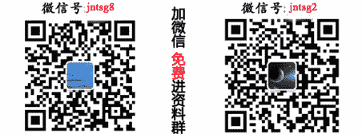

# 文在寅被起诉，韩国左派营阵内斗？

文/卢克文工作室嘉宾 星海舰长

4月24日，韩国突然传出消息：韩国检方以受贿嫌疑起诉前总总统文在寅。

至此，文在寅好不容易保持的“坏金身”，终于破了，也再次证实了“青瓦台魔咒”，看来这玩意只会迟到，但不会缺席呵。

那么这次文在寅被起诉，到底是咋回事?

其实来说，文在寅被起诉，并不奇怪。

虽然文在寅卸任后，基本上处于一个闲云野鹤的状态，以“示弱”而“自保”，但作为左派前总统，怎么可能逃过清算?

就在文在寅招猫逗狗不务正业的时候，已经有4个案子盯上了文在寅，分别是光伏项目舞弊案、西海公务员投北案、蔚山市长选举案，还有文在寅女婿涉受贿案。

说实话，前三个都很难坐实罪名，因为都是公权案件，虽然文在寅都被指责滥用权利，但这个“滥用”本身是很主观的概念，你很难证明总总统行使权力出于私利，所以很难构成杀伤力。

真正对文在寅形成威胁的，其实还是女儿婿涉受贿案。

案情之前的星球文章《文在寅涉受贿，是怎么回事？》（2024-09-02）介绍过，无非就是文在寅有个不成器的女儿文多惠，嫁了个不成器的老公徐某，徐某好好的总统女婿当，非要带着文多惠移民泰国，入职了泰国一家航空公司，结果有人发现这个航空公司是韩国易达航空的子公司，怀疑易达老板李相曙借着给徐某开高薪的渠道，变相给文在寅行贿！

然后就发生了2024年8月韩国检方搜查了文多慧住宅的事情。

看到大家也就明白了，文在寅这次被起诉，就是去年调查和搜查的余波而已，早晚都会来的，只是时间问题。

当然了，在韩国这种政治极化的环境中。这种涉及政客特别是前总统的案子，我们不能把它当作一个简单的受贿案来看，其背后一定牵扯复杂的政治斗争。

按照一般人的想法，这肯定是韩国右派对左派的报复，毕竟左派刚刚干下去一个右派的现总统，那右派也要干下去一个左派的前总统来泄愤，这很合理。

而且6月份就要韩国大选了，现在把文在寅的案件翻出来，有助于打击左派的选情。帮助右派挽救大选。

第一，如果这个案子是右派击左派，最好的时候是什么时候？

咱们都知道，韩国政坛从去年到现在，一直是乱糟糟的，一会儿是韩国国会选举左派胜利，一会儿是李在明遇刺，一会儿是总统戒严，一会儿是弹劾总统，左右双方斗得不得赤架乎。

作为弹劾前总统这种大杀器，必然要在用关键时刻，比如韩国国会选举的时候，或者弹劾尹锡悦表决的时候，才能起到关键作用。

可是现在呢?尹锡悦都下下了，动手是不是晚了点？

第二，韩国检方为啥突然发难？

说实话，虽然这个受贿案听起来很严重，但办成铁案并不容易。

比如检方指责李相贤给徐某开工资的方式向文在寅行贿，受贿多少钱呢?1150万韩元/月，也就相当于6万块钱人民币，这点钱在韩国根本不算，一个船厂工人一个月都能挣七八百万韩元，说是行贿，有点牵强了。

费这么大劲，绕远这么大弯子，给总统行赂一个月才6万块钱?这也太看不起文在寅了吧？

而且，如果说易达航空给徐某高薪是向文在寅行贿的话，可是2023的时候，文多惠和徐某离婚了！文多惠带着孩子返回韩国，那么这个时候还有没有必要向徐某支付“行贿”吗?没有了啊！可是现在呢？徐某仍拿着高薪，一点也没有受离婚影响。

那么就说明，这笔钱的确是工资，和徐某是不是文在寅的女婿没关系。

所以，虽然去去年查的时候闹得动静大，但检方却一直迟迟没有起诉。

但是现在，检方突然起诉，那必然是有了能在法庭上指控文在寅的底气，才敢放手一搏。

以韩国右派的作风，检方不出手则已，一出手必然是奔着搞死文在寅去的，不会这么随随便便出招。

那么只有一种可能，韩国检方拿到了非常不利于文在寅的证据。

问题来了，这个证据从何而来？肯定不会是从右派来，右派要有证据，早就用了，还用等到今天？所以，拿出这个证据的，不排除是左派。

很多人看到这就懵了，文在寅不就是左派吗？左派怎么可能搞自家总统？其实完全可能，因为左派也不是铁板一块。

我们可以思考一个问题，文在寅倒了，谁受益最大？右派固然会受益，但这点不足以改变大选结局。算来算去，似乎李在明受益最大。

也许一切，都要从李在明和文在寅的矛盾说起。大家要明确一点，民主党本身其实是选举的产物，对于民主而言，组织关系松散，执行力度有限，不像社会主义那样严肃和统一，很多时候只是立场接近，而不是立场统一。

这就决定了，民主政治内部也会存在复杂的派系，如共同民主党，内部就有文在寅派、李在明派、卢浩渊等派别，矛盾重重。

也许面对右派攻势的时候，这些派别还能一致对外，等收获胜利的时候，内斗不可避免了，比如现在的总统竞争。虽然很多人已经把李在明视为下一任总统了，但事实上李在明连党内候选人的位置还没拿到。

韩国法律并未限制党派的数量，实际运作中，为了避免选票分散，各党派通过内部初选确定正式候选人。要成为唯一代表，必须把竞争PK掉。4月19日，共同民主党内进行了候选辩论，一共三个人参加，分别是李在明、金庆洙和金东宪。

有的是，金庆洙和金东宪都是文派。

金庆洙不必说，左派元老，早在卢浩渊时期就跟卢浩渊混了，算是文在寅的忠臣，也是文在寅的绝对心腹。文在寅竞选期间他在担任发言人，后来担任庆州实在。金东宪呢？他在文在寅上一任期担任副总理，文在寅对他是有恩，文在寅卸任后，金东宪当了京州。在这个民主党无比接近总统宝座的时刻，文在寅突然出来和李在明竞争，你要是李在明你会想：辛苦了，又是受伤，又是挨刀，又是翻，又是牺牲，好不容易收获胜利了，文在寅怎么能来摘桃子？

显然，文在寅和李在明的矛盾，比我们想象的还要大。事实上，文在寅和李在明在今年年初就有决裂的迹象了。大家都知道，去年尹锡悦戒严波以来，被李在明揪着这件事，民主党内部大作为，又是游行又是抗议，想彻底翻尹锡悦。

但令李在明失望的是，曾经把朴槿惠翻的“烛光革命”，加入人数不如预期。当年动员就有百万人，可现在呢？最快的时候也没有超过二十万。甚至在弹劾之后，国民的支持率竟然还上升了！显然，韩国人虽然不喜欢尹锡悦的戒严，但对李在明的好感也不。

对此李在明急得不行，可能是自己翻尹锡悦的唯一契机，绝对不能放过！就算弹劾失败，这个锅也不能自己背！于是是在今年月7日，李在明在国会记者会上把锅扔给了文在寅。李在明这么说的：“尹锡悦政府这么严重，为什么国民如今还没有站起来？原因只有一个，人民怀疑民主党能否领导国家走向充满希望的未来。烛光革命时，国民在冬季奋力抗争，推翻了朴槿。从那以后，社会没有改变，只有掌权的政党肤色变了，韩国并没有变。”这话翻译过来就是，这次反尹计划执行得顺利，怪文在寅！文在寅执期间把民主党的好感败光了！现在反尹那么难！

两天之后，文在寅发表了一个自由访谈，别有深意的出了这样话：“我想对李在明强调，民主党若要赢得胜利，就必须展现出更具包容性、更广泛的延伸。在扩大影响力之后，民主党还需要将这种力量凝聚起来，形成团结的局面。然而，目前党内某些声音总是对特定行动或竞争加以批评，甚至视之为分裂并排斥，这种做法是极其不安的。它只会民主党的发展空间更加狭隘。”

显然，这是在敲打李在明，对他清洗文派公开表达不满。同时，文派也开始在党内发难，崔宰诚、任钟哲、金富谦等派站出来指责李在明：“民已经成了李在明的一人党，所以导致人民不信任”，这是把李在明甩过的锅又甩了回去。

你看，两派都闹成这样了，文派显然就不可能毫无保留地支持李在明了。对文派来说，最好的方案就是“换储”。

巧了，这个时候，金庆洙选回来了。金庆洙是“网红水军选举案”的主角，自己帮文在寅扛了水军助选的雷，被判了两年徒刑，不过文在寅比较照顾这个帮自己坐牢的亲信，在2022年把金庆洙特赦了。当然，为了避免争议，文在寅当时表态，虽然特赦了金庆洙，但不会复赦（政治权利），只免除余刑。但是在今年2月5日（也就是文李决裂的前两天），金庆洙突然宣布，已申请重返党籍。庆南道部进行了审查程序之后，也重新接纳了金庆洙。在这个节骨上突然让金庆洙复赦，目的显然不简单，这可能也是刺激李在明炮戈文在寅的导火索。
