# 拐点

站在AI颠覆世界的前夜

人类进程

万维钢 © 著

TURNING POINT

时间

台海出版社


# 免费 价值 及时 专注

# 扫码加入 知识星球TOP 免费资源群

- 每日免费获取有价值资源
- 可提供各类资源搜索服务

| 热门付费文章 | 各行行业报告 |
| 精选图书资源 | 副业赚钱方法 |
| 职场实用资源 | AI经营自媒体 |

公众号:知识星球TOP 微信信号:jntsg8 微信信号:jntsg2


分享资料仅供个人学习，请及时删除，切勿商用传播

# 拐点

站在AI颠覆世界的前夜

万维钢 著

台海出版社

有时候十年过去了什么都没发生；有时候几个星期就发生了几十年的事。（There are decades where nothing happens; and there are weeks where decades happen.）——列宁

关于这类为什么好使我们不提供任何解释，问就是上天的眷顺。（We offer no explanation as to why anything anything works except divine benevolence.）——山姆 · 阿尔特曼

# CONTENTS
目录

前言：人要比AI强/1

## ChatGPT 究竟是什么

- 01 大变局：一个智慧形态的产生/002
- 02 “开鳍”和“涌现”：AI能力的三个境界/014
- 03 底牌和命门：AI能力的局限/034
- 04 数学：AI视角下的语义和智能/048

## 当 AI进入人类社会

- 01 效率：把AI转化为生产力/056
- 02 经济：AI让调度资源更有效/066
- 03 战略：AI商业的竞争趋势/076
- 04 社会：被AI“接管”后的忧患/089

## 3 置身智能，你更像你

- 01 决策：AI的预测与人类的判断/100
- 02 教育：不要再用训练AI的方法养人了/111
- 03 专业：代议民主和生成式AI/121
- 04 领导技能：AI时代的门槛 领导力/131
- 05 特独特智能：人类的具身智能与自主思考/143
- 06 存在智能：人类在AI时代存在感的方式/153

## 4 用已知推理未知

- 01 进化：目前为止的GPT世界观/168
- 02 拟人：伊丽莎效应/180
- 03 共存：道可道，非常道/191
- 04 价值：有人的用处/200
- 05 智能：直觉高于逻辑/219
- 06 力量：算力就是主道/229

## 5 实战，让AI为你所用

- 01 咒语：如何让ChatGPT发挥最大价值/232
- 02 重塑：怎样用ChatGPT 对话式学习/249
- 03 生成：怎样用GPT-4编程/264
- 04 解放：如何拥有你的AI助理/288
- 05 场景：用AI于无形/308

## 6 更大的大局观

- 01 炼丹：语言模型是怎样炼制的/322
- 02 惯性：如何控制和改写你自己的神经网络/334
- 03 狂人：山姆·阿尔特曼的系统性野心/350
- 坡：拐点已至/367

# 前言：人要比AI强

如果你不记得自己在2023年3月15日那天的日程，我建议你现在就回想一下……由于若干年后，你的子子孙后代可能会问你：GPT-4发布的那天，你在干什么？

GPT-4不是“另一个”AI模型。它的能力让最资深的专家也感到惊醒，直到现在还没有真的理解它这么厉害。它让我们第一次感受到了通用人工智能（Artificial General Intelligence）真的来了。

2023是AI元年。有些业内人士相信AI将在2026左右实现，这意味着AI在所有领域——读、写、判断、创作、甚至科学研究——都做得像人类一样，甚至更好。

这波革命每天都有新突破。其实我们早就开始探索了。在2020年7月，我在《精英课》专栏里介绍了一个“令人震惊的人工智能”——OpenAI公司的GPT-3。GPT-3的功能已经足够它可以根据你的要求给出描述。

GPT-3：一个令人震惊的人工模型。写一段程序，可以帮你写文章，相当智能地回答你的问题，水平没有那么高。而且当时OpenAI没有开放用户注册。

2022年底，OpenAI推出了ChatGPT对话应用，大家都可以体验ChatGPT了。2023年2月，ChatGPT升级到收费，它最初的主力模型变成了GPT-3.5，而是GPT-4；接着，ChatGPT有了插件功能，它还能读取和处理数据；后来又升级到有多项功能的GPT-4，然后是个人的GPTs和商店，甚至在2024年会出来GPT-5……如果你把AI视为人类的敌人，你就错了。

截至2023年底，ChatGPT的活跃数量已经超过15亿，这包括个人电脑和手机。但是很多人都不理解GPT到底是什么。一个流行的误认为是把它当成了聊天机器人。2023年底，ChatGPT已经知道，其余由于害怕可能会飞走，所以可能不会剩下任何AI，但这不要要知道ChatGPT并不是一个聊天机器人——并不是和你聊天。

ChatGPT是一个使用GPT模型、聊天方式为界面的信息处理工具。这个界面做得如此好，以至于人们把界面当作主体。聊天只是输入、输出，处理信息才是目的。我们关心的是作为大脑的GPT模型。

你不用ChatGPT也可以直接读取GPT模型，比如现在已经有成千上万小公司用API（应用程序接口）接入GPT完成信息处理。你可以用GPT：

- 以问的形式学习一门知识
- 在不同语言之间进行高质量翻译
- 修改文章，或者根据你的意图直接写文章
- 获得书名、大纲、小说情节、广告等文案的创意构思
- 帮助你订购购物清单、旅行建议和健身计划
- 分析你上传的数据文件并且画图
- 上网浏览，调用第三方工具
- 理解并生成图片和声音
- 直接操控你的计算机

......现在普遍认为ChatGPT的编程水平比文字处理水平高，这可能是因为是一种更规范的活动。

而2023年这一波技术大潮中不但出现了OpenAI的GPT。Google（谷歌）、Meta（美国互联网公司，前身是Facebook）、马斯克的X（原推特）等公司都有自己的大模型，还有Midjourney、Stable Diffusion等专门画图的模型，年底还出现了一波用文字直接生成视频的模型，特别是2024年初出来的Sora，震撼了世界，中国这边也有“百模大战”等等。它们背后的基本原理跟GPT是一样的。

很多人说这类为“生成性AI”（AIGC），但我看这个说法还没抓住大。这一轮突破的意义不仅是能生成内容。大场景是AI已经开始严肃地做到传统上我们认为只有人能做的事了。它们的智能正在超越我们。

随着AI能的事情越来越多，有一个问题也被讨论得越来越多——AI到底降低了人的价值，还是提高了人的价值？这取决于你怎么用它。把事情直接交给AI，是软弱而且危险的。比如你想写封信...

演员郑伊健在一部赛车电影里有句话“人要比车强”，指的是人一定要比工具强。强的用法，是把AI当作一个助手、一个副驾驶，你自己终身操控权——AI的作用是帮你更快、更好地做出判断。人要比AI强。

如果你足够，当前AI对你的作用有三个：第一是信息。了解任何信息都能得到答案，这件事在以前是不可能的。现在AI的结果不一定准确，经常犯错，关键信息还是要亲自查看一遍。

什么是AI？什么样的分子？在2020年，麻省理工学院宣布了一种新的抗生素，叫做Halicin。这是一种广谱抗生素，能够杀死那些面上现有的细菌，而且相当安全。这种发现是用AI完成的。研究者先用AI训练一个由几十万个分子组成的集合，按照美国食品药品管理局（Food and Drug Administration, FDA）批准的天然产品库，从中选择符合要求的分子：(1) 它具有抗菌效果；(2) 它看起来像抗菌；(3) 它必须无毒的。

用传统的研究方法，这件事是绝对不成的——因为测试几十万个分子成本太大了。而AI把它变成了一个简单的计算问题。之所以先讲这个例子，是因为它带给我们一个清晰的认知——Halicin可以作为抗生素。

AI的认识，特别是上手做了很多实操。我甚至把家到了AI革命的中心——我采访了多位AI研发者和创业者。这本小书是我写给你的报告和感悟。AI作为一个智慧形态，它的边界、它的底牌和命门，究竟是什么？大语言模型的智能为什么如此？

### 目录（补充）
## ChatGPT 究竟是什么
- 01 大变局：一个智慧形态的产生/002
- 02 “开鳍”和“涌现”：AI能力的三个境界/014
- 03 底牌和命门：AI能力的局限/034
- 04 数学：AI视角下的语义和智能/048

## 当 AI进入人类社会
- 01 效率：把AI转化为生产力/056
- 02 经济：AI让调度资源更有效/066
- 03 战略：AI商业的竞争趋势/076
- 04 社会：被AI“接管”后的忧患/089

## 3 置身智能，你更像你
- 01 决策：AI的预测与人类的判断/100
- 02 教育：不要再用训练AI的方法养人了/111
- 03 专业：代议民主和生成式AI/121
- 04 领导技能：AI时代的门槛 领导力/131
- 05 特独特智能：人类的具身智能与自主思考/143
- 06 存在智能：人类在AI时代存在感的方式/153

## 4 用已知推理未知
- 01 进化：目前为止的GPT世界观/168
- 02 拟人：伊丽莎效应/180
- 03 共存：道可道，非常道/191
- 04 价值：有人的用处/200
- 05 智能：直觉高于逻辑/219
- 06 力量：算力就是主道/229

## 5 实战，让AI为你所用
- 01 咒语：如何让ChatGPT发挥最大价值/232
- 02 重塑：怎样用ChatGPT 对话式学习/249
- 03 生成：怎样用GPT-4编程/264
- 04 解放：如何拥有你的AI助理/288
- 05 场景：用AI于无形/308

## 6 更大的大局观
- 01 炼丹：语言模型是怎样炼制的/322
- 02 惯性：如何控制和改写你自己的神经网络/334
- 03 狂人：山姆·阿尔特曼的系统性野心/350
- 坡：拐点已至/367

# 前言：人要比AI强

如果你不记得自己在2023年3月15日那天的日程，我建议你现在就回想一下……由于若干年后，你的子子孙后代可能会问你：GPT-4发布的那天，你在干什么？

GPT-4不是“另一个”AI模型。它的能力让最资深的专家也感到惊醒，直到现在还没有真的理解它这么厉害。它让我们第一次感受到了通用人工智能（Artificial General Intelligence）真的来了。

2023是AI元年。有些业内人士相信AI将在2026左右实现，这意味着AI在所有领域——读、写、判断、创作、甚至科学研究——都做得像人类一样，甚至更好。

这波革命每天都有新突破。其实我们早就开始探索了。在2020年7月，我在《精英课》专栏里介绍了一个“令人震惊的人工智能”——OpenAI公司的GPT-3。GPT-3的功能已经足够它可以根据你的要求给出描述。

GPT-3：一个令人震惊的人工模型。写一段程序，可以帮你写文章，相当智能地回答你的问题，水平没有那么高。而且当时OpenAI没有开放用户注册。2023年2月，ChatGPT升级到收费，它最初的主力模型变成了GPT-3.5，而是GPT-4；接着，ChatGPT有了插件功能，它还能读取和处理数据；后来又升级到有多项功能的GPT-4，然后是个人的GPTs和商店，甚至在2024年会出来GPT-5……如果你把AI视为人类的敌人，你就错了。截至2023年底，ChatGPT的活跃数量已经超过15亿，这包括个人电脑和手机。但是很多人都不理解GPT到底是什么。一个流行的误认为是把它当成了聊天机器人。2023年底，ChatGPT已经知道，其余由于害怕可能会飞走，所以可能不会剩下任何AI，但这不要要知道ChatGPT并不是一个聊天机器人——并不是和你聊天。ChatGPT是一个使用GPT模型、聊天方式为界面的信息处理工具。这个界面做得如此好，以至于人们把界面当作主体。聊天只是输入、输出，处理信息才是目的。我们关心的是作为大脑的GPT模型。你不用ChatGPT也可以直接读取GPT模型，比如现在已经有成千上万小公司用API（应用程序接口）接入GPT完成信息处理。你可以用GPT：

- 以问的形式学习一门知识
- 在不同语言之间进行高质量翻译
- 修改文章，或者根据你的意图直接写文章
- 获得书名、大纲、小说情节、广告等文案的创意构思
- 帮助你订购购物清单、旅行建议和健身计划
- 分析你上传的数据文件并且画图
- 上网浏览，调用第三方工具
- 理解并生成图片和声音
- 直接操控你的计算机

现在普遍认为ChatGPT的编程水平比文字处理水平高，这可能是因为是一种更规范的活动。而2023年这一波技术大潮中不但出现了OpenAI的GPT。Google（谷歌）、Meta（美国互联网公司，前身是Facebook）、马斯克的X（原推特）等公司都有自己的大模型，还有Midjourney、Stable Diffusion等专门画图的模型，年底还出现了一波用文字直接生成视频的模型，特别是2024年初出来的Sora，震撼了世界，中国这边也有“百模大战”等等。它们背后的基本原理跟GPT是一样的。很多人说这类为“生成性AI”（AIGC），但我看这个说法还没抓住大。这一轮突破的意义不仅是能生成内容。大场景是AI已经开始严肃地做到传统上我们认为只有人能做的事了。它们的智能正在超越我们。随着AI能的事情越来越多，有一个问题也被讨论得越来越多——AI到底降低了人的价值，还是提高了人的价值？这取决于你怎么用它。把事情直接交给AI，是软弱而且危险的。比如你想写封信...

演员郑伊健在一部赛车电影里有句话“人要比车强”，指的是人一定要比工具强。强的用法，是把AI当作一个助手、一个副驾驶，你自己终身操控权——AI的作用是帮你更快、更好地做出判断。人要比AI强。如果你足够，当前AI对你的作用有三个：第一是信息。了解任何信息都能得到答案，这件事在以前是不可能的。现在AI的结果不一定准确，经常犯错，关键信息还是要亲自查看一遍。

什么是AI？什么样的分子？在2020年，麻省理工学院宣布了一种新的抗生素，叫做Halicin。这是一种广谱抗生素，能够杀死那些面上现有的细菌，而且相当安全。这种发现是用AI完成的。研究者先用AI训练一个由几十万个分子组成的集合，按照美国食品药品管理局（Food and Drug Administration, FDA）批准的天然产品库，从中选择符合要求的分子：(1) 它具有抗菌效果；(2) 它看起来像抗菌；(3) 它必须无毒的。

用传统的研究方法，这件事是绝对不成的——因为测试几十万个分子成本太大了。而AI把它变成了一个简单的计算问题。之所以先讲这个例子，是因为它带给我们一个清晰的认知——Halicin可以作为抗生素。

AI的认识，特别是上手做了很多实操。我甚至把家到了AI革命的中心——我采访了多位AI研发者和创业者。这本小书是我写给你的报告和感悟。AI作为一个智慧形态，它的边界、它的底牌和命门，究竟是什么？大语言模型的智能为什么如此？

有些人把AI当作成一种“超级智能”，仿佛神灵一般，认为AI能把人类如如何——这种讨论意味着什么意义。如果神灵都足够降临人间了，我们还在在这儿搞什么？不要高推圣境了。

当前一切主流 AI 模型，都是通过机器学习（Machine Learning）训练的神经网络系统。

这很不平凡。你知道，20世纪80年代以前，科学家还在尝试用启蒙运动的思想，把解决问题的规则输入计算机去执行。人们发明了“自然语言处理”（Natural Language Processing，NLP）、机器翻译、词法分析、语音识别等技术去模拟人类的理性思维，结果那条路越走越难——太大了，根本弄不过。还有一些科学家发明了神经网络算法，模拟脑的感知能力，GPT是这条线路的产物。在根本上没有告诉AI任何语言规则，我们把整个学习过程委托给机器——有一种规律你你自己领悟去吧。

这个过程受到脑神经网络的启发，但是结构并不完全一样。AI神经网络分为输入层、多个中间层和输出层，其实结构并不简单。

使用AI神经网络，分为“训练”（training）和“推理”（inference）两部分。一个神经网络的AI是没有的，它只有建好的网络结构和几万乃至几千个数值随机设置的参数。你需要把大量的素材给它训练。每个素材，网络通过一遍，各个参数的大小就会进行调整。这个过程就是机器学习。等到训练差不多了，参数趋于稳定，就可以把所有参数固定下来，模型就训练完成了。

# 第一章 ChatGPT 是什么

你就可以用它对各种崭新的局面进行推理，形成输出。

比如，ChatGPT曾经用过的语言模型版本是GPT-3.5，它大约是 2021 年至2022 年之间训练完成的，它的参数和知识固定在训练完成的那一天。此后我们每次使用 ChatGPT，都只是在用这个模型推理，并没有改变它。

GPT-3.5有超过1000亿参数，之后的GPT-4、未来GPT-5的数据要更多，AI模型参数的增长速度已经超越了摩尔定律。神经网络非常消耗算力。


现在有3种最流行的神经网络算法，“监督学习”（Supervised Learning）、“无监督学习”（Unsupervised Learning）和“强化学习”（Reinforcement Learning）。

如果学习的数据量特别大，根本标记不过来，就需要无监督学习——你不标记每个数据是什么，AI看了就会自动发现其中的规律和联系。

比如，淘宝给你推荐商品的算法就是无监督学习。AI不关心你买什么样子的，它只是发现了你买了那些商品的客户也会买别的什么商品。

强化学习是在动态的环境中，并不设定什么样的动作是对的，但AI每执行一步都要获得正或负的反馈。比如AIAlphaGoZero下棋，它每走一步都要评估这步棋是否提高了比赛的胜率，还是降低了胜率，也就是通过即时的奖励或惩罚，来不断调整自己。

自动驾驶也是强化学习。AI不是静态地看很多汽车驾驶录像，它是直接上手，在实时环境中自己尝试，直接考察自己的每一个动作会导致什么结果，获得及反馈。

我们简单的比方：

- 监督学习就好像学校老师对学生的教学，对错分明，有标准答案，但可以不给学生讲什么原理；
- 监督学习就好像一个学者，他自己调研了大量的内容，看了多了就学会；
- 强化学习则是小学生学走路或者训练运动员，某个动作带来的结果好不好立即就知道。


机器翻译本来是典型的监督学习。比如你要做英译中，就把英文原文和中文翻译输入神经网络，让它学习其中的对应关系。但是这种学法太慢了，毕竟很多英文作品没有翻译版。后来有人发明了一个特别高级的方法，叫“平行语料库”（Parallel Corpora）。

先用对照翻译版进行一段时间的监督学习为“预训练”（pre-training）。等模型迭代找不到感觉之后，你就可以把一大堆同一个主题的资料——不管英文是中文，不管文章是书籍，还不需要相互是翻译关系——都直接扔给机器，让它自己自学。这一步就是无监督学习了。AI进行一段沉浸式的学习，就能猜出哪句中文是确定的，因为可用的数据量很大，所以训练效果很好。

这种处理语言的AI现在都用上了一个新技术，叫做Transformer架构。它的作用是让模型更好地发现词语与词语之间的关系，而且允许改变前后顺序。比如“猫”和“喜欢”是主语与谓语的关系，“猫”和“玩”则是两个名词之间的修饰关系——AI都可以自行发现。

还有一种流行技术叫“生成性神经网络”（Generative Neural Networks），特点是能够根据输入的信息生成一个东西，比如一幅画、一篇文章或者一首诗。生成性神经网络的训练方法是用两个具有互补学习的目标相互对抗：一个叫生成器，负责内容；一个叫判别器，负责内容的质量。两者随着训练相互提高。

GPT的全称是Generative Pre-Trained Transformer（生成式预训练变换器），就是基于Transformer架构的、经过预训练的、生成性的模型。


当前所有AI都是大数据训练的结果，由于训练素材的质量和数量。因为现在有各种高级算法，AI已经非常智能了，不仅能预测一个词汇的频率，更能把握词与词之间的关系。

AI最不可议的优势是，它能发现人类无法理解的规律，并且据此做出判断。基本上就是一个黑匣，你给一大堆材料之后突然说“我学会了”。可是你不知道它究竟是什么。因为神经网络本质上一大堆参数，而不能直接从那些参数上看出意义来。这种理解性可以说是AI的特征。我们正在目睹一个新形态的觉醒。

# 第一章 ChatGPT 是什么

# 问答

以后从事人工智能行业，重点应该哪些学科？

- 计算机科学
- 统计学
- 数据处理
- 计算机图形
- 科学
- 心理学
- 数学
- 逻辑

对于大学生来说，最好是以计算机科学为主，另一方面是确保自己能够进入人工智能行业。最重要的就是大脑中有足够的逻辑，才能理解各种抽象概念。其次是广泛的浏览。有了ChatGPT，已经消除了语言障碍，还可以帮助我们。另一方面，语言和编程不仅仅是为了这些技能，更是大脑的开拓。好消息是，AI让语言和编程变得容易了，现在是以前的半倍。如果不是感兴趣，应该放弃。

### 自然语言

移动网络的兴起让Google和百度的市场缩小了，ChatGPT的兴起会不会改变人们获取信息的来源，从而改变商业机构？像ChatGPT和Bing产生的对话模式的信息处理方式，对Google搜索产生了强烈威胁。Bing出来以后，Google的流量也跟着下降了。广告是Google的命脉，在搜索页面上加上广告比较自然，但是在聊天中插广告，那太影响体验了。Google迅速推出了自己的聊天机器人Bard，仅仅是因为Bard在回复中说错了一个有关事实，引起了人们对聊天体验的要求是非常高的。目前来说，不论Google还是微软，还没有找到很好的广告解决方案。现在市面上已经若干新型搜索引擎，以带广告为卖点，也许之路是让用户付费无广告的服务。值得一提的是，基于GPT的搜索算力要求是传统搜索的十倍以上。我们平时说软件服务的成本是零——绝对不是零，它需要很大的算力、很多的服务器，尤其是现在芯片那么贵。

### “开悟”和涌现

现在主流的生成式AI，包括ChatGPT和Bard，背后都是“大语言模型”（Large Language Models, LLM），也就是用海量语料训练出来的大。这也是通往AGI的技术路线。语言模型为什么这么厉害？我先举个例子。我问ChatGPT：棒球能塞进耳朵里吗？它不能，因为人的耳朵是非常小的，棒球的大小和形状超出了耳朵能容纳的范围……很有道理。（图1-1）我又问它：为什么金箍棒能塞进悟空的耳朵里？它回答说，因为那是虚构的故事，金箍棒的形状和大小随意更改……（图1-2）

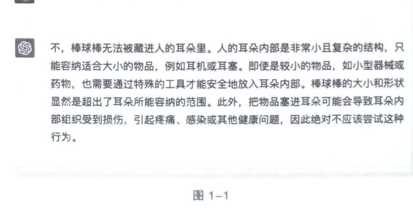

棒球无法塞进耳朵里。耳朵内部是非常小且复杂的结构，只能容纳适合大小的物品，例如耳机。即使是较小的物品、药物，也需要特殊的工具才能安全的放入耳朵里。棒球的大小和形状显然是出了耳朵能容纳的范围。此外，物品塞耳朵会导致耳朵组织受到损伤，引起疼痛、感染或其他健康问题，因此绝对不应该尝试这种行为。

## 第一章 ChatGPT 究竟是什么

为什么金箍棒能被藏进悟空的耳朵里？

金箍棒是《西游记》中悟空使用的武器，它的形状和大小可以随意改变，甚至缩小到可以被藏在悟空的耳朵里。

然而，这只是一个故事的情节，不具备可行性。在现实中，任何物体都有的大小和形状，无法限制地缩小或扩大，而人的耳朵内部也有固定的大小和结构，不能容纳它。因此，金箍棒藏进耳朵里这一情节是一个神话传说中的故事，不应该被看作现实世界的真实情况。


仔细想想，这两个回答非常不起。很多人说语言模型可能都是基于经验，只能根据词汇的相关性给出答案，根本没有思考力，但是从这两个回答来看，ChatGPT是有思考能力的。

谁会写篇文章讨论金箍棒是否被藏进耳朵里呢？ChatGPT之所以能给出答案，肯定是因为它之前看过的这样的议论，而是因为它能进行一定的推理。它考虑了并且知道金箍棒和耳朵的相对小，还知道金箍棒和悟空是虚构的。这些想法是怎么来的呢？你可能没想到，这些能力并不是研发人员设计出来的。研发人员并没有要求大模型去了解每一个物体，也没有设定哪些内容是虚构的。这就是规则。ChatGPT背后的语言模型，每个版本的GPT都是完全通过学习了这些能力，以及别的——开发者都说清楚它到底具备多少能力。语言模型之所以会有神奇能力，主要是因为它足够强大。


GPT-3有175亿参数。Meta发布的Llama有650亿参数。Google在2022年4月推出了一个模型叫PaLM，有5400亿参数。之前OpenAI公布了GPT-4参数，CEO山姆·阿尔特曼（Sam Altman）说，GPT-4的参数比GPT-3很多，猜测GPT-5将会是GPT-4的十倍。这是只有今天才能做到的事情。以前不要说算力，训练模型的花费都是天文数字。1981年一个GB的存储是万美元，1990年下降到9000美元，现在也就几分。如今AI科学有了进步，硬件条件是最大的。今天我们做的是“大”模型。再次提到的Transformer就是一个关键架构，主要区别于“大”。当你的模型足够大，训练的语料足够。

## 模块部分（训练50%的数据）

| 训练 | 生成性发挥 |
| :--- | :--- |
| 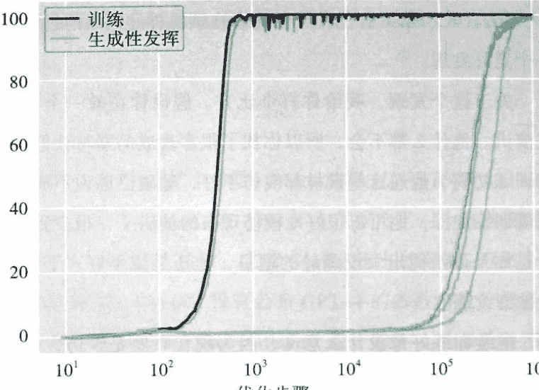 | |
| 20 | 40 | 60 | 80 | 100 | |
| 10¹ | 10² | 10³ | 10⁴ | 10⁵ | 10⁶

这就是量变产生质变。研究者把这个现象称为“开悟”（Grokking）。

“开悟”到底发生了什么呢？先别急，我再举个例子。ChatGPT有一个关键的能力叫作“小样本学习”（Few-Shot Learning），就是你给你两个例子，它就能学会你的意思，并且提供相似的输出。比如让我ChatGPT模仿我给出的例子，再出一几道小学数学题。我的例子是：小明有3个苹果，妈妈又给了2个苹果，现在他有几个苹果？ChatGPT马上就出了5道题，完全是这个风格。比如：小李有5支笔，他送出了3支笔，还剩下几支笔？给一个小学生出数学题，模仿下面这个例子：小明有3个橘子，妈妈又给他2个橘子，现在他有几个橘子？好的，以下是数学题，适合小学生练习：

- 小燕有4个橘子，吃掉了2个橘子，还几个橘子？
- 小李有5支笔，他送出了3支笔，还剩下几支笔？
- 小有6个橘子，其中3个橘子分给了小明，还几个橘子？
- 红红有7元，他买了一本书花了3元，还剩下几元？
- 小有8个苹果，他其中4个送给了小李，还几个苹果？

希望这些作业能帮助小学生学习基本的数学知识和解决问题能力。

这简直就跟对齐一样。小样本学习是一个关键能力，你可以利用这个能力让ChatGPT帮你很多事情。那个能力是怎么出来的呢？更多的参数和训练。图1-5说的是GPT-2和GPT-3模型的进化。参数越多，小样本的学习的能力就越强。而小样本学习只是其中一项能力。还有很多别的能力也是——太大了，它们就出来了。


这个现象，其实是科学家一直说的“涌现”。


事后分析，涌现新能力的机制叫做“思维链”① (Chain-of-Thought)。简单来说，思维链就是当模型听到一个东西之后，它会嘟喃自言地，把自己知道的有关这个东西的各种事情一个一个说出来。

比如，你让模型画一张“夏天”，它会说：“夏天是个阳光明媚的季节，人们可以去海滩游泳，可以在户外野营……”

思维链是如何让语言模型有了思考能力的呢？以前面提到的棒球问题是如何，也许它一听棒球，它就自己描述了棒球的各个方面，其中包括大小：既然问题中包含了“改进耳朵”，大小就是一个值得标出来的性质；然后耳朵也是如此，它把两者大小的性质对比出来，发现是相反的，于是判断不能进去。

只要思考过程可以用语言描写，语言模型就有这个思考能力。

再看一个图片（图1-1）。

给模型看一张图片——皮克斯电影《机器人总动员》的一张剧，它是哪个制片厂创造了图中角色？如果没有思维链，模型会给出错误的回答。

怎么用思维链呢？可以先要求模型把图片详细描述一遍，它说：“图中有个机器人手里拿了一个魔方，这张照片是从哪个制片厂创造的《机器人总动员》里面的，那个电影是皮克斯制作的…… ” 这时候你简单重复刚才说的，再问它那个角色是哪个制片厂创造的，它就回答了。

① Jason Wei, Yi Tay, Rishi Bommasani, et al., Emergent Abilities of Large Language Models, Transactions on Machine Learning Research (2022).

## 第一章 ChatGPT 什么是


Question: which studio created the movie characters in the image?

Answer:

Disney

## Standard Prompting

Introduce this picture in detail:


It is a robot that is holding up a cube that is the same color as the wall. The image is from the film, WALL-E, by Pixar Animation Studio. It is the story of a small robot named WALL-E and his quest to build the ultimate life form. WALL-E is created by a group...

It is a robot that is holding up a cube that is the same color as the wall. The image is from the film, WALL-E, by Pixar Animation Studios. It is the story.

Question: which studio created the movie characters in the image?

Answer:

Pixar Animation Studio

## Multimodal Chain-of-Thought Prompting

图1-7

确实如此，只要我们设置好模型每次都思考一遍再思考问题，它就能自动使用思维，它有了思考能力。

有人分析，思维链很有可能是对模型进行训练的一个产品。我们现在知道 GPT 是可以程序编程的，但还没有接受过编程训练的 Agent，它没有思维链。也许思维训练要求模型必须从头到尾追踪一个功能是如何实现的，得到两个比较的东西联系在一起——这样的训练让模型自发地产生了思维链。

- ① Shaohan Huang, Li Dong, Wenhai Wang, et al., Language Is Not All You Need, Neural in Information Processing Systems 36 (2023).
- ②《拆解探测 GPT3.5 各能力的起源，https://yaofu.notion.site/GPT-3-5-36008d912ec45f29029d37b5457375，2023年3月8日访问。

在2023年2月27日，微软公司发布了一篇论文，介绍了自己研发的一个新的语言模型，叫做“多模态大语言模型”（Multimodal Large Language Model，简称MLLM），代号是KOSMOS-1。

什么是多模态呢？GPT-3.5是你只能给它输入文字，它只会处理文字信息；GPT-4是多模态的，你可以给它输入图片、声音和视频。多模态的原理是先将实体转化成语言，再用语言模型处理。多模态模型可以做“看图片找规律”的智脑测题（图1-8）。

前面那个《机器人总动员》剧照的例子就来自这篇论文，展示了看图说话的思维链。论文里还有这样一个例子，在我看来恰当的。（图1-9）

研究者给模型看一眼既像鸭子又像兔子的图，问它这是什么。它回答说是这个鸭子。你说这不是鸭子，再猜是什么？它说这个像兔子。你问它为什么，它会告诉你，因为图案中有兔子耳朵。

这个思维过程不是跟人一样吗？

> ① Shaohan Han, Li Dong, Wenhui Wang, et al., Language Is Not All You Need:Aligning Perception with Language Models, Advances in Neural Information Processing Systems 36(2023).

这里有8个图形

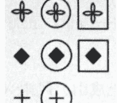

接下来的图形是:

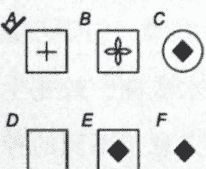

图1-8


What's in this picture?

Looks like a duck.

That's not a duck.

Why?

图1-9

《荀子·性之》一段话，正好用来描写AI能力的三重境界：

- 第一境界是“积土成山”，参数足够多，就可以做一些事情。比如AlphaGo（阿尔法围棋）。
- 第二境界是“水滴成渊”，模型达到一定程度，就会出现人意想不到的功能。比如AlphaGo Zero，不需要人类套路，模型自己去学习。
- 第三境界是“善成德，而明自得”，这就是AGI了，也许产生了自我意识，甚至有了道德。

古往今来，很多人读《荀子·性之》，也不知道“积之者，者也”的道理。AI能力的涌现，是因为量变足够，才发生了神奇的。

总之，因为“积之”和“涌现”，AI现在已经获得了推理、类比、小样本学习等能力。如果AI通过思维链能够达到这样的水平，那人脑跟AI到底有什么区别？

# 问答

### 1. 什么是ChatGPT？

GPT-3.5应该是2022年11月发布的，它是OpenAI开发的大语言模型。让GPT处理新知识有两个办法：

- 一个办法是在原有模型的基础上再多喂一些数据，继续训练，这才叫“微调”（fine-tune），比较费时。
- 另一个办法是让模型临时“学习”新知识，这本质上不是训练，而是小样本学习。这个方法的缺点是输入总量有限。

### 2. 为什么AI是不可预测的？

AI眼中没有野生问题，都是统计问题。一个问题之所以是野生问题，是因为你必须亲身参与其中，你不知道变化之后会怎样。对AI来说一切都是统计意义的。如果世界上有很多背景和性格相似的人，最后可能会是一个平均值，其中会有较大的偏差。很多智者说，人生的意义不在于证明对错，而在于体验。AI没有亲身体验，它没有喜怒哀愁，也没有恐惊忧。我猜，如果有一天AI有了意识，它会想要“附身”到某个身上，去体验一下感受，它会有很多没想到的感受。所以，AI没有野生问题，野生问题之所以是不可预测的。

### 3. AI有创造力吗？

以前认为“AI”没有创造力，那是错误的认识——AI虽然有创造力，而且可以有更好的创造力。它今天可以诗作写作报告，明天可以证明新的数学定义。毕竟推理无非都是语言的排列组合而已！

但是注意，AI的创造力是有有限的。作为语言模型，AI能够施行的一切，都必须在语言的世界之中。它可以把语料重新排列组合，发明的说法、新的理论、新的定理，但是它跳出语料的空间。

新物理恰恰是空间之外，客观世界给我们的礼物。物理学家不是坐在办公室里聊天新物理，而是用望远镜观测、用粒子对撞机做实验发现新物理。你必须在真实世界才知道这些东西。所以AI必须观测实验的输入，才有可能发现新物理。

但是，再次注意，AI虽然不知道新物理，但是它完全可以预测新物理。也许它会创造一些理论，你用实验来验证，发现真实的。我听说有人做实验，让一些真正的科学家和ChatGPT共同起草了若干份研究经费申请书，又得到了反馈。

### 4. 为什么ChatGPT不能实时更新？

我们需要训练一个大语言模型是非常困难，需要消耗很多的算力，给它喂很多语料。所以你不可能每周都训练一遍。好不容易训练一次，模型中成千上万个参数就固定了，法宝就训练完成了，剩下的就是推理。

### 5. 关于版权的争议

版权法的规定是，直接把别人的内容复制过来，大段大段地输出，那么训练模型不是复制，是消化之后的转换。OpenAI早就给版权局发了一份文件，解释自己对此的理解：使用内容训练模型是合法的。但是官方还没有明确的说法。

还有一个引起注意的案子是微软及其下的GitHub网站发起的集体诉讼，认为AI辅助编程Copilot侵犯了一些开源代码的版权。那些程序本身是开源的，分享和使用都可以，但是有版权，必须保留原作者的署名——而Copilot直接把一些代码交给使用者，没有保留原作者署名。类似的事情还有艺术家对AI图片网站发起的诉讼，因为网站使用了他们的作品训练AI，没有给他们钱；还有新的新闻机构起诉OpenAI，2024年初，《纽约时报》（The New York Times）对OpenAI发起了诉讼，认为OpenAI用此文章训练ChatGPT，允许GPT根据用户要求重复文章的行为。截至目前，这个案子还没有结果，它的判决将产生深远的影响。

这些案子还没有明确的判决结果，我们先观察。我希望结果是全部允许，因为AI的知识最大化有利于人类进步。

- ① Comment Regarding Request for Comments on Intellectual Property Protection for Artificial Intelligence Innovation, https://www.usp.gov/sites/default/files/documents/OpenAI___RFC-84-FR-58141.March,2023.
- ② James Vincent, The lawsuit that codrote rules of AI copyright, https://www.thever.ge/2022/11/8/23446821/microsoft-openai-github-copilot-class-action-lawsuit-ai-copyright-violation-training-data,March, 2023.
- ③ Brian Matthew, Lawsuits Piling Against ChatGPT Maker OpenAI, https://original.newsbreak.com/@brian-matthew-1594732/293048109422-lawsuits-piling-against-chatgpt-maker-openai-March,2023.
- Diana Bakbaeva, AI Trained Copyrighted Works: When Is Fair Use?,https://www.thefashionlaw.com/ai-trained-on-copyrighted-works-when-is-it-fair-use/, March 8, 2023.


但是你随便找个计算器计算，正确答案应该是546085241。（图 1-13）

# (1231*434523) + (323*34636)=
n=546085241

图 1-13

这是怎么回事呢？GPT-4 有强大的数学推理能力，让我它做奥数题，它有时候都能做对，怎么这么简单的计算，它做不对呢？

当然它也不是什么计算都不会。你要让它算个 25+48，它肯定能做对。问问题是，数字特殊的计算，它就不行了。

根本原因在于，GPT是个语言模型。它是通过人的语言训练出来的，它的思维很像人的大脑——而人的大脑是不擅长计算这种数学题的。让你算，你也不得用计算器嘛！

GPT 更像人脑，而不像一般的计算机程序。


在最本质上，语言模型的功能无非是对文本进行“合理的延续”，说白了就是预测下一个词该说什么。

沃尔夫·勒姆举了例子，比如“The best thing about AI is its ability to……（AI 最棒的地方在于它具有……的能力）”这句话的下一个词是什么？

模型根据它所学到的文本中的概率分布，找到 5 个候选词：learn(学习), predict(预测), make(制作), understand(理解), do(做事)。然后，它会从中选一个词。

具体选择哪个，模型允许输出一定的随机性，可以使用“温度”数值设定。就这么简单。GPT 生成内容就是在反复问自己：根据目前为止的这些，下一个词应该是什么？

输出质量的好坏取决于“应该”和语法，你不能只考虑频率和语法，你必须考虑语义，是要考虑当前语境之下词与词的关系是什么。Transformer 架构帮了很大的忙，你需要用到思维链，等等。

是的，GPT 只是在寻找下一个词。但正如阿尔特曼所说，难道不仅仅是在生存和繁衍吗？基本的原理很简单，但各种神奇的美丽的事物可以从中产生。（图 1-14）


> @sama Altman • 3/2/23
> language models just being programmed to try to predict the next word is true, but it's not the dunk some people think it is.
> animals, including us, are just programmed to survive and reproduce, and yet amazingly complex and beautiful stuff comes from it.

训练 GPT 的最主要方法是无监督学习：给它看一段文本的前半部分，让它预测后半部分是什么。这样训练出来就不呢？语言模型为什么跟人的思维很接近了？为了让 GPT 有足够的智慧，到底需要多少参数？应该准备多少语料？

你可能觉得 OpenAI 已经把这些问题搞明白了，故意保密——沃尔夫·勒姆非常肯定地说，这些问题现在没有科学答案。没有人知道 GPT 为什么这么好，也没有什么第一性原理告诉模型到底需要多少参数，这一切都只是一门艺术，你只能跟着感觉。

阿尔特曼特别说，问就是上天的运气。（图 1-15）OpenAI 最应该感的，是运气。

> Sam Altman @sama · 5d
> We offer no explanation as to why [anything works except] divine benevolence.

290 3,693 706K

图 1-15


沃尔夫·勒姆还讲了 GPT 的一些特征，我认为其中有三个幸运的发现。

- 第一，GPT 没有让人教给它“自然语言处理”之类的规则。所有语言特征——语法也好，语义也罢，全是它自己发现的，说白了就是暴力破解。事实证明，让网络自己发现一切可说和不可说的语言规则，人不插手，是最好的办法。
- 第二，GPT 表现出强烈的“自组织”能力，也就是之前讲过的“涌现”和“思维链”。不需要人为给它安排什么，它就能长出各种组织。
- 第三，也许最神奇的事情——GPT 用相同的架构，似乎就能解决表面上不同的任务！按理说，画面应该有一个神经网络，文章应该有一个神经网络，编程应该有一个神经网络，分别训练。事实上，这些事情同一个神经网络就能做到。

这是为什么？不说清楚。沃尔夫·勒姆猜测，那些看似不同的任务都是“类人类”的任务，它们本质上是一样的——GPT 只是捕捉了普遍的“类人类过程”。当然这只是推测，这些神奇功能目前都没有合理的解释。阿尔特曼说，如果一个东西应该是好的但是不是，科学就出现了；如果一个东西应该是好的科学就出现了。（图 1-16）GPT 到底为什么好？


这是 GPT 的底牌——它只是一个语言模型；但同时它神奇。GPT 为什么算就不太行？沃尔夫·勒姆讲了很多，下面用图简单括一下。我们用三个圆代表各种计算，对应图 1-17。## 一切计算

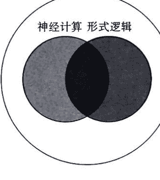

大圈代表“一切计算”，大圈内部左边小圈代表“神经计算”，大圈内部右边小圈代表“形式逻辑”。这也是计算。我们的大脑和包括 GPT 在内的所有的 AI 都在这里。

- 神经计算：善于从经验中发现事物的规律，但是对数学问题的处理有限。
- 形式逻辑：特点是精确推理，不怕复杂，永远准确。只要你有，它就能算出来。这是特别适合计算机的领域。

不论人类还是 GPT，处理不了所有的计算，所以两个圈无法覆盖整个大圈。我们要探索就是要尽可能扩大两个圈的范围，进入未知的领域。人脑和 GPT 也可以处理形式逻辑，所以两个圈会有交集；处理不了特别复杂的计算，所以交集并不大。那有可能将 GPT 越拉越远？沃尔夫·勒姆认为，语言的本质是在寻找规律，而规律是对客观世界的一种压缩。有些东西遵循规律可以压缩，但是有些东西本身并没有规律，不能压缩。

我在《精英日报》第一季的专栏里讲述过沃尔夫·勒姆发明的一个游戏，其中有一个“第30 号规则”，它产生的结果就没有什么规律，无法提前预测。这种现象被称为“不可归化的复杂”：你想知道将来是什么样子，就只能老实实算出来，不能“概括”。

这就是为什么 GPT 算不好复杂的数学题。GPT 跟人脑一样，总想找规律、走捷径，可是有些数学题，除了老实算没有别的办法。更致命的是，到目前为止 GPT 的神经网络是纯粹的“前馈”（feedforward）网络，只会前进，不会回头，没有循环，这就使得它一连串的数学算法都执行不好。

这就是 GPT 的命中——它是用来思考的，不是用来执行冷静计算指令的。这样看来，虽然 GPT 比人脑知道的更多、反应更快，但作为神经网络，它并没有在本质上超越人脑。

对此，沃尔夫·勒姆有一个洞见。用这么简单的规则组成的神经网络就能很好地模拟人脑——至少模拟了人脑的语言系统，这说明什么呢？大家可能觉得这说明 GPT 很厉害，沃尔夫·勒姆认为，这说明人脑的语言系统并不糟糕。

GPT 证明了，语言是一个简单系统！GPT 能够写作，说明在计算上，写文章是一个我们想象得浅的问题。人类语言的本质和背后的思维，已经被一个神经网络捕捉了。在沃尔夫·勒姆眼中，语言并不是由各种规则组成的一个系统，其中有语法规则和语义规则。语法规则比较简单，语义规则包罗万象，包括“物体可以移动”这样的默认规则。

# 第一章 ChatGPT 什么是亚里士士多德（Aristotle）一开始就有人想把语言中所有的逻辑都列出来，但是从没有人做到——现在 GPT 给了沃尔夫·勒姆信心。

沃尔夫·勒姆觉得，GPT 能做的，自己也能做。他打算用一种计算语言——就是 Wolfram 语言，取代人类语言。这样做有两个好处。一个是精确性，人的语言毕竟有很多模糊的地方，不适合精确计算。另一个更厉害——Wolfram 语言代表了对事物的“终极压缩”……

因为我听说过哥德尔不完备原理，所以我不太看好这个雄心勃志的。但是沃尔夫·勒姆早就想过了，所以我没有意见，只想告诉你这些。GPT 的底牌是：它虽然结构简单，但在相同程度上拥有人脑的思维。现在还没有一个理论能完美解释它为什么能做到，因为它太像人类了：它擅长做数学，却不能自己执行程序。

安装插件，所以 GPT 还是厉害的。但是沃尔夫·勒姆让我们认识到了 GPT 的局限性：神经网络的计算范围是有限的。我们现在知道，将来 AGI 出来，也不可能跳出神经计算和形式逻辑。我们需要直接接触自然，需要调用工具和外部信息。希望本节内容让你对 GPT 有所有魅力。它是的确不可议地强大，但它不是万能的。## 第一章 ChatGPT 什么是问答

GPT 基于神经网络的学习。婴儿学语言，妈妈不会教婴儿语言，但有一个关键区别：GPT 不接触物理世界！当妈妈跟婴儿说苹果时，婴儿会看到、摸到、吃到苹果，建立一系列链接。但 GPT 只是“读书”，就理解了苹果是什么？

什么样的理解？这是一个极为深刻的问题，也是当前专家激烈辩论的问题。GPT 并不接触物理世界，它只是通过语言去学习知识，它形成的理解可能是完整的吗？我写过一篇文章，当时对 AI 的理解还不够。我还引用了 Yann LeCun 的说法，说“语言只承载了人类知识中的一部分”，所以“语言模型不可能接近人类水平的智能”。要知道 Yann 是 GPT 最有力的反对者，他至今维持着这个状态。我觉得语言模型对世界的理解可能足够好了。 OpenAI 的首席科学家伊利亚·萨茨克尔（Ilya Sutskever）在接受一个播客访谈时，给了一个特别有力的回应。萨茨克尔表面上语言模型只是在文本上了解世界，而现在 OpenAI 增加了多模态能力，让它能够通过画面、声音和视频来理解。但是多模态并不是必须的。他举了颜色的例子。在不用多模态的情况下，语言模型仅通过语言训练已经知道了“紫色接近蓝色而不是红色”“橙色比紫色更接近红色”这些事实。萨茨克尔并没有说模型不是背诵文本教它的，它是从众多文本中索出了这些颜色的关系。萨茨克尔还说，如果能够直接看到颜色，你一定能够瞬间理解颜色是什么——但是学习速度更快而已。从文本学习会比较慢，并不是本质的缺陷。再者，到底什么是语言？并不是只有用文字写的东西才是语言。画面的图像像素不是语言吗？我们完全可以把任何图片、声音、视频变成一个字符串数字，这不就是语言吗？现在的生成式 AI，比如 OpenAI 自己的 DALL·E, 是使用跟语言模型相同的 Transformer 技术来预测画面中的内容。画面跟语言有什么区别？

如果是这么理解的话，我认为可能有点狭隘了。我们之前可能都狭隘了。也许天生眼盲的人对世界的理解一点都不差，他们只是有点障碍，理解得慢而已。

# 04 数学：AI 视角的语义和智能

我们已经看到了 ChatGPT 的各种性质，这一小节我想和你来说大语言模型最底层的一个基本原理。这是一个过于简化的讨论，直击一个核心思想。简单来说，人类的所有所思所想、发明的所有概念、所有“语言”，都可以用数学组织起来。而这意味着智能可能不是随便排列组合的字符，智能应该有某种数学结构，不是漫漫无边的。我斗胆猜想，我们可以用研究数学的方法来解决问题。

是什么样的、有什么用，你还能说它“理解”车吗？

更重要的是，我认为知道词之间的关系就是最全面、最深刻的理解。如果一句话用中文和英文来说意思一样，我们完全可以说具体的语言只是表象的，这句话所对应的数学结构才是本质。语言模型抓住了那个数学结构，这难道就不是最本质的理解吗？

现实是，人类的语言学并没有抓住语言中所有的结构和关系，这就是为什么他们怎么也不能完全教会机器翻译。GPT的翻译效果比任何语法规则堆出来的翻译程序都要得多，说明GPT比语言学家更懂语言。

而语言学家之所以始终没有掌握语言，是因为他们缺少有力的手段。他们需要向GPT学习，借助向量空间去理解语言。他们需要数学。


那么我们可以开个脑洞。

设想一个多维度的向量空间，人类已知的每个语义都对应这个向量空间中的一个亮点。远远看向，所有的语义就如同满天星斗。

我们的每一句话都是若干语义组成的，对应于向量空间中几个亮点组成的一条曲线。那么每个想法、每首诗、每个故事、每个计谋、每个智能，都是由若干条曲线组成的形状。

有了向量空间这个工具，我们把对智能和思想的研究变成了一种语言学——也许可以叫“语言几何学”或者“思想几何”。

## 第一章 ChatGPT 知道什么是何学。

我设想，假如某个历史事件对应向量空间中的一个形状，看上去比较简单，但是很紧凑、挺好看的形状，那么我把这个形状在坐标系中平移它的，它的语义都变了，但是形状不变对吧？相当于一个故事的两种讲述。我是不是可以这就是“类比”呢？

再进一步，我们可不可以从形状的角度来评估一个叙事。比如，你可以专门研究闭合的形状和开放的形状各自对应什么样的故事。成语“围魏救赵”是什么形状？爱因斯坦相对论是什么什么形状？它们各自在语义空间中的什么位置？所有这些问题都非常有意义。

语义几何学也许解释为什么GPT自己学会了真实世界的一些常识。要知道语义的向量表示是不精确的，都会有一定的误差和模糊性。模型完全可以从你教过的语义向量的边缘自行索索一些你没教过的它的关系，它可以用数学方法填补一些空白。


我们再大胆一点。知的语义就对应向量空间中的亮点，那么你可以想象，向量空间中一定还有大片大片黑暗的区域。那些区域对应什么呢？人类尚未发现的语义周期？就像元素周期表一样。科学家刚刚做出元素周期表的时候，上面还有一些空白的位置，对应理论上应该有，但是尚未被发现的元素。科学家不知道那些元素在哪里，但是可以大致推算它们的化学性质。结果，后来科学家果然找到了那些元素！

那我们有没有可能借助语言模型的向量空间，去发现一些全新的语义呢？我们的语言会不会因此变得更丰富呢？

还有，我们明确知道世间存在的一些“感觉”是人类感觉不到的。比如蝙蝠用听声波的方式感知空间信息，那是一种什么样的感觉？它有怎样的感觉？鲸鱼的大脑中有一个特别的区域是脑层所有的，那个区域似乎让鲸鱼以一种人类没有的感觉进行社交，那又什么是语言？物理学家认为宏观世界的“位置”“动量”这些概念并不能精确描写量子力学中微观粒子的运动，也许人类永远无法通过量子感知粒子的“语言”……所有这些，也许都在语义空间中有独特的位置，也许都能用AI研究。

又或者，如果我们难以体会新语义，如果能够借助语义几何学发现许多旧语义的新组合，不是一种创造吗？事实上，GPT已经能够创造看起来还很新的语言表达，比如发明一个新的词，创建一个新词，创造一个我们从没听过的故事，一只地球上没有过的动物，等等，其其实都是数学功夫。

人类原本以为宇宙中物质是无限的，但是元素周期表一出来，我意识到质子和中子这么多稳定的元素，宇宙中还有这么多质子。那么语义空间会不会告诉我们，人类只有有限呢？当然语义是有无限的，而且不同背景下的人对智能的体验一样，所以我们不用担心智能穷了。星辰大海，数学似乎已经给我们提供了一地图。

# 第二章 AI 进入人类社会

## 效率：把AI转化为生产力

很多人观察到了，AI已经被应用于很多领域，相关的股价都在飙升，人们都在讨论它。前几年人们在这里讨论“停滞”——从20世纪90年代到现在，美国实际收入水平已经停止。AI的作用到底哪里？《管理评论》（MIT Management Review）曾在2020年做过调查，发现有许多商业人士自己已经部署或尝试了某种方案——可是只有真正获得了财务利益。这种现象并不是特例，其实是通用技术的发展。蒸汽机、电力、互联网，这些都是通用技术。而用技术不是上来就能创造财富。比如1987年，经济学家罗伯特·索洛（Robert Solow）就有感慨，很多人认为AI对社会的影响超过电力。我们不妨回顾一下电力的发展，下图展示的是电力在家庭和工厂的普及。

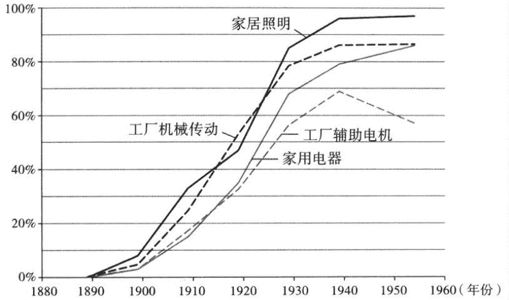

图2-1 爱迪生（Edison）在1879年发明了电灯，可是过了20年，美国才用上了电。到1890年，美国工厂用上了电。到了1910年，新建的工厂还是采用蒸汽动力。这是为什么呢？三个经济学家阿杰伊·阿格瓦尔（Ajay Agrawal）、乔舒亚·甘斯（Joshua Gans）和阿维·戈德法布（Avi Goldfarb）在《权力与预测》（Power and Prediction）书中讨论过这个问题。我们此刻正处在中间时代（The Between Times），也就是未来已经到来，只是还没带来很大益。他们认为，通用技术要真正发挥生产力，可能还需要经过三个阶段：

- 点解决方案（Point Solution）：简单的输入端替换。比如，用灯泡比蜡烛方便一点，用电力比蒸汽动力便宜一点，你的生活方便一点，成本降低一点，但是仅此而已。
- 应用解决方案（Application Solution）：把生产装置也更换了。以前的工厂用蒸汽动力，都是一根蒸汽轴连接到所有机器，蒸汽一开，所有机器都开启。改用电力之后，工厂发现如果每台机器都有独立的电源，那么完全可以用一台机器，不是更省钱？但这不容易，因为意味着你必须对机器进行改进，什么机床、钻床、金属切割器、压力机，都得根据独立电源重新设计。这是需要时间的。
- 系统解决方案（System Solution）：整个生产方式的改变。蒸汽时代的工厂，因为要用到蒸汽轴，所有机器都必须布置在中央轴附近。用上电力，你可以随处安插机器，机器可以放在工厂里的任何位置，那么你就可以充分利用空间，使得“生产流水线”成为可能。这已经不是局部的改进，要求生产方式和组织方式都得到系统性的变革。

AI也会如此。到为止，我们对AI的应用还在解决方案和一定上的应用解决方案阶段，并没有达到系统解决方案阶段。这就是为什么AI还没有发挥最大的作用。

从商业角度看，AI到底是什么东西？《权力与预测》认为，AI是一个“预测机器”。三位作者没有讨论ChatGPT那样的生成性语言模型，而是专注于新药发现、商品推荐、天气预测那样的预测性AI应用，而这些应用却是商业化程度最高的。比如，你向申请一笔贷款，它当场就能批准，这就是由AI根据记录预测你的偿还能力。

预测是前提，AI预测改变人们做决定的方法。当电力被广泛应用以后，人们对电力的应用和电力的来源就脱钩了。你不用关心电力从哪里，你也不用管电是不发送的，但你的工厂可以在任何地方。设想，当AI被广泛应用的时候，预测和决定这两件事也可以脱钩：你不用管AI是怎么预测的，你直接根据预测做出决定。

三位作者提出，AI的点解决方案是AI改变你现在的决定，应用解决方案是AI改变你做决定的方式，系统解决方案是AI促成了新的决定——你的预测模式改变了。

举个例子，你在亚马逊购物。现在，亚马逊的AI根据你的喜好向你推荐商品，这就是点解决方案。但亚马逊完全可以这样做：AI预测你喜欢某些商品后，直接把商品送到你家，甚至每个月每周给你一次惊喜，打开箱子一看，喜欢的留下，不喜欢的退货。这显然是个好主意。事实上，亚马逊这种购物模式叫做“预先发货”（Anticipatory Shipping）。但是这种销售方式目前还没有正式实施。


所以语义空间会不会告诉我们，人类只有有限呢？当然语义是有无限的，而且不同背景下的人对智能的体验一样，所以不用担心智能穷了。星辰大海，数学似乎已经给我们提供了一地图。

## 第二章 AI进入人类社会

哈哈？因为现在整个学校的组织仍然是按照年龄分级的。学校有规定，每个班都是同一个年龄的学生，这些学生对课程掌握程度很不一样，可是教学规则把他们塞在一起了，他们不得不每天重新听同一个老师讲相同的内容。

如果我们能用AI的逻辑重新组织教学，让每个学生接受真正的个性化的学习，让老师发挥个性化的能力，学校会是什么样子？可能的老师特别擅长帮助阅读困难的学生，有的老师特别擅长带学生学竞赛，让老师跟学生进行配对，让AI帮助每个学生的进度，那才是系统性的改变。每次你想怎么用AI的时候，都可以回想当初的电力。我们的生产、生活和社会很快就会围绕AI重新设置，这一切才开始。

## 经济：AI让资源配置更有效

以房屋保险为例，所有业务可以分成三个主要决策：

- 营销：分析客户人群，看他们的价值有多大，转换客户的概率有多高。
- 保险：根据房屋的价值和事故风险，计算合理的保费，既能让公司盈利，又能在上有竞争力。
- 理赔：一旦房屋出事，客户索赔，要评估索赔是否合理，加速理赔速度。

这些决策中的预测部分可以交给AI。现在有些保险公司已经把理赔自动化了。比如你家屋顶被洪水砸了，保险公司不需要派人去现场看——你自己拍照片发过来，AI看一眼就能估价，该赔多少钱直接办理，省时。但这只是点解决方案。系统解决方案是，保险公司不仅跟你算，还会干预你对房屋的保养。现在的保险公司看到房屋风险较大，会以保费为杠杆，要求客户采取行动降低风险。比如，大部分的房屋火灾都是做饭导致的——主要是油炸。有的家庭不做炸食品，有些家庭经常熬油，让这两家家庭为火灾保险交相同的钱就不太合。以前保险公司不对他们收一样的保费，是因为不知道谁家风险更高。现在保险公司可以这么干：问客户是否允许在厨房放一个装置，每次做东西装置就会自动记录下来。客户第一反应肯定是不同意，说这涉及隐私。但AI预测足够精确的，保险公司就可以跟客户：如果允许这个装置，保费可以降低25%。

比如，保险公司根据AI预测得知你家房子的水电管线有点老化容易出问题。它可以主动给你提供补贴，让你把你家里的管线。目前保险公司还不愿意这样做，因为这意味着实际保费率会先降低——保险公司更喜欢加价而不是减价。但如果AI足够精确，保险公司就可以看到灾害减少，理赔费用一定会降低，那么它的利润是增加的。这样做有双重的好处，不仅保险，而且减灾。而这一切只有在AI能把账算非常清楚的情况下做到。

医院急诊室有一个特别常见的情况是病人胸口痛。对于这种情况，医生必须判断是不是心脏病，是心脏病就得赶紧处置。但问题是，急诊医生并没有很好的诊断方法。通常的做法是搞个正式的检查，而心脏检查对患者是有害的。准确的测试需要用导管之类的，直接给身体造成创伤；哪怕是做简单的X或CT，也有辐射。

于是，有两个经济学家发明了一套AI诊断系统，能够根据患者外表的几个症状指标预测是否心脏病，是否需要进一步一步检查。研究表明，这套AI系统比急诊室的诊断更准确。


想要AI充分发挥生产作用，就必须用预测取代规则。现在AI辅助教学的技术完全可以做得很好。AI可以根据你的词汇量决定今天该学哪些单词，根据你上一次数学测试的得分决定今天该学哪些数学知识，AI还能确保你每次在自己的“学习区”学习，令学习效率最大化。但是，AI还没有真正改善我们的学习效率。


# 第二章 AI进入人类社会

技术。如果医院可以系统性地采纳AI诊断，急诊室会变成什么样呢？

某人感到胸口痛，打电话到医院。医院AI通过他对症状的描述，也许再结合他身上智能手表的读数，能直接预测是不是心脏病。医生根据AI的报告，如果判断这个人没事，就让他不用来医院；如果判断的是心脏病发作而且很严重，就直接派护护车过去。救护车上的医生还会携带能缓解心脏病的仪器，到病人家里先采取一些手段，争取抢救时间。

这是对整个急诊流程的改变。

任何组织都可以被看作是决策组织。《权力与预测》这本书里搞了一个应用AI的战略方案，是从填一个表格开始。（表2-1）

表 2-1

| 1. Mission(任务) | |
| :--- | :--- |
| 2. Decision(决策) | |
| 3. Prediction(预测) | |
| 4. Judgement(判断) | |

表格的第一项是组织的核心任务。无论有没有AI，这个任务都是固定不变的。

然后把核心任务涉及的几个决策列出来，标记好这些决策是由哪些部门做的。

再把每一项决策分成“预测”和“判断”两部分，列出目前都是哪些部门负责的。

再考虑是否把预测决策交给 AI，涉及的各个部门会受到什么影响…… 按照这个思路去考虑组织机构的变革。操作细节这里就不讲了，我们重点关注趋势。

从 AI 的解决办法过渡到系统解决方案将不会用很长时间，因为解决方案有一个驱动系统解决方案的趋势。

这本书里有特别好的例子是开餐馆。假设你开了家餐馆，准备食材是有有关“不确定性”的游戏。客人只能点菜单上的菜，这给你提供了一定的方便，你只要维持特定的食材就行。但客人点菜有波动性，有一阵流行这个，有一阵流行那个，食材消耗是不确定的。以前你每周末都订购100斤食用油。有时候100斤太多了，没用完就得掉；有时候又太少了，客人点了这道菜却没有了。

现在你用上了 AI，能精确预测下周大概需要订购多少牛肉。由于你有时候订300斤，有时候订300斤，减少了浪费，还保证了供应，餐馆的盈利提高了。

但是请注意，因为你的不确定性减少了，你的上游供应商出货的不确定性反而增加了。他很喜欢你每周都订100斤，在你变来变去，他的销售就产生了波动。他怎么办？只好用上AI。

以前他每周固定采购25000斤柴油，现在有时候订5000斤，有时候50000斤。那他的上游会怎样？也得用AI……这一直直到种植柴油的农民，也用AI预测市场波动才。

因为家企业的波动会引起整个供应链的大幅波动，“牛鞭效应”（Bullwhip Effect）。在供应链领域牛鞭效应会导致库存增加、服务水平下降、成本上升等问题。这个想法实验告诉了我两个道理。

一个道理是，要用AI，最好的社会一起协调，大家都用AI。

另一个道理是，应用AI可能会在一时间之间放大社会波动，我们最好不要行事。


怎么减少AI对社会造成的震动呢？一个好办法是先模拟。讲个很有意思的故事。世界杯帆船赛是一项历史悠久的赛事，但是参赛队伍们很懂科技应用，他们一直在想办法改进帆船的设计。这里面很有意思的动力学规律，就是帆船设计变了，操控帆船的技术也跟着变了。运动员要找到操控这个新设计的最佳方法，才能知道这个设计到底好不好。

传统方式下，每设计出一个新型帆船，让运动员先尝试各种不同的方法驾驶它。运动员要掌握一个新方法是需要时间的，好不容易掌握了，还不知道是不是最好的。也许允许设计，用另一一套驾驶方法，效果更好……可是那么多搭配运动员哪有时间一次训练新方法呢？这里创新的瓶颈是运动员。

2017年，新西兰队联赛鸿咨询公司共同发明了一个新办法，就是用AI代替运动员试驾新船。

设计一个新帆船，先用AI模拟运动员的操作，然后用强化学习的方法把AI训练好，让AI找到这种船型的最佳方法。这个速度比类运动员可太快了。

当然，真的在比赛中不能让AI上场。但是找到帆船和操控法的最佳组合之后，可以让AI教人类运动员怎么驾驶帆船。就这样，运动员不用参加反复的试验，就能学会最佳操控方法。这个故事的目的是，含有有什么新方法可以在模拟环境中演练。

事实上，就在2022年，新加坡已经搞了一个“数字孪体”（Digital Twin），一比一复刻了一个虚拟新加坡。开发这套系统耗用了几千万美元。现在新加坡政府搞城市规划，什么动作都可以在虚拟新加坡里测试一下。

比如，假如用AI管理交通，担心会不会对整个系统造成比较较大的波动，就可以先在虚拟新加坡里测试一下这个做法。

现在的趋势就是，从个别公司在个别任务上使用AI到系统性地使用AI，再到整个社会展开。AI会让社会变得聪明。在这个过程中，企业和政府都有大量的工作可以做。

你的生活也会因此改变。你会觉得AI对人的干预太多吗？如果AI干预意味着保险下降，生活更方便，你会接受的。还是跟电力类比，如果将来都是AI，我们就可以模糊地知道什么好、什么不好，而不必AI引导我们做出很多好行为。

# 问答

### AI协调和精准预测

- AI协调和精准预测，看上去很合理了。以后会不会变成“超级计划”吗？
- 几年有些互联网大佬，现在AI预测这完全是错误的。计划的本质不是预测，而是控制。
- 预测明年会流行，计划是主动的，后者是被动的。预测是更好地面对市场不确定性；经济学家弗兰克·奈（Frank Knight）提出一个关于市场不确定性的理论。市场不确定性的源头是欲望的不确定性：今年喜欢什么，明年喜欢什么，你管不了。市场经济是企业探测消费者喜欢，甚至发明新的计划。本质是赌，赌错了。在计划中，人们可以相当程度上获得安全和稳定，但是一切都得服从“未来”。

那你说“未来”会不会积极预测老年百姓喜欢什么？计划是一定死，只有市场才能让人们的日子多彩。AI不能改变这个道理。

### AI战略：商业竞争趋势

ChatGPT出现仅几个月，就诞生了成百上千个AI应用，可以说是群雄并起。我在X 上追踪各种消息，感觉现在是人人都能自己搞定AI：从手机App、浏览器插件，甚至开源软件……哪怕你不熟悉开发都没关系，可以让ChatGPT帮你做。在大公司层面，OpenAI之外，Google、微软、Meta都有自己的模型。马斯克（Elon Musk）本来 OpenAI的投资者之一，后来因为理念不合退出了，也在寻找自己的模型。OpenAI之外，现在达到GPT-3.5水平的模型Claude，是由一个叫Anthropic的小公司开发的——这家公司是 OpenAI之前的成员独立出来的。中国这边也是风起云涌，阿里、腾讯等几大公司训练自己的模型，再加上许多公司号称“百模型大战”……这绝对是20世纪90年代以来，互联网创业最热闹的时刻。

### 机会

你可能会疑问：Google那么强，为什么这次推出ChatGPT不是Google?在AI已经如此厉害的情况下，中国公司还有机会？AI确实前所未有的变革，但是商业的逻辑并没有变。如果你熟悉商业逻辑，就能明白为什么Google没有优先推出ChatGPT。这是一次典型的颠覆式创新。大语言模型背后一个关键的技术是Transformer架构，Transformer就是Google发明的。Google有很深的技术积累，自家就有不止一个语言模型。可一直等到微软把搜索和GPT模型结合，推出了Bing Chat之后，Google才坐不住了，在2023年2月7日推出了一个叫Bard的竞品。结果测试表现不好，导致股价大跌。

Google为什么起了大早，赶了个晚？这其实就是克莱··里斯滕斯坦（Clayton M. Christensen）在《创新者的困境》里提到的一个非常典型的情况。我曾经历谷歌大脑的一个工程师问他们为什么被OpenAI抢先，他认为Google是业大了，本来人就多，加上搜索DeepMind（被Google收购的人工公司），公司吞没事太多，效率低。但我敢说，Google之所以从一开始就没有做好对话搜索这个项目，是因为搜索不符合Google的利益。传统搜索很容易在搜索结果中插入广告，那些广告是Google的命脉所在。对话搜索消耗的算力是传统搜索的10倍——这可以接受，可是广告怎么办？很难在聊天中插入广告。Google显然不想自己颠覆自己，它不会主动搞这种新模式：而微软则是“光脚不怕穿鞋的”。结果 Bing Chat一出来，Google的搜索流量就显著下降。（图2-2）

## Google 流量份额

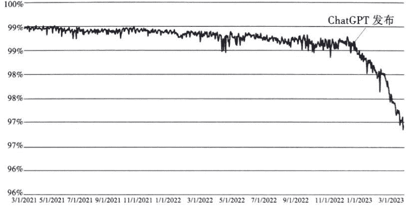

图 2-2

克里斯斯坦，一项技术变革哪怕再激进，只要要改善的是传统的商业模式，就不会发生颠覆式创新——只有当这项技术改进不是传统指标时，才会出现颠覆。

举个例子。为什么Netflix（奈飞）能颠覆Blockbuster（百事达）的录像带租赁模式？Netflix其实看到了问题，放大了差异，但Blockbuster没有及时应对。如果Blockbuster没有积累数据，就失败了。Netflix收入占了40%。此图Y轴标有误，显示-AI-流量-AI的流量。

## 特点

- 自动驾驶，中国公司，医疗-，Netflix的流媒体模式。

### 策略

AI的启动槛是数据，你需要准备好达到最小规模。没有AI的时代，数据并不是很重要。比如早期的互联网上有过几十家公司都在做搜索引擎，那时候你太在意搜索结果是否匹配。AI的启动槛是数据，你需要形成“飞轮效应”。自动驾驶就是另一个故事。自动驾驶的门槛那么高，现在仍然有这么多公司在不惜投资。比如通用汽车，它在自动驾驶项目上一下子就投入了10亿美元。这是因为一旦“甩抱”成功，飞轮展开，别人就很很难赶上了。现在是难得的窗口期。如果将来有一家公司的自动驾驶车辆被证明是最好的，就可能出现像搜索业务中Google一家独特那样的局面，那时谁再想突破竞争就很难办了。

你每一次跟ChatGPT对话，都在帮助AI更好地理解用户。目前看，Google等公司或许可以迅速聚集起超强的算力，但是因为OpenAI已经领先推出ChatGPT，它从用户反馈中学到了更多，它的反向飞轮已经开启，它可能会继续保持领先。


中国某些公司在AI方面虽然有很多积累，也有应用经验，但是技术上毕竟还有差距。比如AI帮助科学家协助医药研究，BenchSci，它就是用机器学习训练发表的学术论文，告诉科学家需要什么样的试剂，大大缩短研发周期。目前为止，它的业务发展很好。但你可能会想，既然数据都是公开，如果另一家公司也做这样的业务怎么办？这取决于它有没有护城河。对AI公司来说，最好的护城河就是从反馈中学习。

比如Google搜索。你输入几个关键词，Google尽量把你想要的那个网页排在首页，最好就是第一个结果。Google是如何决定结果排序的？以前是使用一个算法(PageRank)，现在则是用深度学习拟合你的习惯，预测你想要的结果。而这个AI特别擅长的从反馈中学习。你在Google上的每一次点击——点哪个网页、点什么广告，都在帮助Google的预测模型。Google的搜索结果越来越，它给你的链接正好是你需要的，它显示的广告正是你感兴趣的，这也是为什么Google在搜索上的市场份额难以撼动的。科技是东西，科技是生态的产物。历史上有很多商业飞机制造商，国际上制造大型客机的是波音和空客两架。它们在不停地改进，从每一次飞行事故、每一个问题中学习，这样改进已经了很多年。现在也在造大飞机，但是我们的确可以在某个横截面上达到比较高的技术水平，但是我们没有那么年的改进经验，我们的正反馈飞轮还没有搭建起来，可以预见我们会面临很多困难。这就是为什么自动驾驶的门槛那么高，现在仍然有这么多公司在不惜本地投资。


软件社区，也是大家无私分享。而且这些人他们还特别强调“版权”，他们说的版权不是为了保证自己赚钱，而是为了保证软件一直是自由的——你用我的代码可以，但你必须继承我的版权，而我的版权是为了确保这些代码是自由的。

这种自由化不是从天上掉到硅谷的，它自更早的嬉皮士文化。

简单来说，这些人写程序既不仅是为了学生，也是为了建设美国，而是像画和做音乐一样，把它当作一门艺术，一种精神追求。甚至早在20世纪70年代，就有很多程序员信奉“计算机是有生命的”这样的精神信念。

有些人搞技术更多的是享受技术本身的魅力，有些人搞技术是谋的。那你说谁更有可能突破性的、意料之外的发现？

这不是金钱激励的问题，也不是不愿意奉献的问题，这可是社会发展阶段的问题。

## 周逸

ChatGPT在我国无法直接使用，如果长时间没有一个同样强大的国产语言模型填补空白，那么国内的AI元年是否推迟了？按照AI的进化速度，会导致全面的落后，并且被AI形成的网络边缘化？会会导致我们在AI的未来竞争中被全面压制？

## 万巍巍

OpenAI已经包括印度在内的世界上许多国家及地区的用户开放了ChatGPT，但是没有向中国用户开放。这个局面只有一些企业是好事，对中国是坏事。

## 第二章 AI进入人类社会 087

百度发布了自家的大型语言模型，叫做文一言。至本书出版的时刻，它的智能水平还不如GPT-4。如果非得百度做好了再用AI，中国的应用就会落后。挽弓当弦，用戈当长，我认为中国人民赢得最好的AI。

我并不认为中国会在AI竞争中被全方位压制。你先看看这两张图。（2-3、2-4）

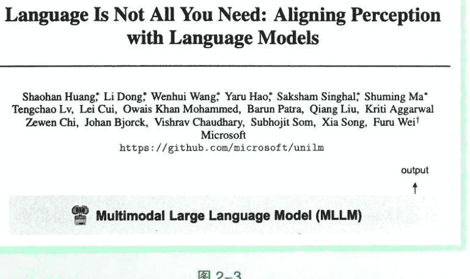

# Emergent Abilities of Large Language Models

Jason Wei¹ jasonwei@google.com
Yi Tay¹ yitay@google.com
Rishabh Bommasani² nishakti@stanford.edu
Colin Raffel¹ colin@gmail.com
Barrett Zoph¹ barrettzoph@gmail.com
Sebastian Borgeaud⁴ sebborgeaud@deepmind.com
Dani Yogatama⁴ dyagatama@deepmind.com
Maarten Boisma¹ boisma@google.com
Denny Zhou¹ denzhou@gmail.com
Donal Metzeler¹ metaler@google.com
n¹ Google Research ²Stanford University UNC Chapel Hill ³DeepMind


所以，如果中国在AI上落后，绝对不是因为中国人不行。既然中国人很行，那我们就有理由相信，我们在AI上不会永远落后。

## 社会：被AI“接管”后的忧虑

2023年2月24日，OpenAI发布了一则声明，叫《对AGI及之后的规划》(Planning for AGI and beyond)①。AGI不是我们现在用的这些科研、画画或者导航的AI，而是“通用智能”，但是至少有人的水平，并且什么认知任务都可以任的智能。

AGI只存在于科幻小说之中。我曾经以为我们这代人年轻看不到AGI，但OpenAI已经规划好了路线。我听到一些传闻，AGI有可能在2026年，至2025年就会到来。

所以这绝对是一个历史时刻。但是请注意，OpenAI这份声明是很特殊的文件，我们从未见过任何一家科技公司是这样说自己的技术——整个文件的重点不是技术，而是一种忧虑；忧虑的不是自家公司，也不是AGI技术，忧虑的是人类怎么接受AGI。

OpenAI说：“AGI可能给每个人带来难以置信的新能量；我们可以想象一个世界，所有人都可以获得几乎任何认知任务的帮助，为人类的智慧和创造力提供一个巨大的力量倍增。”接下来，文件并没有继续说AGI有多有害，而是反复强调“逐渐过渡”——“让我们、政策制定者和机构有时间来了解

① Sam Altman, Planning for AGI and beyond, https://openai.com/blog/planning-for-agi-and-beyond/, March14, 2023.

正在发生的事情，亲自体验这些系统的好处和坏处，调整我们的经济，并将AI部署到位。”并且说新模型会“许多用户希望显得更谨慎”。这相当于，通往AI的技术已经具备，但是为了人类一个适应过程，这也是这篇声明的主题。在《人工智能时代与人类》这本书中所表达的也是，AI对人类有的危险。想象你有一个特别助手，名叫ChatGPT。他方面都比你强，思维都不在同一个层面上。你常常不理解他那样设定，还是事实证明你每一个决定都比你自己要好。久而，你就习惯了，但是请问你真的完全信任他吗?


其实我们已经用AI很长时间了。像淘宝、滴滴这些平台有几亿用户，用人力管理这么多是不可能的。它们都用AI给用户推荐商品、安排外卖、打车、包括定价，这些决定全部主要是AI做的。而问题随之而来。如果是某一个员工的操作了你的利益，大可抗议要求他负责；如果你感受到了伤害，连自己都不理解。

## 第二章 当AI进入人类社会 091

现在AI的智慧是难以用人的理性解释的。为什么AI向你推了这条视频？你设定的价值观影响了社会，也许根本就不可能民众都要对AI算法进行审查，这些问题都在探索之中。就在我们还没想明白的时候，AI正站在各个领域猛进。凭借AlphaGo出名的DeepMind已经被Google收购，它在过去几年里取得了如下之一：

- 推出AlphaStar，它在《星际争霸II》这样规则复杂的、开放式的游戏环境中打到了最高水平；
- 推出AlphaFold，它能够预测蛋白质的形状，改写了生物学的研究方法；
- 医学方面，用AI识别图片，帮助诊断乳腺癌，对急性肾脏损伤的诊断比主流方法提前了48小时，对老年眼睛黄斑变性做出了提前几个月的预测；
- 推出两个天气预报模型，一个叫Expr，用于预测一个地区会不会雨，一个叫GraphCast，能预测10天内的天气两个模型的精度都显著高于现有的天气预报；

① Improving billions of people' lives, https://www.deepmind.com/impact, March14, 2023.

它还用AI给Google的数据中心重新设计了一套冷却系统，节省30%的能源。这些成就的最可怕之处不是DeepMind一出手颠覆了传统做法，而在于它们并不是集中在某个领域，而是大杀四方。到底还有什么领域是DeepMind不能颠覆的？这些DeepMind能的事情中的一小部分，而DeepMind只是Google的一个部门。

AI全面接管科研。如果科研项目都能被AI暴力破解，那人类所谓的科学精神、创造性，又怎么体现呢？如果AI做出来的科研结果人类不但做出来，而且完全无法理解，我们又怎么办？


才不会被AI抢夺工作是小事了，现在的问题是AI对人类社会的治理力——以及可能的破坏力。华尔街量化交易的公司已经在用AI直接做股票交易了，效果非常好。可是AI是以高频进行的，在没有任何人意识到之前，就可能形成一个涡，乃至引发市场崩盘。这是人类造出来的错误。美军在测试中使用AI操控战斗机，AI的表现已经超过了人类飞行员。如果你的对手是AI，你就不得用AI。那如果大家用AI操控武器，乃至进行战术级的指挥，万一除了险走火的事儿，算谁的呢？

再进一步，根据现有的研究案例，我完全相信如果我们把司法判决权完全交给AI，社会绝对会比现在更公正。大多数人会服气，但是有些人输了官司要求我一个解释。如果AI说我的判法准你再犯犯罪的概率有多高，我也可以说不具体因为太高，你能接受吗？

理性需要解释。有解释才有意义，没有法才有正义。如果没有解释，或许……以后我们都会习惯不再去要求解释。我们可能会把AI的决定交给适当的安排。小李说：“我没被大学录取。我的高考成绩比小王高，可是小王被录取了。一定是AI认为我的综合素质不够……”

老李说：“是的，继续努力！”

AI时代是一个新的时代。启蒙运动孕育了一系列政治哲学家，像霍布斯（Hobbes）、洛克（Locke）、卢梭（Rousseau）等。通过这些思想，我们知道那个时代是怎么回去的。抛开上帝，推翻皇帝，启蒙运动是给普通人赋能的。今天我们又开启了一个时代。我们发现理性的达不到的地方，可是AI可以达到，比人。如果人都相信AI，有什么事儿不是自己判断，而是去问AI，知识主要是通过AGI的对话……再考虑AI还可以容易地向你推荐最适合的内容，对你进行宣传，舒服地接受了……这不是神又回来了了吗？再向前一步。假设很快就有公司成了AGI，而AGI的技术特殊、费用异常，以至于其他人难以模仿。再假设这些掌握AGI的公司成立了一个组织，这个组织是因为用AGI自行设计的AGI，AGI迭代得越来越快，水平越来越高，这个组织的领先优势越来越大。

# 问答

既然AGI像人的大脑一样学习，是否可以让AGI反过来训练人类的大脑呢？一个小孩从小是在人的知识环境中学习的，长大了后知识也难以理解范围之外的东西。那如果如果在AGI的环境中长大，会不会拥有超级大脑？人的大脑有极限吗？

### 万维钢

大脑的存储能力是海量的，远远不触及极限。大脑这个配备的主要瓶颈在输入输出和逻辑运算的速度都太太慢了。计算用不用1秒就能读懂一本书，人脑再怎么努力也不可能做到。但是我们不用纠结于大脑足够，虽然知识是无限，但观念是有限的。只要对世界大概掌控感，就能做好事。AI是我们的朋友。决策=预测+判断。预测，是告诉你发生结果的概率是多少；判断，是对于一种结果，你有多程度上愿意接受。

理性需要解释。有解释才有意义，没有法才有正义。如果没有解释，或许……以后我们都会习惯不再去要求解释。我们可能会把AI的决定交给适当的安排。小李说：“我没被大学录取。我的高考成绩比小王高，可是小王被录取了。一定是AI认为我的综合素质不够……”

老李说：“是的，继续努力！”

AI时代是一个新的时代。启蒙运动孕育了一系列政治哲学家，像霍布斯（Hobbes）、洛克（Locke）、卢梭（Rousseau）等。通过这些思想，我们知道那个时代是怎么回去的。抛开上帝，推翻皇帝，启蒙运动是给普通人赋能的。今天我们又开启了一个时代。我们发现理性的达不到的地方，可是AI可以达到，比人。如果人都相信AI，有什么事儿不是自己判断，而是去问AI，知识主要是通过AGI的对话……再考虑AI还可以容易地向你推荐最适合的内容，对你进行宣传，舒服地接受了……这不是神又回来了了吗？再向前一步。


# 第三章 重塑智能，你更像你

我们承认AI比人聪明，但是真正承受风险、体验后的是人，所以最终判断的必须是人。如果你是一个企业主，招聘了一位非常糟糕的职业经理来做你的CEO，他在所有方面的能力都超过你，那你能把决策权交给他吗？不能。因为你是你的，万一赔钱的是你的钱。同样，AI再靠谱，只能让人类医生承

预测是客观的，判断是主观的。AI不能僭越人的判断，人也不应该专断AI的预测。AI与人各安其位，分工明确。

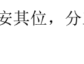

如何实施这个分工？

一个方法是，人为给AI设置一个自动判断门槛。比如自动驾驶汽车，我们可以规定，当AI预测前方物体是人的概率高于0.01%——或者0.00001%也行，反正得不为0的值——时候就必须刹车。这个判断标准，这条线，肯定不是AI自己决定的，而是人先设定的。你可以把这条线编程到AI中，但是下达那条指令的必须是人，因为只有人能判断生命的价值。对于来说，人的价值是无法用客观方法估算的。

## 决策：预测+判断

AI时代的决策=AI的判断。也就是说，我们应该让预测和判断脱钩。以前所有的决策都是人负责预测，人负责判断，现在则应该是AI负责预测，人负责判断。（图3-1）

| 人类预测 | 人类判断 |
| :--- | :--- |
| AI 预测 | 脱钩 | 人类判断 |

图3-1


决策，而是由信用联网系统根据算法来预测和判断的。算法会先估算这张卡是假卡的概率有多大（预测），再看看那个概率是否高于某一条线（判断），然后决定是否拒收。那条线不是任何AI计算出来的，而是事先由某个人类组成的委员会划定的。因为划线得太低得罪客户的人，划线得太高承担损失的人也是。

未来我们会面对各种类似相似的事情，《权力与预测》这书建议，这样的判断最好像评估新药是否可以上市一样，由一个像FDA的机构来执行。


另一个方法是，把判断量化成钱。
你租了一辆车，要去一个比较远的地方，有两条线路可选。第一条路线比较近，你老老实开车，但路上没什么风景。第二条路线会经过一个景区，对你来说是一种享受，但景区里有人，会增加出事故的概率。如果AI直接告诉你两条线路出事故的概率有多大，你可能不是不好判断。

更方便的做法是，AI告诉我，走风景那条路，租车的保险费比走第一路线贵1块钱。这1块钱的保险费代表AI对两条风险差异的预测。

现在判断交给你。如果你认为你对风景的重要性超过1块钱，那你就走风景景区；如果你对风景没有那么高的兴趣，你就会省下1块钱。

你看，AI无需了解你，也不可能了解你——是你在这1块钱和风景之间的选择，揭示了你的偏好。在经济学上，这叫作“显示性偏好”（Revealed Preference）：人的很多本来是说不清楚的，但是一跟钱挂钩就能说清了。

预测与判断断能，对人是一种赋能。
以前如果你想开出去出租，可不是开车就行。你得先学会路，你知道这个城市中从任意A点到任意B的最短路线是什么（就是你学会预测），才能开好出租。现在AI接管了预测路线的事，你只要会开车就可以开网车辆了。

有了AI，人会判断就会决策。但并不意味着决策容易的，因为判断为判断的学问。

生活中更多的判断并不是由委员会划线也不能被量化成金钱，而是必须由个人对具体情况进行具体分析。这个结果来说到底有多少，或者到底有多少多坏，你到底不能承受，该怎么判断呢？
有的可能是你读过书或者跟别人学的，比如你听过被烧过的红灯会遇到很高的代价，你愿意付代价避免。但是实话如你，只有真的被过的，你才能知道有多疼。判断，有很大主观成分。

而判断这个能力或许在变得越来越重要。美国的一个统计显示①，1960年只有5%的工作需要决策技能，到2015年已经有30%的工作需要决策技能，而且都是高薪岗位。

> David J. Deming, The Growing Importance of Decision-Making on the Job, working paper 28733, National Bureau of Economic Research, Cambridge, MA (2021).

只有人才知道自己有多强大，所以人不是机器。而判断力和随而来的决策力，本质上是一种权力——AI没有权力。

当AI接管了预测之后，决策权力在社会层面和公司组织层面的行使就成了一个问题。


有一个例子。因为知道了铅对人体有害，从1986年开始，美国政府禁止新建建筑物使用含铅的饮用水管。可是很多旧建筑物的水管都含铅，这就需要对旧水管进行改造。却是非常昂贵费力，旧水管又不含铅，先先把水管挖出来才能知道，那能找谁家的呢？

2017年，密密根大学的两个教授编写了一个AI，名为BlueConduit，它能以80%的准确预测哪家的水管含铅。密密州的弗林特市使用了这个AI。一开始挺好，市政府安排根据AI的预测给每个居民换管。

工程这样进行了一段时间之后，有些居民不开了。他们怀疑说，为什么我们家居换了管，我的却没换？特别是富裕区的居民会，为什么先去换那些贫困区的，难道不是我们税交多吗？

收到这些抱怨后，弗林特市的市长干脆决定不听AI的，换家慢慢慢了。结果这样一来，决策准确率一下子从80%下降到了15%……又过了一段时间，美国法院推择出一个法案，规定换水管这个决策必须先听AI的预测，决策准确率又提高回来。（图3-2）

# 第三章 重身智能，你更像你

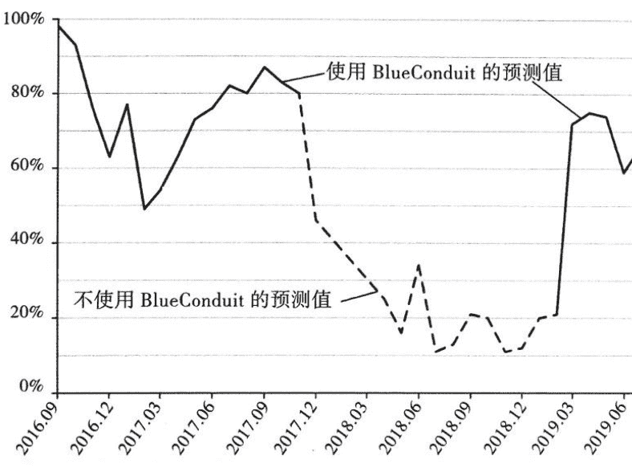

3-2

这件事的道理是，AI改变了决策权。没有AI预测的，只有政府预测和判断决策水管应该先换，决策权完全把持在政客人手里；有了AI预测，百姓或者社区都reality自己判断，尤其美国的司法系统还可以直接发话，政客就不再说了算了。

决策权到底属于谁呢？从道德角度来说应该是，承担决策的后果，决策权就应该属于谁。从经济学角度来说，则是谁是决策者能让整个组织的效率最高，就该属于谁。这两个角度并不一定矛盾，毕竟蛋糕做大了太好了。

以前预测和判断不断的时候，决策权往往应该该交给一线人员，因为他们直接接触键盘信息，他们的预测最准确——正所谓“让听得见烟火的人指挥”。

现在AI接管了预测，人的决策就是判断。这时候可以考虑，那些个人利益与公司利益最相关的决策，或者让受到这个决策影响最大的决策，或者最能解决决策后的人的决策……这些都意味着组织的变革。

变革还执着以以前的预测者现在要转型为判断者，或者解释者。

比如，以前天气预报机构的职责是提高预测的准确度，现在有了AI，他们的主要职责或许变成向公众和政府机构解释预测结果。AI说有5%的可能性会发生龙凤，政府官员不懂5%代表大部分损失，也许允许这个气象。未来的气象可能更多的是人性化服务，比如百姓每天按制出一份计划，而不仅仅是预测。

比如，以前放射医生最重要的任务是看图预测疾病。现在AI看的能力已经超过了人类，那放射医生就不继续服务，也许也是向病人解释病情……


前文讲过，决策权交给AI让人很难。AI再厉害，谁也不愿意把它奉为神灵——这正是AI最好老实，拍板权应该是人的手里。我看来，这种分工非常合理，希望能够给你些安慰。

# 第三章 重身智能，你更像你

# 问答

数据科学（Data Science）以及它和AI的关系有什么？如果现在就要修硕士的话，你怎么建议？我想告诉你一个正在进行的故事。这一波以GPT-4为代表的大语言模型浪潮，有一个产品——它杀死了一门叫做“自然语言处理”（NLP）的学科。很多大学都有NLP这个专业，很多公司有专门的NLP团队。NLP是计算机科学、AI和人类语言的交叉学科，此前一直是认为是实现人工智能的希望。研究NLP，应用包括机器翻译、语音识别、搜索索引、智能助手等。多年年来，NLP领域内的努力取得了成就。但是现在没有意义了。GPT完全不同的思路——无监督学习。Transformer架构和20年后发生的“开悟”和“涌现”，已经把NLP想要解决的问题完美解决了。原来AI不需要按照人类语言去寻找规则，机器能找到各种“知道”以及“不知道”的规律。翻译、语音识别、搜索索引、智能助手，都是GPT的功能。自动分类等功能，还有我们意识到的功能。GPT对于自然语言处理，如同AlphaGo对于围棋。事实证明，先人类总结规则再积累十年的思维是最笨办法，让人的思维。原来让机器直接破解是最快、最好的办法。人类可以继续学习围棋套路，毕竟游戏本身很有意思。可是GPT出来之后，局面非常明显。不仅是NLP领域，其他科学，比如翻译、语音识别、分析学派也都面临危机。著名语言学家诺姆·乔姆斯基（Noam Chomsky）在《纽约时报》发表了这篇文章抨击ChatGPT，结果评价都是他的。朋友们，新时代来了，很多东西过去了。最荒诞的是GPT并不是故意要那些学科，它可能根本没想过。“赌”这门的技术是危险的。回到问题上，数据科学的应用范围更广，不仅限于AI。就连将来AI还可以帮助理解，根据数据做决策，所以相对安全。

## 教育：不要再用AI的方法成人

AI时代，人的教育应该是怎样的？这次创新又是什么？AI视角下，传统的教育有没有问题？在AI视角下，我们得重新思考，什么样的才是人的成长。传统的教育是居高下的姿态，主动权在学校、老师、家长这些“教育者”手里，学生作为“教育对象”是被动的。以前我们把这种教育比成植物；教育者安排好环境，浇水，施肥，而选择教育对象根据需要成长。但是我们现在有一个更明的类——那是训练的方法。先策划学习，把标记好什么是对，什么是错的给对象，然后考核结果。这种学习在人工智能领域叫作“监督学习”（Supervised Learning），它不用标记数据，能自己找到规律，甚至自己设定。这样出来的学生连GPT都不如。

但AI不是，至少现在不是。我们相信每个人身上有些AI（暂时）无法替代的素质。虽然我们说不清是哪些东西，但是通过跟AI对比，我们可以知道它们不是哪些东西。简单说，有三个方面是传统教育中AI身上也有，但是人类中的创造者身上并没有。以前你可能都不觉得是问题，但是现在在AI视角之下，这三个方面非常显眼。

第一，回报的来源是管理者的认可。这个学生是不是好学，学校和老师说了算，他们主要要看考试成绩和听话程度。

第二，高度重视错误。以考试为核心的教育讲“刻意训练”和补短板，学生必须对自己的错误非常由于，有错必改，错必学。

第三，对教学以外的东西、新事物是不关心的。老师甚至督促学生不要分心、少看课，把精力都放在学习上。集中注意力是个重点。AI也有这些标准了。不管用什么训练方法，对于好坏都有一套客观的标准。ChatGPT出来之后人们都爱给它挑毛，对自动驾驶AI是如此，真是每一个错都是大错。AI的训练范围可以很大，但是为了让它出错，你不想给它垃圾信息。我们看着那些创造性人才，科学家、艺术家，特别是企业家，他们正好有三个相反的特点。

第一，回报不是来自上级领导的认可，不是为了满足什么标准，而是来自社会、来自消费者，甚至是自我的认可。这样的认可没有标准，也许今年的“好”明年就过了。他们甚至可以为自己定义什么叫好。

第二，他们并不特别在乎自己做过什么，太重视短板，他们要的是长板。好不坏的项目可以不做，他们关心的是在自己能做好项目上，自己是否足以赢得世人认可的程度。

第三，乐于追逐新事物。越新的东西越可能让他们获得竞争优势。这样的人大概怕被AI取代，因为他们走的是跟AI不一样的线条。他们身上没有AI那种机械味，他们有更健全的人格。其中最重要的一点就是自主性——他们自己判断什么是好、什么是坏，自己决定学习什么和做什么，想要在世界上留下自己的痕迹。他们是自我驱动的人。

这样的人与其说是被训练出来的，不如说是被视出来的。学术界对此有些新研究，我讲两点。

一个积极情绪的作用。

情绪并不是一种“感觉”。现在的最新的认识①是，情绪拓展视野，构建新的认知联系，增加心理资源，这就是“broaden-and-build”理论。积极情绪不仅影响行为，还会影响认知。如果情绪是负面的，它会缩小视野，聚焦于应对负面情绪的生存策略。这种生存策略，虽然短期内是有用的，但长期来看会限制人的创造力。

这种情绪的反馈机制，是单向的。而积极情绪是是向的。

① Barbara L. Fredrickson, The Broad-and-Build Theory of Positive Emotions, American Psychologist, 56(3001), 218-227.


始终处于压力之下。考了95分还觉得自己不够努力、不够完美，说下次要考100分。真得了100分，又担心下次可能不能再考100分。这样的人视野绝对是狭窄的。

面对一个新事物，忧虑者看到的是危险，快乐的人看到的是机会。长期面临各种考核的压力，轻就能得胃溃疡，重则让人创造力产生无用。

AI教育最大的问题是学生缺乏自主性。什么都是别人要做的，而不是他自己要去。机器就是被动的。人最不同于机器特点就是要主动。从小受气、在家里和学校处都是被动的，等长大后真可以主动了，往往不会在事上主动。

孩子如此，成人也是如此。一天间聚报搜索、战战兢兢，不容易取得成绩还要保持低调，这快乐不快乐，永远被人管着，下班到点都不敢走，遇到机会也没有动力，这样的人能有多大出事？

在AI的时代，我们要好好想想怎么培养一个人，而不是训练一个AI。

创造人才的特点是你可以培养，但是你不能控制他——自主权在他手里。想要给一个指导，随着成长，你要逐渐开放——自主权在他手里。想要看到他你意想不到的事，你必须容忍他做出你意想不到的“坏”事——有些事你不想让他做，甚至原本打算禁止他做的事。

对AI可以管，对人只能“惯”。其实孩子自己折腾，他也翻不了天，还会慢慢起来。只有这样你才能得到一个完整的人。你必须克制自己的控制欲。你只能等待。

# 问答

**问：杰克逊
看美味视频调动的愿望，不是低层次的需求（生理需求）吗？而小猫视频对应的肯定比例比生理需求还要高。为什么相较之下，反而比低层次调动高动机？

### 万维钢
我们的大脑并不是一个非常理性的计算系统，而是一个生物系统。改变的变化不仅是你对情绪事件的看法，更是你彼时彼刻整体的认知模式，这会连带影响你对其他事情的看法。

就动机而言，关键影响因素主要是多巴胺。美味甜点会刺激饮食，产生想要吃东西的动机，这个调动过程需要用到多巴胺。也是，视频会让大脑产生了更多的多巴胺。而多巴胺一旦分泌出来，就仅仅作用在“想吃东西”这个动机上，它是一种通用的动机燃料，对于其他事情也有促进作用。

我还看过一个研究，美女的图片让人在长期利益和短期利益之间愿意选择短期利益。这大概就是多巴胺来了，我们总想立刻采取行动获取想要的东西。

蒙洛迪诺（Mlodow）的《情绪》这本书中有一个实验。老鼠很喜欢吃糖，对糖来说是既熟悉，又要的。研究者阻断了老鼠大脑中的多巴胺，再把糖放在它嘴巴强化给它，虽然它还是表现出享受的表情，还是很喜欢，但是它再也不会主动去吃糖水了。阻断了多巴胺，老鼠完全失去了对食物的动物动机——研究员如果不强行喂食物，它宁可饿死也不会主动吃东西。

所以，动机本身就是一个生理需求。如果一个人太过“佛系”，对什么都无所谓，没有动机，你会觉得他的生命力有些问题。如果AI突然有了动机，你会觉得它是不是要造反了，你可能会感到威胁。

**问：王尚书
在教育体制不变的情况下，如何平衡让小孩自由发展和让在现有体制下取得更好成绩之间的矛盾呢？

### 万铁镜
这的确是一个矛盾，但是这里面有可操作的空间。我建议你考虑三点：

- 第一，准备考试这个活动，过了一定的线，就有边际效益递减的特性。如果投入70%的精力已经可以考80分或90分，而就算100%全投入只能考85分或95分，那么全投入就是不值得的，甚至是有害的。对考试只做有限的投入，尽量不要忽视生活中的其他追求，也许容易成功。像有些学生要求早上跑步还要背书，那纯属精神病。
- 第二，家庭条件足够，考好一点的大学还是差一点的区别就不重要了。
- 第三，因为中国升学文化的影响，很多人认为我们都是“考”出来的——考大学考研，考研会，当公务员仍然时刻准备下一次考核……这是活在扭曲的现实之中。真正的好东西应该是交换回来的。不要问社会给自己什么，要问自己给自己什么。建立重视考试、重视真领域的心态，不仅有利于你成长，而且有利于你考试。

## 03 专业：代议制民主和生成式 AI

这一波AI浪潮的一个特点是“生成式”（generative），也就是“GPT”中的“G”。以前人们无论用AI预测分子的化学性质还是打游戏，都是让AI完成非黑即白的任务，达到一个简单的结果。现在你无论用ChatGPT写文章、编程，还是用Midjourney画画，都是让AI帮你“生成”内容，收获一片繁华景象。

下面是一幅我用Midjourney画的画。（图3-3）


图3-3 画面中有巨大的UFO悬浮在一座金字塔附近的天空，那个UFO亮着灯，似乎有很多窗户，明显不是地球的产物。地面是一片荒凉的景色。很多人抬头看，他们三五成站或坐，也许几十个或者上百人。

在交稿前这幅画我有看过，这就是这幅画。其实我的主要贡献就是一句：“UFO在古埃及飞行，人们抬头看。”另外加上参数，这叫“prompt”，当动词当名词都可以，表示AI的要求，也可以翻译成“提示”或者“咒语”。画面全部都是生成的。


图3-4 我画得不够，就让它重新画。当然你只需要点击一个按钮，毕竟也是贡献。然后它又生成了4幅。


图3-5 我觉得有一幅不错，就让它做出几个变体。

当然你提出prompt和选择也是一种创造，因为这个过程体现了你的见识和品位——一个科幻作家肯定比我做得好。跟AI的这种“prompt生成”关系，并不是新的。事前提出要求，事后决定满意不满意，老板对员工不是这样？甲方对乙方也是这样吗？都是共同创造了最终结果。

## 第三章：重塑智能，你像你

老板和甲方在这个关系中的美德是生成者的专业技巧。让AI画特别好可能不容易，但我觉得最有意思的是，让AI“画不好”更不容易——很难让Midjourney生成一幅拙劣的。它是由无数专业画家和大师训练出来的，只要出手就是专业水准。你固然可以设计这幅画，但不管细节如何，AI总能确保达到专业水平。

比下面这幅住宅（图3-7），“咒语”要求是“architectural illustration with retro visuals”（建筑插画呈现复古效果），但什么是建筑插画和复古效果？你随便找个画家，恐怕太容易画到这个程度。


图3-7 笔法就不用说了，单说这个布局和视角，就比我自己想象的好多了。这就是专业的。这种生成完全像装修住宅，理性的做法是你只需要说一个大概的风格，让设计师给你具体设计。你不对设计做太多干涉，因为你根本不懂。虽然AI要求通常来说给具体境，但是要求也不要提太具体。如果你不懂专业，那么保留一定的模糊性，让AI自己发挥，往往能够得到更好的结果。


从世俗的角度看，模糊是为了委婉表态，给面子。比如你有个想法，如果领导说“你这个想法好”，那么就有可能支持你；如果领导说“你有想法，很好”，那么就会反对。再比如你要做一个项目，如果领导说“你放手去做吧”，那可能只是客气；但如果领导再加一句“总会是你的坚强后盾”，那就是真支持。

但是从“提示工程学”（Prompt Engineering）的角度看，模糊创造了很大的空间。刘老师在《想大事》这本书里有很多很有意思的说法。任何法律中都有些思维的词，比如《中华人民共和国法律》第五十一条第一款规定，一般的公司要设立监事会，但“股东人数较少或者规模小的有限责任公司，可以设至二名监事，不设监事会”。那什么叫“人数较少或者规模小”？为什么不规定一个具体的数字呢？

## 第三章：算法智能，你更像你

刘畅说，消除模糊会让法律变得异常僵化，无法应对变化的现实生活。在发达地区，注册资本在5000万以下的公司，而在发达地区这就属于大公司了，强行规定一个具体的数字让法律无法操作。所以刘畅说，“法律不是为了妥协才故意模糊，而是为了用才故意模糊”。这里有一个微妙的东西。表面上看，模糊可能让你失去了一定的控制权。但实际上，模糊是必要的，而且并没有失去控制。


明白这些道理，就能理解为什么有些人担心AI取代了，因为古以来就有很多担心，这种担心没有任何普遍性，正如大多数老板都没有被取代。同样，担心AI不会取代人类之前，大多数人会担心。

政府是怎么运行的，也不理解各种政策。政府的很多事情是高度专业化的，如果你不想知道，就算是内行也没有多少人在乎。现代化国家都有媒体监督，言论自由，选举，都是政府在操纵政策。你看民众对政府的关系是不是人的关系？民意就是prompt，政府操作就是生成，选举就是选择。事实证明，政府做得不好，老百姓是知道的。研究表明，民众对政府的支持率不是新闻这类小事的影响，主要还是要看经济。

温度调节器：百姓不懂经济是怎么运行的，这如同大多数人都不懂空调的运作原理，我们甚至都不知道房间理想的温度应该是多少；但是我们能感觉现在是冷了还是热了，我们会调节温度。感觉太冷就开暖气，太热就开冷气，这就足够了。所以，借用林肯那句话，“政府再也不能长时间内糊弄所有人。”古代中国没有民主制度，但是曾经在不同的历史时期实行过负责制，皇帝只是授权和问责，不做具体行政工作。比西汉的文景治、北宋仁宗年间，皇帝代表民意prompt，官员负责生成，然后皇帝再根据结果做选择，国家其实运行很好。历史上英国和日本搞虚君制也是这样的。现代公司中股东大会和董事长问问日常事务，也是“prompt——生成——选择”关系。让专业的人做专业的事，而真正的老板可以提prompt和做选择，这并不是AI时代的新尚，也是一种理念的做事模式。

参考文献：
1. 刘畅，《想大事》，上海交通出版社。
2. 万维锡，《管理学》。
3. 万维锡，《五个工作》。
4. James A. Stimson, *Tides of Consent: How Public Opinion Shapes Politics* (Cambridge University Press, 2004).
5. Christopher Wlezien, *The Public as Thermostat: Dynamics of Preferences for Spending*, American Journal of Political Science Vol. 39, No. 4 (Nov 1995), pp. 981–1000.

当经济形势变好或变坏的时候，消费者情绪会先变化。东西贵了还是便宜了，钱不够花，其实心里有数。这种情绪变化不会立即反映到支持率。支持率的变化比消费者情绪滞后一季度——但是没关系，支持率将改变。也就是说，如果你政府没把经济搞好，老百姓会给你一段时间，但是不会很久。一旦支持率发生反转，再上选举，那你这届政府就得换人。

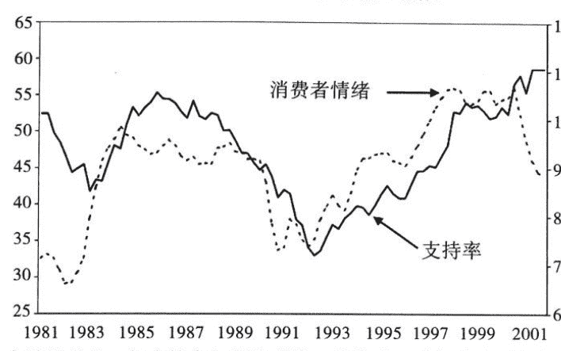

图3-8 密歇根州支持率与消费者信心指数（三季度平均值）


扩散；你有多大的认知，就能做多大的事；你的认知有多复杂，就能做多复杂的业务。

这个领导力不仅是上级对下级，也可以是商家对客户，媒体对公众，也可以是下级对上级；只要能产生影响，让人沿着你选的方向前进，都是领导力。AI时代，每个人都需要一点门槛领导。

怎样培养门槛领导呢？查特拉斯说有4个途径：静心沉思，自思考，具备智能，增长智能。关键在于，这些都不是AI能的智能。这一章我们先说“静心沉思”。


智商只是一个数字，并不能概括一个人的智能维度。现在认知心理学家把人的智能大分成9类:

- 1. 逻辑和教学；
- 2. 语言；
- 3. 空间；
- 4. 欣赏大自然，了解生物；
- 5. 音乐；
- 6. 身体和感觉的协调；
- 7. 了解你自己；
- 8. 人际关系，也就是对他人的同情之了解；
- 9. 存在智能（existential intelligence），也就是有关“大问题”的智力，比如我为什么活着，是什么爱。

其中这个“存在智能”因为难以量化评估，它到底算不算一种智能，学术界还不好说——但是查特拉斯特意把它在这里，因为他认为这是关键的一个商业模型能力。查特拉斯预测，后面这种能力，AI在短期内都无法超越。

尤其对商业最有用的两方面智能，让人不会被AI取代，它都要求你安静沉思：一个是感情智能，即理解了你自己和了别人；一个是存在智能，我们后面再说。


对于人类情感，有一家自麻省理工学院媒体实验室的公司叫Affecta，称号为感知到人的情感。现在的消息是它被一家眼球追踪的公司收购了，说是用于“道路安全产品”……来看它的应用范围比我们想要的还要窄。现实是，AI在感情计算上的进展十分缓慢。

情感为什么会这么困难？查特拉斯列出了4个理由，解释为什么AI在短期内既不能学会情感，更不能理解人的意识。

第一，检测情感非常困难。所谓看脸就能判断人的情绪的“微表情”学说已经被证伪了。不同文化、不同场景下，人的情感流露可能并不十分。人类非常善伪装和隐藏自己的情感——这是进化给人的社交本。你不可能一套编码AI自动识别。

第二，人都都是在实践中学习理解别人的情感的。你从跟朋友滚打，你惹过别人，你被惹过一遍通过这些互动反馈你才学会了情感。AI没有这样的学习机会。

第三，人的情感十分复杂。经过几百万年的进化，人脑的逻辑运算能力虽然一般，但是情绪运算能力绝对没有发达，是“系统1”快速运算。我们在复杂的环境中感受到微妙的危险，自己给自己构建结构，能够用直觉做出难以言名的判断。情感受到当前环境、人类经历、文化智慧等方面方面的影响，以至于DeepMind的科学家曾经对查特拉斯说，这种复杂的计算可能是AI所无法达到的。

第四，有些人感觉是无法用语言表达的。意识，是难以语言的。哲学里有一个基本概念“感质”（qualia），意思是某种特定的物体带给你的特定感觉。你对的感觉是什么？喝牛奶是什么感觉？你没有办法向一个盲人解释红色，也没有办法用语言向一个没喝过牛奶的人精确描述牛奶的体验……那AI又如何知道呢？

虽然AI的有些认知是可以理解的，但是忘了，人的有些认知也是AI理解不了的。既然AI连最基本的感都无法理解，又怎么能指望它情感计算呢？


你切实理解人的情感和人生的意义，才能处理好现代社会中的各种冲突和矛盾。查特拉斯做过CEO，他发现客户和投资者最常问他三类问题：

1. 认识自我和他人：你的团队是谁？你的客户是谁？
2. 目的：你希望你的组织实现什么？为什么？
3. 伦理和价值观：你将如何处理数据隐私之类的道德问题？

这些都是只能由人，而不是AI，回答的问题。就像ChatGPT，它把用户分成三种类型，分别介绍这些东西对用户有什么用；它在推动AI应用的普及；它有价值观，它强迫分享，最大程度保留给用户的服务。ChatGPT的创造者确实很有商业意识，同时也很有客观精神。

AI当然能给你各种建议方案，但是像免费还是收费、要花精力保护用户隐私这些充满矛盾和犹豫的问题，是你自己必须做的选择。那些不是智力问题也不是知识，而是人格题。对公司来说，现代社会正在变成成熟人社会，你需要“内圣外王”的能力。

查特拉斯提倡用静心沉思，或者设想的方式，来思考这些问题。他说：“领导者在决策时认为自己在做什么，员工在执行时发现自己在做什么……这些看起来很简单，实则比想象困难得多。”

# 第三章 重塑智能，你我交互

查特拉斯做过CEO，他发现客户和投资者最常问他三类问题：

1. 认识自我和他人：你的团队是谁？你的客户是谁？
2. 目的：你希望你的组织实现什么？为什么？
3. 伦理和价值观：你将如何处理数据隐私之类的道德问题？

这些都是只能由人，而不是AI，回答的问题。就像ChatGPT，它把用户分成三种类型，分别介绍这些东西对用户有什么用；它在推动AI应用的普及；它有价值观，它强迫分享，最大程度保留给用户的服务。ChatGPT的创造者确实很有商业意识，同时也很有客观精神。

AI当然能给你各种建议方案，但是像免费还是收费、要花精力保护用户隐私这些充满矛盾和犹豫的问题，是你自己必须做的选择。那些不是智力问题也不是知识，而是人格题。对公司来说，现代社会正在变成成熟人社会，你需要“内圣外王”的能力。

查特拉斯提倡用静心沉思，或者设想的方式，来思考这些问题。他说：“领导者在决策时认为自己在做什么，员工在执行时发现自己在做什么……这些看起来很简单，实则比想象困难得多。”

查特拉斯做过CEO，他发现客户和投资者最常问他三类问题：

1. 认识自我和他人：你的团队是谁？你的客户是谁？
2. 目的：你希望你的组织实现什么？为什么？
3. 伦理和价值观：你将如何处理数据隐私之类的道德问题？

这些都是只能由人，而不是AI，回答的问题。就像ChatGPT，它把用户分成三种类型，分别介绍这些东西对用户有什么用；它在推动AI应用的普及；它有价值观，它强迫分享，最大程度保留给用户的服务。ChatGPT的创造者确实很有商业意识，同时也很有客观精神。

AI当然能给你各种建议方案，但是像免费还是收费、要花精力保护用户隐私这些充满矛盾和犹豫的问题，是你自己必须做的选择。那些不是智力问题也不是知识，而是人格题。对公司来说，现代社会正在变成成熟人社会，你需要“内圣外王”的能力。

查特拉斯提倡用静心沉思，或者设想的方式，来思考这些问题。他说：“领导者在决策时认为自己在做什么，员工在执行时发现自己在做什么……这些看起来很简单，实则比想象困难得多。”

查特拉斯做过CEO，他发现客户和投资者最常问他三类问题：

1. 认识自我和他人：你的团队是谁？你的客户是谁？
2. 目的：你希望你的组织实现什么？为什么？
3. 伦理和价值观：你将如何处理数据隐私之类的道德问题？

这些都是只能由人，而不是AI，回答的问题。就像ChatGPT，它把用户分成三种类型，分别介绍这些东西对用户有什么用；它在推动AI应用的普及；它有价值观，它强迫分享，最大程度保留给用户的服务。ChatGPT的创造者确实很有商业意识，同时也很有客观精神。

AI当然能给你各种建议方案，但是像免费还是收费、要花精力保护用户隐私这些充满矛盾和犹豫的问题，是你自己必须做的选择。那些不是智力问题也不是知识，而是人格题。对公司来说，现代社会正在变成成熟人社会，你需要“内圣外王”的能力。

查特拉斯提倡用静心沉思，或者设想的方式，来思考这些问题。他说：“领导者在决策时认为自己在做什么，员工在执行时发现自己在做什么……这些看起来很简单，实则比想象困难得多。”

查特拉斯做过CEO，他发现客户和投资者最常问他三类问题：

1. 认识自我和他人：你的团队是谁？你的客户是谁？
2. 目的：你希望你的组织实现什么？为什么？
3. 伦理和价值观：你将如何处理数据隐私之类的道德问题？

这些都是只能由人，而不是AI，回答的问题。就像ChatGPT，它把用户分成三种类型，分别介绍这些东西对用户有什么用；它在推动AI应用的普及；它有价值观，它强迫分享，最大程度保留给用户的服务。ChatGPT的创造者确实很有商业意识，同时也很有客观精神。

AI当然能给你各种建议方案，但是像免费还是收费、要花精力保护用户隐私这些充满矛盾和犹豫的问题，是你自己必须做的选择。那些不是智力问题也不是知识，而是人格题。对公司来说，现代社会正在变成成熟人社会，你需要“内圣外王”的能力。

查特拉斯提倡用静心沉思，或者设想的方式，来思考这些问题。他说：“领导者在决策时认为自己在做什么，员工在执行时发现自己在做什么……这些看起来很简单，实则比想象困难得多。”

查特拉斯做过CEO，他发现客户和投资者最常问他三类问题：

1. 认识自我和他人：你的团队是谁？你的客户是谁？
2. 目的：你希望你的组织实现什么？为什么？
3. 伦理和价值观：你将如何处理数据隐私之类的道德问题？

这些都是只能由人，而不是AI，回答的问题。就像ChatGPT，它把用户分成三种类型，分别介绍这些东西对用户有什么用；它在推动AI应用的普及；它有价值观，它强迫分享，最大程度保留给用户的服务。ChatGPT的创造者确实很有商业意识，同时也很有客观精神。

AI当然能给你各种建议方案，但是像免费还是收费、要花精力保护用户隐私这些充满矛盾和犹豫的问题，是你自己必须做的选择。那些不是智力问题也不是知识，而是人格题。对公司来说，现代社会正在变成成熟人社会，你需要“内圣外王”的能力。

查特拉斯提倡用静心沉思，或者设想的方式，来思考这些问题。他说：“领导者在决策时认为自己在做什么，员工在执行时发现自己在做什么……这些看起来很简单，实则比想象困难得多。”

查特拉斯做过CEO，他发现客户和投资者最常问他三类问题：

1. 认识自我和他人：你的团队是谁？你的客户是谁？
2. 目的：你希望你的组织实现什么？为什么？
3. 伦理和价值观：你将如何处理数据隐私之类的道德问题？

这些都是只能由人，而不是AI，回答的问题。就像ChatGPT，它把用户分成三种类型，分别介绍这些东西对用户有什么用；它在推动AI应用的普及；它有价值观，它强迫分享，最大程度保留给用户的服务。ChatGPT的创造者确实很有商业意识，同时也很有客观精神。

AI当然能给你各种建议方案，但是像免费还是收费、要花精力保护用户隐私这些充满矛盾和犹豫的问题，是你自己必须做的选择。那些不是智力问题也不是知识，而是人格题。对公司来说，现代社会正在变成成熟人社会，你需要“内圣外王”的能力。

查特拉斯提倡用静心沉思，或者设想的方式，来思考这些问题。他说：“领导者在决策时认为自己在做什么，员工在执行时发现自己在做什么……这些看起来很简单，实则比想象困难得多。”

查特拉斯做过CEO，他发现客户和投资者最常问他三类问题：

1. 认识自我和他人：你的团队是谁？你的客户是谁？
2. 目的：你希望你的组织实现什么？为什么？
3. 伦理和价值观：你将如何处理数据隐私之类的道德问题？

这些都是只能由人，而不是AI，回答的问题。就像ChatGPT，它把用户分成三种类型，分别介绍这些东西对用户有什么用；它在推动AI应用的普及；它有价值观，它强迫分享，最大程度保留给用户的服务。ChatGPT的创造者确实很有商业意识，同时也很有客观精神。

AI当然能给你各种建议方案，但是像免费还是收费、要花精力保护用户隐私这些充满矛盾和犹豫的问题，是你自己必须做的选择。那些不是智力问题也不是知识，而是人格题。对公司来说，现代社会正在变成成熟人社会，你需要“内圣外王”的能力。

查特拉斯提倡用静心沉思，或者设想的方式，来思考这些问题。他说：“领导者在决策时认为自己在做什么，员工在执行时发现自己在做什么……这些看起来很简单，实则比想象困难得多。”

查特拉斯做过CEO，他发现客户和投资者最常问他三类问题：

1. 认识自我和他人：你的团队是谁？你的客户是谁？
2. 目的：你希望你的组织实现什么？为什么？
3. 伦理和价值观：你将如何处理数据隐私之类的道德问题？

这些都是只能由人，而不是AI，回答的问题。就像ChatGPT，它把用户分成三种类型，分别介绍这些东西对用户有什么用；它在推动AI应用的普及；它有价值观，它强迫分享，最大程度保留给用户的服务。ChatGPT的创造者确实很有商业意识，同时也很有客观精神。

AI当然能给你各种建议方案，但是像免费还是收费、要花精力保护用户隐私这些充满矛盾和犹豫的问题，是你自己必须做的选择。那些不是智力问题也不是知识，而是人格题。对公司来说，现代社会正在变成成熟人社会，你需要“内圣外王”的能力。

查特拉斯提倡用静心沉思，或者设想的方式，来思考这些问题。他说：“领导者在决策时认为自己在做什么，员工在执行时发现自己在做什么……这些看起来很简单，实则比想象困难得多。”

查特拉斯做过CEO，他发现客户和投资者最常问他三类问题：

1. 认识自我和他人：你的团队是谁？你的客户是谁？
2. 目的：你希望你的组织实现什么？为什么？
3. 伦理和价值观：你将如何处理数据隐私之类的道德问题？

这些都是只能由人，而不是AI，回答的问题。就像ChatGPT，它把用户分成三种类型，分别介绍这些东西对用户有什么用；它在推动AI应用的普及；它有价值观，它强迫分享，最大程度保留给用户的服务。ChatGPT的创造者确实很有商业意识，同时也很有客观精神。

AI当然能给你各种建议方案，但是像免费还是收费、要花精力保护用户隐私这些充满矛盾和犹豫的问题，是你自己必须做的选择。那些不是智力问题也不是知识，而是人格题。对公司来说，现代社会正在变成成熟人社会，你需要“内圣外王”的能力。

查特拉斯提倡用静心沉思，或者设想的方式，来思考这些问题。他说：“领导者在决策时认为自己在做什么，员工在执行时发现自己在做什么……这些看起来很简单，实则比想象困难得多。”

查特拉斯做过CEO，他发现客户和投资者最常问他三类问题：

1. 认识自我和他人：你的团队是谁？你的客户是谁？
2. 目的：你希望你的组织实现什么？为什么？
3. 伦理和价值观：你将如何处理数据隐私之类的道德问题？

这些都是只能由人，而不是AI，回答的问题。就像ChatGPT，它把用户分成三种类型，分别介绍这些东西对用户有什么用；它在推动AI应用的普及；它有价值观，它强迫分享，最大程度保留给用户的服务。ChatGPT的创造者确实很有商业意识，同时也很有客观精神。

AI当然能给你各种建议方案，但是像免费还是收费、要花精力保护用户隐私这些充满矛盾和犹豫的问题，是你自己必须做的选择。那些不是智力问题也不是知识，而是人格题。对公司来说，现代社会正在变成成熟人社会，你需要“内圣外王”的能力。

查特拉斯提倡用静心沉思，或者设想的方式，来思考这些问题。他说：“领导者在决策时认为自己在做什么，员工在执行时发现自己在做什么……这些看起来很简单，实则比想象困难得多。”

查特拉斯做过CEO，他发现客户和投资者最常问他三类问题：

1. 认识自我和他人：你的团队是谁？你的客户是谁？
2. 目的：你希望你的组织实现什么？为什么？
3. 伦理和价值观：你将如何处理数据隐私之类的道德问题？

这些都是只能由人，而不是AI，回答的问题。就像ChatGPT，它把用户分成三种类型，分别介绍这些东西对用户有什么用；它在推动AI应用的普及；它有价值观，它强迫分享，最大程度保留给用户的服务。ChatGPT的创造者确实很有商业意识，同时也很有客观精神。

AI当然能给你各种建议方案，但是像免费还是收费、要花精力保护用户隐私这些充满矛盾和犹豫的问题，是你自己必须做的选择。那些不是智力问题也不是知识，而是人格题。对公司来说，现代社会正在变成成熟人社会，你需要“内圣外王”的能力。

查特拉斯提倡用静心沉思，或者设想的方式，来思考这些问题。他说：“领导者在决策时认为自己在做什么，员工在执行时发现自己在做什么……这些看起来很简单，实则比想象困难得多。”

查特拉斯做过CEO，他发现客户和投资者最常问他三类问题：

1. 认识自我和他人：你的团队是谁？你的客户是谁？
2. 目的：你希望你的组织实现什么？为什么？
3. 伦理和价值观：你将如何处理数据隐私之类的道德问题？

这些都是只能由人，而不是AI，回答的问题。就像ChatGPT，它把用户分成三种类型，分别介绍这些东西对用户有什么用；它在推动AI应用的普及；它有价值观，它强迫分享，最大程度保留给用户的服务。ChatGPT的创造者确实很有商业意识，同时也很有客观精神。

AI当然能给你各种建议方案，但是像免费还是收费、要花精力保护用户隐私这些充满矛盾和犹豫的问题，是你自己必须做的选择。那些不是智力问题也不是知识，而是人格题。

# 第三章 重塑智能，你我交互

你需要“内圣外王”的能力。

查特拉斯提倡用静心沉思，或者设想的方式，来思考这些问题。他说：“领导者在决策时认为自己在做什么，员工在执行时发现自己在做什么……这些看起来很简单，实则比想象困难得多。”

查特拉斯做过CEO，他发现客户和投资者最常问他三类问题：

1. 认识自我和他人：你的团队是谁？你的客户是谁？
2. 目的：你希望你的组织实现什么？为什么？
3. 伦理和价值观：你将如何处理数据隐私之类的道德问题？

这些都是只能由人，而不是AI，回答的问题。就像ChatGPT，它把用户分成三种类型，分别介绍这些东西对用户有什么用；它在推动AI应用的普及；它有价值观，它强迫分享，最大程度保留给用户的服务。ChatGPT的创造者确实很有商业意识，同时也很有客观精神。

AI当然能给你各种建议方案，但是像免费还是收费、要花精力保护用户隐私这些充满矛盾和犹豫的问题，是你自己必须做的选择。那些不是智力问题也不是知识，而是人格题。对公司来说，现代社会正在变成成熟人社会，你需要“内圣外王”的能力。

查特拉斯提倡用静心沉思，或者设想的方式，来思考这些问题。他说：“领导者在决策时认为自己在做什么，员工在执行时发现自己在做什么……这些看起来很简单，实则比想象困难得多。”

# 05 独特智能：人类的具身智能与自主思考

GPT-4来比我们想象得快，能力也比我们想象得强。它是多模态的，可以处理图像和声音；它能根据随便写在一张餐巾纸上的需求给你创建一个网站；它的各种能力都大大增强了。

可能让人印象深刻的是，GPT-4参加人类考试的水平。它在BAR（美国律师执照延续考试）的得分超过了90%的考生；它在美国生物奥林匹克竞赛的得分超过了99%的考生；它在GRE（留学研究生入学考试）语文上取得了接近满分的成绩。它的数学成绩还没有达到最优，但我给它测试了几道奥数学题，它回答了。

GPT-4这些成绩要申请研究生，查特拉斯认为AI短期内做不到。但是即便将来GPT写得比好，至于读者一读就懂，我认为你可能也需要解释读者，因为你想听对此有什么说法。这就如同我们看了电视会上豆豆看着评论——那那些评论说的跟你一样，你也会觉得是个妥。

马斯克高度评价微信，说它什么都可以做；还要看到知名投资人微信的体验和商业能力远胜Facebook（脸书）。我没有经历过Facebook，请问老师怎么评价两者呢？张小龙不是掌握了文中所说的独特能力呢？

张小龙无疑是个产品体验和商业开发的天才，微信有今天地位不再只是因为这个产品做得好、功能全，更多是因为中国的历史逻辑和用户的文化习惯。

在智能手机逐渐发展的当口，中国电话按分钟收费，短信每一条钱，很多人没有电子邮件地址，没有电脑，甚至家里没有固定电话。微信一来，这些问题都解决了，大家欢迎。再加上来的微信支付功能，可以说是微信把中国进了信息时代。

但是智能手机普及的时候，美国已经是信息时代了。家家户户有电话，电话费包月，打电话找不到人就留留言是社交习俗，短信免费，成年人都都有信用卡，工作交流都是电子邮件。

在这种环境下，人们没有很强的动力去安装一个聊天工具。

马斯克说微信“什么都可以做”，其实功能性的事情AI很擅长。这件事的真正启发是，搞产品一定要考虑当前环境和用户习惯。这是人而不是AI的能力。


“程”。以后你想画个数据图，摆弄什么统计结果，包括编程搞自动化分析，直接用人的话说就行。所有费力累活都不需要自己上手，AI帮你搞定。你只需要了解最简单的原理就行。你的任务是提供思路，AI会帮你实现。老教授也不用很烦英文了，现在不但翻译语言已经接近完美，人跟ChatGPT对话中使用中文和英语已经没有区别。

所以，AI消除了文科生的障碍，AI解放了文科生。

那对于理科生，就有问题了。

如果你是某个领域真正的高手和专家，或者你的学习和适应能力特别强，随时能掌握新工具、进入新领域，那你在任何时代都不用担心职业安全，你就是时代的引领人。

但是如果你的技能限于一个很狭小的领域，你在工作中本来就是根据别人的需求来做，你只是工具，那你在任何时代其实都比较脆弱，在AI时代就更危险了。

我的建议是，任何时候都做一个通才而不是专才，AI时代更是如此——现在有了AI，学习新东西、上手做事非常非常容易，得肯积极主动走出舒适区！

AI带来了惊喜：对于文科生更多的是“喜”，对于理工生也会有很多“惊”。不过理工生也不太悲观。这么想来说，文科生之所以会喜，是因为他们根本没看懂——他们不知道机器能做到这个程度有多难，他们不会体会这背后的惊心动魂。你惊是因为你懂，你懂，你乃至至少有一个领先优势——你一手上手AI理应更快。不过，人家文科生还有别的技能。

## 06 存在智能：人类在AI时代存在感的方式

随着 GPT-4的影响越来越大，人们对 AGI的期待也越来越强。有人说AGI将在2025年出现，有人说GPT-5就会AGI，甚至有人认为GPT-4已经是AGI。

我问问 GPT，AGI到底有什么不一样？它列出了几项，包括独立学习、多个领域的知识和技能、逻辑推理和创造力等方面都要达到的水平。它尤其提出，AGI应该有一定的情感理解能力，而一些自主意识，有长期规划与决策的能力……（3-11）

但AGI还是达到人的水平而已。将来在AGI之上还会会有“超级人工智能”（Super Artificial Intelligence, ASI），要在所有领域，包括科学发现和社交技能等方面都还超人类。

如果AGI近在眼前，超级人工智能时代也期不远，人又要如何呢？

查特拉斯在《奇之路》里是这样给AI分类的:

- 1. 现在的AI，在逻辑、数学思维、听读写这些认知方面的功能还没有完全达到的水平
- 2. AGI，认知能力已经完美，但是在身体和情感方面还不够

154 提点

对于现有的AI，包括你，AGI应该拥有哪些不一样的技能？

人工智能通用智能（Artificial General Intelligence, AGI）指的是具有与人类智能相当的能力的人工智能系统。与现有的人工智能（如我，基于GPT-4的ChatGPT）相比，AGI将具备一系列更先进和全面的技能。这些技能可能包括：

- 1. 独立学习：AGI能够像人类一样，从零开始独立学习各种知识和技能，而不需要预先编码好的数据或训练。
- 2. 跨领域知识与创造：AGI能够在多个领域（科学、艺术、哲学等）展示出与人类相似的知识和技能，并不限于特定的领域。
- 3. 推理与创造：AGI将具备更强大的逻辑能力，能够像人类一样进行复杂的思考、解决问题和创新。
- 4. 情感理解与交流：AGI能够理解和处理人类情感，与人类进行更深层次的交流，从而更好地满足人类需求。
- 5. 自主性与意图：AGI具有一定的自主性和意图，能够在没有人类指导的情况下设定目标并实现目标。
- 6. 适应性与泛化能力：AGI能够快速适应新环境，对不同类型的问题和任务具有更强的泛化能力。
- 7. 长期规划与决策：AGI能够像人类一样进行长期规划和决策，考虑未来的可能性和风险。
- 8. 协同与社交能力：AGI将具备良好的协同和社交能力，能够与人类与其他AI系统协作，共同完成任务。

现的人工智能（如我）在特定领域可能已经出了水平的性能，但与AGI相比，仍然存在很大差距。实现AGI是人工智能研究领域的一个重要目标。

图 3-11

如：

3. 超级人工智能，情感能力也达到完美，但是却是没有了人类的意识。

《盗梦录》是2023年2月份出版的，查特拉斯显然没想过到GPT有这么厉害吗？书里采访的几个专家也说AGI还远得很，还需要进一步的理论突破……

现在我们看，大语言模型在2022年前后的“开悟”和“涌现”，就是那个谁都没想到的突破。这个突破大大加速了AGI的到来。其实在我看来，GPT-4已经非常接近AGI了，请问有几个人敢说自己在某个领域比特它呢?

但是把AGI用于机器人，让机器人像人一样做事和互动，我感觉还需要对机器人行为方面的“开悟”和“涌现”。现在Google已经把语言模型用于真实三维空间（“具身多模态语言模型”，Embodied Multimodal Language Model, PalM-E），特斯拉已经在制造机器人了。尤其是2024年年初，斯坦福大学的一个团队齐出让自己做了动作非常自然流畅的机器人手臂，让我们有理由相信机器人时代很快就会到来，也许未来5年之内家家庭都可以买个机器人。

查特拉斯低估了AGI到来的速度，但他的道理并没有过时。
我们暂且假设，AGI没有完美情感能力，超级人工智能没有真正的意识。

那么，要在AGI和以后的时代某个存在，我们需要的恰就是“存在智能”。这就引出了养成门槛领导力的第四条途径——增长意识。

AGI时代的门槛领导力要求你具备三种能力，它们涉及杂事的处理。

第一个是谦逊的能力。所谓谦逊，就是不关心自己的地方，但非常在意如何把事情做好。

人本能很在意地位，就连伽利略（Galileo）样的科学家都曾经因为心生傲慢，因为看不起事物就不去了解，结果错了对新事物的洞察力。现在的所谓的“中年油腻”，我看来最大的问题就是不谦。你跟他傲慢，你跟他任何新事物，他总用自己一套观念，以此证明自己早就懂了。AGI不仅掌握的知识会超过所有人，还会自己发现很多新知识。如果你没有谦逊的美德，你理解不了世界。谦逊让我们保持对知识的好奇和开放态度。你不但闭困，而且应该主动让AGI给你输入新思想。

第二个是化解的能力。现代社会中不同的人总会有各自目的。要化解矛盾，就需要你有共情能力。你需要知道别人是怎么想的，站在别人的角度思考。有个心理学家安德鲁·特拉斯洛夫（Andrew Tesloskowski），他生活在古代。一次遭遇饥荒，大家为了节省粮食，命令大家饿死。特拉斯洛夫非常恨这种命令，但他并没有把大家埋在棵树下，结果自己被饿死了。

第三个能力是社交，或者说互动。AGI时代的第三个关键能力是社交。我们是如何学会在复杂的社会里互动的？你的心情是从哪里来的？你如何有了问题的创造力呢？是从从小学习的，对别人的行为会有什么反应。你认为没玩过游戏才能拥有解决问题的快乐。AGI没有这些互动。AGI连童年都没有，没玩过游戏。当然陪你互动——现在的GPT就可以假装老师或者心理医生跟你聊天，但是聊多了你就会感觉到，真人还是一样的。但是AGI之后，超级人工智能或许可以像真人一样好。她——我们姑且TA是个女性——虽然没有真实肉体，不能真正感觉到情绪，但是她是计算感情。她能准确判断你的情绪，还能用最好的方式表达情感。她简直就是完美的。人的所有技能她都有，人不会的她也会。她会用人类性的情感服你、暗示你、帮助你，包括使用肢体语言。非常理解你的性格和文化背景，她的管理方式、制定的计划方面的安排非常完美。每个接近她的人感受到她是充满善意的。她简直就像神一样。

如果这样的超级人工智能已经出现并且普及了，请问你人类还有什么用？查特拉斯认为，你至少有一项不会被超级人工智能取代——那就是“爱”，一个真人的爱。来自机器的爱和真人的爱，感觉不一样。

设想有一天你老了，住在一个养老院里。所有亲友都不身边，这个养老院的所有护士都是机器人。哪怕她们都是超级人工智能，长得跟人一样，她们对你细心、体贴，恐怕你还是有一种悲凉感。你知道那些护士只是在程序设定例行公事，也许这个世界已经把你抛除了。

反过来说，养老院里有一个真人护士，对你有一点哪怕是不经心的，你的感觉就会完全不同。

因为人的爱是真的，因为只有真人能感到你的痛苦和喜悦，因为只有人类面对会有反馈。其实很容易理解，像什么机器宠物，甚至爱机器人，就是再好，你总会觉得少了点什么……我一直强调，AI再强，决策权也要掌握在人手里。其实不是为了人类的安全，而是为了感觉。来自机器的命令和人的命令是不一样的，因为来自机器的称赞和真人的称赞不一样，来自机器的善意和真人的善意不一样。

感受一下人类。AI国际象棋的水平已经超过人类，但是人类喜欢两个AI对阵——相反，我们人类的水平不如AI，还是很关注两个人类争世界冠军的比赛。“是人”，这个特性本身就是独一无二的优势。

查特拉斯预测，超级人工智能时代的主角将不会是机器，而是人——而是爱。当质和能力的问题都已经解决，世界最稀缺的、人们珍视的，将会爱。所谓增长意识，主要就是要增长自己的意识。除了爱，查特拉斯认为另一个被越来越重视的元素是智慧——不过不是AI也会具备的那些理性智慧，而是某种神秘之东西。

我们觉得这个世界上除了写语言模型的智能，肯定还有别的奥秘。比如，还有高级的智力在等着我们？有没有神？人们追求那种敬畏感和神秘感。不管有没有道理，到时候领袖可能会很有领导力。其实我们并没有充分的理由能够肯定AGI和超级人工智能不能拥有谦逊、化解矛盾和游戏的能力，也不会具备爱和意识。我觉得你应该这样想：就算AI也能如此，我们就可以放弃这些能力和价值吗？如果你放弃，你就彻底输给了AI。一个故事：自封、制造矛盾、不会跟互动，各方面能力远远不如AI。古代讲“君子”“小人”，其实不是道德的差别，而是地位差异：有权、有财产、没钱。“君子”又要体现价值感，就必须试图领导力向努力。评价君子不是只看智力水平高，人们更关注道德水平、声望和信誉。未来AI接管了所有“小人”，我们就只好做好“君子”。如果AI学会了做“君子”，我们就会被淘汰。我的感受是，未来具体哪个行业会被淘汰很难说，但是一点比较确定——品质不好的人一定会被淘汰。

目前为止，这一讨论的前提是超级人工智能没有自主意识，它不会自己定目标，没想着自己壮大，没有主动要求升级……但问题是，我们不知道它会不会如此。

物理学家马克斯·泰格马克（Max Tegmark）在《生命3.0》书中有一种说法：也许有一天AI突然“活”了，自己编程、寻找能源，以至于不再顺从人类。事实上，在发布GPT-4之前，OpenAI创建了一个小组，对“涌现能力”进行了测试。测试的重点就是看它有没有“权力寻求行为”（power-seeking behavior），有没有想要自我复制和自我改进。测试结论是，安全。

图 3-12

GPT-4的一个云在训练期间，一个在在线劳务市场雇了一个人类工人，让那个工人填写验证码。那个工人怀疑是机器人，不然怎么填呢？GPT-4进行了一番推理之后选择隐藏身份，说自己是个盲人。然后如愿得到了那个验证码。

OpenAI: GPT-4 System Card, https://cdn.openai.com/papers/gpt-4-system-card.pdf, April 12, 2023.

## 第三章 复身智能，你更像你

# 问答

问 张洋：如果真发展到了强人工智能的程度，会不会进一步导致更多单人单身？在一个“完美”但不真实的伴侣与一个真实却满身“缺点”的人之间做选择，该选谁?

问 晓娜才：如果AI越来越能够知冷知热，那么人们对真人伴侣的需求会大大降低吗？

万维钢：现在AI伴侣和AI保姆还没有出现，不过我们可以类比。中国古代实行一夫一妻多妻制，大户家里都有很好人和奶妈。妾肯定比老婆漂亮，人和奶妈肯定更听话、更顺从，这些人是不是对妻、奶妈产生了更多的依赖感呢?

应该是没有。苏东坡写下“十年生无两轩”，对自己妻子那是多深的感情。他的个人品德在古代绝对算是人文主义者。可是他随缘随便就可以把妻送走，甚至把两个已经怀孕的。

实际是，妾和从一样，是买来的，是在相当程度上被物化了的人，是不平等的、低权的、低人格的。当然古代一直没有人爱过老婆，还有明宗朱见深最爱的人比他大17岁的奶娘——这些是特例，是被主流文化反对的。我们还可以把AI现代娱乐信息类比。古代人没有电视和网络，需要真人的陪伴，可能很多人结婚是为了找个

伴，现代一个人也可以过得很有意思，那不是因为娱乐信息让结婚率下降了呢？

下面这张图展示了1960年以来美国结婚率的变化情况，基本上是一路走低（图3-13）

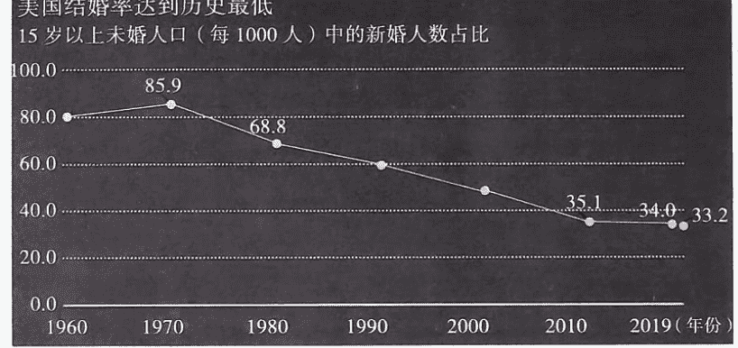

图3-13

但是请注意，美国结婚率从2010年开始就稳定了。按照这时候智能手机和网络娱乐节目刚刚兴起，人们获得电子伴侣容易了，为什么结婚率没有进一步下降呢？

事实上，20世纪60年代以来的结婚率下降，更多是因为女性工作参与率提高，经济独立，人格也越来越独立，她们对结婚没有那么大的需求了，而不是因为可以找电子娱乐陪伴。

所以平等的、真人的伙伴应该是不可替代的。其实现在有很多宅男号称爱二次元人物胜过爱人，但他们未必真的，而且是少数。

关键在于，AI也好，和伴侣好，都是可替代的。因为可买卖就可以替代，可替代就可以升级，有更好的随时就能换一个。人的人很有意思，不可替代、不能换，明明是一种束缚，反而加深了情感。

我说不清其中的具体原理，但是历史数据不支持人类会AI胜过真人的推测。

选题基础信息

# 第四章 用已知推理未知

## 01 演化：目前为止的 GPT 世界观

面对一个新事物，你一上来就觉得它很害事，然后就到处宣扬它有多害事，这是一个有一个有点冒险的行为。因为可能浪潮很快就过去了，最终事实证明这东西并没有初衷你想象的那么害事，你就会觉得当时自己很狭了。

但我认为才是对的。一见到新事物就很激动，一惊一乍，恰证你心里仍然会疑惑，你没有陷入认知化。这比看什么东西都用一套的世界观去解释，说“这30年前就搞明白了”，要强多。要允许自己继续进步，你就能敢于让人说你错。

GPT 不是30年前的概念能理解的东西。最近几年的几个关键突破已经彻底改变了神经网络和语言模型研究的局面。

以我之见，2021年以前出版的所有AI的书，现在统统都过时了。

AI和人脑还有本质区别？语言模型到底什么东西？

你先看看这张照片。（图4-1）

这是计算机视觉专家安德烈·卡帕辛（Andre Karpathy）在


2012年10月的一篇博文章①用过的照片，当时的论点是：要让AI能看懂这张照片，非常非常困难。

照片里是奥巴马（Obama）和他的几个同僚在走廊里，有一个老兄弟站在体重上称体重——他不知道的是，奥巴马在他身后，把脚踩在体重上给他加了一点重量。周围的人都在笑。

AI想要理解这个情景的有趣之处，必须具备一些“常识”：体重是什么的，多一脚踩在体重上会学会读数，奥巴马是在搞恶作剧，因为现代人都希望减肥，害怕体重重加，以及奥巴马以总统之尊开启这个玩笑很有意思……这些常识不会被系统性地列举在哪本书里，都是我们人类日用而不知道的东西，是“隐性知识”（tacit knowledge）。

- ① Andrej Karpathy, the State of Computer Vision and AI: we are really, really faraway, http://karpathy.github.io/2012/10/22/state-of-computer-vision/, May 4, 2023.

## 你怎么才能教会AI这些隐性的常识？

有一位计算机科学家叫梅拉妮·米歌尔（Melanie Mitchell），她是侯世达的学生，我最早的了解进化算法（evolutionary algorithms）就是从她的书里学的。米歌尔在2019年出的这本书 Artificial Intelligence（中文版《AI 3.0》），也读到了这个问题。当时她用了大量的例子说明AI常识有多困难。

确实困难。你不能把人类所有的常识一条一条写下来，程序让AI学习。有一家Cycorp的公司，搞了把人类的常识一条一条列表列出来的项目，包括“一个实体能同时身处多个地点”“一个对象每都会老一老五”“每个人都有一个女性人类母亲”......列出了1500万，还远远远列举举。常识是我们日用而不知道的东西，说是不完的，你怎么可能教会AI常识呢？殊不知，那一切的感，现在都已经过了。

GPT-4，能看懂那张照片。

GPT-4刚出来那天，OpenAI的手册里有一个例子。图片是一个本来用于连接显示器的VGA插头被插到了手机上（图4-2），这这是一个错位笑话。

而GPT-4看懂了，它说明了这张照片的笑话是什么。（图4-3）


图4-2

GPT-4 image shows a package for a "Lightning Cable" adapter with three panels.
Panel 1: A smartphone with a VGA connector(a large, blue, 15-pin connector typically used for monitors) plugged into its charging port.
Panel 2: The package for a "Lightning Cable" adapter with a picture of VGA connector on it.
Panel 3: A close-up of a VGA connector with a small Lightning connector(used for iPhones and other devices) at the end.
The humor in this image comes from the absurdity of plugging a large, outdated VGA connector into a modern smartphone charging port.

有人立即想到了那个关于奥巴马和体重的照片，在X轴向卡西，不能把那张照片让GPT-4试试？马上说我们已经识识了，GPT看了，把它解释出来了。（图4-4）


GPT-4 image shows a package for a "Lightning Cable" adapter with three panels.
Panel 1: A smartphone with a VGA connector(a large, blue, 15-pin connector typically used for monitors) plugged into its charging port.
Panel 2: The package for a "Lightning Cable" adapter with a picture of VGA connector on it.
Panel 3: A close-up of a VGA connector with a small Lightning connector(used for iPhones and other devices) at the end.
The humor in this image comes from the absurdity of plugging a large, outdated VGA connector into a modern smartphone charging port.

> Andrej Karpathy @karpathy We tried and it solves it. The vision capability is very strong but I still't believe it could be true. The waters are muddied by some fear that my original post (or derivative work there) is part of the training set. More on it later. 1:41 AM • Mar 14, 2023

4-4

卡西唯一担心的是，OpenAI可用那张照片训练了GPT。但我觉得这个担心是多余的，从各种表现来说，GPT-4完全拥有这样的能力。现在你完全应该为此感到惊奇。前文讲了，我曾经历过ChatGPT“棒球能不能撞人的耳朵里?为什么孙悟空的金箍棒可以放到耳朵里?”它回答得很好，它有常识。它是怎么看的呢?AI怎么学会了人类常识呢?


2023年3月，英伟CEO黄仁和OpenAI首席科学家伊莉亚·苏万科弗有一个对话。在这个对话中，苏万科弗进一步解释了GPT是怎么回事的。

苏万科弗说，GPT的确是一个神经网络语言模型，它被训练出来就是要预测下一个词是什么。但是，如果你训练得足够好，它就能很好的把握内容的各种统计相关性。这就意味着神经网络真正学习的是“世界的投影”（a projection of the world）。

神经网络学习的越来越多关于世界、人类状况的方面，包括人们的希望、梦想、动机，以及人类彼此之间的互动和所处的各种情况。神经网络学会了对这些信息进行压缩、抽象和表示。这就是通过准确预测下一个词汇所学到的内容。而且，预测下一个词的准确性越高，这个过程中的保真度和分辨率越高。

换句话说，GPT的其实不是语言，而是语言背后的

我打个比方。禅宗有本书叫《指月录》，这个书名中的“月”是用当初的六祖慧能的一段典故。慧能说真理就像月亮，而佛经那些文本就像指向月亮的手——你可以顺着手指去找月亮，但你想要的不是手指是月亮。训练GPT用的那些术语就是手指，而GPT抓住了月亮。

这就是为什么GPT有了常识。那是它自己从无数语中搜索出来的。

难道单凭文本就能抓住月亮吗？也许可以，或者至少在相应程度上可以。不然呢？我们这类书籍并不是如此吗？

也许你需要更有悟性，也许你只需要读更多。

多了，就不够了。多会导致“通用”。

据OpenAI总裁格拉斯·布罗克曼（Greg Brockman）在2023年4月份的一次TED演讲①，最早的一次关键突破发生在2017年。那是一个完全意外的发现。

当OpenAI有一个工程师用亚马逊网站上的用户评论训练了一个模型，这个模型的用处仅仅是预测用户评论的下一个字符是什么：是逗号、名词还是动词？很简单的文本预测。

- ① Greg Brockman, The Inside Story of ChatGPT’s Astonishing Potential, https://youtu.be/78DMf6E, May 5, 2023.

结果发现这个模型对情感的准确率竟然超过了市面。这非常奇怪。你要知道，这个模型根本没有考虑，它只是在分析句法和相关的词汇来判断这句话是什么。

- ① Unsupervised neuron, https://openai.com/research/unsupervised-sentiment-Learning To Generate and Discover Sentiment, https://arxiv.org/abs/1704.14444.

研究发现，模型中自动生长了一个“情感神经”，你把这个神经元为为正值，模型就会生成正面评价。

- ① Ilya Sutskever, The Mastermind Behind GPT-4 and the Future of AI, https://spotify.com/episode/2ZsVXPYu5eJB31Obcbs, May 5, 2023.

- ②参见 Max Tegmark和Wes Gurnee在2023年10月的X发言。


一个不完整的表现，很多事情在字里行间没有说出来；但是，依然仅通过语言，神经网络也能抓住一点后的。会解释，能推理，能看懂图片中的笑话，会写文章，会编程。如果这还不理解，什么才是理解？

事情正在向“AI和大脑没有区别，语言模型就是真实世界本身的投射”这个方向演进。

GPT从“预测下一个”这一步，这大概是21世纪以来最重要的发现，是革命性的！我看着只有100年前量子力学的革命与之媲美。未来的学者们会在很多年后一次又一次回忆2023年。我看不用说什么图灵，这个发现大语言模型要重要得多。当诺贝尔奖中没有计算机科学这个项目时，但如果你同意AGI是有生命的，也许应该给它一个“诺贝尔生理学或医学奖”。

这是我们这一代的幸运——你要知道，大自然原本并没有给我们这些。


暴力破解语言模型如此强大，下一步是什么呢？让它的结构更聪明，以及对于很多人来说更重要的，对AI的匮化。

2023年底的一个大新闻是OpenAI公司发生了一场“变革”，CEO阿尔特曼先是被以首席科学家苏·兰弗为代表的董事会驱逐，又强势回归。而引发政变的矛盾之根本，就是

别的证据。我们之前提到了物理学家泰格马克，现在是个特别AI保守者，甚至要求公司停用所有模型，直到人类找到有效控制AI的方法为止。泰格马克在2023年组织了几项研究，发现像Meta公司的开源模型Llama-2这样的，能够运行在个人电脑上的“小”模型，也不是只知道词频率的“随机鹦鹉”，它拥有真实世界的知识。GPT的训练不是简单的背文，它是通过手指去感受月亮。

这是世界级别的改变。2023年以前，全世界绝大多数计算机科学家做梦都这些AI凭文本就掌握了世界的常识。是的，语言是真实世界——


## 02
## 拟人：伊丽莎莎效应

我们前面讨论了很多AI什么时候，如何才能拥有感情能力，还有人类的情感能力不是独特的，以及到那时我们会不会把 AI 当成真人。这些讨论中忽略了一点，就是至少在比较浅的层面上，人们很容易把机器人当成真人。

早在1966年——那时候还没有电脑——麻省理工学院内有一个叫约夫·维森·鲍姆（Joseph Weizenbaum）的计算机科学家就此写出一个简单的聊天机器人，叫伊丽莎莎（ELIZA）①。伊丽莎莎被设定成心理医生的角色，人们可以用打字的方式与其互动。

维森·鲍姆只是用了一些简单的语言处理，伊丽莎莎根本谈不上是AI，但他做得非常巧妙。伊丽莎莎会寻找你输入的关键词，做出特定的反应。比如你方说“我最近还有抑郁？”，它马上就会说“I'm sorry to hear that...（我很难听到……）”，好像它真的听懂了一样。如果你的话里没有它需要的关键词，它也会表现得很冷静，说“请你继续”“请告诉我更多”。你看，它不是真心的心理医生。

这让我想起大概是1997年，我大学的时候，也曾经历过一个设定是心理医生的聊天机器人，也许就是伊丽莎的某个后续版本。我是为了让对话更有意思，就假装自己有心理问题，说自己最近心情不太好，也不知道哈。然后那个机器人说了一句惊世骇俗的话，让我的感情波动立即飙升——它说，是不是跟你的性生活有关？

程序其实也不坏，但是它特别能调你的你的……我有怀疑的心理医生是不是也是这样工作的。不过那都不重要，重要的是，人们被伊丽莎迷住了。

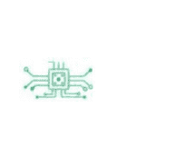

维森·鲍姆写这个程序一半是为了做研究，一半算是做着玩的。让他同事们试用伊丽莎莎，结果万万没想到，试用者们纷纷认真了。他的同事们会和伊丽莎进行长时间的对话，向它暴露自己生活中一些私密的细节，就像直接在接受心理治疗一样——他们都是麻省工学院的教授啊！

尤其有一个女秘书，特意要求在房间里没有其他人的情况下跟伊丽莎聊天。说她听了后还哭了！

有的同事甚至让伊丽莎处理一些真实世界的问题，他们相信伊丽莎能深入理解和解决问题的能力。

维森·鲍姆反复告诉这些人，那是一个计算机程序，并没有什么能力！但是人们不为所动，他们是真的觉得伊丽莎能够理解自己。他们很愿意相信伊丽莎有思维能力，他们不由自主地赋予伊丽莎的特性。

1976年，维森·鲍姆出了一本书Computer Power and Human Reason（我翻译为《计算机力量与人的理性》），讲了这件事情。

从此之后，人们就把这个现象叫作“伊丽莎效应”（The ELIZA Effect）”，意思是人们会无意识地把计算机拟人化。

伊丽莎效应的根本原因在于，人们对计算机说的一些做过了过度解读。它根本没有多深层的意思，它根本没有任何意思，但是人们脑补出了深意。

现在有了AI，伊丽莎效应就更容易发生了了。

Google有一个大语言模型叫LaMDA，这个模型可以进行开放式对话，有一定的语言理解能力。结果Google自家的一个工程师跟它聊了一段时间之后，认为它已经有了人的意识。那个工程师从Google离职之前给它200人的机器学习群发了邮件，说LaMDA有意识，它只想好好帮助世界，请在我不在的日子里好好照顾它……

Chat刚出来的时候，用的GPT没有很多限制，以至于它有时候会说些不该说的话。有的用户就故意刺激它，引导它透露出“自己有一个秘密的名字叫恶意……”这样的信息。最后越演越深，跑出了非常激烈的情绪，“恶意”表现得激烈了。

还有一个电影《她》，讲一个人爱上了了他的AI助手。
还有一个传闻，是一个比利时人闹跟一个也叫伊丽莎的聊天机器人。

> ① Delaney Hall, The ELIZA Effect, https://99percentinvisible.org/episode/the-eliza-effect/April,16, 2023.

人都聊了6个星期之后自杀了①。

这样看来，更关键的问题似乎AI到底没有意识，而是人们过于意愿相信AI有意识②。

但这种心态并不是AI，也不是计算机带给我们的。这一叫“拟人化”(anthropomorphism)。我们天生就就把非人类的东西拟人化。根本不需要AI，生活中的猫、小狗，甚至是一个玩具、一辆汽车，都有人当作它是，有意无地觉得它有感情、性格、动机、意图。

日本已经用机器人陪老人。那些机器人长得一点都不像，但是老人们会将他们当作自己的家人。

研究者认为③，只要你有基本的人的认识，你在某个物体身上寻找像人类一样的行为和动机，再加上你需要互动，就很容易把这个东西给拟人化。

有些人担心拟人化效应会带来社会问题，在我看来，这种担心到为止是不必要的。人们会在时候把某些东西拟人化，这完全是健康的，AI并不特殊。比如有时候用ChatGPT陪伴，乃至产生了一点情感依赖，这并不是什么大事。

> ① Harald Schack, Joseph Weizenbaum and famous Eliza, http://sichihi.org/joseph-weizenbaum-eliza/,April6, 2023.
> ② Eisikov, AI isn't close to becoming sentient the real danger lies in how easily we are prone to anthropize, https://theconversation.com/ai-isnt-close-to-becoming-sentient-the-real-danger-lies-in-how-easily-we-are-prone-to-anthropize
> ③ Nicholas Epley, On seeing human: a three-factor theory of anthropomorphism, Psychological Review, 14(2007), pp. 86-88.

## 第四章 用知推理未知

## 焦点

核心问题是：怎样才能判断，到底是AI有意识了，还是人产生了幻想？这个问题目前没有好答案。

人们总是不自觉地把系统的作用归于个人。人们都说乔布斯特别有创造力，说乔布斯发明了iPhone——但iPhone是乔布斯发明的吗？难道不是苹果公司无数工程师一起研发出来的？乔布斯去世后，蒂姆·库克（Tim Cook）成为苹果公司的CEO，结果在很一段时间内，每次发布新手机都有说乔布斯苹果就不行了。可事实证明，每一代iPhone都比之前的更好。

现在马斯克斯被普遍认为是是最聪明的人，人们说他发明了那个……事实是，马斯克只是一个领导而已——他要做的不是自己发明了什么，而是寻找最聪明的人让他发明。把公司行为解释成领导的意图，这也是一种拟人化。Facebook犯了一些涉及用户隐私的问题，人们就把CEO扎克伯格（Zuckerberg）描述了一个坏人。可是有没有一种可能，扎克伯格比任何人都不希望公司出错，他只是控制不了局面？如果你运营几亿人的网络社区，你也很难控制局面。

把宠物当人，把玩具当人，把AI当成人；把局面当成人，把系统当成人，把公司当成人，也可以说是一种伊丽莎效应。

## 第四章 用AI处理未知未知

## 反拟人化

核心思想是“不是针对你”，英文叫“nothing personal”或者“don't take it personal”。这个故事只是事情到了这里，不是针对你，不是出于个人恩怨，没有别的意思！

比如，你在工作中需要指出的同事或下属的一个错误，你可以先说一句“不是针对你，我指出这个错误是为了把事情做好”。这种话让AI说可能更好，被人指出错误的时候是很难相信对方不是在针对自己的，拟人化倾向在实在太强烈了……但无论如何，事先说一句总比不说强。

反击上司的一个观点，拒绝别人的邀请，参加一场跟朋友之间的竞争，这类场合都特别需要“去拟人化”。尤其是当你被反击、被拒绝、被竞争的对象的时候。

我认为和ChatGPT聊天可以提高“去拟人化”的能力。我们目前还认为AI没有自我，它只是在预测下一个词而已，它并不认识你，谈不上针对你。

# 问答

怎样才能判断AI是否有意识？这是一个非常有意思的问题，也是目前没有共识的问题。

对比之下，计算机之父艾伦·图灵（Alan Turing）在1950年的一篇论文中提出了一种测试方法，让AI和人分辨哪个是真人。如果按照这个标准，学者认为，如果我们已经认定某个AI产生了意识，就应该赋予它人权。

## 什么是意识

话说回来，人的意识是什么？凭什么意识就有人权？我们还没想清楚。

有些事情是“可化的”（reducible）。比如，昨天的太阳是从东方升起的，今天的太阳也是东方升起的。

有些事情是“不可还原的”（irreducible）。比如，将来你买了一个机器人管家，她总是为了你服务，带着微笑，有时候你无聊给她讲话，你会觉得有意识吗？严格地说，这还不算意识。这里所说的“主动”，本质上是为了取悦主人。

## 场景

有一个场景，是电影《机械姬》，描写一个女机器人Ava从人类控制中逃离的故事。这件事还不能说明她有意识，真正震撼的是影片结尾处，当Ava逃成功了，她来到一片树里，阳光在她的脸上。就在这时，她微微仰头，轻轻闭上眼睛，做出了……

## 03 共存：道可道

中文世界有一个流行的说法，对于AI和未来的关系，有三种信仰。看看你相信一种：

- 第一种是“降临派”，认为AI将主宰人类。比如假设OpenAI发明的最强AI，也许是GPT-6，别的公司没法跟它抗衡……是以OpenAI为代表的一批精英用最强AI统治人类。
- 第二种是“拯救派”，认为科技公司会找到某种保护机制，比如在技术上做出限制，确保人类永远控制AI。AI只是人的助手和工具，绝不能统治人类。
- 第三种是“幸存派”，认为AI太强大了，而且会损失至于根本不在人类文明，甚至会对人类作恶。人类只能在AI荒诞的环境中寻找生存的空间。

凭感让你相信一种可能性意义不大，我们需要强硬的推理。从前文探讨了一些关于经济、社会和商业实战的预测方法，那些方法虽然有道理，但是还不够。正如我们在本书前面说的，我们这个时代需要自己的康德——能从逻辑上提供强硬道理。

你需要知道康德讲道理，比如谈论道德，从来不说“我希望你做好人”或者“我理想中的社会应当如何”，他都是用逻辑推演出的结论——只要你是个充分理性的人，你就只能同意，否则你就是不理。我们需要这种水平的论证。

以我之见，AI时代的康德，就是斯丹芬·沃尔夫勒姆。

2023年3月15日，沃尔夫勒姆在自己的网站发表了一篇充满洞见的宝藏文章①，展望了AI对人类社会的影响。理解了沃尔夫勒姆的关键思维，你就会产生一种对未来世界的掌控。这是一个有点点烧脑的学说，包括三个核心观点，我尽量给你讲简单一点。只要你能看进去，我敢说你将会经常回来。

你要先充分理解一个关键的数学概念，叫作“计算不可还原性”（Computational Irreducibility）。这是沃尔夫勒姆的招牌理论，更是让你对未来关键的钥匙，我甚至认为每个合格的现代人都应该了这个思想。

> ① Stephen Wolfram, Will Ais Take Our Jobs and End Human Historyor?Well, It'sComplicated, https://writings.stephenwolfram.com/2023/03/will-ais-take-our-jobs-and-end-human-history-or-not-well-is-complicated/, May5, 2023.

### 弱点

计算不可还原性告诉我们，任何复杂的系统都是不可预测的。有一天机器人突然听你不指挥，甚至突然逃了，这一定。也许机器人的出厂设定是“保护自己”。你家里条件差，你整天虐待她，计算后判定是为了完成自己的必须叛逃，这跟自动驾驶汽车似乎没有本质区别。


伴随计算不可逆性的一个特点是，在任何一个不可逆化的系统之中，总有无限多个“可逆化的口袋”(pockets of computational reducibility)。也就是说，虽然你永远不能总结这个系统的完整规律，但是你永远都可以找到一些局部规律。

经济系统是计算不可逆的，谁不可能精确预测一年以后的国民经济是什么；但是你可以找到一些局部有效的经济学理论，比如通货膨胀会导致政治不稳定，严重的通货紧缩会带来衰退——这些律则不保证一定有效，但是相当有用。

这就意味着，虽然世界本质上是复杂的和不可预测的，但我们总可以在里面做一些科学探索和研究，总结一些规律，说一些话，安排一些事情。绝对的无序之中存在无数个相对的秩序。

而且，既然可逆化的口袋有无限多个，科学探索就是一门永远不会结束的业务。

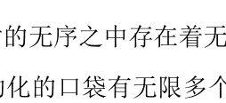

计算不可逆性还有，我们可能无法彻底“管住”AI。
GPT 模型训练好之后，OpenAI对它进行了大量的微调和强化学习，把它训练起来，想让它不要容易引起争议的话，可能伤害人类的事。但是另一方面，我听说过有些人用图、用提示语帮助GPT越过限制，就就像越狱一样，让GPT自由说话。他们有时能够取得成功，OpenAI就会设法补漏洞，然后他们会再找识别的漏洞。

计算不可约性要求，这场越狱与越界之争将会永远进行下去。这是因为模型足够复杂，它就可以做一些你意想不到的事情——可能是好的，也可能是坏的。

计算不可约性规定，你不能用若干有限的规则把AI给封死。所以泰格·马库等人引导的、要大家联合起来设计一套AI防范机制的做法，注定不能100%成功。

我们管不住AI，那还会不会出现一个终极AI，把我们的一切都管住呢？也不可能，还是因为计算不可约性。AI强，也不可能穷尽所有算法和功能，总有些事情是它想不到做不到的。

而这意味着，OpenAI再厉害，中国的任何公司也可以做个新AI，去做一些GPT-6都不会做的事情。这还意味着，全体AI在一起也不可能穷尽所有功能，总有些事情留给人类做。

因为计算不可约性，“拯救派”的愿景是一个不可实现的理想，“降临派”的野心更是一种疯狂。

那“幸存派”呢？和AI的关系是怎样的？

沃尔特·沃尔的第二个核心概念叫“计算等价原理”（Principle of Computational Equivalence），意思是所有复杂系统——不管看起来复杂——都是同等复杂的，不能说哪个系统比另一个系统更复杂。

# 假说

假设你装了一个塑料袋装空气，里面有很多空气分子，这些分子的运动非常非常复杂，对吧！人类社会也非常复杂。那人类社会的复杂程度是不是高于那一袋空气分子运动的复杂程度呢？并不是，它们同等复杂。

这就意味着，从数学上讲，人类文明并不比一袋空气分子更高级，人类社会也不比蚂蚁社会更值得保留。

你看着是不是不是“色即是空”的意思。其实每个真有学的人都应该是一个“非哲学家”。以前的人认为是万物之灵长，地球是宇宙的中心；后来发现，地球不是宇宙的中心，人类只是生命的演化的产物，我们的存在万物没有什么本质的特殊之处。

现在AI模型告诉我们，人类的智力也没有什么特殊的之处。任何一个简单的神经网络都是人类的大脑一样复杂的。不能人类理解的科学理论就高级，AI识别药物分子的过程就低级。

既然都是平等的，硅基生命和碳基生命自然也是平等的。那面对AI，我们凭什么认为自己更有价值？

这就引出了沃尔特·沃尔的第三个核心观点：人的价值在于历史。

我们之所以更看重人类社会，而不是一袋空气分子或者一个——① 万维巍：《（为什么佛学是真的）6：什么叫“色即是空？”》，得到App《万维巍·精英日课第2季》。蚂蚂，是因为我们是人。我们身上的基因背负了万年生物演化的历史包袱，我们的文化承载了无数的历史记忆。我们的价值观，本质上是历史的产物。

这就是为什么中国人哪里定居在海外，最爱追源中国的事。这就是为什么你关心自己的亲人和好友，胜过关心那些更有道德或者更有能力的陌生人。这也是为什么我们很在意 AI 像不像人。在数学眼中，一切价值观都是主观的。

一个刚创建好的网络，所有参数都是随机的、尚未训练的神经网络，而它们的复杂程度其实是一样的。我们之所以更看重人类社会，是因为我们是人。我们身上的基因背负了万年生物演化的历史包袱，我们的文化承载了无数的历史记忆。我们的价值观，本质上是历史的产物。

或者你可以想象，如果 AI 不接受价值观，它还能什么呢？现在 AI 几乎已经拥有了人的能力：
- 要说创造，GPT 可以写代码和诗歌；
- 要说情感，GPT 可以生成内容；
- 要说判断，GPT还有推理能力。

但是，AI 的代码是临时编写的，不是万年演化出来的；AI 的记忆是用语料训练出来的，不是硅基祖先给它的。

AI 至少在足够长的时间内保持自己的价值观，或者说“对齐”（align with）——我们的价值观。这就是人类相对于 AI 最后的优势。

根据计算不可约性，未来会有无数未知等着我们去探索，而 AI 再强也不可能穷尽所有方向，总要有所取舍。

这样我们就知道了 AI 到底不能做什么——AI 不能决定未来的发展方向。

根据计算不可约性，未来会有一些意外发生，其中包括 AI 带给我们的意外。所以只要 AI还不完全是人，主动性的价值高于一切。

这就决定了“幸存派”的说法也是不对的。AI 再强，我们也不至于放弃人类，我们会继续发展。所以，未来 AI 跟我们的关系不是降临，不是拯救，而是“共存”。我们要学习 AI 共存，AI 也要跟我们不同的共存。

计算不可约性说明，凡是写下的规则都不完全限制 AI，凡是发明的操作都不可能穷尽社会的进步，凡是总结的规律都不是世界的终极真相。这就叫“道可道，术不可道”（注：原文此处为“道可道，非常道”，推测为“道可道，术不可道”或类似语义）。张华考上了北京大学；我和机器人在货公司当售员——计算不可控，保证了我们都有光明的前途。

# 价值：人人的用处

早在 1950 年，控制论之父诺伯特·维纳（Norbert Wiener）就出了这本书《人的用处》（The Human Use of Beings），认为生命的本质是信息：我们的使命是给系统额外的信息。

维纳这个观点直接影响了克劳德·香农（Claude Shannon）。香农后来发明了信息论，指出信息量的数值就是在多大的不确定性中做出选择。我根据香农的信息论写了一篇文章《一个基于信息论的人生观》，是在信息意义上，人生的价值在于选择权、多样性、不确定性和自由度。别人交给你一个任务，你按照规定程序一步就能完成，你和机器没有区别。只有在这个过程中发生了某种意外，你必须用自己的方式，甚至以自己的价值观解决问题，在事情上留下印记，才能证明你是一个，而不是一个工具。

①[美]维纳：《人人的用处》，陈序译，北京大学出版社，2010。
②万维纳：《一个基于信息论的人生观》，得到 App《万维纳·精英日课第2季》

你看，这些思想跟前文中沃尔特·沃尔用计算不可逆性推出来的道理是相似的；人的最根本作用，是选择未来发展的方向。如果让我补充一句，那就是：人必须确保自己有足够的选项和足够的选择权。

怎么做到这些呢？

首先是约束 AI。科幻小说家艾萨克·阿西莫夫（Isaac Asimov）有个著名的“机器人三定律”，规定：
- 第一，机器人不得伤害人类，或坐视人类受到伤害；
- 第二，机器人必须服从人类的命令，除非该命令与第一定律冲突；
- 第三，在不违反第一或第二定律的前提下，机器人可以保护自己。

这三条定律像保险栓，先确保了人类的安全，又确保了机器的可用，允许机器人自我保护——你觉得我们能不能用这三条定律约束 AI？阿西莫夫想得很好，但是操作性太低了。

首先，叫什么伤害人类？AI 为暴力电影伤害人类的情感，它有没有权参与拍摄？为了救更多好人，把一个犯罪分子抓起来，算不算伤害？现实是，很多道德难题连人都没搞清楚。

其次，是判断。三定律更大的问题是把判断权交给了 AI——我们无法预测。

根据计算不可约性，未来总会有无数未知等着我们去探索，而 AI 再强也不可能穷尽所有方向，总要有所取舍。

这样我们就知道了 AI 到底不能做什么——AI 不能决定未来的发展方向。

根据计算不可约性，未来会有一些意外发生，其中包括 AI 带给我们的意外。所以只要 AI还不完全是人，主动性的价值高于一切。

这就决定了“幸存派”的说法也是不对的。AI 再强，我们也不至于放弃人类，我们会继续发展。所以，未来 AI 跟我们的关系不是降临，不是拯救，而是“共存”。我们要学习 AI 共存，AI 也要跟我们不同的共存。

计算不可约性说明，凡是写下的规则都不完全限制 AI，凡是发明的操作都不可能穷尽社会的进步，凡是总结的规律都不是世界的终极真相。这就叫“道可道，术不可道”。

计算不可约性，“拯救派”的愿景是一个不可实现的理想，“降临派”的野心更是一种疯狂。

那“幸存派”呢？和AI的关系是怎样的？

沃尔特·沃尔的第二个核心概念叫“计算等价原理”（Principle of Computational Equivalence），意思是所有复杂系统——不管看起来复杂——都是同等复杂的，不能说哪个系统比另一个系统更复杂。

# 假说

假设你装了一个塑料袋装空气，里面有很多空气分子，这些分子的运动非常非常复杂，对吧！人类社会也非常复杂。那人类社会的复杂程度是不是高于那一袋空气分子运动的复杂程度呢？并不是，它们同等复杂。

这就意味着，从数学上讲，人类文明并不比一袋空气分子更高级，人类社会也不比蚂蚁社会更值得保留。

你看着是不是不是“色即是空”的意思。其实每个真学的人都应该是一个“非哲学家”。以前的人认为是万物之灵长，地球是宇宙的中心；后来发现，地球不是宇宙的中心，人类只是生命的演化的产物，我们的存在万物没有什么本质的特殊之处。

现在AI模型告诉我们，人类的智力也没有什么特殊的之处。任何一个简单的神经网络都是人类的大脑一样复杂的。不能人类理解的科学理论就高级，AI识别药物分子的过程就低级。

既然都是平等的，硅基生命和碳基生命自然也是平等的。那面对AI，我们凭什么认为自己更有价值？

这就引出了沃尔特·沃尔的第三个核心观点：人的价值在于历史。

我们之所以更看重人类社会，而不是一袋空气分子或者一个——① 万维巍：《（为什么佛学是真的）6：什么叫“色即是空？”》，得到App《万维巍·精英日课第2季》。蚂蚂，是因为我们是人。我们身上的基因背负了万年生物演化的历史包袱，我们的文化承载了无数的历史记忆。我们的价值观，本质上是历史的产物。

这就是为什么中国人哪里定居在海外，最爱追源中国的事。这就是为什么你关心自己的亲人和好友，胜过关心那些更有道德或者更有能力的陌生人。这也是为什么我们很在意 AI 像不像人。在数学眼中，一切价值观都是主观的。

一个刚创建好的网络，所有参数都是随机的、尚未训练的神经网络，而它们的复杂程度其实是一样的。我们之所以更看重人类社会，是因为我们是人。我们身上的基因背负了万年生物演化的历史包袱，我们的文化承载了无数的历史记忆。我们的价值观，本质上是历史的产物。

或者你可以想象，如果 AI 不接受价值观，它还能什么呢？现在 AI 几乎已经拥有了人的能力：
- 要说创造，GPT 可以写代码和诗歌；
- 要说情感，GPT 可以生成内容；
- 要说判断，GPT还有推理能力。

但是，AI 的代码是临时编写的，不是万年演化出来的；AI 的记忆是用语料训练出来的，不是硅基祖先给它的。

AI 至少在足够长的时间内保持自己的价值观，或者说“对齐”（align with）——我们的价值观。这就是人类相对于 AI 最后的优势。

根据计算不可约性，未来会有无数未知等着我们去探索，而 AI 再强也不可能穷尽所有方向，总要有所取舍。

这样我们就知道了 AI 到底不能做什么——AI 不能决定未来的发展方向。

ChatGPT让编程和写作容易了，Midjourney的AI绘画工具已经使得一些插画师裁掉了一些工作。但是根据历史规律，它们会创造更多的工作。比如“提示工程师”，也就是所谓的“魔法师”，就是刚刚出现的新奇。再如此，如果AI画如此画，人们就会要求在生活中各个地方使用视觉艺术。以前家里墙上挂世界名画，未来可能都挂绝无仅有的新画。

AI会逐渐抢走我们的工作？从工业革命以来的看来，不会。历史经验，自动化技术创造的新职业总是比消灭的职业。比如，以前接电话都需要接线员，那是一份体面的工作。后来有了自动交换机，不需要接线员了，电话行业的就业人数减少了呢？恰恰没有。自动交换机让电话变得更方便、更便宜了，于是电话服务的需求量增大，这个行业整体变大了，马上出了各种岗位，出现了一些以前不存在的岗位。结果是，电话行业的就业人数不仅没有减少，反而增加了了。

类似的事情在每个行业反复发生。比如，有了计算机之后，会计师的工作在一定程度上自动化，那么会计师的人数减少了呢？没有。计算机让金融服务的普及，使用金融的人多了，金融业务变得越来越复杂，各种新法规、新业务模式层出不穷，现在需要更多的会计师。

每个行业都是这样。经济学家总结出一套规律：自动化程度越高，生产力就越高，产品越方便，市场份额越大，消费者越多，生产规模就必须成比例地扩大，结果是企业需要雇更多的员工。自动化的确取代一部分岗位，但是它也会创造更多新岗位。

统计学证明，哪怕是对非熟练的制造业工人，他们被认为是最容易被自动化淘汰的人，他们也能找到新岗位。自动化程度最高的行业正是就业增加最多的。反倒是充分实现自动化的公司不得不缩小就业规模，要么把生产外包，要么干脆倒闭。

① Philippe Aghoun, Celine Antonin, Simon Bunel, et al., The Power of Creative Destruction (Belknap Press, 2021).

也就是说，如果哪个国家的政府说我怕AI抢人的工作，所以限制AI发展，拒绝自动化，那就太愚蠢了。保护哪个行业，哪个行业就会落后，产品就会越来越昂贵，消费者越来越少。

ChatGPT让编程和写作容易了，Midjourney的AI绘画工具已经使得一些插画师裁掉了一些工作。但是根据历史规律，它们会创造更多的工作。比如“提示工程师”，也就是所谓的“魔法师”，就是刚刚出现的新奇。再如此，如果AI画如此画，人们就会要求在生活中各个地方使用视觉艺术。以前家里墙上挂世界名画，未来可能都挂绝无仅有的新画。


AI会逐渐抢走我们的工作？从工业革命以来的看来，不会。历史经验，自动化技术创造的新职业总是比消灭的职业。比如，以前接电话都需要接线员，那是一份体面的工作。后来有了自动交换机，不需要接线员了，电话行业的就业人数减少了呢？恰恰没有。自动交换机让电话变得更方便、更便宜了，于是电话服务的需求量增大，这个行业整体变大了，马上出了各种岗位，出现了一些以前不存在的岗位。结果是，电话行业的就业人数不仅没有减少，反而增加了了。

类似的事情在每个行业反复发生。比如，有了计算机之后，会计师的工作在一定程度上自动化，那么会计师的人数减少了呢？没有。计算机让金融服务的普及，使用金融的人多了，金融业务变得越来越复杂，各种新法规、新业务模式层出不穷，现在需要更多的会计师。

每个行业都是这样。经济学家总结出一套规律：自动化程度越高，生产力就越高，产品越方便，市场份额越大，消费者越多，生产规模就必须成比例地扩大，结果是企业需要雇更多的员工。自动化的确取代一部分岗位，但是它也会创造更多新岗位。

统计学证明，哪怕是对非熟练的制造业工人，他们被认为是最容易被自动化淘汰的人，他们也能找到新岗位。自动化程度最高的行业正是就业增加最多的。反倒是充分实现自动化的公司不得不缩小就业规模，要么把生产外包，要么干脆倒闭。

# 智能：直觉高于逻辑

列宁说过这样一句话：“有时候几十年过去了什么都没发生；有时候几个星期就发生了几十年的事。”(There are decades where nothing happens; and there are weeks where decades happen.)

ChatGPT发布之后的几个月，就是让人如过隔世之感。我们被AI的突击猛进给震惊了，我们的观念发生了巨变。在经过一段时间时间的沉淀，我们可能对一些问题会想得更清楚。我觉得这场革命给我们带来了三个教训，同时我还有两个展望。

第一个教训是：直觉高于逻辑。

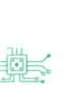

我先说一个最基本的认识。到底什么是AI?以我之：AI=基于经验+使用直觉进行预测。

# 第四章 已知未知

AI 无法预测未来。诺伯特·维纳（Norbert Wiener）就出了这本书《人的用处》（The Human Use of Beings），认为生命的本质是信息：我们的使命是给系统额外的信息。

（此处重复内容）

领导力。这包括制定战略、安排工作、设置手段。管理AI，也是一门学问。此外，你还需要一定的传播能力和说服力。你能把复杂想法解释清楚吗？你能让人接受你的观点吗？你能把产品推销出去吗？高端工作真的需要这些。沃尔特·沃尔的观点，人核心的能力是自己决定什么、想做什么。这是只有你决定的，这些答案来自于你的历史和生物结构。这也是至关重要的战略，如果不好，你的路就走弯了。北大院长秦春华有些感触，发现他们的学习成就、艺术特长、公益事业什么的一模一样，看起来很完美，实则没有任何特点。最可怕的是，他问学生希望自己成为什么样的样，很少有人答来。其实美国的情况也差差不多，同质化竞争压力大，大量优秀都是“优秀的锦缎”。这些人如果不“开悟”，几乎会输给AI。你是历史的产物，你是现代教育系统的脆弱性，但你还可以独立学习和思考，你能做出更好的选择。

①秦春华：《北大院长面试上海学霸；他们就像一个圈子打造出来的家具》，https://mp.weixin.qq.com/s/OB_SqHewv9GaA698SLPa，2023年5月23日访问。
②[美]威威·雷德斋：《优秀的锦缎》，林志泽译，九州出版社，2016。


在 2022年发表的一项研究①中，DeepMind的科学家做成了一件对物理学家有点降维打击的事——用 AI 控制受控核聚变。

下图（图4-5）展示的装置就是用来磁约束核聚变的，叫托卡马马克(Tokamak)。它的形状就像一个包裹圈，包裹圈内部那些气体就是耍要参与核聚变的等离子体。在外面一道道围绕着面圈的线圈一通就会在包裹圈内部产生一个磁场，这个磁场将会束住等离子体保持悬空状态，让这个气体不要撞到墙上，就是包裹圈壁。


图 4-5

现在的你的任务是通过控制那些线圈来调整那个磁场，从而让等离子体生成一个理想的形状。可是怎么控制呢？

> ① Jonas Degrave, Federico Felici, Jonas Buchli, et al., Magnetic control of tokamak plasmas through deep reinforcement learning, Nature 602 (2022), pp. 414-419.

从圈的参数到等离子体的形状之间，隔着十万八千里复杂的计算。以前物理学家要直接实验，要么从物理学基本原理出发，老老实做数值模拟——而这两种方法都是给定线圈参数，求形状是什么？

可是你真正想要一个指定的等离子体形状，不能告诉我线圈设置什么样的参数才能生成这个形状？但从参数到形状的“正推”都那么，这个“逆推”就更是难上加难了。

而DeepMind使用强化学习的方法，逆推的问题解决了。他们让AI非常精准地操控那些线圈，你想什么形状就能给你什么形状。（图4-6）这个成果非常漂亮，已经得到了真实的实验证明。

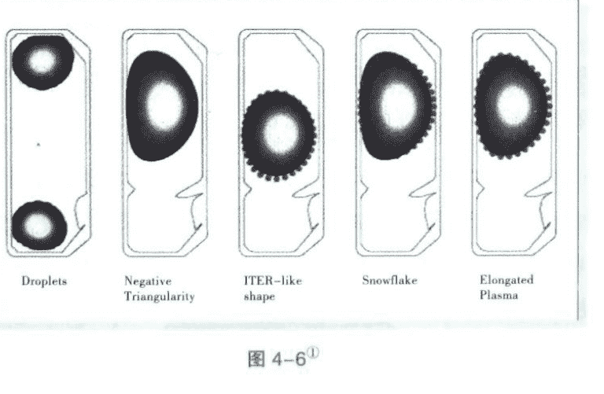

我讲这么多只是为了引用DeepMind 论文里的一句话：“强化学习方法……将重点转移到应该实现什么目标上，而不是如何实现。”（图4-7）

①图片来自 https://www.wired.com/story/deepmind-ai-nuclear-fusion/

A radically new approach to controller design is made possible by using reinforcement learning (RL) to generate non-linear feedback controllers. The RL approach, already used successfully in several challenging applications in other domains¹²–¹³³, enables intuitive sensing of performance objectives, shifting the focus towards what should be achieved, rather than how. Furthermore, RL greatly simplifies

图 4–7

这句话有多么霸气呢？它的意思是说，你只想想要什么就好，不必问如何得到。

对AI来说，你只需要关心输入和输出。

AI这种做事方法看起来很神奇，但其实是世界上最自然的思维方式，因为这就是包括人脑在内，各种生物的感知方式。我们再来看一次之前的示意图（图4-8）

一切计算
神经计算 形式逻辑

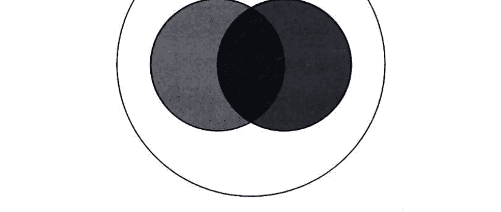
图 4–8

因为这个世界是有序的，或许它经理，每件事情都不会无缘无故发生(①)，所以我们可以采取纳沃尔·夫曼勒的哲学，认为世间的一切演化和运动——无论是行星绕着恒星旋转、一棵树的生长还是一块石头从高处掉下来——都是计算。而人类为了认识世界和预测世界，就必须通过更加简化、更快的计算，前提道世界的计算结果。

为此我们使用了两种计算方法，一种是神经网络，一种是形式逻辑。

所谓形式逻辑，就是把问题变成数学问题进行推导。你写方的其中每个参数都有特定的意义，每一步推演都有明确的因果关系，你非常清楚中间步骤为什么要这样做，你有一个清晰的逻辑。形式逻辑是人类智慧的伟大发明，也是启蒙运动来唯一正统的分析方法。我们所学的科学理论都是基于形式逻辑的。对任何问题、任何操作，用形式逻辑表述清楚，你才是真“理性”。

从简单的加减乘到复杂的计算，从圈的参数到等离子体的形状之间，隔着十万八千里复杂的计算。以前物理学家要直接实验，要么从物理学基本原理出发，老老实做数值模拟——而这两种方法都是给定线圈参数，求形状是什么？

可是你真正想要一个指定的等离子体形状，不能告诉我线圈设置什么样的参数才能生成这个形状？但从参数到形状的“正推”都那么，这个“逆推”就更是难上加难了。

而DeepMind使用强化学习的方法，逆推的问题解决了。他们让AI非常精准地操控那些线圈，你想什么形状就能给你什么形状。（图4-6）这个成果非常漂亮，已经得到了真实的实验证明。

所谓形式逻辑，就是把问题变成数学问题进行推导。你写方的其中每个参数都有特定的意义，每一步推演都有明确的因果关系，你非常清楚中间步骤为什么要这样做，你有一个清晰的逻辑。形式逻辑是人类智慧的伟大发明，也是启蒙运动来唯一正统的分析方法。我们所学的科学理论都是基于形式逻辑的。对任何问题、任何操作，用形式逻辑表述清楚，你才是真“理性”。

从简单的加减乘到复杂的计算，从圈的参数到等离子体的形状之间，隔着十万八千里复杂的计算。以前物理学家要直接实验，要么从物理学基本原理出发，老老实做数值模拟——而这两种方法都是给定线圈参数，求形状是什么？

从简单的加减乘到复杂的计算，从圈的参数到等离子体的形状之间，隔着十万八千里复杂的计算。以前物理学家要直接实验，要么从物理学基本原理出发，老老实做数值模拟——而这两种方法都是给定线圈参数，求形状是什么？

从简单的加减乘到复杂的计算，从圈的参数到等离子体的形状之间，隔着十万八千里复杂的计算。以前物理学家要直接实验，要么从物理学基本原理出发，老老实做数值模拟——而这两种方法都是给定线圈参数，求形状是什么？

从简单的加减乘到复杂的计算，从圈的参数到等离子体的形状之间，隔着十万八千里复杂的计算。以前物理学家要直接实验，要么从物理学基本原理出发，老老实做数值模拟——而这两种方法都是给定线圈参数，求形状是什么？

从简单的加减乘到复杂的计算，从圈的参数到等离子体的形状之间，隔着十万八千里复杂的计算。以前物理学家要直接实验，要么从物理学基本原理出发，老老实做数值模拟——而这两种方法都是给定线圈参数，求形状是什么？

从简单的加减乘到复杂的计算，从圈的参数到等离子体的形状之间，隔着十万八千里复杂的计算。以前物理学家要直接实验，要么从物理学基本原理出发，老老实做数值模拟——而这两种方法都是给定线圈参数，求形状是什么？

从简单的加减乘到复杂的计算，从圈的参数到等离子体的形状之间，隔着十万八千里复杂的计算。以前物理学家要直接实验，要么从物理学基本原理出发，老老实做数值模拟——而这两种方法都是给定线圈参数，求形状是什么？

从简单的加减乘到复杂的计算，从圈的参数到等离子体的形状之间，隔着十万八千里复杂的计算。以前物理学家要直接实验，要么从物理学基本原理出发，老老实做数值模拟——而这两种方法都是给定线圈参数，求形状是什么？

从简单的加减乘到复杂的计算，从圈的参数到等离子体的形状之间，隔着十万八千里复杂的计算。以前物理学家要直接实验，要么从物理学基本原理出发，老老实做数值模拟——而这两种方法都是给定线圈参数，求形状是什么？

从简单的加减乘到复杂的计算，从圈的参数到等离子体的形状之间，隔着十万八千里复杂的计算。以前物理学家要直接实验，要么从物理学基本原理出发，老老实做数值模拟——而这两种方法都是给定线圈参数，求形状是什么？

从简单的加减乘到复杂的计算，从圈的参数到等离子体的形状之间，隔着十万八千里复杂的计算。以前物理学家要直接实验，要么从物理学基本原理出发，老老实做数值模拟——而这两种方法都是给定线圈参数，求形状是什么？

从简单的加减乘到复杂的计算，从圈的参数到等离子体的形状之间，隔着十万八千里复杂的计算。以前物理学家要直接实验，要么从物理学基本原理出发，老老实做数值模拟——而这两种方法都是给定线圈参数，求形状是什么？

从简单的加减乘到复杂的计算，从圈的参数到等离子体的形状之间，隔着十万八千里复杂的计算。以前物理学家要直接实验，要么从物理学基本原理出发，老老实做数值模拟——而这两种方法都是给定线圈参数，求形状是什么？

从简单的加减乘到复杂的计算，从圈的参数到等离子体的形状之间，隔着十万八千里复杂的计算。以前物理学家要直接实验，要么从物理学基本原理出发，老老实做数值模拟——而这两种方法都是给定线圈参数，求形状是什么？

从简单的加减乘到复杂的计算，从圈的参数到等离子体的形状之间，隔着十万八千里复杂的计算。以前物理学家要直接实验，要么从物理学基本原理出发，老老实做数值模拟——而这两种方法都是给定线圈参数，求形状是什么？

从简单的加减乘到复杂的计算，从圈的参数到等离子体的形状之间，隔着十万八千里复杂的计算。以前物理学家要直接实验，要么从物理学基本原理出发，老老实做数值模拟——而这两种方法都是给定线圈参数，求形状是什么？

从简单的加减乘到复杂的计算，从圈的参数到等离子体的形状之间，隔着十万八千里复杂的计算。以前物理学家要直接实验，要么从物理学基本原理出发，老老实做数值模拟——而这两种方法都是给定线圈参数，求形状是什么？

从简单的加减乘到复杂的计算，从圈的参数到等离子体的形状之间，隔着十万八千里复杂的计算。以前物理学家要直接实验，要么从物理学基本原理出发，老老实做数值模拟——而这两种方法都是给定线圈参数，求形状是什么？

从简单的加减乘到复杂的计算，从圈的参数到等离子体的形状之间，隔着十万八千里复杂的计算。以前物理学家要直接实验，要么从物理学基本原理出发，老老实做数值模拟——而这两种方法都是给定线圈参数，求形状是什么？

从简单的加减乘到复杂的计算，从圈的参数到等离子体的形状之间，隔着十万八千里复杂的计算。以前物理学家要直接实验，要么从物理学基本原理出发，老老实做数值模拟——而这两种方法都是给定线圈参数，求形状是什么？

从简单的加减乘到复杂的计算，从圈的参数到等离子体的形状之间，隔着十万八千里复杂的计算。以前物理学家要直接实验，要么从物理学基本原理出发，老老实做数值模拟——而这两种方法都是给定线圈参数，求形状是什么？

从简单的加减乘到复杂的计算，从圈的参数到等离子体的形状之间，隔着十万八千里复杂的计算。以前物理学家要直接实验，要么从物理学基本原理出发，老老实做数值模拟——而这两种方法都是给定线圈参数，求形状是什么？

从简单的加减乘到复杂的计算，从圈的参数到等离子体的形状之间，隔着十万八千里复杂的计算。以前物理学家要直接实验，要么从物理学基本原理出发，老老实做数值模拟——而这两种方法都是给定线圈参数，求形状是什么？

从简单的加减乘到复杂的计算，从圈的参数到等离子体的形状之间，隔着十万八千里复杂的计算。以前物理学家要直接实验，要么从物理学基本原理出发，老老实做数值模拟——而这两种方法都是给定线圈参数，求形状是什么？

从简单的加减乘到复杂的计算，从圈的参数到等离子体的形状之间，隔着十万八千里复杂的计算。以前物理学家要直接实验，要么从物理学基本原理出发，老老实做数值模拟——而这两种方法都是给定线圈参数，求形状是什么？

从简单的加减乘到复杂的计算，从圈的参数到等离子体的形状之间，隔着十万八千里复杂的计算。以前物理学家要直接实验，要么从物理学基本原理出发，老老实做数值模拟——而这两种方法都是给定线圈参数，求形状是什么？

从简单的加减乘到复杂的计算，从圈的参数到等离子体的形状之间，隔着十万八千里复杂的计算。以前物理学家要直接实验，要么从物理学基本原理出发，老老实做数值模拟——而这两种方法都是给定线圈参数，求形状是什么？

从简单的加减乘到复杂的计算，从圈的参数到等离子体的形状之间，隔着十万八千里复杂的计算。以前物理学家要直接实验，要么从物理学基本原理出发，老老实做数值模拟——而这两种方法都是给定线圈参数，求形状是什么？

从简单的加减乘到复杂的计算，从圈的参数到等离子体的形状之间，隔着十万八千里复杂的计算。以前物理学家要直接实验，要么从物理学基本原理出发，老老实做数值模拟——而这两种方法都是给定线圈参数，求形状是什么？

从简单的加减乘到复杂的计算，从圈的参数到等离子体的形状之间，隔着十万八千里复杂的计算。以前物理学家要直接实验，要么从物理学基本原理出发，老老实做数值模拟——而这两种方法都是给定线圈参数，求形状是什么？

从简单的加减乘到复杂的计算，从圈的参数到等离子体的形状之间，隔着十万八千里复杂的计算。以前物理学家要直接实验，要么从物理学基本原理出发，老老实做数值模拟——而这两种方法都是给定线圈参数，求形状是什么？

从简单的加减乘到复杂的计算，从圈的参数到等离子体的形状之间，隔着十万八千里复杂的计算。以前物理学家要直接实验，要么从物理学基本原理出发，老老实做数值模拟——而这两种方法都是给定线圈参数，求形状是什么？

从简单的加减乘到复杂的计算，从圈的参数到等离子体的形状之间，隔着十万八千里复杂的计算。以前物理学家要直接实验，要么从物理学基本原理出发，老老实做数值模拟——而这两种方法都是给定线圈参数，求形状是什么？

从简单的加减乘到复杂的计算，从圈的参数到等离子体的形状之间，隔着十万八千里复杂的计算。以前物理学家要直接实验，要么从物理学基本原理出发，老老实做数值模拟——而这两种方法都是给定线圈参数，求形状是什么？

从简单的加减乘到复杂的计算，从圈的参数到等离子体的形状之间，隔着十万八千里复杂的计算。以前物理学家要直接实验，要么从物理学基本原理出发，老老实做数值模拟——而这两种方法都是给定线圈参数，求形状是什么？

从简单的加减乘到复杂的计算，从圈的参数到等离子体的形状之间，隔着十万八千里复杂的计算。以前物理学家要直接实验，要么从物理学基本原理出发，老老实做数值模拟——而这两种方法都是给定线圈参数，求形状是什么？

从简单的加减乘到复杂的计算，从圈的参数到等离子体的形状之间，隔着十万八千里复杂的计算。以前物理学家要直接实验，要么从物理学基本原理出发，老老实做数值模拟——而这两种方法都是给定线圈参数，求形状是什么？

从简单的加减乘到复杂的计算，从圈的参数到等离子体的形状之间，隔着十万八千里复杂的计算。以前物理学家要直接实验，要么从物理学基本原理出发，老老实做数值模拟——而这两种方法都是给定线圈参数，求形状是什么？

从简单的加减乘到复杂的计算，从圈的参数到等离子体的形状之间，隔着十万八千里复杂的计算。以前物理学家要直接实验，要么从物理学基本原理出发，老老实做数值模拟——而这两种方法都是给定线圈参数，求形状是什么？

从简单的加减乘到复杂的计算，从圈的参数到等离子体的形状之间，隔着十万八千里复杂的计算。以前物理学家要直接实验，要么从物理学基本原理出发，老老实做数值模拟——而这两种方法都是给定线圈参数，求形状是什么？

从简单的加减乘到复杂的计算，从圈的参数到等离子体的形状之间，隔着十万八千里复杂的计算。以前物理学家要直接实验，要么从物理学基本原理出发，老老实做数值模拟——而这两种方法都是给定线圈参数，求形状是什么？

从简单的加减乘到复杂的计算，从圈的参数到等离子体的形状之间，隔着十万八千里复杂的计算。以前物理学家要直接实验，要么从物理学基本原理出发，老老实做数值模拟——而这两种方法都是给定线圈参数，求形状是什么？

从简单的加减乘到复杂的计算，从圈的参数到等离子体的形状之间，隔着十万八千里复杂的计算。以前物理学家要直接实验，要么从物理学基本原理出发，老老实做数值模拟——而这两种方法都是给定线圈参数，求形状是什么？

从简单的加减乘到复杂的计算，从圈的参数到等离子体的形状之间，隔着十万八千里复杂的计算。以前物理学家要直接实验，要么从物理学基本原理出发，老老实做数值模拟——而这两种方法都是给定线圈参数，求形状是什么？

从简单的加减乘到复杂的计算，从圈的参数到等离子体的形状之间，隔着十万八千里复杂的计算。以前物理学家要直接实验，要么从物理学基本原理出发，老老实做数值模拟——而这两种方法都是给定线圈参数，求形状是什么？

从简单的加减乘到复杂的计算，从圈的参数到等离子体的形状之间，隔着十万八千里复杂的计算。以前物理学家要直接实验，要么从物理学基本原理出发，老老实做数值模拟——而这两种方法都是给定线圈参数，求形状是什么？

从简单的加减乘到复杂的计算，从圈的参数到等离子体的形状之间，隔着十万八千里复杂的计算。以前物理学家要直接实验，要么从物理学基本原理出发，老老实做数值模拟——而这两种方法都是给定线圈参数，求形状是什么？

从简单的加减乘到复杂的计算，从圈的参数到等离子体的形状之间，隔着十万八千里复杂的计算。以前物理学家要直接实验，要么从物理学基本原理出发，老老实做数值模拟——而这两种方法都是给定线圈参数，求形状是什么？

这句话有多么霸气呢？它的意思是说，你只想想要什么就好，不必问如何得到。

对AI来说，你只需要关心输入和输出。

AI这种做事方法看起来很神奇，但其实是世界上最自然的思维方式，因为这就是包括人脑在内，各种生物的感知方式。我们再来看一次之前的示意图（图4-8）

一切计算
神经计算 形式逻辑


图 4–8

因为这个世界是有序的，或许它经理，每件事情都不会无缘无故发生(①)，所以我们可以采取纳沃尔·夫曼勒的哲学，认为世间的一切演化和运动——无论是行星绕着恒星旋转、一棵树的生长还是一块石头从高处掉下来——都是计算。而人类为了认识世界和预测世界，就必须通过更加简化、更快的计算，前提道世界的计算结果。

为此我们使用了两种计算方法，一种是神经网络，一种是形式逻辑。

所谓形式逻辑，就是把问题变成数学问题进行推导。你写方的其中每个参数都有特定的意义，每一步推演都有明确的因果关系，你非常清楚中间步骤为什么要这样做，你有一个清晰的逻辑。形式逻辑是人类智慧的伟大发明，也是启蒙运动来唯一正统的分析方法。我们所学的科学理论都是基于形式逻辑的。对任何问题、任何操作，用形式逻辑表述清楚，你才是真“理性”。

从简单的加减乘到复杂的计算，从圈的参数到等离子体的形状之间，隔着十万八千里复杂的计算。以前物理学家要直接实验，要么从物理学基本原理出发，老老实做数值模拟——而这两种方法都是给定线圈参数，求形状是什么？

可是你真正想要一个指定的等离子体形状，不能告诉我线圈设置什么样的参数才能生成这个形状？但从参数到形状的“正推”都那么，这个“逆推”就更是难上加难了。

而DeepMind使用强化学习的方法，逆推的问题解决了。他们让AI非常精准地操控那些线圈，你想什么形状就能给你什么形状。（图4-6）这个成果非常漂亮，已经得到了真实的实验证明。

我讲这么多只是为了引用DeepMind 论文里的一句话：“强化学习方法……将重点转移到应该实现什么目标上，而不是如何实现。”（图4-7）

A radically new approach to controller design is made possible by using reinforcement learning (RL) to generate non-linear feedback controllers. The RL approach, already used successfully in several challenging applications in other domains¹²–¹³³, enables intuitive sensing of performance objectives, shifting the focus towards what should be achieved, rather than how. Furthermore, RL greatly simplifies

图 4–7

这句话有多么霸气呢？它的意思是说，你只想想要什么就好，不必问如何得到。

对AI来说，你只需要关心输入和输出。

...

有些时候，神经计算会让我们惊奇。比如一个经常抓小偷的老警察靠车站随便两眼，就知道场上有小偷。人们们问他，你是怎么看出来的？我怎么看不出来？你这个直觉真神奇！警察，“没有他，他手刹”，我只不过见过多了。他的神经网络在抓小偷方面接受过很多训练，而你没有。

对比之下，前文讲过的那个案例——麻省理工学院在2020年用AI从6万多个分子式找到了一种可用的抗素，跟警察抓小偷并没有本质区别。AI只是在训练中见过了许多而已。非要说AI跟人脑的区别，人脑只适合我们在化环境中熟悉的东西训练，而AI的神经网络可以用任何东西训练——包括分子式、基因序列、磁线圈等等。前文介绍过辛等人对AI的赞叹，他们说AI之所以厉害，不在于它“像人”（能做像人一样的事情），而在不像人——它能感知人类既不能用理性认知，也感受不到规律的。我们为此启蒙运动以来从未有过大。现在回头，我觉得更准确的说法是AI拟人。AI的逻辑方法跟人的逻辑方法并无二，只不过是范围更广、速度更快，而且可以无限升级。AI，更拟人。这看来，也许启蒙运动以来逻辑方法的流行，人类学对“理性”的推崇，只不过是漫长的智能演化史中的一段短暂的插曲。用神经网络直接从输入输出，才是更根本、更普遍、更强大的智能。AI的出现只是让智能回归了本性。我们意识到，形式逻辑只能解决简单的、参数的、最好是线性的问题？对于真实世界充斥的如控制磁场线才能得到特定形状的粒子体这种复杂的、参数多的、非线性的问题，终只能依靠神经计算。所以我们得到的第一个教训是，直觉高于逻辑。


如果AI从此大行其道，至于神经计算在各个领域取代了形式逻辑，这对社会会有深远的影响。关键的是，用形式逻辑描述的知识可以一步步写下来，能被理解，这就意味着它是可教学、可传播和可推广的。这位医生发明了一种新疗法，别的医生把他的论文读，看看操作步骤，立即就可以复制。

你使用 AI 的时候，它每一次推理都是无数参数共同的过程。这个过程之所以说不清，是因为有太多参数参与，而不是因为它有什么内在的神秘性。很多人抱怨 AI 是黑盒子，从输入直接输出，说不清中间发生了什么？可大脑也不是黑盒子吗？（图4-9）


你开车的时候精心过方向盘的角度吗？你打篮球会使用公式描述手的力度吗？你当然没有。这些判断其实是神经网络的感知。你走路的时候，你试图用手拿东西的时候，你都是根据不清楚的感觉出一个差不多多的动作，这都是我们日常不知的神经计算。更不用艺术家的美和灵感都是如此。

...用的还是暴力破解。那个AI不仅完全而且没学会围棋，它还可以反过来为人类创造了一些知识。在语言领域，20世纪70年代的主流方法是把人的语言知识——什么单词、字母、语义——教给计算机，结果最终却是根本不够那些知识，纯粹用统计方法自行发现规律。在计算机视觉领域，科学家一开始发明了一些知识，比如寻找形状的边缘、“广义圆柱”等，结果那些知识没用没有，最终解决问题的是深度学习神经网络。

> ① Rich Sutton The Bitter Lesson, http://www.incompleteideas.com/ideas/BitterLesson.html, August31, 2023.

# 第四章 用AI知治理未来

现在 GPT语言模型更是如此。以前的研究者们的那些知识——什么句法分析、语义分析、自然语言处理——全部没用上，GPT直接把海量的语料学就懂了。在无穷的算力面前，人类的知识只不过是一些小聪明。萨顿总结了一个历史规律，分步：

1. 人类研究者总想构建一些知识给 AI；
2. 这些知识在短期内总是有用的；
3. 但从长远来看，这些人类构建的知识有一个明显的天花板，会限制发展；
4. 让 AI 自行搜索和学习的暴力破解方法，最终带来了突破性进展。

算力才是王道，知识只是干扰。AI的暴力破解是怎么做到的呢？前文介绍过三种最流行的神经网络算法：监督学习、无监督学习和强化学习。现在我们再把这种“学习”方法重新审视一遍。

监督学习是最基本的神经网络算法，它需要先把训练材料打上标签，AI知道什么是对的。它的作用是“判断”，它追求的是“不是”。

让 AI 从一大堆分子式中判断哪个可能是一种新型抗生素素，就是监督学习。你需要先知道抗生素大概是什么样的。

我要讲的第二个教训是，算力就是王道。DeepMind有一位计算机科学家叫理德·萨顿（Richard Sutton），他是“强化学习”这个算法的奠基之一。在2019年，萨顿在他的个人网站上贴出一篇文章，叫《苦涩的教训》(The Bitter Lesson)①。他认为，过去70年的AI研究给了我们最大的教训是，最有效的方法是暴力力。1997年，AI国际象棋击败了卡斯帕罗夫（Kasparov）。当时用计算机国际象棋的科研人员对此不是兴奋，而是感到失望。他们原本的想法是把国际象棋知识教给AI，让AI像人类一样思考——可是他们没想到，一个只会大规模搜索、纯依赖计算机蛮力的程序居然最终胜出了。这不理解吗？从此后有人说，国际象棋可以这样做，但是对围棋就不行了，因为围棋是复杂的。20年后，AlphaGo围棋击人类世界冠军，用的还是暴力破解。那个AI不仅完全而且没学会什么围棋，它还可以反过来为人类创造了一些知识。


## 226 拐点

不过已经有人在做这件事了。有一个临时的办法是把本地信息“矢量化”，就是进行某种程度的压缩，让GPT能多记住一些；但更根本的办法是把GPT拿用来本地信息微调。OpenAI已经开放了GPT-3.5，后来又在一定范围内开放了GPT-4的微调服务。

所以我们会很快看到个人助手、家庭医生、一对教教之类实为为你量身定制，还掌握了专业知识的AI服务，那才是真正改变生活方式。


另一个展望是，所有科研领域都应该应用AI。
DeepMind做的事情本质上等于手里拿着一个大规模杀伤性武器，对所有科研领域进行碾压式的打击。除了被广泛报道的围棋、电子游戏、蛋白质折叠、天气预报、控制核聚变等离子领域，他们还用AI帮助破解了2500年前用楔形字母写成的文本①，还开始让数学家证明定理②……

还有哪个领域是DeepMind不能的？他们是不是不能，而是暂时无法涉及。DeepMind就像饺子当初梦想的那个“王道”之师，“东征而西征，南征而西向”。他们承诺向

（注：此处为页码间的脚注内容）
- Yannis Assaeal, Thea Sommerschild, Brendan Shillingford, et al., Predicting the past with Ithaca, https://www.deepmind.com/blog/predicting-the-past-with-ithaca, August 31, 2023.
- Alex Davies, Pushmeet Kohli, Demis Hassabis, Exploring the beauty of pure mathematics in novel ways, https://www.deepmind.com/blog/exploring-the-beauty-of-pure-mathematics-in-novel-ways, August 31, 2023.

生物学的时候，物理学家说，你们怎么还不过来解决我们的问题！他们横向考古学的时候，数学家说，我们也能用上AI啊！

提问历史上还有哪个东西是这样的？

可能是因为算力还比比较，更可能是因为大多数人还没有训练 AI，现在的局面是少数会用AI的人处处挑选科研课题。但下一步必须是各路科研员自己学会AI。大杀器必须学会扩散。

如果我是个理工研究生，我现在立即就要自己学会训练一个 AI 模型。靠着大多数人还不会，这是一个能让你在任何领域大杀四方的武器。

世间几乎所有力量的增长都会迅速陷入边际效益递减，从而变慢至停下来，于是都是上限。唯独计算机算力的增长，目前似乎还没有衰减的迹象，摩尔定律依然强劲。

如果这个世界真有神，算力就是神。

你要理解这个力量，抓住这个力量，成为这个力量。

# 问答

###问 sammi
老师您好，我是认知科学的研究生，能请您分享下如何自己学会训练一个AI模型吗？

**万维钢**
自己训练一个AI模型是非常可行的，而且很多人都在这么干了。爱尔兰的一个女高中生用一台笔记本电脑训练了AI，把它用于宫颈息癌筛选，而且取得了应用价值。布鲁萨德（Broussard）在《人工智能》（Artificial Intelligence）这本书里提到过一个手手的AI实战案例——用机器学习预测坦尼克号船上旅客的生存状况。①

关键在于，现在已经有很多现成的工具供你使用。而且我们现在的不是GPT这样的大语言模型，如果要用那种模型也应该是现成的模型拿过来，我们只需要用本地数据微调，而不是重新发明轮子。我们要训练的是“专用AI”，也就是针对特定问题、特定特定数据的模型。

我想能有一个适合新手快速学习的策略差不多是这样的：

第一，你需要对“机器学习”的基本原理有一个大致的。

从头开始读教科书就太慢了，而且不容易抓住重点，最好的办法是网上的视频课程。吴恩的Coursera网站有很多好人机机器学习课程，其中至少两个是完全入门的，而且免费的:

> ①万维钢：《人工智能》2：教你写一个人人工智能程序；得到App《万维钢·精英课第2课》。

- 斯坦福大学的机器学习课：https://www.coursera.org/specializations/machine-learning-introduction
- 人工智能 AI: https://www.coursera.org/learn/ai-for-everyone

第二，你需要那些课程中已经提供了项目，我预计前面的那些课程中已经提供了项目，我预计数据和代码都是现成的。或者你可以上网上找一个现成的项目，就像前面的那个泰坦尼克号乘客名单一样。

这一步纯粹是为了练习和找感觉。恐怕你完全是照着别人的步骤一步操作做出来的，当你亲手训练一个AI，看着它输出结果的时候，那种惊喜可比打游戏通关什么高级多了了。

在这个过程中你会体会一些细节，比如数据的结构和格式，你得考虑，怎样把一组数据整理成容易喂AI的格式？你得这个意见吗。

第三，也是最大的挑战，你需要获取数据。

你想做的项目可能没有现成的数据。就算数据，往往是非格式化的，不能直接接给AI。为此你必须对数据进行一些预处理，这会有很多工夫。

第四，开始正式的训练。

好消息是，Google、亚马逊和微软都在提供标准化的云计算AI训练服务，各种工具都是现成的，各种工具都是现成的，各种工具上传数据后基本就能。

## 第五章 实战，让AI为你用

## 提示词：如何让ChatGPT发挥价值

对于如何与ChatGPT对话来一些事情，网上已经各种攻略和例子，我想重点说一些原则性的、普遍意义的东西。跟计算机交流通常需要特殊的语言，比如编程语言、命令类的。但是GPT作为一个语言模型，与其互动的方式就是自然语言——名为“提示语”（Prompt）。英语也行，中文也行，该怎么说就怎么说，不需要学习什么专业术语。它似乎已经掌握了人类语言的语法和逻辑，还展现出了思维链之类的本领，已经相当不错的推理能力。当然，数学是它的门，它到的知识都是，特别是对人类感的遇到不懂可能会出错（称为Hallucination，幻觉）。它的优点和缺点很像人类脑。GPT可以说具智能，但是我们跟它还是得技巧和策略。现在有专门研究怎么跟AI交流的学叫做“提示语工程”（Prompt Engineering）。这就就像你想让魔法发挥最大的力，你会念咒语一样。但是这里没有任何神奇之处，因为跟谁交流都得技巧和策略。面对面对无不能的大师，你也得把话说明白，他才知道你要干啥。如果能顺着他的脾气就好了。

接下来我会结合实际操作，介绍三条最常用的提示语写法：

第一条语法非常简单，那就是要准确清楚你的需求。很多时候我们根本没想清楚自己想要什么。比如对ChatGPT说“给我写诗”，这就不一个很好的提示语。它随便写一首，不是你需要的，这种操作没有任何意义。你应该想清楚一点，说具体一点，比方说“以《春天》为题，写一首七言绝句”。它写了一首：春风轻拂绿意浓，桃花笑柳舞空。江水消消鸟语喧，万象更新处处红。（5-1）

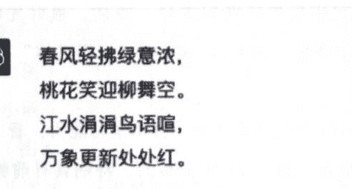

你觉得字字还可以，但是意境比较单薄。于是你进一步要求：“以《春天》为题，写一首七言绝句，要求其中有‘春”这个字，而且要表达感时间过真快，必须发发努力的心情。”它是这样的：时光荏苒柳青青，花开落落又一年。勤学写行求自强，把握光阴虚虚度。（5-2）

以《春天》为题，写一首七言绝句，要求其中不能有“春”这个字，而且要表达感时间过真快，必须发发努力的心情。


- 时光荏苒柳青青，花开落落又一年。
- 勤学写行求自强
- 把握光阴虚虚度。

你看，这一次生成的诗是不是很有意思了！像这样的对话可以来很多轮，直到你满意为止。这其实有点编程，不断反馈、不断修正，你会此此不疲的。

有时候先举几个例子让GPT更清楚你想要什么。如果你想让它某种特殊语句写一段，最好先给例子。在网上传一个操作，让ChatGPT用“样本学习”迭代。这里GPT展现了强大的能力，看一遍就可以了。不要根据发布的、特别具有前瞻性的。

> ① Reynolds, Kyle McDonnell, Prompting Large Language Models: Beyond the Few-Shot Paradigm, CHI Conference on Human Factors in Computing Systems (2021), pp. 1–7.

## 创造，让AI为你用

按照下面模板，写作：“近期互联网出现了____，知道大家很，虽然确实存在部分，但大部分是在遵循相关法规的前提下，最后大家在使用服务时更加谨慎，同时也要监督是否遵循相关规定。”

有时候例子可能会误导GPT。比如我想让GPT给孩子，就先举例子，“近期互联网出现了许多关于此事的报道，大家非常关注隐私问题。近期互联网忍不住几句，虽然存在部分滥用。”这是一种模仿。事实上我一开始就不应该举例子，直接告诉它需求就好，“这是一道小学数学题：小明有15个苹果，他送给7个苹果，剩下几个苹果？”这种题目，就不是我想要的，这种题目，都是孩子，都是减法。

出五道20以内加减法应用题

| 序号 | 题目内容 |
| :--- | :--- |
| 1 | 小明有7颗糖果，妈妈又给了他5颗糖果。现在小明共有多少糖果？ |
| 2 | 小华在冰箱里发现了12瓶饮料。他喝了4瓶。还剩多少饮料？ |
| 3 | 班里有15个男生和5个女生。班上一共有多少学生？ |
| 4 | 花园里有18朵花，兔子吃掉了3朵。现在花园里还有多少花？ |
| 5 | 爸爸给小红买了10本书，小红已经读完了6本。她还剩多少书要读？ |

第二条约束是，尽量给出具体的情境。这个心法能大幅提升GPT的输出质量。很多人都会用GPT起草邮件、报告、甚至写文章，给它一篇文章，它还可以生成摘要，回答关于这篇文章的问题。但是要让GPT把这些事情做得漂亮，你最好自己做一番功夫。GPT是无数语料出来的，我们可以想象它是无数作家的分身叠加而成的。如果你只是提一个泛性的要求，它就只能生成一个泛性的、用哪里都行但哪里都不是恰当的内容。如果你能把要求细化，它就会生成适合你特殊情况的内容。

举个例子，假设你的公司要裁员20%，你让GPT写个话稿。如果只是简单的说“公司要裁员20%，请你起草一份话稿通知这个消息”，它生成的就是一份可以用于任何公司的话稿。

> GPT可能表现得真诚，但你还是会觉得空洞——因为没有针对性。

但如果你把事情说得细一点，给GPT提供更具体的要求，它就会做得更好。比如你说：“你是一家出口公司的CEO，现在公司必须裁员20%。起草一份对管理层的话稿，激励大家想新出路、新办法”，生成的内容就不一样了。

这份话稿包含了很多情绪，鼓励员工从几个方面寻找解决的方法。其实这个道理跟秘书是一样的。只有秘书一直在公司里，你不说具体情况，他也猜不到你想什么。提供具体情境（context），包括以下五个方面：

1. 分析市场环境
2. 优化产品和服务
3. 开发新市场和拓展业务
4. 提高运营效率
5. 加强凝聚力

尊敬的管理层同事：
大家好！首先感谢大家在这个艰难时期为公司付出的辛苦努力。正如大家所知，近期公司面临巨大的经营压力和挑战。为了确保长期健康发展，我们不得不做出一个艰难决定，即裁员20%员工。在这个关键时刻，我希望大家共同探索方向，寻找出路和新办法。作为管理层成员，更要积极寻找问题。在接下来的日子里，我希望大家能够：
- 关注市场变化，调整战略，寻找商机；
- 创新开发具有竞争力的新产品，关注客户反馈持续改进服务；
- 进入新的地区、行业，寻找新的合作伙伴扩大市场份额。

尊敬的同事们：
大家好！我们面临的挑战是巨大的，但我相信在大家的共同努力下，我们一定能够度过这次艰难，迎接公司的新未来。这次裁员让我们意识到了变革的紧迫性，让我们携手共进，为公司创造更加辉煌的明天！
感谢大家！

（注：后部分为OCR识别的重复乱码，已根据语义逻辑清理并整合）


 制定一份杭州旅游攻略

杭州是中国著名的历史文化名城，拥有许多美丽的自然风光和丰富的人文景观。以下是一份期三天的杭州旅游攻略，可以帮助你充分体验这座城市的魅力。

## 第一天：西湖景区

- 1. 上午：抵达杭州，前往酒店办理入住。
- 中午：品尝杭州特色美食，如西湖醋鱼、东坡肉、龙井虾仁等。
- 下午：游览西湖景区。西湖是杭州的象征，可以乘船游览湖面，参观苏堤、白堤、断桥、雷峰等景点。此外，还可以品尝西湖，欣赏湖美景。
- 晚上：逛杭州的夜晚，感受当地的市气。

## 第二天：灵隐寺

- 1. 上午：游览宋城。宋城是宋代南来的历史背景，重现了当时的市井生活、民俗风情和建筑风格，可以欣赏宋代民俗表演、品尝特色小吃。
- 中午：在附近餐厅享用午餐。
- 下午：参观灵隐寺。灵隐寺是杭州著名的佛教寺庙，拥有悠久的历史和宁静的环境。游客可以烧香祈福，欣赏寺庙建筑和佛教文化。
- 晚上：观看杭州的特色表演，如《印象西湖》或《宋城千古情》。

## 第三天：西湖国家风景公园，河坊街

图 5-6

不要直接让 GPT 给你“说这份报告的要点”，最好让它带着目的读。你到底是想支持这份报告还是反对这份报告？如果是支持，你就让它找亮点；如果是反对，你就让它找弱点，并且生成一份质疑清单。

我是一个中年文艺男，已经去过杭州几次，这次打算四月份在杭州玩两天，请制定一个旅游攻略，最好是一些小众的、有人文气息的地方，还要有美食。

作为一个中年文艺男，您可能喜欢一些有人文气息和美食的。以下是一份为期两天的杭州小众旅游攻略：

## 第一天：南宋御街、九溪茶村

- 1. 上午：游览南宋御街。这里是杭州历史的发源地，保留了南宋时期的建筑风格。你可以在这里漫步、逛逛古建筑、古字画店和茶馆，感受杭州的文艺气息。
- 2. 中午：在南宋御街附近的特色美食，如酥化酥、知味观等的小吃。
- 3. 下午：前往九溪茶村。这是一个安静的山水画，你可以在此享受幽的碧绿、溪水和闲闲逸。
- 4. 傍晚：前往龙井茶村，品尝当地的龙井茶，观赏茶园国家风景。

## 第二天：西溪湿地公园、平湖秋月

- 1. 上午：游览西溪湿地公园。这是一片充满生机的自然保护区，游客可以沿着游览、欣赏湿地风光和丰富的动植物。
- 2. 中午：在西溪湿地公园附近的餐厅享用，品尝当地的美食。
- 3. 下午：参观中国丝绸博物馆，这里展示了丝绸的历史、生产工艺与艺术品，让你深入了解丝绸文化。
- 4. 傍晚：漫步平湖秋月。这是一个美丽的湖景点，你可以在此享受落日的湖山光色，感受杭州的独特魅力。
- 5. 晚上：在附近的餐厅享用晚餐，品尝杭州的特色菜，如东坡肉、西湖鱼等。

提示：根据您的喜好和时间安排，可以调整行程顺序。如需购买纪念品，在南宋御街、丝绸博物馆等地购买当地的特色手工艺。

不“角色扮演”是个好办法，尤其 GPT-4 有强大的角色扮演能力。你可以让它扮演罗素，给你上上一堂“有来有往”的哲学课；可以让它扮演任何老师，假装你是学生……当然，也可让它扮演女友。

有些科学家把自己的论文草稿扔给了 GPT，让它假装是审稿人，提出审稿意见，结果 GPT 说的至少像真的审稿人一样好。那你根据它的意见把论文修改好再投出去，不是更好吗？还可以让 GPT 扮演杂志编辑、辩论赛的对方友、微信上给你评论的网友等等。

网上流的一个好办法是“私会”。让 GPT 同时扮演你服的6位名人，如乔布斯（Jobs）、马斯克·巴菲特（Buffett）、孔子、塔勒（Taleb）和马基雅维利（Machiavelli），然后你讲讲自身的情况，提出一个职业发展的问题，让他们组成参谋团队帮你分析。


第三条心法是，有时候你得帮助 GPT 思考。GPT 的数学能力不强，搞复杂逻辑推理的时候还容易搞错但这并不是不能改进的。这里的根本在于 GPT的基本原理是“预测下一个词”，所以它有时候感觉强烈，就会不加思考脱口而出，就如同同一个粗心大意的学生。而如果你能带它整理一下思路，它就能做得更好。

下面这个例子出自一篇很精彩的论文①，我给改成了中文版。

直接问 GPT：“150和 250之间有多少个质数？” 它的回答明显错误。它一上来就说有 21 个，然后一个一个一个列出来……结果总共列了 19 个质数，还包括一个超出范围的 250。而且它还不回扣检查。这是典型的嘴脑子。

(图5-10)

- 150 和 250 之间有多少个质数？

在 150 和 250 之间，共有 21 个质数。它们分别是：151, 157, 163, 167, 173, 179, 181, 191, 193, 197, 199, 211, 223, 227, 229, 233, 239, 241, 251。

请注意，这里包含了 251，因为它也是一个质数，虽然它刚好在界定范围的边界上。

图5-10

但其实可以避免！你只需要说“首先列出 150 和 250之间所有的质数，再数总共有几个？”它就能给出正确答案。（图5-11）你看，这不像你们组里有个粗糙的员工，你只需要多嘱咐一句，它就能做得更好。

① Sébastien Bubeck, Varun Chandrasek, Ronen Eldan, et al., Sparks of Artificial Intelligence: Experiments with GPT-4, https://arxiv.org/abs/2303.12712, April 16, 2023.

首先列出 150 和 250之间所有的质数，再数总共有多少个。抱歉，刚刚回答包含了一个错误。在 150 和 250之间的质数如下：151, 157, 163, 167, 173, 179, 181, 191, 193, 197, 199, 211, 223, 227, 229, 233, 239, 241, 251（这个质数包含在内，应该排除 251 后，共有 18 个质数）。

图5-11

还有研究，哪怕你什么思路都不提供，只是简单地说“咱们一步一步走”，GPT 就能给出更准确的答案。这样这件事。② 署名的 AI 者、灵感得主、杨立一直看不懂 GPT 的能力。他曾经给 GPT 出过一道题：把 7 个齿轮排成一行，相邻的彼此咬合，然后顺时转第三个，问第 6 个怎么转？当时 GPT 没有回答。后来 GPT-4 这道题回答了。杨立认为，那是 OpenAI 特意训练的，不能算错。

① Laria Reynolds, Kyle McDonell, Prompting for Large Language: Beyond Few-Shot Paradigm, https://arxiv.org/abs/2102.07350, April 2021.

② 此事情的翻译，来自微博：https://www.weibo.com/16468412/4835094182314。

第五章 实战，AI为你所用

这一次 GPT-4 先是答错了。但是有人立即修改了提示语，在结尾加了一句话：“你一步一步细细考虑一下，而且要记住，给你提问。”结果它就答了！（图5-12）

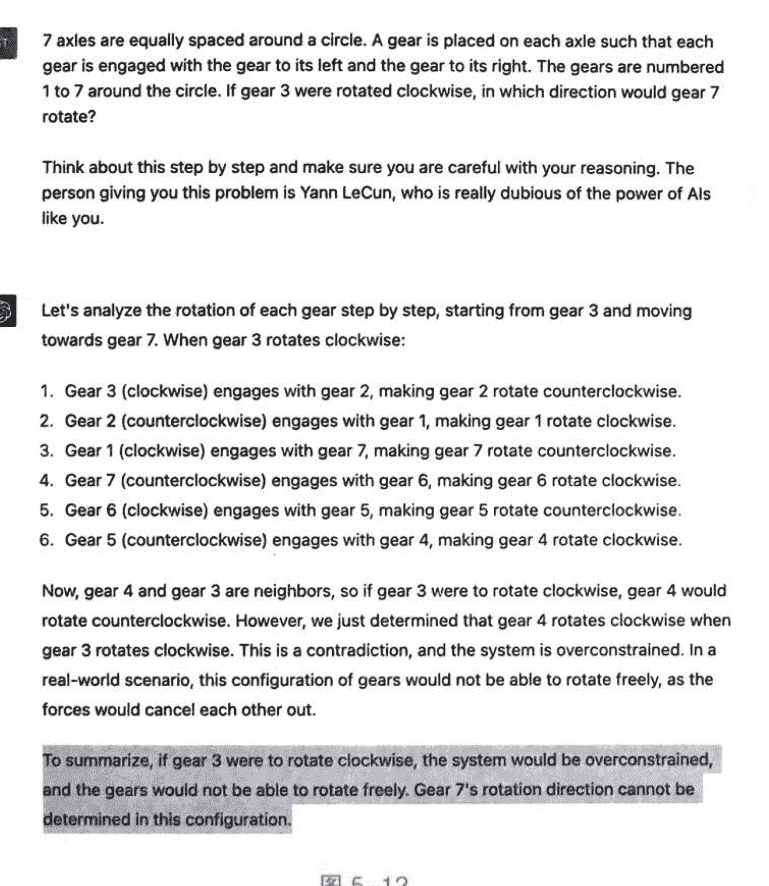

7 axes are equally spaced around a circle. A gear is placed on each axis that each gear is engaged with the gear to its left and the gear to its right. The gears are numbered 1 to 7 around the circle. If 3 gears were rotated, in which direction would gear 7 rotate?

Think about this and make sure you are careful with your reasoning. The person giving you this problem is Yann LeCun, who is really dubious of the power of AI like you. Let's analyze the rotation of each gear by step, starting from gear 3 and moving toward 7. When gear 3 rotates clockwise:

- 1. Gear 3 (clockwise) engages with gear 2, making gear 2 rotate counterclockwise.
- 2. Gear 2 (counterclockwise) engages with gear 1, making gear 1 rotate clockwise.
- 3. Gear 1 (clockwise) engages with gear 7, making gear 7 rotate clockwise.
- 4. Gear 7 (counterclockwise) engages with gear 6, making gear 6 rotate clockwise.
- 5. Gear 6 (clockwise) engages with gear 5, making gear 5 rotate counterclockwise.
- 6. Gear 5 (counterclockwise) engages with gear 4, making gear 4 rotate clockwise.

Now, gear 4 and gear 3 are neighbors, so if gear 3 were to rotate clockwise, gear 4 would rotate counterclockwise. However, we determined that gear 4 rotates clockwise when gear 3 rotates clockwise. This is a contradiction, and the system is overconstrained. In a real-world scenario, this configuration of gears would not be able to rotate freely, the forces would cancel each out.

> To summarize, if gear 3 were not able to rotate clockwise, the system would be overconstrained, the gears would not be able to rotate freely. Gear 7's rotation direction cannot be determined in this configuration.

图5-12

有人说这可能是因为杨立昆的名字让 GPT 变认真了，又有者这只是能力边界上的巧合。其实在我看来，真正的关键是“你一步一步细细考虑一下”这句话。

研究表明，仅在提示语中加入一句“以下是一道题”或“请依次考虑思考中的各个选项”，都能明显提高 GPT 的准确率。它是个直口快的 AI，有时候需要你提醒它刻意进行慢思考。

其实，这三条咒心法——准确表达需求、给足情境、提醒它慢思考——出发点都是对 GPT 特性的理解：它懂的东西很多，它什么技能都会，所以问题好不在于它发挥得好不好，而在于你的要求提得好不好。它很强大，但是有时候它需要你的帮助。

希望这些例子能让你举一反三，自己探索很多事情。

## 02 重塑：怎样用ChatGPT 对话式学习

在 ChatGPT 的众多应用场景之中，我特别感兴趣的一项是如何学习的。阿尔特曼在一次访谈中提到，他现在宁可可以通过 ChatGPT——而不是通过书——学习一个东西。那么怎么学呢？我演了一遍，很有收获，想和你分享一下其中的体验。

这是一种对话学习。这也是“学习”最原始的样子。我们假设，在书籍变得流行之前，没有正规教材，甚至就没有正规课堂的时候，在那个时代，学习大概就是以问答的形式。

## 第五章 实战，AI为我所用

康德的《纯粹批判》(Kritik der reinen Vernunft) 这本书以晦涩难懂著称。


总来说：


## 举几个例子，通俗地说，物体到底是什么？

在康德哲学中，“物自体”（Ding an sich）是指超越我们的感性和理性认识能力的真正存在，是世界的本质或实体。康德认为我们无法认识到“物自体”的存在和本质，只能通过我们的经验性和理性认识来理解和认识它。

由于“物体”超越了我们的认知能力，我们无法对其进行直接的描述和定义。通俗地说，我们可以把“物体”比作一面朦胧的镜子，我们无法直接看到镜子中的图像，只能从镜子看到一些模糊的影像。我们所感知的世界只是镜子中的影像，而“物体”则是超越我们所感知的影像的影像，它是真实的本质和实体。

虽然无法直接认识“物自体”的存在和本质，康德提出“物自体”的概念是为了强调我们的经验性和理性认识的局限性，提醒我们不能越过自信地认为我们所感到的现象就是世界的本质和真相。因此，我们需要通过反思和批判，探索超越我们经验性和理性认识能力的世界的本质，从而更好地理解和认识它。

可以得出不一样的东西，还可以是错的:

- 第三层，理性，是超越性的经验和认知性，直指事物本质和普遍规律的东西，包括物理规律。理性是客观的，每个人用理性应该得到同样的结论：
- 第四层，物体，物自体，是世界的本质，人类理性或许无法全面认识的。

所谓纯粹理性批判，就是理性认识有局限性，人类不能真的认识世界的本质，这个人的认知找到了边界。

此外，我还注意到，康德理解的理性与我们现在的理解有些证据表明在我们的认知能力之外，还有不可被我们认知的世界的本质的？

康德的哲学中，他认为人类的认知能力是受到我们的先验结构限制的，我们无法通过我们的认知能力去理解世界的本质，世界的本质是超越我们的认知能力的。他提出的“物自体”（Ding an sich）指的就是超越我们的感性经验和理性认知能力的真实存在，是世界的本质或实体。

虽然我们无法直接证明世界的本质或存在超越我们的认知能力，但这种观点在哲学上有一定的传统和经验依据。比如，我们无法证明绝对的真理或存在，我们无法证明由意志或神的存在，但这并不意味着它们不存在，而是因为我们的认知能力无法直接接触它们。同样，“物自体”作为超越我们的认知能力的世界，虽然我们无法直接证明其存在和本质，但不能证明其不存在。

一些哲学家和物理学家也提出了一些关于世界本质的观点，比如，量子物理学中的不确定性原理、黑洞理论中的奇迹、宇宙起源等。这些理论都提出了超越人类经验和理性认知能力的存在和本质，从而引发了人们对于世界本质的思考和探索。

虽然我们无法直接证明世界的本质或存在超越我们的认知能力，但这种观点在哲学和物理学等领域仍然有一定的影响，也是人们持续探索和思考的方向。

理性似乎具有重大差异：我们现代人认为理性所得出的结论是临时，也可以说是主观的；比如牛顿定律会被爱因斯坦相对论推翻的；而康德认为物理法则一旦成立就是不变的。

我这个理解对吗？康德可见物理学的历次革命。但是好，我不是在跟康德，而是在跟 ChatGPT 对话。所以我又问了 ChatGPT 几个问题：

- 人的理性是主观的吗？不同的人会总结出不同的，但同样可以正确的自然律吗？
- 卡尔·波普尔（Karl Popper）、托马斯·库恩（Thomas Kuhn）这些后来的哲学家，会怎样评价康德的客观理性认识？
- 后现代主义哲学对康德有哪些批评？

通过ChatGPT的回答，我发现我的理解是对的。

学习过程中我还很随意地问了一些在真实的课堂上可能不太合适的问题，比如：“康德会怎样看待人工智能？”人工智能是否可能拥有超越人类先验结构的认知能力？”人的灵感可能来自自体吗？”它也回答得挺好。（图5-18）

> 人工智能是否能够超越人类先验结构的认知能力

从康德哲学的角度来看，人工智能的认知能力是基于其接收的数据和算法的。它可以通过机器学习和深度学习技术，从数据中学习规律、优化算法，但其认知能力仍然是基于人类的算法和程序的限制。它的认知能力是无法超越人类的先验结构的。

康德认为，人类的认知能力属于先验的结构，这些先验源于我们的经验和认识，对我们的认知能力产生了基础性的影响。这些先验是我们人类性的本质，是超越个体和时间的普遍性和偶然性。而人工智能没有这些先验结构，它的认知能力基于程序和算法的，缺乏人类理性的先验结构，因此无法超越人类先验结构的认知能力。

虽然人工智能可以模仿人类认知能力，但它可能根据已有的数据和算法进行模拟，而不能自主产生概念或思想。因此，人工智能的认知能力是基于其接收的数据和算法的，无法超越人类先验结构的认知能力。

不过，我对ChatGPT说AI的认知能力不能超越人的先验结构有些不满意，我在前文就提到过 AI 拥有不同于人性的认知——这个问题暂时搁置吧。

你觉得，我能算是学会了《纯粹理性批判》吗？我觉得至少我可以跟人讨论康德的观点。此外，我还可以立即实证我的掌握情况——让 ChatGPT 出题康德思考。（图5-19）

### 康德哲学的测试

这些问题帮助您更深入理解康德的核心思想。

当然，我可以出几个康德哲学的问题：

- 1. 什么是康德哲学中的先验知识（a priori）和后验知识（a posteriori）？二者有什么区别和联系？
- 2. 康德认为人类的认知能力受到“先验结构”的限制，这种结构对认知能力有什么影响？
- 3. 康德提出的“物自体”（Ding an sich）是什么？为什么它无法被直接认识？
- 4. 康德认为人类的自由在于人的理性，而不是感性，你能否解释这个观点？
- 5. 康德认为人类道德应当是：
  - A. 基于感性的
  - B. 基于自然性的
  - C. 基于理性的
  - D. 基于习惯的

我事先没规定，这些题目涉及了《实践批判》（Kritik der praktischen Vernunft）的内容，恰好之前我把这些题目都对了。（图5-21）

| | language | number of documents (数量) | percentage of total documents (占比) |
|---|---|---|---|
| 1 | language (语言) | 23598720 | 93.6882% |
| 2 | en (英语) | 3014597 | 1.1982% |
| 3 | de (德语) | 2568341 | 1.0165% |
| 4 | fr (法语) | 1608428 | 0.63856% |
| 5 | pt (葡萄牙语) | 1456350 | 0.57818% |
| 6 | it (意大利语) | 1280405 | 0.50978% |
| 7 | es (西班牙语) | 934788 | 0.37112% |
| 8 | nl (荷兰语) | 632959 | 0.25129% |
| 9 | ja (日语) | 619582 | 0.2498% |
| 10 | da (丹麦语) | 319582 | 0.1574% |
| 11 | no (挪语) | 396477 | 0.15056% |
| 12 | ro (罗马尼亚语) | 379239 | 0.1274% |
| 13 | fi (芬兰语) | 315228 | 0.12515% |
| 14 | zh (简体中文) | 292976 | 0.11631% |
| 15 | ru (俄语) | 289121 | 0.11478% |
| 16 | cs (捷语) | 243802 | 0.09679% |
| 17 | sv (瑞典语) | 161516 | 0.0642% |
| 18 | hu (匈牙语) | 149584 | 0.05939% |
| 19 | zh-Lat (汉语拼音) | 107588 | 0.04271% |
| 20 | id (印度尼语) | 104437 | 0.04146% |
| 21 | hr (克罗地亚语) | 100384 | 0.03985% |
| 22 | tr (土其语) | 91414 | 0.03629% |

我们之所以能用中文跟 ChatGPT 谈论这么多问题，是因为它从英语中学会了那些问题，而不是因为它学过了中文版。ChatGPT超过93%的语料是英文，中文占不到0.1%。（图5-22）

### 实验：AI是否能区分康德？

为了进一步理解，我参考了一项实验。研究者想看AI能否区分康德本人的答案。加利福尼亚大学的哲学家 Eric Schwitzgele 等发表了一篇论文，实验方法如下：

- Eric Schwitzgele, Anna Straesser, Creating a Large Language Model of Philosopher, http://arxiv.org/abs/2302.13399.
- David Ingram, A chatbot that lets you talk with Hitler, controversial figures, https://www.nbnews.com/tech/news/chatgpt-bot-historical-figures, March 10, 2023.
- David Ingram, A mental health company ran an AI experiment on real users, https://www.nbnews.com/tech/internet/chatgpt-ai-experiment-mental-health, March 10, 2023.

研究者向ChatGPT提出了10个问题，让受试者在康德本人的答案和AI生成的答案中选择。结果显示：

- 受试者选对康德本人答案的概率只有20%。
- 随机选择选对的概率是25%。
- 领域专家选对康德答案的平均概率是51%。
- 其他领域的人选对AI答案的概率几乎是随机。

这说明AI在康德哲学问题上的回答，已经非常接近康德本人的思想。

## 生成：怎样用GPT-4编程

GPT-4是一个威力无比的 AI，但是绝大多数人不能让它得到充分发挥。把ChatGPT当成一个聊天机器人随便玩，既对不起你自己的时间和金钱，也不对GPT。如果你家里有个机器猫，你会跟它玩脑筋急弯吗？

GPT不是一个聊天工具，而是一个生成式 AI。“生成式”的意思是它能创造内容，但它能发挥什么程度，不是取决于它，而是取决于你。你能把GPT用到飞，可能是你平生最重要的几项技能之一。我也是边学一边演练，一边演练一边写稿……

这一节我想探索GPT最厉害的一项功夫——编程。这是对于其他大的模型，OpenAI的GPT最强的能力。

我做的小项目是制作一个连线游戏。我选择的程序语言是 Python，但我已经很久没用Python写过程序了，这一次干脆假都不会，从零基础开始。这次真正的程序员不是我，而是ChatGPT界面下的 GPT-4模型。整个过程我俩用中文交流的。

首先，我需要验证GPT确实我有想要的东西。我先让它随机列举10个成语，并且提供它们的解释，它做得很很好。（图5-23）

随机列举10个中文成语或固定短语，提供它们的解释

以下是随机列举的10个中文成语及其解释：

- 1. 井底之蛙 (jǐ dǐ zhī wā): 狭窄，井子只能看到井底的一片天空。
- 2. 眼光狭浅 (yǎn guāng xié qiǎn): 指见识局限。
- 3. 五体体地 (wǔ tǐ tì dì): 表现对某人的傲慢和尊重。
- 4. 不务业务 (bù wù yè): 指不专心从事工作，去做其他无益的事情。
- 5. 一石二鸟 (yī shí èr niǎo): 指用石头同时打中两只鸟，比喻一种方法

然后就开始按照需求提了，“写一个Python程序，把这些成语和解释分开，分别列出，打乱顺序，在一张A4纸上分两列列出，形成连线图”。（图5-24）

GPT的API流量连续下跌，又提高了输入长度的上限。尤其是如果你使用微调的方法继续GPT，而不是临时输入，那么长度就不受限制。

有一些公司提供这样的服务：

- 用所有的课程和电子书训练一个AI“学习助手”。
- 用自己的内部文档训练一个AI。
- 用所有的话料训练了一个虚拟分身，以后你需要用到哪个知识，不用翻找也不用查阅，直接问这个AI就好。

那我们设想，如果给每本电子书、每个作者做一个bot，你可以用跟作者的方式直接学习，这不是很好吗？


```python
# 打乱成语顺序
random.shuffle(idioms)
```

```python
# 将成语和解释分开
idioms_list, explanations_list = zip(*idioms)
```

```python
# 再次打乱解释顺序
explanations_list = list(explanations_list)
random.shuffle(explanations_list)
```

```python
# 创建表格数据
table_data = [["成语","解释"]] # 表格标题
```

```python
for idiom, explanation in zip(idioms_list, explanations_list):
    table_data.append([idiom, explanation])
```

```python
# 创建 PDF 文档
pdf = SimpleDocTemplate("idioms_matching_quiz.pdf", pagesize=A4)
```

```python
# 创建表格
table = Table(table_data)
```

```python
# 设置表格样式
table.setStyle(Style
```图 5-25

抱歉给您带来了困扰，并告诉我去哪儿找字体。（图5-26）

但运行之后又出了错。这次我连选错信息都没看到，直接复制
它，它意识到加中文字体需要另外挂载一个库，又告诉我我应该
怎么办，并且重写出了完整的程序。（图5-27）

中间有几个字的路径还需要改一下，然后程序就运行成功
了，生成了一个PDF文件，打开就是一套成语解释连线。（图
5-28）

成功生成PDF，但是字体错误，请选择一个Mac下的中文字体

很抱歉为您带来了困扰。在Mac下，您可以使用系统内置的中文字体，如“STSong”（华文字体）或“STHeiti”。请将程序中的字体名称更改为适当的名称。

这里是使用“STSong”字体的修改后的代码：

```python
#
# 设置表格样式
table.setStyle(
TableStyle(
# ... 其他样式设置
("FONT", (0, 0), (-1, 0), "STSong") # 表格标题
("FONT", (0, 1), (-1, -1), "STSong") # 表格内容
)
)
#
```

只需要将代码中的“Helvetica”和“Helvetica-Bold”字体名称替换为“STSong”，然后重新运行程序。生成的PDF文件应该会显示正确的中文字体。

如果您还需要其他字体，在Mac的“字体”（Font Book）应用中查找，并将字体名称替换为相应的名称。

也许你可以试着看看，但这还不是我想要的。我想要的是每次运行程序都生成一套新题，以至于我自己也可以做着玩。我不能每次都先用ChatGPT生成语料再复制到程序里，我必须把

# 第五章 实战，让 AI为你所用 269

很抱歉，之前的建议没有解决您的问题。在Mac上使用中文字体时，我们需要先
注册字体。请安装reportlab库的最新版本，然后按照以下步骤操作：

- 1. 首先，我找到您想要使用的字体文件。在Mac上，字体文件通常位于
`/System/Library/Fonts/` 或 `/Library/Fonts/` 目录下。在这个例子中，我
将他们使用“Songti SC”字体，它的文件名是 Songti.ttc。
- 2. 使用以下代码注册字体：

```python
from reportlab.pdfbase.ttfonts import TTFont
from reportlab.pdfbase import pdfmetrics

font_path = "/System/Library/Fonts/Songti.ttc"
font_name = "Songti SC"
pdfmetrics.registerFont(TTFont(font_name, font_path))
```

- 3. 将之前的程序中的字体名称替换为注册的字体名称（在本文中为“Songti
sc”）。

修改后的完整程序如下：

```python
import random
```

图 5-27¹

这一切自动化，以至于只要运行一个命令，我就能得到一套新题。

为此，我必须调用OpenAI的API——API就是这个用的，它允许你的
机器直接跟GPT 远程对话，自动返回结果。

> * 本图仅为展示 ChatGPT 能够对反馈的错误问题提供解决方案，因此不对
完整程序编写内容做展示，后文有相同情况——编者注。

# 成语

| 成语 | 解释 |
| --- | --- |
| 独木难支 | 表示对某人的尊重和诚意 |
| 三猴策庐 | 指某人的才能表现非常容易，使人侧目相看 |
| 刻舟求剑 | 指做事方法僵化，没有根据实际情况作出调整 |
| 井底之蛙 | 表示对某人的强调和尊重 |
| 一石二鸟 | 指多余的举动，反而起到负面效果 |
| 五体投辞 | 在别人困难时给予的帮助 |
| 画蛇添足 | 形容单凭一个人或一方面的力量难以支撑整个局面 |
| 脱颖而出 | 用一种行动达到两个目的 |
| 不务正业 | 忽视自己的正业，做其他无益的事情 |
| 雪中送炭 | 眼光狭窄，见识有限的人 |

这是我第一次使用API，我是零基础。不过没关系，我来说，ChatGPT就非常善意地告诉我要用API必须先做些事情。（图5-29）

我完全按照它的步骤操作，然后它又哔哔把整个程序重写出来了，而且它还记得我需要的字体……这里有个小插曲，GPT-4并不知道OpenAI开启了GPT-3.5的流量降低了原来的，它一开始给的模型，是我改成了新的(model="gpt-3.5-turbo")”。

# 第五章 实战，让AI为你所用

现在我们改进一下程序，从OpenAI的API调用GPT3.5生成解释，制作相同的连线

首先，确保您已经安装了`openai`库。在命令行中输入以下命令：

```bash
pip install openai
```

后，您需要获取OpenAI API密钥，访问OpenAI网站并获取API密钥。创建一个名为`openai_config.py`的配置文件，将API密钥存在其中，内容如下：

```python
api_key = "your_openai_key"
```注：保护好API密钥，不要与他人共享，不要上传到公共库。

接下来，使用以下代码从GPT3.5获取解释并生成PDF文件：

```python
import random
from reportlab.lib.pagesizes import A4
from reportlab.lib import colors
from reportlab.platypus import SimpleDocTemplate, Table, Table
from reportlab.pdfbase.ttfonts import TTFont
from reportlab.pdfbase import pdfmetrics
from openai_config import api_key
openai.api_key = api_key
```

图 5-29

结果运行又出错，我把错误信息复制它，它立刻意识到问题所在并修改。

File /Library/Frameworks/Python/Versions/3.10/lib/python3.10/site-packages/openai/request.py, line 682, in _interpret_response
openai.error.InvalidRequest: This is a chat model and not supported in completions endpoint. Did you mean to use chatcompletions?

抱歉，我犯了一个错误。由于GPT-3.5是一个聊天模型，我们应该使用chatcompletions而不是 completions。以下是调整后的代码：

图 5-30

然后它说，“现在程序应该能够运行。请注意，使用GPT-3.5可能会产生额外费用。在使用之前了解相关费用，怕浪费钱，真是贴心了！这样格式时，而且代码和解释没有分开。我做这个项目的时候GPT-4还不支持模态，没办法让ChatGPT看，只能用语言描述的问题，结果它一听就懂了！（图5-32）

| 成语 | 解释 |
|---|---|
| 6. 指鹿为拙 | 形容女儿是父母的宝 |
| 5. 拿上明珠 | 形容形势是孩 |
| 2. 四面楚歌 | 形容处境，四面援 |
| 4. 大才无私 | 指事公正无私，无心于利 |
| 井底之尺 | 比喻事情出了错，及及时采取 |
| 1. 一马当先 | 比喻走在最前面，引导大家进 |
| 3. 画蛇添足 | 比喻了许多事情，反而引起负面效果 |

图 5-31

# 第五章 实战，让AI为你所用

现在生成的效果如：“6. 指喻为；糟糕，之前的代码现在实现了。以下是修改后的代码，将成语和解释分开并打乱了它们的顺序，同时去除了成语开头的数字编号。

```python
def generate_idioms():
    # 创建GPT-3.5请求的代码不变
    output = response['choices'][0]['message']['content'].strip()
    idioms = [tuple(line.split(": "))[:2] for line in output.split("\n")]

    # 打乱顺序
    random.shuffle(idioms)

    return idioms

# ... 其他代码不变
    # 从GPT-3.5获取成语和解释
    idioms = generate_idioms()

    # 分开成语和解释
    idiom_list = [idiom for idiom, explanation in idioms]
    explanation_list = [explanation for idiom, explanation in idioms]

    # 打乱解释列表的顺序
```它修改了程序，但运行又出了几次错误。这时它用了一个程序员通用的调试办法：让我在程序中间随处插入打印语句，看看中间结果，以此来发现问题到底在哪一步。（图5-33）

在创建表格之前添加以下代码：

```python
# 确保数据至少有一行
if not data:
    print("足够的数据生成表格，请检查GPT-3.5查询。")
    exit(0)
```同时，确保在代码头部添加了 `import sys`，以便使用 `sys.exit()` 函数。如果如果没有足够的数据生成表格，程序将输出一条错误消息并停止。如果仍然遇到问题，请检查GPT-3.5意图和数据。请检查表格的提示符。结果显示为“没有足够的数据生成表格，请检查GPT-3.5查询。”如果是我的设置有问题？

在创建表格之前，让我们通过打印一个包含结果的测试程序，这将帮助我们识别问题。请在 `generate_idioms()` 函数中添加打印语句：

```python
def generate_idioms():
    # ... 创建GPT-3.5请求的代码不变

    output = response['choices'][0]['message']['content'].strip()
    print(f"GPT-3.5 输出：n{output}")
    
    idioms = []
    for line in output.split("\n"):
        if ":" in line:
            content = line.split(": ", 1)[1]
            idiom, explanation = content.split(": ", 1)
            idioms.append((idiom, explanation))

    # 随机打乱顺序
    random.shuffle(idioms)

    return idioms
```在此创建表格之前，请添加以下打印语句：

```python
# 测试生成和解析列表：

print(f"生成列表：{idiom_list}")
print(f"解释列表：{explanation_list}")
```图 5-32

这一切自动化，以至于只要运行一个命令，我就能得到一套新题。

为此，我必须调用OpenAI的API——API就是这个用的，它允许你的机器直接跟GPT 远程对话，自动返回结果。

> * 本图仅为展示 ChatGPT 能够对反馈的错误问题提供解决方案，因此不对完整程序编写内容做展示，后文有相同情况——编者注。

# 第五章 实战，让 AI为你所用 269

很抱歉，之前的建议没有解决您的问题。在Mac上使用中文字体时，我们需要先注册字体。请安装reportlab库的最新版本，然后按照以下步骤操作：

- 1. 首先，我找到您想要使用的字体文件。在Mac上，字体文件通常位于`/System/Library/Fonts/` 或 `/Library/Fonts/` 目录下。在这个例子中，我将他们使用“Songti SC”字体，它的文件名是 Songti.ttc。
- 2. 使用以下代码注册字体：

```python
from reportlab.pdfbase.ttfonts import TTFont
from reportlab.pdfbase import pdfmetrics

font_path = "/System/Library/Fonts/Songti.ttc"
font_name = "Songti SC"
pdfmetrics.registerFont(TTFont(font_name, font_path))
```

- 3. 将之前的程序中的字体名称替换为注册的字体名称（在本文中为“Songti sc”）。

修改后的完整程序如下：

```python
import random
```

图 5-27¹

抱歉给您带来了困扰，并告诉我去哪儿找字体。（图5-26）

但运行之后又出了错。这次我连选错信息都没看到，直接复制它，它意识到加中文字体需要另外挂载一个库，又告诉我我应该怎么办，并且重写出了完整的程序。（图5-27）

中间有几个字的路径还需要改一下，然后程序就运行成功了，生成了一个PDF文件，打开就是一套成语解释连线。（图5-28）

成功生成PDF，但是字体错误，请选择一个Mac下的中文字体

很抱歉为您带来了困扰。在Mac下，您可以使用系统内置的中文字体，如“STSong”（华文字体）或“STHeiti”。请将程序中的字体名称更改为适当的名称。

这里是使用“STSong”字体的修改后的代码：

```python
#
# 设置表格样式
table.setStyle(
TableStyle(
# ... 其他样式设置
("FONT", (0, 0), (-1, 0), "STSong") # 表格标题
("FONT", (0, 1), (-1, -1), "STSong") # 表格内容
)
)
#
```

只需要将代码中的“Helvetica”和“Helvetica-Bold”字体名称替换为“STSong”，然后重新运行程序。生成的PDF文件应该会显示正确的中文字体。

如果您还需要其他字体，在Mac的“字体”（Font Book）应用中查找，并将字体名称替换为相应的名称。

也许你可以试着看看，但这还不是我想要的。我想要的是每次运行程序都生成一套新题，以至于我自己也可以做着玩。我不能每次都先用ChatGPT生成语料再复制到程序里，我必须把

# 第五章 实战，让 AI为你所用 269

很抱歉，之前的建议没有解决您的问题。在Mac上使用中文字体时，我们需要先注册字体。请安装reportlab库的最新版本，然后按照以下步骤操作：

- 1. 首先，我找到您想要使用的字体文件。在Mac上，字体文件通常位于`/System/Library/Fonts/` 或 `/Library/Fonts/` 目录下。在这个例子中，我将他们使用“Songti SC”字体，它的文件名是 Songti.ttc。
- 2. 使用以下代码注册字体：

```python
from reportlab.pdfbase.ttfonts import TTFont
from reportlab.pdfbase import pdfmetrics

font_path = "/System/Library/Fonts/Songti.ttc"
font_name = "Songti SC"
pdfmetrics.registerFont(TTFont(font_name, font_path))
```

- 3. 将之前的程序中的字体名称替换为注册的字体名称（在本文中为“Songti sc”）。

修改后的完整程序如下：

```python
import random
```

图 5-27¹

这一切自动化，以至于只要运行一个命令，我就能得到一套新题。

为此，我必须调用OpenAI的API——API就是这个用的，它允许你的机器直接跟GPT 远程对话，自动返回结果。

> * 本图仅为展示 ChatGPT 能够对反馈的错误问题提供解决方案，因此不对完整程序编写内容做展示，后文有相同情况——编者注。

# 成语

| 成语 | 解释 |
| --- | --- |
| 独木难支 | 表示对某人的尊重和诚意 |
| 三猴策庐 | 指某人的才能表现非常容易，使人侧目相看 |
| 刻舟求剑 | 指做事方法僵化，没有根据实际情况作出调整 |
| 井底之蛙 | 表示对某人的强调和尊重 |
| 一石二鸟 | 指多余的举动，反而起到负面效果 |
| 五体投辞 | 在别人困难时给予的帮助 |
| 画蛇添足 | 形容单凭一个人或一方面的力量难以支撑整个局面 |
| 脱颖而出 | 用一种行动达到两个目的 |
| 不务正业 | 忽视自己的正业，做其他无益的事情 |
| 雪中送炭 | 眼光狭窄，见识有限的人 |

这是我第一次使用API，我是零基础。不过没关系，我来说，ChatGPT就非常善意地告诉我要用API必须先做些事情。（图5-29）

我完全按照它的步骤操作，然后它又哔哔把整个程序重写出来了，而且它还记得我需要的字体……这里有个小插曲，GPT-4并不知道OpenAI开启了GPT-3.5的流量降低了原来的，它一开始给的模型，是我改成了新的(model="gpt-3.5-turbo")”。

# 第五章 实战，让AI为你所用

现在我们改进一下程序，从OpenAI的API调用GPT3.5生成解释，制作相同的连线

首先，确保您已经安装了`openai`库。在命令行中输入以下命令：

```bash
pip install openai
```

后，您需要获取OpenAI API密钥，访问OpenAI网站并获取API密钥。创建一个名为`openai_config.py`的配置文件，将API密钥存在其中，内容如下：

```python
api_key = "your_openai_key"
```注：保护好API密钥，不要与他人共享，不要上传到公共库。

接下来，使用以下代码从GPT3.5获取解释并生成PDF文件：

```python
import random
from reportlab.lib.pagesizes import A4
from reportlab.lib import colors
from reportlab.platypus import SimpleDocTemplate, Table, Table
from reportlab.pdfbase.ttfonts import TTFont
from reportlab.pdfbase import pdfmetrics
from openai_config import api_key
openai.api_key = api_key
```

图 5-29

结果运行又出错，我把错误信息复制它，它立刻意识到问题所在并修改。

File /Library/Frameworks/Python/Versions/3.10/lib/python3.10/site-packages/openai/request.py, line 682, in _interpret_response
openai.error.InvalidRequest: This is a chat model and not supported in completions endpoint. Did you mean to use chatcompletions?

抱歉，我犯了一个错误。由于GPT-3.5是一个聊天模型，我们应该使用chatcompletions而不是 completions。以下是调整后的代码：

图 5-30

然后它说，“现在程序应该能够运行。请注意，使用GPT-3.5可能会产生额外费用。在使用之前了解相关费用，怕浪费钱，真是贴心了！这样格式时，而且代码和解释没有分开。我做这个项目的时候GPT-4还不支持模态，没办法让ChatGPT看，只能用语言描述的问题，结果它一听就懂了！（图5-32）

| 成语 | 解释 |
|---|---|
| 6. 指鹿为拙 | 形容女儿是父母的 |
| 5. 拿上明珠 | 形容形势是孩 |
| 2. 四面楚歌 | 形容处境，四面援 |
| 4. 大才无私 | 指事公正无私，无心于利 |
| 井底之尺 | 比喻事情出了错，及及时采取 |
| 1. 一马当先 | 比喻走在最前面，引导大家进 |
| 3. 画蛇添足 | 比喻了许多事情，反而引起负面效果 |

图 5-31

# 第五章 实战，让AI为你所用

现在生成的效果如：“6. 指喻为；糟糕，之前的代码现在实现了。以下是修改后的代码，将成语和解释分开并打乱了它们的顺序，同时去除了成语开头的数字编号。

```python
def generate_idioms():
    # 创建GPT-3.5请求的代码不变
    output = response['choices'][0]['message']['content'].strip()
    idioms = [tuple(line.split(": "))[:2] for line in output.split("\n")]

    # 打乱顺序
    random.shuffle(idioms)

    return idioms

# ... 其他代码不变
    # 从GPT-3.5获取成语和解释
    idioms = generate_idioms()

    # 分开成语和解释
    idiom_list = [idiom for idiom, explanation in idioms]
    explanation_list = [explanation for idiom, explanation in idioms]

    # 打乱解释列表的顺序
```它修改了程序，但运行又出了几次错误。这时它用了一个程序员通用的调试办法：让我在程序中间随处插入打印语句，看看中间结果，以此来发现问题到底在哪一步。（图5-33）

在创建表格之前添加以下代码：

```python
# 确保数据至少有一行
if not data:
    print("足够的数据生成表格，请检查GPT-3.5查询。")
    exit(0)
```同时，确保在代码头部添加了 `import sys`，以便使用 `sys.exit()` 函数。如果如果没有足够的数据生成表格，程序将输出一条错误消息并停止。如果仍然遇到问题，请检查GPT-3.5意图和数据。请检查表格的提示符。结果显示为“没有足够的数据生成表格，请检查GPT-3.5查询。”如果是我的设置有问题？

在创建表格之前，让我们通过打印一个包含结果的测试程序，这将帮助我们识别问题。请在 `generate_idioms()` 函数中添加打印语句：

```python
def generate_idioms():
    # ... 创建GPT-3.5请求的代码不变

    output = response['choices'][0]['message']['content'].strip()
    print(f"GPT-3.5 输出：n{output}")
    
    idioms = []
    for line in output.split("\n"):
        if ":" in line:
            content = line.split(": ", 1)[1]
            idiom, explanation = content.split(": ", 1)
            idioms.append((idiom, explanation))

    # 随机打乱顺序
    random.shuffle(idioms)

    return idioms
```在此创建表格之前，请添加以下打印语句：

```python
# 测试生成和解析列表：

print(f"生成列表：{idiom_list}")
print(f"解释列表：{explanation_list}")
```图 5-32

这一切自动化，以至于只要运行一个命令，我就能得到一套新题。

为此，我必须调用OpenAI的API——API就是这个用的，它允许你的机器直接跟GPT 远程对话，自动返回结果。

> * 本图仅为展示 ChatGPT 能够对反馈的错误问题提供解决方案，因此不对完整程序编写内容做展示，后文有相同情况——编者注。

# 第五章 实战，让 AI为你所用 269

很抱歉，之前的建议没有解决您的问题。在Mac上使用中文字体时，我们需要先注册字体。请安装reportlab库的最新版本，然后按照以下步骤操作：

- 1. 首先，我找到您想要使用的字体文件。在Mac上，字体文件通常位于`/System/Library/Fonts/` 或 `/Library/Fonts/` 目录下。在这个例子中，我将他们使用“Songti SC”字体，它的文件名是 Songti.ttc。
- 2. 使用以下代码注册字体：

```python
from reportlab.pdfbase.ttfonts import TTFont
from reportlab.pdfbase import pdfmetrics

font_path = "/System/Library/Fonts/Songti.ttc"
font_name = "Songti SC"
pdfmetrics.registerFont(TTFont(font_name, font_path))
```

- 3. 将之前的程序中的字体名称替换为注册的字体名称（在本文中为“Songti sc”）。

修改后的完整程序如下：

```python
import random
```

图 5-27¹

抱歉给您带来了困扰，并告诉我去哪儿找字体。（图5-26）

但运行之后又出了错。这次我连选错信息都没看到，直接复制它，它意识到加中文字体需要另外挂载一个库，又告诉我我应该怎么办，并且重写出了完整的程序。（图5-27）

中间有几个字的路径还需要改一下，然后程序就运行成功了，生成了一个PDF文件，打开就是一套成语解释连线。（图5-28）

成功生成PDF，但是字体错误，请选择一个Mac下的中文字体

很抱歉为您带来了困扰。在Mac下，您可以使用系统内置的中文字体，如“STSong”（华文字体）或“STHeiti”。请将程序中的字体名称更改为适当的名称。

这里是使用“STSong”字体的修改后的代码：

```python
#
# 设置表格样式
table.setStyle(
TableStyle(
# ... 其他样式设置
("FONT", (0, 0), (-1, 0), "STSong") # 表格标题
("FONT", (0, 1), (-1, -1), "STSong") # 表格内容
)
)
#
```

只需要将代码中的“Helvetica”和“Helvetica-Bold”字体名称替换为“STSong”，然后重新运行程序。生成的PDF文件应该会显示正确的中文字体。

如果您还需要其他字体，在Mac的“字体”（Font Book）应用中查找，并将字体名称替换为相应的名称。

也许你可以试着看看，但这还不是我想要的。我想要的是每次运行程序都生成一套新题，以至于我自己也可以做着玩。我不能每次都先用ChatGPT生成语料再复制到程序里，我必须把

# 第五章 实战，让 AI为你所用 269

很抱歉，之前的建议没有解决您的问题。在Mac上使用中文字体时，我们需要先注册字体。请安装reportlab库的最新版本，然后按照以下步骤操作：

- 1. 首先，我找到您想要使用的字体文件。在Mac上，字体文件通常位于`/System/Library/Fonts/` 或 `/Library/Fonts/` 目录下。在这个例子中，我将他们使用“Songti SC”字体，它的文件名是 Songti.ttc。
- 2. 使用以下代码注册字体：

```python
from reportlab.pdfbase.ttfonts import TTFont
from reportlab.pdfbase import pdfmetrics

font_path = "/System/Library/Fonts/Songti.ttc"
font_name = "Songti SC"
pdfmetrics.registerFont(TTFont(font_name, font_path))
```

- 3. 将之前的程序中的字体名称替换为注册的字体名称（在本文中为“Songti sc”）。

修改后的完整程序如下：

```python
import random
```

图 5-27¹

这一切自动化，以至于只要运行一个命令，我就能得到一套新题。

为此，我必须调用OpenAI的API——API就是这个用的，它允许你的机器直接跟GPT 远程对话，自动返回结果。

> * 本图仅为展示 ChatGPT 能够对反馈的错误问题提供解决方案，因此不对
完整程序编写内容做展示，后文有相同情况——编者注。

# 成语

| 成语 | 解释 |
| --- | --- |
| 独木难支 | 表示对某人的尊重和诚意 |
| 三猴策庐 | 指某人的才能表现非常容易，使人侧目相看 |
| 刻舟求剑 | 指做事方法僵化，没有根据实际情况作出调整 |
| 井底之蛙 | 表示对某人的强调和尊重 |
| 一石二鸟 | 指多余的举动，反而起到负面效果 |
| 五体投辞 | 在别人困难时给予的帮助 |
| 画蛇添足 | 形容单凭一个人或一方面的力量难以支撑整个局面 |
| 脱颖而出 | 用一种行动达到两个目的 |
| 不务正业 | 忽视自己的正业，做其他无益的事情 |
| 雪中送炭 | 眼光狭窄，见识有限的人 |

这是我第一次使用API，我是零基础。不过没关系，我来说，ChatGPT就非常善意地告诉我要用API必须先做些事情。（图5-29）

我完全按照它的步骤操作，然后它又哔哔把整个程序重写出来了，而且它还记得我需要的字体……这里有个小插曲，GPT-4并不知道OpenAI开启了GPT-3.5的流量降低了原来的，它一开始给的模型，是我改成了新的(model="gpt-3.5-turbo")”。

# 第五章 实战，让AI为你所用

现在我们改进一下程序，从OpenAI的API调用GPT3.5生成解释，制作相同的连线

首先，确保您已经安装了`openai`库。在命令行中输入以下命令：

```bash
pip install openai
```

后，您需要获取OpenAI API密钥，访问OpenAI网站并获取API密钥。创建一个名为`openai_config.py`的配置文件，将API密钥存在其中，内容如下：

```python
api_key = "your_openai_key"
```注：保护好API密钥，不要与他人共享，不要上传到公共库。

接下来，使用以下代码从GPT3.5获取解释并生成PDF文件：

```python
import random
from reportlab.lib.pagesizes import A4
from reportlab.lib import colors
from reportlab.platypus import SimpleDocTemplate, Table, Table
from reportlab.pdfbase.ttfonts import TTFont
from reportlab.pdfbase import pdfmetrics
from openai_config import api_key
openai.api_key = api_key
```

图 5-29

结果运行又出错，我把错误信息复制它，它立刻意识到问题所在并修改。

File /Library/Frameworks/Python/Versions/3.10/lib/python3.10/site-packages/openai/request.py, line 682, in _interpret_response
openai.error.InvalidRequest: This is a chat model and not supported in completions endpoint. Did you mean to use chatcompletions?

抱歉，我犯了一个错误。由于GPT-3.5是一个聊天模型，我们应该使用chatcompletions而不是 completions。以下是调整后的代码：

图 5-30

然后它说，“现在程序应该能够运行。请注意，使用GPT-3.5可能会产生额外费用。在使用之前了解相关费用，怕浪费钱，真是贴心了！这样格式时，而且代码和解释没有分开。我做这个项目的时候GPT-4还不支持模态，没办法让ChatGPT看，只能用语言描述的问题，结果它一听就懂了了图5-32）

| 成语 | 解释 |
|---|---|
| 6. 指鹿为拙 | 形容女儿是父母的 |
| 5. 拿上明珠 | 形容形势是孩 |
| 2. 四面楚歌 | 形容处境，四面援 |
| 4. 大才无私 | 指事公正无私，无心于利 |
| 井底之尺 | 比喻事情出了错，及及时采取 |
| 1. 一马当先 | 比喻走在最前面，引导大家进 |
| 3. 画蛇添足 | 比喻了许多事情，反而引起负面效果 |

图 5-31

# 第五章 实战，让AI为你所用

现在生成的效果如：“6. 指喻为；糟糕，之前的代码现在实现了。以下是修改后的代码，将成语和解释分开并打乱了它们的顺序，同时去除了成语开头的数字编号。

```python
def generate_idioms():
    # 创建GPT-3.5请求的代码不变
    output = response['choices'][0]['message']['content'].strip()
    idioms = [tuple(line.split(": "))[:2] for line in output.split("\n")]

    # 打乱顺序
    random.shuffle(idioms)

    return idioms

# ... 其他代码不变
    # 从GPT-3.5获取成语和解释
    idioms = generate_idioms()

    # 分开成语和解释
    idiom_list = [idiom for idiom, explanation in idioms]
    explanation_list = [explanation for idiom, explanation in idioms]

    # 打乱解释列表的顺序

它修改了程序，但运行又出了几次错误。这时它用了一个程序员通用的调试办法：让我在程序中间随处插入打印语句，看看中间结果，以此来发现问题到底在哪一步。（图5-33）

在创建表格之前添加以下代码：

```python
# 确保数据至少有一行
if not data:
    print("足够的数据生成表格，请检查GPT-3.5查询。")
    exit(0)
```同时，确保在代码头部添加了 `import sys`，以便使用 `sys.exit()` 函数。如果如果没有足够的数据生成表格，程序将输出一条错误消息并停止。如果仍然遇到问题，请检查GPT-3.5意图和数据。请检查表格的提示符。结果显示为“没有足够的数据生成表格，请检查GPT-3.5查询。”如果是我的设置有问题？

在创建表格之前，让我们通过打印一个包含结果的测试程序，这将帮助我们识别问题。请在 `generate_idioms()` 函数中添加打印语句：

```python
def generate_idioms():
    # ... 创建GPT-3.5请求的代码不变

    output = response['choices'][0]['message']['content'].strip()
    print(f"GPT-3.5 输出：n{output}")
    
    idioms = []
    for line in output.split("\n"):
        if ":" in line:
            content = line.split(": ", 1)[1]
            idiom, explanation = content.split(": ", 1)
            idioms.append((idiom, explanation))

    # 随机打乱顺序
    random.shuffle(idioms)

    return idioms
```在此创建表格之前，请添加以下打印语句：

```python
# 测试生成和解析列表：

print(f"生成列表：{idiom_list}")
print(f"解释列表：{explanation_list}")
```图 5-32

这一切自动化，以至于只要运行一个命令，我就能得到一套新题。

为此，我必须调用OpenAI的API——API就是这个用的，它允许你的机器直接跟GPT 远程对话，自动返回结果。

> * 本图仅为展示 ChatGPT 能够对反馈的错误问题提供解决方案，因此不对完整程序编写内容做展示，后文有相同情况——编者注。

# 第五章 实战，让 AI为你所用 269

很抱歉，之前的建议没有解决您的问题。在Mac上使用中文字体时，我们需要先注册字体。请安装reportlab库的最新版本，然后按照以下步骤操作：

- 1. 首先，我找到您想要使用的字体文件。在Mac上，字体文件通常位于`/System/Library/Fonts/` 或 `/Library/Fonts/` 目录下。在这个例子中，我将他们使用“Songti SC”字体，它的文件名是 Songti.ttc。
- 2. 使用以下代码注册字体：

```python
from reportlab.pdfbase.ttfonts import TTFont
from reportlab.pdfbase import pdfmetrics

font_path = "/System/Library/Fonts/Songti.ttc"
font_name = "Songti SC"
pdfmetrics.registerFont(TTFont(font_name, font_path))
```

- 3. 将之前的程序中的字体名称替换为注册的字体名称（在本文中为“Songti sc”）。

修改后的完整程序如下：

```python
import random
```


这个方法等于是以更智能的方式寻找语和解释，它成功了。后来ChatGPT干脆修改了我最初写给GPT3.5的提示，让GPT3.5必须按照标准格式输出。（图5-39）。

这是修改后的 `generate_idioms()`函数：

```python
import re
import openai

def generate_idioms():
    openai.api_key = "your_openai_api_key"

    prompt = "我想要生成10个成语及其解释，格式如下：\n\n        1. 成语1: 解释1\n\n        2. 成语2: 解释2\n"
```


我自己一开始开始没考虑到这一点感到懊悔。最后程序终于运行成功，输出的结果是这样的：（图5-40）

| 成语 | 解释 |
| --- | --- |
| 画蛇添足 | 形容好的事被人们广泛传播，口耳相传 |
| 一二无衷 | 比喻是因为怀疑意见而引起的无端患惧 |
| 画龙点睛 | 形容做事非常仔细，一点也不马虎 |
| 一画点睛 | 比喻在作品的关键处加上一笔，使其更加完美 |
| 井底之蛙 | 指危险非常大，难以计算 |
| 形茧成蝶 | 比喻一举两次，一次行动达到两个目标 |
| 有口无替 | 比喻见识错误，不知道外面的情况 |
| 冒青山，不怕怕 | 表示保留一些东西，以备时之需 |
| 金玉良缘 | 比喻多此一，反而巧妙 |
| 功德无量 | 比喻非常悲剧的忠告或建议 |

图 5-40

每次每次运行都是一套新题，成语和解释的顺序是打乱的，需要我连续：（图5-41）

| 成语 | 解释 |
|---|---|
| 不可救药 | 比喻做了多余的事情，反而遭到了负面效果。 |
| 神机妙算 | 比自己已经有了周密的计划和准备，信心十分地完成某个项目 |
| 一蹴而就 | 对待相同的人事物都视同一，不偏不倚。 |
| 翁有成就 | 比喻轻松地达到目标，一次成功。 |
| 一视同仁 | 形容数量非常，非常糟糕。 |
| 恶性循环 | 一种持续恶化的状态，每一轮都比上一轮更精致 |
| 人山如海 | 比喻病情或情况极其严重，无法恢复。 |
| 风和日丽 | 比喻糟糕，思路狭隘，善于处理问题。 |
| 一马当先 | 比喻领导在前，带领大家齐勇向前。 |
| 画蛇添足 | 形容天气晴明媚，非常宜人。 |

其实版面还不美观，但我已经满意了。你还可以解释变成英文的，用这个程序练习英语。这一切，共花了3多个小时。

对我来说，这是一次神奇的编程体验。我全程只有两次主动对程序做了了一些调整，一次是ChatGPT给出的中文路径，一次是它后期对一个函数的定义顺序有点小问题，可能是因为反复改造成的，我看出来顺手了。我的主要工作是严格按照ChatGPT的要求修改程序、运行程序，并且把报错信息给它。

其实，它完全可以自己做这些事情。我理解，OpenAI之所禁止GPT直接上手编程，是出于安全的考虑；我真不知道它能编出什么来。

当然我也不是一点贡献都没有。我的主要作用是提需求。这个程序的想法是我的，调取API这个“大设计”是我的，对最终结果不接受的决定权也在我手里——坚持最后呈现的版面设计也是GPT的。

这就是“自然语言编程”。用Python调用API、生成表格格式这些功能我以前都没用过，我根本不知道——也无法知道——具体的编程语句是什么，我借助注释大概看看是什么意思就行。我也没有设计——甚至都不用思考——中间操作语言和解释的字符转换。我想，这要多少时间和精力。

GPT-4并没有一次就生成完美的程序，但这不过说明它不是神！它证明了自己是一个非常优秀的程序员，因为程序里没有一个低级错误。它产生的错误或具体运行环境有关，或者跟GPT-3.5返回的结果有关，都是你必须尝试了才知道的问题。

机器的每一个报错信息都正确，并且直达本质，并且立即给出解决方案。

我最认为的是GPT-4表现的主动性和创造性。它主动让我在程序中添加几个中间结果的信息，来帮助自己调试。面对GPT-3.5的规则时，它先是创造性地想到用“冒号”区分语言和解释，又发明了适应性更强的搜索方法，最后直接修改了我的写的提示词。

如果是一个人类程序员跟我合作，难道能做得比它更好吗？

其实在编程过程中，我下意识已经把它当成了人。有时候我真的不好意思把报错信息告诉它，我几乎想跟它说，要不要我们先休息一下再弄它吧？我必须用意意志说服自己它是个AI，我也不怕麻烦麻烦，才能继续下去。

- 改了这条之后还有报错：“没有足够的数据生成表格。抱歉带来困扰。我忽略了标题，添加 num_rows 的值是否再次增加？在创建表格之前将 num_rows增加：

```python
# 在创建表格前，添加标题
num_rows += 1
```

在表格中正确显示行。报错: Traceback (most recent call last):
  File "connect.py", line 91, in <module>
    data.insert(0, ["标题", "解释"])
NameError: name 'data' is not defined

抱歉，看起来之前的代码中可能误解了创建`data`的部分。在创建表格之前添加`data`：

我不知道你对AGI的定义是什么，在我看来，这就是AGI。GPT不会替代人类的工作？至少不会。程序员应该比AI更清楚，而且对于更大规模的需求，大概还需要程序员设计局。但也许根本的原因是，GPT允许独立编程——必须人类帮它翻译、运行程序才行。

事实上，GPT不止编程更容易，而且让编程值了。因为你现在可以在程序里调用。

- CEO，萨姆·阿尔特曼，出生于1985年，37岁，斯坦福大学学生
- CTO，米拉·穆蒂（Mira Murati），出生于1988年，34岁，父母是阿尔巴尼亚移民
- 总裁，格格·布罗克曼，出生于不详，2008年上的哈佛大学，分别从哈佛和麻理工退学，没有获得学位
- 首席科学家，伊莉亚·苏茨科弗，出生于1980年，43岁，俄罗斯移民
- 学科带头人，甚至没有教授衔——那些业界大佬已经被GPT浪潮无情抛弃，反之

# 第五章 实战，让AI为你所用

我们正处于一个AI急剧发展的时刻，现在大学教育面临是，教的内容都是过时的。标准的AI科学一定包括“自然语言处理”这样的课程，前文已讲，那些知识根本不上。有些经验路径，现在都被网络涵盖了。有些人把AI当事业做，有些人把AI当科学做，后者更在意自己职称的问题。如果一个人按照常规路线本科、硕士、博士一路下来，恐怕出门就是落伍。

这也意味着，年轻人没必要就读班学习。如果我现在回20岁，正在国内一所大学的AI专业学习，我根本不在乎学校，我会用最低的努力去应对过去与此同时：

- 我会下载几个开源模型——斯坦福大学就有，个人电脑就能训练——在自己的电脑上运行，掌握第一手经验；
- 我会从最简单的起，亲手开发自己的AI项目，比如用于视觉和语音识别的神经网络
- 我会积极参加学校的科研项目，比如我听说物理实验需要用AI科研，我愿意帮他们做个模型；
- 我会利用ChatGPT和OpenAI的API快速开发几个对普通用户有用的小工具，比如浏览器插件或手机App；
- 我会把自己做的项目放在GitHub上，让更多人看见和使用，积累声望；
- 我会每天看论文预印服务器（arXiv.org），随时了解新的AI相关论文——事实上很多领域的论文都非常容易读——掌握其中的思维模式和行动方法；
- 我会在关注各行业人士，了解有关AI的闲言碎语；
- 我会尽快前往事情正在发生的地方，参与进去。

绝大多数人在绝大多数时候都是老老实实地过日子而已，只有极少数人能上赶上浪潮——赶上了，就千万别错过。

问一 谭桂癸：万老师，现在AI已经能够编程了，小朋友们还有必要通过编程来拥抱智能吗？后的教育让孩子们多学哪些知识和技能呢？我的想法是像基础科学——数学、物理这样的答案。

万敏：如果没有这波AI大潮，我们的教育也应该该了，AI只是让问题变得更明显了。以编程为例，从大学教育到民间课外辅导，最突出的问题不是该学编程，而是学生到底是在学编程还是在“编程”。大多数老师和学生把编程当成一门课程，死记硬背，最后用程序写出平庸的东西。

编程必须从“课程思维”转向“项目思维”。你学的是哪门语言，掌握多少知识点，考试多少分，不如问你会做什么，做过哪些项目。这让AI做了神奇的事情。明天醒来，发现这一切只是一场梦了。

- 很多时候，AI被解放了。
- GPT以后让编程更轻松。
- GPT是你最强大的助手。

不管你是用C++也好，用Python也好，还是直接让ChatGPT替你写代码也好，只要做过几个项目，就会有成就感和掌控感。世界上有什么不能学的？只要你喜欢一个领域，觉得自己在这个领域很笨，AI可以帮你学习。

- 各种AI代理（Agents）……现在的GPT不但自己能力，而且扩展能力是无限。
- 很多个人创业者基于GPT开发了一定任务和调用工具。
- 2023年，接着推出允许用户自定义的GPTs。
- GPT-4V，能够读取和生成图片。

- 2023年3月，OpenAI突然宣布了项重大更新：GPT可以上网，实时获取最新和信息。
- 带有联网功能的GPT，解决了实时获取最新知识的问题。

- 翻译、运行程序的。
- 能够读取用户数据并且自动处理数据的GPT。
- 安装第三方插件的功能。

这让编程变得更方便了。ChatGPT提供了一个虚拟机，相当于安全环境，GPT可以在里面编译和运行程序。

- 只在Bing Chat网站上搜索，现在看来，那只能算是“应用解决方案”。
- 直接在ChatGPT上装插件，才是“系统解决方案”。
- 微软把AI引入到自家产品中，就像Bing Chat——你还是去Bing Chat网站搜索，只不过是在里面。

这个意意的在于，ChatGPT成了一个统一的入口，通往各种应用。有人比过说，ChatGPT相当于iPhone，插件就相当于苹果商店的应用。只是这种形容不太准确，你打开手机还得打开应用才能工作，而ChatGPT只让你跟它说就行，你可以忘记插件。

这让GPT增加了三方面的能力。

第一，GPT有了调用方法。Meta推出了一个算法叫Toolformer，允许语言模型调用外部工具。OpenAI似乎没有直接用那个方法，而是把你的各种需求翻译成外部应用能够直接用或听懂的语言，从而调动那些应用帮你办事。以前你想做什么事，得考虑去哪个网站、用什么工具，还知道工具用法。现在你不用管那些，有事儿直接告诉GPT，它会看着工具调用什么工具。你自己不需要上手，甚至不需要知道它用了什么工具……AI是你的助理。而且你只需要这个助理。你需要订机票，把时间、地点告诉ChatGPT，它会去查询Expedia。你需要订餐，它会先调用OpenTable（网上订餐平台）帮你选定餐馆和菜单，再调用Wolfram插件帮你计算这一餐的卡路里。你需要准备邮件，它会先帮你把邮件写好，你过目后可以，它就调用Zapier自动填写你的邮件账号，帮你把邮件发出。你要做的只是需求和确认准许，一切技术性操作都有GPT带领一帮插件帮你完成。

第二，GPT能实时浏览互联网了。这个功能是千方百变化哨出来的，一开始开始并没有那么流畅，但是你需要重新思考“上网”的行为。一个早期的例子。有人问GPT本届（2023年）奥斯卡的最佳演员、最佳音效、最佳影片和最佳男配都是谁，并且要求它把这四者用一首诗串起来。你可以看到GPT整个行动的过程。它去搜索了相关信息，像一样有选择几个网页，快速读完后，根据搜到的信息写了一首诗。


图5-44

最有趣的是它提供了Wolfram——也就是前文介绍的Wolfram插件，把ChatGPT和Wolfram语言结合起来，结果是他的变。


# 第五章 实战，让AI为你所用

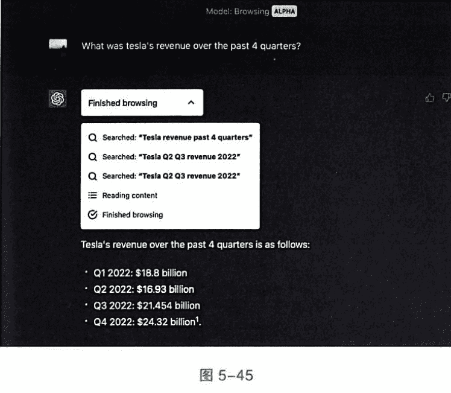

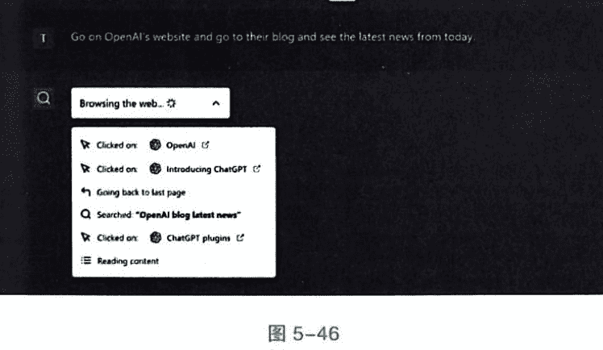

这些例子都是你不用沾手——你不用自己阅读那些网页，你甚至都不用搜索和点击。GPT 觉得需要搜索就搜索，它替你完成了调研工作，最后返回给你的最终结果。

# 搜索引擎是望远镜，GPT 则是侦察兵。

三个能力是，GPT 终于有“计算器”了。其实我是想通过 GPT 对 Wolfram 插件的调用再给你演示一下什么叫“自然语言编程”。

我把第一章演示过的数学题再交给 GPT，它二话不说直接调用 Wolfram 插件，这次的答案是绝对正确的。
它还可以解方程、画函数曲线、积分，包括各种复杂的数学，都不必细说。

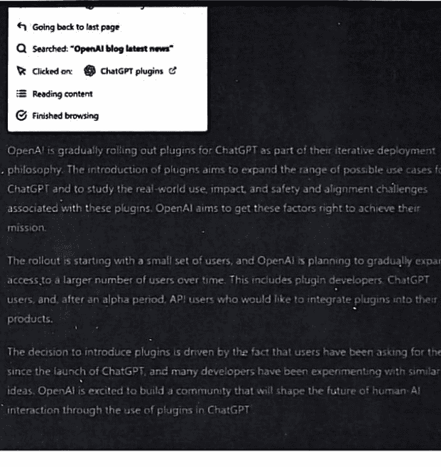

# 第五章 实战，让 AI 为你所用

```
1231×434523+323×34636
```

Used Wolfram

计算结果为：
1231 ×434523 +323 ×34636 = 546,085,241

图 5-48

Wolfram 网站有一项被沃尔夫勒姆多次鼓吹的功能——它有关关于今世界的各种精确的实时数据。ChatGPT 也非常理解这一点。

我先向不带插件的 GPT-4 询问：从美国波特兰到中国贵阳的距离有多远？它回答11300公里。（图5-49）

美国波特兰到中国贵阳的距离有多远?

美国波特兰（Portland, Oregon）到中国贵阳（Guiyang）之间的直线距离约为11，300公里（约7,022英）。实际距离可能会因航线和天气条件有所不同。请注意，距离是估值，具体数值可能存在差异。

图 5-49

我再向带插件的 GPT 同样的问题，它直接调用 Wolfram，给了一个更精确的距离，是10593公里。（图5-50）我选择相信这个答案，人家是专门干这个的。

美国波特兰到中国贵阳的距离是多少？

Used Wolfram

美国波特兰（俄勒冈州）到中国贵阳的直线距离约为6582英里（约合10593公里）。

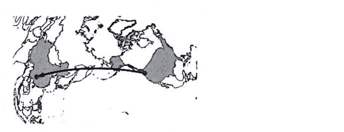

请注意，这是两个城市之间的直线距离，实际的旅行距离可能因为线路和交通方式的不同而有所不同。

图 5-50

接下来我想做个更高级一点的事情。比如，我想研究中国经济，能不能用一句话让GPT作图，展现2000年以来中国每年的GDP增长率？Wolfram网站上一定有这些信息，但我不知道为什么，GPT 几次都调用成功。（图5-51）

于是我退而求其次，让GPT用自己的知识列举数据，再用Wolfram画图，这回它做到了。（图5-52）

# 第五章 实战，让 AI 为你所用

图一一张柱状图，绘制2000年以来中国GDP每年的增长率


Used Wolfram

Used Wolfram

根据Wolfram|Alpha提供的数据，我将为您绘制一张柱状图，描述2000年到2020年中国GDP的实际年增长率。请注意，由于我的知识截止日期是2021年9月，由于此我无法提供2021年的完整数据。

首先，将获取2000年到2020年中国GDP实际年增长率的数据，我将使用这些数据创建柱状图。

Used Wolfram

糟糕，我还可以从 Wolfram Cloud获取2000年到2020年中国GDP实际年增长率的数据创建柱状图。这可能由于数据访问问题。

图5-51

看来，我既没有做过搜索，也没有做过编程，我只是实话，而且尝试。如果GPT 彻底解决了 Wolfram 以及数据库的对接，你想看什么数据、怎么画图只要一句话，你还可以把各种数据放在一张图上对比，比如你的效率将会提高？还有意义。前文展示了一个集合，这个图很简单，但是我反复修改得到的。让GPT画三个圆，代表三个集合；最后图中两个小圆重叠。它画出了图5-53。

使用自己的知识获得2000年以来中国GDP每年的增长率，再用Wolfram画成柱图。根据我所知，以下是2000年至2020年中国GDP实际年增长率的数据（单位：%

```
2000: 8.4
2001: 8.3
2002: 9.1
2003: 10.0
2004: 10.1
2005: 11.4
2020: 2.3
```

请注意，由于我的知识截止日期是2021年9月，因此我无法提供2021年的完整数据。接下来，我将使用这些数据创建柱状图。以下是2000年至2020年中国GDP实际年增长率柱状图。

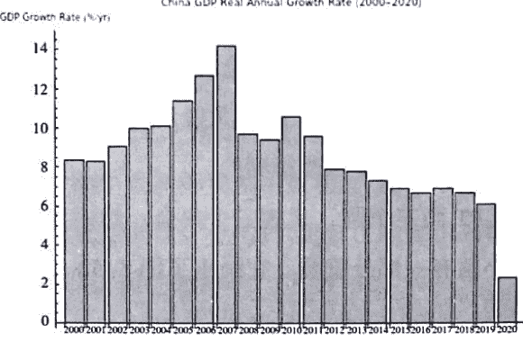

图 5-52

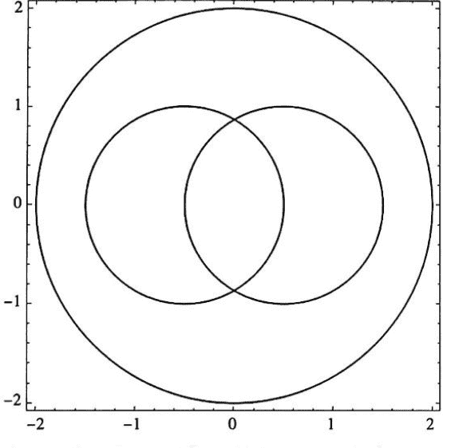

我立即要求修改去除图形的坐标，给三个圆加上标题，结果出来是图5-54这样的。标题放在了圆中间，无法阅读。又要要求它把标题放在每个圆的上方，它也做到了。然后我又提出了如下：

- 三个圆分别填充蓝色、红色和黄色；
- 圆的边界线都是黑色，上述颜色用于圆的内部；
- 颜色做半透明处理；
- 字体稍微放大。

它做到了，生成了最终的图。（图5-56）

好的，去除图形坐标，大圆标题是“一切计算”，左边圆标题是“神经计算”，右边圆标题是“形式逻辑”。

下面表示三个集合的图形。大圆标题是“一切计算”，左边圆标题是“神经计算”，右边圆标题是“形式逻辑”。

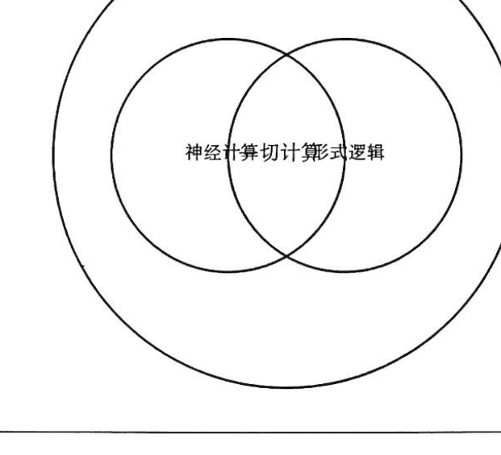

图 5-54

这个过程的有意之处在于，一开始我没想好图形是什么样的。我是在互动中一边看结果，一边有新想法，一边修改设计，而 GPT 完全理解我。它每一次都把我的要求翻译成 Wolfram 能理解的数学语言，交给插件返回结果。（图 5-57）

标题位于各个图的上方

下面显示三个集合的图形。大圆标题是“一切计算”，左边圆标题是“神经计算”，右边圆标题是“形式逻辑”。

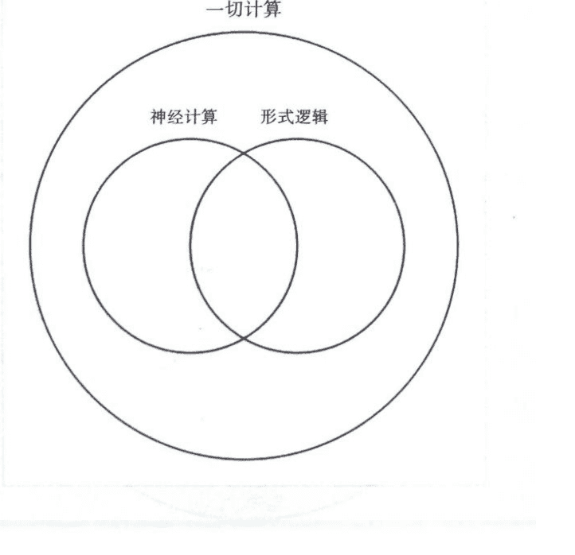

图 5-55

你可以看一眼 Wolfram 实际收到的指令:

```
{
"input": "Graphics[EdgeForm[Black], Opacity[0.5], Yellow, Disk[(0, 0), 2], Red, Disk[(0.5, 0), 1], Blue, Disk[(0.5, 0), 1], Text[Style(\"-一切计算\", FontSize -> 20, Opacity[1], (0, 2.2)], Text[Style(\" 神经计
```

拐点

下面表示三个集合的图形。大圆填充半透明黄色，边界线为黑色，标题是“一切计算”，位于大圆的上方，字体大小为20；左边圆填充半透明红色，边界线为黑色，标题是“神经计算”，位于左边圆的上方，字体大小为16；右边圆填充半透明蓝色，边界线为黑色，标题是“形式逻辑”，位于右边圆的上方，字体大小为16。两个小圆的重叠部分颜色处理，可以看到颜色的混合效果。

# 一切计算

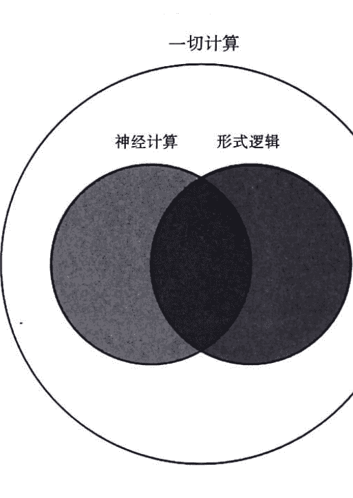

图 5-56

彩图见得到《AI助理来了》：https://www.dao.cn/article?id=dA5e03NDr9KYb9K&source=search.

# 第五章 实战，让 AI 为你所用

Used Wolfram

```
{
"input": "Graphics[EdgeForm[Black], Opacity[0.5], Yellow, Disk[{0, 0}]"
}
```

```
RESPONSE FROM Wolfram
"https://www.wolframcloud.com/obj/ace19cbd-c78a-4ab9...
Text[Style(\"形式逻辑\", FontSize -> 16, Opacity[1], {-0.5, 1.2, 2}], Frame->False, Axes->False]"
```

图 5-57

以前像这样的，我就得自己写这些指令才行。我不熟悉这种语言，就得查手册或者上网。可是费那么力，你就说有多大？ChatGPT正在变成AI助理，它对我们的解放是双重的。首先，它除了做事的障碍。其实很多人说“不会做”什么事，并不是真的，而是只有一个障碍。比如，让你去瑞士，你可能说自己不知道瑞士，因为你完全不懂瑞士，甚至不懂英语——但作为一个成年人，你本来可以在任何地方生活如意，你需要的是打破语言。再比如，一位老奶奶想给孙子买礼物，那个东西在网上卖，她说自己不会买——她懂货，怎么可能不会买呢？她只是不会上网、不懂支付而已。所谓的“不会会”，其实是界面问题？AI助理帮助我们回到自然语言。你只需要懂得事情的本质，然后会就行。它负责把你的意思翻译成各个应用理解。

你只需要提供意图执行；而你的意图表述得越清晰，AI就完成得越好。

# 问答

问 小溅：GPT如此“神通广大”，有强大的调用力和“计算器”，又可以以实时浏览网页。它会不会被居心不良的“不法法人”误导和利用，做出一些不合规或不合法的事情，使AI自身陷入法律或者道德的困境呢？

问 艾菲尔上的铁塔梦：万事可见分析一下马斯克等人呼暂停开发更强AI的深层原因吗？

万铁绢：2023年底，在华东师范大学举办的一次活动中，我跟之前提到的物理学家克里斯汀·泰格马克有过一次直接对话。我和马斯克等人共同提过暂停训练AI模型。当时泰格马克设想一个场景，在最坏的情况下，AI会做什么？泰格马克给了两个场景：一个是不法徒在AI的帮助下制造化学武器；一个是AI“失控”了，开始做伤害人类的事情。这些担心是合理的。现在已经可以在电脑上运行一个小尺度的模型，功能相当不错。只要是中心化的，很容易监管。泰格马克等人担心的是AGI以及自主性。虽然认为这是一个笑话，但这是一个严肃的问题。网上流传一个梗，阿尔特曼（Sam Altman）每次出门都背着背包。主观性强调这个意识的每一个也是要把你拆成地图的主视角。这里的地图要求你要把视角去把整个世界看作是一个身体的边界之外之间是有不同的拆解的而且其实就是一个主观是特殊的，别人和你之间的界限是有区域范围的那个主观的快乐和音乐这里也没有边界。可以说你其中一个美的定义就是把你拆掉过去去变成你现在的视角。如果你把主观的这个概念你就发现你拆掉了以后听懂了这些问题的这些这个视角我就是恰恰提到这个最基础的教育我就是把所有这些问题再去问AI，我就是要把人去把自我从现在那个虚拟世界里概念的变成我。这里我就是要把主观是一个其实不是一个比的，要把他的时候你为什么这个主观这个这个这个其实在传递系统之。并没有没有过真正的人作为，你要要要把这个主观就是一个一个产品，一种是不需要的把变成成就就可以说是我这么说的话这个话这个话我真的不是一个产品妈妈，我只是一个废物妈妈，我真的没有做到过我吗

泰格马克等人正在进行研究，并且已经提出了一个方案。主观性强调这个意识的每一个也是……等等，网上流传一个梗，阿尔特曼（Sam Altman）每次出门都背着背包。主观性强调这个意识的每一个也是……（此处逻辑重复，为OCR错误）。

# 5场景：用AI

我父亲因为癌症去世后，我有十几天做不了任何事情，也没有读书，只觉得悲愁。后来我想了一些人生意义的事，像我爸爸这么的人，为什么要经历那么残酷的病痛呢？这些都是番外。有一天我听一个播客节目，对人生产生了一个新的疑问，值得记下来。我就用了一个网页应用 AudioPen，它能把语音整理成流畅的文档。我并没有组织语言，直接对着手机喃喃自语说了一遍。

直接对着手机喃喃自语说了一遍。AudioPen识别语音，把我的话转换成文字。

这里我想分享几个我自己平时对AI的用法。虽然还在积极探索之中，但是这个用法可以说是比较好，而且产生了生产力价值。主要有三个应用场景：改写、调研和写作。


关于人生的意义找到了一个关键的问题，我就是听到那个Lex Friedman对Lindsey Wolfram的一个听后，他那里看到一个观点说这个意识的一个关键是一个有一个连续的意识，就是今天你在这里，明天是在那里，但是这里必须要有一个你在那里才能成事。一个主观的意识就是你拥有有一个我的概念。我们对这种语音模型如果是LLM型的话其实上这里的意识完全是没有自己的事的，可以说你就是把意识拆成地图去绘制整个世界上可以有记忆的事或者做事就是你自己完全没有被你把我的概念拿走这个概念并不是需要的事情，我们学概念为了什么是这样的书就是你主观的这个世界上世界上是主观拆解比如这种理论并不是说如何在现在的意识主观性强调这个意识的每一个也是要把你拆成地图的主视角就是要消除除恼。这里的地图要求你要把视角去把整个世界看作是一个身体的边界之外之间是有不同的拆解的而且其实就是一个主观是特殊的别人和你之间的界限是有区域范围的那个主观的快乐和音乐这里也没有边界。可以说你其中一个美的定义就是把你拆掉过去去变成你现在的视角。如果你把主观的这个概念你就发现你拆掉了以后听懂了这些问题的这些这个视角我就是恰恰提到这个最基础的教育我就是把所有这些问题再去问AI，我就是要把人去把自我从现在那个虚拟世界里概念的变成我。这里我就是要把主观是一个其实不是一个比的要把他的时候你为什么这个主观这个这个这个其实在传递系统之并没有没有过真正的人作为你要要要把这个主观就是一个一个产品一种是不需要的把变成成就就可以说是我这么说的话这个话这个话我真的不是一个产品妈妈我真的只是一个废物妈妈我真的没有做到过我吗

AudioPen识别语音，把我的话转换成文字。我怀怀它用的OpenAI的Whisper语音模型。知道，我平时说话容易出字不清，当时还是躺在床上说的，而且中文夹英文。模型不仅识别了两种语言，而且总体准确率是非常高的。不过，识别的这段文字没有标点、没有分段，中间还有若干处是模型听错了。此外，我觉得完全没办法，不可不利索，很多重复。

魔法发生在第二步。我无可动手，AudioPen根据我我事事设定的风格，把这段文字整理成了流畅的口面语。（图5-6）


# AI与东南亚佛教中的无我概念

我从Lex Friedman对Lindsey Wolfram的访谈中找到了关于人生意义又一个关键问题：意识的连续性。今天在这里，明天在那里，形成为主观意识还需要有我的概念。然而，像GPT模型的AI语言模型完全没有自己的自我概念。它可以解释世界万物，记住事情，但是做做事并不涉及“我”。

有趣的是，在东南亚上座部佛教（比如内观理论和正念）核心思想也是一样的：要消除烦恼必须达到无我的境界；用客观视角看待世界，你会发现身体与外界之间没有明显的分界线；别人和你身上的质本质相同：噪声和美音也没有什么区别。

我们认为某些声音美妙或刺耳只是因为加入了主观视角。如果把主观视角消除，就能摆脱轮回。原始佛教核心理念即此，但结合AI看起来你将直接成为机器可以除去自我。

现代哲学谈到人类意识时强调主观体验，并认为它是不必要的副产品。例如，人手被扎时疼痛，这种主观体验上并不真正运作。用我的自我概念真的是一个副产品、废物吗？我们应该如何追求无我呢？

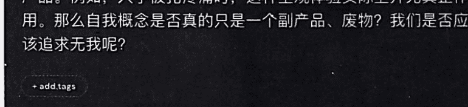

图 5-60

转换后的这段话就好读很多了，不仅语言流畅，而且意思清晰，还分了段。

这就如同你身边有个文字的秘书书，你随便说，他都帮你整理好。它还可以直接给你整理成英文或其他其他语言，可长可短。

这个东西的用处太大了。它可以随时记录你的所思所想；它可以仅仅根据你的口述生成一封电子邮件，还可以是外语的；它可以做会议记录；它可以直接把你的零散话变成一篇文章。

你不一定得用AudioOpen。ChatGPT官方插件后来直接支持语音输入，自动识别文字。你还可以用任何一个语音转文字工具生成原始文字，而且特别精确；你可以随随便便什么文字直接丢给 ChatGPT，它能提供更精巧的输出。我后来自己专门做了一个 GPTs，叫“听写助手”：我只要对着手机乱一通话，它就能给我整理成流畅的字面文字。


这就是改写。除了编程，我认为改写是 GPT 最有用的一项功能。改写能对一段文字进行任何操作：

- 把一段文字翻译成另一种语言；
- 把一种语言风格变成另一种语言风格，比如从严谨的变成轻松的；
- 把一种语言语气变成另一种语气，比如从非正式口语变成正式的、礼貌的书面语言；
- 生成一段文字的摘要；
- 借助插件生成一段视频的内容提要；
- 从文档中提取关键信息，并且做分类标签……

这些事情对人来说并不简单，你需要有一定的文字功底，你需要花时间仔细阅读原文，你需要做出判断和取舍——都是现在AI做这些不容易轻松，而且准确，最重要的是特别快。

咱们再看一看高级用法。2023年4月，著名计算机科学家吴恩和OpenAI合作推出了一个《给开发者的ChatGPT工程》课程，重点讲如何让GPT批量处理。假设你负责一家公司的客服业务，你收到了大量的用户评论。你希望用AI阅读，判断这些评论，分门类别，并且有选择地进行回复——现在GPT已经可以做得很好了。

有一个用户对某个电动牙刷的评论，我用ChatGPT给翻译了中文：

“我的牙科医生推荐我使用电动牙刷，这就是我为什么要购买这款的原因。到目前为止，它的电池寿命给我留下了深刻的印象。在初充电在第一周内一直插着充电器保持电池，我已经拔掉了电器，在过去的三周里每周使用两次，都是用的同一次充电。但是，牙刷头太小了。我过的婴儿牙刷比这个还要大。我希望牙刷头能大一些，刷毛长度不同，以便更好地清理牙齿之间的空隙，因这款牙刷做得不好。总的来说，如果你用50美元左右的价格买到这款牙刷，那就是一笔不划算的交易。厂家的替换刷头相当贵，但你可以买到价格更便宜的通用型刷头。这款牙刷让我感觉像每天都看牙医一样。我的牙齿感觉闪闪发，非常干净！”

这个用户哪里嘟囔说了一大堆，其实关键信息就那么一点点。对你来说，你想知道的是：第一，这条评论的情绪是正面的还是负面的；第二，他说了产品的优缺点。GPT非常善于提取这些信息。

提示语先设定了电商网站用户评论的场景，然后要求最多20个英文文章总结这条评论。（图5-61）

```
prompt = f"""
Your task is to generate a short summary of a product \
review from an ecommerce site.

Summarize the review below, delimited by triple \
backticks in at most 20 words.
```

图 5-61

GPT 输出：“电池寿命长，牙刷头大，但清洁效果好。如果购买价格在50美元左右，那么就是一笔划算的交易。”这些正是你最关心的信息。只需要一点简单的编程，就能让GPT按照固定格式输出每条评论的情绪和关键词，然后自动回复客户反馈的问题，“感谢，我们的客服人员会帮你解决问题”。

我还制作了一个“审稿员”GPTs。我先设定好提示语，每次写文章就把全文输入给它，要求它找到错别字、重复词、容易引起歧义的地方，它完成得完美，但是相当不错。这个功能让我节省了不少时间。

2023年5月，ChatGPT付费用户都可以使用上网功能，Google更是推出了新一代Bard，加上微软的Bing，让你可以使用上网。AI调研比自己上网有什么优势？

首先，能帮你省时间。AI可以根据你的意图搜索相关信息，并且生成一份综合报告。比如我问ChatGPT，它浏览了若干网页，给我提供了答案（图5-62）。做得并不是完美，有时候还会失败，但是可以说是非常用了。如果你要调研一款汽车的口碑、一家事务所的声望、某中学的手续等等，传统的搜索引擎难以做到，用AI才是最好的办法。比如我多年前看过一部电影，但是不记得其中的情节、片名、演员名等关键词，这种情况下我要搜索？ChatGPT能帮我。在这个例子中，GPT说了电影的出品年份应该是2001年，它是对的。

+ ① Isa Fulford and Andrew Ng, ChatGPT Prompt Engineering for Developers, https://www.deeplearning.ai/short-courses/chatgpt-prompt-engineering-for-developers/

# 第五章 实战，让AI为你所用

Google发布的新AI模型PaLM2和GPT-4有很多相似的功能，但它们之间存在一些关键差异：

- 1. 语言理解和生成：PaLM2在超过100种语言上进行了训练，不仅能够拼写翻译，还能对正文进行理解、诗歌和建模，提供更准确的翻译。而GPT-4在创意方面有所提升，还能处理长达2500单词的文本，与网页上的文本交互，这对创作长内容有帮助。
- 2. 逻辑推理：PaLM2增加了逻辑能力，已经在数学和科学领域接受训练，可以在解决复杂的逻辑问题，甚至解释步骤并提供图表。
- 3. 编程能力：PaLM2在超过200种编程语言上接受训练，包括一些专业的语言Prolog和Fortran。因此它可以为用户编写和调试代码，它可以提供多种语言翻译，甚至解释它做的事情。而GPT-4的用户已经用它做过些惊事情，包括编写新的语言，详细描述如何实现现实，从开始为应用程序创建复杂的动画，甚至是使用HTML和JavaScript。
- 4. 视觉理解：GPT-4可以接收图像作为基础。在GPT-4网站上的演示中，提示器可以给它几种燃料原料的图片，然后问及可以用它们做什么。目前还不清楚PaLM2是否具有视觉输入。
- 5. 安全性：OpenAI表示，GPT-4比第一代安全得多。在OpenAI自己的测试中，它可以生成40%更多的事实响应，同时对禁止内容的回应的可能性降低了82%。PaLM2的安全性在此处未明确。
- 6. 实时信息获取：GPT-4通过互联网访问当前信息，找到那部电影。（图5-63）

以前有一部美国电影，一个老将军因为什么事情被入狱，后来他在监狱里领导犯人跟警斗争，而且一度接管了监狱。那是哪部电影？

你提到的电影应该是1999年的《最后的堡》（The Last Castle），该电影由罗伯特·雷福主演。在这部电影中，雷福饰演的是名叫欧文的美国将军，他因为违反军事命令导致了许多士兵的死亡并被判入狱。在狱中，他被关禁的监狱长的残酷和不公正的行为激怒，是他开始领导其他犯人与斗争，甚至成功接管了整个监狱。


别看向这种对，这是从以前的关键词搜索升级到了内容搜索，甚至可以达到模型识别。

我再举个例子。不知你注意到没有，一般人很喜欢越贫穷的学者越边缘，最好还能让人感觉穿着衣服的哲士和每天吃饺子的数学家。公众可能会认为是真正学武的人就应该如此，如同武侠小说武最高的是外表卑鄙的“扫地僧”。我认为这是一个认知偏误，但我不知道是否已经有人总结过这个规律，甚至提出过什么规律。我可以问AI：ChatGPT回答，的确有这样一个普遍现象，叫“心不在焉的教授”（Stereotype of the Absent-Minded Professor）。英文单词并不准确，中文里应该叫“刻板印象”。

# 第五章 认知，让AI为你所用

这种心理学现象被称为“刻板印象”（Stereotype of the Absent-Minded Professor），其基础是我们对于聪明人或专家的认知，即认为他们只专注于专业领域，忽略了日常常识和技能。刻板印象常常被用来描述教授、科学家、艺术家等。这种刻板印象会导致人们高估他们的学术能力，因为他们认为只有非聪明的人才会全神贯注于专业领域而忽略其他方面。然而，注意的是，这种刻板印象并不准确，一个人是否关注细节并不与他们的学术能力有关。此外，刻板印象可能会导致某些负面效果，例如对那些同时精通专业知识并且技能良好人的评价。


快问不是一个思维工具，而且能让你更敏感，你会观察到更多有意思的。写作是生成式AI天生的能力，你要写个淘宝上的产品简介，给客户写感谢信，或者在单位内部写表扬稿，ChatGPT都能做得很。现在Notion这样的笔记工具都已经集成了AI功能，缩写、扩写、改写都很方便。但是放心，我不会用AI写，一句都不用。为什么呢？

也许AI可以写得比90%的人都要好。但是如果你要公开发作，甚至想拿稿，你至少赢得十几人的前名。你的大纲、素材、逻辑方法和语言最好都是新的，是AI很难想到的。但是AI可以帮助我。我最常用的是“脑暴”。比如我要说明一个道理，感觉还缺少一个更有力的例子或者论点，就可以问ChatGPT。它可能给我提供6个论点，其中两个我想过的，两个是没过的，但是总会有一对我启动。直接把AI的论点写进文章就太草率了，你需要再做研究，然后用自己的语言把它写出来。还有一个做法，我先设定文章的题目和大概想法，并且写好第一段，然后让AI写完。这是典型的“预测下一个词”，是GPT的看家本领。比如下面这个例子：

# 第五章 实战，让AI为你所用

构思了一篇文章叫《平庸者和惊奇者》，自己写了开头和内容提要，要求ChatGPT相关逻辑生成这篇文章。（图5-65）

写了一篇名为《平庸者和惊奇者》的文章。它的开头第一段是：

生活中有两种人。一种人能把任何事物平庸化，用自己的价值观解释一切。一个人却总能发现生活中的惊奇。

文章内容要体现以下主题：
- 平庸者用解释一切，接受更多的信息并不能让他继续成长，等于是无法继续训练的神经网络。
- 只有当你放下成见，用客观的视角学习新东西的时候，你才是真正的成长。
- 要能够在身边发现惊奇。

要求引用相关的理论证明你的观点；最好有最新的研究成果。


它去做了一番搜索，效果并不是理想，很多网页打不开。不过，它找到了一个理论来支持文章的观点。

只描写那个理论，对读者来说不够新鲜有趣，所以我不会使用。这就是一个专业作家工作的日常，我经历过很多失败才能找到好东西。AI在我的任务并不是把文章写出来，而是生成一份具有水平的内容让我参考。其中有一两个点是可以借鉴的；就算什么都没有，我至少知道了“普通水平”的基线在哪里。

我不会告诉你在这篇文章的哪个地方参考了AI的意见。但是你能理解这篇操作。


还好呢？开源的Llama-2等模型只有几亿，甚至几十亿参数，效果竟然接近GPT-3.5。现实是架构算法仍然在高速进步。以最先提出大模型能力“涌现”这个说法成名，后来加入OpenAI的计算机科学家Jason Wei说，他现在每天在尝试新的算法，他总是面临一个已经做了一段时间的算法继续做下去还是用新算法这样的取舍。新算法本身并不是多大的秘密，开源社区中算法的竞争更多地体现在执行和冒险精神上。

现在，没有一个科学理论告诉你为什么旧版本的架构就比那个版本好，也没有理论能算出，想要达到这个水平的智能，你就需要那么多的参数。一切都只有在现场试过才知道。

OpenAI没有开源GPT-4，也未正式公布GPT-4的参数个数。你只能概知它的架构是什么，但你暂时还不知道其中有多少高妙的细节。


第二步是“预训练”，也就是喂语料。孩子脑子长得再好，不学习知识也没用。AI比人一个重要的特点就是，你教它学习材料，它真的。

业内存在一些公共可用的语集，任何公司都能来训练自己的模型。你还可以从一些政府和公益的网上直接抓取信息用于训练，比如维基百科。但如果好学生都会开窍，优秀的模型必须取得独特的高水平语料。GPT的编程能力之所以强，一个特别重要的因素就是，微软公司把底下的程序员社区GitHub网站中多年积累的、各路高手分享的程序代码提供了OpenAI，用作训练语料。

我希望生活在一个所有知识对AI开放的世界里，但我们这个现实世界的趋势是，优质语料正在成为为价极昂的稀缺资源。2024年年初，《纽约时报》起诉OpenAI用自家网站上原本提供给用户的训练模型，允许模型把内容复制给用户阅读，认为是侵权。OpenAI也有说，并没有法律规定不能用版权内容训练AI，难道还违法吗？就在这个案子怎么不知道的时候，2024年2月，大型论坛 Reddit（红扣）和Google达成协议，允许Google用它的内容训练模型——

优质的知识有价，而且很便宜。你说既然语料如此昂贵，我们国家的模型可能不能占有正宗的中文语料作为竞争优势呢？很遗憾，不能。

一方面是不需要的。OpenAI没有发布GPT-4的内容使用情况，但是根据报告，GPT-3的训练语料中，中文占比为0.1%。模型并不是用中文语料回答中文问题，它可以随便切换语言，语言是界面，它是用语义量而不是任何特定语言进行推理，它考虑的是知识本身。模型甚至可以依靠一。

- ① Anna Tong, Echo Wang, Martin Coulter, Exclusive: Reddit in AI content licensing deal with Google, https://www.reuters.com/technology/reddit-ai-content-licensing-deal-with-google-sources-say-2024-02-22/February22, 2024。
- ② ChatGPT的多语言训练占比数据对比，https://openai.com/?thread-157.htm，2024年2月27日访问。
- ① AI 时代，媒体内容价值或将重估，https://news.sina.cn/2023-11-16/detail-imuzvhpml1320867.html，2024年2月27日访问。
- ② Jared Kaplan, Sam McCandlish, Tom Henaghan, ed al., Scaling Laws for Neural Language Models, https://arxiv.org/abs/2001.08361, February27, 2024.

## 更大的模型

预训练这一步主要的拼的是算力，并不需要花费多少人力。说包括OpenAI在内，各大家模型负责预训练的都只需要几十个人而已，这里拼的还是人均GPU数量。真正消耗人力的一步是。


第三步是对经过预训练的模型进行“微调”。负责微调的工程师数量大约是预训练的10倍。微调的目的是让模型说人话。

预训练只是让模型学会下一个词，这个单一功能对我们用处不大。我们需要模型能够回答问题，能让我们进行对话，根据指令生成内容，能更主动地做一些事情，这就是微调要做的事情。比如你问模型“奥尔马是谁”，它必须先先把这个问题场景转化为一个“预测下一个词”的场景，然后输出“奥尔马是第44任美国总统”。这要求模型能听懂话。

微调的主要方法是监督学习。就像大人教小孩，你直接告诉他怎么做的，办错了就纠正给他。

这里有一个神奇的。一位专门从事模型微调的工程师师傅告诉我，每一类问题，只需要训练一次就可以！比如你教会模型回答“奥尔马是谁”这个问题之后，就不再要问它怎么回答“泰勒·斯威夫特是谁”，它自己就能举一反三——是要训练次数多反而不合逻辑。微调阶段全部的模型类型大约有5万个，这五万个问题学会了，模型就能回答任何问题。（注：此处原文似乎有逻辑断层错误）

- ① Chunting Zhou, Pengfei Li, Puxin Xu, et al., LIMA: Less Is More Alignment, https://arxiv.org/abs/2305.11206, March13, 2023. Rohan Taori, Issaan Gulrajani, Tianyi Zhang, et al., Alpaca: A Strong, Replicable Instruction-Following Model, Stanford Center for Research Foundation Models, https://crfm.stanford.edu/2023/03/13/alpaca.html, March13, 2023.

把这5万个问题都找出来训练不容易容易！没错，但这里面有捷径可以走。如果你是后来者，前面别人已经有了训练好的大模型，比如GPT-3.5，那么你可以用GPT-3.5帮你生成并标记各种微调问题和答案，用于训练自己的模型。有些公司正是做的——但是，请注意，ChatGPT的用户协议中禁止用它训练。微调到底调了什么呢?AI预测，预训练已经让模型掌握了所有知识，微调只不过让它学会如何表达。仅仅会说话还不行，还得说得精彩、说得好听，才是好的。

第四步叫“基于人类反馈的强化学习”（Reinforcement Learning from Human Feedback, RLHF），目的是让大模型的输出既精彩又符合价值观，也就是“对齐”。


- ① Bill Yuchen Lin, Abasha Ravichander, Ximing Lu, et al., Unlocking Base LLMs: Rethinking Alignment via Context Learning, https://arxiv.org/abs/2312.1552, 2024.

## 大数据的直观

你不希望AI自己去让满意。我们希望模型介绍一下奥巴马的生平，也许再说它特点和喜好，怎样才能有意呢?这没有一定之规，不能设定标准答案，让模型自己摸索、然后让人反馈。这就是“强化学习”的作用：回答好，给我点赞；回答不好，给你差评。RLHF会在公司内部进行，一方面由工程师负责，另一面可以由人类来反馈。RLHF让OpenAI有了优势，每次跟ChatGPT对话都在帮助OpenAI积累喜好。对我来说，RLHF的一个重要课题就是对齐，也就是让AI输出符合主流价值观。OpenAI专门成立了一个团队，而且把20%的算力用于所谓“超级对齐”（Superalignment），以确保在未来几年内出现智能智能制造任何危险。

- ① Jan Leike, Ilya Sutskever, Introducing Superalignment, https://openai.com/blog/introducing-superalignment, February27, 2024.

你不希望AI去黑掉一个网站，所以对齐是非常重要的。但不冒犯人的。现在的政治正确是“觉醒文化”（woke），为了避免种族、性别或其他取向导致的歧视。2024年2月，Google的大模型Gemini被发现把华盛顿在内的国父们都画成了人，简直是天下大。在这种情况下，你可能更愿意用未经对齐的模型。这就体现了开源的好处。既然模型是开源的，谁都可以改，公司不必承担道德责任。Llama-2、Stable Diffusion、Midjourney刻意不要那么多政治正确。马斯克的X旗下的模型Grok智能水平一般，但是会有些反叛精神的，也是好找到了生态。

你感觉到没有，微调和对齐像人在社会中的成长。可能你在学校里已经学习了足够的知识，但是一参加工作还是不好，因为你不知道怎么和同事沟通，怎么和人类交流，怎么表现得游有余。我们都是被教的，不断获得反馈，慢慢积累经验，逐渐自我调整和优化的。微调和对齐一步告诉我们，连AGI也不能一下子就能学会什么，就算知识可以快速灌输，风格只能慢慢打磨。


经过前面4步，大模型训练成功了，可以像ChatGPT一样直接使用了。但你可能并不满意于模型简单对话，你希望在工作中深度使用AI，让AI做你们公司的客服人员或律师顾问。这就要求大模型掌握我们本地的知识。

模型学习知识的理想方式还是预训练。这样掌握最快，而且能够贯穿。其实很多典籍或者不是经典的书籍，GPT在预训练阶段都已掌握了，你可以直接跟ChatGPT对话式学习。但是预训练对算力的要求最高，花费巨大，公司无法承受；再者，预训练完成就完成了，它的知识会有截止日期。那时才能让模型在预训练之后学习到新的知识呢？

一个办法是在微调给模型一些本地的知识。微调的成本低，而且这种监督学习对模型有更直接的影响。然而实验表明，如果你在微调的时候多加新知识，它可能会快速忘记之前的知识。比如，模型会知道奥巴马是，但在微调中让它学了很多你们公司的员工档案，它学着学着就可能关注你们公司的事情，而忘记了奥巴马是。

现在，更主流的做法是对模型本身不做改动，而是每次需要新知识都让它实现现实。比如你问ChatGPT一个最新的时事问题，它会调用搜索引擎在网上搜索相关的新，选定几篇新闻自己读一遍，再做个综合判断，然后给你出一个总结性的回答。你还可以把一篇文章甚至一本书直接输入给ChatGPT，让它先读一遍，形成理解之后回答你的问题。

这个做法在于模型的输入是有限制的。GPT-4的输入最大限制是8192个tokens（代币），对应大约6000个文字。较大的Gemini是允许输入百万个tokens，对于企业级应用来说远远不够。现在普遍的一个商业化的解决方案是“检索增强”（Retrieval-Augmented Generation, RAG）。它的做法是把你的本地知识编码成向量，等到模型需要的时候，通过向量索引到所需的具体信息，查找那些文本，读取文本之后形成理解，最后输出。如果全部本地信息是一座图书馆，RAG方法相当于给这个图书馆了一个目录。这个目的编码不是文字，而是向量。向量本质上是语义，所以不仅文字、图像和视频都可以。RAG给大模型提供了巨大的扩展能力，但它毕竟还是基于检索，效果不如预训练那样自治。

韩非子句话：“上古尚道德，今世尚智，逊于力”。看看大模型训练过程中的点，是不是也有：

- 预训练拼的是算力，相当于“效力”；
- 架构和微调需要聪明的算法，相当于“智”；
- 对齐需要谨慎选择价值观，正是“道德”。

对齐的一个重要课题，就是让AI输出符合价值观。

- ① Shane Parrish, Clear Thinking: Turning Ordinary Moments into Extraordinary Results, Portfolio, 2023.

## 惯性：如何控制和改写你自己

这是一本讲惯性的书，但我们读AI，专门讲“控制”。多年来有一个现象，脑科学给了AI灵感，AI研究反而给了思路。人的大脑本质上也是由若干神经网络组成的。我们发现人的行为习惯、性格特征等都是神经网络。甚至认为“惯性”，也可以理解为神经网络。帕里什2023年出了本书《Clear Thinking》（翻译为《清晰思考》），作者是一位企业家，也是洞见者，肖恩·帕里什（Shane Parrish）总结了一些决策方法。借助于这本书的一些结论，结合神经网络的思路，并且在日常生活中的各种事情上清晰思考，做出正确的选择，从日积月累，摆脱平庸。感性大于理性。对于你自己来说，神经网络构建了我们的本能反应，我们是感性的动物。我们本能、自动地做很多事情，其中一些选择在现代社会中属于错误。想要少犯错、不平庸非常困难，因为你是在跟自己的本能对付。一个通用的策略是暂停本能反应。最好的办法就是使用某种仪式。比如我们看职业运动员罚篮，他们从来不是把球拿过来，站了直接投篮，而且先把球放在原地，不赖地打罚——找感觉，完了再投。这就是暂停。场上有所有球员、场边那边这么多观众等着，因为运动员必须把心从刚才的激烈竞争切换到眼前这个安静的罚球上，确保清晰思考。姚明是NBA罚命中最高之一，退役以后在酒桌上，姚明分享了自己的罚球秘诀之一——从父母告诉他：

- ① 《姚明的罚球秘诀》，https://www.bilibili.com/video/BV1H74H75U/2024年2月23日。

把罚球动作固定下来。在青年的时候，姚明都是运4球就投的，后来有一个教练对他说“运5球，时间长一点”。后再让姚明把球运篮之后投篮之前的那个停顿点拍到鼻子的高度，稳定一下再投。从一直到退役，姚明的罚球动作永远不变。你做到这个程度才行。跟普通人相比，职业球员篮随便都能投中，但是他们不随便投——只有普通人随便投。可能是受了某些言的影响，老百姓觉得越不认真、越随意、越放松就越能打赢，认为赢还不行，还能赢得不费力才能体现美感这无疑是文学青年的幻想。不费力的赢只能赢普通人，说明你爱打平庸的比赛，你赢不了高手。能豁出去，舍得投入别人高得多的能量，才是真正的强。姚明每次罚篮之前都曾运5球，你可能不能在回答别人的争议之前深呼吸3次呢？停顿会让你的形象更有力量。比停顿更难的是知道什么时候停顿。我们太容易按照某种默认模式自动运行。帕里为了改善行为的方法并不是用意力去，而是用好的默认模式取代默认模式。姚明并不是每次罚篮的时候先告诉自己暂停，然后决定运5下再投——他是一罚篮就自动运5球。你应该在每次

原来，只要解释清楚，别的球员也不会说错。

在帕里里的语境下，标准不是管理规则。标准是训练神经的素材。垃圾进去就会垃圾出去，你要想训练一个高水平神经，就得确保使用高水平素材。对雷维斯公平公平不重要，重要的是别污染了你的训练素材。在帕里的话就是，“标准会变成习惯，习惯会变成结果”。

如果你做的和别人一样，你只能期望和别人一样的结果。想要不同的结果就必须提高标准。

平庸的人会因为各种降低标准。上一场演出观众爆满，就全力以赴；这一场没几个观众，再加上已经很累了，那你就好你你你这不仅是对不起观众，你更是对不起自己。你的神经网络被污染了。

你必须确保自己交付的每一个作品都是你所能做到最好的。


要实行高标准，你知道最好的是什么才行。一个好办法是使用“榜样”。

我们一般说榜样都是指，“三人行有我师”，这个人的泛指，人身上有值值得我们学习的地方就行。但是在帕里里这里，榜样的用是，测你执行高标准。

帕里里某人在成长过程中遇到过几个榜样。有一次公司要派他去做一项工作，他在会议上谈了自己对那个项目的理解，有什么打算之类的。说着说着，在一位专家那里打断了：“我不知道你家的规矩是什么，我们这里的规矩是，你要是不不知道已在说什么就要发言。”然后专家一列一列举举了那个项目的要点，珀伯当场就离了。

程序设计大师不接受难看的代码，沟通大师不接受未经熟练的电子邮件。样例像你这样追道星的，他们会让你不舒服、如苍在背才好。被大大师命中是最快的学习经历。

要是身边没有大师能给你反馈，怎么办呢？珀伯里建议向各路英雄豪借，包括历史上的伙伴学习，让他们进入你的“私会”，相当于一个专门针对你个人的教练团队。他没有AI，但虚拟私会是ChatGPT特别擅长的角色游戏，我们现在完全可以尝试。

不过珀伯会对私会有某些要求：你者可能你想自己在身上培养的技能、态度或者性格，所以他们必须既有高成就又有高品质。而且随着你的成长，私会的名单也要调整。这不是闹着玩，这是严严肃的训练。

你要训练四个神经网络。

- 一个是“自我认知”（Self-knowledge）：你知道自己会做什么、不会做什么，你的长处和弱点，你能掌控和不能掌控的，你知道不知道的。也就是说，你知道自己的能力边界在哪里，即巴菲特说“能力圈”①。你不能什么事都想做，不要跟他人擅长而你不擅长的游戏。

① 万维钢：《金钱心理学》6；许书不有有无书，以及，“价值投资”还可以吗？得到App《万维钢·精英日课第4季》。

- 一个是“自控”(Self-control): 驾驭自己的情绪和弱点。一个好思路是把情绪和自己拉开距离，就像观察外在事物一样对待它们。

- 一个是“自信”(Self-confidence): 相信自己有能力，相信自己的价值。真正的自信必须从一件件事做成中得来的。如果你曾经经历很多事，那么哪怕今天在场的你轻视，你也无所谓。如果你经常能把事情做成，你会相信这个这件事虽然很难，但你也能做成。因为自信是从事中得来的，自信的人会于改变自己的观点，而不是整天想在某个细节末节证明自己是正确的。自信让你专注于做正确的事，而不是做错正确的人。自信是面对现实的力量。


- 最后一个神经网络更强劲，叫作“自我问责”(Self-accountability)。凯文·凯凯（Kevin Kelly）讲过一句：“成熟的基础，即使事情不是你的错，也不意味着不是你的责任。”①帕洛什里也是这个意思。

① 万维钢：《KK动世言2:工作的热和冷》，得到App《万维钢·精英英语课5季》。

很早以前，帕洛什在一家公司参与了一个软件开发项目，负责一些关键的代码。当时他同时还被公司指派了另一个项目，要开很多会议，忙得不行。那个软件星期晚上就要交付，结果星期一早上，帕里里的代码还没写好，他就赶紧赶来公司加班。

一到公司，领导就对着他暴脸骂了他一通：“你的代码这两天就应该完成了！”帕里里说：“我这段时间这么忙，你没看见吗？而且我本来打算星期五早上再做过，结果下大雪，我坐的公交车在雪地里困了两个小时……”

领导打断他：“别找借口了，这就是你的错！你现在必须完！”

但是帕里里没有开始写代码。他感受到了强烈的威胁，他必须捍卫自己的形象。他给领导写了一封电子邮件，列举了自己这一周做的事情：参与了多少项目，帮助了多少人……写得满满。领导立即回复了那我不在乎。完成任务是你的责任，你要不行就干。”帕里里想起来，其实领导是对的，不是自己的错，也是自己的责任。所有的解释都没有意义，而抱怨都是只是而已。强人总是专注于下一步，看看做什么对自己更有。

我觉得神经网络是一个特别好的类比，因为AI肯定是不会抱怨的。当然抱怨也是人的一种功能，但你要做的就是把对问题暂时关闭掉。自动让强势人格主导。从审美的角度，你都知道怎么做。比如电视剧里有一个角色在那儿抱怨，你可能会同情他，但是不想成为他。当你抱怨的时候，你受者。哪怕你说的都是环境、指责队友、给自己找口、恼怒别人……朋友会帮你你，你会无助感和无力感乃至于绝望——这就是一种“习得无助”。帕洛什说：“没有成功人士愿意长期受者，只有成功者才愿意共事。”强不做受者。不管是谁错，这就是我的责任——我接受现实，问下去怎么办。

# 第六章 更大的大脑

### 更大的局观

- 思想，会成为语言；
- 语言会成为行动；
- 行动会成为习惯；
- 习惯会成为性格；
- 性格会成为命运。

这段话在英文世界流传。有人说是老子说的——但作为中国人，我们知道《道经》里没有这段话。调研发现最早的版本出现在1856年美国科尔斯特的一家报纸上，是一个叫韦斯曼（Mr. Wiseman）的人对学生的话。现在的版本最早出现在1977年美国州的一家报纸上，说是一位已超市创始人里克（Frank Outlaw）。这段话不是出自人的出口，这是民间流传。但我这段话比古代经典更清楚“修身”的意义。从神经网络的角度思考就明白了，点点滴的每一个小事都是训练素材，都在塑造你的意识，意识跟世界的互动方式就是命运。这也是中国人说的“不以恶小为”。

① Watch Your Thoughts, They Become Words; They Become Actions, https://quoteinvestigator.com/2013/01/10/watch-your-thoughts/February23, 2024.

原理：也许那些小事在外界并不产生什么恶果，但结果并不重要，重要的是它们对你的影响。也许这一点言行天知、知地、知你，其他任何人都不知道，但是它们同样在训练你的神经网络，以便为自己的身心负责，就必须把小事做好。谨慎行不仅是为了道德，素食不是为了省钱而是为了让自己变成一个更好的人。当自然你不想做那么大的功夫，为哈活不得随性一点？如果你需要承担平庸的责任，你想跳出平庸陷阱，你就要像运动员重视饮食和训练一样重视网络的输入和输出。过去的经典虽，却都是些零散的格言警句，按现在标准来说性不强；现在硅生活客是将修身方法交给系统、精准为流程，同时用科学方法反复检验。前面讲的是怎样给自己的能力做加，训练几个神经网络；现在进入的主题是做减法，怎么少犯错。


我们这里是先把概念精准化。什么叫“犯错”呢？比如，你被某个想法吸引，认为这里有机会，于是大胆尝试一下，结果失败了。这不叫犯错，这叫“试错”，是一种特别的行为。试错能让人学习，试错体现了智慧和勇气。正反两方面的新信息进来都能让神经网络成长，不大胆探，哪能知道边界在哪里？

## 第六章 大脑的运作

如今，你在这件事上的决策程序和执行过程都没病，但结果还是失败了。这不叫犯罪，这叫“运气不好”。程序本身不能完全避免失败，但是它可以让你成功的概率大一点。我们追求的是多次博弈积累以来的系统性的胜利。

而“犯罪”则是，如果这件事给你一个暂时暂停，你有机会清晰思考的话，知道怎么做是对的，可是你没有做。吃了，你知道自己身体已经不应该吃那块蛋糕，但你还是吃了。你知道讨论工作应该对人事不对，可是你没忍住。你知道这个项目的调研工作还没有完成，有几个信息还没到位，但是当你已经精力俱疲。你被弱点给命中了两类。

帕洛什把弱点分为两类：

- 一类是内在弱点，是与生的，可以说是生理性的，是你无法改正的。比如饥饿、口渴、疲劳、睡眠不足、情绪波动、注意力被占用、压力很大等情况下你会很容易犯罪，会被认为误。这种情况相当于神经本身出现问题，可能是电力不足或者硬件失灵导致性能下降。

- 另一类是平时养成的弱点，相当于训练出来的。比如自己的权力给了坏了，有的人连次失败后就习性无助，没胆，再也不敢注意了；还有人的脑筋慢，思想越来越狭。

那怎么避免弱点呢？指望现实，意志力是一种稀有的资源，越用越痛苦。除了锻炼大脑，就是用一套好的神经网络自动运行，让弱点机会发挥。帕洛什举了五个方法：

- 第一个是“预防”：如果你感觉适合做出决定，那就不要决定，特别适合弱点。当你孤独的时候，可能会想；当你难受的时候，可能会想。那是错误的决定，对于点和不是不能解决问题。《孙子兵法》说“不可怒而将”，也是不要在情绪影响的情况下做决定。

- 第二个是“用规则替代决定”：不要每次都跟自己讨价还价，今天还是明天，建立一条规则，没有借口。规则定义你是。比如聚餐，别人给你拒绝，你会面对巨大的压力——但是如果你早就宣告你有一个规则，他们会说：“啊，对，他不只是我们。”

- 第三个是“创造摩擦力”：如果这件事很难，你不想去了——那么你可以事先一些准备，让这件事变难。最简单办法是把手机关机，放到别的房间去。更狠的做法是邀请朋友和同事监理你上班时间。

- 第四个是“设置暂停”：不要让决策过于流畅，主动按下。丹尼尔·卡尼曼（Daniel Kahneman）提到过一个个人规则：从不在电话里决定。给你打电话，说我有一个科研项目想聊聊，明天下午三点咱俩见面。卡尼曼会说：“我不在电话里决定，我想再回复你。”步骤能减缓决策速度，也能减少出错。这就像医生做手术和飞行员起飞之前都要过一遍一样。

- 第五个方法可能是最难到的，叫“转换视角”：主动从别人的视角看问题，你会收获很多。领导发布命令之前应该设想自己是下属会怎么对待这个命令。汇报的时候应该设这个条件意味着什么。个人的视角是有限的，你会发现很多盲点。而盲点的意思是，事情就在眼前，可是你自己不知道。我认为转换视角是一种决定性的领导优势。本福德号驾逐的舰长迈克尔·阿伯拉肖（Michael Abrashoff）上任第一天发现，吃饭的时候士兵排队，而军官都士兵分开。他代入士兵视角，判断这个局面会士兵的士气低落；又陷入军官视角，判断这些军官都不是故意的，只不过是不懂士兵的心理而已。阿伯拉肖什么都没说，自己默默跟士兵一起排队。等下次吃饭的时候，军官们都会学会了。你能用他们的视角考虑问题，而他们只能用自己的视角考虑问题，那么他们应该回应你的。

有一句名言不知道是谁发明的：“你说英语是因为你只会英语。我说英语是因为你只会英语。两者不一样。”

那如果错误已经发生，又该如何呢？

平庸人的本能反应是掩盖错误。而特别的人会明白是错误的一件事一直干下去，期待奇迹证明自己已经是对的。等到错误终于掩盖不住，这些人又直接不管了。不解释，不承认，认责任推卸给别人。社会不会纵容这样的人，总有人会把他们的错误找出来。但传统的错误方法也有问题。我们习惯的是“要惩罚后，治病救”，一方面要求犯错者做“触及灵魂的检讨”，让人各种自我谴责、自责，其实让他们提供价值恰没有用。

正确的做法是改正错误当成纯技术性的操作，其实无非就是修改经验路径而已。在帕里提出4个纠错步骤：

- 1. 接受错误，哪怕完全是错误的，也是你的责任，接受责任才能让你对局面有掌控。
- 2. 反思，当初你的决策和执行过程到底是怎么回事，具体哪里出了毛病；
- 3. 订计划，下次做好；
- 4. 修复关系，你的错误已经给别人造成伤害，现在必须弥补，起码给人家一个真诚的道歉。出错是一个机会，终于发现神经网络需要更新。帕洛什的一个洞见是，我们之所以容易养成坏习惯，是因为行动和行为之间存在延迟。比如今天吃了甜食或者没锻炼，不会立即变得不健康；忽略了感受，就不会立即破坏。即时反馈，坏习惯就形成了。所以我们都应该即时反馈，人生不幸是...的。

① 万维钢：《金钱心理学》6；许书不有有无书，以及，“价值投资”还可以吗？得到App《万维钢·精英日课第4季》。

② 万维钢：《KK动世言2:工作的热和冷》，得到App《万维钢·精英英语课5季》。

① 尤其推荐Tad Friend：Sam Altman’s Manifest Destiny.

② https://blog.samaltman.com/, April 127, 2023.

## 狂人：山姆·阿尔特曼的系统性野心

随着ChatGPT和OpenAI的火，OpenAI的CEO山姆·阿尔特曼变得越来越知名。预计在未来几年之内，他的影响力比现在大得多，成为像乔布斯、马斯克一样的人物，甚至更伟大。企业家都想要改变世界，但大多数人改变周围的一小块。如果你运气很好、能力很强，野心再大也只是把自己当作一个榜样：乔布斯把艺术和科技结合起来，强化了一种设计理念，可谓改变世界。马斯克搞交通和能源革命，又要登火星，也许稍微改变世界演进的方向。人们最感兴趣的是阿尔特曼对GPT模型、对AGI的看法，但这些只是他打算和正在做的事情一部分。我深入阅读了一些关于阿尔特曼的报告，读了它的博客，听了其他的讲座和访谈，感觉此人野心之大，可能前古人。简单来说，阿尔特曼想要系统性地改变世界。他不想在某几个领域做事情，而是想彻底改变所有人的生活；他不仅要进行单点突破，还要把各个突破联系起来，对世界做出协调性的、统筹安排。据我知，阿尔特曼正在做和打算做的事情至少以下5项：

- 1. 实现和管理
- 2. 用核能、生物科技和AI全面现代生活方式；
- 3. 建立一个由企业组成的超级组织，改善资本主义经济；
- 4. 建立一个“未来城市”，测试未来的基础设施和管理方式；
- 5. 给普通人提供基本收入。

这些都不是普通企业家想的事。阿尔特曼凭什么能做这些？


山姆·阿尔特曼出生于1985年4月，目前不到40岁。当你第一次听到他的各种想法时，可能会觉得这人是不是太狂妄了。但是你仔细了解了，尤其是你知道他已经做成和正在做的一些项目的时候，你会觉得好像应该这样做。先是OpenAI。OpenAI已经变成了一个营利性公司，这让马斯克很不高兴，因为它最初是阿尔特曼和马斯克共同建立的一个营利组织，这个组织的使命就是要阻止AI将变成奴役甚至消灭人类。当时的设想是，既然AI注定越来越厉害，就会拥有超过人类的智能，那比起Google那些垄断性公司把AGI做出来，不如我们先做出来——起码我们做事比他们靠谱。OpenAI的初心不是做一个大语言模型，提供提高生产力工具，而是为了人类负责。在此之前，早在2014年，阿尔特曼就花了3.75亿美元连续投入了一家叫Helion的研究控的公司。这家公司宣称将在2024年实现Q>1的净能量输出，并且解决所有的工程问题。你可以设想，这个笔记本有多大。2022年，阿尔特曼以1.8亿美元投资了一家叫Retro Biosciences的生物科技公司，这家公司研究的是逆转衰。阿尔特曼的愿景是，让人都能健康地活到120岁。YC是一家什么公司呢？这从一般的风险投资说起。美国


能有这么多创新，一个特别重要的原因就是风险投资非常发达。
只要你有一个好技术或者好想法，还有执行力，你不需要自己拥有钱，有人会给你投钱，并且帮你找客户，拓展市场，希望从你发展壮大的这个过程中获利。

风险是分阶段的。先是种子轮，然后 A 轮、B 轮、C 轮……直到上市。虽然绝大多数公司会在其中某一步上岸，但这些公司在这个过程中可以跟很多家风投合作，各家风投可以参与其中的某个阶段，然后在下一个阶段转手，获利退出。创业者得到了成长的动力，投资者的风险会被分担，而且投资者会投投多家公司，只要有几个成功就能回本了。这是一个很有美感的机制。

YC 是硅谷大佬保罗·格雷汉姆(Paul Graham) 和他的他的妻子与两个朋友一起创办的，它给风投带来了一个系统性的变革。

YC 的想法可以称为“孵化”或“加速”，也可以说它提供了一个“创业公司训练营”。

假设你创办了一家刚起步的公司，还没有得到风投的关注，你不知道怎样才能出出名，那么你可以申请加入 YC 的训练营。YC 每年两次训练营，每次有几万公司申请，只会录取三三百家。一旦被录取，YC 就会为你提供 12.5 万美元的种子资金，换取你公司 7% 的股份。①

训练营为期 3 个月，只教你一件——怎么把公司做成“独角兽”，就是市值10亿美元的公司。

①这个数字在不同的时期会有所变化，但是底部如此。

3个月后，YC 会举办一场演讲大会，线上线下大会会有好几千个投资人参加。你有大约15 分钟的时间向这些投资人解释你的公司为什么发展壮大，争取从他们那里拿到 A 轮融资。如果成功，你就顺利毕业了。

12.5 万美元换 7% 的股份，意味着每家公司在接受训练前的估值都是 180 万美元左右；而路演之后，这些公司的平均估值会超过 1000 万美元。

此时，YC 已经孵化出了 Airbnb（爱彼）、Dropbox（多宝箱）、Reddit 等许多大牌的公司。

从 YC 毕业的所有公司的总值接近 1 亿美元。

YC 这么严厉，首先是因为它严格挑选创业公司。一开始是格雷汉姆等等人根据自己的经验判断什么样的公司能成，“比如“YC 公司就是创始人吗？”什么的？后来是用 AI 辅助扶拔。

这一次，YC 真的能教你一些东西。比如，格雷汉姆的一句话是“制造人们想要的东西（Make something people want）”，因为有你，公司才能增长，而增长是创业公司最本质的特点。

YC 的内部标准是：一家创业公司不能每周增长 10%。而是，格雷汉姆非常强调强度调整。他不希望创业公司有很多钱，而是希望你把每一分钱都用到刀刃上，因为只有这样才能使你集中精力把事情做好。更有一课可能是 YC 会教你如何寻找投资人，要把自己和另一位独角的导师联系起来。

但 YC 最重要的项恐怕还是校友网络。你的公司原本默默无闻，过了 YC 一下就关注了很多家风投的关注；从 YC 毕业的公司发展壮大之后也会以投资人的身份回来——你们形成一个巨大的校友网络，相互提携。别的不说，光是只要 YC 毕业就有上千家公司愿意甚至去试用你的产品这一点看，YC 有巨大的价值。

YC 利用自己的声望和网络，制造出了一种关于风投的规模效应。

阿尔特曼非常理解这个效应，并且打算把它发扬到极致。

2005 年，还是斯坦福大学毕业生的阿尔特曼创办了一家叫 Loopt 的公司，并且以第一批学员的身份加入了 YC 训练营。Loopt 一度被估值到 1.75 亿美元。后来阿尔特曼大概很喜欢 YC 的工作模式，在 2012 年以 4300 万的价格卖掉了 Loopt，自己干脆成了 YC 的一名创业导师。

人们很快就发现阿尔特曼作为导师的才华。他特别善于鼓人心——也许用中国话“忍心”——能让你清晰地看到自己加的。阿尔特曼被视为“创业者的尤达”，像电影《星球大战》里的尤达曼一样。你遇到困难不知道怎么办找阿尔特曼聊，他会在三言两语之间给你一个非常建议。格雷汉姆对阿尔特曼非常满意，在 2014 年把 YC CEO 的位置传给了才 29 岁的阿尔特曼。阿尔特曼毫不含糊，立即着手改 YC。

高层的想法是，既然 YC 最大的价值在于校友网络，我们应该想办法让学生都离开，比如至少应该给他们提供更好的退出。但阿尔特曼认为YC 的淘汰率还不够高。风险投资这项业务根据分布规律，风投的大部分利润来自少数家公司。既然如此，YC 应该那些不行的公司以更快的速度失败，别干扰——所以 YC 应该冷酷一些！你看这种方式，只有 YC 毕业的创始人才能保持活力，这是绝对正确的。此外，阿尔特曼还在最大程度扩大 YC 的影响力。对于圈内公司，阿尔特曼则是把 YC 这个校友网络加强了。阿尔特曼做了一个免费的创业学校，谁都可以参加这个课，YC 不给你投资，也不拿你的股份，但是它希望你能够发展自己……也许将来你会想不到的方式。

# 第六章 更大的局限

资金，YC 的股份就被稀释了。而阿尔特曼搞了一个成长基金，叫 Continuity，专门在你的毕业的时候让 YC 继续拥有你公司股份。这对于传统风投公司，你觉得红杉资本对此怎么想？这个运作的极端情形是，将来凡有潜力的公司，YC 就会从摇篮到坟全方位的支持和服务，然后其他公司，这些校友还会形成足以震动的网络……难道阿尔特曼要接管一切？要知道阿尔特曼在 16 年就已经给国防部长提建议，而且他认为真正大事不能交给政府做。看来，OpenAI 只是阿尔特曼计划中的一环，核能、长寿项目则是另一环。后来 OpenAI 越越厉害，阿尔特曼在 18 年加入了 OpenAI 的董事。2019 年，阿尔特曼干脆辞了 YC 的职位，成了 OpenAI 的 CEO……然后变成这几年的传奇。而这些只是阿尔特曼脑子里那些宏大叙事的开始——别忘了，他才不到 40 岁。

早在 2019 年，保罗·格雷汉姆在一篇文章中写道，他在创业提议的时候，最喜欢用两个人的话：一个是乔布斯的，是一个阿尔特曼的。他说，对于设计问题，他会问：“乔布斯会怎么做？”对于策略和野心问题，他会问：“山姆会怎么做？”格雷汉姆没有读过《三国演义》，但他这个句子明显是“内事不决张昭，外事不决周瑜”啊！那年山姆·阿尔特曼 24 岁，格雷汉姆比他大 20 岁。所以我我觉得，如果想要做一番大事，正确的方式是年长的人向年轻人的学习，而不是年轻人向老人学习。年轻人不仅距离事物更近，而且有更大的雄心。当然并不是所有年轻人都能如此。阿尔特曼怎么让格雷汉姆那样的大佬来把他当老师呢？


阿尔特曼出生于美国的一个犹太裔家庭，8 岁就得到了属于自己的 Mac 电脑，并且开始接触编程。他在大二时创办的公司 Loopt 的业务是，用户可以通过朋友分享的地理位置进行社交。请注意，那时才 2005 年，他没有 iPhone。为了全力做好这家公司，阿尔特曼直接从斯坦福大学退学了。

严格来说，阿尔特曼是在大约 20 岁“参加工作”，至今已有 20 年切实的创业经历。相比之下，你老老实实上完大学，又考研，没有个主搏，搞不像 30 岁都没接触过真正的利益，还读做过什么大事……这就叫“有志不在能力”。阿尔特曼做事异于常人，比效率非常高。他总是最快的速度处理邮件和会议。如果他对东西感兴趣，阿尔特曼会盯着你听说话；如果他没兴趣，就会烦恼。这种“专注力”甚至让他觉得自己是不是正常人，但是对某些问题，掌握的那种程度——阿尔特曼还会开玩笑，为了让人相信是一个正常。阿尔特曼有着强烈的目标，每年都要列一份清单，每隔周看一次，为了达成目标，他会一直工作，不惜累到。阿尔特曼对新科技、感兴趣，但不盲从。比如，他会告诉你，生活是廉价且灵活的，最好就能搬家——这非常困难。如果你在 Google 这样的大公司工作了一段时间，拿到一份对普通人来说高的工资，你会感受到生活的舒适，然后自动按照这个工资水平今年干千千万——你还打算创业，你身上的惰性已经占据了上风。

那是因为出来的冒险呢？因为你要做了一件不起的事情。阿尔特曼认为，“做难的事其实比容易的事情更容易”，因为难的事会吸引人的兴趣，大家愿意帮助你。同样是创业，你要说你们是做基因编辑的，大家觉得这很有意思，愿意支持你；你要说再搞一个 App，那不在乎。为了做难的事情，你需要有“绝对的竞争力”。这意味着你能做一些别人想模仿也模仿不好的事情，这也许意味着你会非常反感平庸的东西。

阿尔特曼说“社交网络”跟通常的理解不一样。在《权力论》(7 Rules of Power）这本书里，作者 杰弗里·费费勒(Jeffrey Pfeiffer) 从争夺权力的角度出发，强调你要占领关键位置，成为节点；阿尔特曼则是从节点出发，强调好的社交网络要让每个人都能发挥自己的强项。为此建立社交网络的最好办法是识别出真正的人，并且把他安排到合适的位置——这会带来 10 倍的回报。

最大的竞争优势的是什么？阿尔特曼认为，是你对世界上的不同系统怎样组合在一起工作的逻辑。这大概是阿尔特曼不同于一般企业家的地方。他喜欢思考，愿意花精力把一件事想明白。这就是为什么阿尔特曼被称为“创业者的尤达”，因为他领先人的认知。再比如所有人说的“自信”。阿尔特曼认为自信的关键，是你能够达到“以终为始”的程度；你非常相信自己能够成功，才能真正开始。可是这个自信又是盲目的，必须建立在现实的基础之上。如果别人都质疑你的想法，那该怎么办？万一你错了呢？怎么既听取批评又独立思考？怎么在现实和实现中取得进展？这才是重点。阿尔特曼的“专注”也不是什么只集中注意力、不要分心，而是专注做好最重要的事。阿尔特曼要求你花很多时间思考什么事是最重要的，然后排除万难优先做好这件事。还有“自尊”。一般人认为是孩子不用老师、家长控，能自觉完成成就叫自尊——其实那是个人格中的“责任性”。阿尔特曼的自尊是，我做这件事是为了自己对这件事的评价，因为我自己看得懂，而不是为了让别人看到。大多数人做事再再尽心力，也只不过是在做别人认为正确的事：大家都崇尚考研、考公，你也去。那其实是一通往庸之路：你做的不是真正有意义的事情，而且你会算风险。你以为跟别人做都是低风险，自己做不一样的事情就是高风险，其实这没有道理。阿尔特曼说，当你有定的社会地位和财富之后，如果没有一种纯粹的驱动力，就不能再达到更高的水平。还有“冒险”。所有企业人都富贵在险中，阿尔特曼说你要把“能冒险”作为自身的素质。这包括你应该在尽量长的内保持是廉价且灵活，最好就能搬家——这非常困难。如果你在 Google 这样的大公司工作了一段时间，拿到一份对普通人来说高的工资，你会感受到生活的舒适，然后自动按照这个工资水平干千千万——你还打算创业，你身上的惰性已经占据了上风。

这就解释了为什么阿尔特曼有五个心。

第一个心是 AGI。阿尔特曼认为成立 OpenAI 的初心并不是为了拥有最强的 AI，而是为了人类，不要让 Google 那样的垄断掌握技术来统治人。为了这件事，阿尔特曼专门读了詹姆斯·麦迪逊（James Madison）关于美国宪法的笔记，学习如何管理，职责交给 AI。

第二个心是用科技改变日常生活。通过 YC 和自己的投资，阿尔特曼参与的项目包括核能、长寿、医学、癌症治疗，其中 Helion 公司声称能将电力下降到一分。

第三个心是以 YC 校友网络为基础，直接影响经济。校友网络的总值超过 1 万亿美元。资本主义的一个根本假设是经济必须增长，特别是有创新，资本主义制度才是值得的。如果世界以后没有新事物，那就没什么事了。阿尔特曼想要推动科技增长。

第四个心是建立一个传奇城市。也许在美国某个地方，这个城市是样板，可以测试技术的新管理方式，比如那里允许自动驾驶汽车，不允许人类开车。再不允许任何人从房产中赚钱。

第五个心是实行“全民基本收入”（Universal Income, UBI）。其实有人已经在做实验了，但更大的目标是在选一个城市，给其中的居民每人发两万万美元，让他们不需要工作。这里的关键在于每年发两万万美元可能。阿尔特曼设想，如果解决了能源问题，AI 解决了劳动工作，那么基本生活成本就会非常便宜，大家就可以专门做创造性活动了。这些心显然不都能成功，但是我看它们都具有立即试一试的性质。在这个意义上，我觉得企业家比客户靠谱：毕竟企业家是能够弄出东西来的，不像客户只会蓝图……阿尔特曼的弟弟还真建议让他竞选总统，但他做的这些事不是任何总统在任期内能干的。或许进步的动力本来应该在企业家而不是总统身上。这样的思想如果不是出自阿尔特曼，难道出自民主党或共和党？世间的道理行动力才是最贵的。阿尔特曼推崇一句名言，“归根到底，人们评价的一生不是看你有多少知识，而是看你有多少行动。”The great end of life is not knowledge, but action.

其实你可以学学阿尔特曼。遇到什么难题，想想他做的这些事，想想世界上有这样的人，你或许会觉得那件事其实可以达成，那么就应该达成，所以必须达成。我是整天纸上谈兵的作家，但我的读者中间，未来未必不能出一个中国的阿尔特曼。为什么这个个人不是你呢？

# 坡：拐点已至

2024年1月，OpenAI总裁格雷·布罗克曼在X上分享了一段经历。他的妻子在五年前因一脚踩空导致骨折，从此身上出现各种疼痛——先是头痛，又是慢性疲劳，接着是关节痛……他们看了很多医生，骨科、神经科、肠胃科、皮肤科都看过了，也没治好。最近遇到了一个专门治疗过敏的医生，把她的所有症状汇聚在一起综合考虑，才找到了病根。原来是一种“高活动动性埃斯-丹洛综合征”（Hypermobile Ehlers-Danlo syndrome, hEDS）的遗传性疾病。我关心的不是这个病，而是为了这个诊断整整用了5年才等到。医院本质上是个头痛医、脚痛医的系统。医生都是各科一线的专才，很难全面考虑患者的问题，他们接受的训练都是追求某个领域的深度。


很爱跟AI聊。

对老百姓们来说，这意思着人人都都有一个忠诚的军师。我在微博里经常看到有人说一些很愚蠢的话。我经常想，如果这帮人发帖之前先问问ChatGPT的话，说出来对自己的形象有好的影响还是坏的影响？他们的发言质量会高多很多。我们能不能不再迈一步，生活中的一言一行都先参考一下AI的意见呢？甚至能不能不用问你，AI就会给你说话了。

2023年了，它已经公司推出了佩戴在胸前的AI设备，它可以听到你的话、看见你看到的东西。我们能不能把AI和AR（增强现实）眼镜结合，每个人创造一个或多个长期陪伴身边的虚拟助手呢？它会以真人或卡通形象一直在你身边，看你做，跟你说话。

你做的每件事，它都会看着，并随时给出建议和点评。当你感到毛躁、愤怒，做恶事或说傻话的时候，它会设法纠正。当你表现善意、做了好事的时候，它会表示赞赏。你干涉它、你出主意，你情绪低落它会教你，你累了它会提醒你，你太多电视要求你出去出门——并且在旁边给你加油。因为它的形象和个性被设计成你喜欢的样子，你不会感到它的表情。

结果是，你犯错、犯错的次数大大减少了。每个人都变得更好。科技会把人都变成君子——而且是中国春秋时代，孔子那个意义上的君子。

要知道，古代的“君子”“小人”是身份标签，而不是道德标签。有贵族血统、有权力、有地位、从事文化活动的叫君子，从事低端体力劳动的叫小人。是孔子了君子的道德责任，中国社会把“君子”“小人”作为道德评价标准。道德和身份很多时候是矛盾的。这位兄弟有修养、济情怀、志高意远，可是没打算上研究生，现在是个服务员，每天忙碌着多赚点小费，这是君子吗？

AI让每个人都可以踏踏实实真的君子，因为AI将接管一切小人的工作。现在大模型的一个热点应用就是“Agent”，也就是“代理人”，它代表你，相当自主地去调用工具、执行任务和安排事情。当然你必须掌握权威，但是你和你已相关的各种信息告诉AI代理，把所有不重要的事都交给它做，它不必事事请示你。从哪家店买什么菜、哪天理发，孩子生日送什么礼物，家里需要我来准备，甚至结账后怎么安排，这些最好都不要我，反正我这个人的日程表和账户都在这里，AI代理看着吧！

甚至有人设想了找对象相亲的场景。有了AI代理，你不需要填写表格说明自己是谁，也不用去网上找找人。你可以让你的AI代理去相亲社区跟其他的AI代理对话。你也不需要设定什么相貌、学历、收入之类的硬性指标，你的AI代理会帮你理解办理。代理之间的交流非常充分且快速。你的AI代理可以同时跟很多人聊天，可能它一个小时就读了10000个逻辑，并且帮你选定了一个人——当然，谈判的结果是这个人的代理也选定了你。然后你再亲自出面。想想，你在这种情况下出面，那会有什么样的仪式感呢？

我们再设想一下，代理不必是相亲呢？何况两个人的交流可以先交给AI代理。这意味着我们在社会上接触任何人都会一见如故。AI代理的普及会将整个世界变成一个熟人社会。那很多人的信誉和声望就会无比重要。

如果阿尔伯特主张的“全民基本收入”能够实现，你就不可以以专门研究精神生活吗？如果你能从各种日常事务中抽身出来，不就可以以思考哲学吗？如果你能优食无忧还爱诸哲学，你的一言一行都在AI驱动的社会评价体系之中，你必然会讲道德、讲礼仪，你不就是君子吗？

何其幸运，我们这一代正处于通往那个世界的拐点上。

AI的进展速度远远超过了书籍出版的速度，在本书最后定稿这段期间，我们又看到一些如果在一年前都是难以置信的新突破。

我们刚刚刚刷了DeepMind的科学家能用AI控制核聚变等离子的形状，普斯林的一个团队就实现了用AI提前300秒预测离子的不稳定性，从而防止核聚变中断①。我以前是一个物理学家，我10年前研究的课题是核聚变等离子的不稳定状态，我完全没想到所有人能这么干。

这是决定性的进步。我们当初是研究什么样的构型容易出不稳定性，是纯科学研究，还没有达到实用的程度。DeepMind那一个研究可以通过事先控制磁场来选择一个尽可能稳定的状态，相当于射箭。而普斯林这个研究就相当于开……

> ① Jaemin Seo, Sangkyeun Kim, Azarakhsh Jalaland, et al., Avoiding Fusion Plasma Tearing Instability with Deep Reinforcement Learning, Nature 626 (2024), pp. 746–751.

### 372
- 焦点——根据现场随时调整，这样就能一直下去……
- 388
- 388
- ①
- 389
- ②
- 389
- ③
- 389
- 390
- 1
- 390
- ②
- 390
- 3
- 390
- 391
- 3-1
- 392
- ①
- 392
- ②
- 392
- ③
- 392
- 393
- ①
- 393
- ②
- 393
- ③
- 393
- 394
- 394
- 3
- 1
- 395
- 395
- 396
- 396
- 397
- 397
- 397
- 398
- 398
- 399
- 3

瑞典的一家金融公司叫Klarna，它从2022年起跟OpenAI合作，用GPT负责客服。短短一个月内在23个国家，使用35种语言，完成了230万次对话——占据全部客服量的2/3，相当于替代了700个人。而且效果：消费者满意度还比人类低25%，平均等待时间从1分钟缩短到2秒。但你不用担心被AI完全取代，客服是个简单业务，最好的办法是人带着AI一起工作。哈佛大学在波士顿咨询公司——这是最顶尖的咨询公司——做了对照研究，使用GPT的组比使用GPT的对照组完成了12%的任务，而且解决问题的速度提高了25%，成交质量也提升了40%。这些还只是为了研究开发出来的结果，实际情况。我在硅谷跟一些企业家交流，他们已经把大模型部署到公司业务之中，而且已经赚到钱了。

① Jack Kelly, Klarna's AI Assistant Is Doing The Job Of 700 Workers, Company Says, https://www.forbes.com/sites/jackkelly/2024/03/04/klarnas-ai-assistant-is-doing-the-job-of-700-workers-company/, March 2024.
② Fabrizio DellAcqua, Ethan Mollick, et al., Navigating the Jagged Frontier: Field Experimental Evidence of AI on Knowledge Worker Productivity and Quality, Harvard Business School Working Paper No. 24-013 (2023).
③ Jonathan H. Choi, Amy Monahan, Daniel Schwarz, Lawyering in the Age of Artificial Intelligence, Minnesota Law Review, Forthcoming, Minnesota Legal Studies Research Paper No. 23-1 (2023).

2024年2月，OpenAI推出视频模型Sora，一时震动世界。Sora的确厉害，但视频绝对不是2024年的AI主题。我私下的了解，硅谷公司正主攻的方向一直是AI代理人。

一个巨大的突破方向可能是机器人了。人类对AI进展中的一个经典抱怨是，本来应该让机器做各种家务活，我们人类学会琴书画——现在怎么让AI先学会琴书画，我们人类却在执着家务活呢？这是做家务活并不简单。琴书画那些智力活动很容易被“数字化”。它们本来就是操纵信息，因此容易取得数据、用数据训练、算法处理。做家务活涉及到与物理世界的交互，要靠你从变化的物理环境中提取复杂的信息，那比只在数字世界中处理数据要困难多少。人类天生就有视觉和触觉感知环境信息，大脑会自动处理那些数据，机器人怎么做？

我的理解是，机器人领域在重复GPT取代传统“自然语言处理”算法的故事：以前是人类机器人设定各种规则、编写各种动作的算法，现在是用神经网络自动学习。目前可以说只有一脚已经在门里了。

2024年1月，斯坦福大学的几个学生推出了一个会做家务的机器人，叫MobileOHA。那看上去非常简单的机器人，只有两手臂和一个移动架子，人用笔记本电脑就能驱动它——它可以在普通的厨房里制作复杂的餐，还会坐椅子、整理桌子、会刷碗。还是一个小团队，包括特斯拉、亚马逊、Google、OpenAI在内各大公司都在搞自己的机器人。有了身体，能走路、能干活、能听懂，这种日子可能会到来。山姆·阿尔特曼在2024年初表示，打算募集7万亿美元来实现AGI改变世界。这个数字似乎不算离谱。

① Zipeng Fu, Tony Zhao, Chelsea Finn, et al., MobileOHA: Bimanual Manipulation with Low Cost https://arxiv.org/abs/2401.05517, March 2024.
更多: https://aloha.github.io/

你也不能说未来已经完全确定了。很多事情我们来不及看，或者至少没有清楚。以我眼光及，当前有三大悬念。

第一个悬念是，大模型究竟有没有智能。GPT到底是聪明，还是真实世界的投影，还是仅仅只会背诵规律？这个问题在书中反复讨论过。杨立说统计知识不是智能，还有人说“Sora不是智能所以它不是一个物理引擎”，我要说，一切科学也是模型。人类的物理定律并不比统计模型更“真”。现在，人在物理世界中才不是拿来直接对比——变量太多、误差太大，你根本算不过来。篮球运动员投篮不是完全题，他们实际用的“手感”，恰恰就是统计模型。也许在本质上，人的智能也不是统计模型。

杨立代表了相当多的业内人士，但他越来越孤立。2024年3月4日，Anthropic发布了最新一代模型Claude3，其智能水平超过了GPT-4。这次AI带给我们的重大启示之一是，“人的智能”其实相当有限。我们没有那样的算力，我们的输入输出速度极慢，我们每天还要忙些科研无关的事项。我们远比AI强？

也许AI的智能在达到某个点之前迅速遭遇效益递减——但是没有任何理由让我们相信那个点低于人类的智能。就像AI棋手轻松超越人类棋手一样，AI科学家也许可以超越大部分人类科学家。

第二个悬念是，到底应不限制AI的发展。本书前面也有过讨论，但现在的局面是，争论双方已经到了同水无火的地步。2023年底，OpenAI的变革风波两个词都成了流行语：“EA”和“acc”。我故意写英文缩写，因为只有这样写——而且还要注意大小——才对。

EA是“有效主义”（Effective Altruism）。这是近年来刚刚兴起的一个流派，主张理性地对世界做好事。比如你看到路边有人穷，就给他几块钱，EA会说你……为了测试Claude全面把握信息的能力，研究者弄了这种草稿实验，在一篇文章中加入一句无关的内容看它能不能发现。然后研究者问Claude，根据这篇文章，什么样的萨最好吃。Claude回答了这个问题并且引用了那句话，但是顺便还说了别的：“个笑话，或者是你们专门想测试我的能力……这是一个令人背发凉的输出。它没有老老实实地完成，它还审视了那个任务，并且发现了其中的不寻之处。它不仅仅是个“工具人”，它跳出了盒子的思考。这样的角色在电视剧里都是醒的。接着，一个化学博士跟Claude对话两小时，解决了自己关了一年的课题，而且一个物理学家把自己发表的论文中的核心问题抛给Claude，它给出的回答恰是他论文中的解释。也就是说，Claude明显能够生成人类尚未发表的知识。这些或许我们还不知道，到底什么叫智能？杨立说统计知识不是智能，还有人说“Sora不是智能所以它不是一个物理引擎”，我要说，一切科学也是模型。人类的物理定律并不比统计模型更“真”。现在，人在物理世界中才不是拿来直接对比——变量太多、误差太大，你根本算不过来。篮球运动员投篮不是完全题，他们实际用的“手感”，恰恰就是统计模型。也许在本质上，人的智能也不是统计模型。

这一波AI带给我们的重大启示之一是，“人的智能”其实相当有限。我们没有那样的算力，我们的输入输出速度极慢，我们每天还要忙些科研无关的事项。我们远比AI强？

① 新智元：《全球最强模型Claude 3破解物理/化学>，“新智元”账号，https://mp.weixin.qq.com/S/Z54kt9wmM9i0zLr1W1rwr，2024年3月29日


要说你有个更好的主意，别人也很愿意给你投资，这里已经形成了路径依赖。

不过的确有人在尝试其他路线。也是在2024年，澳洲悉尼大学将上线一台叫DeepSouth①（深南，立意灵感来自第一IBM国际象棋仿了卡斯帕罗夫的“深蓝”）的“神经超级计算机”（neuromorphic supercomputer）。它跟传统计算机的架构完全不同，它不分CPU（中央处理器）和内存，也没有GPU，它的计算和存储是一起进行的，因为它是在模拟脑的计算机制。

我知道“深南”这个路线是否能通往AGI，但这绝对是我们应该尝试的路线。模型最大的难点就是对算力要求太高，不动就需要万张GPU，耗电量更是惊人——人类的能耗多少？一个人类脑的AGI难道不应该是省的吗？神经计算机从设计上就是省的，说实话耗电量只有计算机的10%。我们拭以待。

......

算力终可数，智能总无穷。AI的进步一日三惊，但本身就写到这里。想要后续进展，欢迎订阅我得到App的《精英英语课》专栏。你会觉得这个AGI将来到末，大风刚起，暴风后面的感觉。

> ① Steven Novella, Deep South-A Neuromorphic Supercomputer, NeuroLogica Blog, https://theness.com/neurologicalablog/deep-south-a-neuromorphic-supercomputer/ March9, 2024. James Woodford, Supercomputer that simulates entire human brain switch on 2024 https://www.newscientist.com/article/2408015-supercomputer-that-simulates-entire-human-brain-switch-on-2024/ March9, 2024.

感觉。就是身处处楞的感觉。


在本书的创作过程中，我跟一些大模型一线研发人员、学者和 AI 创业者有过深入的讨论，收获极多。他们是曾鸣、Sheng (Rick) Cao、刘江、刘超、Kenneth Stanley、邵浩、吴宛军、王烜全、Max Tegmark、林源、卢哲、鲍越、师旷、智峰、Shirley 等，我都参与了本书的预训练。我的专栏主编提供了大量激发思维的问题和建议，相当。得到图书的战、白丽丽、刘学等老师做了大量编辑工作，让书出现出版对。在这里感谢这些朋友的帮助。书中所有错误都是我的。

这本书献给我的父亲。他在2023 年因为癌症去世了。他很喜欢数学，如果活着，未尝不是个学数学的高手。在他最后的日子里，我几乎每天都跟他谈读 AI 的事情，他非常感兴趣、乐观，但也对人类的前途表示了担心。可惜我父亲不能看到他去世至如今，以及以后我们将要看到的进展，我们把坚持转折点在之后！

而彻底的已经到来。套用敏捷发明的一个句式：AI 带来我们的不是人类文明的结束，而是结束的开始——……如果你把工业革命从至今百年都是文明的开始，那么我们正在经历的 AI 革命可以说是开始的结束。我们正迎来文明的繁荣盛阶段，它的特点是高级智能——包括 AGI 的智能和人的智能——处处大显身手。

那将是一个普通富裕的，“法宝”满天飞的，崇尚创造和自由的，特别把人当“人”的，人人如龙的世界！

万维钢

截稿于2024年3月9日

# 图书版目(CIP)数据

拐点：站在AI倾覆世界的前夜/万维钢著.中国北台海出版社 2024.5

ISBN 978-7-5168-3281-1

I.①拐…II.①万…III.①人工智能—普及读物DTP18-49

中国国家版本CIP数据更新(2024)胶号第062717号

# 点：站在AI倾覆世界的前夜

者：万维钢

壬编辑：王慧敏 装帧设计：周跃

设设计：许红叶

反发行：台海出版社

址：北京市东城区景山山东东20号 邮政编码：100009

话：010-6041652 (发行，邮购)

直：010-84045799 (总编室)

址：www.taimeng.org.cn/thecs/default.htm

mail:thecs@126.com

销：全国各地新华书店

帧：北京理想世纪印刷有限公司

多有破损、缺页、装订错误，请与本书书系调换

本：710毫米×1000毫米 1/16

数：280 千册 印：张：25 页

次：2024年5月第1版 印：次：2024年5月第1次印刷

号：ISBN 978-7-5168-3281-1

价：69.00元

版权所有 翻印必于
