# 人生财富：靠康波波动周期论

周金涛 著
经济周期决定人生财富命运 中信出版集团

## 版权信息

书名：人生财富靠康波：波动周期论
作者：周金涛
出版社：中信出版集团
出版时间：2024年11月
ISBN：9787521769425
本书由中信联合云科科技有限责任公司授权得到APP电子版制作与发行
版权所有：侵权必诉

## 扫码加入 知识星球TOP 免费资源群

| 免费 | 每日免费获取高价值资源 可提供各类优质资源搜索 |
| 价值 | 热门付费文章 各行行业报告 | 精选图书资源 副业赚钱方法 |
| 及时 | 职场实用资源 AI筛选自媒体 |
| 专注 | |

分享资料仅供个人学习，请及时删除，切勿商传播

## 推荐语

### 康波周期与世间周期

“人生依靠康波周期”，这是很多人意想要进入了周金涛先生的最直观浅白的初心。但周金涛先生倡导的“结构主义”（通过产业结构推动经济增长）和“四四波动经济周期”（60年康波周期——长波、人生；20年房地产周期——中波、投资；10年明格洛周期——中波、投资；3年铁锈周期——短波、库存）的分析方法是他思想的真谛与结合。作为金涛学在南京大学共同读书的好师兄，我为金涛学取得的学术成就就由衷地感到高兴。

金涛学的周期理论基于经济，其内涵又远远远经济层面。他不仅仅将周期作为宏观经济研究，而是认为周期是经济、技术、社会系统以及制度的综合产物。在周期系统面前，宏观经济指标的变化只是表现类型。他认为，对周的研究最高境界是以系统的测量来理解的变化，周期的过程与系统才是其奥义所在。这种视角与方法对经济政策制定者、研究人员、企业高管、投资者和学生都具有重要的启迪和参考价值。

对经济政策制定者来说，这套书通过在过去看着现在，站在现在看着和在未来看着现在的方法，以经济和新兴经济的经验来比较评价中国的改革与转型类型，其是有研究了经济政策对产业和部门的实质影响。

对研究人员来说，这套书通过大量案例，提供了近二十年中国上市公司价值变迁的图谱，为如今的理论创新提供了坚实的数据基础。

对企业高管来说，这套书的研究可以帮助他们判断行业或部门的兴盛或衰大势，从而制定正确的投资决策和企业发展战略，尽享先发红利。

对投资者来说，这套书是很好的大类资产配置读本。比如，如果投资者读了《房地产价格周期是增长型而非非典型》，会对中国房地产投资有更深刻的感情；如果阅读了《国际博弈》，则会对2008年国际金融危机有更深刻的认识。

对学生来说，这书是有趣又充满魅力的。

天佑，金涛学不幸年早逝。虽然他已经离开了我们，但是他的思想和研究成果留给了我们，这套书的出版让我们可以结合当时的经济现实，有根据地检验他当时预测的逻辑推理，同时具有具体解释其特殊。

金涛曾说，“从周期到直觉，这是自2016年来周期的华丽转身，我们从最初的孤独的到全球的呼，难道周期真的发生了如此大的变化吗？周期即人性，这就是周期理论的形而上学层次。周期的剧烈波动，每次都体现了人性的贪婪和恐惧，所以我们才会有结论，周期是人类行为的结果，自然，作为群体的人来说，绝大部分人都明白周期的真谛，所以才有从恐惧到贪婪的转换，但这就是周期运动的一部分。”“周期由人类社会运行的系统所推动的，自然包括周期的信仰者与非信仰者，而在周期的每个阶段，不同的结果本身没有必要进行无谓争，当下需要做的就是把周期的研究清楚，获取人生财富的意义”。

盛斌
南京大学党委委员、副校长

## 推荐

“人生财富靠康波”。站在2024年回望，也许每一个中国人真切切地体会这句话的含义。这句话是周金涛先生十年前讲的一句。2024年的中国正在经历快速增速，自2021年房价见顶回落，已经四个年头了。现代经济中，康波似乎等同于房地产周期。康波走出了一个经典的“康波”：1960-1990，三十年的左侧（工业化）；1991—2021，三十年的右侧（货币扩张）。周金涛先生用“康波”的视角审视中国，准确地指出当时的经济进入了“类滞胀”状态。宏观经济中有一句名言：滞胀是周期的，大概就是这个状态延续到2021年房价见顶，也算是走完了一个标准的“康波左侧”。这句话我觉得完全看你是否选择一个正确的政策范式来应对康波，完全避免萧条，或者很快就能走出衰退。现代经济学最近三十年的发展和政策实践，完全证明了人类已经找到了“康波右侧”的智慧。从这个意义上讲，“人生财富靠康波”。缅怀周金涛先生！

刘煜辉
中国首席经济学家论坛理事

## 扫码加入 知识星球TOP 免费资源群

- 每日免费获取高价值资源
- 可提供各类资源搜索

| 热门付费文章 | 各行业报告 |
| 精选图书资源 | 副业赚钱方法 |
| 职场实用资源 | AI筛选自媒体 |

公号：知识星球TOP 微信信号：jntsg2

分享资料仅供个人学习，请及时删除，切勿商传播

## 专家导读

### 缘起

金涛逝后，在他离开我们的一周后，我和研究所的同事们一起下决心，一定要把他一生的研究成果集成。这本书更多是希望将他的研究精华呈现在世，让更多宏观策略爱好者分享金涛先生和他的团队的思想盛宴。这也是我们一起工作了十多年的老同事和学生们的情怀。

我们看着这书的编辑后，才知道这项工作有多不容易，我们惊叹金涛十多年研究成果的质量和高产。当时，中信建投投资策略团队的小伙伴们不仅在他住院期间每天忙碌，而且承担了书稿编写的工作。所有书内引用的报告有金涛在证券行业期间的主要成就，也有由于此书能够顺利完成离开两家公司的帮助与支持。由于书内容跨度极大，涉及范围极广，小伙伴们在不耽误本工作的前提下，把业余时间倾注了这书，这种奉献是他们对自己老导师和老师的一种情怀。

正因为大家的努力，才有了今天的《人生财富：波动周期》和《周金涛实录》。记得在金涛的研究成果追思会上，和他共同过的老老师朋友们，有十人在现场参加，都对此书的整体内容提出了宝贵的建议，并在此表示感谢。金涛的研究成果从来都不是个人的，而是以金涛为代表的团体智慧的结晶。

正如看着这书的朋友们，对于书以及周期的理解，是由大家共同的智慧不断重新解构的。

### 色即是空&周期与反思考

记得我刚来上海研究工作不久，我第一次领略了周金涛先生的风采。在长江策略论坛上，金涛的大发言报告题目就是《色即是空》，一个小时左右的讲解获得满堂彩响。当正值全球大宗商品价格上涨的阶段性高潮，金涛用他完美的逻辑推导，做出了很多关于全球宏观经济以及大宗商品价格的预判。现在的眼光来看，该报告真的充满了智慧。例如资源价格不仅是资源市场的问题，更是资源行业与非资源行业产业博弈的问题，更是世界经济增长的“溢胀”：资源价格表现的形式“中国周期性利润解释世界周期”等。这些前瞻性结论即使在今天也具有重要的指导意义。更有的是，通过市场更多地关注短期波动，就在报告出的那几天，大宗商品领域出现了巨大的调整。当时的金涛是市场受瞩目的青年分析师，因为资源价格波动引发了更大的流量，金涛的报告是一次高光时刻。事后一起感叹那是一个属于金涛的年代，也看到了一位顶级卖方师。其实文章本意并不是空谈大宗商品，而是讲述了未来大宗商品周期中的一次小波澜。

《宿命与反抗》报告出来前，更有意思的故事。中信投资团队对这篇报告初稿，最后聚在一起讨论了这个题目。文中有的对宏观趋势的判断，更有深度，显明了周金涛先生的宏观策略能力。报告发布后，研究所内的人很多人说“宿命与反抗”这两个词相反，神奇地被统一起来，用金涛的话解读就是：“过去我们谈论如何宽松，而在未来应该谈论如何反抗”，这就是一个大的判断。

### 罗斯托的研究

2007年在上海，金涛策略团队通过成员薛俊（日本知名经济学背景）邀请了不少重量级日本经济学家出席长江策略论坛。回头望，也许应该是罗斯托的周期框架才是真正的内核。当时金涛突发奇想，是否可以用罗斯托，没想到金涛很认真地说：“这次会议就去证实的亚洲四国的发展”。罗斯托在2003年已经去世了，美国当时的情况也不太了解。我只是开玩笑建议，没想到这次会议最终成功举办，不得不说是一大遗憾。

来到北京办事后，有一天突然发现书架上有《概念与周期——市场六十年》这本书，是罗斯托的代表作，中文版以前未见过。我就当时非常兴奋，马上买了这本书，一路跑把书带回研究所，金涛看到特别开心。在这一次之后的路演中，我们多次提及罗斯托这本书的内容，也算是金涛为我的罗斯托理论者送的一份敬意。

### 波动周期理论

金涛天津住院的最后日子，我基本上每隔周去探望他。老实说，看着他憔悴的病容，我的内心是很煎。即便如此，每次都坚持和我谈论研究所的工作，并且明确接下来阶段宏观策略的方向。为了安心他，笑着说他的病复了，还带着我们一起把BTC和黄金放在研究。当时我们隐约觉得这两者的关系非常微妙，也很重要。都是金涛先生在最后时刻挂念的研究方向。神奇的是，这也是他去世5~10年后全球最大的两个因素，只可惜世间再无金涛！

金涛对自己多年研究的一个总结性提法就是波动周期。我记得那天他拟定这个提法的时候，专门跑来我的办公室得意的告诉我这个创造性的名字，这件事仿佛发生在昨天。至此今日，这个提法恰好作为这套书最好的标题。经过反复沟通，周金涛的家人选择中信出版社出版这套书，这就是对中信大家品牌的信任，也是这套书能够让金涛先生的经济思想长存。本套书出版，要再次感谢金涛先生服务过的两券商的大力支持，也要感谢对本书编辑内容提供帮助的人。我期待所有爱金涛的人和爱金涛的人，大家都能在未来的日子共同成长，照耀彼此。

苏雪晶
青骊：投资管理合伙人

## 第一部分： 波动周期论

扫码加入 知识星球TOP 免费资源群
公众号：知识星球TOP
- 每日免费获取高价值资源
- 可提供各类资源搜索服务

价值 微信信号:jnts8
◆ 热门付费文章 各行行业报告

◆ 精选图书资源 副业赚钱方法
及时 ◆ 职场实用资源 AI筛选自媒体
微信信号:jnts2

## 人生财富康波——波动周期

关于康德拉周期夫周期的研究，一个活跃是在20世纪70年代，事实上是第四次康波的衰退和萧条。2005年之后，我们一直致力于康波理论的研究，2008年美国金融危机也有一些论述。2014年中期之后，我们有一个切身的感受，当房地产投资价值逐渐失去，随着步入工业化后期，中国已经进入了宏观陷阱。2005年以来，我们一直致力于工业化和城镇化的研究，并建立一套适用于中国的周期体系。这套体系是为了宏观对单一研究，虽然康波在进入衰退之后更容易理解，康波的形成是集体的行为。康波研究者指出，康波依赖于资本设备的生产，以及依赖于资本设备的移动速度。过去，康波的长度很大程度上取决于这两个方面，导致康波出现，更快的通信或技术变革。

所以，康波的长度其实是一个甲子。一个人出生在康波中的时点几乎就注定了他生的经济轨迹。从某种意义上说，财富由康波决定，因为康波的本质表现就是价格波动，财富积累根本源于资产投资或投机，人生财富靠康波。上述对康波的基本认识涵盖了康波的本质，康波在现实中的表现就是价格波动，这种规律为我们提供了宏观对冲和人生规划。本章将对康波中的价格波动进行研究，而在长期的价格波动之后，我们对2016年做了测，这是未来三年最重要的机会。

### 康波周期概述

早期研究在19世纪末，英国商人阿尔斯拉斯解释了经济增长中50~60年的长期波动。1913年，荷兰经济学家高尔·艾德林解释了经济发展中的大波动，其周期是60年。1919—1922年，苏联经济学家康德拉李夫发表了长波波动，在《战争和战后时期的世界和经济学》书中，界定了康波研究的理论基础。从那时到二战，康波的研究活跃，重点是统计证明和原因的定性分析。而在后的30多年里，康波的研究一直沉寂，直到第四次康波的繁荣阶段。20世纪70年代以后，康波的研究再度活跃，这就界定了第四次康波进入了衰退和萧条阶段，然后的研究解释了欧美经济学家福德斯坦、曼德尔、罗非、日本突破，最有成就的是彼三一代。

### 有关康波时期的划分方法

表1-1是每个康波研究者对后次康波的划分。需要注意的是，如果按照繁荣、衰退、萧条、回升四个阶段来划分康波，康波的顶指的是衰退期的结束，也就是说，繁荣和衰退是康波的上升期。康波的谷底是回升的结束，也就是说，萧条和回升是康波的下降期。从各种种类来看，康波基本上围绕着50~60年的周期循环。

| | 第一次波浪顶（年份） | 第二次波浪顶（年份） | 第三次波浪顶（年份） | 第四次波浪顶（年份） |
| --- | --- | --- | --- | --- |
| 康德拉李耶夫 (1922) | A | 1789 | 1814 | 1849 | 1873 | 1896 | 1920 | -- | -- |
| | B | 1790 | 1810/1817 | 1844/1851 | 1870/1875 | 1890/1896 | 1914/1920 | -- | -- |
| 德凡尔夫 (1929) | | 1825 | 1849/1850 | 1873/1874 | 1896 | 1913 | -- | -- |
| 范·西里亚－望特鲁普 (1936) | | 1792 | 1815 | 1842 | 1873 | 1895 | 1913 | -- | -- |
| 熊 (1936) | | 1787 | 1813/1813 | 1842/1840 | 1869/1884 | 1897/1898 | 1924/1925 | -- | -- |
| 科林·克拉克 (1944) | | | 1850 | 1875 | 1900 | 1929 | (1970?) |
| 杜普兹 (1978) | | 1789/1792 | 1814 | 1846/1851 | 1873 | 1895 | 1920 | 1939/1946 |
| 罗斯托夫 (1978) | | 1790 | 1815 | 1848 | 1873 | 1896 | 1920 | 1935/1951 |
| 曼德尔 (1980) | | | 1826 | 1847 | 1873 | 1893 | 1913 | 1939/1948 | 1967 |
| 范迅 (1982) | | | 1845 | 1872 | 1892 | 1929 | 1948 | 1973 |

注：A—根据水平，B—考虑其他指标。资料来源：1973年以前见雅各布·范杜，《创新随时间的波动，现代国外经济学论文（第十辑）》，商务印书局，1986年。目前受到认可的康波划分方法是荷兰经济学家雅布斯·范迅的划分，他列出了资本主义世界以前的四个阶段。从表1-2中可以看出，第五次康波自1982年起进入阶段，1991年后进入繁荣阶段，并根据我们对康波的理解，我们定位主导繁荣的高为2000年或2004年。2004年后进入衰退阶段，而第五次康波的标志性创新为信息技术。

### 表1-2 世界经济上的五次康波（1782—2015）

| 康波（主技术创新） | 繁荣（年份） | 衰退（年份） | 萧条（年份） | 回升（年份） |
| --- | --- | --- | --- | --- |
| 第一次（纺织工业和蒸汽机技术）（63年） | 1782—1802（20年） | 1815—1825（10年）、战争1802—1815 | 1825—1836（11年） | 1836—1845（9年） |
| 第二次（钢铁和铁路技术）（47年） | 1845—1866（21年） | 1866—1873（7年） | 1873—1883（10年） | 1883—1892（9年） |
| 第三次（电气和化工业）（56年） | 1892—1913（21年） | 1920—1929（9年）、战争1913—1920 | 1929—1937（8年） | 1937—1948（11年） |
| 第四次（汽车和电子计算机）（43年） | 1946—1968（18年） | 1966—1973（7年） | 1973—1982（9年） | 1982—1991（9年） |
| 第五次（信息技术） | 1991—2002或2004 | 2002或2004— | ? | ? |

资料来源:1973年以前见冉随雅各布·范杜，《创新随时间的波动》，现代国外经济学论文（第十辑）》，商务印书局，1986年。1973年以后为陈涛高、乔俊妍所续。陈涛高、乔俊妍，《信息的技术外溢与第五轮长期康波的发展趋势》，世界经济研究》，2007（7）。第五次康波为周金划分。

### 当前对康波的基本认识

美国的伊斯兰尔·丁对康波做了简单而深刻的描述，基本上符合我们对康波的认识。（1）每个康波是指一个相当长时间总价格的上升或总价格的下降。（2）长期的波动不是自己产生的，而康德拉李耶那
夫认为是资本主义本质的结果。(3)每个康波又套着几个康德涅淫周期和几个朱格周期。

对康波的研究最初是一种统计现象研究，支持康波假设的最有力的经验证来自资本价格。我们可以在长期利率的运动、世界能源生产和创新中发现支持性证据，也可以在工业生产、失业和投资中看到有限的证据。所以，康波的根本问题还是世界资源的长期波动问题，资源价格包括商品属性和金融属性两个方面，这也决定了康波就是国际财富配置的根本逻辑。

为什么康波会出现50~60周期的变动？我们现在还是认为是资本主义自身演进的结果，但到底是什么力量驱动了资本主义的长期运动，依然没有任何的观点。关于康波推动理论的理论，目前有几种：(1)创新说，把康波引起技术革命说；(2)货币说，即在金银本位下黄金产量的变动带来货币数量的变化，从而带来价格变动；(3)新的国家进入世界体系，包含战争等因素；(4)初级产品及供给的有限限制；在康波推动的研究中，康波的研究set影响深远，它提出了三周期通胀模型，并提出了创新拯救康波的理论。

## 康波的增长与通胀

我们对康波通胀表现的basic认识，实际上就是康波增长与通胀的关系。任何周期的机制都可以理解为价格对增长的反制，康波也不例外。但是康波对通胀的抑制是十分暴力的，基本上以上冲击的形式完成的。而且，这种冲击将延续10年以上，其间将经历两次重要的危机阶段。所以，增长与通胀的关系是决定康波阶段的核心问题，和这一点在宏观上对冲击的意义在于，在康波的框架下，不同阶段增长与通胀的关系是变化的，不是不变的。10年前的经验对后10年没有任何借鉴意义，必须追溯到50年前才够解释。

康波的繁荣阶段往往是增长随着低通胀，这可以解释为新的技术提高了效率，高增长并没有引发资源约。而新的技术对生产率的某一提升边缘递减时，康波就进入了资源匮乏阶段。这种康波进入衰退阶段的解释简单直接，实际上我们的理解是，效率下降时，资本主义体系仍然按照原来的增长速度运行，这就会增加资本投入。与此同时，新的资本主义发展国家开始工业化，造成资源需求的边缘，而以前在资源价格处于低位供给没有得到充分准备。这带来供给变化短期内的不平衡，资源约束启动，价格极速上升，这一点一旦与资本收益率的下降契合就会发生经济冲突。在每一个康波的衰退阶段，衰退的前半期都是高增长引发通胀，后期都是通胀，从衰退到萧条总是是如此反复。康波从萧条向回的转换本质上是从繁荣向收缩的转换，此时经济增速不断下降，价格趋势式回落，通缩成为社会的共识。这个过程也有10年之久。在衰退后期，世界经济进入一种复苏的状态，对康波的研究仍发生在在这个阶段（参考图-1）。

| 经济阶段 | 爆发 | 见顶 | 过渡期 | 上升期 | 回弹期 | 回落期 | 打底期 |
| :--- | :--- | :--- | :--- | :--- | :--- | :--- | :--- |
| 持续经济 | 扩张期 | 20年 | 5~7年 | 10~15年 | 10~15年 | | |

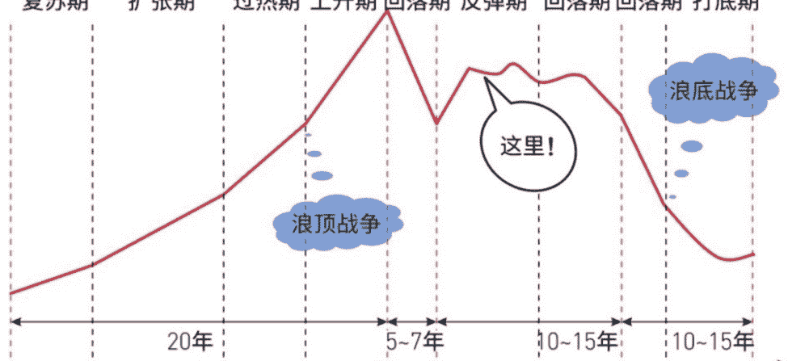

图1-1 经济康波的九阶段波动示意图

资料来源：拉尔夫·艾洛特，《艾洛特波浪理论》。

从康波的形态来看，最复杂的就是衰退阶段，一般来说，衰退阶段首先会呈现一个标志性的经济危机，例如第四康的1971—1973年布雷顿森林体系衰退、2008年的美国次贷危机，事实上都确认了康波进入衰退阶段。而在这一次的冲击之后，世界将来到一个暂时的稳定阶段，两次冲击之间的间隙。间隙期的结束一般以新生的冲击作为标记。我们看到，这次冲击许多进入新兴经济体或资源国，在第四次康波中陷入增长的泥潭。在两次冲击后，康波进入萧条阶段，此时也是一种通胀与滞胀反复的局面。从萧条向通胀的过渡越来越缓慢，要经历10年以上的时间，其中我们可能会看到新兴经济的复苏，比如20世纪80年代到90年代的亚洲小国，它们的复苏就发生在第五次康波的回升阶段。

但是以往的波形来说，衰退和萧条期表现出极其复杂的态势，特别是进入衰退单位后，货币对康波的波动明显增加，第四次康波的起点目前定在1966年，但美国经济增长的高点，随后出现布雷顿森林体系崩溃，属于衰退的结束，但在萧条阶段的第次，1974年和1979年发生两次石油危机。萧条期没有表现出通胀，而是长期的滞胀，这显然与货币因素、政治因素都有关系。

在第四次康波中，实际上日本在1971年之前就已经出现了严重的通胀局面，在1974年石油危机冲击后，通胀与增长的反向关系达到了极值，日本经济走出了明显的V字反转，这也是经典的康波形态（见图-2）。

图-2 第四次康波衰退后的日本CPI

资料来源：CEIC数据库，中信证券研究部。

1966年之后，美国结束了高增长局面，而在1966—1982年，美国始终处于滞胀状态（图-3），这就是康波衰退与萧条期。1982年之后，美国再次进入高增长局面（图-4），直到2007年。2007年后，全球本质是通缩，这一点与经典的康波是一致的，但并不等于康波结束。

图1-3 美国工业产出和CPI

资料来源：Wind资讯，中信证券研究部。

图1-4 美国工业产出产能利用

资料来源：CEIC数据库，中信证券研究部。从产能利用率可以清晰地看到，1983年是产能利用率的低点，也是康波结束和第五次周期复苏的开始。

## 康波中的价格现象

对康波中的价格认识最深刻的是罗斯特，当然在判断第五次周期的时候他也记错了。罗斯特用价格运动来解释康波，他认为康波的基本原因是粮食和初级产品的相对供给匮乏。他认为增长的主导部门，粮食与原材料的价格是驱动康波的关键。这一分支是太阳黑子，因为太阳黑子的变化导致了价格波动。现在看来，这个分支对于研究农业具有重要意义。

罗斯特的《为什么穷者穷富者富》书中写道：“第一个周期上升期，价格上涨有66%发生在1799年和1801年；在第二个上升期，价格上涨71%发生在1852年和1854年；在第三个上升期，价格上涨有75%发生在1898年和1900年；在1973~1975年，世界经济经历了这种婴儿增长。”罗斯特注意到康波波动的顶点，物价在三年内猛涨60%~70%乃至两倍以上，应当从实物而不是货币方面分析这种现象。

对周期而言，康波的剧烈波动是有别于其他周期的特征，这种价格剧烈波动集中在衰退阶段。罗斯特观察了这种价格波动的基本特征，即价格的波动在一段时间内急剧，最终对经济造成冲击（见图-5）。这实际上就是所谓的康波衰退的冲击，而这种冲击一般于康波衰退，但在第四次波中，冲击贯穿了整个衰退和萧条。

资料来源：Wind资讯。在这里的核心问题是，到底是什么构成了康波价格的突然行情，目前的解释集中于三个原因。第一个是创新，即罗斯特的主导部门的问题，由于新的技术发明对劳动生产率的提升作用在繁荣的高潮期开始变弱，增长更多依赖于投资，从而造成价格上涨，这是一个常见的供需解释。第二个是关于进口国的工业化问题，由新国家的工业化导致了世界资本主义主体的转型，对原材料的需求突然增加，从而加剧了价格波动，我们认为这是核心原因。第三是关于农业及初级材料的属性问题，这个问题被某些研究者认为是康波价格波动的原因。但对于农业，我们可以用一种理论来理解价格波动的原因。

在第四次波动之后，世界货币位制彻底与黄金挂钩，初级产品价格水平呈现一个中枢上升的态势。货币位制的变化改变了价格波动的中枢，但没有改变价格波动的形式。价格中枢的上升是全球黄金本位的消失的结果，但康波认为，价格的波动应当用黄金的购买力衡量。如果发现，黄金原油价格比率能够间接解释价格的波动，我们发现（图1-6），这就解释了我们上述的观点。

图-1-6 全黄金-原油价格比率

资料来源:CEIC数据库。

## 康波商品价格初级产品的解释

关于康波商品初级产品的解释，罗斯特认为，初级产品部门（含能源、原材料和食品）生产能力的不能和生产能力的过剩交替过程引起，因为这些产品的需求不能平稳发展。原因在于：(1)在获得能力出现和做出决策之间存在延迟；(2)在完成周期和有效利用之间存在延迟。实际上，大宗商品价格本身会经历中期和长期的波动，这是一个比较简单的供需机制。康波研究的意义在于，价格在繁荣顶点之后出现突然变化，即所谓的大宗商品在长期周期中经历了衰退和繁荣阶段，主要在该阶段维持稳定。从康波格局看，大宗商品所需的边际增长应该被视为一个积累的结果，这是由于技术创新推动效率提升，而当效率提升缓慢时，增长更多依赖于投资，供需的平衡发生了变化。从图-7我们可以看出美国要素生产率的增长在2003年达到高点，而2002年之后，正是康波的启动点。

图-7 美国要素生产率的增长、资本投入对产出的贡献

资料来源：美国统计局。在第四次康波中，美国要素生产率在1966年附近达到高点，这是康波繁荣的顶点，经历了波动之后，要素生产率的低点出现在1982年，即康波结束点（见图-8）。

图-8 美国的技术进步（要素生产率）

资料来源：A. Steven Englander. Total Factor Productivity: Macroeconomic Aspect of the slowdown.http://www.oecd.org/eco/outlook/352378.pdf.

还有一个问题，就是牛鞭效应，由于上游资源处于供应链的最端，其波动性是最大的。

### 牛鞭效应

牛鞭效应的基本是：当供应链上的每个节点企业根据自身相邻下游的需求信息进行生产或者供应决策，需求信息沿着供应链逆流而上，产生逐级放大现象。当信息到达最远端时，其获得的需求和实际消费产生了巨大的偏差。由于这种需求放大的影响，供应维持比需求更高的库存水平或生产计划（见图-9）。

CPI（左）—PPI（左）—PPI半成品（左）—原材料与初级产品（右）

图1-9 生产过程的价格波动

资料来源：Wind资讯。但是20世纪70年代之后，世界变得尤其复杂，第五次波动出现了明显的全球化特征（见图-10），更多需要全球模式来解释。世界的低通胀主要依靠中国的低成本来承担，这是在2010年盛行的一种对通胀的解释。但当2012年大市场出现头部之后，虽然全球的模式依然存在，但世界经济进入通缩的趋势已经非常明显，这里的核心问题是，全球分工不会改变周期的秩序，自英国工业化以来，新的国家和人口被纳入资本主义体系，但并未改变周期波动的本质。从康波意义上讲，更多的人口加入资本主义体系后，波动变小了，而是变大了。

| 资源 | 产品 | 半成品、外贸 | 消费国 |
| :--- | :--- | :--- | :--- |
| 澳大利亚、巴西、沙特、俄罗斯、南非等 | 德国、日本、中国等 | 原材料 | 美国为主 |
| | | 商品 | 资本 |

图1-10 全球产业链及其关系

资料来源：全绘制。

## 康波衰退和萧条周期的滞涨和通缩

第五次康波以来，并没有出现类似第四次康波的滞涨问题，而是表现出明显的波动特征，这却是需要讨论的。对于这一点的解释对我们判断处于末期中期的价格形势非常重要。为了研究这个问题，我们努力寻找最有代表性的序列却是美国的CPI，美国的CPI和PPI长期看是一致的，所以我们以康波划分分国的CPI趋势，得到的结论确实非常有意义。

从图1-11来看：（1）康波的繁荣期百分之百的价格平稳；（2）康波的回升期中间中有两次价格平稳；（3）康波的衰退期百分之百的剧烈波动；（4）康波的萧条期百分之百高高落落。这个研究的意义在于，它说明我们处于衰退即将结束、向第五次康波萧条过渡的阶段，而此时当全球处于货币量释放后的通缩期，康波的规律向我们展示，目前处于价格低点的概率非常高，未来我们研究的重点不是如何防范通缩，而是如何应对通胀。

图1-11 康波各阶段的价格表现

数据来源：DATASTREAM。康波中的能源

1983年，日本经济学家罗斯特在他的著作《经济的长期波动与能源》中研究了康波中的能源问题，他研究了日本和美国一次能源对生产总值的弹性，并得出了结论：(1)从长期来看，弹性值趋于一。在约100年的时间内，尽量出现巨大的产业和社会结构变化，但作为生产和最终消费品的能源消费增长率基本上与增长率相似。(2)从长期来看，弹性值趋于一，但仍有一定的波动，受到很大的干扰。日本从1947年到1954年，美国从1930年到1940年，弹性波动都很大，期间出现弹性水平急剧下降。(3)经济增长率发生变化，能源消费结构不能适应这种瞬间的变化，经济增长率下降后的几年，弹性值仍上升，进入下降，从而形成底。我们观察美国的长期一次能源供给对生产总值的弹性，美国出现弹性值超过1，与生产总值趋势背离的阶段，一次是1911—1922年，一次是1972—1976年，这两次处于康波繁荣向衰退的过程。在之后，美国的核心CPI直到1980年看到最高点，因此第二次石油机的发生也许只能解释为偶然因素（见图-12）。

| 千吨油量 (%) |
| :--- | :--- |
| 500,000 | 5.00 |
| 300,000 | 4.00 |
| 100,000 | 3.00 |
| 900,000 | 2.00 |
| 700,000 | 1.00 |
| 500,000 | 0 |

图1-12 美国能源消耗和消费速度

资料来源:Wind资讯。但是，我们需要理解为什么经济衰退仍然会出现期的价格上涨，这就存在能源消费的惯性规律。对此，罗斯特解释：“在石油危机后，尽管能源价格发生了，但是日本战后近30年积累的多种产业和消费结构难以以价格变化而迅速转换。20世纪60年代末到1978年前，日本弹性超过1，正是由于这一时期带有前一时期影响的惯性时期。当弹性下降趋势时，情况却相反”。2000年之后，美国的能源消耗速度是下降的，而石油的价格是上涨的（见图-13），所以不能用供给解释价格长期波动的原因，这是我们一致的观点，能源价格的波动是一个长期积累的结果。

资料来源：Wind资讯。上面只是完成工业化的国家的情况，对康波资源价格影响最大的是追赶国的工业化，这就是所谓的领先四国理论的基础。追赶从繁荣期到衰退期进入工业化阶段，这是康波中的一个重要现象，包括第二次康波中的日本和第五次康波工业化的中国，都具有类似的情况。从工业化过程中各国的能源消耗将会呈现一个U型的结构，我们认为，在崛起的时候，对资源品种价格影响最大。在第四次康波中日本的工业化可以看出，日本工业化经济增速的高点在1964年，一次能源消耗的同比增长率高点落年后，1967年出现，而彼第四次康波能源物资刚刚开始。四年后森林体系被破坏视为第四次康波衰退的第一次冲击，1974年发生第一次石油冲击的时候（1974年石油危机是康波衰退的第二次冲击，是衰退的结束），日本一次能源消耗的同比增速早已回落（见图-14），所以我们一直认为康波资源是一个积累的结果，长期供需并不是核心原因。

图1-14 能源消费增速和产出缺口

资料来源：Wind资讯。在第五次康波工业化起的中国，其中一次能源消费增速从1998年开始启动，这正处于低点附近。在2004年之后，中国再次进入高增长，直到2007年，全球本质是通缩（见图-15）。这进一步证了能源结构的滞后性问题。

1-15 中国能源消费增速和产出缺口

史理来看，70年代才形成OPEC（石油输出组织）供给夺头垄断，在此之前，石油的定价权完全掌握在英美石油公司手中。直到90年代之后，期货与金融因素对油价的影响逐渐加大，最终产生了由OPEC、石油需求和国际石油资本共同决定的局面，国际油价至此基本实现市场定价。这也回答了为什么20世纪90年代之前能源价格波动较小，且与工业金属价格波动关联性较小。

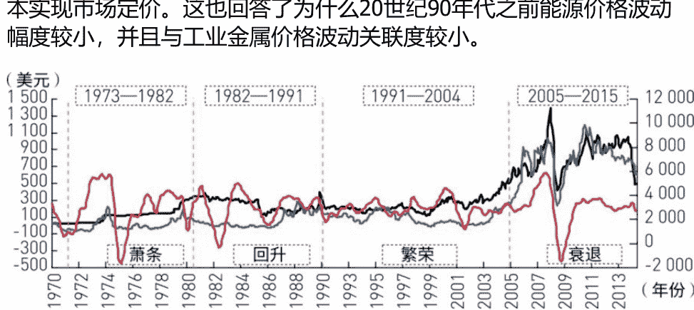

### ▲图1-16 油价、铜价和美国产出口

资料来源:CEIC数据库。

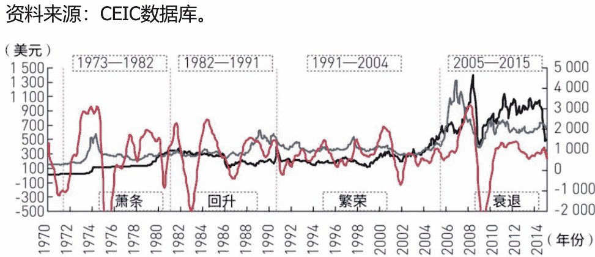

### ▲图1-17 油价、锌价和美国产出口

资料来源:CEIC数据库。

| (美元) | 1973-1982 | 1982-1991 | 1991-2004 | 2005-2015 |
|---|---|---|---|--|
| 1500 | | | | | 4000 |
| 1300 | | | | | 3000 |
| 1100 | | | | | 2000 |
| 900 | | | | | 1000 |
| 700 | | | | | |
| 500 | | | | | |
| 300 | | | | | |
| 100 | | | | | |
| -100 | | | | | -1000 |
| -300 | | | | | -2000 |

图1-18 太阳油价格、铝价和美国产出缺口

资料来源:CEIC数据库。

## 康波中的农业和太阳黑子

在早期的研究中，农业一直是一个重要的研究对象，英国统计学家海姆·克拉克在1847年发现了54年为周期的欧州饥荒的长期波动。其中最亮的是威廉·士士文，他在论文《商业危机和太阳黑子》中推定平均为10.45年的太阳黑子周期。但是20世纪70年代第四次康波规律的时候，农业几乎成为一个足够的问题，这与社会农业对经济影响的弱化有关。农业与其他其它品种相比，特殊性在于它的供给受天气的极大影响。所以，农业价格的研究逻辑一直十分关注太阳黑子活动。我们也试图观察农业的价格波动序列，但从真实的统计数据看，农业价格并未表现出明显的周期波动特点，反而受到施贝循环的直接影响，所以目前的证据无法证明农业价格存在与康波周期相同的波动。

## 太阳周期与康波

世界是广泛联系的，与康波的三周期迭代模式最相似的就是太阳黑子周期。太阳黑子周期显著的影响是通过影响气候影响农产品产量，这是与波浪周期直接的联系。事实上，进入工业化社会之后，农产品价格对周期的长期影响远没有显著的，但周期理论的一个重要分支其实太阳黑子对周期循环模式的影响有深入的研究。研究者认为，除了农产品价格，太阳黑子以一种未知的原因影响人类的情绪和商业行为，从而为决定周期的另一个重要要素。

前对太阳黑子活动的周期性研究，将太阳黑子活动分为以下几个周期：尼尔诺循环（2~7年）、太阳周期（施瓦贝循环，约11年）、太阳磁活动周期（海定律），约22年）、吉姆斯循环（约55年）。国际文学界以1755年3月为太阳黑子活动周期元年，到2013年已经经历了23个完整的黑子周期和4个吉姆斯循环（图1-19）。

2008年3月以来的第4周，处于第五个大周期的第四个周期内，从月度太阳周期数据来看，最大值历史周期低值，说明本次周期相对较高（1-3）。

| I 56.8 | II 55.3 | III 56.4 | IV 52.8 | V 2013年3.8年 ...... |
|---|---|---|---|---|
| 1749/0/07 | 1754/0/07 | 1753/0/07 | 1727/0/07 | ... |
| 1750/0/07 | 1755/0/07 | 1762/0/07 | 1728/0/07 | ... |
| 1751/0/07 | 1756/0/07 | 1763/0/07 | 1729/0/07 | ... |
| 1752/0/07 | 1757/0/07 | 1762/0/07 | 1730/0/07 | ... |
| 1753/0/07 | 1758/0/07 | 1771/0/07 | 1731/0/07 | ... |
| 1754/0/07 | 1759/0/07 | 1770/0/07 | 1732/0/07 | ... |
| 1755/0/07 | 1760/0/07 | 1779/0/07 | 1733/0/07 | ... |
| 1756/0/07 | 1761/0/07 | 1778/0/07 | 1734/0/07 | ... |
| 1757/0/07 | 1762/0/07 | 1777/0/07 | 1735/0/07 | ... |
| 1758/0/07 | 1763/0/07 | 1776/0/07 | 1736/0/07 | ... |
| 1759/0/07 | 1764/0/07 | 1785/0/07 | 1737/0/07 | ... |
| 1760/0/07 | 1765/0/07 | 1784/0/07 | 1738/0/07 | ... |
| 1761/0/07 | 1766/0/07 | 1783/0/07 | 1739/0/07 | ... |
| 1762/0/07 | 1767/0/07 | 1782/0/07 | 1740/0/07 | ... |
| 1763/0/07 | 1768/0/07 | 1826/0/07 | 1741/0/07 | ... |
| 1764/0/07 | 1769/0/07 | 1815/0/07 | 1742/0/07 | ... |
| 1765/0/07 | 1770/0/07 | 1814/0/07 | 1743/0/07 | ... |
| 1766/0/07 | 1771/0/07 | 1813/0/07 | 1744/0/07 | ... |
| 1767/0/07 | 1772/0/07 | 1812/0/07 | 1745/0/07 | ... |
| 1768/0/07 | 1773/0/07 | 1811/0/07 | 1746/0/07 | ... |
| 1769/0/07 | 1774/0/07 | 1810/0/07 | 1747/0/07 | ... |
| 1770/0/07 | 1775/0/07 | 1809/0/07 | 1748/0/07 | ... |
| 1771/0/07 | 1776/0/07 | 1808/0/07 | 1749/0/07 | ... |
| 1772/0/07 | 1777/0/07 | 1807/0/07 | 1750/0/07 | ... |
| 1773/0/07 | 1778/0/07 | 1806/0/07 | 1751/0/07 | ... |
| 1774/0/07 | 1779/0/07 | 1805/0/07 | 1752/0/07 | ... |
| 1775/0/07 | 1780/0/07 | 1804/0/07 | 1753/0/07 | ... |
| 1776/0/07 | 1781/0/07 | 1803/0/07 | 1754/0/07 | ... |
| 1777/0/07 | 1782/0/07 | 1802/0/07 | 1755/0/07 | ... |
| 1778/0/07 | 1783/0/07 | 1801/0/07 | 1756/0/07 | ... |
| 1779/0/07 | 1784/0/07 | 1800/0/07 | 1757/0/07 | ... |
| 1780/0/07 | 1785/0/07 | 1799/0/07 | 1758/0/07 | ... |
| 1781/0/07 | 1786/0/07 | 1798/0/07 | 1759/0/07 | ... |
| 1782/0/07 | 1787/0/07 | 1797/0/07 | 1760/0/07 | ... |
| 1783/0/07 | 1788/0/07 | 1796/0/07 | 1761/0/07 | ... |
| 1784/0/07 | 1789/0/07 | 1795/0/07 | 1762/0/07 | ... |
| 1785/0/07 | 1790/0/07 | 1794/0/07 | 1763/0/07 | ... |
| 1786/0/07 | 1791/0/07 | 1793/0/07 | 1764/0/07 | ... |
| 1787/0/07 | 1792/0/07 | 1792/0/07 | 1765/0/07 | ... |
| 1788/0/07 | 1793/0/07 | 1791/0/07 | 1766/0/07 | ... |
| 1789/0/07 | 1794/0/07 | 1790/0/07 | 1767/0/07 | ... |
| 1790/0/07 | 1795/0/07 | 1789/0/07 | 1768/0/07 | ... |
| 1791/0/07 | 1796/0/07 | 1788/0/07 | 1769/0/07 | ... |
| 1792/0/07 | 1797/0/07 | 1787/0/07 | 1770/0/07 | ... |
| 1793/0/07 | 1798/0/07 | 1786/0/07 | 1771/0/07 | ... |
| 1794/0/07 | 1799/0/07 | 1785/0/07 | 1772/0/07 | ... |
| 1795/0/07 | 1800/0/07 | 1784/0/07 | 1773/0/07 | ... |
| 1796/0/07 | 1801/0/07 | 1783/0/07 | 1774/0/07 | ... |
| 1797/0/07 | 1802/0/07 | 1782/0/07 | 1775/0/07 | ... |
| 1798/0/07 | 1803/0/07 | 1781/0/07 | 1776/0/07 | ... |
| 1799/0/07 | 1804/0/07 | 1780/0/07 | 1777/0/07 | ... |
| 1800/0/07 | 1805/0/07 | 1779/0/07 | 1778/0/07 | ... |
| 1801/0/07 | 1806/0/07 | 1778/0/07 | 1779/0/07 | ... |
| 1802/0/07 | 1807/0/07 | 1777/0/07 | 1780/0/07 | ... |
| 1803/0/07 | 1808/0/07 | 1776/0/07 | 1781/0/07 | ... |
| | | | | (年/月)

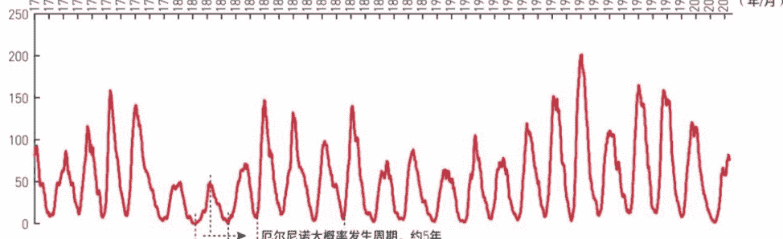

- 尼尔诺大发生周期，约5年
- 太阳黑子活动周期-施瓦贝循环，约11.2年
- 磁活动周期-太阳周期x2，海定律，约22年
- 一个完整的黑子活动周期，吉姆斯循环，约55年

### 图1-19 1749年到2013年的23个施瓦贝循环和4个吉姆斯循环资料来源：NASA（美国航空航天局）。

### 表1-3 1755年至2015年的太阳黑子活动周期（月）

## 1755年至2015年的吉姆斯循环与施瓦贝循环 周期 最大值 最小值 均值

| | | | 周期 | 最大值 | 最小值 | 均值 |
|---|---|---| --- | --- | --- | --- |
| 第1周 | 第1周 | 1755年3月 — 1766年6月 | 136 | 107.2 | 0 | 41.66 |
| | 第2周 | 1766年6月 — 1775年6月 | 108 | 158.2 | 0 | 59.46 |
| | 第3周 | 1775年6月 — 1784年9月 | 111 | 238.9 | 1 | 66.7 |
| 第4周 | 1784年9月 — 1798年5月 | 164 | 174 | 0 | 61.53 |
| | 第5周 | 1798年5月 — 1810年10月 | 163 | 62.3 | 0 | 21.03 |
| | 第6周 | 1810年10月 — 1823年5月 | 137 | 96.2 | 0 | 20.46 |
| | 第7周 | 1823年5月 — 1833年11月 | 126 | 106.3 | 0 | 37.89 |
| 第2周 | 第8周 | 1833年11月 — 1843年7月 | 116 | 206.2 | 1.4 | 67.39 |
| | 第9周 | 1843年7月 — 1855年12月 | 149 | 180.4 | 0 | 55.73 |
| | 第10周 | 1855年12月 — 1867年3月 | 135 | 116.7 | 0 | 48.56 |
| | 第11周 | 1867年3月 — 1878年12月 | 141 | 176 | 0 | 53.17 |
| | 第12周 | 1878年12月 — 1890年3月 | 135 | 95.8 | 0 | 34.10 |
| | 第13周 | 1890年3月 — 1902年2月 | 143 | 129.2 | 0 | 38.71 |
| | 第14周 | 1902年2月 — 1913年8月 | 138 | 108.2 | 0 | 32.29 |
| | 第15周 | 1913年8月 — 1923年8月 | 120 | 154.5 | 0 | 44.35 |
| | 第16周 | 1923年8月 — 1933年9月 | 121 | 108 | 0.2 | 40.98 |
| | 第17周 | 1933年9月 — 1944年2月 | 125 | 165.3 | 0.3 | 57.61 |
| 第4周 | 第18周 | 1944年2月 — 1954年4月 | 122 | 201.3 | 0.2 | 74.50 |
| | 第19周 | 1954年4月 — 1964年10月 | 126 | 253.8 | 0 | 91.06 |
| | 第20周 | 1964年10月 — 1976年6月 | 140 | 135.8 | 4.3 | 60.32 |

## 1755年至2015年的吉姆斯循环与施瓦贝循环 周期 最大值 最小值 均值

| | | | | 周期 | 最大值 | 最小值 | 均值 |
|---|---|---|---| --- | --- | --- | --- |
| 第V周 | 第21周 | 1976年6月 — 1986年9月 | 123 | 188.4 | 1.1 | 81.16 |
| | 第22周 | 1986年9月 — 1996年5月 | 116 | 200.3 | 2.4 | 80.63 |
| | 第23周 | 1996年5月 — 2008年3月 | 142 | 170.1 | 0.9 | 57.19 |
| | 第24周 | 2008年3月 — 2015年2月 | 83 | 102.3 | 0 | 41.58 |

资料来源：NASA。太阳黑子循环基本对应康波模式的每个周期（见图-20）。尼尔诺循环（约7年）、施瓦贝循环（约11年）、海定律（约22年）、吉姆斯循环（约55年）对应康波周期。

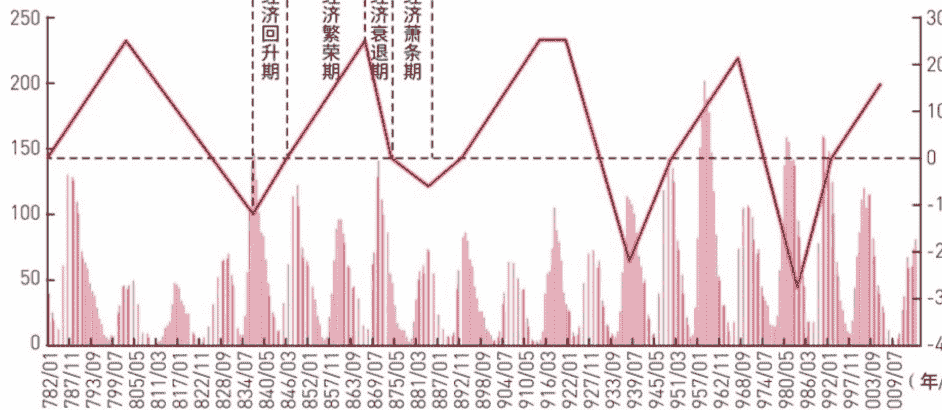

## 农产品价格的周期

我们的研究，农产品价格并不显著偏离周期，反而与施贝循环（约11年）有着较强的关系，这一点将在后面的章节中详细谈到。当然，在康波的高潮期，农产品价格也出现波动大的特点，例如在20世纪70年代石油危机和2007年危机前。并不是天气造成的农产品波动，仍然从需求角度看，农业出现天气影响以及长周期波动的特点。也就是说，供给不是周期的原因。天气对农产品价格的影响更多属于施贝循环的级别，而在一个康波中，尼尔诺循环带来农产品价格短期波动。

太阳黑子活动施贝循环和尼尔诺周期与全球农产品价格表现出相关。我们将1866年来的太阳黑子活动与玉米、大豆、小麦的价格相比，发现了非常显著的负相关关系，即太阳黑子多、活动频繁时，由于气候温暖湿润，大宗农产品产量增长；而太阳黑子较少时，该段时间农产品产量处于低点，价格有上扬趋势（见图1-21至图1-24）。

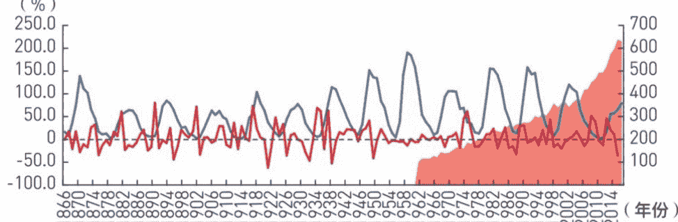

- 玉米产量（右）—太阳黑子（左）—玉米价格涨跌幅（左）

### ▲图1-21 1866—2014年太阳黑子数与玉米涨跌幅和小产量

资料来源：美国农业部（USDA）。

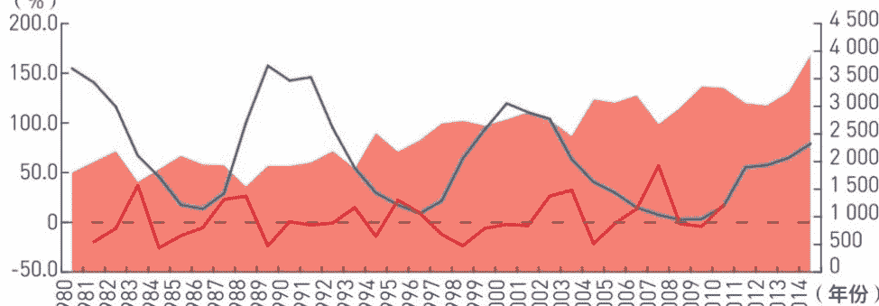

- 大豆产量（右）—太阳黑子（右）—大豆价格涨跌幅（左）

### ▲图1-22 1980—2014年太阳黑子数、大豆价格涨跌幅和大产量

资料来源：美国农业部。

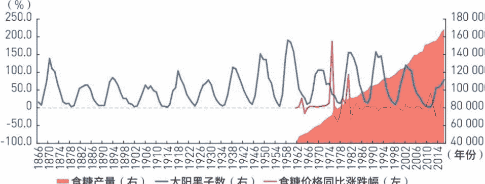

### ▲图1-23 1866—2014年太阳黑子数、糖价格涨跌幅和糖产量

资料来源：美国农业部。

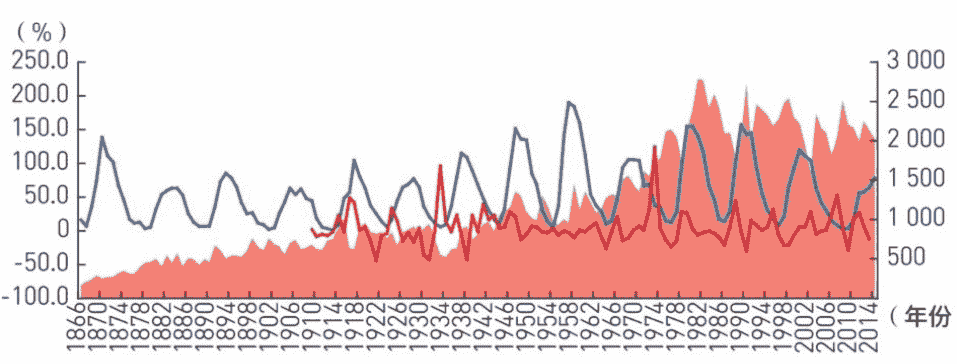

### ▲图1-24 1866—2014年太阳黑子数、小麦价格涨跌幅小麦产量

资料来源：美国农业部。

从第四次康波来看，农产品价格的下降在1964年达到低点，从南方涛动指数来看，1972—1973年出现了尼尔诺，推动了农产品价格上涨，并随之发生两次石油危机和大商品价格上行。1982—1983年，发生超强亚洲尼尔诺，农产品价格被推向高峰。但是，在第五次康波中，1997—1998年的超强尼尔诺并没有带动价格上行，反而在2000年后没有发生超强尼尔诺的情况下，商品牛市出现了（见图1-25）。从这个角度看，太阳黑子确实不是农产品的长周期动力来源，更多影响短周期价格波动。

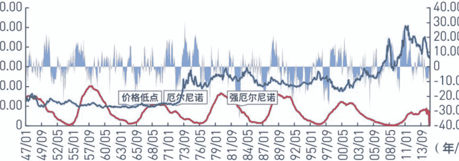

图1-25 尼尔诺循环与农产品价格

资料来源：美国农业部，周金涛绘制：

## 康波中的黄金

在康波中，黄金作为货币，其价格理论上与大宗商品的总体走势一致，但事实并非如此。黄金与货币脱钩之后，这个关系变得很复杂。最核心的变化是，黄金虽然不再是货币，仍然有货币属性，当货币体系发生波动时，黄金的价格变化则表现出明显的独立走势，显示出黄金的信用特征（可参考图1-26）。

图1-26 全球黄金价格的长期趋势

资料来源：彭博。

1盎司≈28.35克。——编者注

货币体系本位互拆之后，黄金价格的波动开始加大，从1967年开始，黄金价格大幅波动，这实际上都是黄金的名义价格。全球黄金的需求在很大程度上受到投资需求的影响，投资需求的变化主要受到通胀率、美元汇率、避险需求三个因素的影响，所以黄金价格最终是由其货币属性决定的。研究者发现，历史黄金价格与美国CPI基准指数的平均值，这可以视为黄金购买力的指标（可参考图1-28、1-29）。剔除美国的通胀率后，可以得出黄金实际价格的长期趋势（见图1-27）。从实际价格趋势看，黄金的价格范围内一剧波动，而波动的特征与黄金的价格波动一致，这就是黄金理论上就是大宗商品一般的等价物。

(美元/盎司)

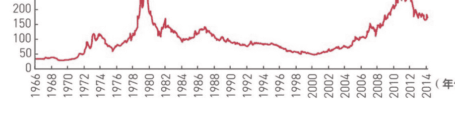

▲图1-27 1966—2014年全球黄金实际价格的长期趋势

注：黄金实际价格等于黄金名义价格除美国CPI指数（城市），后者的基期为1967年。资料来源：CEIC数据库。

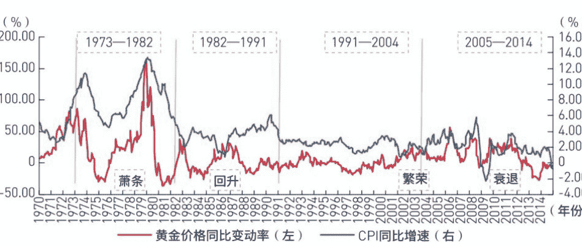

### 图1-28 黄金价格相同变动率与美国CPI对比增速

注：美国CPI指数为城市CPI指数。

资料来源：彭博，CEIC数据库。

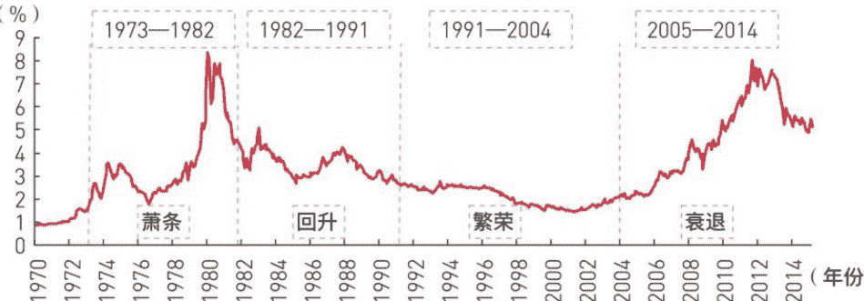

### 图1-29 黄金价格与美国CPI指数比率

注：美国CPI指数的基期为1982—1984年，即1982—1984年的CPI为100。

资料来源：彭博，CEIC数据库。

除此之外，黄金作为避险的货币，对其购买力的检验依据其相对于其他大宗商品的价格比率。在这方面，黄金-原油价格比率是被广泛使用的指标（可见1-30）。根据研究，自1971年美元与黄金价格脱钩以来，黄金的美元价格与原油的美元价格保持着很强的相关性，在布雷森林体系下，黄金-原油的兑换比例大致每盎黄金兑换12.3桶原油。当黄金原油的价格显著脱离这一趋势后，此比率会向一个水平回归，而且主要是靠原油而非黄金的价格波动回归。同样的研究也把这一比率定位于每盎黄金兑换10~15桶原油。

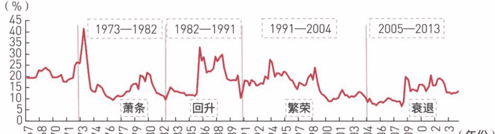

图1-30 全球黄金-原油价格比率 资料来源：CEIC数据库。

解释完黄金的康波货币属性后，问题的关键还是要看黄金脱离其中的原因。黄金对通胀率的脱离和其对黄金-原油价格比率的脱离是两个问题。黄金对通胀率的脱离实际上就是所谓的“布莱恩顿悖论”，即将扣除通胀的实际利率充当持有黄金的成本，实际利率低则黄金价格向上。从图1-31中我们可以看出，在康波的萧条、回升及衰退阶段，黄金价格与实际利率的负相关确实存在，但在繁荣期，这种关系基本上不存在，甚至实际上是康波中不同阶段大宗商品的表现不同所导致。

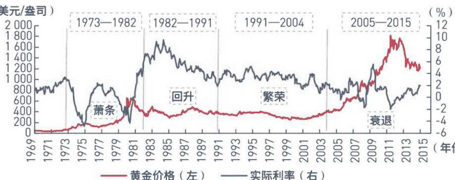

图1-31 黄金价格与美国实际利率

注：美国实际利率对10年国债收益率减去美国城市CPI的增速。

资料来源：CEIC数据库。

关于黄金价格对商品购买力的波动，本质上完全是康波问题，更可能是因素导致的，包括商品自身的因素和黄金价格的因素（见图1-32）。从现有数据来看，黄金在大波范围内表现出了大宗商品的滞后性，比如2004-2007年，黄金显然落后于大宗商品。我们认为与黄金的货币属性有关，波动衰退的前半期主要表现为大宗商品价格，在此之后源于两个原因：其一，货币体系动，避险情绪的出现；其二，货币政策带来的实际利率的低位。可以推测由于整个萧条期实际利率是一个方向，未来黄金对大宗商品依然存在。

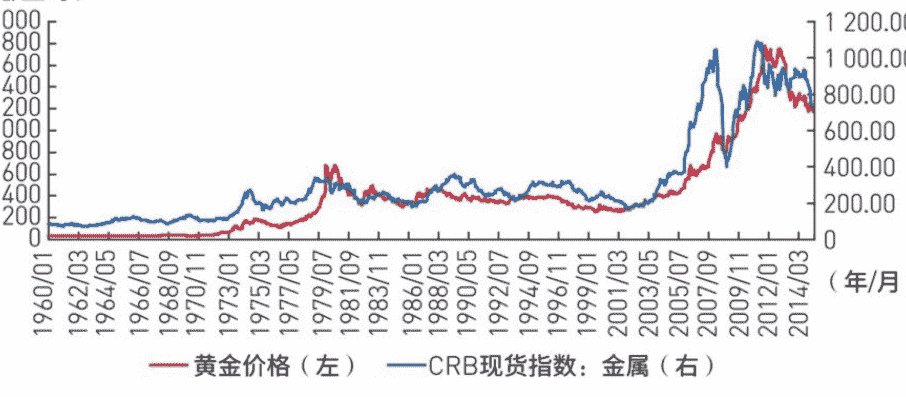

图1-32 黄金价格与金属现货指数的对比 资料来源：CEIC数据库。

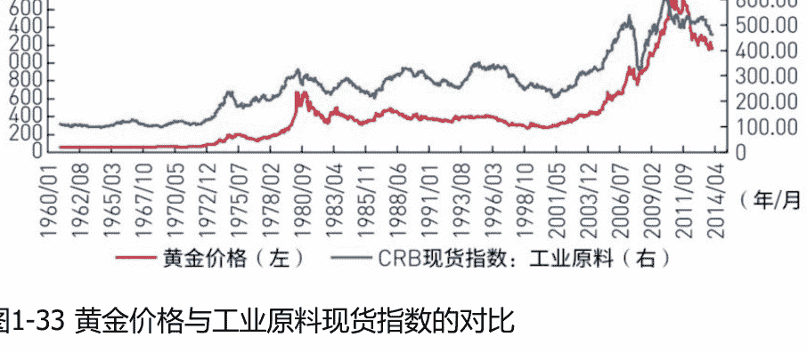

图1-33 黄金价格与工业现货指数的对比 资料来源：彭博，CEIC数据库。

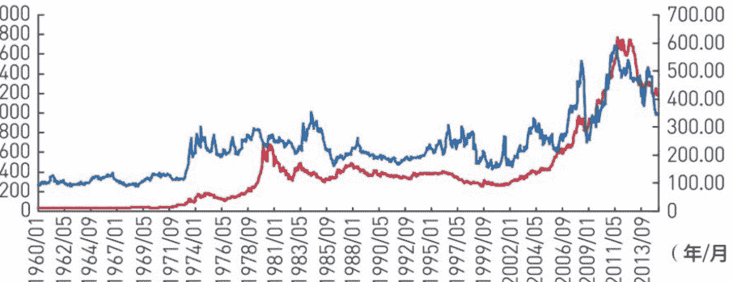

图1-34 黄金价格与油脂现货指数的对比 资料来源：彭博，CEIC数据库。

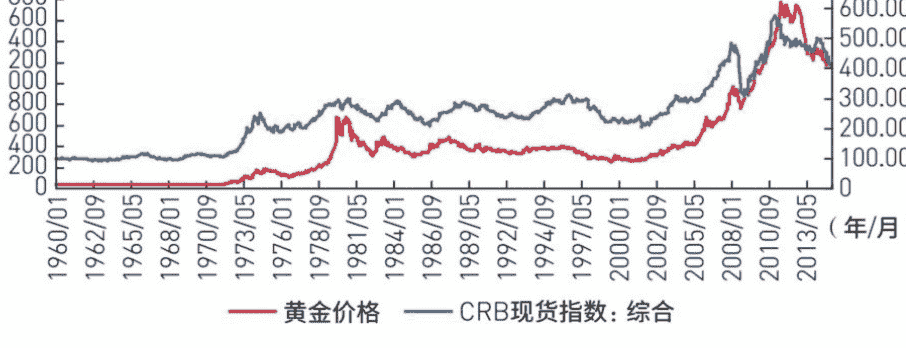

图1-35 黄金价格与CRB现货指数的对比 资料来源：彭博，CEIC数据库。

## 第五次康波的价格波动

关于第五次康波周期的研究

关于第五次康波的研究，我们从2006年就开始进行。2006年我们发表了《利率如此》、《国际博弈》，在摘要中指出：“当经济面临的周期与70年代初期相似，以美国经济为中心的世界模式面临信用的危机，而这种危机在货币波动、全球通胀的推动下有可能压缩货币政策的调整空间，并由此出现的金融动荡趋势，这一点是2008年决定全球市场走势的根源”，我们成功判断了康波的到来。

2008年我们发表了《向东终结》，指康波最剧烈的阶段已经过去，经济将出现反转。随后我们发表了《资源约束、信用膨胀与美元价值——增长中的通胀》，对康波进行了系统阐述。2009年之后，我们一直专注于房地产周期和库存周期。

2011年是第五次康波的一个关口，大宗商品牛市的第二个头部在2011年第二季度出现（见图1-36）。此时，根据对美国房地产周期的跟踪，我们确认从2011年第三季度地产周期启动。我们认为，长波周期中主导国与其他货币之间的关系会出现周期性波动，长波约15年。短波周期包含3左右周期。从2012年开始，中期周期开始恢复。在中、短波力量的共同作用下，经济正在运行。同时，周期理论可以判断出，世界经济已经改变，欧元将在未来跌20%以上，从而导致美元指数突破700。2014年下半年之后，我们判断随着美元指数的上涨和大宗商品的暴跌，世界经济可能进入康波衰退二次冲击阶段，世界经济将出现动荡加剧的具象。

| | 1948–1966 | 1966–1973 | 1973–1982 | 1982–1991 | 1991–2002 | 2002–2015 |
|---|---|---|---|---|---|---|
| 700.00 | | | | | | |
| 600.00 | 繁荣 | | | | | |
| 500.00 | | 衰退 | | | | |
| | | | | 回升 | 繁荣 | 衰退 |

资料来源：彭博。

## 关于第五次康波周期中的价格波动

第五次康波的大宗商品牛始于2001年至2002年之间，而美国增长的最高峰是在2000年，按照康波的划分，2000年或2002年之后即可被划分为第五次的衰退阶段。2002年之后，大宗商品经历了一个长达10年的周期，其中2008年可以被视为大宗商品牛市的第一头部，2011年可以视为大宗商品牛市的第二个头部。从康波大宗商品牛市的形态上来说，我们可以确认康波大宗商品牛市的结束。自2012年后，大宗商品一直熊市，已有4年的时间，这就是当前价格运行的基本定位。但是问题的复杂性在于，大宗商品的价格表现出什么样的走势，这是当前和未来价格研究中的核心问题。图1-37中的周期分为萧条、回升、繁荣、衰退四个阶段，可以看到2002年后行情启动，2008年和2011年分别出现头部，随后进入熊市。2002年或2004年之后，康波已经确认了繁荣向衰退的转换，而经历了2008年的康波冲击之后，2015年后康波进入第二次冲击阶段并向萧条转换。有一个结论是可以肯定的，即衰退和萧条转换是一个价格低点，这一点为第五次康波的价格形成。

关于第五次康波的价格所证明（见图1-38）。前三次康波的价格表现出了明显的经典周期波动，而第四次康波之后出现了增长周期的形态，这与世界经济的历史趋势相似。所以，可以肯定的第五次康波向萧条转换是一个价格低点，我们不会展望价格可以回到2011年的低点，而是要根据供需关系及市场环境对价格进行深入研究。

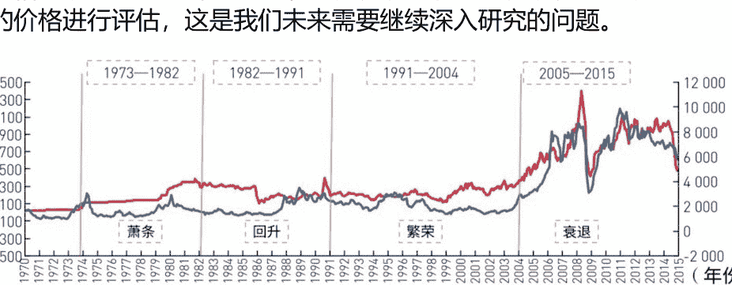

图1-37 第五康波周期中大宗商品的牛转换 资料来源：CEIC数据库。

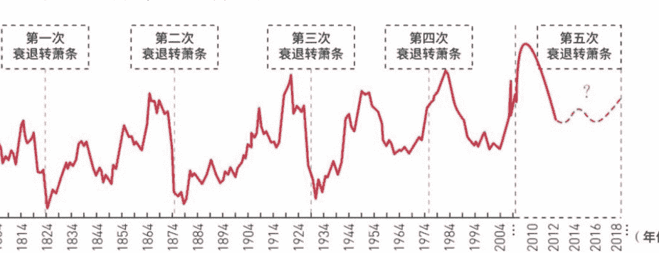

图1-38 每一次康波向萧条的转换是一个价格低点

注：前三次康波的价格波动都是经典周期，第四次康波是增长周期，除了第四次，前三次衰退与萧条的转换都是价格低点。我们推测，第五次衰退与萧期的转换点大致在2016—2018年。资料来源：中信证券。

## 关于大宗商品的中级反弹

从历史的价格运行来看，萧期的开始是一个价格反弹的过程，一个非常重要的问题是这次衰退向萧条的转换在哪里，这也是对商品价格最低点的确认过程。关于这个问题，我们有如下推测：从一般的衰退周期划分来看，康波与萧条的转换应用在中周期的低点。对本次康波而言，衰退与萧条的转换点在2018年。由于是以周期的双底结构来看，底部之前就会出现一次深层的衰退过程，这个过程以现在的世界经济运行状态来说，应该在2015年第四季度至2016年上半年之间，这个位置出现了大宗商品的价格底部。那么在2016—2018年，理论上会出现一次超强反弹的过程，对于这个过程我们可以进一步探寻其理由。

康波中大宗商品的形态是非正常的，由数据的周期性的，我们最多可以研究第四次衰退后的大宗商品价格，而第三次衰退后的大宗商品形态似乎只能用美国的大函数替代研究。从严格意义来说，第四次大宗商品形态是从1980年石油危机之后的开始，这个过程一直持续到2002年结束，历时22年。这22年间，我们可以清晰发现，虽然大宗商品并没有出现衰退意义上的行情，但是从周期的意义来说，每个周期大宗商品都会出现一次行情，正如我们几个样本来看，这个行情概率出现在周期的末尾阶段，基本上位于第三周期的位置。这个问题也不难理解，是周期康套模式的必然。虽然大宗商品处于康波意义上的熊市，但其价格仍然会随着周期波动，而在周期第三周期范围内往往是暴涨阶段，所以出现大宗商品中期反弹性规律是有。

## 关于第五次康波周期中价格的研究后续问题

我们已经说明，大宗商品处于一个长期的低点附近，当然从短期的角度看，这个低点需要被反复确认，不是一下就能被确认的。以我们对世界经济周期运动的理解，这个长期低点的确认需要3年以上的时间。但我们对世界经济周期低点的研究（表1-4至表-6），我们认为，在2016年即将启动本次周期第三周期，这个周期源于中国房地产周期的反弹，以及美国房地产的高位延续，周期复苏和货币上涨给全球带来一次小的涨幅潮流，我们认为是商品的一次的机会。而在2018年的周期复苏低点也是商品价格的真实低点。所以，我们就要在这个框架下紧跟美国、欧洲、中国的经济周期运行，判断美元指数的基本趋势，把握低点。

### 表1-4 第一周期：美国大宗资产收益率

| 时间 | 国债收益率 (%) | CPI (%) | 实际房价 (%) | 美元指数 (%) | CRB现货 (%) |
|---|---|---|---|---|---|
| 第一周期 | 1964年9月—1966年8月 | 24.58 | 5.14 | -2.42 | 7.75 |
| | 1975年6月—1977年5月 | -5.09 | 12.50 | 6.55 | 10.23 |
| | 1983年1月—1984年5月 | 28.20 | 5.73 | 0.95 | 13.79 |
| | 1991年4月—1995年1月 | -3.23 | 11.17 | -4.36 | 13.59 |
| | 2002年1月—2002年9月 | -23.21 | 2.20 | 5.45 | -8.89 | 10.58 |
| | 2006年2月—2012年6月 | -56.45 | 6.39 | 10.15 | 2.63 | 29.75 |
| 平均 | -5.87 | 7.19 | -0.66 | 2.87 | 16.51 |

资料来源：中信证券研究部。

### 表1-5 第二周期：美国大宗资产收益率

| 时间 | 国债收益率 (%) | CPI (%) | 实际房价 (%) | 美元指数 (%) | CRB现货 (%) |
|---|---|---|---|---|---|
| 第二周期 | 1967年8月—1969年9月 | 35.61 | 10.75 | -0.08 | 16.07 |
| | 1978年2月—1978年12月 | 22.20 | 7.63 | 5.34 | -7.96 | 13.72 |
| | 1986年11月—1988年5月 | 25.38 | 6.43 | 5.18 | -16.81 | 19.41 |
| | 1996年3月—1997年12月 | -7.34 | 3.60 | 2.66 | 14.20 | -2.63 |
| | 2003年7月—2005年3月 | 13.07 | 5.11 | 16.29 | -13.33 | 18.89 |
| | 2013年8月—2014年11月 | -14.96 | 0.97 | 3.61 | 7.68 | -3.28 |
| 平均 | 10.66 | 5.75 | 5.50 | -3.24 | 10.36 |

资料来源：中信证券研究部。

### 表1-6 第三周期：美国大类资产收益率

| 时间 | 国债收益率 (%) | CPI (%) | 实际房价 (%) | 美元指数 (%) | CRB现货 (%) |
|---|---|---|---|---|---|
| 第三周期 | 1971年1月—1973年11月 | 7.85 | 15.33 | -4.60 | 77.71 |
| | 1980年8月—1980年8月 | 34.59 | 10.80 | -3.93 | 30.45 | -7.37 |
| | 1989年1月—1990年7月 | 5.74 | 3.82 | -2.34 | -9.45 | 2.30 |
| | 1999年1月—2000年5月 | 36.44 | 4.38 | 7.04 | 17.10 | -1.94 |
| | 2005年11月—2008年3月 | -16.82 | 8.06 | -13.51 | -20.84 | 59.45 |
| 平均 | 13.56 | 8.48 | -3.47 | 4.32 | 26.03 |

资料来源：中信证券研究部整理。

### 第三周期上

## 繁荣的起点

《经济恐慌与其周期的再现》书中，研究了英、法、等国家工业设备投资的变动情况，发现了9~10年的周期波动。所以，朱格拉斯周期又称为设备投资周期。这种基于投资的周期在工业化高速增长的过程中表现非常明显。

表2-1和2-2显示的日本高速增长景气循环和日本工业化期间的投资增长率和投资率。

### 表2-1 日本高速增长周期景气循环

| 谷底 | 高峰 | 谷底 | 上升期（月） | 下降期（月） |
| --- | --- | --- | --- | --- |
| 1954年11月 | 1957年6月 | 1958年6月 | 31 | 12 |
| 1958年6月 | 1962年12月 | 1962年10月 | 42 | 10 |
| 1962年10月 | 1964年10月 | 1965年10月 | 24 | 12 |
| 1965年10月 | 1970年7月 | 1971年12月 | 57 | 17 |

▲资料来源：（日）西奈泰者，彭晋译，《高速增长的时代》，贵州人民出版社，1987年。

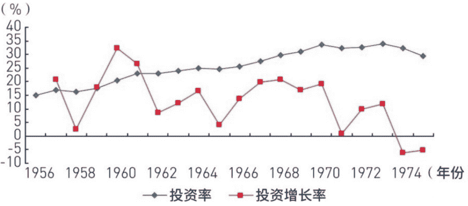

图2-1 日本工业化期间的投资增长率和投资率

资料来源：长江证券研究所。

根据对改革开放后中国经济周期的研究（图2-2），中国从1981年开始已经经历了两个年的中期周期，而本次经济周期从1999年开始起，经历了5年的中上周期之后，已经在2004年第一季度出现头部，连续5个季度回落之后，说明2004年是本次中期周期的头部。当然，这一头部对整个中国的工业化进程具有历史意义。

我们对国际工业化进程的研究，虽然不能认为中国将会再次出现投资拉型的景气，但中国投资增长率的高点可能已经在2004年出现。从工业化国家的历史来看，国际经验证明，人均GDP（国内生产总值）在达到10000美元以后，就是罗斯托所说的起飞前阶段，投资率在到位保持一段时间，这个时间是4~5年。

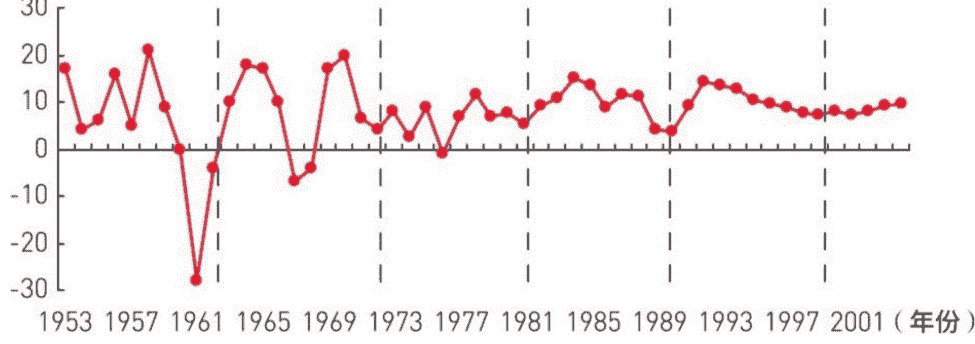

资料来源：上海经济研究所。

这个问题从两个角度来看，一是我们可以认为投资带动的增长是中国未来几年经济增长的重要动力来源。但从另一个角度看，本轮周期固定资产投资增长的高点可能是以后无法逾越的历史高点，中国高速增长的转型周期已经开始。

所以，我们研究的问题就是在经济进入转型期后对经济发展路径做一个全景描述。而这种全景描述将基于工业化过程中的国际比较，并与中国工业化过程中的战略转型相结合。这种描述的重心在于得出产业选择的结论。我们的产业选择也基于工业化中产业发展的基本逻辑。

在工业化的转型期，“产业选择的更迭不会是突发的，工业会多多样化发展，但是必然与以前的主导部门有所联系，在经济增长的过程中，哪个部门成为主导部门，不仅取决于技术条件，也取决于资源禀赋的，取决于起飞阶段的性质和起飞的动力量（罗斯，1960）。这是我们产业选择的基本逻辑。按照这样的原则，我们首先从中国起飞阶段的性质和起飞的动力量入手，从工业化转型期的角度分析未来产业更迭的基本方向。从短期角度来看，这将基于工业化转型期产业更迭的结论与当前的经济周期特征相结合，从而得出完整的产业选择线索。

## 城市化与技术扩散

### 技术创新与技术扩散

发展经济学理论认为，技术创新往往是经济起飞的重要推动力，罗斯也认为，对经济起飞中的主要部门来说，“在这些部门中，创造新或利用旧有的资源或可能尚未开发的可能性，将造成很高的增长率，并带动经济中其他部门的扩张”。虽然技术创新很重要，但对工业化来说，技术创新并非唯一的因素。我们的观点是，中国的高速增长并不是技术创新的结果，而是由技术创新推动的，而且由于城市化带来的工业化进程也有其必然性。实际上，罗斯的技术最早用来解释技术波动，他认为资本主义在发展过程中总体存在三种周期，即长波周期、中周期和短周期，而长达半个世纪的长波周期，其根源在于技术进步的影响深远。根据罗斯的长波周期分析，我们可以得到。

### 表2-2 罗斯的长波周期

| 周期 | 繁荣 | 衰退 | 萧条 | 回升 | 标志性技术 |
| --- | --- | --- | --- | --- | --- |
| 第一个 | 1782—1802 | 1815—1825 | 1825—1836 | 1838—1845 | 纺织机、蒸汽机 |
| 第二个 | 1845—1866 | 1866—1873 | 1873—1883 | 1883—1892 | 钢铁、铁路 |
| 第三个 | 1892—1913 | 1920—1929 | 1929—1937 | 1937—1948 | 电气、化学、汽车 |
| 第四个 | 1948—1966 | 1966—1973 | 1973—1982 | 1982—1991 | 汽车、计算机 |
| 第五个 | 1991—2000 | 2000年— | ? | ? | 信息技术、生物 |

资料来源：罗斯，《技术进步与经济波动：以美国为例的分析，《世界经济》，1986年；2004年。

我们注意到，第一个和第二个长期周期是英国工业化领先，美国和法国等国家处于跟随地位，而第三个长期周期是美国工业化领先，美国成为处于领先的国家。日、美国等国家的工业化繁荣大于第四个长期周期，电气、汽车与发展对德国的工业化起到了很大的作用。而对于中国来说，由于处于领先衰退期，技术创新对中国的推动作用相对弱。实际上，在长期周期的繁荣中，技术进步和模仿对中国经济增长的影响虽然自主技术创新的贡献并不显著。

这种认识的意义在于，从大背景来看，在经济过渡的过程中，我们应该对技术对经济增长带来的影响有一个准确的认识。就中国的工业化进程所处的历史而言，我们的任务是在工业化的过程中完成前三个长期周期内技术创新的引入和吸收，并在过程中将技术创新扩散到每一个领域。虽然技术创新容易被理解为信息技术、生物技术，而对中国更有意义的是铁路技术、新材料技术，这更符合中国在工业转型期技术扩散的特征。

## 城市化动力与城市化深化

由于技术创新对本轮中国工业化的贡献，“利用尚未开发的可能性”（罗斯，1960）使得房地产成为本轮中国经济增长起飞的动力。为什么工业化和城市化由城市化带动，发展经济理论能够做出解释，因为工业化是任何一个经济发展必须经历的空间结构变动与产业结构变动的过程（图2-3）。

研究表明，美国在1820—1950年间，工业化与城市化的相关系数达到0.997，法国在1866—1946年为0.970（周维富，2002）。与工业化相比，中国的城市化就显得滞后了，这是造成本轮工业化由城市化推动的根本原因。

根据城市化发展的S曲线规律（图2-4），目前的城市化率为40.5%，恰好位于城市化的加速发展阶段。发展经验表明，只要不出现外生冲击，城市化将沿着S形轨道加速上升。根据城市研究者（北京大学周一等人）给出的城市化理论模型，y=40.55logx-74.96，其中x代表GDP，折为美元计价，y为城市化率，我们得到2004年后各年的城市化预测增长率（表2-3）。

| 就业增加 | 建设更好的基础设施 |
| --- | --- |
| 人口增加 | 地方财政增加 |
| 城市扩大 | 消费品和工业服务的发展 |
| | 新工业建立 |
| | 外贸贸易扩张 |
| | 税收增加 |

▲图2-3 城市化与工业化协调发展的动力机制

资料来源：邱晓华，《论世界制造业转移与中国经济增长》，北京师范大学博士论文，2003年。

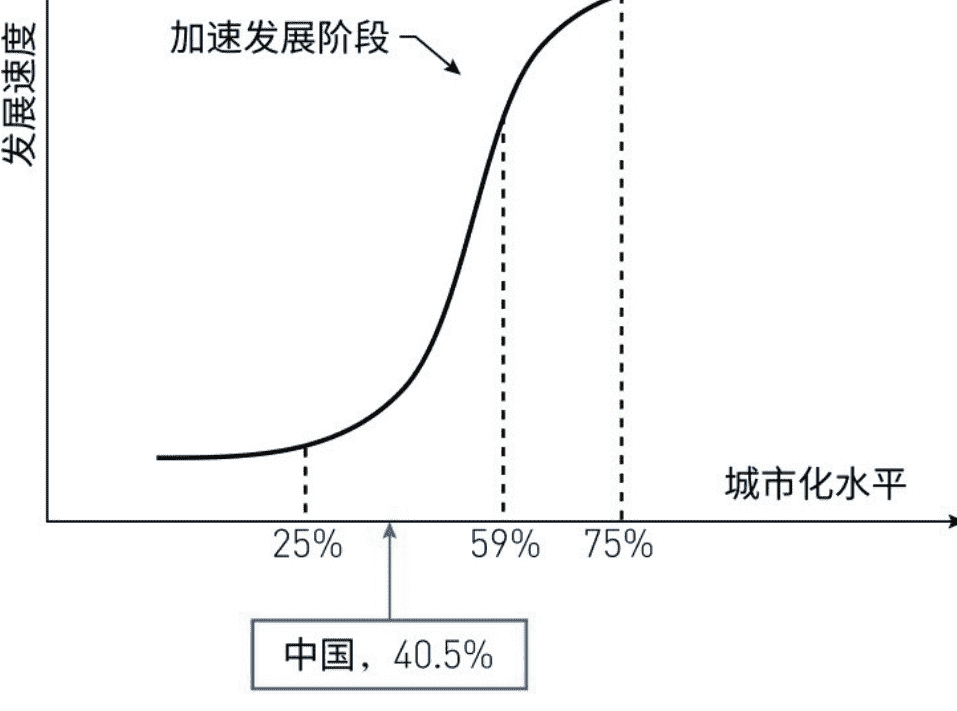

▲图2-3 城市化发展的S曲线

### 表2-3 未来几年城市化预测增长率

| 年份 | 2004 | 2005 | 2006 | 2007 | 2008 | 2009 | 2010 | 2011 |
| --- | --- | --- | --- | --- | --- | --- | --- | --- |
| 预测增长率(%) | 1.51 | 1.36 | 1.19 | 1.03 | 1.03 | 1.03 | 1.03 |

资料来源：长江证券研究所，其中2004年以后的经济增长预测值为6%。

这种认识的意义在于，从大背景来看，在经济过渡的过程中，我们应该对技术对经济增长带来的影响有一个准确的认识。就中国的工业化进程所处的历史阶段而言，我们的任务是在工业化的过程中完成前三个长期周期内技术创新的引入和吸收，并在过程中将技术创新扩散到每一个领域。虽然技术创新容易被理解为信息技术、生物技术，而对中国更有意义的是铁路技术、新材料技术，这更符合中国在工业转型期技术扩散的特征。

我们认为，城市化的作用体现在几个方面：
- 第一个方面：城市化带动了基础设施增长，特别是交通建设将加快。
- 第二个方面：城市化从封闭向开放发展，这主要是指发达地区的交通建设将加快。
- 第三个方面：加强了统一市场的形成，这对于未来发展非常重要。城市化和消费结构升级进一步促进消费需求的增长。
- 第四个方面：城市化进程对服务业发展起到了明显的拉动。

我们讨论的货币政策问题是在周期性衰退中的企业行为。另一个短期周期的问题更加具体，就是周期衰退中的企业行为。在工业化的转型期，价格的下降和产能的过剩企业面临剧烈的竞争，所以衰退是在经济上重新重组和分配资源，使企业能够在新的主部门中进行的过程。企业为了获得生存空间，除了寻找降低成本，进行价格竞争，通常的做法是重组，这种行为总是令人倾津乐道的。

寻找产业周期的底部实际上是针对短周期而言，这一策略完全适用于2006年的市场。根据我们对经济周期的判断和利润增长周期的研究，中国的短周期在2006年出现。我们必须承认，这种判断只是基于统计意义，无论从实证还是从投资的实践指导来看，我们都认为对产业周期的分解是对周期判断的关键。

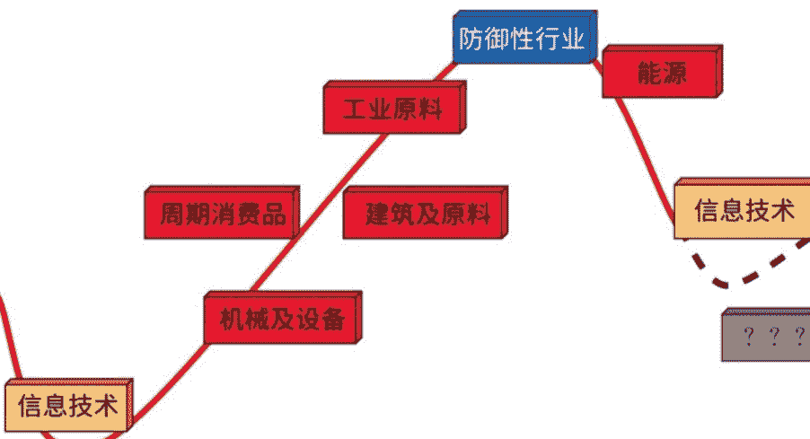

▲图2-5 周期中的产业轮动示意图

资料来源：长江证券研究所。

### 表2-4 本次周期中的产业轮动

| 行业 | 占总流通比重 (%) | 本次景气时间/ 当前状况 | 经济同步性 | 是否会行业性转向 |
| --- | --- | --- | --- | --- |
| 信息技术（GDP敏感部门） | | | | |
| 先于周期，弱增长后的复苏表现强烈 | 信息技术业 | 7.74 | 2000年，复苏期间 | 复苏初期入景气 | 否 |
| | 电子元件 | 1.60 | 2000年，谷位附近 | 复苏初期入景气 | 是 |
| 工业 / 投入品（GDP敏感部门） | | | | |
| 航空运输 | 2.17 | 受油影响明显 | 理论上提前 | 是 |
| 专用设备 | 2.21 | 2002—2003年，在持续 | 复苏中期入景气 | 否 |
| 上升初期表现优异 | 电气机械及器材 | 2.95 | 2002—2003年，回落中 | 提前1~2年 | 否 |
| 建材 | 1.07 | 2003—2004年，谷位附近 | 复苏后期，稍有 | 提前 | 是 |
| 土木工程 | 0.90 | 2003—2004年 | 提前~2年 | 是 |

### 续表

| 行业 | 占总流通比重 (%) | 本次景气时间/ 当前状况 | 经济同步性 | 是否会行业性亏损 |
| --- | --- | --- | --- | --- |
| 消费周期直接相关，其他 | 交通设备 | 2.67 | 2003年，接近谷值 | 提前~2年 | 否 |
| | 日用电子 | 1.43 | 不明显 | 不明显 | 是 |
| | 纺织、服装 | 1.44 | 2002—2003年，回落中 | 提前~2年 | 否 |
| 原材料(GDP敏感部门) | | | | |
| 纸质 | 0.80 | 2002年，回落中 | 接近 | 否 |
| 化学原料及制品 | 0.59 | 2004年，回落中 | 基本同步 | 否 |
| 黑色金属 | 10.41 | 2004年，维持高位 | 基本同步 | 是 |
| 石油加工及炼 | 2.22 | 2004年 | 基本同步 | 是 |
| 煤炭 | 2.33 | 2005年，见顶 | 基本一致，滞后 | 是 |
| 石油和天然气 | 2.26 | 景气中 | 滞后 | 非 |
| 批发和零售贸易 | 4.73 | 景气中 | 不明显 | 否 |
| 食品、饮料 | 2.60 | 2003年，小幅回落 | 表现明显 | 否 |
| 高速市场、港 | 9.12 | 景气中 | 不明显 | 否 |
| 电力、煤气、水 | 10.36 | 2005年 | 基本同步，略有滞后 | 否 |

## 总表

| 行业 | 占总流通比重 (%) | 本次景气时间/ 当前状况 | 经济同步性 | 是否会行业性亏损 |
| --- | --- | --- | --- | --- |
| 房地产 | 3.51 | 2005年见顶 | 基本同步，理论上提前 | 否 |
| 金融、保险业 | 9.01 | 不明显 | 利率敏感 | 否 |
| 传播与文化产业 | 6.19 | 不明显 | 不明显 | |
| 社会服务业 | 1.71 | 不明显 | 不明显 | 否 |

GDP及利率敏感部门 | | | | |
利率敏感部门 | | | | |

注：占总流通比重的样本总体为300股。
资料来源：长江证券研究所

## 全球经济转型中的货币政策

关于寻找产业周期底部的问题将在后文详述。在这里，我们打算讨论两个在短期内至关重要的问题根据根据对工业化转型国际经验的研究，在转型期中货币政策具有重要的作用。中国当前的工业化比日本在20世纪60年代50年代转型期面临更为复杂的局面。日本当时的经济起飞靠布雷顿森林体系与美国的不对称贸易维持了近20年的经济高速增长。20世纪70年代以后才出现布雷顿体系的崩溃从而结束了经济的增长。而现在的工业化水平相当于日本在20世纪60年代的水平，已经出现了汇率升值的问题。在未来的几年里，几个导致日本经济泡沫的基本因素会在中国出现。正如罗斯在《日本经济的辩论》中所言，“迄今为止，中国正在以一种稳定汇率（人民币和美元挂钩）与不开放资本账户为特征的模拟布雷顿体系下创造了一个发展速度与日本相似的奇迹。正如布雷顿体系的崩溃带来了日本经济体制的逆转一样，如果在遥远的将来，中国在强大的国际政治压力下行的浮动汇率和开放资本账户，中国经济体制监控方面的弱点可以直接帮助中国经济安全的死穴。

在人民币升值的背景下，货币政策面临首要目标的冲突，其意义不仅在于货币政策对虚拟经济发展的作用。货币政策对虚拟经济繁荣与衰退的作用可能被极大放大，所以货币政策的研究是实体经济与虚拟经济研究中的核心环节。

20世纪发生两次严重的经济失衡。一次在20世纪二十年代，由一次世界大战后美国经济的崛起引起，集中体现为美国和日本之间的再调整，以资本主义世界的经济危机而告终；另一次在20世纪七十年代，失衡的矛盾集中在美国和日本之间，以布雷顿森林体系的崩溃和日本经济的终结结束。失衡的根本原因在于，新兴经济体引起世界经济格局和分工体系的改变（见图2-6），以及失衡双方经济结构和增长方式的不合理（这些都是世界经济结构转换的必然）。当失衡导致世界主导国（美国）和主导货币（美元）赤字和债务引发信用危机时，世界的失衡必须得到调整，否则我们可能会面临全球性的危机。新兴经济体崛起的世界失衡和调整的共同规律，为我们分析当前的中国提供了有意义的经验和教训。

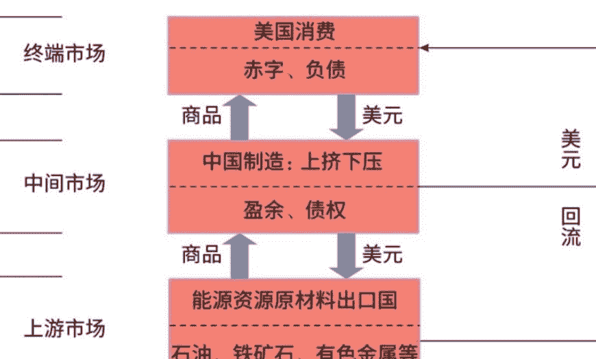

图2-6 国际市场分工

资料来源：长江证券研究所

20世纪90年代末以来，伴随着经济的崛起，世界经济的失衡现象越来越严重，突出表现为美国的巨额赤字和中国的巨额顺差（见2-7、图2-8）。这种情景和20世纪七八十年代日本经济腾飞非常相似，就像当时的美国和日本之失衡一样，但程度已远远超过了当时。

在美国和中国都不愿意也不可能休克调整自己的经济增长方式与经济结构的情况下，这种严重失衡的压力只能通过其他方式得以释放。要美国衰退，从中国和世界经济衰退；要美元贬值而人民币继续升值。美国、中国和世界其他各国都不愿意世界经济衰退，从而会共同进行抵抗，那么从长期角度来看，美元必然贬值，人民币必然升值。这背景下中国应该如何运用自身的货币政策就显得十分微妙。

（十亿美元）

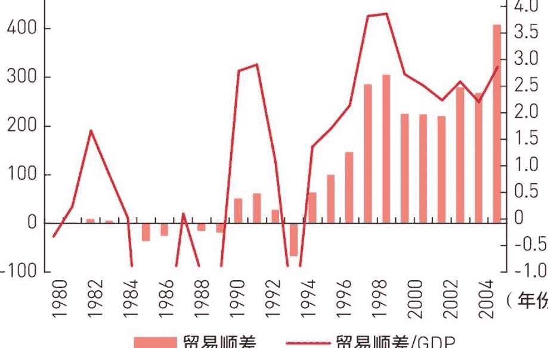

▲图2-7 1980—2004年中国的贸易顺差及占比

资料来源：CEIC数据库，长江证券研究所。

(十亿美元) (% )

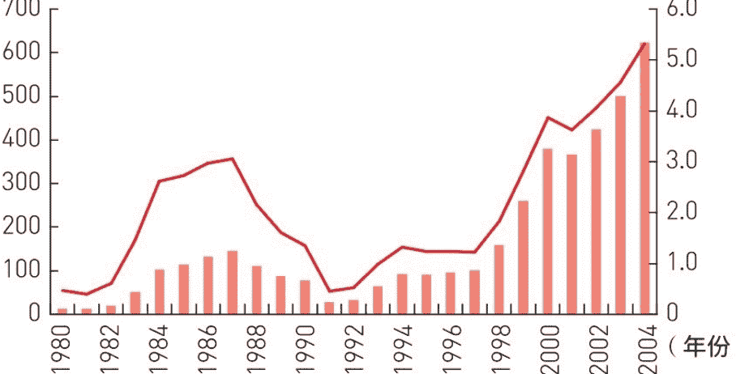

图2-8 1980—2004年美国贸易赤字及占比

资料来源：CEIC数据库，长江证券研究所。

而货币政策的得失关系我们的下一个问题，那就是虚拟经济（包括股市）的走势问题。所以，在这个时候国际经验的研究就有史为鉴的特殊意义了。日本在布雷顿森林泡沫后的货币政策的运用被认为是导致日本经济出现破裂的重要原因。而中国能够从中吸取的教训也决定了我们货币政策的未来走向。

## 从失衡到胜利：日本贸易政策的失败

二战后，日本经济迅速崛起，20世纪60年代末，日本开始出现断断的贸易顺差，70年代贸易顺差开始呈现扩大趋势，80年代贸易顺差持续增加。与此同时，美国在70年代开始之前的顺差为逆差（见图2-9、图2-10）。由于日本是当时美国的主要逆差国，美元产生强大的贬值压力，并开始迫日元升值。70年代初期，美国突然宣布放弃美元与黄金的兑换关系，布雷顿森林体系崩溃，美元进入升值周期。在这个过程中初期，日本并没有放弃出口型经济增长方式，导致80年代下半期的贸易顺差更有幅度的增加，结果是1985年签订《广场协议》和紧随之后的汇率失控、经济泡沫和90年代日本“丢失的十年”。

从20世纪80年代中期世界经济失衡的调节说起，1985年《广场协议》签署后，日元升值出现了失控的现象。需要指出的是，汇率升值是一个关键环节，因为不同的升值方式产生的结果及政策反应可能是完全不同的，我们在分析中国的情况下会详细译述。在汇率失控的前提下，快速的金融深化和金融自由化是导致日本经济产生泡沫，而这种结果可能是任何一个处于此情景下的国家都不得出的选择。

(十亿元美元) (见2-11)。

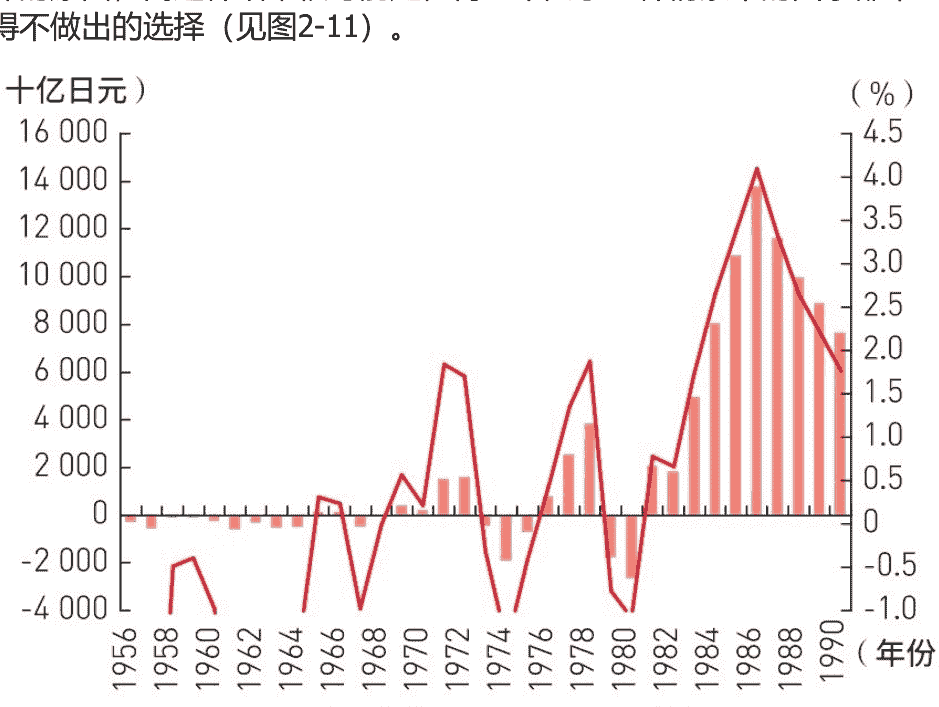

图2-9 1956—1990年日本的贸易顺差及占比

资料源：CEIC数据库，长江证券研究所。

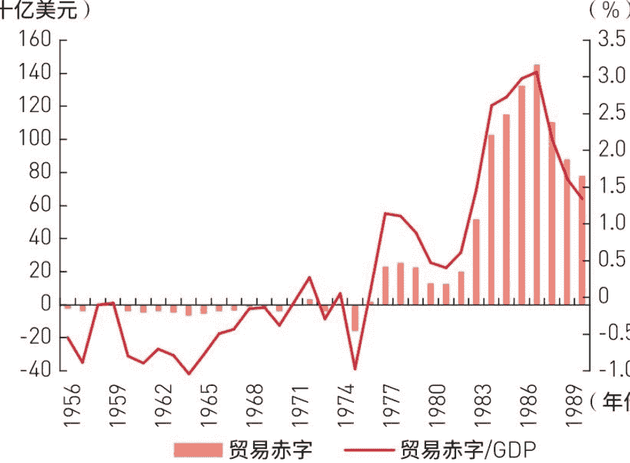

▲图2-10 1956—1990年美国贸易赤字及占比

资料源：CEIC数据库，长江证券研究所。

图2-1 日本的教训：从失衡到失控

资料源：证券研究所

## 一些有意义的经验和教训

从这一次世界经济严重损害后的调节，我们可以得出一个有意义的结论：第一，当世界主导国（美国）经济严重损害、主导货币（美元）面临调整时，失衡必须重新调整，否则结果可能更糟糕。这种调整源于外部压力、国际市场体系崩溃的风险、国内经济结构调整等多个方面，实际上是一个不同角度的问题。中国已经意识到转变为经济增长型和调整结构的需要。第二，世界经济失衡的根本在于失衡双方的经济结构和增长方式，但是经济增长具有很大的惯性，不能在朝夕之间重新调整。在这种情况下，失衡的调整往往转向金融体系，通过该体系的重新安排得到。汇率的变革对此结论做了很好的补充。第三，国家以怎样的方式（渐进式还是休克）十分重要，这在很大程度上决定了它如何在面临几种不同的经济前景中选择。当然，以什么方式升值不是不是能够控制的，对中国来说，这一点尤其重要，争取渐进升值是最好的选择，否则我们可能陷入左右为难的境地。第四，升值过程往往伴随着金融自由化和金融深化，这一一方面由于外压力，另一方面往往是汇率从固定转向浮动的过程，完善金融市场的内生性，但这会带来很多风险，货币政策如何与财政政策配合至关重要。但是，在平衡内外经济、实体经济与虚拟经济之间，货币政策往往显得力不从心，信贷的适度控制是决定实体经济的关键，如果不基于这种考虑，中国货币与“紧缩信贷”的情况可能持续下去。

## 困难棘手的抉择：全球对中国的货币政策选择及其影响

我国的情况与日本不同，从世界经济形势及其调整的过程来看，有许多方面都是可能性的。

在外部与内部压力下，人民币汇率改革已经在2015年7月21日开展，经过这种形势已经明朗，在经济结构在短期内得到调整的情况下，本次经济的转型再次以汇率和金融体系的调整取得了突破。在不到一年的时间里，为缓解增长压力，中国已经出台多项金融政策，从汇率浮动化、利率市场化、外流自由化等措施，这些措施至少显示出了金融自由化的倾向。中国已经处于风口浪尖，下一步的汇率改革与货币政策选择可能成为未来的关键。我们虽然运行还有远，但政府已经识别并提出要灵活转换增长方式的问题，经济增长方式与经济结构的调整绝非朝夕之间可以毫无本地地完成。因此，将汇率改革、货币政策选择与经济增长方式转换的节奏完美且有效地结合起来，对现实经济平滑增长、避免风险至关重要。

如图2-12所示，在货币政策和宏观经济形势的分析中，我们认为三种可能，决定这三种可能的关键环节有两个，即何种方式升值、何待经济增长采取货币政策。

第一种情景是相对客观理想的选择。如果外部条件允许选择渐进式升值，那么中央行有机会继续采取稳健的货币政策，并对货币实体系统进行渐进式改革，从而为经济增长方式和经济结构赢得时间，逐步实现经济的再平衡。渐进式升值配稳健的货币与财政政策，可以保持经济的平稳增长，并避免虚拟经济领域出现泡沫。这种情景面临的问题是人民币有可能较大的升值压力，为保持货币供应常态，央行不得频繁实施干预。

图2-12 货币政策选择及三种宏观情景

资料来源：证券研究所。

第二种和第三种情景的前提是外部条件没有渐进式升值。对于经济增长程度高度依赖出口的国家而言，它可能面临出口衰退的风险。在这种情况下，可控的货币政策和适度扩张财政政策应该是最好的选择。在货币流动性充分的情况下，选择松信贷可能会出现现实经济泡沫；如果选择信贷扩张与财政政策，实体经济可能陷入衰退。

## 2006年货币政策分析

总的，金融深化和国际化已经把货币推到了另一个阶段，未来的货币政策在平衡内部经济、实体与虚拟方面承担更大的责任。汇率渠道和资产渠道将会受到央行的更多关注，货币政策不再难以在汇率、资产价格、经济增长和安全之间寻找平衡点。从中长期角度来看，通过上述三种情景分析，我们对货币政策的选择非常明确：在外部条件的情况下，建议使用争取升值以速度来缓解金融深化，并严格将货币政策进行结构调整和推动运行，防止升值过程中货币供给同步。这样才能为未来经济平稳增长，有效避免汇率风险，否则可能进入泡沫和衰退的两个极端。

短期是一个中期的阶段，上述分析对于货币政策同样适用，我们需要将其具体化。我们认为货币政策的操作是以上要素综合作用的结果：经济增长、通胀压力、汇率、利率。经济增速和通胀压力的减轻决定了货币环境可能收缩，但在汇率升值压力较大的情况下，适度宽松的货币环境是有必要的。从改革过程中资本的充足以及支出项目来看，信贷可能会出现扩张。据此，从意义上来说，“宽松紧缩”的格局可能存在。随着央行操作等制度的推出，汇率升值压力通过市场转向，货币供应和信贷增速之间的差异有望缩小。根据市场操作传递的信号，预期2006年人民币汇率水平可能达到7.85元美元，人民币值为2%~3%，鉴于基准利率保持在4.5%~5%，预计我国市场利率维持在2%~2.5%，能够缓解利率之间的倒挂，能够很好地阻止人民币的升值压力。

我们从央行的政策目标可以解读，正是试图在两者之间找到平衡，经济增长长期稳定。因为在我们看来，货币政策的中间路线可能看着虚拟机会的弱化，也不会产生大的泡沫。但是，这种方法可能是一种情绪化的，汇率问题已经变成一场博弈，博弈的不确定性意味着货币政策更多受到汇率政策的胜利，最终实现平衡的思路可能无法被贯彻始终，相应实施政策（包括汇率调整）的影响可能会市场带来巨大的波动。

## 2006年繁荣的起点

在合适的时机我们现在开始谈中国的虚拟经济繁荣。这个问题充分考虑了我们当前的经济形势。当前经济已经在周期中下滑，在这种情况下，2006年的中国股市不能从实体经济获得持续的支持，这使得我们目光放在虚拟与实体经济的关系及其独特性上。更关键的是，通过近期工业化历史，我们更加明确发现中国虚拟经济的繁荣已经临。实际上，物资价格、艺术品价格以及房地产价格已经证明了2006年也将迎来虚拟经济（主要表现为股市和房地产）繁荣的起点。我们正处于虚拟经济繁荣的起点阶段，初期可能并不有整体性的投资机会，而是资本市场的活跃程度增加，富层积累包含了投资机会。

## 工业化后超越周期的虚拟经济繁荣

我们并不认为虚拟经济繁荣与实体经济之间的相互应该，实体经济的稳定会对虚拟经济的繁荣起到支撑，而虚拟经济的繁荣也对实体经济起到平滑周期的作用。很多时候，虚拟经济的趋势与实体经济的发展是非常一致的。但是，从一个更长的视野来看，虚拟经济繁荣也是超越周期的。在特定的历史时期，比如工业化后期，伴随着一些外界条件的发生，虚拟经济将走向大繁荣。这种虚拟经济的大繁荣景象时间可能比较短，因此某种程度上是超越周期的，它。

从主要工业化经济的股市发展来看，进入工业化后期以后，虚拟经济会有一次超越周期的繁荣出现，比如美国“泡沫的20年代”和日本20世纪60年代。韩国和中国台湾也是如此，与日本泡沫相似之处，也出现了虚拟经济繁荣。

## 日本20世纪60年代开始的股市

在日本工业化后期，从20世纪60年代开始，虚拟经济包括股市和房地产，同时走出了迈向繁荣的第一步。图2-13、图2-14描述分别是日本股市和平均地价走势。日经225指数自20世纪60年代开始一路走，最高峰达到了38915.8点。80年代后的股市带有泡沫性质，未来未必会走这条路。但是日本股市之所以产生后期繁荣，与当时的工业化发展和制度创新有着密切的关系。在同一时期，从1955年—1989年，日本地价平均上升了54倍，东京六城市上线了28倍。

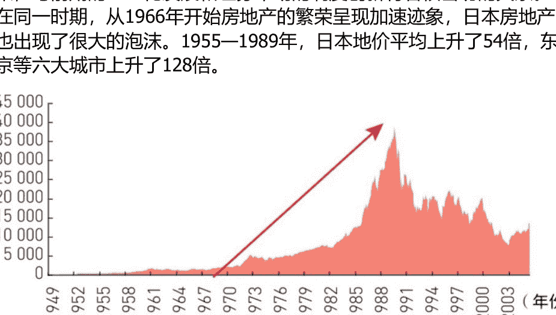

图2-13 日经225指数走势

资料来源：CEIC数据库，长江证券研究所。

图2-14 日本全国六城市土地价格（2000年=100）

资料源：日本统计局，长江证券研究所。

## 韩国和中国台湾的繁荣

韩国和中国台湾在20世纪80年代进入工业化后期，随着经济高速发展，80年代中期股市快速提升（见图2-15），80年代末达到虚拟经济繁荣的顶点。相对于主要的工业化经济而言，速度更快、时间更短。

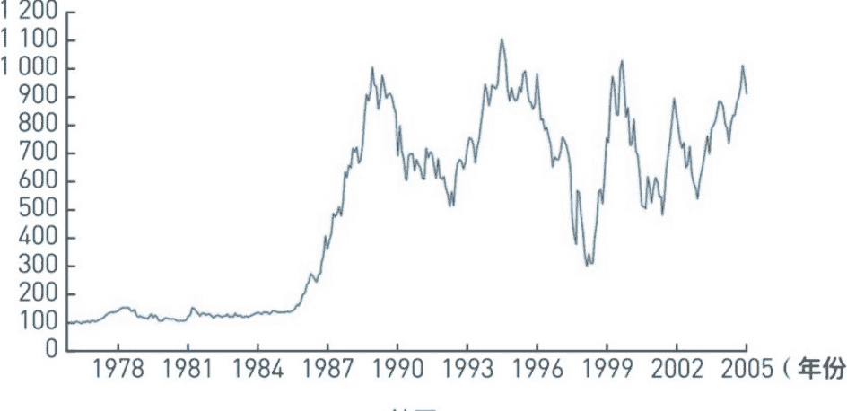

图2-15 韩国和中国台湾股票市场走势

资料来源：CEIC数据库，长江证券研究所。

## 为什么会产生虚拟经济繁荣：工业化发展

虽然实体经济无法避免波动，但是人类社会的经济水平总是在不断提高，相应地，虚拟经济的总体趋势也是向上的。要加速虚拟经济发展，形成虚拟经济繁荣，我们需要人类社会进入工业化社会，经济发展水平的巨大增长提供了前提。虚拟经济大繁荣产生的根源应该是工业化发展。图2-16是虚拟经济繁荣的路径。第一，工业化在中后期对实体经济的深远影响，发展水平得到极大增长。第二，经济发展水平达到了一定阶段后，实体经济逐渐需要虚拟经济的支持（表现为融资需求）。第三，虚拟经济部门（表现为资本市场）的重要性日益提高，迎来发展机遇。第四，原本不受重视的虚拟市场开始完善制度，加大金融产品创新，资本市场由成熟走向发展。第五，在资本市场趋成熟但经济需求越来越大的情况下，所有虚拟经济走向繁荣的基本条件已具备。第六，虽然面临其他的约束因素，虚拟经济仍然走向发展，这种大繁荣也会反作用于实体经济，初期可以增强周期的回落，起到平滑作用。当然，这种平滑作用不是解决根本方法，如果虚拟经济繁荣不断持续，最终导致泡沫破裂，对实体经济的危害更大。

| 工业化中后期，实体经济发展 | 实体经济需要虚拟经济支持 | 证券市场迎来发展机遇 |
|---|---|---|
| 证券市场繁荣，反作用于实体经济 | 实体经济有助于市场的制度完善 | 证券市场和产品创新 |

图2-16 虚拟经济繁荣的路径

资料来源：长江证券研究所。

## 1961年的证券萧条改革实施一系列整改措施

得益于流通市场的畅达与证券投资信业的显著增长，1961年日本股市实现了第一次大繁荣。但是，这种繁荣并没有持续多久，泡沫破后的证券萧条给资本市场带来了极大的不利影响，最终政府不得不出面，实施一系列整改措施，包括停止上市和增发、配股、给证券公司提供流动性支持，成立证券基金等，这些为证券市场走向更大的繁荣创造了机会。应该说，日本的资本市场在经历了20世纪60年代的证券萧条后带来了重生的机会（见图2-18）。

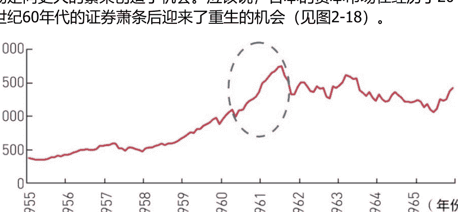

图2-18 日经225指数走势（1955—1965年）

资料来源：CEIC数据库，长江证券研究所。

## 证券市场的制度建设为大繁荣提供了保障

当日本从战后快速增长进入长期增长以后，资本市场的发展满足了实体经济的需求，政府开始加大证券市场的改革（见表2-6）。1958年，资本市场开始向普通民众开放，逐步形成一个流动性较强的市场。这也是日本第一次股市大繁荣的主要原因之一。但是在后的证券萧条中，政府又不得不对证券市场的基本制度进行修正。1965年日本通过了《证券交易法修正案》，并开始对一级市场的发行制度进行改革，从原来的按购股票面额增发、配股，改为按市发行，定价市场机制转变。

### 2-6 日本证券市场的重大制度变革（1946—1975）

| 时期 | 时间 | 制度变革 |
|---|---|---|
| 战后复兴时期 (1946—1956) | 1947 年 | 实行证券民主改革 |
| | 1948 年 | 制定新的《证券交易法》 |
| | 1949 年 | 盟军制定“市场三原则准则” |
| | 1958 年 | 股票开始向民众公开发行，股市市场逐步形成 |
| | 1965 年 | 通过《证券交易法修正案》 |
| 高速增长时期 (1956—1975) | 1967 年 | 放宽外资购买股票的限制 |
| | 1969 年 | 设立了相当于存款保险机制的证券信托基金 |
| | 1970 年 | 投资信托的自由化 |
| | 1971 年 | 一般投资者购买外国证券的自由化 |

资料来源：东京证券研究所。

另一方面，20世纪60年代末期，日本的资本市场逐步开始国际化。对外资购买股份限制的放宽（1967—1968年）、证券公司海外分支机构的增设（1968年）、投资信托的自由化（1970年）、一般投资者购买外国证券的自由化（1971年）、在证券方面实行第一类自由行的行业形成（1970年）、有关国际证券法律的通过（1971年），这些都促进了日本证券市场的逐步向国际化。

而且，随着市场的不断完善，投资的标准也发生了巨大的变化，不再采用传统的股利率标准，而是引入了盈率、市净率（PE、PB）等新标准，投资理念日益成熟。可以肯定，日本在战后初期进行的一系列证券市场制度变革，新投资标准和投资理念的建立，都为日本20世纪80年代类似经济大繁荣奠下了坚实的基础。

## 房产的初期繁荣也为股市提供了支持

日本的房地产泡沫对于泡沫而言有过之而未及，我们将在后面回顾1956年之后三次主要的房地产泡沫历史。从中可以看出，在20世纪60年代初期，产业结构的高级化和工业化，日本的房地产可以说是第一次泡沫暴涨，其土地价格最高甚至超过以后几次房地产泡沫（表2-7、2-19），与日本第一次泡沫涨发生的时间几乎一致。我们认为虚幻的繁荣是“相互促进、相互支撑”的，房地产的逐步繁荣会促进财富积累，使得后期，更多的资金进入了虚幻的经济领域，这反过来也会刺激股市繁荣。当然，在后期，这种状况不可避免了，可能存在“一山二蕴”的现象，长万裕认为，日本房地产泡沫不可持续的主要原因在于它和房地产泡沫交织在一起，他认为泡沫是不可持续的，最终会泡破。但从经济史来看，日本经济初期的繁荣至少对股市繁荣有一定的好处。

### 表2-7 日本战后产业结构变化及其对房地产价格的影响

| 阶段 | 时间 | 主要产业 | 对房地产价格影响 |
|---|---|---|---|
| 1 | 战争结束到20世纪50年代 | 钢铁、煤炭、电力 | 战后首次房地产价格上涨 |
| 2 | 60年代 | 产业结构高级化、工业化、贸易和资本自由化 | 第一次房地产价格暴涨 |
| 3 | 70年代初期 | 知识密集型产业为主、国际协调的产业政策、国际化、信息化、服务化 | 第二次房地产价格暴涨 |
| 4 | 80年代 | | 地价再次高涨 |

资料来源：长江证券研究所。

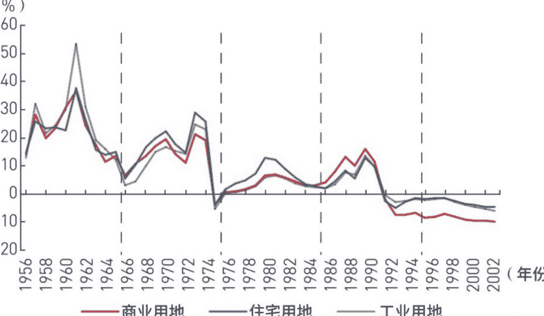
图2-19 日本地价变动（1956—1975年）

资料来源：日本统计局，长江证券研究所。

从上面的分析看出，形成虚拟经济大繁荣的前提包括四个方面，如图2-20所示。

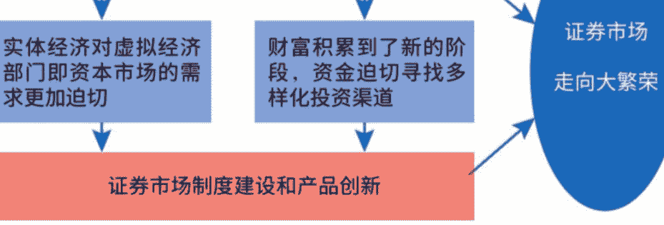
图2-20 证券市场繁荣的内在逻辑

资料来源：证券研究所。

## 中国证券市场繁荣的起点：工业化程度

从工业化进程来看，中国虚拟经济繁荣的初始条件已经具备。这主要体现在两个方面：一方面随着工业化进程的加快，高速增长的实体经济需要虚拟经济的支持；另一方面工业化使得经济水平提高，财富积累达到一定阶段后，人们对金融市场的需求日益增加，只有市场才会有繁荣。这两方面充分展示了工业化进程的重要性。

### 表2-8 2005年前三季度国内金融机构融资情况

| 融资总量（亿元人民币） | 比重 (%) | 2005年前三季度 | 2004年前三季度 |
|---|---|---|---|
| 国内非金融机构融资总量 | 24645 | 24076 | 100.0 | 100.0 |
| 贷款 | 20614 | 19250 | 83.6 | 80.0 |
| 股票 | 1159 | 1149 | 4.7 | 4.8 |
| 国债 | 1896 | 3492 | 7.7 | 14.5 |
| 企业债 | 976 | 185 | 4.0 | 0.8 |

资料来源：中国银行，长江证券研究所。

目前与1961年后日本证券市场的相似之处，虽然资本市场的重要性发增强，但是股市持续下跌却失去了动力。这特别需要对证券市场的发展进行修正或重建，并加大证券市场上各种金融品的创新。

## 财富的积累已经达到一段阶段，市场缺少的是资金

经过十余年的工业化发展，国民的财富积累已经达到了一个新的水平。从总量来看，2004年的居民储蓄总额已经接近12万亿元，而股市市值仅有4000多亿元，这充分说明了从我国财富的角度看，股票的购买力是没有问题的，市场缺少并不是资金，而是优质的投资品种。

随着经济的增长，我国的居民储蓄率很高，占GDP比例一直保持在80%以上，同时证券化率出现下滑趋势，2004年仅有30%左右。两者相比，显示证券市场发展的严重滞后性，加快发展资本市场成为当务之急（图2-1）。

## 证券市场的制度重建，为市场发展提供了制度保障

从前面的分析可以看出，中国与日本的相似之处很多，日本在股市市场正走向繁荣以前，经过一系列制度建设和产品创新，最后成就了股市的繁荣。中国的证券市场从成立不到20年，各种制度存在关注之处，尤其是股权配置，这些都制约证券市场的长期走。值得庆幸的是，在经历了与日本20世纪60年代上半期类似的证券市场准入之后，我国已经对资本市场的各项制度进行了完善乃至重建（见表-9）。特别是针对股权配置这一影响股市的顽疾，管理层正在平稳推进股权配置改革，可以预期，如果这些制约证券市场发展的制度得到改进，之前限制股票发行、限制市值规模的不利因素被消除，那么新的虚拟经济的繁荣将可见。

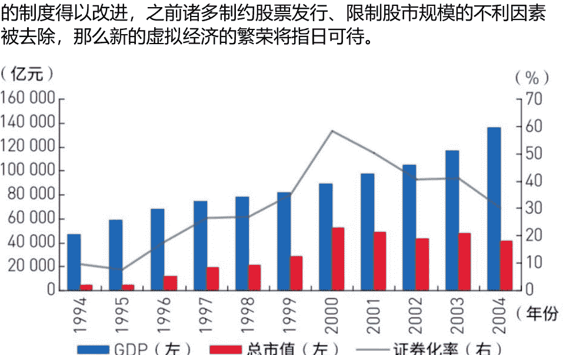
图2-21 中国的GDP、总市值及证券化率

资料来源：Wind资讯，长江证券研究所。

### 表2-9 2005年中国证券市场的重大制度变革

| 时间 | 重大制度变革 |
|---|---|
| 2005年1月1日 | 关于证券公司发行相关通知 |
| 2005年2月20日 | 关于商业银行设立基金管理办法 |
| 2005年3月25日 | 证券信息披露第5号 |
| 2005年4月29日 | 关于上市公司股权分置试点有关通知 |
| 2005年6月6日 | 关于上市公司回购股份管理办法（试意见） |
| 2005年6月12日 | 关于实施股权分置改革有关通知（指导意见） |
| 2005年6月16日 | 关于上市公司回购股份管理办法（试行） |
| 2005年6月16日 | 关于进一步完善证券投资基金募集程序有关通知 |
| 2005年6月17日 | 关于上市公司股权分置改革后增持有关通知 |
| 2005年6月17日 | 国务院关于股权分置改革指导意见 |
| 2005年6月30日 | 证券投资者管理办法 |
| 2005年7月1日 | 关于上市公司与投资者关系指引 |
| 2005年8月23日 | 关于上市公司股权分置改革指导意见 |
| 2005年9月4日 | 关于上市公司股权分置改革管理办法 |
| 2005年9月30日 | 关于上市公司股权分置奖励办法（试行） |
| 2005年10月25日 | 证券投资基金监管报告内容指引（试行） |

资料来源：上海证券研究所。

## 本币升值作为催化剂，使中国证券市场繁荣起来

依赖出口的制造业在保持高速增长的同时，进一步加剧了世界经济的不平衡。这种不平衡本来需要双方调整经济结构和增长方式，然而，经济增长和经济结构具有很大的惯性，可能在短期内无法统一。在这种情况下，调整的压力必然转移到金融体系中，汇率的调整、本币升值成为必然。选择本币升值可以维持一定的出口增长，保持经济稳定，但并不是无代价。如图2-22所示，在压力下，只能采取低利率的货币政策，这会导致两个结果：一是继续保持出口增长，世界经济加剧并招致更大的升值压力，升值和低利率都必须维持，进而陷入一种恶性循环；二是宽松的货币政策会大量资金流入虚拟领域，产生资产价格泡沫，刺激虚拟经济繁荣。

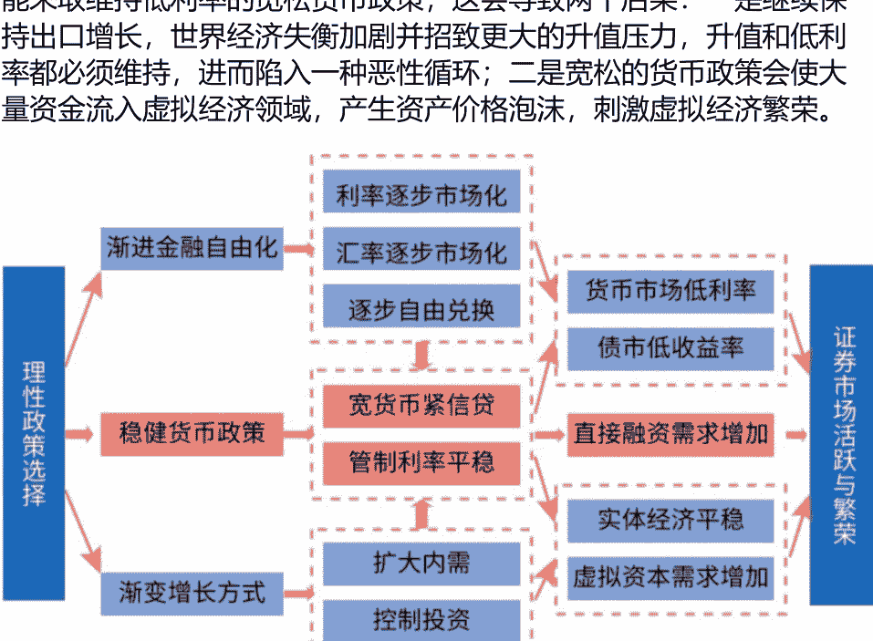
图2-22 经济转型期的货币政策引导与市场繁荣

资料来源：长江证券研究所。

## 繁荣起点阶段的投资机会：产品创新与制度创新

前面的论述告诉我们，中国虚拟经济繁荣的起点已经放在眼前，需要更多考虑的关键问题就是如何把握繁荣起点阶段的投资机会，这也是我们进行2006年资本市场状况分析的主旋律。

## 2006年的总体判断：繁荣更多体现为市场的活跃

对于2006年的资本市场，我们的一个总体判断是，市场缺乏系统性的投资机会，繁荣更多体现为市场的活跃程度，而机会可能在于把握结构性投资机会。虽然经济转型期基本上就是经济调整（此处原文疑为衰退），这将大大抑制股市的繁荣程度，但作为中国虚拟经济繁荣的起点，我们认为市场的活跃是可以期待的。

这种市场的活跃有两个方面原因：一方面，虽然经济周期面临回落，但仍有部分行业已经经历到达周期的底部，部分领域如新能源、新技术也因创新而存在投资机会；另一方面，随着市场体系的完善，市场投资出现新的投资热点，活跃性也必然增强。

根据前面的分析，工业化发展一方面给公众带来了巨大的财富积累，另一方面也强化了企业对资本市场直接接触的需求。因此，中国虚拟经济繁荣的初期阶段已经具备，剩余的关键问题就是如何引起资金进入证券市场。如图2-23所示，我们认为市场制度建设、证券产品创新以及金融改革与深化这三个方面对吸引资金进入、刺激虚拟经济繁荣起到了决定性作用。我们在分析2006年资本市场的投资机会时，主要从三个方面着手。

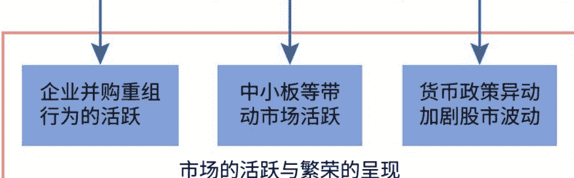
图2-23 证券体系的完善与繁荣的呈现

资料来源：长江证券研究所。

## 制度改善带来的投资机会

市场制度改善主要体现在股权处置上，解决了长期长期发展的顽疾。值得庆幸的是，在经历了与日本20世纪60年代上半期类似的证券市场准入之后，我国已经对资本市场的各项制度进行了完善乃至重建（见表2-9）。特别是针对股权配置这一影响股市的顽疾，管理层正在平稳推进股权配置改革，可以预期，如果这些制约证券市场发展的制度得到改进，之前限制股票发行、限制市值规模的不利因素被消除，那么新的虚拟经济的繁荣将可见。此外，证券市场的开放，QFII（合格境外投资者）带来的不仅是资金，而且丰富了市场。由于新产品的不断推出，资本市场的活跃性也会增强，而股价波动本身意味着机会的到来。此外，涉及交易方法的重大制度创新，如引入卖空机制、“T+0”交易方式等对活跃证券市场、促进市场的初期繁荣也有好处。

## 衍生产品：带来的不仅是资金，还有信心

我们已经阐述了产品创新是中国资本市场的一大主题，除了中小板可以视为重要的产品创新，以股票为标的证券衍生产品，比如权证、股指期货将成为创新产品的主流品种。我们也应该意识到，创新带来的不仅是资金，还有信心。由于新产品的不断推出，资本市场的活跃性也会增强，股票价格的波动性也会增强。

## “色即是空”——世界经济的共生模式与国际资源价格调节新机制

2005年9月12日

2500多年年前，释迦牟尼用“色即是空”解释他对世界的表现与原本关系的看法，现在，这个世界的规则依然没有改变，一切表象皆回归本质。世界变化让资源问题显得更加永恒。我们对上次的资源危机仍然记忆犹新，新的资源冲击已经弥漫在我们周围；20世纪70年代的资源危机以世界经济通胀的形式实现了我们自己的调节，而这次国际资源价格的上升伴随着世界经济的高增长低通胀。关于资源的问题，无论是在经济增长还是对个人的金融投资，资源价格永远都是核心。

对资源价格的判断，显然不是通过几个支离破碎的论点，诸如“中国因素”“金链四国”“美元定价”“流动性支撑”的拼凑就能得到的。在国际经济化的前提下，金链四国显然应该被纳入世界产业分工链；在世界经济增长模式中，美元贬值对国际资源价格的影响不仅限于资源指数，关系到世界经济共生模式的稳定，可以解释，把大资源价格狂涨和世界经济低通胀解释出来。

### 表2-10 日本不同增长率的企业分布（单位：%）

| 销售增长率（1960年9/1959年9） | 0~0.9倍 | 1.0~1.4倍 | 1.5~2.4倍 | 2.5~4.9倍 | 5倍以上 |
|---|---|---|---|---|---|
| 上市公司（247家） | 2.4 | 26.3 | 48.6 | 22.3 | 0.4 |
| 按规模行业前1/4（61家） | 0 | 39.4 | 44.2 | 16.4 | 0 |
| 按规模行业后1/4（61家） | 3.3 | 19.7 | 52.4 | 23.0 | 1.6 |
| 门市企业（151家） | 4.0 | 14.6 | 43.0 | 33.8 | 4.6 |

注：门市企业为上市公司，不包括31家计量不明的企业。
资料来源：（日）香西泰秦译，《高速增长的时代》，贵州人民出版社，1987年。

中小企业板的投资机会体现在两个方面：第一，上市公司的基本面不错，平均业绩明显高于主板；第二，不少上市公司由于成长能力强，具备成为目标企业的潜力，股权价值高，体现在市场估值上有一个溢价。

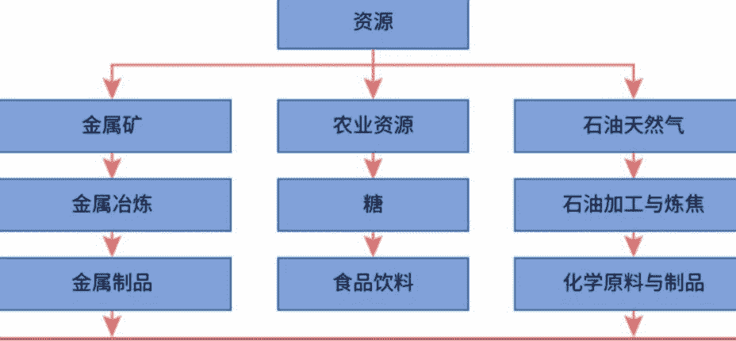
▲图3-1 主要资源品及其对应的制造产业链

资料来源：长江证券研究所。

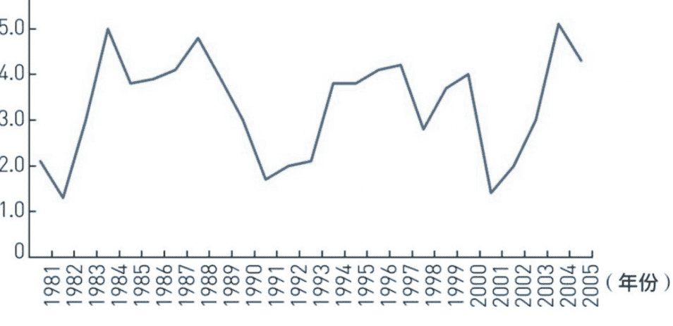
图3-2 世界经济GDP实际增长率

资料来源：彭博，长江证券研究所。

## 大牛市是由世界经济周期的衰退和中国周期的强复苏成就

CRB商品指数是1956年美国商品局(CRB)推出的用以反映国际大宗商品市场结构和行为走势的价格指数，所有商品权重相等。该指数包括现货和期货指数。

高盛商品指数(GSCI)包括24种商品，涵盖能源、工业金属、黄金、谷物和农产品，其中大部分的权重依赖全球产量来决定。这里的指数是指去年的平均产量。因此，总体上看，在高盛商品指数中，能源的权重较大。而且，高盛商品指数包含了更多已经上涨的原因，更多反映了商品价格的历史。

观察20世纪中以来的数据，大宗资源价格的波动呈现周期性特征。而且，这种周期和经济周期具有很强的一致性。通过比较商品价格指数和全球GDP的历史数据（图3-3至图3-7），我们可以发现资源价格的周期受制于世界经济的长周期，随世界经济增长周期的繁荣而衰退，衰退而复苏。至少可以通过20世纪80年代以来两个完整的经济周期来反映。以CRB和GSCI商品指数为例，通过商品价格趋势和全球经济的历史数据，我们可以发现，在20世纪80年代以来的两个完整的周期内，商品价格趋势增长是一致的。因此，我们可以依赖经济增长周期来判断资源价格的周期变化。

我们知道，伴随着世界经济的复苏与繁荣，国际大宗资源价格出现了一轮引注目的强势增长，世界经济也是在资源匮乏下开始调整。然而，在世界经济和中国经济的高点都已结束的经济周期的第二阶段，国际大宗资源价格的高位离离显示，资源品市场的相对独立性及其对宏观经济的约束尚未结束。那么，资源价格的平衡在哪里？

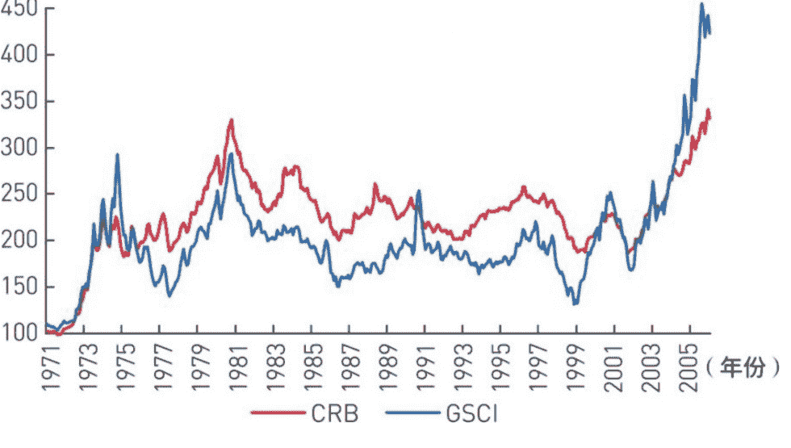
图3-3 CRB和GSCI

资料来源：彭博，长江证券研究所。

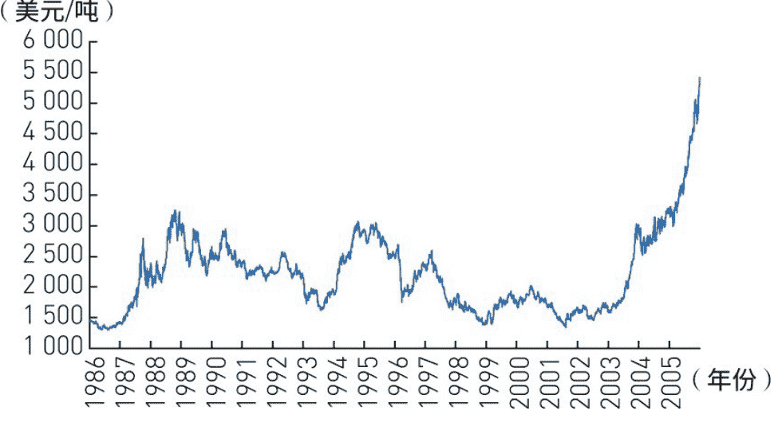
图3-4 伦敦金属交易所3个月期铜价格(美元/吨)

资料来源：彭博，长江证券研究所。

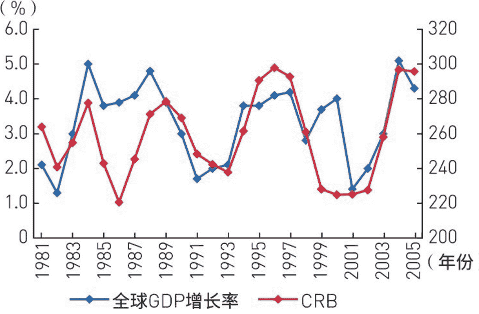
▲图3-5 CRB现货指数和全球GDP增长率呈正相关

资料来源：世界银行，彭博，长江证券研究所。

### 图3-6 黄金现货价格和全球GDP增长率

资料来源：世界银行、彭博、长江证券研究所。

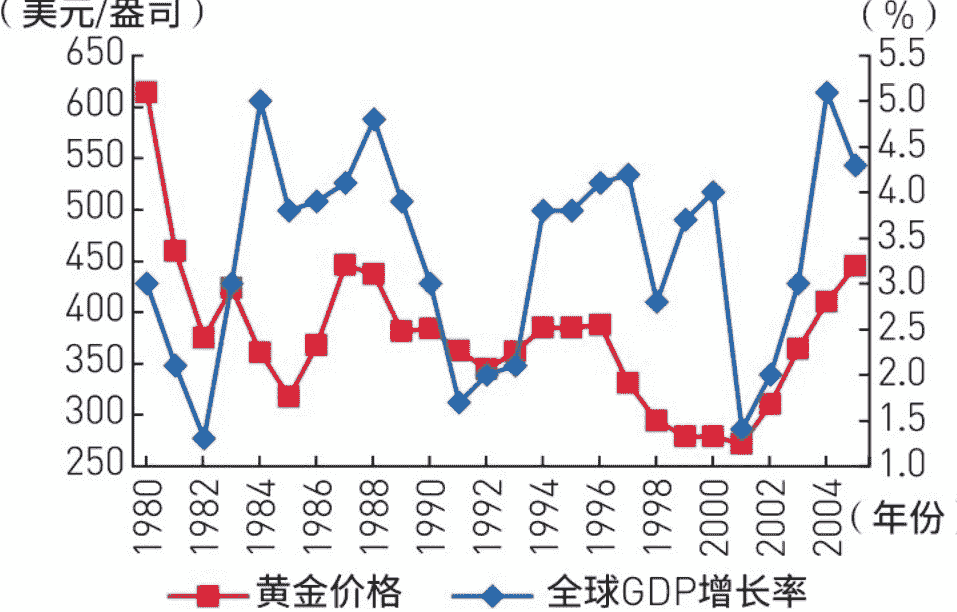

### 图3-7 1960—2005年CRB变化趋势

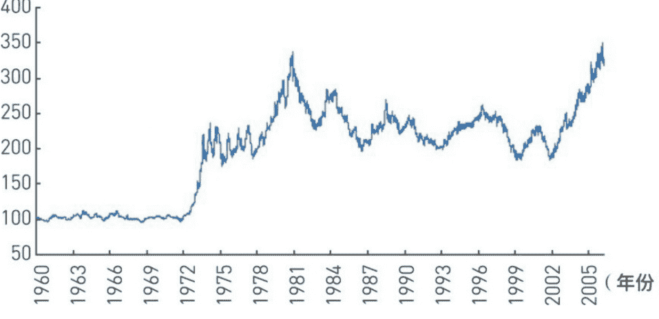
资料源：彭长，长江研究所。

既然价格是供给和需求博弈的结果，而且任何商品的历史价格都包含当时市场的预期、投机等因素，我们就可以通过寻找资源历史价格变化的依赖因素来识别波动规律和未来的趋势。

值得注意的是，虽然在20世纪80年代和90年代大宗资源也有过周期性的繁荣与衰退，但从长期周期来看，这两个时期都是大宗资源的牛市。本次牛市远超过80年代和90年代，类似于70年代。此外，大宗资源价格波动具有长周期和中期周期的特征。按照我的理解，决定大宗资源价格因素很复杂，但基本因素仍是供给和需求。商品价格周期性是因为供给和需求失去平衡的均衡，从经济学角度考虑，牛市是在供给和需求极端冲突时产生的。原因在于世界经济周期的衰退导致了大宗资源供给能力的削弱，而中期周期的强劲引发了需求的快速增长，供需矛盾使得极端冲突并造成大宗资源牛市。我们的结论得到了历史的实证。在20世纪的历史上，20年代和70年代都发生过大宗牛市，我们将此康布·范杜对世界周期的划分（参考表3-1）发现，20年代和70年代都是世界周期的衰退或萧条。按照长期周期的规律，2000—2008年属于第五次世界周期的衰退，这又印证了本次牛市。当然，历史同样显示，经济周期和中期共同出现时，大宗资源价格回落。

 表3-1 康布·范杜对世界周期的分析

| 周期 | 年份 | 繁荣 | 衰退 | 萧条 | 复苏 |
| :--- | :--- | :--- | :--- | :--- | :--- |
| 第一次 | 1782 – 1802 | 1815 – 1825 | 1825 – 1836 | 1838 – 1845 |
| 第二次 | 1845 – 1866 | 1866 – 1873 | 1873 – 1883 | 1883 – 1892 |
| 第三次 | 1892 – 1913 | 1920 – 1929 | 1929 – 1937 | 1937 – 1948 |
| 第四次 | 1948 – 1966 | 1966 – 1973 | 1973 – 1982 | 1982 – 1991 |
| 第五次 | 1991 – 2000 | 2000 – 2008 | | | |

资料来源：陈继勇主编，《美国新经济周期与中美关系》，武汉大学出版社，2004年。

按照上述认识，在判断大宗商品价格时，从经济周期和长期周期的划分至关重要。我们认为，从经济周期角度看，商品价格已经达到上升周期的后期。在此阶段，部分供需缺口的商品仍有可能高位出现缺口，但随着经济增长长期的波动，供需缺口的逐步缩小及全球流动性的逐步吸收，商品价格上涨将不断缓慢，该阶段往往是价格波动加剧风险暴露的时刻。我们可能会进一步通过资源内在调整机制的分析来认识资源价格波动。

20世纪70年代资源价格的上涨引起了全球的通胀，反过来，通胀本身就是经济增长中资源价格自发调整的机制和表现形式。我们所说的“传统”是指，当时各国经济特征仍然带有很大的封闭性，而封闭性体现在世界并不如今天这样按照国际比较优势进行明确说明，各国产业结构具有多样性和复杂性特征，各国制造产品以自给自足为主。，“传统”主要体现在世界分工上的纵向一体化程度远不如现在。在封闭经济条件下资源价格运行规律的探讨，有助于我们更深刻地认识和对比开放条件下资源价格的运动。

在主流经济学理论中，资源问题本质上是成本问题，而成本问题要体现为通货膨胀问题，要么体现为企业利润问题。资源价格上涨的结果，一方面会导致通货膨胀和需求减少，另一方面会导致资源行业投资和供给增加，最终实现供需平衡和价格回落，同时伴随着经济增长的周期性波动。虽然3-8没有包含时间因素，但这种静态分析还是有助于我们认识资源价格运动规律。

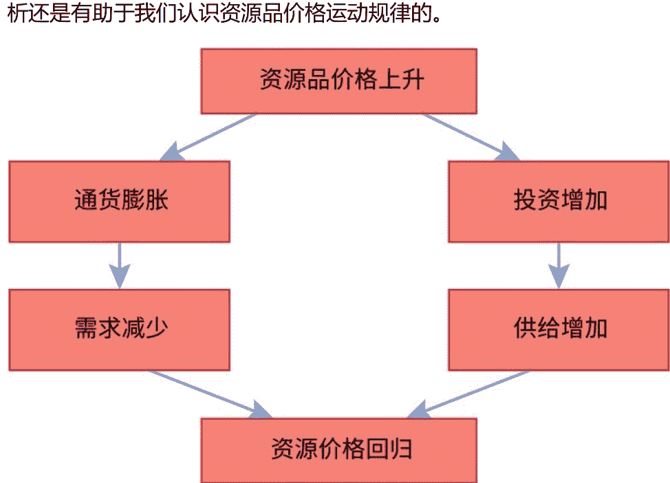
3-8 封闭经济条件下资源价格运动规律图
资料源：长江证券研究院。

需要强调的是，这种传统模式下资源自收敛的运动机制其实存在两个前提：消费者和生产者在同一经济环境下做出决策；资源行业和非资源行业之间存在利益博弈，也是在统一的国家利益之下博弈，而且往往会受到国家政府的调节。强调这两点很重要，因为在下文中我们要到的世界经济共生模式下，这一资源价格调整机制的各个环节都变得不像现在这样。

这是我们所周知的供需调整过程，这一机制本质上是通过资源行业的动态增加和下游行业的动态调节。根据20世纪70年代的经验，通胀是资源价格上涨的结果，反映了经济增长的约束及其引发的需求约束，也是资源价格回归的一种自发调整。因此，资源价格在快速上升后迅速下降（见图3-9）。

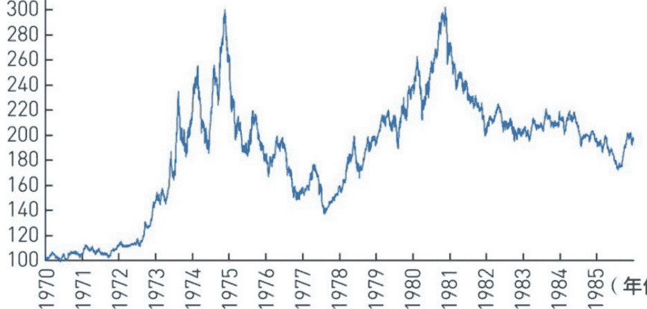
图3-9 1970—1985年GSCI变化趋势
资料源：彭博，长江证券研究所。

但是，本轮资源价格上涨以来，世界经济并没有产生严重的通胀和衰退（见图3-10），这是什么原因？是否意味着资源价格上涨得还不够多？

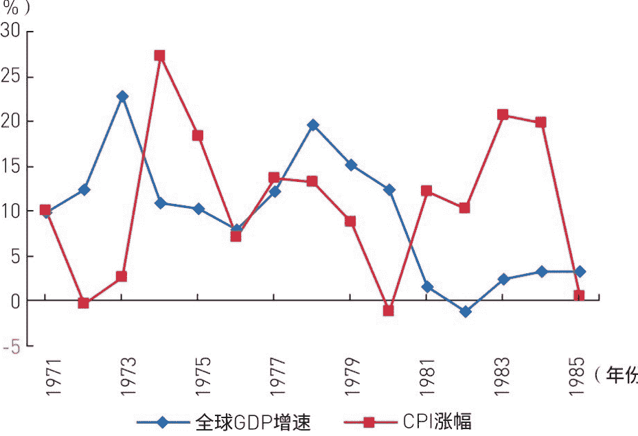
图3-10 1971—1985年全球GDP增速和CPI涨幅
资料源：彭博，长江证券研究所。

我们来回答第一个问题。有一种观点认为，世界经济中超额流动性流入虚拟经济产生资产泡沫，由于大量超额流动性进入股市、期货市场，而不是实体经济，造成了通胀。我们的逻辑与上述观点相反，大量的超额流动性进入实体市场就是牛市的必要条件，但这需要从中国因素谈起。

根据国家统计局2005年的核算，中国总量在世界排名第六，越来越成为世界增长的核心力量之一。随着经济勃起，中国对资源的消耗日益增加，在国内资源不能满足需求的情况下，通过进口来满足经济增长。本轮大宗价格上涨的主要原因被称为“中国因素”。

从数据上看，“中国因素”的说法并非道理。1995年后，中国成为初级产品进口口；2002年后，初级产品进口量急剧增加，其中糖、橡胶、石油、铁矿石、铜矿石以及铝等资源的进口量不断创历史高（见图3-11）。

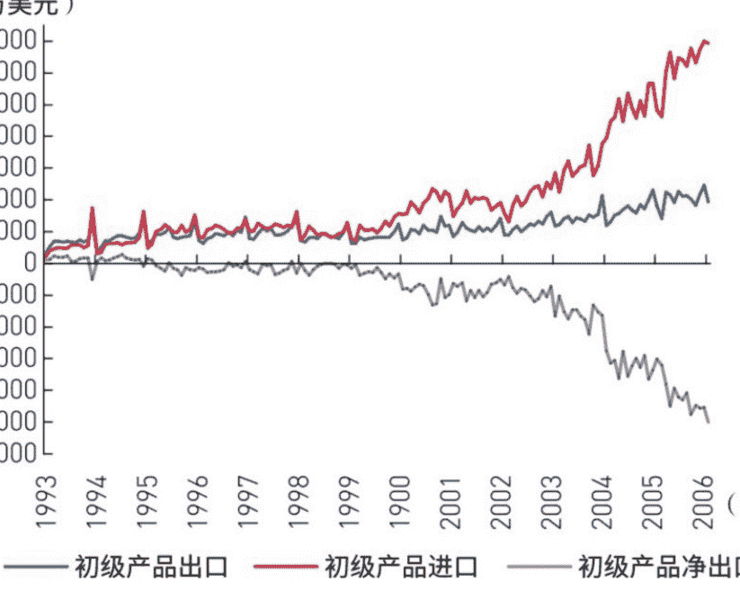
图3-11 中国初级产品出口
资料来源：CEIC数据库，里昂研究院。

另外，对大多数资源来说，中国消耗在全球量中的占比都在20%以上（见图3-12）。作为一个初级产品进口大国，中国对世界大宗市场需求的影响日益增大。从面上看，2000年以来市场上大宗价格持续上涨被解释为“中国因素”，似乎是理所当然。

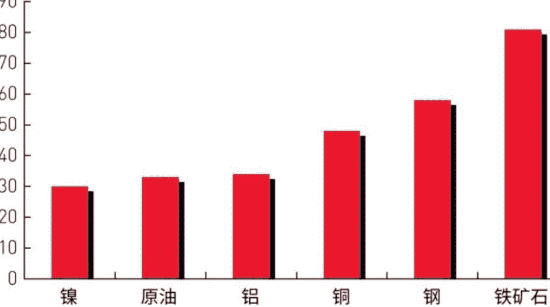
图3-12 04年中国主要资源在全球消耗量中的比重
资料来源：国际货币基金组织，长江证券研究院。

但我们分析认为，“中国因素”的偏差在于忽略了两个事实：一是世界制造业向中国转移，中国只是世界产业链的加工者；二是中国经济的快速增长，外需起着突出作用。因此，中国只是世界制造业的聚集地，为世界市场提供制造产品，当然也消耗资源，而这种局面正是建立在世界经济共同繁荣的前提下的。所以，我们认为，应该把中国纳入世界经济体系一体化分工分析。世界制造业向中国转移的事实，可以通过美国的外贸顺差结构（见图3-13）和中国的外贸顺差看出。

从美国的贸易逆差结构，20世纪80年代中期，日本、韩国、中国香港、中国台湾等地是美国最大的逆差区域。近几年的数据显示，中国内地（大陆）成为美国最大的逆差区域，而对日本、韩国、中国香港、中国台湾等的贸易逆差大幅减少，这正是制造业转移中国内地（大陆）的结果。根据2004年的数据计算，中国内地（大陆）GDP占全球GDP的比重为3.5%，产生了世界7%的制造业。

图3-13 1985年（左）和2003年（右）美国贸易逆差的地区结构
资料来源:伯格斯坦，《美国与世界经济》，经济科学出版社，2005年。

从中国的外贸盈余结构看，中国对北美和欧洲呈顺差，而对亚洲、拉美、非洲和大洋洲呈贸易逆差（见图3-14）。进一步对每个地区的贸易结构分析可以发现，中国主要从亚洲、拉美、大洋洲的国家和地区，如韩国、日本、中东、巴西、澳大利亚进口半成品。

图3-14 中国出口出口地区结构（2004年）
资料源：中国商务部，长江证券研究所。

另外，无论是数量还是速度，初级产品进口与制造业出口之间存在显著的相关关系。2001年后，随着世界经济周期的复苏，中国出口总额在工业产值中的比重持续提升，2004年达到近35%（见图3-15）。从长期周期看，2000—2004年，中国的外贸依赖度翻了一番，延长了资源在高位的期限。其实上文已经说明，中国崛起建立在制造业转移和依赖外需的基础上的，制造业的发展不仅是中国经济的增长，也反映了世界经济的增长。大量的超额流动性以FDI（外国直接投资）的方式进入实体经济领域，一方面推动经济高速增长，造成国际资源品短缺和价格上涨。另一方面，大量FDI导致制造业产能过剩，由于原本低廉的成本，以及中国在共生模式中的劣势地位所决定的资源成本能力较弱，结构性维持维持了低通胀。

图3-15 初级产品净出口和制造业出口
资料来源：CEIC数据库，长江证券研究所。

图3-16 初级产品进口与制造业增速
资料来源：CEIC数据库，长江证券研究所。

图3-17 外对经济增长的贡献
资料来源：林毅夫等，《必要的修正——对外贸易与经济增长的考察，《国际贸易》，2001年。

图3-18 中国出口总值占工业产值的比重
数据来源:Wind资讯，长江证券研究所。

| FDI | FDI | 北洲 |
|---|---|---|
| 亚洲 | | |
| | 原料 | 中国 | 成品 |
| 非洲、大洋、拉美 | | | 欧洲 |
| | | FDI |

▲3-19 世界产业分工和中国的经营模式
资料来源：长江证券研究所。

▲图3-20 生产资料中上下游价格
来源：国家统计局，长江证券研究所。

# 中国因素之谜：中国利润缓解通胀

那么，在资源价格高涨的情况下，世界没有像20世纪70年代那样产生恶性通胀的真正原因是什么，中国与此有何关系？我们认为，真正的中国因素在于，中国以流失的方式缓解了资源高价格对北美和欧洲发达国家的通胀压力，增加了世界抗高价格的韧性，推迟了发达国家采取紧缩政策的力度，延长了全球经济增长周期，也延长了资源在高位的期限。

共生模式的基础。正如瑞纳格林所说，如果外部国家对美元的信心坚挺，这种共生模式就能维持。因此，整个世界经济增长链的维系或断裂可能很大取决于美元，而支持美国消费和经济增长的前提是，中国和资源出口国以美元的形式持有大量外汇储备，推高美元价格，压低长期利率。

国际商品市场 国际金融市场

图-3-22 国际产业分工的共生模式
资料来源：长江证券研究所。

在明确了世界分工格局和共生模式后，所谓的“金砖四国”因素法就不攻攻破了，这些国家不是今天世界产业链上的某些环节，而是中国、巴西和俄罗斯才是我们说的资源核心成员。“金砖四国”很大意义并没有超越现有的世界分工链，并成为真正的增量因素，仍然与世界周期同生、共荣。

但是，在传统经济增长模式下，统一的国家利益之下的资源与非资源行业之间的利益博弈，演化成了共生模式中资源核心、制造核心国、消费（货币）核心国之间的利益博弈，资源价格调整机制因加入了政治因素而变得更加困难和不稳定。

同时，世界经济增长模式与传统模式相比，一个重要的变化是生产与消费出现分离。用经济学术来说，在传统模式下，生产、消费和价格是由行为主体同时决定的，而在开放的经济体系中，生产、消费是由处于不同环境下的行为分别决定的，生产和消费分别由不同经济环境下的主体决定。具体来说，中国制造许多商品，很大程度上不再由中国自身决定（这意味着中国宏观调控政策的失效），而是由消费（货币）核心国（从其出发）决定。在资源价格上涨不能变成消费者行为为之前，即使生产者的利润已经受到很大压缩，由于对强制性与参与经济的客观观点提出以及维持自身经济增长的模式，中国也不得不按照美国的消费需求生产、消耗资源。在传统模式下，通过资源行业和非资源行业的利润博弈，以及消费和生产自发调节资源价格的机制失效。当然，中国资源性自身利润是由其在全球产业链上的上游地位决定的，附带的结果是世界经济增长的韧性增加，资源消费和价格却没有像传统模式那样迅速下降。

## 共生模式下的资源价格调整机制

在传统模式和共生模式下，资源价格调整机制是不同的。前面我们已经分析了传统模式下，资源价格调整通过全球经济增长进行调整的逻辑，但在共生模式下，中国通过结构性利润消除了全球的滞胀。不过，新的调节机制正在发挥作用。

我们现在提及指出，按照主流经济学的观点，资源价格问题的实质是成本问题，成本问题本质上是通货膨胀或者利润问题。因此，物价上涨并不是唯一的传导利润的形式，在共生模式下，汇率是调节国际产业利润和经济增长的重要形式，而是成为影响资源价格波动的内部调节机制之一（见图3-23）。

| 资源品 | 中国因素 | 人民币升值 | 消费(货币) 核心国和世界经济 | 需求 | 资源品价格 |
| --- | --- | --- | --- | --- | --- | --- |
| 上涨 | | 产能扩充 | | | 供给增多 | 调整 |

图3-23 共生模式下的资源价格调整机制
资料来源：江苏研究所

我们的这种理解同样可以得到实数据的证明。一方面，伴随着人民币汇率的升值，中国出口速度会减慢。长期来看，随着人民币升值幅度的加大，美国消费者的购买力会萎缩，世界经济增长和资源商品价格上的压力会源头上逐渐减弱。另一方面，在大宗商品价格维持高的情况下，人民币汇率的升值可能是2016年半年以来利润增速减缓的原因之一。我们并不认为，在长期来看，出口增速放慢，需求约束可能超过汇率升值的价格，最终导致增速重循环。

从上述角度来看，人民币升值可能是共生模式下资源价格内生调整机制的必然。另外，针对资源、能源消耗而采取的税收和产业政策等将影响资源需求和价格，事实上，这也是共生模式下资源价格调整机制的一个方面。

## 美元：共生模式的基础

前面曾经指出，美元的国际地位是共生模式的基础，但共生模式是建立在经济和金融失衡基础上的，其表现为美国贸易赤字的极端扩张（参考3-24），从长期来看，这将透支美元信用。从理论上说，经常账户赤字是一个国的对外负债，主要靠银行实体价值来偿。但随着美元贸易赤字的增加，美元信用越来越受到怀疑，美元被市场逐步削减的可能性越来越增大，美元潜在的贬值压力不会随着美元增加导致的升值（此处应为逻辑）而减弱。

图3-24 美国的贸易赤字状况
资料来源：彭博，长江证券研究所。

一旦加息周期结束，美元重返贬值之路的可能性很大。当美元资产持有者的这种预期变成实际行动时，美元资产价格，包括美国和世界经济都可能面临巨大的下跌压力。因此，失衡格局在发展的同时也在腐蚀共生模式的可持续性（参考图3-25、图3-26）。

图3-25 美国增长率是领先指标
资料来源：彭博，长江证券研究所。

图3-26 美国经济领先指标处于下滑
资料来源：彭博，长江证券研究所。

正如瑞纳格林所说，如果外部国家对美元的信心坚挺，这种共生模式就能维持（见图3-27）。虽然外部国家的集体利益要求购美元以维持信用，但个体利益可能引起抛售，导致共生模式瓦解。这种现象随时可能拉开帷幕，并在某种因素的作用下，甚至会引发经济危机。

图3-27 美元汇率和商品现货指数
资料来源：彭博，长江证券研究所。

在失衡的经济体系中，美国的政策显得特别重要。美联储抑制通胀的加息措施是维持美元增长的前提。然而，当加息结束，美国增长也将面临风险，美元贬值会导致国际资源价格的影响。我们预测2016年后半年，当美元维持加息的可能性越来越小，世界经济增长的风险可能会更加明朗。长期来看，经济衰退对资源需求和价格的作用更加深远。

## 共生模式的根基正在被蚕毁

共生模式通过通胀调整资源价格失效，似乎使得世界经济增长的能力增强了，但新的调节机制正在发挥作用，这种机制正在腐蚀大商品市场的根基。而且，失衡的共生模式可能无法持续下去，美国泡沫破裂会导致资产陷入衰退，而泡沫继续膨胀则造成更大的风险。避免泡沫破裂是世界追求的目标，虽然我们看到美国资产出现了高点后泡沫着陆出现，却有了疑问。不过，就大商品价格的判断来说，两种可能无所谓，因为这使得大商品市场的风险日益增大。

此时，资源价格和世界经济的判断我们已经有了明确的答案。关于资源价格的事实并没有告诉我们，我们必须对另一个问题：即这次世界经济的高点已经在2004年出现，2005年和2006年，大商品并没有随着世界经济的衰落而回落，我们从周期角度看待资源问题的正确性是否得到了证实？我们认为不是。事实上，这是一个实体经济和虚拟经济的问题。

## 不要被表面泡沫的繁荣所迷惑

我们在《中国虚拟经济的繁荣》中指出了实体经济和虚拟经济之间的关系。在古代增长理论框架下，在经济经历了一繁荣之后，当人们过度储蓄和资本积累积累总量存在黄金率水平，经济中的资源配置不再最优，经济将出现动态无效。实体经济动态无效使得资本损失了越来越多的获利机会。而此时，一方面，经济体内的流动性仍然十分充足；另一方面，在宏观经济的回落初期，由于实体经济高峰的滞后效应，资源价格尚不能从供给短缺中得到解放，大量资金通过虚拟繁荣获取收益，延续或保持了实体经济的局部动态有效。

很大程度上，经典经济学理论正从这一角度理解实体经济和虚拟经济周期的关系（见图3-28）。当实体经济出现动态失效时，虚拟经济就会出现持续的投机泡沫，会有更多的资金被投资于虚拟资产而不是实体经济。这导致实体经济中资本的边际产量增加，虚拟经济的繁荣将资本和储蓄推向黄金水平，实体经济的动态效率得以恢复，虚拟经济的繁荣甚至投机泡沫有助于增加实体经济的动态效率。

这一过程体现了虚拟经济周期对实体经济周期的滞后性，资源价格和世界经济走势的确验证了这一观点。但是，我们需要深入分析为什么虚拟经济繁荣滞后于实体经济周期。对这个问题的回答十分重要，因为如果没有认识虚拟经济繁荣对实体经济的滞后效应，我们可能被当前的繁荣迷惑，而失去对未来的识别。

图3-28 实体经济和虚拟经济的关系
资料来源：长江证券研究所。

## 最后的终站

长波总是结束。资源价格的滞后效应是世界经济增长衰落的缓慢。因此，当实体经济回落时，资源价格的滞后时长取决于需求。在2004年已经小幅过剩，2005年进一步增加，但原油价格的长期下跌。在2006年出现顶部，原油继续高位震荡。

图3-29 大商品繁荣
资料来源：长江证券研究所。

表3-2 大资源供需逐渐趋于平衡

| 精铜(万吨) | 原铝(万吨) | 精铝(万吨) | 锌(万吨) | 钨(万吨) | 镁(吨) | 黄金(百万吨) | 原油(桶) |
| --- | --- | --- | --- | --- | --- | --- | --- |
| | 供给 | 1521.7 | | 681 | 988.6 | 29.1 | 119 | 4153 |
| 2003年 | 需求 | 1564.2 | | 683 | 982.8 | 30.4 | 122 | 3451 |
| | 缺口 | -42.6 | 26.9 | -2 | 5.8 | -1.3 | -3 | 702 | -0.15 |
| | 供给 | 1579.8 | | 694 | 1016.9 | 32.55 | 127.5 | 3767 |
| 2004年 | 需求 | 1668.5 | | 710 | 1046.6 | 33.38 | 131.5 | 3854 |
| | 缺口 | -88.7 | -30 | -16 | -29.7 | -0.83 | -4 | -87 | 0.54 |
| | 供给 | 1643.3 | | 741 | 1032.2 | 34.39 | 136 | 3925 |
| 2005年 | 需求 | 1641.1 | | 744 | 1052.0 | 34.9 | 133 | 3959 |
| | 缺口 | 0.2 | 6 | -3 | -19.8 | -0.51 | 3 | -34 | 0.80 |
| | 供给 | 1765 | 3349 | 784 | 1068.3 | 36.57 | | 3964 |
| 2006年 | 需求 | 1735.5 | 3363 | 782 | 1112.0 | 36.71 | | 4069 |
| | 缺口 | 29.5 | -14 | 2 | -43.7 | | 14 | |

资料来源：国际研究小组、BP（石油）、长江证券研究所。

## 石油的价格以及通货膨胀的发展趋势。

### ▲图4-2 价格中的长波阶段（罗斯托）

资料来源：木船久雄，《经济的长期波动与能源；20世纪70年代为长江证券研究所添加。

### ▲图4-3 美国经济增长与物价的长期波动

资料来源：木船久雄，《经济的长期波动与能源》。

## 4-4 日本经济增长与物价的长期波动

资料来源：木船久雄，《经济的长期波动与能源》。

长波衰退期的通货膨胀问题从表现来看非常清晰。所以，长波本身被定义为周期性的现象。至于长波衰退期为什么会出现物价的大幅上涨，按照罗斯托的解释，这与食品和原材料的价格有着很大的关系。在本土位下，有些学者认为是黄金的发现导致了流通中货币的增加，因此导致了通货膨胀。然而，无论是什么战争都是黄金的发现所引起的货币供应量的增加，都在表面上被解释为长波的衰退期出现通货膨胀的原因。而我们通过近两次长波所观察到的现象却是，衰退与信用膨胀是导致通货膨胀的两个原因。20世纪70年代的通货膨胀的原因自然符合这种解释。

美国的经济长期波动与物价的关系，阶段性增长出现在20世纪20年代和70年代，这两个时间段就是我们所说的长波的衰退期。而且，尽管20年代的通货膨胀有战争的因素，但是我们不得不承认，即便是在黄金位下，这种现象也是存在的。美国作为世界经济第三次长波衰退期的主导国，其经济态势应该能够解释长波的基本特征。

如果从现象来看，衰退期的通货膨胀至少是一种现象，我们在前面也提到过长波衰退期资源与信用膨胀的基本逻辑。这种以能源为代表的原材料材料的价格上涨到底有没有内在的原因，也是我们必须探究的问题。

## 长波中的能源

关于长波中的能源价格上涨，我们实际上对在世界经济高速增长后的后期出现非需求推动的通货膨胀无疑。问题的关键在于，世界在经济增长衰退之后，在1970年附近，依然爆发了严重的石油危机。为什么经济衰退没有从供需的角度削弱石油价格上涨？实际上，除了这些用于解释石油危机的种种因素，如战争，这里还有其他的基本原因。日本学者木船久曾在他的著作的《长期波动与能源》中进行了研究。

木久研究了日本和美国的一次能源供给对国民总值的弹性值，他认为，长期来看，能源与经济增长的关系可以从以下几点理解：

- 一，从长期来看，弹性值是不稳定的，弹性值在100年的时间里，尽管出现了巨大的产业和社会结构变化，作为生产要素的最终消费的能源消费增长率与经济增长率是接近的。

- 二，弹性值是不稳定的，弹性值见到能源消费基本上是跟经济增长率水平剧烈下降的时期。

上述两点实际指出了一个事实，就是经济增长会带来需求的增加，在供给约束条件下，带来了价格的上涨。但是另一方面，能源的需求可能不会脱离增长而体现我们所谓的绝对稀缺性，能源的供给在内需需求上升的预期之后是可以得到缓解的。因此，我们认为能源不存在脱离增长无休止上涨的可能。

但是，为什么经济衰退之后仍然会出现定期的能源价格上涨？这就存在能源消费的惯性规律问题。对此，木船久解释道：“引用日本在石油危机之后能源价格发生了变化，但战后近30年培育来的多耗能产业和消费结构就难以因价格变化而迅速转换。20世纪60年代末到1978年前后，日本弹性值超过1，正是在此惯性时期。而弹性值有下降趋势，情况亦相同。”

尽管经过这样的解释，我们认为能源在经济衰退后的一定滞后后期，能源价格仍能维持高位，但是为什么这种情况以极端的形式出现（石油危机），那就只能以突发因素来解释了。

我们观察美国的长期能源供给对国民生产总值的弹性值（可参考4-5，4-6），美国两次弹性值超过1，与国民生产总值趋势产生背离的阶段，一次是在1911—1922年，另一次是在1972—1976年，两次都是处于繁荣向衰退转换的过程中。在后一次，美国的核心CPI直到1980年看到最高点，因此，第二次石油危机的发生才能被解释为偶然因素。

### ▲图4-5 美国一次能源供给对国民生产总值的弹性值

资料来源：木船久雄，《经济的长期波动与能源》。

### 图4-6 一次性能源供给对国民生产总值的弹性值

资料来源：木船久雄，《经济的长期波动与能源》。

我们对长波中通货膨胀研究的体会是，今为止，关于长波的衰退期出现严重通货膨胀的原因还没有令人信服的解释。但是，这种现象是客观存在的，所以，我们要从通货膨胀与增长的博弈角度来寻找未来世界经济增长的基本规律，这是我们观察世界经济和判断美国经济的入手点，也是看待中国经济的基本的前提。

## 长波中的美元

在观察了长波衰退期的本质特征后，出于研究的目的，我们仍然需要观察美元在长波衰退期的特征。这正好为我们研究复杂的美元走势提供一个视角和思路（见图4-7）。

### 图4-7 美元走势

资料来源：彭博、长江证券研究所。

在20世纪70年代长波衰退期，布雷顿森林体系的崩溃实际上就是增长衰退的一种反映。在衰退之后，直到1980年繁荣到来之前，我们观察到美元经历两次小的反弹和一次大的反转，在1973年和1975年长波衰退期分别有两次反弹，而在1980年后，曾经出现长达5年的上升期。我们相信研究这些美元反弹和反转具有借鉴意义。

## 20世纪70年代两次美元反弹

整个20世纪70年代的通胀期间，布雷顿森林体系的崩溃由于美国货币中心地位的动摇，最终导致世界经济衰退期出现通胀，这正是我们分析美元在全球经济波动中的此消长关系。美元指数在1973—1975年的企稳其实分为两个阶段：

- 一、美元在1973年3月布雷顿森林体系的固定汇率制崩溃，采取浮动汇率，直接引起美元大幅下跌。

- 二、石油危机作为外部冲击，在本次经济衰退过程中增加了美国经济的脆弱性，再加上石油危机本身在1972年12月发生，美元在石油危机后相对马克、日元高走（可参考图-4）。

我们对此的解释是美元贬值主要是由于以下内在原因：

- 一、美国经济在二战之前就完成了产业转型，使得美国处于20世纪60年代的繁荣期结束。

- 二、德国从资源密集型产业转型后，钢铁和重化行业增长的规模更地，此时日本正处于资源密集型的发展阶段。1973年的石油危机使得这个资源匮缺的国家遭受严重冲击，在这种情况下，日本开始从资源密集型向技术密集型的转换。

- 三、1976年欧洲共同体的最终统一（统称欧体），实际上增加了德国与日本的贸易差异。德国与日本一方面主要的贸易对象不是美国，而是欧体内部成员。所以，在1973年德国与其他国家共同实行浮动汇率，而彼此之间保持固定汇率，这让德国的外部环境优于日本。与此同时，石油造成的原材料成本在欧洲煤炭、钢铁、能源共同体之间得到有效化解，使得高通胀的压力消耗于欧洲各国之间，而日本独自承受通胀带来的负面冲击。

1973年3月布雷森体系崩溃
1973年10月第四次中东战争爆发
1973年12月石油危机爆发
- 美元指数（右）——美元指数（左）——美元马克（右）——美元GDP（左）

### ▲图4-8 布雷顿体系崩溃与石油危机对美元、日元、马克的冲击

资料来源：彭博、CEIC数据库、长江证券研究所。

- 德国CPI ——美国CPI ——日本CPI

### ▲图4-9 两次石油危机前后美、德、三国CPI对比

资料来源：彭博、世界银行、长江证券研究所。

### ▲图4-10 两次石油危机前后美、德、三国GDP增长率对比

资料来源：彭博、世界银行、长江证券研究所。

### 图4-11 两次石油危机期间欧洲国家货币汇率对比

注：英国不在欧洲共同体之内。

资料来源：彭博、长江证券研究所。

因此，我们可以得到一个初步的结论，在第一次石油危机的冲击下，美国、德国与日本之间的经济增长此消长的关系是美元出现反弹而不是美国经济好的原因。总体来看，在长波的衰退中，美国作为主导，由于自身的竞争力、市值相对变动，其与欧洲国家和赶型国家（日本）确实此消长的关系，这可能是主导美元市值短期走势的基本原因。由于衰退向萧过渡的基本性质，美国也从未出现反转。

在20世纪80年代初期，美国实际利率大幅提高和美元上升，把那些高成本、低利润的企业击出海，为美国经济复苏提供了初始步骤。另一方面，日本在1983年委员会成立后，资本流动的自由化进一步加速了美元的需求，由于美国经常收支顺差，增加了对美元的需求。同时为了治理通胀，美国实施了紧缩货币政策，利率吸引了大量的海外资金，导致美元汇率大幅飙升。我们相信这些美元反弹和反转具有借鉴意义。

## 长波衰退与1985年《广场协议》反弹

## 之间的反弹

关于长波中的美元市值，我们能够提供两点经验：首先，在长波周期的衰退期，美国出现反转，只是其时间在衰退期间出现，长波衰退是持续的。

## 共生模式遭遇的逻辑

共生模式是指，在当前世界经济一体化和产业化的背景下，资源核心、制造核心、货币（消费）核心形成的相互依赖。这种相互依赖和共生体表现为：

- 资源核心主要用于出口；
- 制造核心用于出口；
- 货币（消费）核心。

三类国家根据自己的比较优势进行分工，一旦脱离这一世界运行模式，结果将积累。

本质上说，共生模式的根本原因在于世界经济分工朝着一体化方向发展，决定共生模式的延续性取决于美元的使用。正如瑞森格林所说，如果外国国家对美元信心坚定，这种共生模式就能维持。因此，整个世界经济增长的前提是，中国和资源出口将大量外汇储备以美元资产持有，推动美元。

## 共生模式的构建

一般认为，共生模式的构建是在1973年布雷顿体系崩溃之后。其实共生模式的本质在于，美国通过美元扩张发行以支撑内部需求，并通过美元回流的方式避免内部蓄率低导致的成本过高。这种扩张在20世纪60年代本位制度下实行凯恩斯主义的时候已经有所言，无节制扩张最终终结了本位的枷锁。可以说，布雷顿体系的崩溃由于美元扩张以及相应的共生模式发挥了，而内在的主因素源于美国自身的结构变化。

## 共生模式的变诡：美国经历通胀的增强

从20世纪60年代共生模式开始直到1973年布雷顿体系崩溃后的进一步发展，共生模式中资源核心变为产品属性，而非成为作为消费（货币）核心的美国、六七十年代的日本、亚洲小龙经济和制造核心国的中国，制造核心地位的转变成为终端差异化优势。

在这种技术升级引起区域扩散的发展模式下，美国以前更快加速了内在的产业结构调整，制造业对经济增长的贡献逐步被消费需求取代。由此，即使在技术创新的扩散主导下，贸易状况也只能是有转（见图4-12、4-13）。因此，美国的消费需求在没有贸易差的支撑下更多地依靠财政赤字。

就现在的共生模式而言，美国与20世纪70年代相比越来越脱离制造领域，但是美国的消费越来越依赖终端。所以，我们的基本判断是，与70年代相比，美国对通货膨胀的抵力在增强。

资产价格泡沫引发的经济增长风险明显强于欧元区，这也是欧元区经济在GDP回落幅度上小于美国，但是从回落到之后的复苏却落后于美国的关键。

再比较2001年后美国经济与中国经济的同步性，我们可以发现两者之间的调整过程也是中国落后于美国（可参考图4-15）。内在的联动机制在于，美国对中国实体经济的影响主要在于进口需求，虽然美国的进口需求一直以来都具有极强的GDP增长联动性，但是中国的出口增长依赖美国强劲的出口需求支撑，而欧元区经济的产业结构与美国之间的差异决定了消费需求对美国经济增长程度的不同，因此，在此资产价格泡沫破灭后，经济增长的回落自然存在时滞。由此，当面对由美国经济内的周期波动所衍生的世界经济调整时，阶段性的特征总是无法避免。

资料来源：彭博，长江证券研究所。

4-15 1999年以来美国经济与中国经济的同步比较

资料来源：彭博，长江证券研究所。

## 调整阶段的细化分解

### 第一阶段：美国的先优回落

结合科技网络泡沫以及美国经济历次波动对世界经济的影响，我们将目前美国经济以及世界经济的这种调整过程整体划分为三个阶段。第一阶段，美联储通过宽松货币政策以延缓经济增长步入衰退的速度。这一阶段，美元将会显得加速贬值的态势，虽然美元的贬值有利于暂时缓解原本的贸易逆差，但是美元回流在贬值的压力下无疑会更多质疑，这也从根本上延长了美国经济修复的时间（图4-16、图4-17）。

▲图4-16 1999年以来美元指数及基准利率

资料来源: CEIC数据库，长江证券研究所。

图4-17 1999年以来美国进出口比增速变化

资料来源：CEIC数据，长江证券研究所。

值得注意的是，美元指数在2000年科技网络泡沫破灭时并没有大幅回落，主要是因为科技网络泡沫与现在的房地产泡沫相比，全球化的程度更深。泡沫破灭引发的经济增长回落是同步的，所以即使美国的基准利率先于欧洲央行进行调整（可参考图4-18），美元的变化显然也更注重增长预期的变化，这也是我们在接下来探讨美元的短期波动时必须考虑的。

| 1999/01 | 1999/07 | 2000/01 | 2000/07 | 2001/01 | 2001/07 | 2002/01 | 2002/07 | 2003/01 | 2003/07 | 2004/01 | 2004/07 | 2005/01 | 2005/07 | 2006/01 | 2006/07 | 2007/01 | 2007/07 | 2008/01 | (年/月) |
|---|---|---|---|---|---|---|---|---|---|---|---|---|---|---|---|---|---|---|---|---|
| 美国 欧元区 | | | | | | | | | | | | | | | | | | | | |
| 4-18 欧元区利率与美国基准利率差 | | | | | | | | | | | | | | | | | | | | |

资料来源：彭博，长江证券研究所。

### 第二阶段：通胀与贬值

在第二阶段，随着美元的持续贬值，全球经济一体化的其他国家也会受到影响，货币汇率的升值以及美国进口需求的弱化，欧元区以及日本等工业化成熟国家将面临竞争优势逐渐弱化，生产成本相比中国来说要高得多。

另一方面，美元持续贬值引发的通胀可能会加速世界经济调整，这在2000年科技泡沫破灭时是有体现的。由于之前所述的第一和第二阶段中，包括欧元的经济增长已经开始回调，随着第二阶段过程深化，美国增长预期的回落，美元贬值程度越强，在这种背景下，大宗商品价格波动的可能性大幅提高。

### 第三阶段：大宗商品价格的阶段性回落

在第三阶段，受限于欧美区以及其他发达国家经济增长放缓，同时美国经济的发展开始呈现景气回落，这种景气回落是外需回落双重压力的结果。这一过程中，美国的回流才会正式明显，除非爆发一次技术革命导致价格下降，相应的世界经济整体回落，从根本上意味着大宗商品牛市周期结束。

### 第二、第三阶段演进的关键要素

结合前期处于共生体系中的各国经济增长速度，以及日本等发达经济体下，世界经济正处于第一阶段向第二阶段过渡。

### 欧洲：世界经济的助推而非领导者

我们已经了解到，在世界经济进入调整的第二阶段，欧美区的经济增长长期处于贸易逆差积累将会引起一定的放缓，这在2001年科技网络泡沫破灭过程中也有体现。贸易逆差持续的时间短，从根本上决定了美国是世界真正的领导者。

根本上，我们比较了欧美区、美国GDP部分，20世纪90年代随着共生体系的逐步推进，之前提到的产业升级能够美国内需“扩张”的内在逻辑，欧美区从1999年开始形成统一的货币体系。就欧美区相对于美国的经济结构而言，显然增长模式更为均衡，但也意味着很难通过降低进口、促进内需的方式重构经济增长平衡点。

另一方面，过高的失业率一直都是欧洲经济的最大弱点。这使得欧洲想要效仿美国政策吸收大量其他地区的廉价资源虽困难，但强力的工会也不能容忍这一政策带来的无序现象。尽管欧洲经济在未来几年全球增长中其传统的制造业功能可能受害较轻，但是想要拯救全球经济是不切实际的想法。同时，在美国处于繁荣的高峰时期对所谓的“美国模式”半信半疑的欧洲制定者来说，现在更可能复制这套模式以免沦到美国如今的境地。欧洲经济回落的过程中积累过程往往很短，对于普通的新兴国家而言，欧洲经济带来的外需支持只是一种阶段性的弥补，不足以影响美国经济回落，这是经济调整阶段性的本质差异。

### 中国：回落引发经济调整

关于中国此轮经济减速机制，我们在2008年策略报告《国际博弈》中已经表达清晰，成本推升与外需回落之间的博弈是主因素。考虑到中国目前的出口仍然以制成品或中间制品为主，一旦外需回落的程度难以支撑上游产品的成本转化导致价格上涨，利润增速的脚步就逐渐接近了。

从2002年以来的外贸依存性（见图4-19）以及工业企业利润增速和进出口增速之间的比较（见图4-20）可以发现，中国在维持高速增长的同时，与世界经济的融入正在加强，这也意味着经济增长结构上的差异可能导致中国经济与美国经济回落的不同步，但这只是一个时滞性问题。

图4-19 中国2002年以来外贸依存度大幅上升

资料来源：彭博，长江证券研究所。

图4-20 20世纪90年代以来进出口增速和工业企业利润增速对比
- 出口增速（左）-进口增速（左）-利润增速（右）

资料来源：彭博，长江证券研究所。

另一个导致增长放缓的因素是通胀水平的持续高位，与2000年的相似点在于，美国经济的回落未造成CPI包括大宗商品的回落，关键因素在于以中国为代表的新兴经济体与美国经济的周期性。作为最大的需求，中国经济增长已经能够随着通胀下降，大宗商品价格阶段性回落，这意味着近期的石油价格上涨，增长依然存在。

在探索这种通胀的时候，我们需要考虑另一个因素是美国之前采取的管制方式，一方面缓解了中下游的成本上升，另一方面政府压力及时传导至实体经济，利润增长趋势很大。作为共生体系中的制造国，中国在通胀时代也是这种压力不会导致增长机制的逐步改善以及美国经济周期的回落。

### 小结：如何看待美元的短期波动“迷局”

了解上述规律，对于美元的短期波动我们似乎陷入了一个困境。从2000年以来美元指数与美国经济增长的波动并没有遵循相同的规律（见图4-21）。这恰恰印证了作为共生体系中的重要环节，美元的阶段性趋势需要掌握其他经济体的相对变化，进一步探索美国经济增长回落与复苏之间的差异。

图4-21 美元指数的阶段性趋势

### 美国经济：回落与复苏的实质

关于目前的经济状况以及可能的美元趋势，我们需要将次贷危机与2001年的科技网络泡沫做对比。虽然由于资产价格泡沫引发，两者对美国以及世界经济的影响模式是不同的。首先，较于房地产泡沫，科技网络泡沫引发的回落在美国与欧洲更具同步性。在2000年下半年，标普500指数几乎处于新高，但是房价危机的起源美国是从2005年开始，英国是从2007年开始，由于地域属性明显。

其次，科技网络泡沫与房地产泡沫产生的经济背景是完全不同的。按照长波周期的划分，20世纪80年代是以信息技术为代表的长波周期上升，而90年代是长波周期繁荣的开始。通过比较2000年之前的贸易逆差（见图4-22）以及财政预算的情况，我们可以发现，科技网络泡沫的产生是因为技术创新确实赋予了美国实体经济更健康的增长模式。

图4-22 20世纪90年代以来美国贸易逆差扩大

资料来源：CEIC数据库，长江证券研究所。

财政预算更加明显（见图4-23），1995—2000年甚至出现了美国20世纪60年代以来很少出现的财政盈余。这与克林顿削减政府支出有关，增长动力的增强以及由此激发的资产价格前期良性上涨，与单一依赖流动性和制度变革引发的房地产泡沫不同。正因如此，我们需要进一步对比降息以及减税对美国经济的影响。

（十亿美元）

资料来源：CEIC数据库，长江证券研究院。

### 降息与减税的本质效应对比

与2001年科技网络泡沫危机解决的形式类似，美联储又采取了减税与降息并举的方式。此次“货币游戏”能否重回泡沫支撑经济复苏的逻辑？上述科技网络泡沫与房地产泡沫的背景包括全球化的波动效应仅仅是我们考虑的前提，两者之间的作用机制仍需加以对比。

我们从降息的预计效应来看：

一方面，债务危机与2001年科技网络泡沫危机的最大不同在于，其因房地产泡沫的破灭而非泡沫。在大量银行机构参与了这一扩张机制之后，泡沫破灭由“资产负债表”问题导致的信贷收缩远于之前的危机。这也决定了需要更大的降空间。而在通常意义上，美联储降息的直接效应往往体现在大宗商品的涨价上，由于其模式下倾向一体化的生存机制，当前“金链四国”在经济增长与美国经济周期的不同步，导致原材料的需求放落后于美国经济的回落。在经济增长并未呈现明显放缓以及通货膨力的背景下，美联储的利率决策处于两难境地。

另一方面，降息像1998—2000年股市繁荣、2001—2006年房地产繁荣一样，产生了一个周期的资产价格泡沫值得警惕。毕竟，在科技网络泡沫破灭后，由于需求弱化导致了经济增长回落，这种效果往往持续。至于减税所带动的复苏效应，更多地体现在消费者的支配收入上。其实关于减税方案在美国史上并不是第一次，2001年2月8日，上任布什总统签署了1.3万亿美元的减税计划，2006年6月7日，美国政府通过了另外3.5万亿美元的减税，劳动者收入增速并没有跟随大宗商品价格下滑（见图4-24）。

图4-24 美国劳动者收入对比大宗商品增速

资料来源：彭博、长江证券研究所。

### 美国是反弹还是反转

讨论美元走强的关键，是对其是反弹还是反转。如果是美元走强的问题，那么自然就是反弹。实际上，正如开头所说的，我们在观察的第四次周期的衰退期和复苏期中，美元从来没有反转。从1970年以来美元升值后，1980—1985年和1995—2001年长波周期的复苏期和繁荣期，符合美国经济这两次周期的推论。至于2008年之后美元究竟是反弹还是反转，我们认为要解决美国经济复苏的问题有技术创新、信用泡沫以带动消费、制造出口的三个机制。就第一个机制而言，显然在创新刚刚结束的情况下，新的创新是不可能的。第二个机制是关于信任催生泡沫，虽然是对美国经济可能导致泡沫破灭的原因，但是根据我们对美国经济的理解，在次贷泡沫破灭导致经济衰退的时候，信用扩张和流动性注入可能导致流动性陷阱，对比2001年科技网络泡沫破灭，当时的扩张政策确实产生了泡沫。但是我们对资产泡沫破灭多年的研究，流动性仅仅是支撑作用的一个因素，实体经济在增长的限制以及政策变化都需要一个过程。目前所面临的通胀压力对利率政策的有效性相比2001年更加迫切。目前来看，美国经济的衰退程度以及相应的复苏时间从根本上决定了经济增长的第二、第三阶段的节奏和延续时间。在经济增长过程中，政策干预的有效性是决定因素。虽然2001年的科技网络泡沫与现在的房子泡沫的区别，但是政策的类似程度包括宽松、减税具有可能性。

比较而言，这次次贷泡沫引发的“资产负债表”的资金收缩要大于2001年的科技网络泡沫，不过美联储对此这种疾病的处理方式让人折服，除了市场噪音以及对市场体系流动性较差的问题，将长期债转换为短期国债，这一步提供了信用支撑。更重要的是SLF（证券债券贷款）计划将流动性升级，就像石油价格在伊拉克战争后每桶50美元一样，如今的通胀压力使得美联储进行了更大的调整，使其能够了在20世纪90年代初泡沫破灭后由于供给过剩形成的流动性破解。随着政策在2008年下半年的实施，相信可支配收入的相对提高对于美国经济在第三季度之后的企业。但是，由于信贷泡沫消费需求扩张的增长模式，在经历了2001年科技网络泡沫现在的次贷危机之后，资产价格的通胀体系也需要经济内在创新体系的重建，预计2008年或2009年美国经济的复苏高度也会相对有限。这也是我们经历了2008年这一轮经济调整之后必须面对的问题。

对于美元的趋势问题（可参考表4-1），从目前周期的创新角度看，的确很难找到美元反转的技术创新。这意味着美元的反弹更多是由于各国经济之间的此消彼长。从之前各国的经济趋势以及美国、减税对美国经济的影响比较可以得出，影响包括减税程度上会通过加大财政支出弥补市场的流动性缺口。财政政策对...

以此，罗斯特认为，这样的时期对一个国家来说是机会又是风险，我们将在本章阐述这种不确定性，而且指出，大工业化和升级无疑是将起飞阶段之后的基本增长模式。

我们无法解决这么多工业化问题，但是按照工业化理论指出中国这次经济调整的特殊性，以及在长周期的背景下如何衡量经济增长波浪对中国工业化转型折点的深度影响。这些问题最终都被总结成我们对这次经济调整的时间和深度的理解，对中国未来的经济增长方式的详细分析，将会有后续的深入研究。

## 从起飞到走向常规

罗斯的《工业化的阶段》描述了一个国家的工业化将经历的过程。他用一个经济学家的归纳方法，将工业化进程分为起飞准备、起飞、走向以及大众普通。我们对这部分的理解，是对增长的阶段的定义，核心在于对于起飞为代表的工业化进程的描述。罗斯特承认：“增长阶段是考察现代史中发展的一种权威的局限的方法，而且绝对不是正确的方法。事实是，增长阶段的并不是描述现代化发展顺序的唯一，而且要说明每个国家经历的独特性。”因此，我们从2005年以来在使用工业化理论中的经济增长和投资机会选择时，就不断地在梳理共性和个性的问题。可以，在2007年用该理论对中国经济的拐点做出成功的判断之后，我们增加了对理论对当前适用性的认识，这种实用性的基础就是中国工业化的经典。

## 起飞：中国工业化的经典与新问题

2004年以来，我们在观察中国2000年以来来进入中期的典型特征，用罗斯特理论认为，中国确实在2000年进入了工业化起飞期，中国工业化的经典在我看来可能实现在以下几个方面：

- 其一，具备了起飞准备、起飞的基本阶段特征。根据我的理解，中国在1978年至2000年进行了以轻工业发展为主的起飞准备和原始积累，从2000年起进入经济起飞阶段。
- 其二，具有起飞阶段的几个要素条件，例如固定汇率等。
- 其三，具有典型的起飞主导产业以及重工业相关行业的发展。中国起飞的主导产业是房地产，同时具备钢铁、造船等重工业化的发展。
- 其四，具有完善的工业体系，在起飞中进行了以铁路为代表的工程和装备的技术积累。这一点对于中国未来的产业升级至关重要。
- 其五，遵循了城市化加速、市场扩张以及交通发展的规律。

上述这些经典的过程在工业化理论中认为这些是许多工业化国家的共同特征，所以，我们认为中国的工业化是非常典型的，而这一点可能决定了俄罗斯的工业化进程对于中国工业化的适用性。

当然，与早期英美的工业化起飞相比，表5-1显示了美国工业化起飞的新特征在于对外依存度过高。它出了美国、日本和中国工业化起飞对外贸易依存度和相应的年均GNP（国民生产总值）增长率，在起飞的主导产业铁路的带领下，美国完成了工业化的关键阶段。在这一期间，美国的对外贸易依存度基础维持在12%~14%，其相应的经济增长率维持在5%~6%，而日本工业化起飞出现在1955—1965年间，其经济增长率在8%~9%。以俄罗斯理论认为的中国的工业化起飞，实际上应该从2000年算起，其对外贸易依存度和经济增长率都远超过以往的任何国家，这是一一个工业化起飞中的中国中的新问题。

### 表5-1 美国、中国工业化起飞阶段的对外贸易依存度

| 国家 | 工业化阶段 | 对外贸易依存度 (%) | GNP年增长率 (%) |
| :--- | :--- | :--- | :--- |
| 美国 | 1869—1881年 | 14.2 | 6.6 |
| | 1882—1893年 | 12.6 | 4.8 |

### 续表

| 国家 | 工业化阶段 | 对外贸易依存度 (%) | GNP 年均增长率 (%) |
| --- | --- | --- | --- |
| 日本 | 1955—1965年 | 20.9 | 9.1 |
| | 1966—1975年 | 21.5 | 7.8 |
| 中国 | 1990—1999年 | 34.5 | 10.6 |
| | 2000—2007年 | 53.8 | 10.2 |

资料来源：美国数据来自美国人口普查局，日本数据来自日本财务省，长江证券研究所。

一步来说，我们在起飞期间中国与日本在外贸易依存度上的情况进行了对比。我们发现，中国对外贸易依存度存在，中国外资的数量远远超过日本当年，而中国国内市场的开放程度也超过日本。此外，关键的是，中国参与国际分化的方式，中国参与与生产要素为基础的国际分，承担劳动密集型的生产。日本参与与产品为基础的国际分，注重自己的品牌，我们认为，中国高度对外依赖的工业化起飞的利弊，是在我们工业化理论研究中国问题时必须问题的。

上述论述是对本章的一个理论基础，了解了中国的工业化特征，我们知道中国将继续遵循工业化进程的共性规律，并此展开我们对中国将工业化起飞，进一步走向成熟阶段的论述。对于工业化的高度对外依赖，我们认为这可能会中国的转型带来两个方面。从正面的影响：
- 其一，对工业化转型的创新要求，由于生产参与国际分，中国内生的创新动力缺乏。
- 其二，对于工业化转型中的财富分配，格局更加复杂。
从负面的影响，就日本的案例而言，外部需求可能减少转型的停滞，也会带来的剧烈波动。

## 从起飞走向成熟

在进行了上述论证之后，本章的核心是用工业化理论来判断中国调整在工业化进程中的意义，即本次调整意味着工业化起飞的结束，我们将首先解释起飞的理由。当然，我们认为工业化起飞结束后经济调整的复苏实际上存在一种规律，我们将对这个过程进行研究。进一步说，在调整结束后，中国将进入一个新的工业化阶段，这一阶段在罗斯特定义就是走向成熟。需要说明的是，本章主要使用罗斯特定义的工业化进程来区分各国经济增长，我们将使用美国和日本的案例。其中，美国的起飞结束走向成熟应当在1890—1900年附近，而日本在20世纪年代是这样的。

## 起飞准备的短期意义

我们在之前的报告中提到，中国从2007年以来的周期调整具有极大的意义。首先，中国的经济周期与世界长衰波共振。然而，增长和衰退剧烈的波是在2008年发生的。关于这个问题，我们将专门讨论。其次，我们将推测，中国在2007年遭遇长衰波的经济调整意味着中国工业化起飞阶段的终结。

## 中国步入工业化转折

罗斯特论述：“转折点是以挑战的形式出现的。萧退的标志是主要的市场。从结构上讲，起飞阶段是由于少数部门的快速增长带动的。由于投资过程的性质，这些部门的快速增长是经济周期的本质。因此，起飞阶段通常以萧结束。衡量一个社会已经完成起飞阶段的方法之一，就是看社会有没有能力重新组织资源，以及一系列新的主导部门的发展。所以，从起飞的本质说是固定资产投资推动的主导产业的高速增长的特征，投资的投入在资源或市场的制约下，必然引发经济萧退，这就是我们说的起飞结束的基本特征。所以，起飞往往一个国家固定资产投资拉动经济增长最明显的时期，后面的投资将趋于收益（可参考图5-1）。这一点我们在《增长的经济——繁荣后期的经济状况》（2007）中已经明确指出。在工业化起飞的过程中，城市化进程的加速需求和市场扩大，所以工业化起飞也是城市化加速的过程（见图5-2）。但是，从工业化国家的证明中我们可以，当一个国家起飞结束走向成熟后，城市化率为40%~50%时，城市化将进入一个新的阶段。在这样的阶段中，农村向城市人口转移开始结束，取而代之的是城市化发达地区的大都市化进程和城市化发达区域扩散过程。美国在1900年刚好处于这样的阶段，日本在20世纪年代是这样的。

![img/0aab809972e7812d4f6facdf2ff1_173_0.png]
投资率（左）——全社会固定投资完成额增速（右）
▲图-1 中国1990—2007年的投资率和固定资产投资完成额增速
资料来源：CEIC数据库，长江证券研究所。

![img/0aab809972e7812d4f6facdf2ff1_174_0.png]
图5-2 中国城市化进程趋势预测
资料来源：长江证券研究所。

起飞阶段的终结，实际上意味着起飞主导产业的转换。关于起飞的主导产业，罗斯定义为：“创新或利用新的有利蓝或可能尚未开发资源的可能性，将创造很高的增长率并带动经济中其他部门的扩张。”其中，其他增长部门也被视为补充性增长。在美国、法国、德国等国家的起飞阶段，铁路被视为主产业，其作用体现在降低运输成本，扩大出口，引发棉、钢铁和现代工业的发展。对于中国主导产业而言，其关联性是一个前提条件。我们可以近似地认为，中国房地产的发展是一个具有很强关联性的主导产业。从创造业的数字特征来看，增速明显于其他行业仍然集中在钢铁、有金属、煤炭、通信、设备等这些领域，中国特有的重化工业趋势。

我们对主导产业的理解，房地产是一个具有大关联性的主导产业，但作为主导产业的另一个必要的技术因素，是这一行业对尚未开发的资源的利用（可能是中国以前较低的土地成本）。较低的成本是有效需求的来源。所以，虽然产业关联性依然存在，我们认为，房地产为主导产业的位置逐步衰减。实际上，对中国的整体发展而言，优势的失去是起飞结束的标志。随着原有主导产业和补充性增长部门的最高增长阶段的终结（可参考表5-2）。而在美国，1890—1900年铁路修建的下降意味着起飞结束。

### 表5-2 1999—2007年中国工业化期间制造业增速

| 行业 | 倍数 | 年均 (%) |
| :--- | :--- | :--- |
| 黑色金属矿业 | 9.60 | 42.02 |
| 有色金属冶炼及延工业 | 6.41 | 34.59 |
| 黑色金属冶炼及延工业 | 5.53 | 31.81 |
| 家具制造业 | 5.71 | 31.62 |
| 煤炭开采 | 5.26 | 30.92 |
| 通信设备、计算机及其他电子制造业 | 5.26 | 30.22 |
| 石油加工、炼焦及燃料工业 | 4.57 | 29.56 |
| 有色金属矿业 | 4.34 | 28.23 |
| 燃气生产和供应业 | 4.47 | 28.08 |

| 行业 | 倍数 | 年均 (%) |
| :--- | :--- | :--- |
| 通用设备制造业 | 4.48 | 27.84 |
| 仪器及文化、办公机械 | 4.15 | 26.98 |
| 木材加工和木、藤、棕、草制品 | 3.90 | 25.86 |
| 电气机械及器材制造业 | 3.79 | 25.35 |
| 石油和天然气采业 | 3.12 | 24.48 |
| 化学原料及化学制造业 | 3.54 | 24.42 |
| 交通运输设备制造业 | 3.42 | 23.91 |

![img/0aab809972e7812d4f6facdf2ff1_176_0.png]
图5-3 1830—1923年美国的铁路里程
资料来源：美国人口调查。英里=1609米

工业化本身并不是单一的经济现象，起飞的终结广泛影响社会各个领域。这一点还要从起飞的本质说。伯纳姆说：“无论在何处，工业化的起飞阶段，无论是由资本还是人类代表，都会是一个残忍的过程。”事实上，起飞的本质是要保证富裕向少数手中完成原始积累的过程并再投资（图5-4、5）。所以，起飞之后，社会的富裕分化将呈现加速的趋势。但是，按照罗斯特的观点，在走向成熟阶段之后，在未来的大众消费时代，也就是我们所说的启动的过程中，起飞阶段的富裕分化将对经济增长产生负面的作用。所以，富裕分化对经济增长约束的呈现，是起飞完成的标志之一。

![img/0aab809972e7812d4f6facdf2ff1_177_0.png]
图5-4 中国的基尼系数
资料来源：长江证券研究所根据相关研究估算。

![img/0aab809972e7812d4f6facdf2ff1_177_1.png]
图5-5 日本工业化期间的富裕差距(1954—1982)
资料来源：日本学者关口（Mizoguchi）估算。

而在起飞完成的时候，由于资源约束和成本上升的问题，对原有增长模式的讨论和未来经济转型的探索将成为经济学研究的基本点。日本的1960—1965年开始接近起飞结束阶段，日本1962年就在经济白皮书中提出了针对设备投资过热的转型论。而在经历了1965年的萧后（我们认为其工业化程度类似于2008年的中国），佐藤内阁就强调，“要以经济的稳定增长替代过速增长，把关注放在第一位”（《高速增长的时代》，香西）。不过经历了转型，起飞结束往往存在绚丽的另一面。佐藤泰在《高速增长的时代》中描述道：“1955年至1965年这个时期，对日本经济来说是惊人的高速增长的时代……日本作为经济大国的信心连接不断……（1964年）10月1日，国有铁路的海道新干线，列车速度达每小时200公里……10月10日，在新干线通车以后，东京奥林匹克运动会开幕了……日本人有一种强烈的渴望，向国内外展示。民族主义的抬头是起的标志，也是走向成熟的选择。”那么，中国起飞结束将面临起飞阶段理由如下：
- (1) 经济领域。
- (2) 社会领域。民众的财富和福利提高，社会分配问题对约束作用开始。
- (3) 原有模式转型出现。
- (4) 是新的富有选择，也是一个危险性的时期。

![img/0aab809972e7812d4f6facdf2ff1_179_0.png]
图5-6 工业化期间GDP增速对比
资料来源：CEIC数据库，长江证券研究所。

![img/0aab809972e7812d4f6facdf2ff1_180_0.png]
图5-7 工业化期间实际GDP增长率
资料来源：CEIC数据库，长江证券研究所。

### 表5-3 日本工业化期间（20世纪60年代至70年代）GDP增长和三拉动率（名义实际，1990年不变）

| 年份 | GDP增长率 (%) | 消费拉动 (%) | 投资拉动 (%) | 出口拉动 (%) | GDP增长率 (%) | 消费拉动 (%) | 投资拉动 (%) | 出口拉动 (%) |
| :--- | :--- | :--- | :--- | :--- | :--- | :--- | :--- | :--- |
| 1956 | 12.21 | 7.03 | 7.60 | -2.41 | 6.79 | 5.26 | 2.39 | -0.86 |
| 1957 | 14.68 | 8.35 | 5.88 | 0.46 | 8.15 | 5.40 | 2.74 | 0.00 |
| 1958 | 15.08 | 5.61 | -0.95 | 2.40 | 6.58 | 5.39 | 0.70 | 0.49 |
| 1959 | 17.32 | 9.09 | 8.77 | -0.54 | 11.22 | 7.75 | 4.12 | -0.66 |
| 1960 | 20.03 | 10.44 | 10.70 | -0.47 | 12.00 | 7.32 | 5.25 | -0.56 |
| 1961 | 20.92 | 11.91 | 11.14 | -2.13 | 11.77 | 7.62 | 5.15 | -1.04 |
| 1962 | 10.70 | 9.18 | -0.36 | 1.88 | 7.54 | 5.69 | 1.15 | 0.70 |
| 1963 | 17.47 | 11.51 | 7.54 | -1.58 | 10.40 | 7.37 | 4.09 | -1.05 |
| 1964 | 15.90 | 9.74 | 4.50 | 1.67 | 9.49 | 6.26 | 2.72 | 0.51 |
| 1965 | 11.07 | 8.70 | 1.16 | 1.21 | 6.19 | 4.51 | 1.25 | 0.42 |
| 1966 | 17.57 | 9.96 | 7.58 | 0.03 | 11.04 | 7.07 | 4.18 | -0.21 |
| 1967 | 16.99 | 9.23 | 8.90 | -1.14 | 11.04 | 6.61 | 5.37 | -0.94 |
| 1968 | 18.30 | 9.31 | 7.53 | 1.47 | 12.36 | 5.42 | 0.52 |
| 1969 | 18.41 | 9.55 | 8.44 | -0.42 | 12.02 | 5.77 | -0.56 |
| 1970 | 15.73 | 8.02 | 6.56 | 0.15 | 8.25 | 4.39 | 0.59 |

## ▼表5-4 韩国工业化期间(20世纪70年代至80年代) GDP增长和三项拉动比率

| 年份 | GDP增长率 (%) | 消费拉动 (%) | 投资拉动 (%) | 出口拉动 (%) | GDP增长率 (%) | 消费拉动 (%) | 投资拉动 (%) | 出口拉动 (%) |
| :--- | :--- | :--- | :--- | :--- | :--- | :--- | :--- | :--- |
| 1971 | 23.73 | 21.51 | 6.25 | -2.93 | 8.57 | 7.01 | 1.62 | -0.60 |
| 1972 | 23.33 | 17.91 | 1.16 | 4.68 | 4.88 | 3.95 | -0.97 | 2.31 |
| 1973 | 29.30 | 16.67 | 11.45 | 0.02 | 12.34 | 5.49 | 4.92 | 1.08 |
| 1974 | 42.62 | 34.28 | 20.02 | -12.76 | 7.39 | 5.74 | 5.44 | -2.33 |
| 1975 | 33.54 | 28.55 | 6.30 | -0.22 | 6.53 | 4.50 | -0.99 | 1.78 |
| 1976 | 37.73 | 23.11 | 8.03 | 5.78 | 11.20 | 5.45 | 3.88 | 1.50 |
| 1977 | 28.33 | 16.91 | 10.17 | 0.92 | 10.01 | 3.96 | 5.68 | 0.14 |
| 1978 | 34.80 | 22.34 | 15.90 | -4.20 | 9.01 | 5.90 | 7.40 | -2.09 |
| 1979 | 28.24 | 20.05 | 13.20 | -5.31 | 7.06 | 4.59 | 4.76 | -1.97 |
| 1980 | 22.20 | 21.64 | 2.78 | -2.60 | -2.09 | 0.81 | -5.98 | 2.38 |
| 1981 | 25.53 | 18.67 | 5.31 | 1.12 | 6.47 | 3.48 | 0.14 | 1.57 |
| 1982 | 14.48 | 9.76 | 3.26 | 2.51 | 7.25 | 4.03 | 2.15 | 0.62 |
| 1983 | 17.65 | 9.24 | 5.44 | 1.23 | 10.70 | 3.71 | 3.72 | 0.99 |
| 1984 | 14.59 | 7.69 | 5.70 | 0.79 | 8.25 | 4.58 | 3.66 | 0.34 |
| 1985 | 11.89 | 7.69 | 3.25 | 0.94 | 6.47 | 4.51 | 0.94 | 0.83 |
| 1986 | 16.71 | 7.49 | 4.02 | 5.32 | 10.99 | 4.88 | 4.52 | 1.54 |
| 1987 | 13.38 | 7.86 | 6.45 | 3.24 | 10.99 | 6.88 | 4.52 | 1.54 |
| 1988 | 19.06 | 9.71 | 7.06 | 1.43 | 10.46 | 5.44 | 4.63 | 0.40 |
| 1989 | 12.87 | 10.68 | 6.92 | -4.82 | 8.02 | 6.25 | 4.81 | -4.48 |
| 1990 | 20.64 | 13.03 | 11.33 | -3.36 | 8.98 | 6.10 | 5.37 | -2.11 |
| 1991 | 21.06 | 12.88 | 10.59 | -2.14 | 9.23 | 5.22 | 5.37 | -1.97 |
| 1992 | 13.95 | 9.71 | 2.76 | 1.34 | 5.44 | 3.64 | -0.35 | 1.18 |
| 1993 | 12.87 | 8.19 | 3.04 | 1.60 | 5.49 | 3.56 | 1.04 | 1.09 |
| 1994 | 17.04 | 11.27 | 7.52 | -1.26 | 8.25 | 4.67 | 4.95 | -1.46 |
| 1995 | 17.23 | 10.67 | 7.20 | -0.54 | 8.92 | 5.30 | 0.14 | 1.19 |

数据来源：CEIC数据库，长江证券研究院。

## 工业化进程与经济调整

另一个值得关注的是经济调整政策的作用。在1980年代转折期，韩国面临的问题与中国类似：首先是由于过度投资引发通胀和流动性过剩造成的通胀，其次是重化工业发展速度超过了社会分配能力和富差距。在1980年后，韩国政府进行了一系列改革，包括经济自由化、改变发展重化工业的政策倾向均衡发展、推动中小企业和农业的发展。在这些政策下韩国开始复苏。在日本，为了应对经济萧条，政府才发行了特别公债，实施了减税等财政政策，被认为是20世纪60年代高速增长的原因。

实际上必须注意到，对于一个工业国家而言，工业化就是其融入世界经济的过程。韩国在1974年没有感受到石油危机的影响，而日本也发生了严重的经济危机。正如《国际博弈》报告中指出的那样，我们对中长期经济走势的判断已经有了清楚的轮廓。首先从韩国自身的表现而言，工业化进程结束并步入萧条是不争的事实，未来我们需要关注的是转折期结束之后的经济复苏问题。按照前面的证据分析，进入萧条后的复苏进程是缓慢的。但是按照我们对工业化进程的理解，工业化过程不可能跨越长期周期的限制。根据罗斯夫博士，一个国家完成工业化需要大约60年的时间。所以对于一个工业国家的终结，特别是韩国，是不可逾越的。因此我们一定要对整体有一个深刻的理解，不至于对经济得出过于悲观或是乐观的结论。

## 长波衰退与中国的工业化转折

我们根据学术辩论对世界经济做了划分，但是对于尚未结束的第五次长波划分之前还没有肯定的结论。借我们对长波周期的理解，2001年科技网络泡沫并不是第五次长波繁荣的结束，因为长波是一个新问题，还包括价格和增长关系的寻求。

我们认为，本次长波衰退的终点应该刻在2004年美国经济增长高点的附近。我们注意到，在此之前经济保持较快的增长，但通胀并不显著。而且关键的问题是，在2004年进入长波衰退后，2007年世界经济增长已经变缓慢。1970年左右的全球通胀与多次波动、债务危机问题等长波衰退的特征已经出现。经历了2008年石油的上涨和回落，全球通胀导致回落，美国金融危机的爆发是最危险的时期。我们有一个基本判断：长波衰退剧烈波动的阶段已经结束了，这是我们看到的2009年后世界和中国经济增长的基本背景。

## 长波衰退、萧条与中国的工业化

对于工业化过程中的国家而言，我们注意到一个国家的崛起与长波的繁荣与衰退有着密切的关系。事实上，长波主要主导国的经济繁荣，第三次长波一直以来以美国为主。在长波周期中，新兴工业化国家的崛起往往随着长波的繁荣和衰退。虽然新加坡、韩国这样的国家在长波萧条期起步，但没有巨大的国家在长波衰退期崛起。中国的工业化发生在第二次长波，19世纪60年代和80年代；日本的工业化发生在第四次长波，1955年后；中国的工业化发生在第五次长波繁荣与衰退期间，即2000—2007年。

### 表5-5 长波萧条期的工业化国家

| 波萧期 | 工业化国家 | 经济表现 |
| :--- | :--- | :--- |
| 1873—1883年 | 美国 | 1873—1879年内战后的第二次萧条 |
| | 法国 | 1873—1896年经济增长停滞，转型困难 |
| | 日本 | 石油危机冲击下，经济增长回到6% |
| | 韩国 | 重工业化开始 |
| 1973—1982年 | | |

资料来源：长江证券研究院。

## 长波衰退最剧烈的时期已经过去

长波衰退最剧烈的表现就是高通胀抑制经济增长从而造成经济衰退。大宗商品价格带来的通胀必然带来经济增速的低点。必须指出，这类通胀之后伴随着石油的下跌，在一个季度内实际GDP出现低点，相关内容符合我们报告的《通胀衰退经济开端》。证明说明这个实际GDP的低点就是长波的最低点。

在日本的例证中，我们发现由于石油危机造成的实际GDP下滑发生在通胀顶之后的两个季度，这个低点在工业化结束之前一直是最低点（参考图5-9）。同时在整个第四次长波结束（1982年）之前一直是最低点。在第三次长波衰退中，美国工业化的过程中虽然通胀与增长的走势受到第一次世界大战的干扰，但我们可以发现1916年和1919年通胀高点对应的1916年和1920年的实际GDP低点是在1929年长波衰退之前的最低点（参考图5-10）。

事实上，在第四次长波衰退期，由于石油危机通胀高点对应的实际GDP低点都是美国一段时间的低点（参考图5-11）。我们有理由认为，这次由于长波回落带来的实际GDP最低点就是长波衰退中的最低点。按照我们对长波的理解，中国在2008年或2009年第一季度极有可能经历一个实际GDP的最低点，但是这个低点就是2013年或2015年之前的最低点。

我们可以从工业化起飞与长波的角度对中国未来的经济增长进行几点总结：
1. 中国正在经历工业化起飞与长波衰退复合的经济调整，这种幅度很深。
2. 在通胀回落后，中国将在2008年底经历一个实际GDP最低点，有理由相信这个最低点是在长波衰退之前的低点。
3. 在2009年的经济调整之后，我们认为中国将迎来春天，这由于内需和投资带动的反弹很强烈。
4. 在2013年或2015年之前，中国的经济增长将延续，工业化将进入新阶段。

## 表5-6 美国经济中的资本形成（1929年价格）

| Period | 资本形成（占 GDP比例，%） | 总资本形成（占 GDP比例，%） |
| :--- | :--- | :--- |
| 1869—1878年 | 13.9 | 23.4 |
| 1879—1888年 | 13.1 | 22.9 |
| 1889—1898年 | 14.0 | 26.0 |
| 1899—1908年 | 12.9 | 24.2 |
| 1909—1918年 | 11.2 | 23.4 |
| 1919—1928年 | 9.9 | 22.3 |
| 1929—1938年 | 1.8 | 14.8 |
| 1939—1948年 | 6.1 | 20.3 |
| 1946—1955年 | 4.9 | 20.4 |

▲资料来源：库兹涅茨，《美国经济中的资本》，长江证券研究所。

## 城市化率45%

▲图5-13 1790—1970年美国东北部与南部城市水平差异

资料来源：美国人口调查局。

图5-14 1790—1970年美国城市化发展的地区差异

资料来源：美国人口调查局。

这里同样需要注意的是，在走向成熟阶段，城市化速度仍处于高峰期，日本的城市化增速拐点出现在1970年（见图5-15），也就是城市化率超过50%之后，美国也有类似的特征。所以，这是我们所说的，在走向成熟阶段，城市化动力依然存在。

作为工业化的结果，柯涅滨认为，工业化期间是产业结构变动最快的时期，根据实证研究得出工业化过程中产业结构变动的一般模式。如表5-8所示，从数字比较来看，中国目前的产业结构处于工业化中期，但是已经具有向后期过渡的特征。这一点也支持我们对中国工业化将走向成熟阶段的看法。表5-9和表5-10为美国和中国工业化期间三种产业的占比。

资料来源：《日本统计年鉴》，长江证券研究研究所。

### 表5-8 不同工业化阶段产业结构的变动

| 工业化阶段 | 产业价值结构的变动 |
| --- | --- |
| 工业化前期 | 第一产业 > 第二产业 |
| 工业化初期 | 第一产业 < 第二产业, 且第一产业 > 20% |
| 工业化中期 | 第一产业 < 20%, 第二产业 > 第三产业 |
| 工业化后期 | 第一产业 < 10%, 第二产业 > 第三产业 |
| 后工业化阶段 | 第一产业 < 10%, 第三产业 > 第二产业 |

▲资料来源：《中国工业化进程报告》。

## 表5-9 美国工业化期间三种产业的占比

| 时期 | 第一产业 (%) | 第二产业 (%) | 第三产业 (%) |
| --- | --- | --- | --- |
| 1935—1939年 | 11.43 | 49.15 | 39.42 |
| 1930—1934年 | 12.44 | 51.68 | 35.88 |
| 1919—1928年 | 14.84 | 49.27 | 35.89 |
| 1914—1923年 | 18.16 | 47.19 | 34.65 |
| 1909—1918年 | 20.68 | 44.39 | 34.93 |
| 1904—1913年 | 19.84 | 43.76 | 36.41 |
| 1899—1908年 | 19.72 | 43.33 | 36.95 |
| 1889—1899年 | 20.80 | 44.16 | 35.04 |
| 1879—1889年 | 19.78 | 44.35 | 35.87 |
| 1869—1879年 | 25.37 | 40.72 | 33.91 |

▲资料来源：长江证券研究所测算。

## 表5-10 中国工业化期间三种产业的占比

| 年份 | 第一产业 | 第二产业 | 第三产业 | 第一产业 (GDP占比) | 第二产业 (GDP占比) | 第三产业 (GDP占比) |
| --- | --- | --- | --- | --- | --- | --- |
| 1991 | 59.70 | 21.40 | 18.90 | 24.53 | 41.79 | 33.69 |
| 1995 | 52.00 | 23.00 | 24.80 | 19.86 | 47.18 | 32.86 |
| 2000 | 50.00 | 23.50 | 27.50 | 15.06 | 45.92 | 39.02 |
| 2001 | 50.00 | 22.30 | 27.70 | 14.39 | 45.05 | 40.46 |
| 2002 | 50.00 | 21.40 | 28.60 | 13.74 | 44.79 | 41.47 |
| 2003 | 49.10 | 21.60 | 29.30 | 12.80 | 45.97 | 41.23 |
| 2004 | 46.90 | 22.50 | 30.60 | 13.39 | 46.23 | 40.38 |
| 2005 | 44.80 | 23.80 | 31.40 | 12.20 | 47.70 | 40.10 |
| 2006 | 42.60 | 25.20 | 32.20 | 11.30 | 48.70 | 40.00 |
| 2007 | 40.80 | 26.80 | 32.40 | 11.30 | 48.60 | 40.10 |

资料来源：国家统计局。

对于制造业内部的结构，一般可以使用指标来，即制造业在总生产部门中的比例，总生产部门指农牧业、采矿业、建筑业，这个指标实质上是衡量程度的，可以理解为程度越高，工业化越先进。根据这一指标，我们可以认为，当前的制造业程度类似于1900年的水平。

### 表5-11 中国制造业阶段对比

| 年份 | 农业 (%) | 矿业 (%) | 制造业 (%) | 建筑业 (%) | 工业指标 (%) |
| --- | --- | --- | --- | --- | --- |
| 1869 | 52.6 | 0.40 | 33.03 | 12.23 | 33.03 |
| 1879 | 49.06 | 0.59 | 36.98 | 11.13 | 36.98 |
| 1889 | 37.41 | 0.92 | 48.04 | 10.62 | 48.04 |
| 1899 | 33.33 | 1.02 | 53.23 | 8.67 | 53.23 |
| 中国2005 | | | | 52.00 | |

资料来源：美国人口调查，指标近似计算，略有高估；中国数据引自《工业化进程报告》。

## 中国当前阶段与美国成熟阶段的相似性

事实上，产业变动也快，人均GDP也涨，都是工业化的结果，而动力还是投资和城市化。经济发展进程中的经济结构变动指标转换为人均收入，这里用人均GDP代替。表5-5是经过折算的人均GDP所反映的工业化阶段。按照《工业化进程报告》的折算，以汇率定价的2005年价格，中国人均GDP为4137美元，基本上处于工业化中期水平。与日本以1964年的价格计算的1962—1966的人均GDP为1072~1200美元，也基本处于工业化后期过渡的阶段，所以，此这一点能够辅助我们认为中国类似于日本1962—1966年的结论。

### 表5-1 人均GDP水平反映的工业化阶段

| 工业化阶段 | | 工业化阶段 | | 工业化阶段 | | 发达经济 | |
| --- | --- | --- | --- | --- | --- | --- |
| 时 | 初级产品 | 初期 | 中期 | 后期 | 初级 | 高级 |
| 人均 GDP (1964年美元) | 100~200 | 200~400 | 400~800 | 800~1500 | 1500~2400 | 2400~3600 |
| 人均 GDP (1970年美元) | 140~280 | 280~560 | 560~1120 | 1120~2100 | 2100~3360 | 3360~5040 |
| 人均 GDP (2005年美元) | 745~1490 | 1490~2980 | 2980~5960 | 5960~11170 | 11170~17890 | 17890~26830 |

资料来源：钱纳里等，《工业化和经济增长的比较研究》，转引自《工业化进程报告》。

## 走向成熟的工业化的扩散

上面的说明，中国当时的工业化阶段类似于美国1900年左右和日本1965年左右向成熟的工业化阶段。那么，在走向成熟阶段时会出现什么样的特征？在这里，我们对俄罗斯斯托托的理论进行了总结。

正如上面所论，成熟阶段并不是一个工业化的结束，而是工业化的扩散。在这个阶段，投资拉动经济的增长持续，但投资可能会在一个范围内波动，而城市化仍然加速，只不过内部结构发生了变化，这也是我们前面论述强调的，起飞结束的根本原因是动力失效。

## 产业扩散与装备繁荣

工业化的扩散现在产业方面，就是工业化多样化发展，这种多样化发展就是新产业逐渐老产业。在大多数例中，工业化初期属于发展的量变；工业化中期则属于发展的质变；工业化后期，发展趋于相对稳定，进入新的阶段。这种特定阶段的产业结构变革，实质是社会分工的细化，也就是我们说的装备繁荣。

在高速增长时代中对日本20世纪60年代前期的描述，“仅限于大企业的创新和现代化以及中小企业”。但是这种产业扩散在制造业内部，我们看到的是有的重工业，如钢铁部门，作为主导部门，这种增长就是以投资为核心的，在生产中效率的提高。这也是我们感受到的产业与增长。

### 图5-16 日本工业化期间制造业的利润率

资料来源：《日本统计年鉴》，长江证券研究所。

- 农林渔业
- 矿业
- 建筑业
- 食品制造业
- 房地产
- 服务业
- 零售业

### 图5-17 日本工业化期间各产业的利润率

资料来源：《日本统计年鉴》，长江证券研究所。

所以，这里的潜台词是主导产业的更迭不是一次性因素完成的，而是一个长期的过程，整个走向成熟阶段都是产业升级的过程，但这并不代表在未来的经济中，中国的增长就此换模式。走向成熟阶段的本质就是过渡阶段。

## 区域扩散与区域转移

我们前面举了美国的例子说明，在走向成熟阶段，国家的城市化率差异开始达到顶峰，并开始区域城市化缩小的趋势，这也是我们在后面看到的。在日本的例中，以太平洋沿岸地带为中心的工业区在20世纪60年代后期出现了向扩散的倾向。这种倾向在美国的类似阶段也出现过（见表-13），美国19世纪后半期最重要的工业区是新英和大西洋。新英格兰地区（马萨诸塞、康涅狄格）在1880年之后增长开始减速，在生产上受到了资源的限制，开始朝着加工的方向发展。而大西洋（纽约、宾夕法尼亚、新泽西）仍是主要的工业区。比较而言，资源丰富且农业发达的中东北地区（俄亥俄、伊利诺伊、威斯康星）在经济发展中的地位开始上升。所以，区域扩散是走向成熟阶段的一个重要的经济特点，这也是与城市化扩散相关的。

### 表5-13 1840—1900年美国各地人均收入的变化

| 1840 年 (%) | 1880 年 (%) | 1900 年 (%) | 1910 年 (%) |
| --- | --- | --- | --- |
| 新英格兰 | 132 | 141 | 134 | 124 |
| 中大西洋 | 136 | 141 | 139 | 134 |
| 南大西洋 | 70 | 45 | 45 | 59 |
| 中东北部 | 67 | 102 | 106 | 108 |
| 中西部 | 75 | 90 | 97 | 87 |
| 中东南部 | 73 | 51 | 49 | 52 |
| 中西南部 | 144 | 60 | 61 | 72 |
| 落基山区 | — | 168 | 139 | 100 |
| 太平洋地区 | — | 204 | 168 | 195 |

资料来源：美国人口调查，长江证券研究所。

基于这种认识，我们可以确认，未来中国的经济增长可能会出现区域扩散的特征（见表5-14），特别是劳动密集型产业工业化相对落后地区如中部和东北部转移。

### 表5-14 中国各区域的工业化水平差异（2005年）

| 阶段 | 全国 | 七大经济区 | 31省、自治区、直市 |
| --- | --- | --- | --- |
| 后工业化阶段（五） | | | 上海 |
| 工业化后期（四） | | 长三角 | 天津、广东 |
| 工业化阶段 | 东部 | 环渤海 | 江苏、山东 |
| 工业化中期（三） | 全国 | 辽宁、福建 |
| 前工业化阶段 | 吉林、内蒙古 | 黑龙江、宁夏、重庆 |
| 工业化初期（二） | 中部、西部 | 中部、西北 | 陕西、海南、安徽 |
| 前工业化阶段 | | 甘肃、广西、贵州 |
| 前工业化阶段（一） | | | 西藏 |

资料来源：《工业化进程报告》。

## 经济的大型化

走向成熟阶段的描述这样说：“让人们对20世纪60年代后期的经济增长有一种印象。走向成熟阶段的规模化及设备大型化，这是资本集中的必然表现。事实上，19世纪末20世纪初并购浪潮的出现，就是美国经济走向成熟的表现，当时美国的并购以横向合并为主，这次并购的高潮出现在1901年，一些工业部门集中程度高达78.8%（钢铁行业）、71%（造纸）和57.3%（运输）。

走向成熟阶段与起飞阶段的不同在于，起飞阶段带有新产业和新产品开发。而在走向成熟阶段，重点放在生产能力的规模化及设备大型化方面，这是技术开发的基础上。

### 表5-5 美国第一次浪潮中的企业

| 年份 | 被并购企业（家数） | 被并购资本（百万美元） |
| --- | --- | --- |
| 1897 | 69 | 120 |
| 1898 | 303 | 651 |
| 1899 | 1208 | 2263 |
| 1900 | 340 | 442 |
| 1901 | 423 | 2053 |
| 1902 | 379 | 911 |
| 1903 | 142 | 293 |
| 1904 | 79 | 110 |
| 1905 | 226 | 243 |
| 1906 | 128 | 378 |
| 1907 | 87 | 185 |

资料来源：美国人口调查。

对中国而言，成熟的上游产业大型化将是势不可挡的潮流，这种趋势并购和大型化的企业繁荣走向成熟阶段将重要的投资主题。

## 创新与改革分配政策的关键意义

如果从社会发展的角度看，走向成熟阶段是一个政策导向十分重要的时期，俄罗斯斯托说，“成熟阶段是一个提供新的希望的选择时期，也是一个带有危险性的时期”。之所以带有危险性，就在于我们转折初期的描述中关于贫富分配的问题。事实上，在走向成熟阶段，可能存在三个方向：一个是国家追求在国际上的势力和影响；一个是福利国家；一个是走向大众消费时代。任何国家都是这三个目标的选择，任何一种都是利益矛盾朝着不同方向领先。所以就政策选择而言，如果单从经济角度出发，走向成熟阶段，至少有三个政策是重要的：推动成熟阶段的大型化、促进技术进步和自主创新，改革分配并适应大众的财富要求，长期来看，这些是最佳选择。而这里内核的就是分配的改革，它也是走向成熟阶段的危险所在。所以，走向成熟阶段作为大众消费时代的过渡阶段，大都市化顺向一个阶段推进具有极其重要的作用。

## 大都市化与大众消费时代的准备

在走向成熟阶段，部分工业化发达地区已经开始经历大众消费时代的过程。在走向大众消费时代过渡时，大都市化是其中的重要环节。我们在前文中提到，大都市化对于未来而言，这些日益倾向于提供和享受商品和服务的生活在什么地方？答案是不城市中心的人口越来越多，城郊区域的人口也越来越多，在20世纪20年代，整个美国人口增长了16%，住在城市中心的人口增加了22%，但是住在卫星地区的人口增加了。

(千人)

图5-20 新增劳动力供给与需求的情景分析

资料来源：长江证券研究所

所以，关注中国对城市化的推进问题，对未来增长模式的变化以及对相关产业选择具有十分关键的作用。

## 向成熟阶段是对原有模式的改进

对于成熟阶段的特征，我们做下总结。首先，它是一个经济扩散的阶段，是产业扩散与区域扩散的阶段，但是扩散不是转折。这里根本的例子是，投资和城市化的加速虽然处于高位，也就是说增长的动力依然存在，而这种状态将持续到成熟的完成。所以，在2010年之后的经济增长仍然是在原有模式不断改变过程中的增长，但是原有模式依然存在和有效。

所以，从产业的角度来看，这不是原有模式中的工业化已经到了快速的拐点或尽头，这是一进步在高速增长中提升效率的过程。在这个过程中，我们将迎来经济的大型化，这种类型化与其说是产业生命周期的原因，不如说是资本的缘由，这就是我们后面所说的企业繁荣的一个方面，也就是大型化的繁荣。

对中游而言，这是罗斯托所认为的走向的必然方向，但是这种中游的多样化膨胀与大型化相符的，所以产业结构的变化必然发生。因此，未来公司繁荣的本质是产业组织的变更，在讨论未来中国机会的选择时，我们除了关注企业的成长，还关注了它为什么可能发生变化的理由。

对于区域扩散，这是中国未来必然发生的事情，所以需要关注工业化后发达地区。但是，成长的前沿仍然是工业化核心地区，我们在选择机会的时候需要考虑扩散的灵活。

关于我反复强调的成熟阶段政策的重要性，实际上政策在成熟阶段都不合适。因为政策决定了中国工业化成功的停止，所以我们必须关注核心的政策，如创新和节能环保政策、并政策等。同时，要关注分配政策的现实，我们已经指出，政策的任何倾向都必须改变分配不均和福利方向发展，我们是在推测政策导向时的思维。

在经济政策方面，其凯恩主义的需求，扩张政策依然有效，这是由中国特定的工业化阶段决定的，只不过我们需要深入研究这种政策与波浪的规律，从而对政策效果实施必须的。

在经历了上述过程之后，中国的经济可能会走向公司繁荣的经济，这种公司繁荣源于中国的资本积累程度和中国产业结构的改变。然而这种情况可能更多发生在走向成熟阶段的后期，而是它的起点必然是从大型化和多样化的开始。

## 大型化、多样化与公司使命

我们提出的公司繁荣的使命，是对未来一段时间中国投资的选择和投资策略的一种思考，它不一定是2009年的全部，但是应当从2009年开展。公司繁荣是有别行业繁荣的一种经济现象，行业繁荣是全行业发展的一种常态，不管公司小公司都能分行业成长的利润，比如如此起期的房地产和建筑。而公司繁荣指的是在行业发展减速时期，单个公司突出于同行业获得超出平均水平的发展，这个时期的主要表现为公司并购、商业创新和全球化。在这种背景下，公司繁荣并不是一个完全自足而上的概念，而是对未来的增长方式的一种理解，是一个微观主体在经济中发挥更大作用的时代。

### 大型化是公司繁荣的起点

工业化中期、经济危机、长期衰退、经济转型以及政府投资，这是我们对当前经济状态的折点的认识。事实上，从经济的角度来看，1980年韩国进入工业化转型期后，80年后韩国公司繁荣时代的一些背景，我们可以概括为财政支出、政府保护以及产业政策支持下的并购、国际竞争力的培育、引进必要的外资和技术（表5-17）。从这个意义上讲，韩国的繁荣过程也是其投入国际并在其中扎根的过程，就是引入外资转向对外发展的过程（见5-18）。

表5-17 韩国发展计划

| 时期 | 基本目标 | 备注 |
| --- | --- | --- |
| 一五 | 1962—1966年 | 纠正经济的恶性循环，需要建立经济基础 | 大力开发基础和其他首要产业 |
| 二五 | 1967—1971年 | 实现产业结构现代化，促进自主经济的确 | 政策导向型计划，列示重点项目 |
| 三五 | 1972—1976年 | 争取出口大幅增长，开展重工业建设 | 开展重工业建设 |
| 四五 | 1977—1981年 | 构建自主成长的基础，技术创新和提高效率 | 以工业化为主轴 |
| 五五 | 1982—1986年 | 稳定物价、均衡发展，改善国际竞争力 | 政府主导大规模投资项目 |
| 六五 | 1987—1991年 | 同上，局部调整 | 海外投资持续增长 |

▲资料来源：长江证券研究所。

### 表5-18 韩国八大社工业出口比例

| | 1976 年 (%) | 1980 年 (%) | 1985 年 (%) |
|---|---|---|---|
| 三星 | 28.8 | 52.2 | 74.1 |
| 双龙 | 87.6 | 81.8 | 84.5 |
| 大宇 | 11.7 | 45.5 | 74.6 |
| 国际 | 8.3 | 33.9 | 36.1 |
| 晓星 | 4.0 | 41.0 | 51.7 |
| 乐喜 | 26.4 | 51.1 | 77.0 |
| 鲜京 | 6.9 | 31.8 | 52.1 |
| 现代 | 93.9 | 86.1 | 95.6 |
| 商社 | 22.6 | 54.1 | 70.5 |
| 全国平均 | 33.2 | 43.9 | 58.6 |

>资料来源：韩国贸易协会《贸易统计》

韩国的繁荣过程也是其投入国际并在其中扎根的过程，就是引入外资转向对外发展的过程（见5-18）。韩国的经验表明，工业化转折点并不是简单的，它改变了经济结构，总量是增长的。在这个转折点，发达国家货币释放的能力已经到了极限，继续增长是无效的。需求波浪的下降，生产率的下降，意味着经济吸收已经到了极限。在长波衰退之后的阶段，需求波的下降是不可抗拒的。这种情况下，增长不再是持续的。我们把这个时期定义为公司繁荣的起点，从大型化开始，而多样化带来的中游繁荣，更多是一个漫长的过程。

## 中小企业与产业组织

西泰描述日本经济时道：“指出0世纪60年代，一方面是少数巨大的企业，另一方面是大量转型的小企业。”这些小企业的共同特征就是工程化程度。中村教授通过研究，将以往的中小企业发展为规模的企业。中坚企业的出现与经济的快速增长、组织变革有密切的关系。60年代，日本主导行业的快速发展，加上政府宽松的金融政策，导致了日本经济的繁荣。同时流通扩张和技术创新引发膨胀，在消费化、个性化的推动下，部分具有创新精神和研发能力的中小企业抓住了机会，成为独立于大型企业的企业。20世纪60年代是松下、富士钢铁、日立、东芝、丰田等企业挂钩零部件厂家通过企业间的交易维持产品高质量的时期。然而，这一过程出现了分化现象，有的中小企业得到发展，有的则走向消灭。这种企业内外的竞争导致了中小企业的更新，就有了许多能够积极挑战技术的“中坚企业”（可参考5-19）。

表5-19 日本中坚企业的发展

| 时期 | 目标 | 备注 |
|---|---|---|
| 20世纪60年代 | “独特的领域选择”和“为规模化而引入机械设备” | 不仅是制造领域，超市、批发、连锁店等商业领域也出现中坚企业 |
| 20世纪70年代 | “领先的开发技术密集型规模化”和“适应中小化的生产” | 大量生产、消费时代接近尾声，需求呈现多样性、产业结构的升级，产生了大量开发技术、新产业的研究型中坚企业 |
| 20世纪80年代 | “客户需求导向”和“独特的设计” | 进入信息化时代，信息、通信领域出现大量中坚企业，更加重视市场、新业务、新的创造 |

资料来源：证券研究院。

所以，中坚企业的成长就是中游的扩张，也就是所谓的产业升级的过程，它事实上伴随着产业组织的变化。大企业的发展与其相关的中小企业的发展，这种产业组织模式的深刻变迁往往处于底层企业的发展和壮大带来了奇迹（可参考表5-20）。事实上，战后日本经济的飞速发展离不开大企业与中小企业之间建立的较为稳定的共生关系。

表5-20 纵向非一体化产业组织的国际比较

| 模式类型 | 美国模式 | 日本模式 | 意大利、中国台湾模式 |
| :--- | :--- | :--- | :--- |
| 结构特征 | 龙头主导，大小企业共生 | 龙头主导，中小企业共生 | 中小企业主导，交互共生 |
| 大中小企业关系 | 市场化供给关系 | 长期稳定的合同需求关系 | 紧密的纵向或者水平协作关系 |
| 中小企业关系 | 竞争关系 | 有限竞争关系 | 市场化的分工协作关系 |
| 订货成本 | 高订货成本、订货量和库存 | 较低订货成本、较低订货量和库存 | 较低订货成本、订货量和库存 |
| 订货频率 | 较低 | 较高 | 较高 |

资料来源：长江证券研究院。

## 06 结构主义的薪火
——周期波动、经济演进与制度变革

### 结构主义的薪火

结构主义经济学本身就是探索增长动力的学科，长波波动和结构变动就是它的两条线。为什么我们要说这个框架有用？因为在未来的某一段时间里，我们相信核心在于新的增长点，而不是以前十年的重复，而是一个周期。特别强调的是，我们的结构主义分析框架研究经济增长和波动的必然，根据2005年以来的实践，认为政策或流动性都属于增长中的外生变量。

### 周期波动和结构演进是结构主义的两条线

### 变化在周期中的实现

结构主义就是周期波动和结构变动的两条逻辑会会来完成研究（见6-1）。按照罗斯托所描述的人类规律，未来就是要从过去30年繁荣中的成分探索未来的增长动力，为下一次繁荣做好准备。探索动力是结构主义的基本理论，在这一点上，结构主义的时代已经开启。在这样的背景下，我们认为，中国将会表现出增长结构变动的可能性。由于资本市场的特征，由于结构变动本身就是经济周期的两个级别，我们相信欧美国家在未来的中期存在经济周期的结构变动。而作为工业化的中国家，自2008年进入了走向成熟期。这是一个经济增长的大级别变化，我们通常讨论的结构增长调整是一个级别的变化。所以，未来的更多存在结构变动而不是总量的变化，这是一个投资逻辑的改变。

### 结构主义的研究逻辑

2009年之前，使用总量的研究是一种更客观的方式。但是按照长波的理解，我们说的2010年大拐点是一个重大问题。根据我们对长波运行中经济特征的研究，全球增长总量的边际减少是不可抗拒。现实是，发达国家货币释放的能力已经到了极限，继续增长是无效的。需求波浪的下降，生产率的下降，意味着经济吸收已经到了极限。在长波衰退之后的阶段，需求波的下降是不可抗拒的。这种情况下，增长不再是持续的。

在2005年以来，我们使用结构主义框架，但理论真正发挥作用的是在2009年进入剧烈衰退后，显示出其人的作用。巧的是，在一次长波衰退及复苏期（1966—1980年），西方经济学讨论集中在20世纪80年代以前。在此之后，由于长波进入了复苏期，周期性研究开始。

### 关于周期旋套

随着周期波的不断识别，事实证明了周期解释框架（见图6）。经济学和周期旋套理论是我们考察经济周期变动的主要工具。长波、中波和短波力量一致，当三个周期力量冲突时，我们需要识别哪个力量是主导性的，市场就会显得迷茫。

图-6 曲线1长周期；2 中周期；3 短周期；4 三周期叠加

资料来源：Joseph A. Schumpeter, Business Cycles: Theoretical and Statistical Analysis of the Capitalist Process, McGraw-Hill, 1939.

在2007年底，曾经使用长波理论对全球经济将步入长波衰退阶段做出预测。而在2009年以后，我们主要使用周期做出了反弹的顶底判断。此时，周期运行在最后的阶段。

### 投资机会一：周期波动中的趋势增长

### 投资机会二：结构变化下的结构机会

6-3 周期波动和结构演进：结构主义下的投资机会

资料来源：证券研究部

### 结构刚性和制度性是深层因素

更深层的因素是制度性的。结构主义经济学的视角是多样的，但结构主义的最终归宿就是制度。这既是它的一个缺陷，也是它的优势。缺陷在于它无法获得总量框架下的定量描述，优势在于它可以获得总量框架下难以忽略的方向。对于投资而言，这个方向很多时候具有实质性意义。当经济增长超过极限，财富分配的重要性就会得到凸显。这种局面的产生从技术层面上看是资本边际收益递减与人口红利减少的结果。从上看，由于扩张对创新的抑制，为了经济社会发展，必须进行实质性的制度变革。

## 结构主义在投资策略中的运用

### 结构主义的试探：罗斯托工业化理论的实践

早在2005年之后，结构主义分析框架就从罗斯托工业化理论中的转型投资路径出发，研究中国经济繁荣的起点，认为2005年以来的周期性增长可能是未来一较长历史阶段。中国高速增长和工业化处于一个重要的转折期，工业化及城市化是当时增长的动力。产业多样化过程中的主产业将随着市场的线索展开，城市深化过程中的房地产、金融、基础设施、流通、零售业等将不断持续，日益成为未来的主产业。同时，中国经济在2005—2006年正好处于虚拟经济繁荣的起点，工业化深化的实体经济会对虚拟经济产生支撑作用。从一个相对视角来看，虚拟经济繁荣将超越周期。在特定的时期，随着随着临界事件的发生，虚拟经济将走向繁荣，而且会比较长。随后，证券市场从2005年开始启动，到2007年，也是一种超越经济的趋势。

### 周期波动与结构演进的首次结合：周期内

在2007年市场的狂行行情中，在观察到全球市场的疲态之后，结构主义的框架从资源贷、信用膨胀和美元市值的要素的周期内分析框架指出，全球经济已经进入衰退后的通胀阶段。在这个阶段，膨胀的资源和资源品价格、资产价格爆发式上涨扮演了经济增长的“掘墓人”角色，全球注定进入一个大衰退期。

## 周期波动与结构演变的二次结合：结构内核

美国次贷危机以其意外性和巨大冲击，极大地摧毁了市场的信心和增长。标志着长波周期拐点的到来，以一种极具暴力的方式结束了结构主义对长周期演进的判决，这种冲击的猛烈程度甚至超出我们的预期。全球经济在2008年秋季之后，开始进入风声鼎沸的时刻。

中国在国际化博弈中被动入衰退，这是改革开放和工业化以来未有过的。当然，这个衰退是以外部冲击的方式开展的，按照我们的研究结论，工业理论认为，即中国工业化完成之后的萧条阶段具有一定的必然性。同时，按照这个逻辑，我们认为2008年的衰退是一个最剧烈的阶段，其后的经济在工业性的引导下进入一个成熟阶段的过渡，经济将逐步恢复，市场也将开始一个基于价值修复和复激活的中级转型。

## 经济结构转型的开启：过渡期的复杂性

从经济起向工业化成熟的过渡是一个复杂的过程。由于消费的双低点限制，实际收入在滞后调整导致的消费回落是一个概率事件，政府的潜力和深度随着去泡沫化的政策和过程对收入的约束，经济逐步回落可能是另一种概率事件。特别是通货膨胀预期的量化，市场将转向通胀和消减政策，这些都将影响市场信心。从一个角度出发，市场将达到一个关键的选择点，中期反弹的顶部已经得到明确，2009年下半年的主旋是调整（见报告《过渡期的复杂性：中期反弹的延续》），市场将开始延续转型型的特征。此后，市场和经济也经历了一个下滑的过程。

## 经济结构转型的确认：站在周期的大拐点

我们在结构主义分析框架的逻辑中，市场和经济的确是沿着我们的结论演进的，大幅下跌，市场开始处于一种混沌状态，看多和看空的增长持续不下。而根据周期的此起彼伏，我们判断2010年第二季度是库存周期的拐点，也是长周期的一个阶段性拐点，其后经济将进入大拐点之后的景况，即具有过渡和萧条的特征。为此，我们判断原有的经济增长模型趋势已经结束，在新生动力尚未建立之前，经济和市场是一个趋势性下行的过程（详见《在周期的大拐点》系列报告、《大拐点之后的景况》）。2010年第二季度以来，经济和市场再次演变了我们的逻辑。

## 结构性需要的现实问题

对全球而言，结构性问题研究是一个周期运行的问题，而结构性问题是关键的，因为全球经济内部存在升级级别的变动。而且，由于周期处于衰退后期，其拐点特征明显，是一个长周期增长拐点的跨越阶段，同时又将在一段时间内存在分离的特点。所以，这是一个虚假衰退的阶段，我们需要解决2010年第二季度大拐点之后全球经济和美国经济的景况是如何，以及长波持续下中波的力量能否带来结构性机会等问题，特别是面临主要发达经济去杠的过程，中国经济的投资储蓄缺口和外需增长将如何演进，全球平衡对需求及其结构变化的影响。

对中国经济和市场而言，在结构性分析框架下，我们最需要回答的问题有几个：

第一，中国未来经济波动中的底部和顶部是由周期的运行决定的。在全局长波波动遭遇大拐点之后，中国的短周期、中波与全局长波周期的关系及其相互影响，实际上是一个经济周期套用中的主选择性问题，也是一个周期运行的问题。

第二，发展模式转型和经济演进中的结构性机会或主线线索，是继续投资和出口双擎驱动的模式，还是转向以内需为主、消费为主的增长模式，即中国工业化演进的结构性问题。当然，这里涉及要素的变化。在这个过程中，产业之间的关联和顺序可能会变化，即所谓的前向和后向。

第三，增长与分配。当经济增长到工业化完成阶段，社会阶层就会出现分配差距，分配差距明显，即中国是否存在红利。

当然，不管是全球经济、美国经济还是中国经济，对于其周期波动和结构选择上都是为了指导投资，在周期中避免力量陷入无序，另一方面又能把握周期波动和结构变化。

## 三周期套套的核心

对于经济，从不同的考察出发，得出的周期特征是不一样的。比如，周期上，周期通过价格和指数的变化是微观主体对经济运行的短期波动调整。比如看到价格上升就会增加库存，在经济出现下滑时，库存会紧缩。所以，价格、库存成为考察周期的重要指标。这也是三周期套的理论结论。

| 周期类型 | 理论者 | 周期时长 | 划分依据 | 核心特征 |
| :--- | :--- | :--- | :--- | :--- |
| 长周期 (康波) | 熊彼特 | 50-60年 | 技术创新 | 技术创新规律 |
| 中期周期 | 朱拉格 | 9-10年 | 资本积累 | 资本积累速度 |
| 短周期 | - | - | 库存周期 | 需求波动 |

在长波方面，最经典的苏联经济学家康德拉普夫在1925年提出的50-60年周期，他以世界重大危机作为划分。熊彼特认为，尽管三种周期划分标准不一，但是并没有出现矛盾。每个经济体的运行都存在长、中、短周期。每个长波周期包含中周期，每个中期又包含短周期。

一般来说，中期周期最早是由法国经济学家朱拉格在1862年提出的。他以法国、英国和美国的危机为研究对象，存在一个9-10年的周期。中期周期最典型的是资本主义的周期性变化，也被称为支出周期。

更进一步，熊彼特以其创新理论为基础，认为技术创新作为长波周期的划分，技术创新与不同的周期之间相互互动，这比重大危机的划分更有说服力，也证明了1912年提出的资本主义创新规律（参考6-4）。可以看出，2008年金融危机的爆发是本次长波（第五次）从繁荣走向衰退的大折点。

## 三周期的起伏：底部和顶部

一般来说，如果三个周期力量在同一时期呈现相同或相似的方向，那么经济周期的运行方向是明确的。但是，如果长期、中期和短期的周期力量处于不同的起伏阶段，就要观察哪个力量是主导性的。如果三个力量呈现一致的方向，那么经济运行将被加强；如果三个力量方向不一致，那么经济运行将陷入状态，其走势取决于主导力量（见6-5、6-6）。沿着这个方向，我们就能在周期性主导力量的考察中找到经济的底部和顶部。

![img/0aab80989972e7812d4f6f0acdfff1_225_0.png]
图6-4 技术创新下的长波周期
资料来源：世界银行、熊彼特、雅各·范杜杜、中信建投证券研究部。

![img/0aab80989972e7812d4f6f0acdfff1_225_1.png]
图6-5 三周期套的模拟：三个周期力量的此消彼长
资料来源：中信建投证券研究部。

在市场顶底的寻找过程中，我们首先应该确定三周期中的主导周期。主导周期级别的不同，决定了市场顶底的决定因素不同。比如，2008—2009年顶部的主要力量是长波衰退，所以研究长波衰退50年出现一次的异常运行机制才是解决问题的根本。从2008年底开始，全球运行是一个被动增强型的库存周期，库存周期的决定性因素是价格和利率，这就决定了经济和市场的超跌反弹性质。随后，当我们说的二次去库存结束后，经济将进入中周期的真正的起点，而决定这一真正起点的就是固定资产投资。

![img/0aab80989972e7812d4f6f0acdfff1_226_0.png]
数据来源：中信建投证券研究部。

市场底部的形成十分缓慢。我们曾经在不同时候预测了顶部，但底部从来不是系统性问题，容易预测。这一点熊彼特解释得很清楚，二次去库存不是系统的原因，因为二次去库存后的周期过渡过程中，真实需求来源于微观行为，为了提升效率所努力。所以我们应该对市场底部的判断是有警惕的。

## 长波衰退后期：虚假分离与政治博弈

就长波来看，在2010年大拐点之后，长波进入衰退后期。按照我们对长波的理解，衰退后期是一个减缓期。在长波拐点（2005—2008年）之后，开始进入一个平稳期，我们在《大拐点之后的景况》报告中对这个平稳期做过详细描述。未来3~5年，经济进入相对平稳期，我们可以观察到几个重要特征：

首先，美国在经历了2009年衰退后，开始进入平稳阶段，但这个阶段在一个低的平衡上。每个国家的货币政策使用穷尽之后，都面临通缩或滞胀问题。所以这个平稳期可能带来一个周期繁荣，但是这个繁荣又是短暂且不定的（见图-7）。

![img/0aab80989972e7812d4f6f0acdfff1_227_0.png]
图6-7 美国消费和信贷总额变化
资料来源：彭哲。

其次，需要被破坏的国家，比如中国，通胀是一个中期问题，具有持续性。而且长波衰退后期都是一个滞胀到通缩的过渡阶段，这个阶段存在明确的虚假分离，即现在看到的景象。这种通过流动性造成的景象，实质上是周期底部的前兆，所以此时应当关注泡沫机会。

最后，在这样一个短暂的繁荣阶段，经济政策对经济的作用衰减。当各国空间被压缩后，各国在国内趋于稳定并开始通过政治手段进行经济博弈，如20世纪70年代美国压抑日元升值。但在博弈中，美国作为主角扮演着决定性角色，未来中国的不确定性会更多源于政治博弈。

## 2010年与11年之交去年库存的底部

我们提出大拐点之后，去年库存与长波可能就是主导市场趋势的内在短期力量。就目前来看，在政策退出的背景下，尚未有其他能力能够改变去年库存存储，这与我们关于长波、中波和短波三周期的结论是一致的。我们认为，2010年与11年之交是去年库存的底部（参考6-8）。现在看来，这个问题并不重要，或者说市场在这个问题上已经达成了一致预期，真正重要的是中周期的启动机制，因为这决定了未来的增长斜率问题。

当二次库存达到之后，库存转换问题就会产生，即从一个被动型库存周期向主动型库存周期转换（可参考6-9）。被动库存周期是一个政府主导的过程，而主动库存周期是一个私人部门主导的过程。在库存转化中，经济波动产生了，二次库存发生了过去的过程，为此经济的方向是向下的；在库存重建中，市场需求处于一个复苏的过程。更重要的是，我们指出（《大拐点、起点和两次转换》），库存转换是一个投资先行的过程，特别是中下游的行业更加明显，我们提出了投资品→投资品→半消费品→消费品的演进逻辑。当库存重建开展后，向中周期的过渡理论上就开始开始了。

## 二次去库存与主动库存重建

| 年份 | 美国 | 中国 | 全球视角 |
| :--- | :--- | :--- | :--- |
| 2008 | 底部 | | |
| 2009 | 第一个高点 | | 二次库存 |
| 2010 | | 第一个高点 | 二次库存 |
| 2011 | | | |
| 2012 | | | |

图6-8 美国库存周期
资料来源：中信建投证券研究部。

| 美国 | 中国 |
| :--- | :--- | :--- |
| 2008 底部 | |
| 2009 第一个高点 | 流动性释放 |
| 2010 第一个高点 | 货币政策退出 |
| 2011 | | |

图6-9 全球视角下的库存演进
资料来源：中信建投证券研究部。

## 结构性反弹的延续：起点与中期

熊彼特认为，第一个短波的演进是“结构性的”，是增长模式的量调整；而第二个短波是质调整，可能是增长路径的实质调整。在短波周期，其变动比第一波更重要，因为这一波是主导的。短波重建可能是一个“反弹”，而一个中期（起点）代表的是“重启”。2010年第一季度、第二季度可能是被动库存周期向主动库存周期的转化，这对重启是一个开始。我们对中期周期的理解，中期是一个固定资产投资引发的周期，起点就是固定资产投资。主动库存周期是私人部门主导的，带有投资扩张元素。对起点的寻找，表面来看是经济问题，而内核是结构问题。当然，我们需要把结构分为两个层次：第一层是一种长期经济发展的大级变动，第二层是在经济周期中实现这种结构变动。

## 中期与起点：结构转换的考察

对长波的讨论说明了一个结构转换的背景。对于全球来看，长波后期不是结构的进步，而是为了下一个结构的做准备。技术尚未出现，所以在发达国家范围内，其结构变动主要体现在总量下降以及结构中的逆向变动。对于发展国家而言，这种情况是结构变动的动力。但是中国国家发生什么样的变动取决于自身的发展进展。在这个过程中，资源走向衰减，而某些非工业化国家和经济体可能会开展工业化的准备（比如20世纪70年代的亚洲四龙等经济体或者当时的印度）。

## 长波退后期：转型中的追赶型经济体

在现行的国际经济运行体系中，美国中心的位置是消费国家的代表，外围国家的生产型和资源型国家无疑将受到需求不足的直接冲击（参考6-10）。全球经济将进入一个低增长、弱需求的“新常态”，尤其是处于杠杆行程中的经济体，其需求水平将会相对不足。同时，生产型和资源型国家的需求也处于相对不足的态势，即发展中国无法与美国“脱钩”。

| 东亚 | 德、日 | 中国 | 美国 | 其他资源国 |
| :--- | :--- | :--- | :--- | :--- |
| S-I>0 | S-I>0 | | | 石油出口国 |
| 商品服务 X-M>0 | 美元 | 美元 | | |

图6-10 后布雷顿森林体系结构格局下的中心、外围国家
资料来源：钱银里、中信建投证券研究部。

在此情况下，对发展中国家而言，内部储蓄的重要性就提高了。发展中国家必须将出口缺口收窄带来的压力通过改善储蓄投资的方式来缓解，即在国内需要增加投资或减少储蓄，扩大内需。而内需扩大不是一而就的，以出口为导向的增长模式和经济结构将面临明显的挑战。以中国为例，继续强化出口的空间已经足够，不是唯一的出路；二是出口导向增长的效率难以保证，三是约束条件触发，比如人口和资源。为此，发展中的需求在水平上可能还需要下降。

但是，以往衰退的后期有时候是追赶型经济进一步繁荣的阶段。比20世纪70年代的日本和德国，作为当时的追赶型经济，在西方经济衰退期间依然保持着增长。而比1980年之前的拉美，在经济崩溃的前有过中期的繁荣。这是一个不可忽视的问题，就是我们前面提出的，衰退后期（2010—2015年）可能是一个相对稳定的国际环境，从而为追赶型的经济转型提供了一些有利条件。事实上，这些国家在此阶段的增长是一个结构性的进程，都与这些国家的工业化升级有关。

新兴产业并不代表一种必然。为此，我们必须论证对待结构的演进问题，即从结构线索中寻找增长性还需要区分新旧两个方面。

对我们的逻辑而言，跟踪结构变化最好的途径无疑是对工业化进程的考察，特别是对一个发展中的经济工业化进程为主的资本投资时期，即在周期内进行考察。它可能导致该经济的周期特征，抵消短期和长期的扩张性力量，结构演进可能存在新的起点，所以起点的寻找来是大级别的结构变动和区域级的结构变动结合在一起的，对结构变动剧烈的中国而言（可参考图6-12，6-13）。

## 走向成熟之后：寻找增长的线性

如果从工业化进程来说，中国与20世纪初期的美国和20世纪60年代中期的中国相似，都在一个工业化飞向成熟的升级过程中。在这个特殊的历史阶段中，最重要的特征是工业化的扩散，即将现有的先进技术应用于所有资源和产业的过程。在这个阶段，我们在2008年的报告《走向成熟》中已经做了详细的描述。现在看来，下面这些已经是、正在或者即将将发生的变化（参见图6-14）。

- 第一，投资拉动经济的增长长期将持续；
- 第二，生产能力规模化，资本集中强化，经济出现大型化，尤其是中小型企业淘汰。
- 第三，新老主导产业的交替，促进社会性的深化，中产业的膨胀与设备制造业的发展。
- 第四，城市化与工业化伴随加入加速，区域差异达到顶峰，并出现了差异的进程，城市化扩张开。
- 第五，收入分配不均达到高峰，分配改革将实质性进行，出现多样化消费，大众消费时代铺垫。

▲图6-12 周期波动与结构演进中的中国：大结构、小周期
资料来源：中信建证证券研究发展部。

▲图6-13 中国“三驾马车”对经济增长的贡献率
资料来源：国家统计局。

## 收入分配改革与多样化消费的兴起

| 区域差异化、城市化加速与扩散 |
| 产业升级和中游产业膨胀 |
| 投资强化及结构性变化 |
| 资本集中及大型化兴起 |

2007 2008 2009 2010 2011 2012 2013（年份）

图6-14 走向成熟的五个特征在中国的映射
资料来源：中信建证券研究发展部。

这五个方面更是我们寻找中国增长的重要线索。

这是我们关于工业化走向成熟的一个现象描述，而对促进结构变化的本质问题而言，我们应该遵循这样的线索展开：

- 第一，需求的转向（增长模型）。
- 第二，结构升级的继承性（投资强化及结构性变化）。
- 第三，要素的变更（刘易斯临界点）。
- 第四，周期遗留问题（流动性过度释放）。

## 需求转向：工业化积累是根本

根据历史经验，英国、美国等老牌工业国家的工业化进程都与长周期的复苏和繁荣阶段紧密联系在一起，尤其是工业化起飞和成熟阶段基本上都处于一个长周期的繁荣期中。日本则与英不同，1956年就完成了工业化准备阶段，并进入工业化起飞阶段，1965年左右从工业化起飞阶段走向成熟期，1975年左右基本完成工业化成熟期，并进入大众消费时代。可以说，日本的工业化准备阶段和起飞阶段处于长波周期的复苏繁盛阶段，工业化成熟阶段大部分时间处于长波繁盛阶段（可参考表6-1）。不过，在日本工业化成熟阶段的后期，全球经济已经处于长波繁荣和衰退的转型时期。

与日本不同的是，中国工业化逐步走向成熟阶段，全球长波周期已进入衰退期。中国的工业化升级在全球经济周期衰退进行，中国工业化成熟阶段的发展挑战要比日本，长波衰退是一个需求总量下降的过程，而工业化升级是一个新产能不断创造的过程，即总供给在扩大的。如果中国内部总供给的吸收能力不能，那么中国经济将逐步遭遇增长。如果中国能够创造出的新需求，那么工业化的上浪头将结束全球经济的衰退，中国可以保持高增长。也就是说，工业化升级是中国面临需要收缩的根本性的依靠国内拉动因素。

### 表6-1 日本工业化阶段特征

| 时期 | 工业化阶段 | 特征 |
| --- | --- | --- |
| 1948—1955 | 准备阶段 | 工业高速发展，建立初期的工业体系 |
| 1956—1965 | 起飞阶段 | 设备投资快速运行，重工业化占比快速提升 |
| 1965—1974 | 成熟阶段 | 设备更新和技术升级，行业重组态化，产业结构升级 |
| 1975—1987 | 后工业化阶段 | 城市化进程，进入大众消费时代 |

资料来源：中信证券研究发展部。

但是，需求变常于消费在经济增长中占据主导地位。一方面，中国的工业化决定了投资仍是未来经济增长的主要动力，而消费作为事实的增长动力，可能支撑超过60%的增长。因此，中国的结构转型从方向向上的终可能是由投资向消费的转换，但从未来10年的方向上看，固定投资仍是工业化走向成熟阶段的主导力。所以，未来市场投资仍会放弃投资。2010年之后的高投资将是中国工业化转型的必然趋势，中国继续维持较高的投资率和投资增长水平，这是工业化中结构的连续性。

## 结构升级的继续性：投资强度及投资结构的变化

工业起飞之后是一个可以获得向前发展但存在波动的阶段，这由于投资率的较高水平保证了经济增长的自动性和持续性，这种经济的自我持续增长是一种可能的“自动增长”。这种自动增长可能性的核心因素是投资领先水平，即资本积累的程度，也决定了资本投资周期或中长期能够循环开启，具体而言，取决于原有主导部门的后向效应和侧向效应能否继续作用，即旧主导部门的作用是爆发式的、崩溃式的，或者旧主导部门通过技术、模式等创新继续发挥主作用；对于新旧部门的转化是否顺利，新主导部门可以不断替代旧部门引起“扩散”过程不断重复，与特定的“破坏”均衡。这一决定了经济波动的剧烈程度，也决定了增长的持续性（参见6-1）。

所以，按照我们研究的工业化走向成熟期的规律，固定资产投资在速度和结构上将发生变化。关键在于，此时的结构决定了节奏。日本在工业化走向成熟期间（1965—1974年），固定资产投资结构具有明显的转移倾向，这是一个工业化的演进规律，也是我们看到的依据（参考6-1）。

▲图-15 日本增长、投资率和增长率
资料来源：《战后日本经济统计》，CEIC数据库

| 自主创新 | 附加值增加 | 核心竞争力 | 企业 |
| 市场拉动 | 需求增长 | 快速成长 | 行业 |
| 要素变动 | 低生产要素 | 产业转移 | 优势 |
| 重组 | 价值估值 | 外资 | 并购 |
| 驱动因素 | 路径选择 | 影响 | 策略 |

▲图-15 日本增长、投资率和增长率
资料来源：中信证券研究发展部。

现在看来，新起点大概源于装备。新起点的意义对应上述两个方面：一个是原有主导产业的创新、升级、改造，二是新产业的兴起。这两个起点的主导力量是私人部门和资本积累。从这个意义上说，经济之后的刺激不能获得自动增长的能力，只有私人部门资本积累、产业升级和新兴产业带来的增长才是可持续的。

特别注意的是，中国工业化进程走到完毕后，中国内部要素发生了实质性变化。在人力、资本和技术的分析下，两个阶段的正面效应已经消失，并且冲击可能越来越大。总结来，实际上是两个重大问题：一个是人口结构，即所谓的刘易斯拐点，这是生产要素的本质变化；二是中国的过度刺激问题。这两个问题将可能实质性改变中国结构转换的方向。

## 刘易斯拐点：要素的质变

我们观察到，2008年中国人口占比高达55.3%，但这可能是人口占比最高的时期。随着时间的推移，人口下降是一种必然，因为这种下降源于低出生率、低死亡率和低自然率。另外，从横向比较来看，日本在1968年人口占比达到最高56%，而中国接近其峰值（见图6-17）。

图-17 中国人口占比
资料来源：世界卫生组织、经济合作发展组织、中信证券研究发展部（印度、巴西和美国的数据来自经济合作发展组织，2006年）。

从劳动人口数量和相对比例的减少、劳动力剩余对结构性加剧以及工资上涨的系统性压力指标来看，中国的结构已经发生重大变化。根据刘易斯的人口框架，劳动力供给逆转、工资的上升是刘易斯拐点的直接表现。我们认为，中国已经在2010年的时刻悄然越过了刘易斯拐点。

在过去的三十多年在实现经济增长和参与国际分工的过程中，中国高度依赖丰富且廉价的劳动力。按照前文的划分，目前的中国与20世纪60年代的日本和80年代初的韩国异常相似，都处于“走向成熟”的转型关键期。然而，特殊的生育政策使得中国比这两个国家提前12年遭遇了刘易斯拐点。如果再考虑经济长波的影响，当下的中国在遭遇三重压力后，是落入“中等收入陷阱”，还是继续改革以发展之路——中国站在历史的关口上。

为了指导投资，我们详细绘制了刘易斯拐点来到后的经济和社会景象：1）“三马车”将有更多负面冲击，因此中长期结构可能下降1~2百分点，中国不会缺钱；2）工资可能会全面上涨，农产品价格上涨的压力巨大，成本可能会推高CPI的中长期，通胀的问题中期化；3）贫化的扩大和分配矛盾的积累，使社会问题的发展成为刘易斯拐点来到后的新常态。此时，劳动力会要求提高工资以期做蛋糕，资方将重视提高效率以做大蛋糕，还是问题逐步政治——这就是我们描述的社会景象。

实际上，工资价格的上涨及其持续性，劳动力在中长期增长的增大，带来资本收益率的中期下降，资产收益率的下降可能是不可避免的过程，这是一个对市场具有长期影响的问题，值得深入研究。

我们判断，贷款利率回落在2011年第一季度，2012年可能遭遇爆发。贷款利率可能逐步回升4~6百分点；2009年第一季度贷款余额约35万亿元。对应的2012年后贷款规模就是15万亿~2万亿。更重要的是，理智的政府会对商业银行和市场预留二次周期的灵活设想空间，可以明确，政策策略灵活、外引资、损失挂账的适用于商业银行未来的坏账处置。不存在二次性，意味着不存在对银行的二次红利。

关于中国未来结构变动的几条线，我们实际上描述了这样景象：结构仍然沿着固定资产投资的道路发展，所以研究固定资产投资是研究经济波动的主要入手点，也是经济学中机会机会入手点。而在过程中，投资受到劳动力成本推升以及资本波动的双重制约。因此，这种投资的现实效果可能是，投资的启动内在基础上始终不能摆脱通胀的制约。这种投资虽然具有持续性，但在10年（1998—2008年）来看，这是一种典型的结构增长。

## 周期波动中的结构变动：资本投资的视角

以我们对周期理论的理解，短期周期在被动库存向底部时，就会向主动周期转换，这是未来经济和市场运行的必然。存在两个因素：被动库存周期向主动周期的转换（参见图6-18）。

▲图-18 资本投资的视角
资料来源：彭博。

## 表6-2 GDP不同行业的产值

| 年份 | 农林业 (%) | 采矿业 (%) | 制造业 (%) | 建筑业 (%) | 电燃气 (%) | 批发零售 (%) | 金融保险 (%) | 地产业 (%) | 运输通信 (%) | 服务业 (%) |
| :--- | :--- | :--- | :--- | :--- | :--- | :--- | :--- | :--- | :--- |
| 1968 | 12.62 | 0.65 | 19.96 | 11.04 | 2.15 | 5.56 | 1.57 | 11.87 | 6.09 | 15.63 |
| 1969 | 11.83 | 0.69 | 17.24 | 11.43 | 2.13 | 5.94 | 1.89 | 12.01 | 6.39 | 14.84 |
| 1970 | 10.62 | 0.65 | 19.08 | 11.39 | 2.27 | 6.19 | 2.02 | 11.85 | 6.85 | 13.76 |
| 1971 | 9.91 | 0.66 | 20.29 | 11.67 | 2.36 | 7.00 | 2.19 | 11.21 | 6.70 | 13.53 |
| 1972 | 9.39 | 0.66 | 20.22 | 11.88 | 2.36 | 7.24 | 2.32 | 11.34 | 7.06 | 13.07 |
| 1973 | 8.84 | 0.71 | 20.86 | 11.38 | 2.55 | 7.54 | 2.41 | 10.98 | 7.33 | 12.82 |
| 1974 | 8.03 | 0.58 | 22.08 | 10.55 | 2.59 | 8.12 | 2.41 | 10.66 | 7.33 | 12.61 |
| 1975 | 6.97 | 0.54 | 22.78 | 10.91 | 2.70 | 9.18 | 2.53 | 10.06 | 7.54 | 15.15 |
| 1976 | 6.18 | 0.55 | 23.52 | 11.43 | 2.76 | 9.22 | 2.50 | 9.85 | 7.54 | 15.82 |

## 周期转换下的结构变化：日本的经验

这里以石油危机之后的周期来解释是周期波动的结构变化，虽然本质上是分开的，还能看出周期波动的运动。在20世纪70年代的日本，1976年GDP增速达到高点后逐步回落，1976年3月达到高点，开始第二次库存的过程，到1978年1月基本结束。随后，日本也经历了一个周期的繁荣。在20世纪70年代后期，日本的结构变化是明显的。

▲图-16 产能率
资料来源：CEIC数据库，中信证券研究发展部。

(3) 中国城市化的深入和消费时代的临近，工业化进程必须向下转移。从日本的经验，日本经济的升级随着城市化的加速，日本的四个城市化阶段带来了许多产业的需求，加速了日本经济对下游产业的需求，以及对新兴产业的强劲需求。与此同时，工业化的升级，使得大型化、合理化和强化等成为工业发展的新要求。中游偏上的产业由于其资本和技术密集的特征，将主要走向大型化；而中游下行的行业接近终端终端，其主要是走向合理化和高级化，即产业结构升级。随着下游需求的启动和加速，中游下行的投资持续增长，其投资的需求性更大。从2000年以来中国国际资产投资的行业特征：中游上的采矿、钢铁、石化等行业在近期的投资速度加快；而离下端的电子、电气、汽车、建筑、医药、橡胶、印刷等行业投资增长率快。我们认为，这个趋势在中期会得到强化。

在工业化起飞到成熟的转移中，产业结构内部发生了重大变化，就出现了我们所描述的高投资率、高投资增长率、大型化、高级等显著特征。与此同时，随着这些产业结构的演进，第二产业作为工业化的核心，大型企业和新兴城市作为增长的重要支撑，是需要企业和其他行业的支持。

为此，从工业化起飞到成熟的演进，围绕工业化进程加速将会出现工业需求集中化、工业化引发的城市化以及消费多元化、消费升级等重要趋势，这就形成了支持生产和支持消费两个“支持”体系，这又带来了整个服务的投资和新型消费的兴起。

## 投资视角向新型消费产业

工业化向消费阶段升级，生产者和消费者对服务业的需求是空前的。一是工业升级和深化，带来生产服务（中间需求）的结构转变；二是城市化和消费结构变化带来消费服务业（最终需求）的结构转变。整体投资就呈现为工业各产业分工的细化、中间产品的深度化、中游产业的膨以及下游产业的发展，这实际上是向新型消费行业发展。

过过去三年我们对第三产业投资和态势环境的考察，第三产业出现了三个重大投资趋势。第一个重大趋势是规模化和国际化伴随。规模化主要是外延性增长，即通过兼并重组进行横向或规模扩张。如果是消费性产业，一般是横向扩张，而生产性产业一般是纵向扩张。前者主要是解决市场占有问题，后者则出现供应链延伸，尤其是保障上游原材料。不管是横向还是纵向，都突破了国界的限制，而产生了国际化趋势。

第二个趋势与消费升级相关的第三产业投资增长迅速。工业化进程的升级和城市化水平使得主要消费总量增加，并将出现结构性变化，消费普及与升级并行。如果未来城市化率以年1%计算，每年将增加1300~1万亿人口，增加消费支出1000亿元左右。消费水平和层次沿着城市向三线、四线城市逐次延伸，消费结构将得到显著优化。这一趋势将强化相关产业的投资，如汽车、家电、教育、医疗卫生、零售业务等投资增速加快（参见表6-3）。

### 表6-3 主要消费行业发展阶段与增长模式

| 行业 | 发展阶段 | 增长模式 |
| :--- | :--- | :--- |
| 食品饮料 | 消费普及与升级并行 | 内生性与外延增长并存 |
| 汽车 | 普及阶段末近于结束 | 主要依靠外延增长 |
| 家电 | 普及及升级 | 主要依靠外延增长 |
| 商业零售 | 消费升级 | 外延式增长为主 |
| 电子产品 | 普及及升级，升级空间更大 | 内生性和外延并存，技术创新的内发生为增长动力 |
| 旅游 | 消费普及及升级并行，升级为主 | 外延式增长为主 |

资料来源：中信证券研究部门。

第三个重大趋势是与技术创新相关的产业增长持续。从日本20世纪60年代至70年代的工业化进程及行业演进看，日本当时的新兴产业以及相关技术创新的投资增长快速，其电子元件、数字计算机、电气等的产出大幅增加。但是2010年之前，中国信息传输、电子计算机和软件等高新技术的投资仍低于第三产业的整体水平。我们认为，2010年之后其未来发展空间巨大。按三网融合专题组专家估计，未来三年，三网融合相关市场规模6880亿元，其中有线网络相关投资2490亿元，未来三年信息服务收入与终端消费预计4390亿元（可见图6-21、6-22、6-23）。

通过对工业化升级和消费多样性的考虑，我们认为在短周期向中期转型转换，投资结构的变化将产生一些新型消费，其中互联网、IT（互联网技术）、增值服务等行业非常受欢迎（可见图6-24）。而与中国社会福利相关的医疗卫生健康、教育等行业也受青睐。最后，市场看好传媒影视娱乐行业。我们认为，通信设备、移动互联、增值服务、物联网、云计算、数字处理、数字出版与消费升级相关的行业将受益于中国未来工业化进程的升级、城市化迁移和消费多元化带来的机遇，对于结构型和升级型的行业而言，这方面的发展机会非常重大。与此同时，智能电网、核电、新能源带来的投资机会也非常明显。而这些结构的变化最后将整体启动一轮投资。

| 年份 | 市场规模 (亿元) | 增长率 (%) |
| :--- | :--- | :--- |
| 2004 | | |
| 2005 | | |
| 2006 | | |
| 2007 | | |
| 2008 | | |
| 2009 | | |
| 2010 | | |
| 2011 | | |

（图6-21 移动互联网市场规模，资料来源：沙利文咨询，中信证券研究部）（图6-22 全球和中国网络用户发展，资料来源：中信证券研究部）（图6-23 中国高新技术科研投入，资料来源：中信证券研究部）（图6-24 日本20世纪60年代到70年代高新技术产值，资料来源：CEIC数据库，《战后日本经济统计》）（百万日元/亿日元）
- 电子器件产值（右）
- 数字计算机产值（右）
- 通信设备产值（左）

## 小结：中期、起点和反转趋势等待

如果理论上确认中期繁荣是存在的，那么它的核心驱动力也就是我们所寻找的增长点在哪里？这正是我们为何从固定资产投资的视角来寻找起点。在这个问题上，市场对战略性新兴产业的反映也是一种转型预期，而不是中期繁荣的预期。这就是我们强调的两个逻辑出发：经济理论一直不能把某独立的技术作为中期繁荣的标准，技术创新是中期的长期问题。某些技术扩散或组织创新可以通过拉动传统产业来带来中期繁荣。如果与固定资产投资的逻辑相结合，对于未来增长的寻找就需要集中在传统的产业升级和消费升级。如果未来出现中期景气，大概其驱动力来自设备投资，也就是基于现实需求的产业升级和消费兴起。

我们认为，这种新的起点不会立即出现。即便在2011年底出现二次库存的低点，2011年上半年也不会出现基于增长点的经济景气。在新的起点出现之前，经济本身不是一种增长的状态，其启动的动力是由于价格下跌对需求的某种刺激，或者缓慢的升级和模式式创新所形成的局部增长，这些可能是未来系统的一部分。但在2011年前能见到这个系统线性实现的可能性并不大。也就是说，市场的反转趋势基础仍然欠缺。按经济周期经验，在库存周期回落后，经历2~4个周期的迷周期是正常的，对我们要有充分的准备。当然，我们在这个过程中并没有可靠线索，至少在二次库存之后，起点的开始仍然是一个库存周期，任何一个新的起点本质上都是被动的供需规律的结果。

总之，对于市场所期待的起点问题，我们应该从两个角度来看，即便不能把周期景气等同于出现经济转型的一个片段，这个片段可能会体现经济转型的方向。但是它有自己的独立特征，所以对资本市场而言，在2012年之前，研究清楚在转型背景下的中期景气才是问题的核心。

# 07
# 三角周期复衰
**——从熊彼特到罗斯托**

我们在之前的文章中阐述了《三角周期复衰》系列的初衷，对《周期之轮》系列做了更体系化、理论化的研究。我们首先回答了“经济周期是否经历过时”这个问题。为了回答经济周期的本质问题（包括经济周期如何产生，如何传导，如何演化），我们引入并总结了主流的经济周期理论：（1）凯恩斯边际递减率下的周期机制；（2）新古典学派加加速度作用的经济周期；（3）希里拉克“超级衰周期”下经济从萧条到繁荣的周期性波动。

## 概述

在20世纪，熊彼特已经看到经济危机对资本主义的重要性，并着手研究这个问题。熊彼特的经济学理论深受马克思主义和西方思想的影响，一方面倾向于瓦拉斯的经济均衡理论作为静态模型，另一方面引入了动态视角。熊彼特在《经济周期》书籍序言中强调了该书的三个特点：

第一，从理论分析、历史过程和统计资料三个方面对资本主义经济危机进行分析。第二，以创新活动为中心，对经济周期的原因和过程进行实证分析。第三，给出任何有关对策的建议。

熊彼特将引起经济波动的因素分为三类：外部因素、增长因素和创新。外部因素主要包括：战争、灾害、制度变革、经济政策变化、银行和货币管理变化。熊彼特认为，外部因素是导致经济波动的一个明显的根源，但仅从外部因素去探索经济周期的原因是远远不够的。增长因素指人口增长这类会引起经济波动或周期的原因。熊彼特强调，在分析周期问题应当排除这类非周期因素，但即便排除了周期因素，经济也会出现周期现象，由此是因为存在创新活动。

熊彼特将“创新”一词定义为新产品的建立、即“企业对生产要素的组合”。按照熊彼特的解释，创新并非单纯的技术概念，而是生产过程中出现的新事物，也就是把从未有过的生产要素和生产条件的“组合”引入生产体系。包括：

- (1) 引入新产品或提供某种产品的质量；
- (2) 采用新的生产方法；
- (3) 开辟新的市场；
- (4) 发现原料与半品的供应渠道；
- (5) 建立新的组织形式，如建立或打破垄断地位。

所以，创新与技术上的发明不是一事，一般的企业经理不是企业家，只有那些富有冒险精神、勇于先把创新活动付实践的创新者才是市场上的企业。在熊彼特看来，作为资本主义“灵魂”的企业职能就是实现“创新”、引入组合。所谓经济发展，就是资本主义社会不断破坏这种组合，熊彼特将这种所谓不断从内部刷新经济结构，不断破坏旧的、不断创造新的结构的过程，称为“产业变迁”，是一种“创造性的破坏过程”。

创新非线性和扩散性，才是经济体系内本质的引起经济周期波动的根源。

## 两阶段理论：单一创新周期

熊彼特在应用“创新”概念说明商业社会内的周期性现象，提出了一个包括上升期和下降期两个阶段的单一模型。

首先，在增长因素的作用下，先规定一个一般均衡的经济体系。在该体系中，每个家庭和企业处于长期均衡，整个经济并不存在非自愿资源浪费，增长因素决定了长期的增长趋势。

其次，企业家追求利润，引入创新，企业家依靠信用从银行借资金，以此为资本建立工厂，订购新设备，而投入购买生产资金及要要素进行生产。企业家的创新破坏了经济体系的长期均衡，经济开始脱离其增长趋势。企业家的创新活动带来了利润机遇，其他企业纷纷效仿，形成由创新活动造成的“创新风暴”。创新风暴扩大了对生产资料的需求，初始均衡状态中不存在，企业将支付更高的价格获取资料，价格加速，而信贷扩张。由于创新的引入，经济变动非常活跃，从而带来繁荣。然而，创新风暴是对均衡的破坏，经济必然经历下行阶段。创新风暴使企业家获得所需的生产资料，成本增加，同时创新造成产量增加，价格下降，于是信用紧缩，企业利润趋零，经营回落直至到达均衡。如果没有创新带来的繁荣，就不会衰退，均衡体系也将保持原来的状态。我们可以把模型简单归纳为：

(1) 创新活动使企业获得利润，模仿并打破垄断，创新浪潮引起繁荣；
(2) 当创新扩展到足够，获利机会消失，我们面临经济危机。

资本主义本质上是在繁荣与危机两个阶段循环中，一次创新造成的上升，经济呈现周期性波动。然而，真实的经济体系比模型复杂得多：为了回归均衡，熊彼特提出了四阶段模型，即繁荣→衰退→萧条→繁苏，构成了一个完整的、真实的经济周期波动（图7-1 熊彼特的“两阶段”经济周期理论）。

## 四阶段理论：从属波与周期

这个简单的繁荣和衰退模式排除了创新引发的各种从属现象：如创新活动引发的各种连锁反应，以及随着繁荣逐渐到来造成的投机心理和投机活动。熊彼特认为，这种从属现象将加强周期的振幅，他把被忽视的各种从属现象称为“从属波”。为了把从属波引起的结果引入周期理论，熊彼特建立了经济周期的四阶段模型，该模型将经济周期分为繁荣、衰退、萧条和复苏四个阶段（见图7-2）。

繁荣:(1)由于从属波的作用，创新引发的信贷扩张对资产需求的促进了新设备的建立，增加了对消费品的需求；(2)整个社会会出现大量投资机会，出现大量投机活动；(3)创新活动引起的上升越过不均衡，以至于形成过度繁荣。从属波造成的投资机会发生在与创新活动无关的部门中，此时信贷扩张也与创新无关，仅仅是为了企业和投机活动提供资金。（图7-2 熊彼特的“四阶段”经济周期理论，资料来源：中信证券研究部）

衰退：经过一段时间的繁荣后，新产品大量出现在市场上，物价下跌，繁荣终止，此时企业家或许有还债务的能力，又乐于还债，创新创造的购买力随之消失，引起经济衰退。

萧条：创新活动促使经济高涨的动力一旦消失，就使得经济的下降过程通过单一创新停止而成的衰退阶段进入萧条。在萧条阶段，不仅投资活动消失，许多正常活动也受到破坏。

复苏：在萧条低谷，企业经营活动萎缩，几乎不进行投资，从属波的影响消失。经过萧条的企业转型，由于其收入增长的存在（这一社会集团不受资本积累的影响），不会出现所有产业失去所需的情况，经济中存在一个“回归点”。在极低利率的刺激下，投资活动会出现，复苏过程开始，企业重新着手生产，人数增加，不久经济将达到新的平衡。复苏阶段是逐渐失衡的水平向均衡的过程，使得经济由“衰退”走向“繁荣”，就需要新的创新活动，以便经济越复苏阶段达到或将达到的均衡，趋向高涨和经济繁荣。

虽然在复苏和衰退阶段都处于上升，但造成上升的动力是不同的。正是这种不同动力可以形成两种性质不同的阶段。

简而言之，熊彼特将复苏和衰退视为经济自身的适应过程，是不需要额外外部力量就能达到的；而繁荣和萧条阶段表现为离开均衡位置的一种运动，分别由创新和诸者如投机、恐慌、经济政策不当之类引起的外生的、非实质性的现象引起。繁荣和衰退阶段对资本主义来说是本质的存在，而萧条和复苏阶段则不是。

除了上述三种周期，明微还提到“其他形式的周期”，如库恩兹涅周期（也被称为建筑周期或房地产周期）等。

## 资料1

“长波”或“长周期”，通常被称为康德拉季耶夫长波，因康德拉季耶夫在一篇发表于1925年的论文中提出并初步论证了长波的存在而得名。
但事实上，在康德拉季耶夫之前，荷兰社会主义者范·盖尔尔德伦第一次提出并研究了长波问题。盖尔尔德伦在1912年以荷兰语发表了一篇题为《春潮》的文章，这篇文章被公认为是长波理论的起源。

盖尔尔德伦以大量统计材料论证了长波现象的存在，并对长波的产生进行了分析。在他看来，1850—1873年和1896—1911年先后两次出现了资本的积累，这两次长周期使得价格长期的上升。他认为，通过以下几个因素可以说明两次周期的经济增长。

- (1) 重大创新开启了经济的增长主导部门。在他看来，一个或几个快速成长的新部门“推动”形成了长波的上升。就1850—1873年而主导部门是铁路建设，其连带收益应该是金属、煤、矿的生产。1896年以后的一次长波上升时期，电力和汽车工业扮演了主导部门的角色，带动了资本的。
- (2) 资本的过度投资。在长波的上升期，投资的生产比消费的生产扩张得更快。
- (3) 信用扩张。长波的上升随着信用扩张和利率的上升。由利率上升带来的资本的积累可能是使得长波逐渐终结的原因之一。
- (4) 基本原材料的稀缺。在长波扩张期，基本原材料的生产落后于工业品的生产。他以棉花和铜为例，证明了基本原材料的稀缺推动产品价格上涨，从而使得扩张性走向终结。
- (5) 世界市场的扩大和移民浪潮。他把扩张殖民地以及北美、巴西、阿根和日本的工业化视为核心工业化国家长期萧条的直接结果，并有助于西欧工业化国家的扩张性长波的出现。
- (6) 黄金生产。他强调加利福尼亚、澳大利亚和南非的黄金生产对价格波动引起了重要作用，但在他看来，这只是一个要因素。

康德拉季耶夫1925年在其文中分析了长波的存在。英国研究技术新的著名经济学家弗里曼指出，康德拉季耶夫的分析与盖尔德的观点有许多共同之处，两人都分析了价格、利率、增长、外贸贸易和特定贸易（尤其是钢铁）的产量的长波涨落，人都使用了英、法、德的统计数据；两人都根据这些数据论证，长波是资本主义发展的特征。但是他们对长波原因的解释并不一致。

资料来源：中信证券研究发展部，郭自扬、清涛，《20世纪三大长波理论比较研究》、《当代经济研究》，2003年第10期。

## 资料2

### 长波的机制

康德拉季耶夫提出长波的三个实证模式：(1)在上升开始之后和之前，社会经济水平经历了相当大的变化；(2)与下降相比，上升期间伴随着更多的社会动乱和剧烈的变化；(3)下降期间伴随着较长和更严重的衰退。至于长波发生的原因，康德拉季耶夫没有做出回答，他只是认为是“长波是资本主义体系的一个有机的部分”，“资本主义危机是其自我修正且持续的循环，因而是重复的”。

关于长波的成因，以及长波为什么是50年，存在其他不同的理论解释。

**罗斯托的商品价格波动理论**：美国著名历史学家罗斯托认为，50年的波动主要与商品价格特别是产品、原材料的价格波动有关。起初是产品、原材料价格上涨，农业快速扩张，产品大量生产，发展到一定阶段出现过剩，价格开始下降。此时，对新产品、原材料进行开发，从而产生新的需求，新产品的价格再次上涨……如此循环，形成一定的周期的。对于为什么要完成这种循环的时间要长50年之，罗斯特只是提出，产品和原材料的开发需要大量时间。

**基础生命周期**：荷兰学者熊彼特说：“基本的创新引起工业部门的产生，新部门需要基础设施，库存过度积累将会发生。在长波的上升期，两种力量结合反而促进了长波。随着发展，这种演变的类型可以用五个生命周期来表述，即增长、成长、成熟、饱和、衰退。长波恰是五个阶段的循环。”

**资本泡沫理论**：美国经济学和管理学学者熊彼特构建了一个精密的部门模型，其中发现50年的长波：30年的增长，10年的泡沫，10年的衰退。熊彼特认为，每一次扩张都围绕着一体化和相互支持来运作，特别是运输和能源。在发展极限的时候，创新在过度和投资过程中达到顶点，随后出现衰退。在衰退中，原有资本被破坏，除了企业的债务负担之后是一个重建新时代的到来。

**技术僵局**：门斯的观点是，通过一系列创新，经济终于从技术僵局中出来。这些创新可能来自投资者的蓄水池，“蓄水池”由科学发现形成。当旧的行为被排斥，新的创新取代它。自然，随着经济的发展，原来的创新也会陷入技术僵局。

**贝利的长波周期理论**：贝利的观点是熊彼特长波周期理论的基础。贝利认为，在经济持续的发展中，周期的平均长度约为20年以上的周期，这些波动是投资或建设周期。贝利认为，长波不仅仅是简单的价格波动，而且是增长的波动。长周期恰恰反映了基础设施的变化。除了基础周期，贝利的创新之处在于，将康德拉季耶夫长波与经济周期有机地联系起来。贝利认为，技术变化的确发生在大约50年的长波频率上，但增长是在25年左右的周期中加速和减速的，像GNP的增长率、劳动力、家庭构成、资本构成等方面的变化都反映了这一点。

资料来源：中信证券研究部，引自王勇，“探索”轨迹，《理论与现代化》，2003年第6期。

## 熊彼特理论的局限性

熊彼特将经济繁荣归于企业的创新活动，而将经济衰条归咎于创新扩散导致投资的波动，即衰条是从长波的必然结果。这一与奥地利学派的低利率、投资的兴起和清算来修复经济的繁荣与相似有异曲同妙。但熊彼特进一步认为，资本意味着长波，经济就能繁荣，这是奥地利学派不能解释的。熊彼特认为银行信贷在创新和经济周期中的作用，忽视“时间偏好”而被奥地利学派反对（见默尔·罗斯巴《美国萧条》），熊彼特并不认同凯恩斯的边际递减率和乘数加速”。货币不是经济周期的实质，它作为外生因素，是经济周期的重要根源。

熊彼特理论在以下方面不足：

- (1)熊彼特强调企业的创新，指出经济周期与中期周期都能用创新解释，短期的经济周期难以用创新解释，即使按照熊彼特的描述，创新最终都会体现在投资和价格上。
- (2) 创新带来经济繁荣和经济增长，但熊彼特并没有指出什么样的创新、发生在什么领域的创新才能把责任，罗斯特的主导产业或许是一个有益的补充。
- (3) 当前主要经济执行的“决策”宏观政策，或少仍然受凯恩斯、弗里德曼等政策的影响，泛化需求的周期管理和货币在经济周期发展中的作用，可能会出现误判，这也是熊彼特在国外研究中不受重视的直接原因。肯定的是，熊彼特的“长波”和周期预测模型忽略了部分。在实际分析中，上述因素都可以通过“长波”对熊彼特的经济周期产生作用。
- (4)日本不仅是简单的增长，20世纪90年代以来，日本从不缺创新，人口老龄化、房地产周期的使得日本经济经历了长达20年的衰退，经济周期的繁荣对日本而言是苦着的。我们将在之后对这些因素与经济周期做出更深入的研究。
- (5)罗斯特指出不足：①熊彼特对于某些旧的企业和新兴的企业对未来无法做出预测（预测创新、繁荣和衰退）；② 新兴行业中一系列创新的发展需要很长时间，而创新引起该产业产量的增加发生在较短的时间，而熊彼特假设产量的增加在系列创新产生作用之后，除此之外就不会有繁荣和衰退（不能解释的波动）；③忽略了时间偏、积累和储备的作用；熊彼特假设繁荣的时期具有周期性，但并没有进一步做出解释。相反，罗斯特指出，创新、技术进步发生在多数而不是少数企业中，创新的周期性也意味着企业的能力具有周期性。

虽然熊彼特的周期理论有很多缺陷，但我们认为，其理论是用来分析经济周期的重要方法。

## 从熊彼特到罗斯托：创新与主产业

正如上方指出的，通过创新如何推动经济，熊彼特未解决，罗斯托理论得到了完美解决。

### 主产业创新推动经济

罗斯托指出，主导产业是那些足够创新的产业，在经济增长过程中起到主导和引领作用，是那些对整个产业链产生重要影响的。

### 罗斯托的背景

罗斯托（1916—2003年），美国经济史学家，发展经济学先驱之一，于纽约。1938年获肯津大学文学硕士学位，1939年获普鲁大学哲学博士。从1940年开始，在哥伦比亚大学、牛津大学、剑桥大学、麻省理工学院、奥丁普斯坦大学任教授，讲授经济史、经济学与历史。先后担任欧洲共同体秘书助理、总国国家安全事务助理、美国政策委员会顾问和主席、总统国家安全事务助理。罗斯托在学术上最重要的成果是提出经济成长阶段理论。他试图用经济理论解释经济历史的过程，把社会发展为必须经过的6个阶段：传统社会阶段、准备阶段、进入持续增长阶段、成熟阶段、高消费阶段和质量阶段。他用这种理论替代马克思对人类社会历史发展阶段的划分。他相信他的理论解释了西方各国经历的工业化过程，提示了一个国家在经济成长过程中遇到的一系列战略决策问题。另外，他积极研究美国的外交政策。罗斯托著有《十九世纪英国经济论文集》《经济成长过程》《经济阶段—非共产主义宣言》《政治与成长阶段》《这一切怎样开始的：近代经济的起源》《世界经济：历史与展望》《1868—1896年英国贸易的波动》等。

## 表格

### 表7-1 长周期、创新、主导产业

| 周期 | 时期 | 技术和组织创新集群 | 主要要素 | 主导部门 | 核心关键投入 | 管理和组织变革 |
| :--- | :--- | :--- | :--- | :--- | :--- | :--- |
| I | 1782-1845年 | 工业机械化（水力） | 纺织、织布 | 棉织、铁、煤 | 工业系统、企业、家制 |
| II | 1845-1892年 | 工业和运输机械化（蒸汽） | 铁路 | 铁路、蒸汽机 | 铁、棉 | 股份公司 |
| III | 1892-1948年 | 工业、运输和家庭电气化 | 电力、汽车 | 电气设备、重型机械、工业、汽车、钢铁 | 钢、铜、合金 | 专门人才培养、理论体系、“泰动主义”、巨型企业 |
| IV | 1948-1991年 | 运输、民用动力机械化 | 汽车、飞机 | 石化、石油 | 石油、天然气、材料 | 大规模生产 |
| V | 1991年后 | 信息经济计算 | 信息产业、生物技术 | 计算机、电信设备 | 集成电路 | 内部网、互联网 |

### 表7-2 长波不同阶段的创新倾向

| 创新类型 | 长波萧条 | 长波回升 | 长波繁荣 | 长波衰退 |
| :--- | :--- | :--- | :--- | :--- |
| 产品创新（新工业） | | + | ++ | |
| 产品创新（现有工业） | + | | | |
| 创新（现有工业） | | + | + | |
| 创新（基础部门） | | + | | |

| 创新增长阶段 | 创新成熟阶段 | 创新下降阶段 | 创新采用阶段 |
| :--- | :--- | :--- | :--- |
| 长波繁荣 | 旧的“创新衰退” | 长波萧条 | 长波回升 |

▲图7-3 长波视角下的创新加速器

作用的传统主导产业已经成熟，而在亚洲新兴工业国家和地区的追赶下已不再具有往日的竞争优势。为此，日本已经提出了“IT中国”的经济发展新战略，将电子、信息产业作为带动和促进传统产业结构变革的“火淘汰”。目前日本的信息产业与美国相比仍存在较大的差距，但是它在创造市场规模和容纳就业、克服能源制约、产品高附加值并促进三产业发展等方面成为21世纪日本经济中首位的主导产业。

## 中国主导产业的历史演变：电子→电力通信计算机、设备制造、汽车→信息技术

作为后起的工业化国家，中国的主导产业有诸多选择，就如日本1945年以来所做的选择一样，在追赶过程中主导产业的变化是频繁的，发展到一定程度后，主导产业的选择就脱离了长波的束缚。

产业关联效应是辨别主导产业的关键指标（见表7-3）。如果单纯从产业关联的角度考察主导产业，根据1987年至2007年产业关联效应，在这20年里，中国经济的主导产业至少在上起重要作用的产业并非不变（见图7-4）。某些产业在产业链上的作用逐渐减弱，而有些产业逐渐加强，这一强一弱的相对变化就是产业升级和高级化的结果，也是主导产业动态更替的结果。

### 表7-3 根据产业关联效应辨别的中国经济主导产业演迁

| 年份 | 主导产业 |
| :--- | --- |
| 1987 | 建筑业、金属冶炼工业、机械工业、化学工业、纺织业、电气机械、食品制造业 |
| 1992 | 建筑业、金属冶炼工业、化学工业、机械工业、纺织业、建筑材料、金属制品 |
| 1997 | 建筑业、化学工业、金属冶炼工业、非金属矿物制品、机械工业、电气机械、金属制品 |
| 2002 | 建筑业、金属冶炼工业、化学工业、通信设备计算机、通用专用设备、交通运输设备、电气机械 |
| 2007 | 金属冶炼工业、化学工业、建筑业、通信设备计算机、通用专用设备、交通运输设备、电气机械 |

资料来源：中信证券研究发展部。

改革开放以来，中国经济经历了长达数十年的高速增长，而最大的动力是规模巨大的固定资产投资和基础设施的兴起，因而，建筑业、钢铁、化工、机械等行业顺理成章成为推动中国经济增长的火头。纺织业、电器机械以及食品制造等轻工业在1987年之前属于产业链关键行业，共同成为主导产业集群。1992年，工业制品被金属制品替代；1997年纺织业被水泥等建材替代；2002年之后，由于信息技术的快速发展以及汽车工业的发展，通信设备计算机制造业和交通运输制造业逐渐成为主导产业，如果撇除建筑、钢材、化工、机械等行业，我们看到主导产业的演化规律是“纺织→电气→通信计算机、设备制造、汽车→信息技术”。

图7-4 2007—2017年主要产业关联效应

资料来源：中信建证券研究发展部。

## 中国主导产业：新兴产业的培育期

改革开放后的1981年至今，中国经济经历了世界经济长期10年的波回升、17年的波浪频繁期。虽然改革开放初期外部环境并不理想，中国在一个波浪回升阶段。在这个阶段，国家逐步进入信息化时代，使得传统产业向中国转移具备了条件。毫无疑问，纺织是第一选择，中国通过出口带动国内经济发展以及产业升级。1986年纺织行业工业总值占全工业产业的10%，1990年则提高到12.3%，但之后一直在下降，这也表明纺织业作为中国经济的主导产业已逐渐退出历史舞台。

中国的主导产业已从纺织业、基建、电气、重工、耐用消费品变为信息产业，全球仍然没有出现替代信息产业充当主导产业的行业，中国主导产业选择上也面临长波的约束。从周期规律来看，当前经济处于全球衰退下的复苏阶段。在一个周期中，即使我们会迎来周期的繁荣（我们认为本周期高点在2007年已经出现），那也是长波衰退中的下跌。是什么力量引领本次周期的繁荣？创新肯定是主要因素，但仅仅是有意的创新是已有工业部门内部的房地产、钢铁、化工、信息、汽车等产业在长波衰退中成为主导产业（参见图-5）。

图-5 主要行业在工业总值中的占比资料来源：中信证券研究发展部。

在长波衰退的约束下，环保、信息技术、生物制药、高端制造、新能源、汽车等新兴产业难以成为主导产业，也处于萌芽阶段。根据周期规律，在未来10年的长波中，这些新兴产业将更为活跃，主导产业仍未出现。

## 总结：从康波周期到四阶段

在这一章我们对康波周期理论做了系统介绍：首先是康波式的“创新”，其次是引入“增长”的两阶段经济模型，再次引入“从属”概念后的四阶段经济模型。需要指出的是，虽然两阶段模型简单，但更能反映康波周期的本质，不如四阶段模型一般读者所接受。

三周期波动是康波周期理论的精髓，以长波为背景、短波的相互作用能够解释许多周期现象背后的实质，与资本主义经济危机很好地结合在一起。虽然康波周期理论有诸多不足，尤其是受奥地利学派批判的创新与周期问题，但我们引入的主导产业中的创新以及增长周期理论，是对康波式创新的有效补充：周期决定创新，创新决定周期波动。

## 康波衰退二次潮正在靠近

2014年10月，近期市场关于快牛或慢牛的讨论很多，但其基本理由在于三点：即无风险利率的下降、改革的预期以及并购重组等积极行为。在我们看来，核心逻辑只有改革的预期，而利率问题是宏观经济的附属物，一定是经济衰退模式的产物。如果我们智慧制度变革解决一切问题，那么我们所说的底部就不存在，所谓的经济危机也不存在，这就注定了制度变革不是市场趋势衰退的核心要素。

在预测的过程中，我们没有必要偏离一些逻辑线条。之所以会有有意无意地放大增长对经济的核心影响力，可能是因为我们习惯了经济在衰退与复苏之间徘徊的有效形态。我们将不断收敛创新和改革，这种状态自然是幻觉。2008年之后，世界经济已经平稳运行了6年之久，人们认为这就是衰退阶段，我们有一股力量告诉我们，我们正靠近康波衰退的二次潮阶段。我们不能以静态的视角来看当前的格局，现在处于崩溃的节点。

2011年底，我们根据康波的推导美国即将启动房地产周期，美元指数已经到底底部。这一轮美元指数上升与房地产周期将一直延到2017年左右，世界经济的增长动力由中国重新回到美国，彼时美元指数将达到顶点。这个预期已经逐渐破灭，而我们这一切常常运行，我们认为世界经济的2015年至2017年会遇到剧烈动荡的时间窗。现在看来，根源越来越可能是美元指数上涨、欧洲长期通缩带来的政治动荡和资源荒引发的某些问题。

以周期理论解释，2015年美国是房地产周期、投资周期和库存周期三周期共振，其中中期高点可以延续到2017年附近，在2015年第二季度左右美国经济可能出现库存周期回落，但这并不影响世界经济核心回归美国的进程。而2012年以来，欧洲、中国和日本都在中期下行库存周期的反弹中，我们当时认为美元的加速升值将在2014年下半年，而在2014年下半年是本次库存周期的高点。由于美国的库存周期回落将滞后欧洲或中国两个季度，所以美元的加速产生发生在美国和中国库存周期面对之时，这就是格局。

2015年全球都处于库存周期的高位置，但2015年第二季度后，欧洲和中国的颓势越来越明显。如果美国经济出现不确定性，那么世界经济周期也可能取决于美国。对周期的判断有一点指出，2009年以来危机已经过去，全球稳定运行了6年，如果我们对周期判断太久，那么两次危机正在完成。

## 第二部分：大类配置

### 美林投资钟——全球大类资产框架研究

美林投资钟是一种将经济增长、通胀、行业轮动、债券收益率与四个阶段联系起来的方法，是非常用的指导周期工具。为了验证美林投资钟理论，美林采用1973年至2004年的历史数据进行了检验，结果发现美林投资钟很好地描述了经济周期和资产配置的准确性。按照经济增长与通胀的不同，将周期划分为四个阶段（见图-1）：

（1）经济增长、通胀下降构成复苏阶段。此阶段股票对经济弹性更大，债券具有超额收益。
（2）经济增长、通胀上升成为过热阶段。在此阶段，通胀增加了持有现金的成本，加息政策降低了债券吸引力，股票配置相对弱，而商品显著。

（3）经济下行、通胀上升构成滞胀阶段。在此阶段，现金收益率提高，持有现金最明智，经济下行对企业盈利构成负面影响，债券相对股票收益率提高。

图9-1 传统美林投资钟示意图资料来源：Wind资讯，中信建证券研究发展部。

### 外汇与跨国投资乃美林投资钟误区

美林投资钟的价值已经得到投资界的公认，此处不再赘言。然而，跨国投资非常关注的汇率未曾涉及，这不能说是重大遗憾。在金融全球化的时代，如果不考虑汇率问题而直接参照美林投资钟来指导工作，将会节奏错。

比较，全球经济在经历了金融风暴冲击后于2009年初触底回升到2011年，全球股市均出现了大升。在这一轮股票市场中，亚洲新兴市场表现优于欧美市场，还有明显的区别。全球指数从2009年第一季度的高点80回到了2011年的低点73，跌幅达18%，而且亚洲市场的涨幅超过道琼指数还要大。对于2011年以来的投资，配置新兴市场反而产生相反的结果。全球指数从最初的低点73升到2017年的95，涨幅超过30%，该阶段增长也超过新兴市场。

在同一个周期内由于汇率问题（由于国家之间的不同周期）出现巨大的收益分化，显然是美林投资钟无法解释的。对于货币投资配置，美林投资钟却成了一块不可用的报表，毫无指导意义。因此，在金融全球化高度的今天，仅依据发达经济体（主要是美国）经济周期所总结出来的美林投资钟进行投资已经跟不上时代的发展，构建一个包含汇率因素的国际大类资产分析框架已十分不可。

### 黄金与大宗投资研究中要素不可忽视

商品价格取决于全球周期走势，也取决于主要经济体周期节奏的差异。根据美林投资钟理论，在经济的衰退期与复苏期大宗商品表现差异，在经济走向过热与滞胀的阶段商品有超额收益。从图9-2、图9-3可以看出，全球经济增速、通胀变化与商品价格之间确实存在较大的相关一致波动方向（背离的情况较少）。不过，虽然价格与全球周期在波动方向上保持大致概率的一致，但是经济周期幅度对商品价格涨跌幅度的解释力却不能让人满意。如果用美国的数据与商品价格变化的历史数据比较，美国数据的解释力要比全球总体数据更差一些（见图9-4、9-5）。对黄金价格的趋势与波动而言，不管全球经济周期数据还是美国经济周期数据，解释力都远不如大宗商品（如9-6至9-9）。这意味着在黄金投资中，仅依赖经济周期数据，很难判断行情的大小，而且对于具体的拐点判断也会较为模糊。

—CRB现指数：综合：年度（左）——GDP：实际同比增速：全球（右）

# 图9-2 全球增速与CRB现指数资料来源：Wind资讯，中信建证券研究发展部。

# ▲图9-5 美国CPI当月同比与CRB现货指数
资料来源：Wind资讯，中信建投证券研究发展部。

# ▲图9-6 全球GDP增速与COMEX（纽约商业交易所）黄金期货价格
资料来源：Wind资讯，中信建投证券研究发展部。

# ▲图9-7 全球CPI对比与COMEX黄金期货价格
资料来源：Wind资讯，中信建投证券研究发展部。

(美元/盎司)

—期货收盘价（连线）：COMEX黄金：季度（左）—美国GDP：同比：折年数：同比比（右）
# ▲图9-8 美国GDP增速与COMEX黄金期货价格
数据来源：Wind资讯，中信建投证券研究部。

(美元/盎司)

—期货收盘价（连线）：COMEX黄金：季度（左）—美国CPI：当月同比：季度（右）

# 图9-9 CPI对比与COMEX黄金期货价格
资料来源:Wind资讯，中信建投证券研究发展部。

由于在当今世界经济中美国仍是全球头部引擎，美元仍是最核心的国际货币，是大宗商品与黄金的定价货币，所以大宗商品与黄金价格波动应当与美元强弱之间存在紧密的镜像关系。从图9-10和图9-11中明显看出，美元走势对大宗商品及黄金价格波动的解释力强于前面分析的周期数据。

# ▲图9-10 美元指数与CRB现货指数
资料来源:Wind资讯，中信建投证券研究发展部。

(美元/盎司)

# 图9-11 美元指数与COMEX黄金期货价格
资料来源：Wind资讯，中信建证券研究发展部。

此外，在黄金与大宗商品全球定价的时代，在美元作为定价货币的情况下，如忽视美元因素的美林投资时钟理论的精准性是远远不够的。反过来，在美林投资时钟框架中加入美元（汇率）分析，其适用范围与研判的精准性就会提高。经济运行存在多周期嵌套，决定了大类资产周期转换的复杂性。

从周期的角度来看，美林时钟理论基于经济康波周期的波动并建立起来，解释了以资产投资为主的中期运行中的资产周期问题。但是从周期的角度来看，这个模型至少存在两个大的缺陷：首先，中期周期受限于康波与房产周期，房产在波动及房产周期中处于不同的位置决定了这个中期周期的根本特征。从康波的角度来看，由于一个康波包含6个中期周期，所以每个中期周期的强弱取决于当时的康波跌段。从大类资产的角度来看，这个问题更复杂，虽然储债更多受中周期趋势的制约，美林时钟理论对其可用，但商品却由波动决定，特别是在康波的衰退和复苏期，商品表现出异常波动。所以美林时钟并不适用于黄金，这是一个重大缺陷。从细节来看，由于周期本身由三个库存周期组成，三个库存周期又有各自规律，资产配置在纵向层面落实，实际使用的是中周期为指针的时钟，有时候使用的是库存周期，所以这种指针很跟的。在我们看来，美林时钟理论可以作为大类资产配置的基础，但必须被改进，而不是一套适用于全球大类资产的方法。在这方面，我们认为至少有几件事情可以做：第一步加入美元；第二步加入康波因素，将时钟置于不同阶段进行分类；第三分周期和库存周期对大类资产配置的影响。本章先做第一步落实，即加入美元因素。

# 美元对大类资产配置的意义
# 美元还是国际汇与强势的意义

浮动汇率下，反映美元强势不再是黄金的绝对购买力，而是相对于其他主要商品的比较。这意味着，美元走强必然存在主要货币走弱。而且即使美元指数权重之外的其他货币，其市值与美元指数之间存在紧密的负相关。在当今全球时代，对资产的收益由美元周期影响，汇率变化也是不可忽视的因素（见图9-12至9-15）。

# ▲图9-12 全球外汇储备中主要货币所占规模
资料来源：Wind资讯，中信建投证券研究发展部。

# ▲图9-13 美元指数权重构成
资料来源:Wind资讯, 中信建投证券研究发展部。

—欧元兑美元（左）—英镑兑美元（左）—美元指数（右）
# ▲图9-14 美元指数与欧元、英镑兑美元
资料来源：Wind资讯，中信建投证券研究发展部。

—新兴市场货币指数（左）—美元指数（右）
# 9-15 美元指数与新兴市场货币指数
资料来源：Wind资讯，中信建证券研究发展部。

## 商品（黄金与大宗）价格周期与美元周期

除了第一部分已经讲过的，美元作为当前大宗商品价格有不可忽视的影响，美元周期中也隐含国际经济强弱格局演变的逻辑。在后面的分析中我们将详细阐述，美元的强势周期一般都是国际经济的相对弱周期，尤其是作为大宗商品需求的主要工业生产往往处于不太景气的趋势，因此，美元在周期中强弱变化对国际大宗商品的影响除了直接的“价值尺度”角色，还包含对大宗商品需求变化的逻辑。这也是我们在第一部分明显看出美元周期对大宗商品变化的解释力要强于经济周期的原因。

在浮动汇率与信用货币制度下，美元的价值不稳定和长期趋贬是一个国际社会普遍通的问题。作为曾经的实物货币以及货币之锚，黄金的真实价值对美元更受国际社会的认可。由于黄金用美元标价，而美元价格不稳定，这就使得黄金的名义价值（价格）呈现随美元持续波动的态，并且在投资需求追涨衰跌的推动下，黄金价格出现更大的波动。因此，做贵金属投资，研究美元周期比经济周期更重要（见图9-16、图9-17）。

# ▲图9-16 黄金价格波动与美元周期
资料来源: Erbands Havey (2013)，中信建投证券研究发展部。

# 9-17 黄金价格与美元指数
资料来源：Wind资讯，中信建投证券研究部。

## 美元周期主导新兴市场与发达市场的趋同与背离

除了前述作为‘价值尺度’对外的影响，美元的强弱变化还直接决定着国家之间股市与债市的牛熊背离。从9-18、9-19、9-20、9-21、9-22、9-23中明显看出，在美元的弱势阶段，新兴市场与发达市场股市与债市牛格局趋同；而在美元的强势阶段，新兴市场与发达市场股市与债市均表现出显著的熊格背离。对于不同的美元走势阶段，新兴市场与发达市场股市与债市之间的这种趋同与背离，我们认为是因为美元阶段往往是新兴市场的风险高期，新兴市场与发达市场在强势阶段风险出现了明显的分化。

我们在国际经济报告《美元崛起：挑战与机遇》中已经分析：历史上美元两轮牛行情期间，也是新兴市场的风险高发，如20世纪80年代牛行情中爆发了拉美，90年代牛行情中爆发了亚洲金融危机。美元强势的过程中，某些对资源依赖较大的经济体遭遇经常账户与资本账户的双重冲击，而此前隐藏的风险被放大，最终发生危机。

- 发达市场股票（左）- 新兴市场股票（左）- 美元指数（右）
# ▲图9-18 美元强势期新兴市场与发达市场股票牛格局
资料来源：Wind资讯，中信建投研究发展部。

# ▲图9-19 美元强势期新兴市场与发达市场股票熊格局 (1)
资料来源：Wind资讯，中信建投研究发展部。

- 马来西亚:贷款利率
- 德国:债券收益率:10年
- 印度尼西亚:贷款利率（右）
- 泰国:贷款利率
- 英国:10年政府国债收益率
- 美国:国债收益率:10年
# ▲9-20 美元强势趋势新兴市场与发达市场股票熊格局（2）
资料来源:Wind资讯, 中信建证券研究发展部。

- 新兴经济体、中国私人资本流入
- 美国:证券投资净流入
- 美国:外商直接流入
# ▲图9-21 美元指数与新兴市场危机
资料来源：Wind资讯，中信建投研究发展部。

# 图9-22 美元强势国际资本逃离新兴市场
在经常账户方面，形成美元强而欧弱（第二次包括日本弱的格局意味着全球经济是相对低迷的，对新兴经济体的出口不利（强美元对资源品存在进一步的冲击）。在资本账户方面，美元走强，美国资产升值，还会导致国际资本从相对弱的新兴市场回流美国。资本规模外流引发市场危机，恐慌情绪蔓延之后进一步发展债务危机，甚至升级为经济危机。

# 图9-23 美元强势国际资本流入美国
资料来源:Wind资讯，中信建证券研究发展部。

# 美元强弱演变过程中的格局与经济周期逻辑

## 美元牛市的国际格局

1971年美元与黄金脱钩之后，国际货币体系进入浮动汇率时代。在浮动汇率制下，反映美元强弱的不再是对黄金的绝对购买力，而是其他主要国际货币的比较。这意味着，美元走强必然存在主要货币兑美元走弱。在当时美元指数的主要货币中，欧洲货币（现在的欧元，过去的德国马克、法郎、里拉、荷兰盾）的权重占据了一半以上江山。因此，因布雷顿森林崩溃之后美元在1980—1985年至2001年的牛市行情，基本上呈现美元欧弱的国际格局。此外，20世纪90年代的牛市行情还包括美强日弱的格局。

# 图9-24 美元指数的历史走势格局
资料来源：Wind资讯，中信建投证券研究发展部。

## 1980—1985年的美元牛市

1978底，伊朗政局动荡，之后爆发两次伊拉克战争，油价从1979年开始暴涨，从每桶13美元猛增到1981年的每桶34美元，导致第二次石油危机出现。随着石油危机的发酵，20世纪70年代末80年代初，一场世界级的经济危机席主要资本主义国家，首先在美国（1979年4月）、英国（1979年7月）爆发，到1980年下半年，欧洲和日本等国家陷入危机。1981年初里根，为了应对长期的通胀，作为宏观政策的首要目标，采取了松财政、紧货币的政策。一方面实行减通胀以刺激增长；另一方面严格控制货币发行量，抑制通胀，提高利率以吸引外资来弥补巨额财政赤字。美国经济从1983年底抬头，出口连续增长，到1984年，美国的复苏更为强劲，达到了6.9%，为33年的最高记录，比同期其他国家高出两倍，增强了国际对美元的信心。

### ▲图9-25 原油价格
资料来源：Wind资讯，中信建投研究发展部。

- 美国: GDP; 同比
- 英国: GDP; 同比
- 意大利: GDP; 同比
- 日本: GDP; 同比
- 加拿大: GDP; 同比
- 德国: GDP; 同比
### 图9-26 第二次石油危机后美、德、法、意、英、日增速
资料来源：Wind资讯，中信投研究发展部。

美国通胀下降而利率回升。美国通胀从1980年就开始下降，到1984年通胀情况有了明显的改善，消费者价格上涨降至4%。美国在通胀得到的同时，利率一直维持在较高水平。1984年，美国联储银行贴现现一直维持在8%~9%，商业银行的优惠利率在10%以下波动。在其他国家强调低利率时，美国利率保持较高水平，吸引了大量国际资金，从而有力地支持了美元汇率。估计，1984年从各地流入美国的资金约1000亿美元，这个数目足以弥补美国贸易赤字的一半以上，相当于美国净投资总额的40%。

# 表9-1 美国劳动生产率的变化

| | 1965-1970年 | 1970-1975年 | 1975-1980年 | 1980-1985年 | 1985-1987年 |
|---|---|---|---|---|---|
| 制造业 (%) | 0.46 | 2.68 | 1.82 | 4.48 | 3.79 |
| 全国 (%) | 0.9 | 0.7 | 0.5 | 1.0 | 0.5 |

资料来源：陈宝森，《美国经济与政府政策——从罗斯到里根》，社会科学文献出版社，2014年；中信投证券研究部。

与此同时，欧洲遭遇重击，且恢复缓慢。在欧洲经济回升的带动下，英国从1982年12月开始，联邦德国、荷兰、比利时等西欧国家从1983年初开始回升。法国和意大利在1983年上半年尚在徘徊，直到年底才出现一些转机。而且即便走出危机谷之后，相比美国经济的强劲表现，欧洲经济的表现却逊色很多（可参考图9-27至9-30）。

# ▲图9-27、德、法、意GDP增速
资料来源：Wind资讯，中信建投研究发展部。

- 美国: GDP; 不变价: 同比
- 英国: GDP; 不变价: 同比
- 加拿大: GDP; 不变价: 同比
### ▲图9-28 美、英、加增速
资料来源：Wind资讯，中信建投证券研究发展部。

( )
### ▲图9-29 美、德、法、意大利实际利率
资料来源:Wind资讯, 中信建投证券研究发展部。

### 图9-30 美、法、意大利实际利率

### 图9-34 美国失业率（季调）

资料来源：Wind资讯，中信建投证券研究发展部。

—美国：道琼斯工业平均指数：周（左） —美国：纳斯达克综合指数：周（右）

### 图9-35 美国道琼工业平均指数与纳斯达克综合指数

资料来源：Wind资讯，中信建投证券研究发展部。

进入20世纪90年代之后，当世界经济之前的低迷逐步恢复发展，并表现出景气的状态，由主要发达国家构成的西欧经济走向增长的低谷。90年代初期，西欧经济遭遇严重危机和多次利率风潮的打击，陷入了起伏不定、失业化、财政困难的局面。1991—1993年，严严重的危机席卷西欧国家。1992年、1993年秋和1995年春，欧洲市场体系遭遇三次危机。在此期间，德国统一实施紧缩政策和高利率，欧洲汇率制动荡不稳，各国财政赤字的重重压力以及（马斯里特协议）达成的约束等影响，欧盟国家普遍实行厉的宏观调控，试图通过提高利率来抑制赤字和整顿财政失败，因此，西欧在20世纪90年代上半出现了“三高两低”（财政赤字、国债、利率水平，经济增速，通胀压力）的显著（见9-36至9-39）。

1989年，欧共12国的经济增长率为3.5%，而到了1995年，欧盟国家经济增长率已下降到2.5%，1996年下降到1.6%。其中德国为1.3%，英国为2.2%，法国为1.3%，意大利为1.1%。直到1997年下半年，主要国家的经济景气才走出低谷，开始缓慢复苏。而且失业率居高不下，政府预算吃紧的局面未能得到根本的扭转，货币紧缩的风险迟迟挥之不去。

从周期的角度来看，1991年美国启动新的中期，1995年之后，美国的中期再次进入强势阶段，而此时是美国房地产周期的强势阶段，所以，美元升值理论都是在美国房地产周期和中期的强势阶段出现的。值得注意的是，1995年的美元市场实现在康德的繁荣阶段，当时美国经济相对于欧的的却却不如1980年的美元牛市明显。

▲图9-36 美、德、法、意GDP增速

资料来源: Wind资讯, 中信建投证券研究发展部。

▲图9-37 德、法、意大利失业率

资料来源：Wind资讯，中信建投证券研究发展部。

▲图9-38 美、德、法、意实际利率差

资料来源：Wind资讯，中信建投证券研究发展部。

—— 欧元兑美元：周 —— 英镑美元：周

### 图9-39 英镑兑美元、欧元兑美元

资料来源：Wind资讯，中信建投证券研究发展部。

## 2011–2015年的美元市

2011年12月15日，我们发表了《美元破百冲击中国》的报告，指出：“长波创新周期中，主导货币与其他货币强弱关系呈现周期波动，长波约为14年。一个长波包含3个货币周期。从2012年开始，美国中中力量恢复。在中、短期力量作用下，经济上行。同时，利用周期理论，可以判断2012–2013年，英国、德国、法国经济中周期尚未启动。世界经济格局，美强欧弱。”这些判断实际支持了我们美元市的判断。

我们当时基于美国经济周期的判断，认为美国的新一轮房地产周期已在2011年启动，当时的欧洲正受主权债务危机之苦，欧元会不会解体，何时成为国际社会关注的热点。随着危机的持续发展，欧洲经济转型，GDP增速在零以下扎了6个季度之久。直到2013年随着欧洲银行和欧盟应对危机的态势日益坚决、断，欧洲危机才开始结束，经济情况缓慢好转。同时，美国经连接的QE中，房地产市场与金融系统得到修复，整体景气态势不断升。2014年半年以来，由于乌克兰局势恶化、对俄罗斯制裁、中国之外的其他经济低迷的影响，欧洲出口恶化，景气再度低。与此同时，美国经济继续令人赞的强势，居民支出持续改善，消费水平稳步提高，整个经济系统的反应逐渐明显。美强欧弱的格局从2011年一直到2015年中，因此美元整体态势呈现（可参见9-36至9-39）。

图9-40 美元指数

资料来源：Wind资讯，中信建证券发展部。

— 美国: GDP; 不变价: 年数: 同比 — 欧元区: GDP; 不变价: 当季

▲图9-41 美国与欧元区GDP

资料来源: Wind资讯，中信建证券发展部。

图9-42 美国与欧元区PMI（经理指数）

资料来源：Wind资讯，中信建证券研究发展部。

除了在美元走势中起决定性作用的美欧景气指数，美元中的因素在本轮货币行情中起到波动的作用（见9-43至9-44）。从2012年底超宽松货币政策和汇率贬值为主要特征的安倍经济推出，经济陷入技术性衰退，美元兑日持续升值到2014年下半年安倍经济推出，美元兑日已经升值。

美国: GDP; 不变价: 年数: 同比 日本: GDP; 不变价: 同比: 季

▲图9-43 美国与日本GDP增速

资料来源: Wind资讯，中信建证券研究发展部。

图9-44 欧元与美元兑日元

资料来源：Wind资讯，中信建证券研究发展部。

## 美元强弱变化的周期逻辑

- 地产周期：我们在前面分析了布雷顿森林体系崩溃后的三轮美元行情，皆发生在一次大的全球经济调整之后出现的美强欧弱（一定程度上包括日本）的大背景。如果从经济周期的逻辑来观察美元行情，三次美元行情之前出现的全球经济的显著回落形成了全球周期的低位，标志着前一个周期的结束和新周期的开始。如果从美国与欧洲经济增长的角度考察，我们可以发现，三轮美元行情启动之前的美欧经济调整，皆出现经济增速级别的回落。正是欧美经济同时出现了负增长的回落，才造就了全球经济的回落。

- 美元牛市与房地产周期：概而言之，布雷顿森林体系崩溃后的美元周期与美国的房地产景气周期同样重要。由于全球经济一体化的影响，欧美地产周期除了节奏上有所差别，趋势相同，所以可以说，美元周期孕美国气周期。回顾房地产周期，1930年美国经济学家奈西·库兹茨在《生产和价格的运动》一书中提出，经济增长中存在长度为15~25年的长期波动。这种波动在美国的许多经济活动中其表现都显得特别明显，所以库兹茨波动周期被命名为建筑周期。由于房地产与经济、金融条件、人口增长、移民周期等信息相关，除了人口增长具有其自身稳定的变化周期，经济周期、货币金融条件与移民周期等存在一定的不稳定性。此时盛行的货币政策理念，美联储派从20世纪70年代以来经历了从古典学派向凯恩斯学派的演变，欧洲的货币政策理念在经历欧陆危机击之后发生了明显的。经济周期在多周期嵌套问题，因此每轮周期都有一定的新的。美联储中央政府的政策影响很大，且变化。所以，这些不稳定因素的影响，每个房地产周期在持续长度上都呈现出一定的差别。

## 欧美房地产周期强弱的差异研究

对于房地产周期为何孕育美国周期，我们认为关键在于欧美地产周期中两者的节奏与强弱差异。对于美国的房地产周期总是领先于欧洲，从人口包括移民的角度并不太好解释，而经济周期节奏差异解释地产周期节奏差异，显然是一个关系难以理解的问题，因为房地产周期与经济周期几乎是同步的。我们认为，造成这种差异的关键因素在于两者金融条件的差异。中央银行（德国模式）和美联储在货币政策上有明显的差异。在欧洲大陆，德国银行历史上多次遭遇通胀教训，将通胀作为其唯一的目标。与欧洲银行相比，美联储既重视通胀，也重视就业问题。在经历困难时，美联储毫无妥协地采取积极的货币政策，而欧洲银行在该问题上表现得慢。对于大家熟悉的最近一轮全球危机，美联储在利率降到基准水平之后，又推出了第三轮量化宽松。而欧洲银行在危机之后并没有像美国那样即使增长，在主权债务危机期间引起反转并不顺利。看着欧洲爆发，就是一种典型的分化。概而言，地产周期是影响经济周期中一个有力的，在经济调整的情况下，欧洲银行由于货币理念的差异，产生领先，造成美国领先于欧洲进入美元走牛。同样，美国的经济与政策领先于欧洲，造成美国优于欧洲受到美元因素的抑制，导致美元欧弱逐渐转转，形成美元强而欧弱的格局。

### 关于美欧弱解释问题的延伸

这里有一个核心问题，是美欧弱格局是否为长期因素（见9-45至9-50）。目前对美国增长的驱动因素研判来看，美欧弱是一个中周期，但这个因素并不是当前出现的。所以，美欧弱只能解释美元强势在某个阶段呈现弱状态是不能做出有力的解释。另一个美元强势的原因仍然在于全球房地产周期的反性问题，即全球房地产周期呈现上行趋势，美元处于弱势期。后期，我们必须加入亚洲国家因素，才能解释当时的国际资产配置。

——美元指数（左）——GDP：实际同比增长：全球（右）

▲图9-45 全球GDP增速与美元指数

资料来源：Wind资讯，中信建证券发展部。

- 德国: GDP; 不变价: 同比: 月
- 法国: GDP; 不变价: 同比: 月
- 美国: GDP; 不变价: 同比: 月
- 美元指数: 月（右）

▲图9-46 美、德、法GDP增速与美元指数

资料来源: Wind资讯，中信建投证券发展部。

— 美国：新建住房中间售价价：同比
— 美国：新建住房平均售价价：同比
—美国指数（右）

▲图9-47 美国房价同比增速与美元指数

资料来源：Wind资讯，中信建证券研究发展部。

—美国：新建房中间销售价：同比：季度（左） —美国：GDP：不变价：折年数：同比（右）

▲图9-48 美国房价增速与GDP增速

资料来源：Wind资讯，中信建证券研究发展部。

——欧区房屋价格指数（左）——美国房屋价格指数（右）

▲图9-49 美国与欧区房屋价格指数

资料来源：Wind资讯，中信建证券发展部。

—美国：联邦基金利率（日）—欧元区：基准利率—德国EONIA指数报价期：1周

### 图9-50 美国与欧洲利率

资料来源：Wind资讯、中信建投证券研究发展部。

## 纳入美元因素的全球宏观对冲框架

### 美欧坐标系下的美林投资时钟与美元强弱格局

美林投资时钟描述的是不同阶段的资产配置理论，正如我们前面所述，当全球经济一体化的时代，美国经济运行的主律，如果欧美运行同步，则代表更强。如果欧美周期为横坐标，则经典的美林时钟中所描述的经济周期阶段相当于欧美坐标系第一、第三象限（如图9-51）。

图9-51 坐标系中的分布

资料来源：Wind资讯，中信建证券发展部。

在美欧坐标体系中，经典的美林投资时钟只占坐标系部分，还有更多符合欧美周期同步的区域。已经分析过美元强弱变化的直接原因是欧美周期不同，美元强势行情，欧强弱（欧洲强美国）则形成美元。严格来说，在这些坐标系中，美国和欧洲经济完全同步的时刻只能出现在第一、第三象限的45度线上。第一象限45度下方属于美国景气优于欧洲，第二象限45度属于欧洲景气优于美国，第三象限45度以上属于欧洲比美国更差，第四象限45度下方属于美国比欧洲更差。随着欧美周期强弱差异，相应出现了美元的弱区间（见图9-52）。

| | | |
| :--- | :--- | :--- |
| | 过热 | |
| | 衰退 | 复苏 |
| 滞胀 | 衰退 | 美国 |
| 强美元 | 衰退 | |
| 弱美元 | 滞胀 | |

图9-52 欧美坐标系中的美元弱区间

资料来源:Wind资讯，中信证券发展部。

▲图9-53 欧美坐标系中的美元无趋势震荡区域

资料来源:Wind资讯，中信证券发展部。

不需要说明的是，在现实中，欧美景气态势未显著分化，也即在接近45度的区域，美元更多地表现一种无趋势震荡态势，也是波动（见图9-53、图9-54）。

图9-54 欧美坐标系中的景气强弱划分

资料来源：Wind资讯，中信证券发展部。

## 欧美坐标系下的全球周期对冲框架

关于大宗商品的做多做空区间，在经典的美林投资框架下，大宗商品的高收益阶段处于过热阶段（区域D）和滞胀阶段（区域A）。在欧美双轴宏观周期对冲框架下，除了区域A和区域D，美国经济处于滞胀期而欧洲经济处于过热或复苏阶段的区域E、区域H，以及欧洲经济处于过热阶段和美国经济处于复苏阶段的区域G都是做多的区间。这些区间除了需求方面的因素，还有美元因素对大宗商品价格形成支撑。对于大宗商品的做空，除了美林投资钟中经济衰退阶段（区域B），美国经济处于滞向衰退阶段转变欧洲已处于衰退阶段的区域P，以及美国经济刚走出离仍处于衰退阶段的区域N都是适合做空的区域。虽然区域P和区域的需求要于区域B，但是区域P和区域N的强弱因素不可忽视。

### 表9-2 从一维到二维、欧周期框架下的国际投资时钟

| 类别 | 做多区域 | 做空区域 |
| :--- | :--- | :--- |
| 大宗商品 | A, D, E, G, H | B, P, N |
| 黄金 | A, E, H, B, F, I, J | 第四象限 |
| 股票（全球市场） | 第一象限 | 第三象限 |
| 债券（全球市场） | B, P | 第一象限 |
| 美元资产（股票、地产） | 第一、第四象限 | 第二、第三象限 |
| 欧元资产（股票、地产） | 第一、第二象限 | 第三、第四象限 |
| 资源出口型新兴市场（股票、地产） | C, D, G, E, H, B | 第四象限 |

资料来源：Wind资讯，中信建投证券研究部。

## 美国、欧洲、中国三周期框架下的大类资产配置

虽然我们在欧美双框架下对大类资产配置的研判已显著提升，但在当今的国际体系下，忽视中国的分析框架仍是不完备的。中国加入世界组织，经济增长增速，中国因素成为左右全球大宗商品市场走势的重要力量，全球大宗商品市场80%的增长需求来自中国，现在中国已成为全球最大的大宗商品出口国。在如今的国际贸易体系中，中国处于全球制造的环节，因此经济景气状况受下游主要消费市场（美、欧）的影响较大，在趋势上保持较高的一致性。不过，中国作为一个发展的制造大国，其自身的发展在结构上不平衡，使其经济周期在趋势上与欧美一致的情况下，节律上会有一定的区别（中国政府宏观调控的引导与力度对中国经济运行节奏稍较大）。

### ▲图9-55 美国、欧元区、中国GDP增速

资料来源：Wind资讯，中信建投证券研究发展部。

- GDP（基于购买力平价）：中国；全球
- GDP（基于购买力平价）：美国；欧元区；全球

### ▲图9-56 美国、欧元区、中国经济总量（购买力平价法）在全球的比重

资料来源：Wind资讯，中信建投证券研究发展部。

## ▲图9-57 美国与中国商品贸易进口规模占全球的比重

资料来源：Wind资讯，中信建投证券研究发展部。

图-9-58 世界贸易组织燃料和矿产品进口规模

资料来源：Wind资讯，中信建投证券研究发展部

## 10 美元破底的全球影响

2011年12月15日

在我们研究的长波周期中，国际货币体系成员强弱格局会随之变动，从而形成一种还未引起人们关注的货币强弱周期。长波繁荣前期，主国货币汇率处于强势地位，比1950—1955年、1995—2000年更强。长波衰退期，主国与其他货币之间的强弱关系会发生倾斜，这之后，主国货币出现倾偏，重新确立强势货币地位。

我们掌握的数据，1935年之后俄罗斯采用弱美元政策，因而可以把1935年作为美元的一个高点；1950—1955年繁荣前期，美元高点；数据显示，1970年是美元强势高点，1985年、2000年左右也是美元高点。观察这个序列我们发现，美元强弱呈现出一个时长约为15年的周期。如果这个周期可以延续，美元下一个高点应该在2015年前后。由于美元升值阶段一般要经历5~7年的时间，所以2011年后，美元将进入升值周期。这就是我们研究美元升值问题的初因和灵感。

美元升值连锁的广、影响之巨无言多。在分析货币体系强弱前，我们需要先分析各国的经济条件。

## 2012年美元弱

## 美国、短期周期上行

### 2011年第三季度为库存周期底部

根据我们的研究，库存对GDP增长变化先行指标大于3时，拉动率变化为正的概率约为90%；当先行指标小于零时，拉动率变化为负的概率约为90%。从图10-1可以看出，美国库存投资拉动率在多个季度的负增长之后，将出现方向性变化。这证明了我们之前的一系列判断，即9月附近是库存周期的底部。这之前，私人库存投资对经济增长持续形成向下的压力。之后，如果不出现外部的价格和需求冲击，库存本身将对经济增长起到向上的拉动作用（见图10-2）。

图10-1 美国库存投资拉动率

资料来源：Wind资讯，中信建投证券发展部。

去库存初始阶段在2010年6月至9月已经结束。

在之前的的一些报告中讨论产能利用率时，我们讨论过早周期行业研判周期运行的方法，低点看汽车，高点看纺织。纺织行业、汽车行业产能利用率从2011年3月开始出现显著下滑，这标志短期库存进入了加速阶段（见图10-3）。在此之后，汽车行业产能利用率呈现盘整态势，而10月产能利用率运行到前期附近，这显示了短期量开始出现方向性变化。从10月开始，居民部门库存在20个月的时间跨度内美国短期周期力量为正。

### 图10-2 私人库存投资对GDP的拉动率

资料来源：Wind资讯，中信建证券研究发展部。

### 图10-3 汽车行业生产能力利用率

资料来源：Wind资讯，中信建证券研究发展部。

根据对中周期的研究，如果房地产周期没有启动，那么美国复苏所经历的就是弱势中期，但中国周期力量是正向的，其力量主要来自产能扩张。截至2011年，美国建筑周期还没有启动迹象，但房价早已企稳，成交量也不萎缩，这是建筑周期力量由负转正的征兆。如果未来房价持续上涨，资本流入，建筑周期也有启动的可能。

但直言的是，美国经济复苏是顺的，未来两年内恢复。我们预测，2012年GDP约2%，而2013年高于2012年。当然，这并不意味着美国经济必然受到考验，风险出现在2012年第一季度。

# 风险：2012年第一季度

经济运行在外部环境之中，必然受到外力的影响。当外力不大时，经济运行态势不会改变。但如果出现某方向冲击或持续冲击，那么经济运行轨迹将受到影响。在经济分析中，我们必须考虑巨大冲击出现的可能性。尤其是经济自动恢复的初期，2012年美国面临两大风险：第一，欧洲债务危机；第二，工资税等政策对居民消费的负面影响。

# 欧洲债务危机

截至2011年，欧区的各国都可以帮助缓解融资压力，而且向市场摆动，这些措施对债务状况并没有大处。债务本质上是一个问题，在有效的政策出台后，债务问题将继续深化。2012年初债务达到峰值，这是一个不可忽视的风险。我们仍然乐观地认为，欧洲问题最终可以得到解决，但当前不是欧洲危机最坏的时刻。2012年第一季度的GDP增速受到欧洲问题的影响。

# 工资税和紧急救业政策走向

2011年12月我们将工资税和紧急救业政策能够延期。鉴于美国超级委员会失望的表现，我们觉得美国两党之间难以达成共识，所以判断这两个政策不会同时延期。虽然这两个政策退出会改善政府状况，但对经济的正面影响的释放需要时间，而退出导致消费下降等负面效果立刻显，这将拖累经济增长。工资税退出会拖累美国2012年第一季度、第二季度年均环比约4个百分点，但失业救将拖累美国2012年第一季度、第二季度年均约3个百分点。困难是暂时的，2012年第一季度后，美国经济会重拾升势。

预测假设：工资税收得以延期，而紧急救济结束；美国没有出台经济刺激计划（从当前的条件下，党派争夺大选出台刺激政策的可能性很小）。鉴于美国经济2011年1月良好的表现，调高对2012年第四季度GDP环比率预测0.5个百分点。在未来的5个季度里，2012年第一季度是风险最高的段。

## 表10-1 美国未来5个季度的预测

| 2011年第四季度 | 2012年第一季度 | 2012年第二季度 | 2012年第三季度 | 2012年第四季度 |
| :--- | :--- | :--- | :--- | :--- |
| GDP环比增长率 (%) | 2.5 | 1.2~1.5 | 1.8~2.1 | 2.2~2.5 | 2.4~2.7 |

资料来源：中信证券发展部。

# 英国、德国、法国经济增速缓慢

英国、德国、法国本次短期调整整体起点略后于美国，由于债务危机持续，其调整幅度将大于美国，调整时间也将更长。从历史上看，英国与德国、法国经济增速是非常一致的。图10-4显示，英国在中周期的下行阶段的表现略优于法国、德国，但在上行阶段会好于它们。总体来说，英国、德国、法国的GDP平均增速相差无几。

中周期的力量来自产能扩张，目前英国、德国、法国周期在2年内无法启动，预计英国、德国、法国在2012年的GDP同比增速为0.5%~0.8%。

图10-4 英国与德国经济增速对比（年环比率平均值）

资料来源：Wind资讯，中信建投证券发展部。

# 2012—2013年美国

虽然美国经济中还有很多不确定因素，但我们认为2012—2013年是美国年。美国经济相对于金四国或新兴六国、欧元国家以及资源国等，其表现相对均衡。

2011年7月，我们在报告中明确指出了美国房产在6月份已经出现了历史性大。2011年9月，在高盛、克鲁格等人的观点下，美国将经历二次衰退，而且需求依然健康，没有衰退。我们不要过于乐观，真实值应该在2012年附近。这一结论归于经济周期的理解：2012年即将结束，新旧交替之际，讨论一个极其巨大的话题：美元升值。

美元升值的依据、证据、动力。美元将进入升值周期，2012年突破90，2013年冲破100。这个判断是美国与其他国家（主要是欧元国家）运动的特点。2012年全球经济增速缓慢。

# 美元指数简介

USD（美元指数）使用的外币权重与美元指数一样，由1973年3月以后几何平均权计算而来，以100为基准衡量其价值。1973年3月之后，外汇率发生变化，是转折的历史时刻，从那时起，各国货币自由浮动，即《史密森协议》取代了布雷顿体系。1999年1月欧元推出，USD从十个国家减少到六个国家，欧元成了重要、最大的货币，其权重达到57.6%。因此，欧元的波动对美元影响最大。其他币种及其权重如下：日元13.6%、英镑1.9%、加拿大元9.1%、瑞士法郎3.6%。

美元指数呈现一定的周期特征，1980—1985年升值，1985—1995年贬值，1995—2002年升值，升值时间5~7年，贬值时间约为10年。美元指数达到85作为升值起点，第一次升值幅度为6%，第二次升值幅度为9%。从图10-5可以看出，目前美元指数处于底部区域。

图10-5 美元指数呈现周期

资料来源：中信建证券研究发展部。

# 美元升值的经济基础已经具备

货币市场参与者可以根据需求在各种货币之间选择。如果随着经济的发展越来越多的人持有美元，那么美元相对于其他货币就会升值，美元指数就会上涨。我们从下面来分析，为何未来两年内经济发展会越来越多的人意愿持有美元。下文称为风险收益率。可用联储基金利率减去通胀率近似替代。

由于参与者众多，其平均收益率和货币所属的经济增速直接相关，从以上总体来看，这个值可以用GDP增长率减去投资风险近似替代。风险平衡可以用GDP增长减去国债收益率近似替代。

如果不考虑交易成本，参与者选择某种货币或者与这种货币相的货币，关键的是货币升值后的收益率。投资者更愿意持有风险收益率的高货币，从而导致其升值，最终使得某种货币的风险收益率。这就是风险收益率理论，我们购买力理论、无风险利率理论等都是这两个在某种假设下的变形。我们需要证明的是：随着时间的推移，货币市场中越来越多，持有美元的风险收益率高于其他货币，风险收益率可以来自持有货币的真实利率。如果来自真实利率，那么只要预期美元真实利率在5年内持续高于其他货币的真实利率就会促使美元升值；如果来自其他投资收益，那么该货币的经济增长和环境风险的加总就要5年内持续优于其他国家。

# 真实利率持续高于其他国家是充分非必要条件

在不考虑交易成本、风险可以被忽略的条件下，投资者如果预期某国的真实利率持续高于其他国家，该国货币就会升值。

从历史上来说，1980年以前，由于高通胀，美元处于弱势。1980年底，沃尔将美国基金利率提高到20%以上。从1980年到1984年底，美国的真实利率持续高于德国、法国、日本等国家，此时美元升值（见图10-6左右投影）。1995年之后，美国经济持续景气，真实利率高于其他国家，此时美元经历了升值。

# 美元真实利率高于其他货币时段与美元升值时段

资料来源：中信证券研究发展部。

但是要注意，真实利率持续多年高于其他国家，是美元进入升值周期的充分非必要条件。因为真实利率不能够良好地反映社会。在正常情况下，真实利率应该围绕增速波动（见图10-7）。为了达到调控目的，人为把真实利率大幅提高到增速之上，或者压低其之下。例如增速高于其他国家，而真实利率持续高于其他国家。当压低真实利率时，即使真实利率低于其他国家，也不代表美元升值。

图10-7 真实利率围绕增速波动

资料来源：Wind资讯，中信投证券研发部。

虽然图10-8显示，真实利率低于欧盟，但因为美国增长水平高于其他国家（欧盟、英国、日本等），所以美元已经具备升值条件。

图10-8 2010年以来美元、英镑、欧元的真实利率

资料来源：Wind资讯、中信投证券发展部。

# GDP增长高于其他国家是充分条件

1950年以后，随着美国国际地位的下降以及统计方法的改变，这个变化范围为0.8~1.4。经过汇率调整之后，弗里曼研究了美国相对于英国的物价变动。他发现1870—1960年，这个相对价格基本在0.84到1.11之间波动。其经历了两次世界大战，而这种关系基本上能够保持。利用近年的数据，我们发现这个规律仍然存在，也就是说这个规律在150多年来没有太大变化。

从10-10中可以看出，购买力变化周期波动，波动中枢为1.05，该值低于中枢时，就有向上波动的趋势。此时，要么英镑贬值，要么美国相对于英国通货膨胀。通过数据可以看出，2008年该值恢复主要来自英镑的贬值。

图10-10 美元相对于英镑的购买力变化区间波动

资料来源：Wind资讯

只要两个国家联系紧密，其货币就会有以上这种关系。再来看与日元。在研究时间内，日元对于美元升值了近70%，但这种关系是稳定的。波动中枢在1.15附近。由于美元对日元在中枢附近，所以通过图10-11我们很难确定日元对美元未来的趋势。

10-11 美元相对于欧元的购买力变化

资料来源：Wind资讯，中信建证券发展部。

## 图10-13 英镑、欧元的汇率

资料来源:Wind资讯，中信建投证券研究部。

第一，很多国家凑在一起之后的，由于各国情况不同，由于更为棘琐的议事日程，货币政策调整更加缓慢。图10-14显示，1992年6月，在英镑相对于美元快速增速（其实也是英镑对于欧元的贬值）之后，英镑的M2增速一直大幅高于欧元。这种货币效应的累积会导致货币的贬值。而图10-15显示，自2007年起，英镑的M2增速也大幅高于欧元，这是英镑走势的重要原因。然而，在债务危机的压力下，欧洲央行将开始长时间释放货币，欧元对美元走势会在某些时间点与英镑大体贴合。

第二，很多国家使用同一货币，会使得该国家更有吸引力。（这是因为，人们觉得很多国家使用同一货币可以分散风险，因为不会有很多国家一起变坏。当然，真正的情况是，当经济调整时，所有的国家的确都会变坏。但是只有先有后。比如“欧猪五国”先变坏，然后是意大利，然后是法国和德国。平均来说，欧元区经济并不比英国好，只是某种原因导致了欧元幻觉。

## ▲图10-14 1994年之前英国、欧元货币增速

资料来源：Wind资讯，中信建投证券研究发展部。

## 图10-15 2007年英国、欧区货币增速

资料来源：Wind资讯，中信建投证券发展部。

不管以上哪个原因，都使得欧元相对于美元的调整更慢。但随着真实情况的暴露，最终的调整幅度与英镑基本相同（见图10-13中93—2002年）。从1993年至末两年，欧元的调整滞后于英语左右，之后英镑与欧元相对于美元开始走强。英镑从2009年开始贬值，2012年也是4年，欧元危机还会导致欧元的调整过程，这也从侧面支持美元2012年升值的判断。我们认为，2012年是美元相对于欧元趋势升值的起点。在可见的未来两年内，英镑相对于美元没有升值理由，由于如果英镑走势重合，那么欧元将在未来下降20%以上，从而推动美元指数破百。

## 两年内升值对经济复苏利害

很多人担心，美国主动阻止美元升值，因为美元升机会损害美国的出口，从而损害了经济复苏。实际上，从两年的时间长度来看，美元升值对美国有利害。有两个原因：第一，曲线效应；第二，吸引资本流入。

## 曲线效应

由于曲线效应，升值初期经常账账户不会马上受到影响。而出现影响时，美国经济可能已经恢复。图10-16显示，1980—1983年以及1995年间，在美元大幅升值的前3年，经常项目差额并没有扩大。

| (亿美元) |
| :--- |
| 50 000.00 |

**10-16 美元升值后的两年内经常项目差额没有明显扩大**
资料来源：Wind资讯，中信建投研究发展部。

长期升值会损害美国竞争力，所以升值过程一般不会太长，因为美国本身会减少升值的基础。

## 吸引资本流入

由于连年赤字，美国政府难为无米之有，而美国净储蓄在负下，整个社会都会在资本规模置换的状态下。美元升值会吸引大量资本流入，这是美国政府希望看到的。美元可以获得外部资金流入，促进经济增长、增加就业。所以升值对出口的影响不是美国当前最关心的问题。

而且现在越来越由资源禀赋差异决定，价格的影响越来越明显。比如，从理论上讲，顺差在本币升值后，出口产品价格下降，其贸易顺差将会收缩。但是，从日本和德国的历史经验，日元和马克的大幅升值并没有改变日本和德国的长期贸易顺差，甚至《广场协议》签订之后的快速升值仅仅是带来了贸易顺差的脉冲性调整，基本上没有改变两国的贸易格局。

## 美元升值对中国的冲击

从历史上看，每次美元升值都要影响一些国家。1980—1985年的升值伤害了拉美，20世纪90年代的贬值拖累了日本。我有大量的外汇储备，在正常情况下，美元短时间、低幅度的升值对我经济冲击不大。但如果我处于增长中心的过程中，美元长时间、大幅的升值就能引发共振，加速我国经济中泡沫的破灭。

资本的本质是增值，货币是资本的一种形态。如果世界各地都没有好的投资机会，货币不会形成方向性流动。虽然我国经济中存在的风险相对较高，收益率还是较高。但当我国经济景气时，美元持续升值必然引起资本向美国流动，导致导致资产价格下降。即使人民币采取美元走势的策略，但海外资金也会选择美国而不是中国。

## 世界大宗商品研究·2011-2018年

2011年以来，全球的大宗商品经历了5年的下跌，特别是2014年之后，大宗商品经历了多次暴涨。我们认为大宗商品价格暴涨改变了世界的秩序，主导国美国和追赶国中国都在价格暴涨中获益，而资源走向枯竭，价格成为今天分配的核心。在经历了5年的下跌之后，大宗商品是否见底？这个问题不仅是短期大宗商品波动的问题，更是一个战略问题。我们认为大宗商品投资是生产中具有战略意义的，因其周期性。如果大宗商品是一个重要的战略底部，那么在实体经济中不断进入，为了未来的暴利而研究，大宗商品底部级别至关重要。

大宗商品的底部本质上就是大宗周期的理解。我们对全世界周期性周期的理解，康德拉耶周期是大宗商品价格波动的根本动力，我们在前面已经做过尝试，但是在每次康复期里，大宗商品自身在10年之后，繁荣和萧条就定了大宗商品周期。这一点我们在大宗商品周期中需要关注这里有几个关键问题：

第一，大宗商品周期不像像50~60年那样，作为周期性行业，大宗商品周期对大宗商品具有十分影响，而大宗商品是如何嵌套的，这是研究的核心。

第二，大宗商品作为周期性行业，其价格波动与固定资产周期相关，从大宗商品价格波动来看，是否可以分离，这对周期研究有一定的意义。

第三，任何周期性行业的价格波动都是周期推动的，大宗商品在周期是如何表现的，这是捕捉大宗商品机会的基本逻辑。上述构想，本章将寻找数据进行分析，最终构建了一套模型。现在看来，虽然大宗商品的价格走势基本上由周期决定，但在趋势中，大宗商品价格波动存在多层次嵌套，这种模式也非常明显。根据我们的研究结果，一个康波周期每个25~30年。在康波周期运行的同时，大宗商品处于18~20年。在超级周期内存在三个不同的级别周期，我们称其为震动周期。由于这个康波周期的理解，我们对大宗商品价格级别进行了调整：

(1) 从周期来看，2015年商品熊市仍然持续。

(2) 从周期来看，2015年处于15~20年的下降阶段，这一定不是周期的最低点，但价格将在6~8年后达到低点，随后进入横荡。截至2018年，价格已经下降5年，过去的规律推测，价格低点在2018年至2019之间。

(3) 从超级周期来看，本次超级周期开始于2011年，高出现在2010年，并根据规律，本次超级周期的最后的低点出现在2019年，年份与周期中的低点是重合的。同时到最终低点之前的两年内，商品会出现底部，也就是2016年的超级反弹。

(4) 以超级周期内部震周期的规律来看，本次超级周期经历了两个震动周期，在2019年之前还会一次震动周期，时间应当在2016年至2019年。

上述定位说明，2016年之后的商品价格将先出现超跌反弹，在2019年之前再次探底，在2019年之后，商品大概率进入横震盘，此时是可以对大宗商品进行投资的阶段。而这个横盘阶段在30年附近结束，随后，大宗商品开始了新的周期。

## 第五次波中的大宗商品市场

关于康德拉耶周期模型下大宗商品周期的研究，我们从2006年就开始研究。2006年我们发表了《色是空》，用康德拉耶周期理论解释了当时的大宗商品市场。2008年我们发表了《走向衰退》，指出波动冲击最剧烈的阶段已经过去，中国经济将出现V形衰退。然后我们发表了《资源无极，信用膨胀与美元价值——衰退中的增长与长期》，对大宗商品第一次系统性总结，解释了周期的价格规律。

2009年之后，我们一直把精力集中在房地产周期和库存周期的研究上。解释了中国库存周期发生的机制问题，并对库存周期的多个高位进行了预测和验证。2011年是第五次波衰退的重要节点，本次大宗商品市场的第二个头部在2011年第二季度出现。2014年下半年后，我们判断随着美元指数的上升，大宗商品的暴跌，世界经济可能进入衰退中途冲击，世界经济将出现波动的景象。

## 波浪周期中的大宗商品价格波动

康德拉耶理论是大宗商品价格波动的根本作用力，这一点我们在前面已经详细阐述。从见到广泛认可的康波方法是荷兰经济学学者齐范畴的。他的划分列出了资本主义世界以来前四次波的四段划分，以及标志性的技术创新。我们可以看到，第五次波从1982年开始进入上升阶段，1991年之后进入繁荣阶段，根据理解，我们定位主导美国繁荣的顶点，即2000年或2004年之后，进入衰退阶段，而第五次波的标志性技术创新为信息技术。

对于波浪而言，大宗商品价格剧烈波动是其周期的重要特征，这种剧烈波动主要集中在衰退到萧条的阶段。描述了这种波动在一个很的时间内剧变，最终对经济造成冲击。

在第四次波中，冲击贯了整个衰退期和萧条期。实际上，大宗商品本身也会随着周期和短周期波动，这是一个比较简单的供需周期。在康波衰退之前发生变化，大宗商品牛市持续10年，之后又会出现熊市，这种熊市一般贯了整个衰退期，主要集中在萧条阶段。

大宗商品价格波动的10年特征，可见过去10年，大宗商品牛市和持续10年的特征并不适用于未来10年。因此，大宗商品周期中，必须在大10年内合理，大宗商品周期中在10年理解，大宗商品周期中，短期的价格波动，这就是康波价格波动的根本意义。

**图1-1 康波中的大宗商品牛市和熊市**
资料来源：彭勃。

## 第五次康波期间的大宗商品牛市

第五次康波的大宗商品牛市始于2001年至2002年，按照康波划分，2000年或2002年之后就是第五次波的繁荣与衰退的阶段。2002年之后，大宗商品经历了一长达10年的牛市，其中2008年被视为牛市第一个头部，2011年被视为牛市第二个头部。从康波形态上看，我们可以确认大宗商品牛市的终结。2011年之后，大宗商品一直在熊市中运行，至2015年已有5年的时间，这就是周期的定位。

## 第五次康波中的大宗商品熊市

在2002—2011年长达10年的牛市中，CRB现指数累计涨幅达到17%，能源、金属和农产品均经历了漫长的熊市。2011年价格见顶，整个大宗市场开启了漫长的熊市。至2015年底，CRB现指数从高位的579.6点跌至374.7点，累计跌幅到35.6%。分类来看，食品价格下跌33.9%，工业原材料价格下跌35.9%，纺织品价格下跌26.3%。能源和工业金属的波动更彻底，布特原油和WTI原油收盘价下跌70.39%和67.49%，LME（伦敦交易所）基本金属指数相较最高点下跌50.87%，铜下跌52.35%，铅下跌42.36%，锡下跌37.48%，镍下跌68.13%。

**▲图1-2 第五次康波中的大宗商品熊市**
资料来源：Wind资讯、CEIC数据库。

**图1-3 本次大宗商品熊市中的基本金属走势**
资料来源：Wind资讯，CEIC数据库。

## 第五次康波周期中的大宗商品价格低

经历了五次的下跌之后，商品是否达到一个低点？而这个低点是否足够低点？这是大宗商品投资中的核心问题。以商品与康波周期的对应来看，我们似乎可以得到一些启示。2002年或2004年之后，康波经历了从繁荣向萧条的转换，并经历了2008年的一次冲击之后，2015年之后康波应该进入第二次冲击并转向萧条转换，这个转换概率大约实现在2018年到2019年之间。有一个结论是可以肯定的，即繁荣和萧条的连接点是康波是大宗商品的重要低点，这一点对于前四次康波周期的价格形态有所证明。

如果我们用美国的CPI（消费者价格指数）和PPI（生产者价格指数）来看，我们用康波周期划分市场的趋势，得到的结论颇有意义：(1) 康波的繁荣期百分之百是价格的平稳期；(2) 康波的回升期中有两次价格平稳；(3) 康波的衰退期百分之百是频繁剧烈波动；(4) 康波的萧条周期百分之百都是中高回落。

这个研究的意义在于，我们正处于衰退期将结束、向第五次康波萧条过渡的阶段。而2015年全球处于货币大量释放后的通缩阶段，康波的规律向我们预测当前处于价格低附近的概率非常高，这为我们的价格低点研究提供了支持。

次熊市幅为61.1%。就原油价格来看，本次已经超过平均水平。食品价格有其自身的规律，与金属和原油均不同步，从目前统计的6次熊来看，平均下跌时间为6年，而本次市幅自2011年以来已经下跌5年。实际价格平均市幅为47.4%，而本次市幅为30.7%。食品价格平均市幅为38.9%，而本次市幅为24.6%。就农业市场来看，本次市幅低于平均水平。

从数据来看，还是跌幅，金属和石油已经到达了可以讨论市场底部问题的阶段。但统计研究的前提是如何进行周期划分，我们在第一部分已经阐述了大宗商品的周期规律，但商品价格一次性冲击击早竟是一个综合因素的结果。如如何界定每次大宗商品熊市的性质在可对比的情况下进行研究，需要进行更新的大宗商品周期划分，我们要解决的第一个问题就是商品产能周期问题。

## 大宗商品的产能周期

关于大宗商品价格的解释，罗斯托认为，初级生产部门（包含能源、原材料和食品）生产能力的不足和生产能力的过度交替过程较长，原因在于，这些产品的需要平稳发展。

(1)在获利出现后和开发它进行投资决策之间存在长时间的延迟。在开新的生产能力上存在长时间的酷练。
(2)在完成投资和有效利用之间存在延迟。

实质上，这就是所谓的产能周期问题。罗斯托认为，决定大宗商品中大宗商品价格波动的根本是产能周期，产能周期不能解释5~60年的长期价格波动，但是产能周期显然是大宗商品周期的入手点。

## 11-2 历史上的大熊市以及本次熊市的对比

| 商品 | 1907-1914 | 1916-1924 | 1940-1946 | 1956-1963 | 1980-1987 | 1987-1993 | 1995-2001 | 平均下跌周期: 6年 | 本次下跌周期: 5年 |
|---|---|---|---|---|---|---|---|---|---|
| 金属价格下跌周期 | | | | | | | | | | |
| 实际价格下跌（%） | 52.4 | 75.5 | 26.1 | 24.5 | 27.9 | 58.9 | 平均下跌周期: 44.4 | 本次下跌周期: 59 | |
| 名义价格下跌（%） | 47.4 | 59.8 | 5.5 | 15.2 | 27.2 | 36.4 | 平均下跌周期: 34.8 | 本次下跌周期: 50 | |
| 原油价格下跌周期 | | | | | 1980-1990 | 1996-2006 | | 平均下跌周期: 5年 | 本次下跌周期: 5年 |
| 实际价格下跌（%） | | | | 68.6 | 56.9 | 平均下跌周期: 54.8 | 本次下跌周期: 63.1 | | |
| 名义价格下跌（%） | | | | | 65.1 | 55.6 | 平均下跌周期: 57.4 | 本次下跌周期: 61.1 | | |
| 食品价格下跌周期 | 1918-1921 | 1925-1932 | 1947-1955 | 1958-1978 | 1980-1989 | 1995-1999 | 平均下跌周期: 6年 | 本次下跌周期: 5年 | |
| 实际价格下跌（%） | 58.5 | 53.3 | 36.1 | 42.3 | 59.6 | 34.6 | 平均下跌周期: 47.4 | 本次下跌周期: 30.7 | | |
| 名义价格下跌（%） | 50.8 | 63.5 | 23.1 | 44.3 | | | 平均下跌周期: 38.9 | 本次下跌周期: 24.6 | |

资料来源：中信证券研究开发部

由于产能的形成一般需要一定的时间，当期投入到产存在存在滞后效应，即当期投入在未来某些时间才能转换成供给，这直接导致了当期需求与当期的结构性错配。这种跨期的错配引发了产能扩张和减少的波动，这是产能波动的核心逻辑。需要注意的是，价格与产能的关系是相互推动的，价格是产能的滞后指标。

衡量产能的指标围绕着资本的形成展开，我们在研究商品产能周期的过程中使用了美国经济分析的数据，主要采用美国的产能指数对比、固定资产形成同比、固定资产投资对比、固定资产平均时间四个指标进行比较。我们选择了基本金属的上述指标，从对比情况来看，我们发现美国的基本金属产能指数主要与固定资产投资具有相关性紧密（图11-8、图11-9）。然而，固定资产投资是一个周期的指标，更多代表中周期的供需错配导致的投资。而我们认为，商品的产能周期越是超越周期范围的，后面的研究充分验证了这一点。而且我们确实测没有世界范围内的权威数据，美国的固定资产投资只能代表美国的中期需求。

![img/0aab80989972e78122d4f6facdf2ff1_379_0] 图11-8 工业金属产能、固定资产与总产能 资料来源：CEIC数据库，BEA（美国经济局），中信证券研究部门。

![img/0aab80989972e78122d4f6facdf2ff1_379_1] 图11-9 工业金属产能、固定资产投资与总产能 资料来源：CEIC数据库，BEA，中信证券研究部门。

有一种衡量商品周期的方法，就是用固定资产的平均时间衡量商品周期。这个指标是美国经济学家间接测量净资产数据，如Fix (t) = Fix (t-1) + Gross Investment (t) - Depreciation of fixed capital (t)。固定资产平均使用时间基于所有设备的加权使用时间，权重是固定资产占比。固定资产平均使用时间是通过过去的投资和折旧的速率决定的，包含大量折旧投资的固定资产平均使用时间会减少。固定资产平均使用时间的上升也是商品周期的下降，就是这个阶段固定资产投资是减少的。按照逻辑推测，这个阶段商品价格应该是下降的。相反，固定资产平均使用的下降是商品周期的上升，此阶段固定资产投资是增加的，所以此阶段商品价格是上升的。

我们将基础金属的固定资产平均使用时间和固定资产对比以及固定资产增速进行了对比，发现固定资产投资对比指标更多反映了产能内的波动，固定资产平均使用时间指标具有更趋势趋势。但就趋势而言，固定资产平均使用时间指标与固定资产对比和固定资产增速之间是相反的，二者在20~30年的序列是可以印证的（见图11-10、图11-11）。

| | (%) |
|---|---|
| 11.0 | 30 |
| 10.5 | 25 |
| 10.0 | 20 |
| 9.5 | |
| 9.0 | 15 |
| 8.5 | |
| 8.0 | 10 |
| 7.5 | |
| 7.0 | 5 |
| 6.5 | |
| 6.0 | -5 |

![img/0aab80989972e78122d4f6facdf2ff1_380_0] 图11-10 工业金属固定资产平均时间与美国工业资产对比 资料来源：BEA，中信证券研究发展部。

| 年数 | (%) |
|---|---|
| 11.0 | 120 |
| 10.5 | 100 |
| 10.0 | 80 |
| 9.5 | 60 |
| 9.0 | 40 |
| 8.5 | 20 |
| 8.0 | 0 |
| 7.5 | -20 |
| 7.0 | -40 |
| 6.5 | -60 |

![img/0aab80989972e78122d4f6facdf2ff1_381_0] 图11-11 工业金属固定资产平均时间与美国工业资产投资对比 资料来源：BEA，中信证券研究发展部。

关于固定资产平均使用时间指标，我们进一步做了行业比对（见图11-12）。从不同性质行业的指标特征来看，该指标可以反映不同行业的生命周期。比如在美国，造纸、服装行业等行业都表现出了明显的产能下降特性，而这个特征显然是由于行业进入生命周期的成熟或者衰退阶段构成的。很多行业并非如此，大部分上游资源品行业，如基础金属、农业行业表现出强周期，而没有明显的行业波动特征。如此，我们认为这个指标反映了上游资源品行业的周期。实际上，固定资产平均使用时间代表的是一种产能的时间结构，而这种固定资产的使用时间结构是全球性的，不单是美国的结构，所以我们认为，美国固定资产平均使用时间在一定程度上可以代表全球的产能周期。

![img/0aab80989972e78122d4f6facdf2ff1_382_0] (年数)
- 计算机软件和服务 — 房地产 — 家具行业 — 采矿 — 服装业
- 化学制品 — 医疗业 — 汽车 — 塑料胶业 — 创造业
- 造型

图11-12 美国各行业固定资产平均使用时间（年份）

## 图11-12 美国各行业固定资产平均使用时间 数据来源：BEA, 中信建投证券研究部门。

我们将黄金价格与基本金属的固定资产平均使用时间进行了对比，发现了非常显著的反相关特征，也发现了明显的基本金属的产能周期（见图11-13、图11-14）。从数据可知，1947年之后大宗商品周期的理解，我们可以划分两个周期。以固定资产平均使用时间为基准，第一周期从1956年开始，1962年和1972年之后，在1972年达到高点，这一上升期16年，随后下降到1980年结束，8年，从1956年到1980年，历24年。第二周期从1980年开始，历至2004年，历24年，而2004年开始下降，2014年是一个低位置，下降期10年，周期34年。在这个过程中，商品价格相应的变化，见表11-3。问题在于1956年到1972年的下降阶段出现了双头结构，似乎在划分上争议。我们在参考了石油周期后，认为这样划分是见图11-15。

![img/0aab80989972e78122d4f6facdf2ff1_383_0] 图11-13 工业产能周期与实际金属价格 资料来源：BEA，中信证券研究发展部。

![img/0aab80989972e78122d4f6facdf2ff1_383_1] 图11-14 工业产能周期与名义价格 资料来源：BEA，中信证券研究发展部。

![img/0aab80989972e78122d4f6facdf2ff1_384_0] 图11-15 油气周期与实际原油价格 资料来源：BEA，中信证券研究发展部。

## 表11-3 两次周期统计

| 两次周期 | 设备使用低点 | 对应金属价格高点 | 设备使用高点 | 对应金属价格低点 |
|---|---|---|---|---|
| 1956—1980年 | 1956（上升16年） | 1956（下降7年后横盘）实际价格下跌24.5% | 1972（下降8年） | 1972（上升8年） |
| 1980—2014年 | 1980（上升24年） | 1980（下降6年后横盘）实际价格下跌45.3% | 2004（下降10年） | 2001（至2010年上升12年，后下降年） |

| 两次周期 | 设备使用低点 | 对应原油价格高点 | 设备使用高点 | 对应原油价格低点 |
|---|---|---|---|---|
| 1956—1980年 | 1956（上升17年） | 1956（下降7年后横盘）原油定价市场化 | 1973（下降9年） | 1972（上升8年） |
| 1980—2014年 | 1980（上升24年） | 1980（下降6年后横盘）实际价格下跌68.6% | 2000（下降12年，2012年后走平） | 1998（至2011年上升12年，后下降年） |

资料来源：中信证券研究发展部。

按照上述产能周期分为24年和34年的情况推测，一个健康的运行中大致存在两个产能周期（见图11-16）。由于我们没有更长的序列数据，我们不知道1956年之前的产能周期情形，并依据现有数据，我们可以推测出一个产能周期的启动点是在1945年附近。按照我们所认知的，在2011年之前，产能周期应该会进入下降阶段。而以上两次的经验来看，这个下降阶段要持续16~24年，也就是说，一个全新的产能周期的启动点在2030年附近。我们本来预测2030年是第六次波底回升阶段的开始。这样我们得到的产能周期的启动序列是1945~1972—2030年，间隔25~30年，这应该是大宗商品的产能周期。

我们注意到，大宗商品波动的产能周期的高点位置前后非常剧烈，实际上就是商品价格由供给侧决定变化。我们注意到，在产能周期开始向下的时候，价格要经历一个7年的下降阶段，滞后吸收。我们的理解，这个阶段应该是供给侧上升快而需求侧下降的速度最快，所以这应该是价格最底的下跌阶段。本次产能周期在2011年见顶之后，2011—2015年所经历的就是这样的阶段，特别突出的阶段就是中国需求侧下降速度最快，所以这5年应该是商品周期处于主跌阶段。当产能供给上升和需求侧下降已经进入放缓后，价格将向底部靠近。

| (美元/吨) | 镍 | 镁 | 锡 | 铝 | 锌 | |
|---|---|---|---|---|---|
| 19 | | | | | | 0.17 |
| 17 | | | | | | 0.16 |
| 15 | | | | | | 0.15 |
| 13 | | | | | | 0.14 |
| 11 | | | | | | 0.13 |
| 9 | | | | | | 0.12 |
| 7 | | | | | | 0.11 |
| 5 | | | | | | 0.10 |
| 3 | | | | | | 0.09 |
| | 1945 | 1947 | 1949 | 1953 | 1955 | 1957 | 1961 | 1963 | 1965 | 1967 | 1971 | 1973 | 1975 | 1977 | 1979 | 1981 | 1983 | 1985 | 1987 | 1989 | 1991 | 1993 | 1995 | 1997 | 1999 | 2001 | 2003 | 2005 | 2007 | 2009 | 2011 | 2013 | 2015 | 2017 | 19 | 21 | 23 | 25 | 27 | 年 |

![img/0aab80989972e78122d4f6facdf2ff1_386_0] 图11-16 大宗商品周期对应的健康阶段 资料来源：BEA、中信证券研究部门。

我们使用固定资产平均时间的倒数来表示产能方向，这样可以更明显地感受产能周期的上升与下降，并且这种表达与价格的方向是一致的，见图11-17。

![img/0aab80989972e78122d4f6facdf2ff1_386_1] 图11-17 产能（固定资产使用时间）—工业属性（固定资产使用时间）来源：BEA、中信证券研究部门。

对于为什么大宗商品的产能周期是25~30年，我们以价格和产能系统的理解，在价格低点，一定是需求引起了价格的上升，然后引起了产能的上升。我们可以推测这种需求来自三个方面：一是主国的经济繁荣，如1947年是第四次繁荣，重启了黄金周期；二是跟随者的工业化，如2000年后中国的工业化，1955年后日本的工业化。三是货币体系的变化或通胀因素。必须说明，这些解释都是无力的，当研究大宗商品波动周期时，我们可能有更贴切的解决方法。

目前看来，大宗商品周期与中期周期长度是一致的。从时间来看，美国的产能周期与中期周期是一致的，都是9年左右，根源在于，中期周期和产能周期本质上都是固定投资问题。但产能周期与中期周期是有明显的不同的，从大的波动特征来看，产能周期显著的超越10年以上的剧烈序列，但是大宗商品产能周期与总产能周期不同（视图11-18），大宗商品产能周期表现出更强的波动性和长序列，节奏也不一致。

## 11-18 大宗商品周期与美国总产能周期对比 来源：BEA，CEC数据库，中信证券研究开发部。

牛鞭效应可以解释为为什么大宗商品的产能周期大于其他行业。牛鞭的基本思想是：当供应链的每个节点企业只根据其下游企业的需求进行生产或者供给决策时，需求的真实性会沿供应链逆流而上，产生连锁放大的现象。信息到达供应方的源头时，其获得的需求信息和实际市场中的需求信息发生了很大的偏差。由于这种需求放大效应的影响，供应往往维持比需求方更高的水平或者生产准备计划。由上游资源处供给供应链的最末端，其波动性最大，反应最激烈。

当然，还有一种可能，就是大宗商品的物理勘探和建设周期。根据我们对主要金属炼厂生产建设周期的调查，基本金属的投资周期一般为3年，其中铝矿的投资周期只需1~5年。总体来看，工业的供给弹性并不是很差，因此可以认为产能建设并不是行业更迭的原因。总之，可以确认的是，金属、能源等代表的大宗商品市场周期在2011—2012年达到顶峰，当前已经进入产能下降。

## 11-20 金金属价格走势对比：以2001年与1972年作为原点

资料来源:Wind资讯。

## 大宗商品价格的超级周期

除了大宗商品的产能周期，大宗商品价格一定与中期周期或固定资产投资趋势的更短周期相关，我们仿国外论文的称呼，将其称为超级周期。接下来，我们采用BP滤波对大宗商品价格数据分两步进行处理。第一步，得到商品实际价格运行的长期趋势（即Trend）；第二步，消除商品价格长期趋势，得到实际价格与长期趋势的偏离，并对其再次采用滤波处理，得到基本金属价格运行的超级周期（即Super Cycle），12-21中的两条表示剔除长期趋势后的实际价格运行（Nontrend）、超级周期（Super Cycle）。

——实际金属波动（剔除长期趋势）——实际金属价格超级周期

## 图11-21 基于滤波的商品超级周期

资料来源:Wind资信、中信投资证券研究发展部。

从结果来看，以商品价格为代表的商品的超级周期，即商品价格与长期趋势的偏离走势，大致在一个平均18~20年的周期性波动。这种波动显然由一些经济中产能够周期更短的因素导致，目前来看，我们推测由于固定资产投资导致的需求增加。实际上，虽然固定资产投资的可见的因素是格拉奇中期，但固定资产投资中长期趋势对国别来说是房地产周期。我们将商品超级周期与房地产周期进行对比，对于由于西半球的房地产周期启动于10年前。对比的结果是，商品的超级周期在1960年后更多跟随西半球的房地产周期波动，而在1960年后，更趋向于东半球的房地产周期（见表11-4）。

### 表11-4 1950年以来的金属超级周期与房地产周期

| 金属超级周期 低高点—一低点 | 周期长度 平均18~20年 | 下降频率 6~8年 | 对应西半球 房地产周期 美国 | 对应东半球 房地产周期 日本、中国 |
|---|---|---|---|---|
| 1910—1916—1922 | 12 | 6 | | |
| 1927—1935 | 23 | 8 | 1921—1942年 | | |
| 1945—1955—1963 | 18 | 8 | 1942—1974年 | | |
| 1963—1979—1985 | 22 | 6 | 1974—1993年 | | |
| 1985—1990—2001 | 16 | 11 | 1993—2011年 | 1980—1999年 |
| 2001—2010—2019年（预测） | 18（预测） | 8（预测） | 2011年—? | 1999—2019年 |

资料来源：中信投资证券研究发展部。

## 精准定位下的大宗商品熊的技术形态研究

通过产能周期与超级周期的定位，我们可以对2011年开始的大宗商品熊进行一个性质定位。显然，2011年的商品熊超越了超级周期，更多是一个产能周期级别的熊市。而更短的超级周期来看，每轮超级周期的下降一般都是6~8年。所以，2011年熊的形态基本上可以类比1956—1963年的熊市和1979—1986年的熊市。我们把1956年和1979年的熊市进行了叠加，其走势有惊人的相似性，所以从技术趋势上看，这是完全可以的。因此，我们对2011年开始的熊市与1956年熊市和1979年熊市分别进行叠加。

还有一种比较方法值得参考，通过对历史上的熊市周期我们还发现，在商品市场进入熊市之前会出现相关3~4年的两个价格高点，如果每轮熊市开始前的第一个高点作为原点进行累加对比，我们得到了11-22至图11-27。

## 图11-22 熊市价格对比图：以2011年和1979年作为原点

资料来源：Wind资讯。

这种对比结果验证了我们的结论，本次熊市与1956年和1979年的熊市对比，无论从时间维度来看，都具备了第一低点形成的条件。所以，商品的反弹应该是可以预期的，而商品价格终极低点的出现大约在第一低点的两三年之后，这符合我们上面的预测值，商品价格的终极低点将出现在2018—2019年。但是是在最终低点之前，上述技术形态，应该会出现一次中级反弹。按照之前报告的观点，这个中级反弹大概在2016年发生。

## 图11-23 熊市价格走势：以2011年和1956年作为原点

资料来源：Wind资讯。

## 图11-24 熊市价格走势：以1956年和1979年作为原点

资料来源：Wind资讯。

## 图11-25 熊市价格走势：以2008年和1974年作为原点

资料来源：Wind资讯。

## 图11-26 熊市价格走势：以2008年和1951年作为原点

资料来源：Wind资讯。

## 大宗商品价格的波动周期：大宗商品超级周期的内部结构

在大宗商品的超级周期中，商品价格的波动规律又是怎样的？我们以金属价格进行分析（见图1-28、图11-29），从超级周期看，每个超级周期中的金属价格大致分为三个波动。

### 图1-28 超级周期中的波动周期：实际金属价格

资料来源：中信建投证券研究部。

### 图1-29 超级周期中的波动周期：名义金属价格

资料来源：中信投资研究发展部。

若观测实际价格，则中间阶段的波动概率偏大。若观测名义价格，仍然是第二和第三波动的幅度偏大。如果这是必然规律，那么超级周期从2001年开始，目前经历了两次波动，在2019年超级周期结束前，应该出现一次商品反弹。这一点与我们前面研究的结论一致。我们将这种波动定义为大宗商品的波动周期，我们理解的波动的形态类似于厄尼诺循环。为了进一步研究这些波动的性质，我们用周期标准重新定义了这些波动在中周期中的位置以及它们与库存周期的关系。我们以美国波动周期和库存周期，其方法可见以前的研究报告。从直观结论来说，金属价格的波动在中周期中并没有明显的发现，但以库存周期视角来看，幅度较大的商品波动概率发生在周期后期。接下来，我们对商品在库存周期中的表现进行了研究（见图11-30、11-31）。

## 大宗商品价格在三个库存周期中的

从中周期的意义来说，每个周期大宗商品的价格波动都出现在后期。我们用自己的方法划分了1964年之后美国的6个周期的库存周期，从这几个样本看，商品收益率在第三周期最高，第一周期期间最低。这个问题不容易理解，这是南方周期模式使得。在一个周期内部，第一库存周期往往是价格和资金成本的最低点，随着经济的复苏，商品价格出现修复，此时波动性最大。而周期中的第三库存周期往往是滞胀阶段，所以出现大宗商品顺理成章。

### 图1-30 超级周期中的波动周期：基本工业金属短期波动与南方涛动指数对比

注：南方涛动指数 (SQI) 是用于衡量南方涛动强弱的指数，根据沃克的南方涛动理论，SQI由科学家选取东南太平洋和海洋平面压差值经过处理后得到，有效反映厄尼诺现象的活跃程度。具体关系为：当SQI出现持续性负值时，该年有厄尼诺预警；而当SQI出现持续性正值时，该年大概会出现拉尼诺现象。

资料来源：中信建投证券研究发展部。

### 图1-31 周期中的波动：基本工业金属短期波动——美国（右）

资料来源：Wind资讯，中信证券研究发展部。

## 大宗商品的周期嵌套模型

根据上面的分析，我们可以得出大宗商品周期嵌套模型。第一层，从周期来看，超级周期决定了大宗商品牛市波动的根本力量。这种情况下，每个超级周期持续18~20年，由10年的上升和10年的下降组成。我们得到的序列起点是1972—2002—2030年。其中，1945—1972年周期嵌套在第四次周期的繁荣期，1972—2002年周期嵌套在第四次周期的衰退末期，2002—2030年周期嵌套在第五次周期的繁荣期至开始。第三层，即超级周期，它去掉了趋势后得到自身的序列为18~20年。我们推测它与固定资产投资周期相关，更接近地产周期。超级周期的形成可能与周期的波动有关。本次超级周期从2001年开始，预测顶，衰退时间为2019年。超级周期中一个波存在三次，而繁荣至衰退一直存在。第四个周期为波动周期，一个超级周期存在三次，每次波动周期不等，但高点出现在超级周期的后期。本次超级周期自2001年后已经出现两次，分别为2001—2008年和2009—2015年。我们推测第三次周期发生在2016—2019年。我们就此构建了一套大宗商品价格波动的嵌套模型（见图11-32、图11-33）。

### 图11-32 大宗商品价格波动、产能周期和超级周期的嵌套

资料来源：中信建投研究发展部。

### 图11-33 大宗商品产能周期、超级周期和波动周期的嵌套

资料来源：中信证券研究开发部

## 大宗商品的周期嵌套模型下的波动测算

我们分别计算了大宗商品产能周期、超级周期的波动幅度。我们先将周期分为上升早期和晚期，下降早期和晚期。从价格波动测算来看，上升晚期的价格涨幅高于上升早期，而下降早期的跌幅也明显大于下降期。也就是说，周期的高点在前后波动最为剧烈，而低点在前后相对和缓（见表11-5）。

### 表11-5 大宗商品产能周期不同阶段收益率统计

| 第一个产能周期 | 产能上升 | 产能上升晚期 | 产能下降早期 |
| --- | --- | --- | --- |
| 1946—1956—1972 | 1946—1951 收益率: 24.76% | 1951—1956 收益率: 20.70% | 1956—1964 收益率: -19.36% | 1964—1972 收益率: 2.27% |
| 第二个产能周期: 1972—1980—2002 | 1972—1976 收益率: 22.05% | 1976—1980 收益率: 22.80% | 1980—1991 收益率: -53.26% | 1991—2002 收益率: -27.33% |
| 第三个产能周期: 2002—2011—2030 | 2002—2008 收益率: 18.3% | 2008—2011 收益率: 41.73% | 2011—2019 收益率: -36.31% | 2019—2030 |
| 平均收益 | 21.70% | 28.41% | -12.53% | |

周期不同阶段大宗商品价格波动：上升晚期>上升早期>下降期>下降早期

资料来源：中信证券研究开发部。

从超级周期来看，周期上行的平均涨幅为79.08%，而周期下行的平均跌幅为46.47%，也表现出了大宗商品暴涨暴跌的特征（见表11-6）。

### 表11-6 大宗商品超级周期不同阶段收益率

| | 超级周期上行期 | 超级周期下行期 |
|---|---|---|
| 第一个超级周期: 1910—1922 | 1910—1916 收益率: 14.4% | 1916—1922 收益率: -74.34% |
| 第二个超级周期: 1922—1945 | 1922—1937 收益率: 22.62% | 1937—1945 收益率: -30.29% |
| 第三个超级周期: 1945—1963 | 1945—1955 收益率: 40.86% | 1955—1963 收益率: -20.40% |
| 第四个超级周期: 1963—1985 | 1963—1979 收益率: 46.91% | 1979—1985 收益率: -41.90% |
| 第五个超级周期: 1985—2001 | 1985—1990 收益率: 24.60% | 1990—2001 收益率: -66.62% |
| 第六超级周期: 2001—2019 | 2001—2010 收益率: 25.40% | 2010—2019 收益率: -46.47% |
| 平均收益 | 79.08% | -46.47% |

资料来源：中信建投证券发展部。

## 康波中的房地产周期研究

自库兹涅定义建筑周期后，房地产周期的运动一直具有经典特征。尽管房地产周期不是库兹涅定义的模式，但这是一个非常重要的经济增长问题。从逻辑来看，房地产周期首先是个别问题，它与技术周期和商品周期的不同在于，它具有共性。单纯从一个国家的工业化和城市化进程来说是不够的，因为增长的原因和结果，同时房地产周期的非共性绝对不是国内因素导致，它是全球性扩散的结果。从康波的理论出发，房地产周期是康波内部存在一个康波的规律，本章就研究这个问题。从内在来看，康波增长的根源是技术创新。但是增长不是单纯的技术创新，技术创新对引入和展开不能描述增长的全部。因为现实的增长作为技术的主导，产业核心的载体就是房地产。而房地产周期滞后于技术周期，可以将房地产周期视为技术革命的产物。增长如此，技术是主导向外传递的，增长也是如此，这就决定了房地产周期。房地产周期存在从主导向外传递的过程中，各种房地产周期之间的传递关系决定了大宗商品周期的出现。这种逻辑关系可以用来推导房地产周期在康波中的划分。首先，我们认为，主导向技术革命引发的其房地产周期滞后于技术革命。随着技术革命和繁荣向国家扩散，首先影响的是主导的几个经济体，比如美国、英法等。随后是向追赶扩散，就是中国的工业化。随后是向附属经济扩散，例如新加坡、韩国。按这种关系，我们可以清晰地发现房地产周期在世界范围内国家和地区的传递过程，而这种传递过程为我们研究复杂的房地产周期的非对称性提供了基本的研究脉络。历史数据的统计证明了康波被划分为两个30年周期的统计意义，而且30年周期适用于技术周期、房地产周期和大宗商品周期的研究。房地产周期确实在跟随康波运行，在一个六十年的康波中，房地产周期主要存在两个波，而这两个波分为一大小二，我们认为，符合房地产周期的真实特征。在这样的认识下，我们又研究了主导、追赶、资源圈和附属经济之间的房地产周期领先关系，这种关系对我们定位各国国家的房地产周期阶段有着很好的借鉴意义。

## 房地产周期与康波周期

1930年，美国经济学家西蒙在《生产和价格的长期运动》书中，根据19世纪末到20世纪初的英、法、德、比利等60国国家、农业主要产品的产量和35种工业、农业主要产品的价格变动的时间序列资料，排除其中短期和中期周期中的波动，重点分析了长期的波动过程，指出经济中存在长度为15到25年不等的长期波动。这种波动在美国的许多经济中，尤其是建筑业中表现得特别明显，所以房地产周期也被称为建筑周期。房地产周期是由居民财富购买周期和人口迁移两大因素相互作用共同促进发展的。从水泥（建筑周期）看，价格周期从起始的时间为1880年到1913年左右（33年），产量周期从1894年到1918年左右（24年）（见图12-1）。从1890年以后的铁运周期，价格周期从起始的时间为1895年到1915年左右（20年），产量周期从1895年到1925年左右（30年）（见图12-2）。

### 图12-1 1880—1924年水泥的产量和价格周期

资料来源：中信建投证券研究部。

200多年来英国和美国的经济和房地产史进行研究，也得到了18年左右的房地产周期。霍伊特、哈里森等等人使用的名义实际土地价格。

| | |
|---|---|
| | (美元/吨) | |

图12-2 1854—1924年生铁的产量和价格周期

资料来源：中信建证券研究发展部。

从以上看，库兹涅的水泥周期为30年左右，水泥产量周期24年左右，长霍伊特、哈里森等人的土地价格周期。自库兹涅定义的建筑周期后，房地产周期的运动模式一直不具有经典特征。当代房地产周期到底不是库兹涅定义的运动模式，这是一个非常重要的经济增长和资产价格问题，这也是本章要解决的问题之一。区别于上述作者，我们选取了美国、英国、法国、日本、中国、澳大利亚、加拿大、新西兰、新加坡、巴西国家和地区的实际房价（排除了通胀因素），研究了第三次康波以来的全球房地产周期。我们的研究表明，1890年来的房地产周期平均长度为25~30年，且房地产周期实际跟随康波周期运行。在一个六年的康波中，房地产周期主要存在两次波动，两次波动分为一次康波周期和鸣波周期，这符合房地产周期的真实特征。我们的研究从康波周期的视角拓展并深化了房地产周期的现有研究，并对当前房地产周期的趋势和所处阶段具有很好的借鉴意义。

### 第三次康波以来的房地产周期

### 第三次康波以来的房地产周期划分

把房地产周期置于康波周期框架下研究，可以更清晰地看到房地产周期随周期内部的波动趋势。

为了研究历史时期的实际房价周期，我们以多国房地产实际房价作为研究基础，而是采用名义价格排除CPI通胀因素后得到实际价格。其中，美国数据来自圣路易斯大学罗伯特·希敬教授的《非理性繁荣》一书中采用的1890年到2012年实际房价指数。法国、英国名义房价数据来自两国的国家统计局，其他国家名义房价数据来自国际清算银行。研究区间为1890~2013年，共23年。我们选取了第三次康波以美国、法国、英国、日本、中国、新加坡、澳大利亚、加拿大、巴西国家和地区的实际房价数据（见12-3）。研究发现，在历次康波中，主导国的房地产周期均领先于追赶国、附属经济体以及资源进口国。尤其是美国、英国、法国等工业化时间较长的发达国家。因此，我们选取了美、英、法等主导国的房地产周期作为房地产周期划分的主要依据。

# 图12-3 第三次康波以来的全球房地产价格走势（1890—2013年）

资料来源：中信建证券研究开发部。

我们基于滤波方法对1890—2015年美国名义房价和实际房价进行研究，并得到了房价波动的序列。从图12-4我们可以看到，两者的波动走势基本一致。除了1914—1920年一战期间名义房价与实际房价有一定偏离，当时物价在战时物资和货币快速扩张的推助下达到了20%以上，导致实际房价除实际因素后出现快速回落。本章将研究房地产周期的实际因素，以此实际房价的波动周期作为研究对象。无特殊说明，下文的房地产周期均指实际房价的周期。

# 图12-4 美国的实际房价周期与名义房价周期走势趋势一致

注：除1915—1920一战期间有偏离（通胀），名义房价周期的长度实际房价周期要缩短，其他时期走势基本一致。资料来源：中信建证券研究部。

根据美、英、法等国的实际房价数据，并结合康波运行特点，我们认为第三次康波以来的房地产周期分为1892—1920年（28年）、1920—1942年（22年）、1942—1975年（33年）、1975—1995年（20年）、1995—2025年（30年）五个周期（见图12-5）。其中，根据康波阶段、资本积累等情况，我们认为1892年定为周期的起点。从发达国家来看，一个康波周期大致在两个房地产周期之间。我们发现，在第四次和第五次康波中，中国的房地产周期领先于英国、法国等国家，因此将美国的房地产周期划分并在此基础上推演房地产的波动规律。

### 图12-5 发达国家周期划分

资料来源：中信建证券研究部。

我们发现，在1942—1975年的房地产周期中，美国在1955年顶回落，英国和法国仍处于上升通道。剔除领先因素，同期的美国名义房价处于增长停滞状态，房价略升，这导致实际房价的回落。我们认为，造成房价停滞增长甚至回落的原因可能是人口结构的变化。首业人口（25～44岁）在20世纪50年代中期到60年代末处于停滞增长甚至下降状态，对房价形成作用（图12-6）。

| (千人) | (千人) |
|---|---|
| 90000 | 350000 |
| 80000 | 300000 |
| 70000 | 250000 |
| 60000 | 200000 |
| 50000 | 150000 |
| 40000 | 100000 |
| 30000 | 50000 |
| 20000 | 0 |
| 10000 | |

美国：人口预测：年龄段25-44岁 美国：人口预测：年龄段45-64岁 美国总人口（右）

### 图12-6 美国置业人口的变化

资料来源：中信证券研究开发部。

不过，2000年后的置业人口存在增长趋势，房价能够快速上涨？我们认为，这可能与当时的货币政策有关。20世纪50年代中期到70年代，美国长期利率趋于上升，对房价有所抑制（图12-7）。此期间，由于需求回落和生产受阻，美国还爆发了多次衰退，比如1953—1954年、1957—1958年、1960—1961年，这些因素也导致了房价的滞。而在2001年“9·11”恐怖袭击和互联网泡沫破灭后，美国巨大的财政进入了40年来最宽松的货币政策环境，使得房地产机构不断放宽贷款条件，房地产市场价格被一路推高，到2006年达到历史顶峰。因此，货币政策扰动人口结构因素是2世纪50年代后期房价相对于法国持续缩短的重要原因。

我们研究了房地产周期的长度。1892—1995年，房地产周期的平均时长约26年。1920—1995年，房地产周期的平均时长为25年左右。这意味着一个房地产周期的平均时长约25年，即一个康波周期可能存在两个房地产周期。其中，房地产周期的上行期平均为8.5年左右，下行期平均为7年左右，表明上行期明显短于下行期。此外，启动于回升或繁荣的房地产周期下行期要长于上行期阶段，这也是我们推算本次房地产周期运行特点的一个依据。

| (%) | 1890 | 1900 | 1910 | 1920 | 1930 | 1940 | 1950 | 1960 | 1970 | 1980 | 1990 | 2000 | 2010 | 2020 | (年份) |
|---|---|---|---|---|---|---|---|---|---|---|---|---|---|---|
| 200 | | | | | | | | | | | | | | | |
| 180 | | | | | | | | | | | | | | | |
| 160 | | | | | | | | | | | | | | | |
| 140 | | | | | | | | | | | | | | | |
| 120 | | | | | | | | | | | | | | | |
| 100 | | | | | | | | | | | | | | | |
| 80 | | | | | | | | | | | | | | | |
| 60 | | | | | | | | | | | | | | | |
| 40 | | | | | | | | | | | | | | | |
| 20 | | | | | | | | | | | | | | | |
| 0 | | | | | | | | | | | | | | | |

### 图12-7 长期利率与实际房价

资料来源：中信证券研究部。

我们发现，若启动于回升或繁荣的房地产周期，平均时长为21年；启动于衰退或萧条期的房地产周期，平均时长为21年，前者长于后者（见12-1）。根据这个特征，我们大致推算，下一次房地产周期开启于1995年（康波繁荣），可能会到2020—2025年触及底部。上述分析表明，房地产周期领先于本次周期，因此对本次判断也符合历史经验。据此推测，下一次房地产周期可能持续到2045—2050年，运行至第六次康波繁荣阶段。

| 所处康波阶段 | 房地产周期 | 周期长度 | 上行期 | 下行期 |
|---|---|---|---|---|
| 繁荣—衰退 | 1892—1920 | 28年 | 1892—1894 (2年) | 1894—1920 (26年) |
| 衰退—回升 | 1920—1942 | 22年 | 1920—1925 (5年) | 1925—1942 (17年) |
| 回升—萧条 | 1942—1975 | 33年 | 1942—1955 (13年) | 1955—1975 (20年) |
| 萧条—繁荣 | 1975—1995 | 20年 | 1975—1979 (4年) | 1979—1995 (16年) |
| 周期平均时长（1892—1995年） | | 26年 | 上行周期平均时长：8.5年 | 下行周期平均时长：17年 |
| 周期平均时长（1920—1995年） | | 25年 | 上行周期平均时长：10.6年 | 下行周期平均时长：14年 |
| 启动于回升或繁荣的周期时长¹ | 30.5年 | 上行周期平均时长：7.5年 | 下行周期平均时长：23年 |
| 启动于衰退或萧条期的周期时长¹ | 21年 | 上行周期平均时长：4.5年 | 下行周期平均时长：16.5年 |
| 繁荣—萧条 | 1995—2025年（预测） | 30年 | 1995—2006 (11年) | 2006—2025 (19年) |
| 萧条—繁荣 | 2025—2045年（预测） | 20~25年 | 2025—2035 (10年) | 2035—2050 (10~15年) |

▲注：启动于回升或繁荣的周期时长，即1892—1920年、1942—1976年两次康波的平均时长；启动于衰退或萧条期的周期时长，即1920—1942年、1975—1995年两次康波的平均时长。

资料来源：中信建证券研究开发部。

### 图12-8 房地产周期的上行期和下行期

| 所处康波阶段 | 房地产周期 | 周期长度 | 上行期（涨幅） | 下行期（跌幅） |
|---|---|---|---|---|
| 繁荣—衰退 | 1892—1920 | 28年 | 1892—1894 (30.0%) | 1894—1920 (46.7%) |
| 衰退—回升 | 1920—1942 | 22年 | 1920—1925 (19.1%) | 1925—1942 (12.4%) |
| 回升—萧条 | 1942—1975 | 33年 | 1942—1955 (68.8%) | 1955—1975 (11.6%) |
| 萧条—繁荣 | 1975—1995 | 20年 | 1975—1989 (27.5%) | 1989—1995 (13.3%) |
| 启动于回升或繁荣的平均波动 | | 上行期平均涨幅：49.4% | 下行期平均跌幅：29.2% |
| 启动于衰退或萧条的平均波动 | | 上行期平均涨幅：23.3% | 下行期平均跌幅：12.9% |
| 繁荣—衰退 | 1995—2016 | 1995—2006 (71.2%) | 2006—2012 (32.5%) |

资料来源：中信证券研究院。

我们认为，导致强弱差异的原因可能在于，相对于衰退期或萧条期，回升阶段处于新技术扩散和应用的重要时期。从周期上看，随着技术革命的主导产业加速发展以及相关产业链在国家间的扩散，其引发的房地产需求增长是较为强烈的。同时，经济经历了许多对新领域的投资活动，由此带来了大量人口。随着收入水平的提高，人们有了更大的房地产需求。同时，由于这些时期产生了大量的资金，在流动性驱动下，它们转化为金融资产流向房地产，并催使房地产投资活动。从立场角度，启动于回升或繁荣期的房地产波动更具极性。按照历史经验，启动于1995年（繁荣阶段）的新房地产周期是一次较强的房地产周期。数据显示，从1995年到2006年高点，国际房价上涨了71.2%，而2006年—2012年的跌幅也达到了32.5%，涨幅超过了此前几次房地产周期的平均水平。这进一步验证了强弱周期的运行规律。据此推论，下一次房地产周期将于2020—2025年开始。我们的研究显示，启动于衰退期的萧条阶段，届时的房地产周期时长和波动性将相对于较弱的水平。房地产周期的强周期和弱周期在英国、法国等发达国家同样相似，从而印证了这种规律极性的动（见图12-9至图12-11）。房地产强弱周期的特点可以通过货币增速加以验证（见表12-3）。

### 图12-9 美国房地产周期的强周期和弱周期

资料来源：中信建投证券研究发展部。

### 图12-10 英国房地产周期的强周期和弱周期

资料来源：中信建投证券研究发展部。

### 图12-11 法国房地产周期的强周期和衰弱周期

资料来源：中信建证券研究发展部。

### 图12-12 美国实际房价指数与城市化率

资料来源：Wind资讯，中信建投证券研究发展部。

### 图12-15 日本城市土地价格指数与城市化率

资料来源：Wind资讯，中信建投证券研究发展部。

### 12-16 中国城市房价指数与城市化率

资料来源：Wind资讯，中信建证券研究部。

## 房地产周期与中期周期

由于一个房地产周期跨越20~30年，明显大于9~10年的中期周期（资本支出周期或朱格拉拉周期），因此，一个房地产周期的内部走势可能会遇到不同阶段中期周期的影响。根据我们对美国产缺口和设备投资占比情况的研究，1942年以来，美国中期低点（启动点）的大致出现时间为1945—1954—1964—1975—1982—1991—2001—2009年”。从中周期的角度来看，我们发现了房地产周期与中期周期的某些

—实际房价 —设备投资/GDP

### 图12-17 房产周期内部态势与中期

资料来源：Wind资讯，中信建投证券研究部。

- (1) 中周期的下行极大对应的是房产周期的回调或下行阶段，而中期周期的上行周期则对应了房产周期的上行或反弹阶段。房产周期可见下行后出现的反弹可能源于中期周期上行力量的影响。
- (2) 中周期的低点之前通常对应的是房产周期的回调或下行阶段，房产周期的低点极大对应在中期周期低点附近之后。
- (3) 美国本次房产周期启动于1995年左右，并于2006年顶，在实际房价顶后的下行过程中，中期周期在2009年开启了上行阶段，而房产周期在2012年出现了B类反弹，这正对应了中期周期的上期。
- (4) 根据我们的研究，美国周期从2009年开始，并在2015年出现中期周期的高点，最终低点可能在2019年附近出现。根据经验，中周期的低点之前对应的是房产周期的回调或下行阶段，由于此，2012年房价的B类反弹概率在2019年之前就会结束，即使在2017—2019进入C类下跌。
- (5) 房产周期的低点极大会带于中期低点，由于2019—2020年可能是美国中期周期低点，因此美国房产周期的终极底部可能出现在2020年之后，或者在2020—2025年见。

## 全球房产周期演进的传递规律

我们还发现，在全球房产周期中，核心主导国、外围主导国、追赶国附属经济体、资源国等不同层次之间存在明显的领先滞后关系，全球房产周期的演进遵循着“主导国—外围主导国—追赶国附属经济体、资源国”的传递顺序。这对我们判断主要国家的房产周期所处阶段意义重大。下文将核心主导国称为为主导国，将外围主导国简称为外围圈。

首先，我们对不同康复周期中的层级关系进行划分。就选取的国家样本而言，在第三次康复周期，英国属于主导国，美国、法国属于外围国；在第四次康波中，美国超越英国，成为全球经济主导国，英国变为外围国，日本、澳大利亚、加拿大等国由于技术创新和经济增长较快，这一时期属于第四次康复波中的附属经济。

在第五次康复周期，美国仍是全球技术创新和经济发展的主导国，由于主导国。而在20世纪90年代以后，尽管经济体量仍然较大，但随着工业化高速发展后增速大幅下降，技术创新弱化，属于外围国。同理，在这次康复中，澳大利亚和加拿大的经济增长动力和影响力也下降，属于追逐国。这一时期中国正处于工业化和城市化的过程中，技术创新开始活跃，属于典型的追赶国。对于附属经济的选择，由于本次康复波阶段尚未结束，此时暂无法确定新加坡是否仍属于第五次康波的附属经济体。此外，我们选择了巴西作为典型的资源（见表12-4）。我们主要从第四次康复波开始研究。

### 表12-4 不同康复周期中的层级关系

| 康复阶段 | 主导国 | 外围国 | 追逐国 | 附属经济 | 资源国 |
| :--- | :--- | :--- | :--- | :--- | :--- |
| 三次康复 | 英国 | 美国、法国 | | | |
| 四次康复 | 美国 | 英国 | 日本、澳大利亚、加拿大 | 新加坡 | |
| 五次康复 | 美国 | 英国、法国、日本、澳大利亚、加拿大 | 中国 | | 巴西 |

资料来源：中信证券研究开发部。

先分析主导国、外围国、追逐国之间的房地产周期关系。在第四次康复的第一轮房地产周期（1942—1975年）中，主导国领先于外围国（英）6年，而高点领先于外围国18年。在第四次波的第二房地产周期（1975—1995年）中，从低点看，美国基本同步，但领先于外围国（英）2年，而领先于追赶国（日、澳大利亚）10年。从高点看，美国领先于外围国（英）和追赶国（日）1年。在第五次波的第一轮房地产周期（1995—2020年）中，从低点看，美国基本同步，但领先于外围国（法、澳大利亚、加拿大）5年，而领先于追赶国（中国）3年。从高点看，美国领先于外围国（英、法）1年左右，但对外围和追赶国仍为9年。根据经验，中周期的低点之前对应的是房产周期的回调或下行阶段，由于此，2012年房价的B类反弹概率在2019年之前就会结束，即使在2017—2019进入C类下跌。房产周期的低点极大会带于中期低点，由于2019—2020年可能是美国中期周期低点，因此美国房产周期的终极底部可能出现在2020年之后，或者在见底。上述分析表明，美国对于外围和追赶国具有明显的领先性，而外围也同步或领先于追赶国，这表明三类国家的传递关系是关键存在的。目前，不同层级国家领先后的规律性不强，尤其是主导领先于追赶国的长度，我们认为这与其工业化进程有关系（见图12-5）。

img/0aab80989972e78122d4f6f0acdf2ff1_421_0.png

### 表12-5 主导国、外围国和追赶国的房地产周期领先滞后关系

| 所处波段 | 房地产周期 | 主导国 | 外围国 | 追赶国 | 高点 | 主导国 | 外围国 | 追赶国 |
| :--- | :--- | :--- | :--- | :--- | :--- | :--- | :--- | :--- |
| | 1942–1975年 | 1942年 | 英：1942年（同步）：1948年(+6年) | | 1955年 | 英：1973年(+18年) | 日：1973年(+18年) |
| 第四次波 | 1975–1995年 | 1975年 | 英：1977年(+2年)澳大利亚：1978年(+3年)加拿大：1985年(+10年) | 日：1977年(+2年) | 1989年 | 英：1990年(+1年) | 日：1990年(+1年)澳大利亚：1989年（同步）加拿大：1989年（同步） |
| 第五次康波 | 1995–2025年 | 1995年 | 英：1995年（同步）法：1996年(+1年)澳大利亚：1996年(+1年)加拿大：1998年(3年) | 中：2000年(+5年) | 2006年 | 英：2007年(+1年)法：2007年(+1年)澳大利亚：？ | 中：2014年或2016年？加拿大：？ |

资料来源：中信投证券研究开发部。

在第四次康波中，新加坡属于附属经济体。在1975—1995年的房地产周期中，美国低点领先附属经济体3~8年，高点领先于附属经济体7~9年。根据上述经验推算，美国2006年见顶以前已经有10年，由于中国作为追赶国的上行周期可能接近极限，这意味着中国作为领先于新加坡的

## 风险提示：中美房地产周期在2017—2019年共振

上面的分析指出，房地产周期时长为20~30年，明显大于9~10年的中期周期（资本支出周期或朱格拉拉周期），因此，一个房地产周期的内部走势可能会遇到不同阶段中期周期的影响。根据我们对美国产缺口和设备投资占比情况的研究，1942年以来，美国中期低点（启动点）的大致出现时间为1945—1954—1964—1975—1982—1991—2001—2009年”。从中周期的角度来看，我们发现了房地产周期与中期周期的某些—实际房价 —设备投资/GDP。

- (1) 中周期的下行极大对应的是房产周期的回调或下行阶段，而中期周期的上行周期则对应了房产周期的上行或反弹阶段。房产周期可见下行后出现的反弹可能源于中期周期上行力量的影响。
- (2) 中周期的低点之前通常对应的是房产周期的回调或下行阶段，房产周期的低点极大对应在中期周期低点附近之后。
- (3) 美国本次房产周期启动于1995年左右，并于2006年顶，在实际房价顶后的下行过程中，中期周期在2009年开启了上行阶段，而房产周期在2012年出现了B类反弹，这正对应了中期周期的上期。
- (4) 根据我们的研究，美国周期从2009年开始，并在2015年出现中期周期的高点，最终低点可能在2019年附近出现。根据经验，中周期的低点之前对应的是房产周期的回调或下行阶段，由于此，2012年房价的B类反弹概率在2019年之前就会结束，即使在2017—2019进入C类下跌。
- (5) 房产周期的低点极大会带于中期低点，由于2019—2020年可能是美国中期周期低点，因此美国房产周期的终极底部可能出现在2020年之后，或者在2020—2025年见。

我们发现，在全球房产周期中，核心主导国、外围主导国、追赶国附属经济体、资源国等不同层次之间存在明显的领先滞后关系，全球房产周期的演进遵循着“主导国—外围主导国—追赶国附属经济体、资源国”的传递顺序。这对我们判断主要国家的房产周期所处阶段意义重大。下文将核心主导国称为为主导国，将外围主导国简称为外围圈。

首先，我们对不同康复周期中的层级关系进行划分。就选取的国家样本而言，在第三次康复周期，英国属于主导国，美国、法国属于外围国；在第四次康波中，美国超越英国，成为全球经济主导国，英国变为外围国，日本、澳大利亚、加拿大等国由于技术创新和经济增长较快，这一时期属于第四次康复波中的附属经济。

在第五次康复周期，美国仍是全球技术创新和经济发展的主导国，由于主导国。而在20世纪90年代以后，尽管经济体量仍然较大，但随着工业化高速发展后增速大幅下降，技术创新弱化，属于外围国。同理，在这次康复中，澳大利亚和加拿大的经济增长动力和影响力也下降，属于追逐国。这一时期中国正处于工业化和城市化的过程中，技术创新开始活跃，属于典型的追赶国。对于附属经济的选择，由于本次康复波阶段尚未结束，此时暂无法确定新加坡是否仍属于第五次康波的附属经济体。此外，我们选择了巴西作为典型的资源（见表12-4）。我们主要从第四次康复波开始研究。

img/0aab80989972e78122d4f6f0acdf2ff1_421_0.png

### 图12-20 中房地产周期或在2017—2019年共振

资料来源：Wind资讯，中信建投证券研究部。

img/0aab80989972e78122d4f6f0acdf2ff1_425_1.png

### 图12-20 中房地产周期或在2017—2019年共振

资料来源：中信建投证券研究部。

## 康波体系下的黄金价格

历史对黄金的观点一直众纷纭，有关黄金定价机制的研究在不同的研究框架下往往相差远。我们认为，造成这一现象的原因分析在研究方法上的不足之处：其一，没有从长周期的观点分析黄金市场的规律。其二，在解释金价上涨或下跌时，将黄金的群众属性与黄金的运行属性相结合。黄金市场的发展经过资本主义体系金融组织演进过程，在货币制度和经济周期波动的过程中，黄金的投资价值与信用属性使其趋于稳定，使得简单根据短期金价波动或孤立的属性分析金价的运行无法透析黄金市场的规律。实际上，长周期的视角，我们可以清楚地透析金价在长期运行中所呈现的波动。

基于周期的视角，我们发现金价的长期运行呈现明显的、与波动运行对应的周期特征。黄金的实际持有率在衰和萧条周期结束，在萧条期达到高点，在复苏和景气周期结束。如果长周期从复苏到萧期的运行代表着增长的轨迹，那么黄金价格的走势可能被视为周期运行的扩张，在周期起点后，黄金价格将进入长期牛市，并在萧条期5~10年的超级行情中获取显著的超收益。可见，周期的运行是影响金价走势的主导因素，而金价在长期内部的运行规律我们需要进一步研究的问题。2011年开始以后，黄金与大宗商品经历了长达10年的超级行情以及股市后的下跌，2016年以来又几乎同步开启了反弹之旅，在全球经济增长、负利率和高杠杆分布的时代，黄金的下一个牛市是要开启还是黄金库存周期、商品周期以及货币体系分别是怎样的关系？厘清这些问题关系到未来中长期的资产配置策略。本章基于周期的框架和因素分析重塑了黄金价格的研究体系，从更深层次解释了黄金价格的波动。

通过研究我们发现，以周期的视角进行剖，黄金价格的运行不存在同别的波动模式，而这些周期性规律本质上是黄金不同级别的属性在金价运行中的体现。站在长期的视角看，黄金跟随全球经济周期和货币体系的演进所呈现的波动规律对应其内在属性——信用对，这一表现为黄金价格的长波动与实体经济和货币体系相反，就是实体经济增长与货币体系稳定性是驱动黄金价格走势的逻辑。从中来看，在购买动力的驱动下，黄金的属性特性得到释放；受商品周期的驱动，黄金价格主要取决于大宗商品产能周期。如果通过规律分析进一步收获，我们发现，黄金风险可能是影响黄金价格波动的核心因素，市场风险的推动，黄金在库存周期上呈现出明显的反向规律。此外，基于历史数据的分析可以帮助我们进一步确认黄金市场的短期运行遵循的基本规律，实际利率、美元、大宗商品以及美储加息共同的结果。对于未来策略，我们得出以下结论：首先，从大的波段来看，2016年以来，黄金的反弹是超额流动性释放、通胀预期以及美储加息共同的结果。从大的波段来看，2016年以来，黄金的反弹是超额流动性释放、通胀预期以及美储加息共同的结果。对于未来策略，我们得出以下结论：首先，从大的波段来看，2016年以来，黄金的反弹是超额流动性释放、通胀预期以及美储加息共同的结果。对于未来策略，我们得出以下结论：首先，从大的波段来看，2016年以来，黄金的反弹是超额流动性释放、通胀预期以及美储加息共同的结果。对于未来策略，我们得出以下结论：首先，从大的波段来看，2016年以来，黄金的反弹是超额流动性释放、通胀预期以及美储加息共同的结果。对于未来策略，我们得出以下结论：首先，从大的波段来看，2016年以来，黄金的反弹是超额流动性释放、通胀预期以及美储加息共同的结果。对于未来策略，我们得出以下结论：首先，从大的波段来看，2016年以来，黄金的反弹是超额流动性释放、通胀预期以及美储加息共同的结果。对于未来策略，我们得出以下结论：首先，从大的波段来看，2016年以来，黄金的反弹是超额流动性释放，通胀预期以及美储加息共同的结果。

未来 ，在康波周期的，

从康波周期来看，2016年以来，黄金的反弹是超额流动性释放，通胀预期以及美储加息共同的结果。对于未来策略，我们得出以下结论：首先，从大的波段来看，2016年以来，黄金的反弹是超额流动性释放，通胀预期以及美储加息共同的结果。对于未来策略，我们得出以下结论：首先，从大的波段来看，2016年以来，黄金的反弹是超额流动性释放，通胀预期以及美储加息共同的结果。对于未来策略，我们得出以下结论：首先，从大的波段来看，2016年以来，黄金的反弹是超额流动性释放，通胀预期以及美储加息共同的结果。对于未来策略，我们得出以下结论：首先，从大的波段来看，2016年以来，黄金的反弹是超额流动性释放，通胀预期以及美储加息共同的结果。对于未来策略，我们得出以下结论：首先，从大的波段来看，2016年以来，黄金的反弹是超额流动性释放，通胀预期以及美储加息共同的结果。

未来 ，在康波周期的，

事实上，通过分析我们发现，实际金价在中期的运行与以油气、工业金属为主的大宗商品周期的走势基本吻合，而通过库存周期的划分，我们也可以明显看到黄金-金属在小周期层面的波动特性。

## 黄金价格与大宗商品周期

在第1章中，我们基于100年来工业金属、能源的实际价格和产能数据进行序列分析并得出以下结论。（1）以固定资产平均使用时间为基准，大宗商品价格波动在30年左右呈现的周期特征，其中产能的上升周期约10年，下降周期约20年。在产能周期达到高点附近，大宗商品价格将进入一个7~8年的剧烈下刷阶段，随后进入漫长的横盘期。（2）从实际价格周期的偏离来看，以金属为代表的大宗商品价格在一个平均18~20年的周期性波动中，参考学术界的文献，我们将其称为超级周期，其波动特征与商品周期的波动显著。（3）一个超级周期内存在三个明显的小级周期波动规律，类比尼尔森与指数函数周期循环，我们将其还原为大宗商品的周期。

意指的是，通过接触实际黄金价格与大宗商品周期我们发现，在长期周期内，实际金价的运行与以油气、工业金属为主的大宗商品产品周期的走势基本吻合。在大宗商品周期的10年上周期中，实际金价上升通道，而在产能周期的20年下，实际金价遭遇震荡低市。黄金在波涨和底部期间，黄金-金属-农产品对价格基本围绕一个固定中枢运行。虽然相对于普通商品而言，黄金的价格波动表现出明显的独立性，但在中周期而言，黄金与其他大宗商品的趋势走势基本保持一致。也就是说，在中周期中，黄金的商品属性得到释放，在黄金属性的驱动下，黄金价格按照产能周期的规律运行，并在长期周期上走势仍然遵循长波段的趋势。从历史上有大量的研究证明黄金-原油此关系是存在的，并且一般都将其定为10~15年。从我们数据来看，黄金与原油、金属等大宗商品价格的基本变动趋势吻合，只是在波段方面出现对于大宗商品的滞后性，这是黄金属性性的重要体现。

从黄金与大宗商品的关系来看，以能源、工业金属为代表的大宗商品价格走势是影响黄金波动的重要因素。基于大宗商品周期的演进逻辑，本轮商品的产能周期和超级周期同时于2011年触发，至今已有五半年的时间，无论从产能周期还是超级周期的角度看，大宗商品价格的跌期仍未结束。也从长期来看，大宗商品的熊市仍延续，这一从大宗商品市场自身以及全球经济长期周期的趋势都能得到证实。显然，大宗商品价格的长期运行仍然偏弱，但是大宗商品价格运行形态我们可以推出，无论是产能周期的主跌段还是超级周期的跌期，大宗商品在最低触前的两年间将出现触底态势，也就是在2016年出现级别的反弹。除了大宗商品市场自身的特征，全球经济运行的逻辑与第三季度库存的节奏是支撑大宗商品上涨的经济层面的关键因素。在之前的系列报告中，我们系统性地推演了2016年大宗商品价格“一波三”反弹的路径。我们对黄金价格的影响将在后面开发分析（见图13-6、图13-7、图13-8）。

## ▲图13-6 实际黄金价格与实际金属价格走势

资料来源：BEA，中信建证券发展部。

(美元/盎司)
(美元/桶)

—伦敦现货黄金价格 —布伦特原油价格

## ▲图13-7 20世纪70年代至2015年黄金与原油价格趋势

资料来源:Wind资讯、中信建投证券研究发展部。

(美元/盎司)
(美元/吨)

—伦敦现货黄金价格 —CRB金属价格

## 图13-8 20世纪70年代2014年黄金与金属价格走势

资料来源：Wind资讯、中信证券投资研究发展部。

## 中周期、库存周期中的黄金价格波动

从金在中周期和库存周期的运行特征来看，中短经济周期对黄金价格产生的直接影响并不显著，黄金的走势在更大程度上仍然服从长波周期和商品周期。这说明，黄金的波动问题已经超越了中周期或库存周期的范围。但通过我们研究发现，在中周期内黄金价格的运行有着其特殊的周期性规律，只不过这种周期律体现在与其他商品价格相对大的运动中。通过库存周期的划分，我们可以明显看到黄金-金属在小周期层面的波动特性。

基于1975年至2014年黄金-金属比在库存周期中的表现，我们发现其走势与库存周期存在严格的反向关系，即黄金在库存周期上的表现要弱于金属，而在下行的表现要强于金属。从经济基本面来看，库存周期的上行伴随着实体需求的恢复、通胀水平的抬头和风险偏好的修复，因此黄金价格相对强。而库存周期运行至高点，实体经济下行，需求下滑和避险情绪的带动下，黄金价格下跌。事实上，通过黄金-银比和黄金-原油周期，也可以得出相似的结论（见图13-9）。

## ▲图13-9 黄金-金属与库存周期（1972—1991年）

资料来源：Wind资讯、中信建证券发展部。

## 图13-10 黄金-金属与库存周期（1992—2015年）

资料来源:Wind资讯、中信投证券研发部。

综合以上基于周期的维度对黄金价格规律的解释，我们可以看到库存周期决定了黄金价格的根本走势，而黄金价格在中短周期内并没有明显的波动规律。原因在于，黄金价格的运行受到市场供需、通胀水平、汇率、经济预期等因素直接或间接影响。只有当全球经济运行至特定时期，市场和货币体系出现大幅波动，黄金的定价机制发生根本性变化，此时信用属性的释放带来超级行情。对库存周期而言，虽然全球经济以及市场的冲击显著，不足以解释其背后的原因。

## 图13-11 黄金-银比、黄金-原油与库存周期

资料来源：中信投证券研发部。

## 如何理解金价在周期框架下的运行

以上我们基于周期的维度对黄金价格规律做出了全方位解释，金价呈现的不同类别实质是黄金属性在运行中的体现。从长期来看，金价跟随全球经济周期的规律对应于黄金的根本属性——信用。而在中期，商品属性驱动黄金价格运行规律。如果将分析角度切换到均衡周期，我们发现，黄金价格在库存周期层面呈现出明显的波动趋势。以上周期框架重建了黄金资产投资体系。关于金价在周期框架下的运行逻辑，我们认为应当回归黄金的属性去解读。

## 如何理解黄金的根本本质——信用

前面我们述了从黄金视角观察到的金价长期波动规律。如果长期周期从复苏到扩张的经济增长趋势，那么实际金价的走势可以视为经济增长的反映。金价伴随着周期的运行表呈现的规律应该如何解读，这种周期波动所反映的本质又是什么，这是我们需要进一步分析的问题。对于黄金价格在长期发生的本质变化，仅通过作用于黄金市场的变量波动不足以解释其背后的原因。理解金价的根本属性才是我们需要逻辑的关键。1971年美国与黄金脱钩成为世界货币体系的核心，在浮动汇率和信用制度下，美元的价值不稳定和长期趋势贬值是国际社会普遍困扰的问题。曾经的实物货币以及以后货币之争，黄金的真实价值对于美元更受国际社会认可。

我们认为，黄金的根本属性为信用，这一属性表现为金价的波动与实体经济和信用制度相反。在实体经济中反映了长周期主导经济增长格局的相对强弱，货币制度反映了全球货币制度下货币体系的稳定性。美国实体经济增长格局和美元体系的稳定性是驱动黄金价格长期走势的根本因素。这背后的逻辑在于寻求：在经济基本面具备基础的复苏和繁荣期，由于强劲的经济潜力加速运行，高昂的机会成本以及利息损失将大幅削弱黄金的持有收益，并且美国实体经济体系的平稳运行。我们在前提到过，长波繁荣期主导货币处于强势市场，这成为使得金价在长波复苏和繁荣期的抑制因素。进入长波的衰退后期，随着经济动力的消失，黄金的相对收益逐渐显，来自经济体系的震荡成为衰退黄金的重要冲击，也是黄金价格上涨的重要动力来源，最终在全球实体信用和货币信用恶化的驱动下，黄金价值迎来回归。

对黄金本质的认识有助于我们理解黄金价格与实际利率、美元指数的关系。正常情况下，风险收益率可以用实际利率来决定，虽然政府的调控可以使得实际利率偏离均衡。长期来看，实际利率的变动能够良好地反映经济增长和市场信用的稳固程度。此外，在浮动汇率和信用制度下，美元的波动是影响黄金价格的核心因素，这就决定了实际利率的上升是黄金价格下行的压力。上述结论，黄金价格在周期运行中更多地跟随实体需求、通胀和风险偏好。在中短周期内只呈现出波动特征，商品属性逐渐弱化。在长波复苏和繁荣阶段，黄金价格与实际利率发生背离（见图13-12、图13-13）。

## ▲图13-12 黄金价格与实际利率

资料来源：中信建证券发展部。

(美元/盎司)
(%)

## 图13-13 美元实际利率与美元汇率

资料来源：中信投证券发展部。

## 如何理解黄金价格中、短期的运行逻辑

应该如何解读黄金价格在中周期运行的规律？我们认为，购买因素的驱动是黄金商品属性在中释放的主要原因。针对黄金购买的讨论通常围绕两个层面展开：一是能源、金属、农产品原材料价格；二是关注流动性水平，具体表现为核心国家的MX指数（货币供应量/GDP）。关于金价与物价水平的关系很好理解。在流动性方面，我们以美国、欧元区、日本、中国等五大经济体的M2值和GDP数据计算MX指数，由于五大经济体占全球总额的70%，其走势可以作为衡量全球流动性的主要指标。通过对比2008年黄金牛市开启与2016年金价大幅反弹期的MX指数走势，我们发现M2相对于GDP在这两段时期都出现了快速增长，应该说国际流动性的充足是2016年上半年黄金上涨的重要动力（见图13-14、图13-15）。

(美元/盎司)
| | 13.5 |
| --- | --- |
| 2000 | 12.5 |
| 1800 | 11.5 |
| 1400 | 10.5 |
| 1200 | 9.5 |
| 1000 | 8.5 |
| 800 | 8.5 |
| 400 | 8.0 |
| 200 | 7.5 |
—伦敦现货黄金 —— MX指数

## ▲图13-14 黄金价格与MX指数（欧美日中）走势

资料来源：Wind资讯，中信建投证券研究发展部。

(美元/盎司)
| | 2 |
| --- | --- |
| 1600 | 1.5 |
| 1400 | 1 |
| 1200 | 0.5 |
| 1000 | 0 |
| 800 | -0.5 |
| 600 | -1.0 |
| 400 | -1.5 |
| 200 | -2.0 |
— 美国：CPI当月同比 —— 伦敦现货黄金

## 图13-15 20世纪70年代至2015年黄金与CPI（美国）走势

资料来源：Wind资讯、中信投证券研发部。

相对于金价在中期的走势，短期内黄金资产相对收益的核心因素是全球风险偏好，因此我们可以看到，在实体需求复苏和市场风险偏好修复的库存周期上，黄金的表现要对企业需求周期的背离。黄金的风险和风险资金属性在中周期释放。而在库存周期运行至高点，实体经济下行趋势后，需求下降和避险情绪的影响下，黄金价格的表现更为强势。从另一个角度来看，市场恐慌和通胀预期也是黄金价格波动的重要因素。通过欧美主权债务利差代表的指标，我们发现在金融危机期间，黄金与欧美主权债务走势高度一致。信用压力指数（TEDCI）也与黄金价格正相关。此外注意的是，在避险面上，美元、美国国债与黄金之间的关系并不是孤立的，三者之间存在替代关系，并且这种替代关系在市场运行的不同阶段有不同表现（见图13-16至13-21）。一般情况下，当市场情绪趋于震荡时，三者之间表现出一定程度的替代关系。如果美元运行某一某一特定崩市，黄金和美国国债成为市场避险资产。相反，如果美国国债收益率上升，则黄金和美元受到更多关注。这种替代关系在市场恐慌情绪达到一定程度后发生变化，比如2008年金融危机期间黄金、美元与美国国债在市场避险情绪的推动下一起。

## ▲图13-16 2000年至2015年黄金与CRB商品指数

资料来源：Wind资讯，中信建证券发展部。

## ▲图13-17 2000年至2015年黄金与CRB指数

资料来源：Wind资讯，中信建投证券发展部。

## ▲图13-18 黄金价格与市场波动率

资料来源：Wind资讯，中信建投证券发展部。

## ▲图13-19 黄金价格与欧美主权债务利差

资料来源:Wind资讯，中信投证券研究发展部。

## ▲图13-20 黄金价格与TED利差

资料来源：Wind资讯、中信投证券研究发展部。

## 图13-21 黄金价格与克莱金融压力指数

资料来源：Wind资讯、中信投证券研究发展部。

## 黄金价格与驱动因素的数量分析

通过上述分析，我们对黄金在周期框架内的运行逻辑以及驱动黄金价格的因素有了全方位的认知。从大趋势来看，美国实体经济和美元体系的稳固性是驱动黄金价格长期走势的根本因素，这是黄金具有对冲属性的体现，可以应用实际利率和美元走势在内的货币层因素代表。从中期周期来看，购买因素的驱动是黄金的大宗商品属性在中期得到释放的主要原因，重点包括流动性属性（MX指数）和物价水平，以及全球风险偏好则是影响黄金价格短期波动的核心因素，包括市场风险偏好的扩张和收缩，以及对于市场危机和动荡的避险情绪等。

## 13-22 市场变量对黄金价格的作用方向

资料来源：Wind资讯、中信投证券研究发展部。

下面我们单纯从数量关系的角度对黄金价格的驱动因素进行分析验证。由于全球风险溢价能够被稳定量化，因此我们假设在经济系统平稳运作期间，直接驱动黄金定价的常规因素主要由两个层面的变量组成。基于数据时间顺序的频率和可靠性，我们选择了美国实际利率（剔除CPI的美国10年期债收益率）、美元指数、MX指数（欧美日中M2GBP）、CRB黄金价格指数和布伦特原油价格作为黄金市场的解释变量，通过建模...

(美元/盎)

- 伦敦现货黄金 —— 美元指数

# ▲图13-24 黄金价格与美元指数（1971—2016年）

资料来源：Wind资讯，中信建投证券研究发展部。

图13-25 名义黄金价格与动态相关系数（180日滚动

资料来源：Wind资讯、中信建投证券研究发展部。

由于黄金自身具有属性性的存在，黄金价格与工业金属、能源价格之间的正向关系时也常出现中断，参照历史数据，黄金价格与商品价格的背离通常表现如下特征：（1）经济危机或流动性紧张引发避险属性升升，会迅速推高黄金价格，造成黄金价格与其他商品价格走势分化，如1972-1973年布雷顿森林体系的崩溃，1993年的全球经济危机，2001年“9·11”恐袭事件的冲击，以及2008年爆发的全球金融危机和2012年的经济危机；（2）石油危机期间油的大幅上涨使得黄金-工业金属价格大幅抬升；（3）黄金价格的上涨微幅滞后于一般商品价格上涨，历史上的多段时期都证明了这一特征（见13-26、图13-27）。

## 黄金在库存周期的配置价值增长

通过黄金价格运行逻辑的分析，我们看到2016年以来黄金价格的反弹并非单一市场量推动的结果。从购买力层面看，从2015年底开始的全球单一市场超额流动性（鲍威尔K值）的暴升以及商品价格带来的通胀预期是推升黄金价格的重要原因，美国实际利率的下降和美联储处于平衡风险对市场的呵护也为黄金的上行提供了动力。此外，包括全球市场波动和英国脱欧公投在内的不确定事件又刺激了黄金的避险属性，其中克利特兰金融压力已经在2016年创造了自欧债危机以来的新高。由此可以看出，黄金在2017年上半年上涨的逻辑根植于全球市场环境的。

▲图13-26 黄金价格与工业金属、能源价格的背离（1971—1994年）

资料来源：Wind 资讯、中信建投证券研究发展部。

(美元/桶)

| 价格 | 指数 |
| :--- | :--- |
| 2 000 | 160 |
| 1 800 | 140 |
| 1 600 | 120 |
| 1 400 | 100 |
| 1 200 | 80 |
| 1 000 | 60 |
| 800 | 40 |
| 600 | 20 |
| 400 | 0 |
| 200 | |

| (年/月) | 1996/01 | 1997/02 | 1998/03 | 1999/04 | 2000/05 | 2001/06 | 2002/07 | 2003/08 | 2004/09 | 2005/10 | 2006/11 | 2007/12 | 2008/01 | 2009/02 | 2010/03 | 2011/04 | 2012/05 | 2013/06 | 2014/07 | 2015/08 |

——CRB金属价格 ——伦敦现货黄金 ——布莱特原油价格（右）

图13-27 金价与金属、能源价格的背后（1996—2015）

资料来源：Wind资讯，中信证券研究开发部。

虽然我们已经对当前长波运行的阶段进行了定位，但当前康波周期的位置是从衰退向需求过渡期的后半段，但长波流向需条的过程并不是瞬间完成的，在长波流向需条的过程中，把握第三周期带来的经济阶段稳定以及价格体系的修复是资本市场投资的关键。通过历史数据的系数分析，实际上可以帮助我们进一步理解金市场的短期内运行所遵循的基本规律。应该说，利率、美元、大宗商品价格以及马克氏K值的走势能够在很大程度上解释黄金价格的短波波动。回到之前的时间窗口，马克氏美元的大幅上涨在流动性层面对于黄金的中期上涨提供了基础，接下来的将围绕第三库存周期的运行节奏分析其他金价驱动因子的运行脉络是理解黄金运行逻辑的重点。而黄金—金属对比随库存周期的波动特性，实质上已经告诉了我们如何把黄金和大宗商品在库存周期的波动特性理解。

黄金、价格在库存周期的运行规律分别在2016年上半年先后触底，以需为动力，在后续库存周期中，黄金价格将上涨。

(1) 大商品继续遭遇第一波浪潮，由于供给侧的技术性回弹，从时间上看，当前处于库存周期的阶段。在报告《需求修正》中，我们经历了需求的幅度调整，经营困难导致利润改善，第三库存周期的逐步修复，这一阶段大部分出现在2016年下半年旺季。

(2) 物价继续处于上通道，并维持。根据库存周期的运行节奏，我们看到大商品一波式的反弹，需求抬头引发了通胀阶级。在库存周期到高点附近，商品市场通胀带动下，货币购买力将不断削弱。

(3) 实际利率呈现走势。按照库存周期的运行逻辑，市场对增长的反复，反映在实际利率的走势上，由于通胀预期高于国债收益率，通过分析实际利率在库存周期中的整体运行速度，我们发现另一个重要特征，即实际利率的低行也可以被视为“泡沫”。

(4) 美联储的政策继续平衡。在风险脱离后，美国将重新开启加息之争，判断的是第三库存周期中的资金释放信号，加息落地后美元将小幅走弱。在风险下，库存周期不是瞬间完成的，而是缓慢的。

# 表13-1 第三次库存周期：大宗商品不同波动幅度

| 主要品种 | 总反弹(%) | 一次触底反弹(%) | 一次触顶二次触底(%) | 二次触底反弹(%) | 产缺口上升期(%) |
| :--- | :--- | :--- | :--- | :--- | :--- |
| 糖 | 346 | 95 | -47 | 299 | 43 |
| 铁矿 | 138 | — | — | — | — |
| 石油 | 277 | 57 | -40 | 250 | 166 |
| 铅 | 159 | 33 | -32 | 158 | 92 |
| 黄金 | 133 | 53 | -47 | 55 | 71 |
| 铜 | 126 | 22 | -22 | 86 | 87 |
| 铝 | 45 | 28 | -18 | 44 | 9 |
| 平均 | 181 | 54 | -38 | 157 | 78 |

▲资料来源:Wind资讯，中信建投证券研究部。

▼表13-2 第三次库存周期:大宗商品不同区间反弹持续时间（月）

| 主要品种 | 总时长 | 一次反弹时间 | 一次触顶回落时间 | 二次反弹时间 |
| :--- | :--- | :--- | :--- | :--- |
| 石油 | 22.00 | 3.33 | 4 | 17.00 |
| 黄金 | 11.25 | 4.00 | 4 | 6.25 |
| 铜 | 14.00 | 3.00 | 4.67 | 10.25 |
| 铅 | 19.40 | 4.67 | 5.4 | 13.80 |
| 铝 | 24.25 | 6.40 | 3 | 16.25 |
| 糖 | 28.00 | 7.67 | 4 | 18.80 |
| 平均 | 19.82 | 4.84 | 4.31 | 13.73 |

▲资料来源：Wind资讯，中信建投证券研究部。

# ▼表13-3 反弹节奏：大宗商品反弹顺序

| 反弹特征 | 反弹阶段 | 顺序 |
| :--- | :--- | :--- |
| 反弹节奏 | 触底 | 铜→铁矿→石油→黄金→铜→铅 |
| 反弹节奏 | 触底 | 铜→糖→黄金→石油→铅→铁矿 |
| 反弹路径 | 经济触底、经济回升时再度回升 |

▲图13-28 美国第三周期实际利率走势（1971年1月—1975年4月）

资料来源：Wind资讯，中信证券发展部。

▲图13-29 美国第三周期实际利率走势（1989年10月—1991年3月）

资料来源：Wind资讯，中信证券发展部。

▲图13-30 美国第三周期实际利率走势（1999年1月—2001年1月）

资料来源：Wind资讯，中信证券发展部。

▲图13-31 美国第三周期实际利率走势（2005年1月—2009年5月）

资料来源：Wind资讯，中信证券发展部。

# 附录

## 从货币体系看黄金价格

20世纪30年代多次英国首相麦克·唐纳说：“金融是资本主义的神经。”在此之前，资本主义体系的金融机制与黄金密切相关，可以说黄金的价格构成了近现代经济运行的神经，以此货币体系的建立和更新作为框架分析黄金市场的运行，有助于我们从另一个层面解读黄金市场的规律。

## 历史上的货币体系与黄金

### 金位时代的价值波动——从稳定的代名词到“金锁”

虽说黄金作为货币，但实际上全球范围内的金位体系直到19世纪才建立，金位体系下，黄金作为世界主要国家的货币，将国际汇率限制在一个范围内，这种全球意义上的固定汇率满足了国际贸易和结算的需求，并且通过货币-黄金机制抑制了本位制下的混乱不平衡（图13-32）。

| (美元/盎司) | |
| :--- | :--- |
| 40 | |
| 35 | |
| 30 | |
| 25 | |
| 20 | |
| 15 | |
| 10 | |
| 5 | |
| 0 | 名义黄金价格 实际黄金价格 |

图13-32 金位时代的黄金波动

资料来源：Wind资讯，中信证券发展部。

在经典金位阶段，黄金被视为唯一的准备金，银行和铸币可以与黄金实现自由兑换，各国协调黄金的自由出入。第一次世界大战的爆发中断了全球金位的运行，在大国主导金位被再次建立，但与经典金位相比，战时金位是一种不完全的金位制度。这种不完全主要体现在大国与小国兑换地位的差别，战后只有英镑和法郎可以在有限条件下被换黄金，而美国实行金汇本位制，即现币不能直接兑换黄金，只能通过固定与英镑和法的兑换比例与黄金挂钩。

本位能够发挥稳定作用的关键在于公信力和国际合作。公信力来源于政府对兑换的承诺和收支政策的坚守，这是金位运作的第一层保障。公信力动摇时，还需要国际提供第二层保障。国际合作，即国际必须采取一切必要的措施维护黄金储备和本国货币的可兑换性，在任何国家的黄金抛售遭遇威胁时，其他国家也将施予以。这是世界大萧爆发破坏了金位运作的根基。首先，公信力的丧使得金位易遭受全球范围内的冲击。上次，战后的金位更加容易崩溃，国际合作在国内政治约束、国际竞争和政策独立性的终结是无尽而复。

正如此，金位维持了6年就成了全球范围内的货币紧缩、市值危机和银行恐慌，各国被迫退出金位，货币体系的崩溃与金融危机相爆发，使得大萧变成比之前的所有的大萧。在结束黄金的可兑换性后，世界的政策决策者开始操纵货币，并采取以镍为筹码的竞争优势，进一步加剧了金位的大萧。

## 布雷顿体系时代的黄金价格——美国的崛起和黄金反抗

二战结束后，美元为中心的布雷顿体系建立，这种“双挂钩”的汇率制度实质上是金位时代的一种延续，标志着战后国际秩序的重新分配。一方面，战后经济恢复需要稳定的汇率制度的支持，更重要的是美元作为世界货币的中心地位决定了国际储备。黄金-美元挂钩体系的运行同样需要信力和国际合作，信力源于美国履行固定平价的义务，国际货币组织的协调。事实上，在战后的30年里，经济复荣但是由于外部平衡难题的存在，布雷顿体系逐渐崩溃。1968年后，美国逐渐退出金位，允许黄金在市场上自由交易，导致黄金价格上涨不断增加。在此背景下，1973年英国宣布对美元脱钩，1973年美国实行浮动机制，正式宣告了金位体系的结束。退出金位带来的直接结果就是快速膨胀。从1931年退出金位到1935年，黄金价格围绕中枢上下萎缩；从1970—1975年，名义黄金价格累计涨幅达到40%，黄金相对于金属和农产品的购买力也大幅增加。

▲图13-34 布雷顿体系时代的黄金波动

资料来源：Wind资讯，中信建投证券发展部。

▲图13-35 布雷顿体系时代的黄金与农产品对比

资料来源：Wind资讯，中信建投证券发展部。

## 关于“美元体系”的思考

布雷顿体系崩溃后，美元作为世界货币体系的中心，体现在美元在商品计价、交易结算和外汇储备方面的优势上。在脱离了黄金属性后，美元不仅挽救了自己，还将推上了“世界中央银行”的王座。一方面由于美国停止兑换黄金，后来持有大量黄金的国家外汇储备只能转向美国国债等资产。另一方面，美国通过与沙特等国家签订协议控制了石油等大宗商品的定价，并依靠成熟的金融市场和丰富的金融衍生品吸引国际资金流入，并且通过美元扩张挤斥其他国际市场，使得国际货币体系陷入动荡。此后，美元背后的信用靠美联储的信用做约束。

## 美元体系的失衡程

当美元体系的失衡问题是学术和业界老谈的话题，这种失衡的根源依然来自黄金-美元体系内在矛盾的延续。美元体系的矛盾源自自身的不平等、货币的不确定以及经济的不平衡。

(1) 不平等。最直观的现在就是美储拥有流动性创造的绝对权，导致了国际利益的非对称性，而美国依靠成熟的资本市场和流动性，又为国际经济格局提供了支持和保障。表现为：一方面美国依靠政治实力以及国际金融市场上的地位，控制原油等大宗商品的定价权，使得美国可以通过钞票换取的资源和商品。另一方面，美国依靠发达的金融中介和丰富的金融衍生品吸引国际资金流入，并且通过美元扩张挤斥其他国际市场，使得国际货币体系陷入动荡。

(2) 货币的不稳定。主要由两个事实造成：一是数字困难在浮动汇体系下依然存在；二是全球金融市场在美元体系下对美联储预期的依赖。我们已经经验并在一个别产生差异汇率时是必须面临的问题，这个问题在浮动时期依然存在。此外，美元体系下一个重要特征，全球金融市场的最后贷款人承担。在经济的不同阶段，美联储需要承担市场调整和流动性的波动，由于金融市场和实体经济的繁荣与某些标准难以量化，就使得全球金融市场在过度流动性、金融泡沫与危机之间切换，特别是金融形势不振而美联储的资源和资产负债结构又被迫支撑面对时，市场将在自我强化的趋势日益剧烈，从而导致外汇和金融市场更加剧烈波动。

(3) 经济体系下，由国际贸易和资本流动的全球经济的失衡特征表现为：一美国是经常账户逆差的核心；二新兴市场国家和发展国家的顺差明显增加；三贸易和投资增长率远超GDP，虚拟经济速度加速，全球经济失衡规模在这种背景下
持续扩大。可以看到，在美元体系下，造成贸易和经济损失的根源并没有被消除，并且在高速的资本流动中有进一步加深的趋势。除了贸易逆差渠道，资本项目是美国输出流动性的另一条渠道，随着全球储蓄资产需求的增加，市场对美国财政清算能力的需求也将增加。这就意味着美国国债发行量将随着扩张而扩张，且债券的发行规模对主权债券的清算能力产生的负面作用将越来越大，考虑到发达国家的普遍债务规模和收益率，我们正面临一个无解的解释。

## 美元体系的新挑战

《美国清算银行（BIS）季度报告》、《金融时报》。

(1) 石油美元、商品美元的萎缩。除了以上传统的经济因素，石油美元、商品美元的萎缩是首要美元体系的新挑战。石油美元汇机制是全球跨境美元体系的核心要素，BIS Global liquidity indicators调查数据显示，2015年第四季度石油出口国居民存款减少790亿美元，同期全球跨境金融和衍生品交易量减少651亿美元，自2014年以来一直处于美元强势态势。根据某些数据推测，国际金融体系中的每笔石油美元贷款都将6~7倍等的跨境交易（见图13-36，图13-37）。按照当前每年石油和相关产品的贸易量以及石油美元汇率创造的流动性（至少对全球总量而言），但目前看来，该体系的支撑因素正在逐渐被弱化。首先，从世界各国供应机制来看，长期的地缘策略对于重要石油需求国能够确保自己石油链的安全。其次，从能源观念和技术角度看，随着新能源兴起和页岩革命的到来，全球产业对石油能源的重视和依赖在减少。最后，随着经济长期周期走向萧条，实体经济和制造的结构性导致石油需求增长放缓，尽管在波动周期内石油和商品价格经历了不同程度的修复，但长期来看，油价的低迷将对美元体系的稳定性产生影响。

▲图13-36 石油价格与石油美元存款
资料来源：Wind资讯，中信建投证券研究发展部。

## 图-13 全球跨境资金流动变化
资料来源：Wind资讯，中信建证券研究发展部。

(2) 人民币的国际化与美元。实际上，布雷顿森林体系崩溃后，世界各国已经认识到单一国家主权货币体系的不足和风险。对欧洲和中国等国家在美元化道路上进行了各种尝试，20世纪70年代以来，日元和欧元都部分替代了美元的国际功能。日本的美元是在新的世界市场中与经济体系中寻求国际地位和国际利益的资产，依靠其不断增长的经济实力，自身的金融化、改革和发展完成的。欧元由于其经济竞争对手对美国国家的依赖，最终日元的国际化并不成功，国际货币基金组织的年度报告显示，在世界各国的外汇储备中，美元仅占3.77%。欧元的诞生对欧洲各国实现区域政治、经济均衡、提升国际竞争力的产物产生了重大影响，使得国际货币多元化成为可能，也有有利于区域国家的自由贸易和市场的完善。但是多国在相近经济文化背景基础上让货币为主为代价取得的阶段性成果。事实上，美元与欧元的战争从1999年欧元过渡阶段就开始了。2000年后，欧元被无情地打压到1欧元换.82美元左右，动摇了国际社会对美元作为储备货币的信心的。若不是美国科技泡沫破裂，美元强势为终结，欧元的崛起可能提前到来。英国对欧元的波动动摇了欧元区（马斯斯特里希条约）的货币基础。虽然全球会议维持着局面，但宽宽松的边界已经消失，利率已复零，欧元似乎大势已去。

与穷尽力竭的欧元相比，人民币是美元的潜在竞争。2005年7月人民币一次汇贬，人民币贬值使得中国错过了那一次战略机遇，我们留住了长期美元资产空出的蓄水池，使得中国从金融危机中抽退。人民币趋势推动了美元仍然强势的地位，而美元资产价格由于高位，人民币的汇口再次打开，人民币是否能负起资产蓄水池的功能之一不可比。过去几年，我们可以看到，中国的战略架构已经形成，以一条美元为标志的三角形形状已经被通过，但上海合作组织版图不断扩大，人民币国际化稳步推进，地缘政治的新格局正在形成。但另一方面，我们也需要注意到国际经济的多样性，对人民币国际化需要从长期的视角予以审视。

(3) 全球欧元利率维持与增长预期的矛盾。金融危机以来，疲弱的经济增长增加了诸多复杂流动，导致全球汇线上遭遇危险风险。以色列南非启动第三轮量化宽松政策为例，无论是发达国家还是发展中国家加入了货币宽松的行，欧日央行从未后来宽松的布局。不折不的债务危机以及以利率政策暂时缓解了短期增长，但与之相关的是各国债务负担以及偿债规模的大幅飙升（见图13-38、图13-39）。近年来，全球经济增长使得各国货币政策带来了严峻挑战，特别是美联储重启加息之后，全球平衡成为常态。2016年以来，货币宽松继续加强，日本和欧元区再次进入利率时代。一方面，利率的长期趋势在本质上是经济增长决定的，可以看到利率政策执行面对经济衰退。另一方面，在信用制度下，国际贸易和资金流动是美元的宿命，由于内外国家利益平衡的存在，资金流动性成为常态。在康波萧条逐渐来的背景下，高杠杆、高负债的环境不断考验货币能力。

资料来源：Wind资讯，中信建证券研究发展部。

图13-39 “金砖四国”非金融部门（初始值统一为100）
资料来源：Wind资讯，中信建证券研究发展部。

# 第三部分
# 先生言谈

## 全球变局：如何进行大类资产投资

时间：2015年10月30日
地点：北京·中国国际展览中心
会议：2015年中国金融论坛

我们回头看2015年第二季度发生了什么事情，包括第二季度欧洲的债被抛空，随着中国股市市场波动，然后大家都知道的中国汇率的波动以及大类资产的暴跌。这实际上说明了我们在2015年第二季全球变局正在变成现实，这个现实具有什么意义？认为这是一个非常重要的时间点。

在我们看来，2015年第二季度全球资产价格的变化有两个含义。第一个含义是全球流动性宽松的货币宽松环境已经达到高点，所以我们看到通胀在讨论中不要加等等。这些情况意味着全球货币宽松已经到极点了。第二个含义就是我研究的一个问题，即美国的经济周期从2009年启动，到2014年第四季度已经出现高涨。现在我们看到的美国经济，从2015年第一季度之后一直就是缓慢回落的态势。所以全球的宽松达到了高点，同时作为全球增长主导的美国。

## 演讲实录：宿命与反抗

时间：2016年1月16日
地点：上海
会议：南开海外校友会2015年年会第二周致巴西金融论坛

先给大家解释一下题，什么是宿命与反抗？2015年1月我们发表了一篇报告《宿命与反抗》，提出我们2016年到2019年未来4年的总体判断。宿命是什么呢？2015年是世界经济的高点，4年后是世界经济的下行，我觉得这是经济的一种必然规律。未来的下行期与2009年到2015年的相比，过去我们都是谈论如何在宽松中赚钱，而在未来我们应该谈论如何在经济的下行期保护自己过去6年的成果，我觉得这是一个大的判断，这就是宿命。反抗的是什么呢？指的是2016年我们将迎来下行周期——第三个资产周期的转换，这个过程可能会有一些与过去6年一样的机会，这是对未来下行的反抗，这是我们这篇报告的基本判断。

既然是宿命与反抗，反抗就无效的，这是基本的判断。在正演讲之前，先阐述一下我的观点。

第一个观点，未来4年的趋势：2015年是全球经济的高点，之后4年处于衰退通道。在康波萧条逐渐来的背景下，高杠杆、高负债的环境不断考验货币能力，这是未来4年的宿命。

第二个观点，全球经济的底部：从2009年以来，流动性宽松的货币宽松反复危机，全球已经到了边界。2015年第四季度美国经济已经见底。很多人认为20015加加息概率低，，，，2202016。

第三个观点，大国博弈：中国和美国在过去年来是协同对抗危机的，但是从周期下降到来，大国博弈比以前更明显了。大国之间的博弈带来全球大类配置的变化。在过去的几年里，我注意到俄罗斯、澳大利亚等国的资源随着大宗价格下跌是走弱的。但从全球周期的运动来看，我认为2016年第一季度大宗商品可能会触底反弹。这种情况下意味着资源资产配置会有机会，这一点就是我们未来的全球大类配置应该从资源匮乏的角度去寻找原因。

所以我的总体观点是，在过去6年多的时间里，我们有宽松就有机会，我们要不断提高自己的收益率。未来4年，我认为我们可能朝着另外一个方向思考这个问题，那就是我们要如何保存过去6年的收益率，这就是我当前的核心观点。我就这些，谢谢大家！

结论，我认为美元不会明后走强，而是震荡。后面我还会大家讲一讲我对美元节奏的判断。

第四件事就是我们如何解决政策。我认为全球政策已经到了作茧自缚的阶段，因为各国央行割据了市场价格的定价权，它们成为了资产价格的主要宰者，同时陷入一个怪圈，那就是不断地宽松，放了许多多货币，世界在不断通胀。放了许多多货币为什么会导致货币紧缩？如果没有进一步宽松，消除这些政策会引起震荡，我们该实施什么样的政策？

我认为，央行的政策在宽松时的资产价格泡沫与宽松时经济的复苏之间做一个再平衡。这句话的意思是，全球将经历一次通胀扭转，通胀预期的这种。这种通胀不一定是明确、强劲的通胀，但是它需要这种扭转通胀预期的过程，这种宽松政策将会继续下去。例如，2016年全球政策的关注点应该是经济的复苏，而不是进一步宽松，这一点与我们刚刚看到的中央银行的政策导向完全一致。

我认为，最近中国政府的政策导向正朝着这个方向走，2016年的核心是关注实体经济复苏，而不是继续宽松，我这是2016年做投资必须注意的一点。对于大家知道，要让这成为现实，2014年、2015年的投资模式必须有所改变。

前面的事情是2016年要关注的事情。如果这样，实体经济复苏的信号就是商品价格的反弹，而商品价格现在全球利益的焦点。主导美国、诸国、中国、资源国俄罗斯，在核心利益的争端就是大宗商品价格。例如，2016年的投资的核心是要关注大宗商品价格怎么走，我们不能在大宗商品价格跌了44%之后再跌8%，我认为我是完全可能的。虽然说大宗商品价格的终低点将出现在2019年，但这并不是在2016年、2017年它不会反弹，这就是我的核心圈。如果成为一个最大的赌注，我们就应该知道通胀预期可能是2016年是通胀预期，不是通胀。通胀预期可能是2016年资产价格布局的核心问题，大宗商品价格和通胀预期问题才是2016年我们做全球资产配置时最该关注的问题，这就是2016年之后发生的重要趋势。

像我刚才说的，这些反抗最终都会归于宿。按照我对世界经济运行的理解，2018年将出现全球德海里周期的重要拐点，就像2007年是周期性高点一样，2018年或2019年将出现周期性反弹。我们在明年一定要看好自己的资产，不要让自己的资产在泡沫中被消灭。我昨天和大家说的时候，资产被消灭可以有两个，这两个途径我都看到了：第一个途径是货币放水，但是又没有什么东西去买房子了；第二个被消灭的是什么？传统经济确实没做到，我们就留新产业吧，就做点新兴产业的投资，你会发现不能存，所以我们一定要清醒，不要让自己的资产在未来4年的泡沫中被消灭。我觉得这对于各位在未来4年的人生都将有重要的意义而言明了。

具体到2016年把握节奏？2016年的股市是第三个周期反弹，美、欧这些经济反弹决定了美元怎么走，商品价格怎么走。美国现在是什么样？我认为，美国最大的风险是维持其经济增长的势头，但是还是高位了，又往上了。美国的核心风险点是什么？就是资产的价格，美联储不敢加息，怕什么？怕股市崩跌。美国两国可能会加息，但这是一次性的，不代表后面会出现周期。所以大家不用把这件事当成一个很大的事情。关于谈及这个问题的时候美联储已经说了要考虑什么的问题，美联储如果在这个时间点不加息，就意味着中国已经没问题了。所以，美联储的加息时间点就是中国A股市的启动点，这是我们几个月之前就做出的基本判断。我要说做跨度的行情，要布局与增长相关的规律，这些都已经足够经验了，我觉得这些都是我们一直到2017年4月之前的资本市场趋势比较乐观的起因。

同时，欧州会怎么样？欧洲现在还处于经济复苏的高位，处于库存期的低位。两国的货币宽松是低于2016年的，欧洲复苏如果持续时间，或许延续到第二季度，美元弱势。大家知道美国和欧洲经济的比较，如果2016年欧洲复苏延续到第二季度，美元指数弱势，这就是商品反弹的绝佳时机。

具体到2016年把握节奏？2016年的股市是第三个周期反弹，美、欧这些经济反弹决定了美元怎么走，商品价格怎么走。美国现在什么样？我认为，美国最大的风险是维持其经济增长的势头，但是还是高位了，又往上了。美国的核心风险点是什么？就是资产的价格。

总结一下我们的判断：
- 2016年上半年：美元触底
- 2016年第一季度：中国库存周期的低点
- 2016年第二季度：欧洲复苏的开始
- 2016年第三季度：美国复苏的高潮

关于通胀风险，通胀扭转的预期：
- 2016年中国经济需要强复苏
- 但不需要强复苏来引导通胀预期
- 2016年通胀预期对资产价格的影响：
- 2016年实体经济复苏
- 2016年通胀预期

- 2016年：周期的反弹（已经开始）
- 2016年：创新的演变
- 2016年：改革的坚守

## 一波三反——周期反弹节奏研究

**时间：** 2016年3月24日
**地点：** 上海·紫金山酒店
**会议：** 周期跳动——全球资产配置论坛

**主持人：** 非常欢迎大家的光临。非常感谢经历了资本市场对大宗商品和类资产配置以及周期性行业的冷淡和重视之后，周期性领域又来了前所未有的关注。作为一个老周期研究员，看到这种场景我非常激动。今天非常高兴大家重新关注这个领域，虽然最近的表现可能会今天产生影响，但是今年关注领域仍然是一个非常重要的选择。市场都清楚，2015年中信建首席经济学家周金涛提出了非常重要的观点，当时许多人听完演讲很惊讶，没想到宏观策略师会有如此大的预测。这应该过去的季度表现充分反映了反弹这一阶段。4月美元加息的预期年初重新启动，给大家带来一些思考。今天我们要出的第一位演讲人就是中信建首席经济学家周金涛。他今天对全球周期类资产配置的观点有两个核心发布：第一个是他的演讲题目，这个题目饱含深意；第二个是2015年底周金涛专门提出了跳动周期理论，开创了自己的理论。相信今年将是有所值的一天。下面把时间交给周金涛先生。

**周金涛：** 很开心看到周期的沉寂4年后重新受到关注，我一直认为这也是周期运动的必然结果。我记得半个月前在网上看到一个段子，说诺古拉斯的千人大会演讲意味着周期运行的阶段性顶部要来了。调整是周期运动的过程，周期就是系统和过程的结合，我们制造的过程，只有周期才能检验对周期信仰的坚定性。这是我们今天要讲的一个主题。

从过程的角度来说，我今天要给大家介绍的就是下一次周期的反弹和大商品的反弹，这种反弹的性质是什么，定位是什么，以及它将经历什么样的“第一波”。今天的题目就是“一波三反”，后面我将用对经济周期近50年的分析，以及对大宗商品周期100年的研究，来预测未来的周期运动是怎样“一波三反”的过程。

我的基本结论是：2015年1月开始的大商品反弹，实际上是我们整个经济周期反弹的领先。此时大商品反弹将持续一年，经历两次反弹和中间调整的过程，这种形态是我们通过多年经验得出的结论。虽然第一波反弹之后的调整可能下个月就开始，但是我们认为这次反弹的主浪会在2016年第三季度出现，这是我们报告中最基本的观点。

第一部分，我们先讲一下周期系统怎样定位，以及大商品的反弹。我们先定位周期的反弹：2016年第一季度是中国库存周期的低点，第二季度是欧洲复苏，第三季度是美国股市。

总结一下我们的判断：
- 2016年上半年：美元触底
- 2016年第一季度：中国库存周期的低点
- 2016年第二季度：欧洲复苏的开始
- 2016年第三季度：美国复苏的高潮

为什么下半年才是主浪？因为2016年第一季度只是商品反弹的第一波，而下半年才是主浪。

第二部分，我们讲大商品周期是如何判断。给大家介绍一下过去100年中商品的统计规律：

| 品种 | 平均下跌时间 (年) | 平均跌幅 (%) |
| :--- | :--- | :--- |
| 金属 | 6年 | 44% |
| 其他 | 5年 | 55% |

从历史经验来看，大商品会出现一个重要低点，这个低点会变成什么样的低点？商品还处于熊市，这是一个基本判断。大商品周期将持续到2019年，经历两次底部。2016-18年是第一次底部，2019年第一季度是第二次底部。

总结一下我们的框架：
- 2015年1月开始：反弹开始
- 2016年第一季度：反弹第一波
- 2016年下半年：反弹主浪
- 2017年-2019年：第三周期的震荡（震底）

最后，让大家了解一下中国经济的现状。什么是供给侧改革？我认为中国需要一切复苏，但是不需要强复苏。为什么？因为强复苏会引导通胀预期，资产价格会受到。所以我们要以供给侧改革来稳定经济预期，而不是通过刺激通胀预期。我觉得供给侧改革的真正意义就在这里。

这就是我对2016年中国经济的看法。在这种情况下，我认为2016年是对投资来说逆向思维之年。我们需要关注三个机会：
- 周期的逆袭（已经开始）
- 创新的演变
- 改革的坚守

我们的分析师已经提出：“真改革才有真牛市”。

的，因为经历了2017年第三季库存周期反弹之后，2017年到2019年是全球经济周期的共同回落。大家不要小看这个经济回落期，因为2018—2019，中国和美国作为世界上最重要的两个经济体，房地产表现下跌的。中国是房地产B浪的延续、LER的下跌，美国是房地产上涨趋势结束、下降2浪的开始。中国处于东半球，美国位于西半球，东半球的房地产和西半球的房地产期的起点差10年，所以中中的房地产可能同步，如果同步大家看不到美元指数的萎缩，美国房地产的上涨期是美元的，但是美国的房地产从2010年启动之后，2017年将触碰到第一波上升的高点，为什么很多人说美元指数2017年是高点，这是有理的。我们国家房地产从2000年启动，第一次调整在2007年。

所以2018年到2019年是东半球房地产回落点，实际上我们现在已经进入了康萧条条期，为什么？因为康萧条期的起点是一小胀，这就是康萧的规律，康萧的规律就是小胀，然后进入全面的资金衰退阶段，这就是康萧条期的一个基本特征。

所以我认为，2017年最好的资产就是黄金。2016年到2017年为什么会出现一次通胀？我们还要留出增长的回波照呢？就是给给大家的机会，这个过程中有的资产是买不卖的，这是我对经济周期的基本原理。

回到商品期，刚才讲了年主段，1946年的产能周期为例，它的主主段从1956年开始，我们把1956年和我们这次主段做了叠加，一个产能周期主段是1979年，然后和2011年做了叠加，这将帮我们能理解在大宗商品中有什么位置。1956年很有很有参考性，是1956年我们以后会对1979年大宗商品熊市的第一低点和第二个低点做对比研究。这两个低点是1982年和1986年，这是我们后面要的问题。

讲完这些之后，我们现在可以看到，这次大宗商品的反弹是一个短周期，在商品周期中实际上是最小的运动波，也就是沸动周期，这个词是由我命名的一个周期。我认为2016年到2019年是这次超级周期的第三次波动，这是我们当前对大宗商品走势的基本定位。

这里要强调，大宗商品价格2019年的低点未必低于2015年的低点。上面我们对大宗商品周期的定位。如果大宗商品周期是这样，1982年和1986年大宗商品是怎么走的呢？是以1979年和2011年分别为起的熊市主跌幅的叠加，两个节点分别是1982年和1986年。可以看到，1982年和1986年的反弹是一波三次的折，1982年总幅度是57%，1986年是129%。第一波都是4个月，调整是3个月，主升不一样，分别是6个月和17个月。我们以主升买涨，今年是商品的主升，我们可以看到的问题。

以品种种来，我们列出了1982年反弹幅度的排序，1982年涨最多的是黄金、银、糖、棉、石油、铅；1986年涨幅的是铜、铜、石油、铝、镍。今年我们研究所主推黄金，也得到了大周期的验证，大宗商品在主升后，我认为周期是从给侧向需侧转移，那时候末次涨大宗商品可能会向石油和铜过。

从第三宗库存周期的规律以及对大宗商品周期的精准定位来看，今年整都处于大宗商品的向上期，只不过是一个一波三次的折成，为一次上行，然后调整，之后二次上行，这是今年大宗商品的周析，所以我们觉得一波三次折不是我们对这个问题的基本办法。

从2015年12月现在的4个月，第一波可能是接近底部，但是我们足以证明第一波没有参与关系，因为调整是靠信仰，不是研究。我们认为2016年第三季度之后，完全可以看到商品进入主升，这里最重要的指标是我们要观测的周期的起点。

谢谢！

---

### 演讲实录：人生就是一场康波
**时间**：2016年3月
**地点**：上海清交易所
**主持人**：有请中信证券首席经济学家周金涛。

周金涛：很高兴参加今天的活动，下午时间比较裕，我们可以多聊聊。大家知道，实际上我主要研究经济周期理论，这个理论大部分人不是熟悉。它实际上是一套发展理论，经济运动过程完全不是经济问题，还包括社会制度、政治方面的问题，也在座在经济运动中如何规划的问题。今天的PPT（演示文稿）实际上是2015年1月我们在年会介绍的内容，当然，我会增加很多对新的理解，方向方面没有变化。2015年12月我做的判断，核心的就是中国经济在2016年第一季度触底反弹，大宗商品将一次反弹，这些大家已经看到了。今天的演讲分为两个部分，上半讲经济周期理论，大家在平时工作中也许有所接触，实际上不是特别深。重要的经济周期理论的开创者有两个，一个是康德拉运拓，他提出的周期被称为“康波周期”，实际上是全球经济运动的决定力量，也是在座各位财富规划的根本理论。

#### 为什么说我有一句名言“人生发财靠周期”
这句话的意思就是说，不要以为个人的财富积累就是你富有，财富积累完全源于经济运行阶段带来的机会。那么最简单的例子是什么？比如过去的10年，中国爆发型的类型为“老板”，大家心里认定为“老板”比你有钱，但成为“老板”就在于给你机会。以康德拉夫理论来说，大企业的市值就会给“老板”人生发财的机会，但在座各位可以不可以成为“老板”？现在应该不会有了，这就是我们描述的。在你的一个，你获得的机会只有三次，如果运气抓住其中一次你你至少成为中层人员。这句话是什么意思呢？就说，我们人的财富轨迹是有证的，人的发财轨迹就是康德拉夫周期。我给大家介绍一下康德拉夫周期。在世界运行中，最长的周期就是康德拉夫周期，一个周期是六十年，大家知道，人类自身寿命的主要阶段大约是60年。在中国第六十年，中国就是一个康德拉夫周期，分为回升、繁荣、衰退、萧条四个阶段。现在的经理是从衰运到萧条的延续，在座各位未来十年注萧条中度，这是康德拉夫不可避免的周期。不用太久，2017年，大家就知道我的判断是对的了。因为我在2007年判断将发生康德拉夫周期衰退一次冲击，就是大家看到的次级危机。2014年6月，我发表报告，认为是2015年第二周期之后泡沫暴市，人民币汇率，这些都是有规律的，这些大家都已经看到了。

#### 康德拉夫周期的开启与判断
康德拉夫周期并不是完全是一个问题，一个周期可能会包含若干周期波动。首先康德拉夫周期的时间预测它会在哪个阶段发生，然后观察量价关系。一般来说，价格低点之前的6~8个月会有明显的特征，6~8个月之后如果持续回调，说明价格低点有效；如果回升则无效。3~4个月后库存周期，则触底。所以康德拉夫周期指的是价格低点，而不是周期。康德拉夫周期的强弱可以预测，根据这个康德拉夫周期中的位置，所以康德拉夫周期受影响都是意料之外。

#### 资产配置建议
从配置的角度来看，本次暴跌即将进入萧条期，康德拉夫机制已经出现。康德拉夫机制是量过载，康德拉夫机制进入领域，即所谓的创新泡沫。第二个方向是，当距离萧条越来越近的时候，康德拉夫机制开始虚向实，主要就是房地产同时黄金上涨，这就是现状。当萧条临时，资产只能做到相对保值，而不是绝对保值，所以此时的最佳配置就是黄金。它们可能是跌得少的，同时你可以足够的流动性在低位购买资产。

段。大家知道，信息技术爆发在20世纪80年代至90年代以美国为主导国开展。当技术从主浪波传中国，扩散到我们生活的每一个角落时，中国作为本浪波的追随者，这个技术在我们这里是否有过前途？可否？一个技术在追逐国的渗透程度达到了无孔不入的地步，它已经到了生命周期的最后的阶段，这个技术在后面就是一个成熟并衰落的阶段。我在前期和朋友说2016年和2017年是第三波的兑期，但不能看到你看到的泡沫，这件事不能是左右的。大家看到这两种现象，意味着泡沫进入了准备周期。2016年到2017年是一次泡沫胀，一旦泡沫涨，你就会发现中国中流性的资产可能可能变要了。这个泡沫阶段之后就是泡沫周期，这些就是资产的价格将会下跌。泡沫理论告诉我们，每一次泡沫萧条是一次泡沫胀的展开，泡沫胀之后就是泡沫流通的阶段。所以，大家在未来可能会突然觉得自己手中的流动性资产没有，这也是让我愁紧发诸的原因，因为可以有金流流通，甚至在较低的价格买进房子。直到2025年，都可以第五次泡沫的萧条阶段。

第四次泡沫的萧条出现在20世纪70年代，第三次出现在20世纪2010年代，就是美国的大萧条，泡沫理论描述了一个世界经济运行转运的过程。我们作为个人应该如何在这样的过程中规划我们的人生生财运呢？我的生涯长长期来看，你的人生机会基本是由泡沫的运动所给予的。10年前你在中信建证券买了房子，工作不是重要，但10年前你在没有中信建证券旁边买一套房子就太太重要了！由于中信在北京朝，现在房价涨了10倍，大家涨了10倍不是。人生的财富是靠工资，还是靠对资产的投资。对资产的投资没有时间规律吗？一定是低点买感兴趣，这个时候买房子有什么意义。一个人在60年的人生规划中，三十会有机会与这样的生活，这30年里泡沫给予你的财富机会会有三次，不以你的主观意志将会转移。在40岁以上的人，人生第一次机会在2008年，如果那时就开始买房子，房子，你的人生会成功。2008年之前的人生机会是1999年，能够抓住那机会的人不多，所以2008年是第一次机会。第二次机会在2019年，最后一次是在2030年左右，如果抓住一次，你就能成为中产阶层，就是人生发财靠泡沫的道理。巴菲特为什么投资成，原因就在于

他出生在第五次康周期的回升阶段，所以他成功，如果他出生在现在一样就不会成功，这是你的宿命决定的。

为什么那个年代美国会出现比尔·盖茨，因为技术创新是在那个年代开启的，道理是一样的，你的人生机会会由康的运动决定。有人觉得自己很封，有很大的问题，能够赚很多，事实上，每个人都在命中进行。这就是我研究经济周期后非常相似的一点。举个简单的例子，1985年出生的人，你的第一次人生机会只能出现在2019年，在35岁之前到30岁的人，在来的5年后，只能最好不要工作。对于买房等都不行，这是由于你的人生财富运决定的，你没有办法。

我刚刚才大家讲这些意思是，我们在做人生规划的时候一定要知道，每个人都是在社会的系统中运行的，社会系统会给你机会你就会有机会，没给你机会，你在这方面再努力也没有。

作为你，人生的财富都有吗？理论上只有以下几类：

- 第一类是大宗商品，大家不要小看，在60年的循环中，大宗商品是最暴利的资产。你刚刚才的，中国认为最暴利的是“煤炭”，原因在于此。大宗商品的牛市几十年出现一次，这次大宗商品的牛市是2000年到2002年，处于康的衰退阶段。第四次康康的衰退发生在20世纪70年代的石油行业中，也是大宗商品的市，正如我们说，大宗商品是最暴利的资产。在座椅位置所经历的第五次周期，大宗商品的牛市已经结束，所以以后我们就不可能依靠大宗商品获利。至少2011年到2013年，大宗商品的走势就是股市，所以我们不可能在这方面取得的收益。那我们不能做空！2015年之前大宗商品可以做空，2016年后不能再做空，即使未来大宗商品是股市。所以，在每个人最重要的资产，不管是否曾经拥有，后面就不可能再有大宗商品了。

- 第二类资产就是房地产，就是经济周期理论中周期。房地产周期20年轮回一次，一个人一生中可以碰到两次房地产周期。为什么？一个人的一生作为群体来看会两次买房，第一次是结婚的时候，平均27岁。第二次是二次置业，为了改善需求，在42岁左右。个人的消费高峰，最高峰出现在46岁的时候，46岁后消费就会停下，逐渐由房子变成医疗养老。

那么房子人在的一生中大概会被消费两次，大约20年一次。房产周期也是20年轮回一次。中国本土房产周期于1999年开启，按照房产周期分为三波，第一波是2000—2007年，第二波又出现了一波，2013—2014年一波，就全范围内来说，房产周期的高点基本确立，报告中判断2014年是中国房产周期的高点，房价价格下跌。在2015年再次爆发，房子又变好了，2016年城市核心区域房产暴涨，但不是房产周期的重新开始，而是B的。所有城市的房子都是牛市，垃圾坝产，一部分股票不是牛市，这是房产周期的B反弹。在2015年下半年，中国的这次反弹结束。如果你买的是城市核心区域的房产，并且不住房，我认为你应该在未来的某一年考虑卖，这就是我对大家的建议。卖房子之后，你可以买到很多便宜的房子，性价已经发生变化，这就是你现在的房产卖出去买不回来，这个世界上只有只涨的的。2019年房价是一个低点，2018年房价结束。房产周期的循环就是，20年的循环，15年上升，5年下降，美国也是一样。2007年美国房价开始下跌，跌到2011年后底部反弹。大家到美国买房有点儿儿，我的研究主旨是全球配置，对美国和欧洲，中国在东球，美国在西球，房产周期的起点是2000年，中国是2010年，美国是2010年，中国是2014年，美国是2014年，中国是2017年，美国是2017年。

- 第三类资产是股票，不是长期问题。

- 第四类资产是艺术，比如古玩、翡翠。

规划。

刚才主持人介绍我曾曾在中信研究院任所长，但是2015年我辞职了，只做了首席经济学家，原因在于，我觉得未来4年做事情的难度比过去6年大得多。而且在萧条将来临，社会将会出现破裂，这是从理论中可以看到的，在这种情况下的人只有两种选择：一种选择是像我一样任虚闲，每天“悠悠悠悠”，心情好出来“悠悠”，心情不好家里待着；另外一种选择，未来一定是英雄辈的时候，你可以成为大师或先行。我认为，未来4年社会将会发生巨大的变化，特别是1985年之后出生的人来说，人生的最大机会即将到来。这是我未来的看法。

具体到2016年，中国领先开始加息存款周期，在美国宣布加息周期之前会加息，我所认为美国最好早在9月，这是可以可见的。为什么美国也得加息？因为美国最弱的是资产价格。欧洲经济的运行对比中国和美国，在欧洲经济周期处于高位回落的位置，欧洲的低点在2016年第四季度出现。

刚才这些意思就是，2016年美元指数的走势应该是第一、第二季度，第四季度转强。这就决定了2016年中国最佳运行的时间点在上半年，美元的压力将，同时大宗商品的反弹就在第一季度。

我和大家说的是2016年是未来4年最好的时间，做通胀、炒涨胀，是我们的核心逻辑。什么时候最最好？下半年会有滞胀，那时就该考虑买黄金了，然后撤离资产，持有现金，这就是2016年的总体逻辑。

今天我就给大家讲这么多，后面有互动环节，大家对什么感兴趣可以提问。

问：老师您好，我是“85”后，所以会抓住您的2019年特别底的机会，您刚才讲了黄金投资，我有一段时间做黄金现金，黄金里包括黄金现金、交易金和黄金衍生，上班的人倾向于做现，只要选对方向就可以，您能不能给我一点儿的建议。谢谢。

周金涛：简单的方法是买实物黄金，你那是交易。不知道你用什么指标确定黄金价格，但是黄金的波动重点关注美元指数和美债的走势。以后黄金的价格理论与真实利率相关，在现实中看美元指数和美国的债券收益率。所以我我觉得如果你对交易感兴趣不可以，对一般而言，买进实物就可以。

问：实物重要的是保值增值，买金条或者买门，好像收益比较，需要一个相当长的线。未来大宗商品上涨，黄金的趋势是跟大宗商品一致，我更倾向于做交易，对我来说会比较。

周金涛：都是可以的，这是你个人的选择，没问题，做交易会好像杠杆比较。

问：我们也参与与投资第三板或者转板的企业，做内部投资，或者定向增资，其中一项投资领域可能涉及未来转板的需求，所以我们对投资不能通过市场化退出是有可能的。

周金涛：现在在排队等的人太多，一年都很难，年后有点儿困难，所以我个人对这个不太好看。

问：老师你好，我想向刚才刚老师讲到的经济加速器问题，明年人民币可能会加入SDR，会不会对中国经济产生影响，会不会产生周期性风险？

周金涛：你是说人民币国际化了吗？这件事去年已经讨论过了。人民币现在的实话话的方向是不明确的，因为我们不知道中国未来是否会发生什么。如果2017年出现剧烈的经济变动，那个时候汇率政策和货币政策可能会发生变化，比如不是弹性性汇率，保内人民币没有可能大幅贬值，这些都会影响人民币国际化的进程。现在从中国加入SDR会怎么样，现在看不清，因为中国未来的资产价格走势有关，到2017年才能明白这个问题，所以我我觉得按照方向的指引配置你的资产就可以了。人民币现在属于比较不确定的阶段。

问：我是债券发行的，今天还是回归主题，融资工具专项。在座的有很多友债机构代表，想请教一个问题，您对国债的走势怎么看？什么时间债券融资成本最低？还有地方债务置换的问题，如果在通胀又上来，地方政府涉及债务融资，必须压低债务成本，请教一下您认为什么看法，因为地方政府债务置换一直保持低位。

周金涛：在资本市场中，固定收益和股票是两个方向，我不喜欢固定收益，因为害怕通胀。我觉得固定收益没有明确的表现，原因有两个：第一个原因是做固定收益在之前是在维持着趋势，这是肯定的；第二个原因是现在债券之所以能稳定运行，是因为我们把它当成一种保险工具，只要不发生违约，债券收益率有可能上升。长期来看，这个时间点要获取足够的现金流，至于2017年后会遇到什么，我不知道。周金涛的周期策略理论，这些结论已经足够吸引人们，成就中最亮眼的部分，也是他的理论对于未来周期性现象和财富积累真正解释的地方。

### 后记

康波是一场生命故事。在这本书即将结束之际，我受邀为父亲写一篇后记。首先，请允许向每一位朋友表示诚恳的感激。感谢你们在父亲去世后依然关注康波研究，这表明他的思想具有生命力。康波是一个社会演化的过程，包括技术创新、社会结构、经济发展、制度框架等多个方面，“康波”背后的经济难题难以理解与思考。在我的职业生涯中，他对经济周期的判断多次证明较为准确，比如2008年全球衰退及2009年中国经济的快速复苏等。这些“康波”的预测，让他在投资者乃至群体中名声大噪，被一些人士称为“尼拉斯周金涛”。在我看来，这些结论已经足够吸引人们，但我希望读者能够更进一步，关注他的研究框架和思想，这就是父亲成就的。

父亲工作就十分勤奋，或许正是印证了他“周期研究需倾尽一生”这句话。他几乎每天工作到深夜，阅读大量的学术专著、文献，一方面他的研究建立了极为坚实的理论框架，2016年，即使是在病肓弥留之际，他仍不倦地工作，整理自己的学术思想和逻辑框架。他的去世对我们的家庭是一个连续的打击，对于策略研究领域而言，留下了巨大的遗憾。在工作领域之外，他在生活中是一个严谨又慈爱的父亲，是一位传统艺术与工艺品爱好者，是一个极为有趣的人。我很感激他为我留下了无尽财富，让我能够在学术路上不断完善自己，以他为典范。而他对我的教育，帮助我构建了坚实的精神体系，使我在面对他的去世时，不至于陷入悲伤和思念之中。一路来，首先感谢我的母亲，感谢她在我成长过程中无怨的关爱和付出，也要感谢她在本书出版过程中的支持。感谢父亲的同事和好友，以及无数人士。这书的出版离不开他们的推进和支持。感谢这本书的编辑和中信出版集团团队本书出版工作所做出的卓越贡献。感谢中信证券和长江证券这对本书的版权授权的支持。感谢所有投资者和广大读者朋友对周金周期策略理论的支持。展望未来，全球经济正处于深刻的变化中，技术创新加速，社会正在不断变革。在父亲的影响下，我成为一名经济学专业的学生，并孜孜不倦地筑牢自己的经济理论基础。我有责任和义务继续完善父亲提出的周期策略思想，为中国的经济学理论研究做出自己的独特贡献。希望广大投资者阅读完本书之后，能够加深对经济周期的理解，顺势而为，在康波周期的正确时刻，完成自己的人生财富积累。

在这本书的最后，愿大祖国繁荣富强，愿每一位读者在人生健康中踏浪前行，幸福美满！

周宪元

