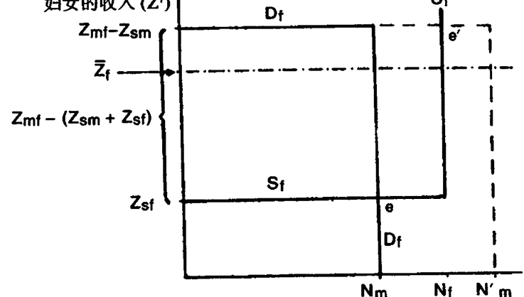
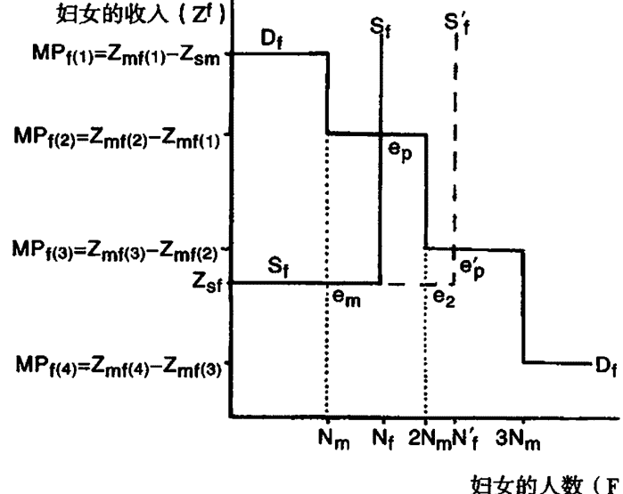
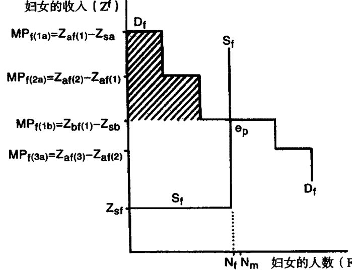
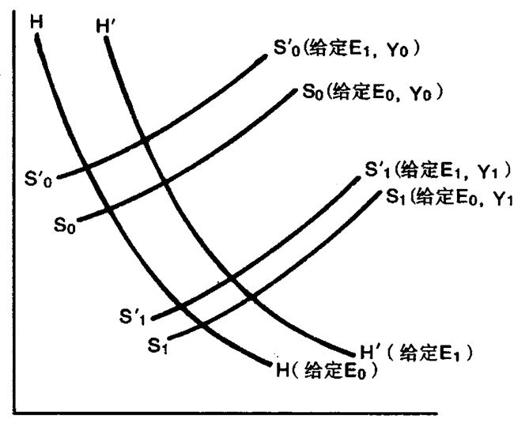
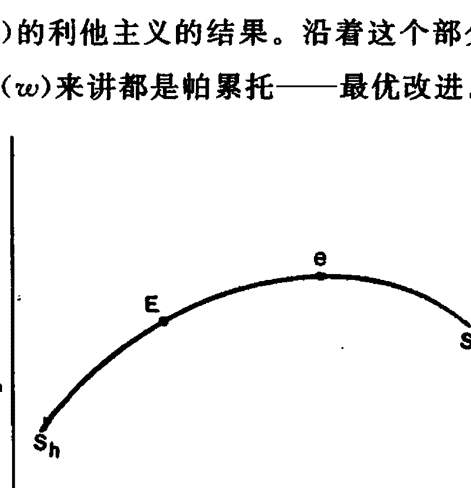
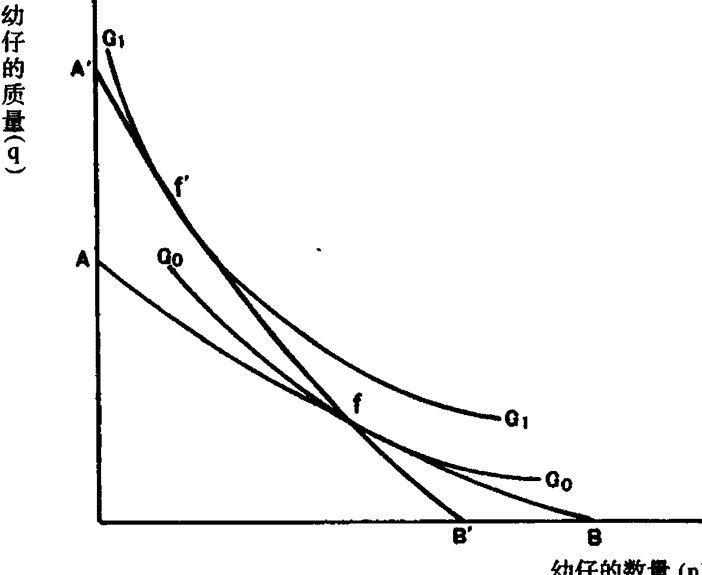
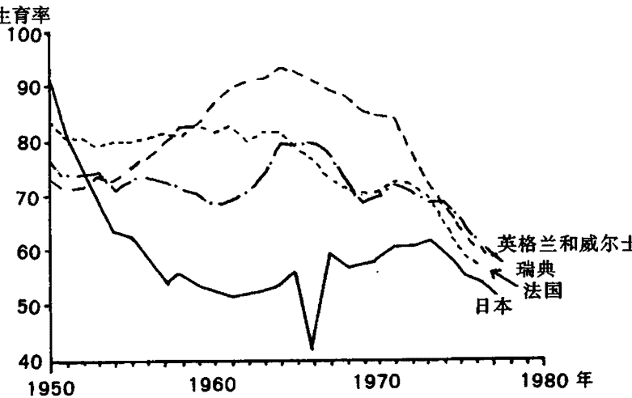
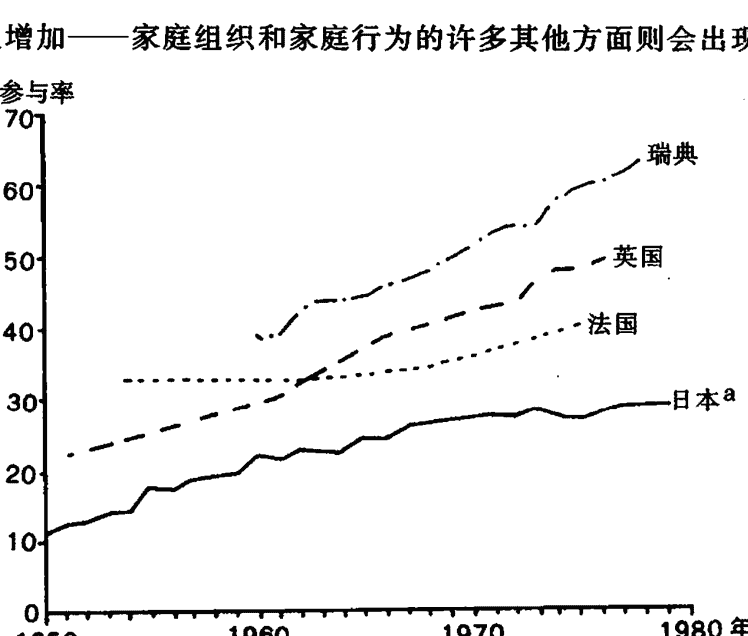

# 汉译世界学术名著丛书

## 家庭论

[美] 加里·斯坦利·贝克尔 著


# 资本主义经济制度
[美] 奥利弗斯·E.威廉姆森著

# 人类行为
[奥] 路德维希·冯·米尔斯滕著

# 资本主义与自由
[美] 米尔顿·弗里德曼著

# 食利者政治经济学
[德] 尼·布哈林著

# 家庭论
[美] 加里·斯坦·贝克尔著

# 福利经济学
[英] A.C.斯古尔著

# 改造传统农业
[美] 西奥多·W.轩尔茨著

# 自由的限度
[美] 詹姆斯·M.布坎南著

# 资本主义的法律基础
[美] 约翰·R.康格斯著

# 各国的经济增长
[西贡] 西蒙·库兹涅泽著

# 汉译世界学术名著丛书

## 家庭论

[美] 加里·斯坦利·贝克尔 著
王献生 王宇译


商务印书馆 2005年·北京

# 图书在版目(CIP)数据

家庭论/[美]贝克尔著;王献生,王宇译.北京：商务印书馆,2005
(汉译世界学术名著丛)
ISBN 7-100-04230-5

I.家...II.①贝...②王...③王...III.家庭论
IV.C913, 11

中国版本图书CIP数据核字(96)第25000号

所有权利保留。未经许可，不得以任何方式使用。

# 汉译世界学术名著丛

## 家庭论

[美]加里·斯坦利·贝克尔著
王献生 王宇译

商务印书馆出版
(北京王井街36号邮编码100710)
商务印书馆发行
北京民族印刷厂印制
ISBN 7-100-04230-5/F·508

2005年4月第1版 开版850×1168 1/32
2005年4月北京第1次印刷 印张14 3/4
印数5000册

定价:24.00元

# 汉译世界学术名著丛

# 出版说明

我们历来重视翻译各国学术名著。从致力于出版马克思主义诞生以前的古典学术著作，同时适应当代具有各派代表的作品。我们相信用人类全部的知识财富来丰富自己的头脑，才能够建成现代化的社会主义社会。这些书籍所蕴藏的思想财富和学术价值，为学人所熟知，毋需诠释。这些译本过去以单行发行，难见系统，汇编为丛书，才能相得益彰，蔚为大观，既便于研读考查，又有利于文化积累。为此，我们从1981年着手陆续刊印，到2000年间已分九辑发行名著360余种。现继续编印十辑。到2004年底出版至400种。今后在积累单著的基础上仍将陆续以名著版印。希望海内外书界、译译界给我们批评、建议，帮助我们将这套丛书出得更好。

商务书印编辑部
2003年 10 月

# 译者的话

加里·斯坦利·贝克尔是当代西方最著名的经济学家之一，1992年诺贝尔经济学奖获得。贝克尔1930年12月生于美国宾夕法尼亚州，后获得普林斯顿大学、芝加哥大学学士、硕士和博士学位。27岁时出版了《差别对待经济学》书，向当时的经济思想领域内占统治地位的凯恩主义提出挑战。30岁时成为哥伦比亚大学教授。从1970年起，一直在芝加哥大学任教，并担任该校经济学系主任。贝克尔后来获得美国著名的克拉克奖、赛诺德曼奖、威延斯基奖、麦瑞特奖。他现已退休，但仍担任责任芝加哥大学经济学和社会学教授，并继续在经济领域内探索。

贝克尔是美国芝加学派的主要代表和自由主义经济学派的重要成员。在九十年代的教师和学生生涯中，他独树一帜地发动一系列开创或新的家庭经济学、人力资本理论、犯罪经济学等为主要内容的“贝克尔革命”，对整个西方经济学界产生了重大影响。1992年瑞典皇家科学院的授奖辞指出：贝克尔“微观经济学的研究领域延伸到人类行为及其相互关系”，“不仅对经济学，而且给其他社会科学带来了较大的影响”。

# 家庭论

① 法经济学家帕勒曾给贝克尔以高度的评价，他说贝克尔在50岁时“已跻美国著名的经济学家列”，“是个极为多产的作家，又有非凡的概念，因此成为经济理论的核心人物，他作出的系列答案以全新的方式解释了当代的大部分问题，打破了以往社会学家、人类学家视为禁区的领域”。② 贝克尔对经济学的重大贡献之一，是在家庭范围内应用了传统上用于企业和消费者的分析框架，从而完成了一项革命性的突破”。③ 贝克尔是一个勤奋的经济学家，他先后发表、出版了一批论文和著作，如：
- 《差别经济学》（1957）
- 《生育行为和经济理论》（1960）
- 《非理性行为理论》（1962）
- 《人力资本》（1964）
- 《时间配置学》（1965）
- 《收入分配》（1967）
- 《人类行为的经济分析》（1971）
- 《家庭论》（1981年第一版，1992年扩大版）等。

① 转自《人民日报》，1992年10月。
② 丁利·帕勒：《自由经济学》，北京大学出版社，1985年版。
③ 马克·布洛格：《现代经济学》，北京大学出版社，1989年版。

# 译者的话

《家庭论》是贝克尔理论体系的主要内容，是他最重要的代表作。1981年出版的《家庭论》（第一版），该书除了前言以外，共括了家庭内的劳动分工和一夫多妻制，还探讨了孩子的需求、教育和非物质行为。1992年出版了《家庭论》（扩大版），除了第一版的所有内容以外，增加了三分之一的内容，使其更加全面。

以来，赞者称其为一部划时代的著作，批评者则认为其内容是浅的。贝克尔综合了各方面的意见，由于家庭成员之间彼此理解、相互信任，这就大大减少了监督和管理费用。如此，家庭就是一个高效的经济单位。

家庭之所以会亘古以来、绵延延长，其原因在于家庭生产以明确的分工为基础。最初的分工发生在妇女与男子之间，妇女主要致力于生儿育女、操持家务等非市场活动；而男子则专注于狩猎、种田等市场活动。家庭成员之间的这种分工部分地决定了生理上的差异，但主要取决于经验和人力资本投入上的不同。这种差异构成了家庭产生的物质基础。彼此结合，扬长补短，使家庭产出最大化。因此，一个完全家庭的效率比不完全家庭的效率高。

为什么要结婚、离婚？怎样才能降低离婚率？贝克尔认为，人们结婚的目的在于从婚姻中得到最大化的收入。如果婚姻收入超过单身的收入，人们就会选择离婚；否则，就宁愿独身。

如同在商品市场上，也存在一个婚姻市场，这说明婚姻具有高度的系统性和组织性。在一个高效的、自由竞争的市场上，每个人都能找到自己的最佳伙伴，从而使自己的效用最大化。高质量的男子和高质量的子女、低质量的男子和低质量的女子握手言。一些宁愿和低质量的男人结婚，是因为他们认为高质量的婚姻太昂贵了。在一夫多妻制的社会里，男性的对象可能是高质量的女子，其相对低于实行一夫多妻制的同样上等的婚配，其获得的收益低于一夫多妻制的婚姻。如此，一夫多妻制的婚姻市场将萎缩。

能否否准确地掌握婚姻市场的信息，是一个个人能否在婚姻市场上获得最大效用的本质所在，也是决定婚姻与否的根据。然而，人们在婚姻市场上总是想获得信息，但由于时间短缺、知识局限等原因，难以获得准确的信息，因此草率结婚。由于寻找新伴侣需要投入时间、货币等资源，大多数人在婚姻市场上没有最大化的效用，也不愿离开婚姻。如果一个人从婚姻中得到的效用大于成本，他就会选择离婚。

然而，家庭收入、父母的时间价值、孩子的质量和数量等变量影响着孩子的需求。生育始终主要取决于经济因素：比较成本。如果第一个孩子的成本和收益小于生育孩子的成本，那么就有生育；如果一个孩子和两个孩子的预期总收益一样，就会出现高质量、减少数量，这也是当今发达国家出生率降低以及孩子投资的主要原因。

很多经济学家总是怀疑家庭中利己主义的重要性，但是贝克尔认为，如同市场中普遍存在利己主义一样，在市场下利己主义效率较低；而在家庭生活中利己主义效率较高。利己主义可以提高家庭成员的产出水平，“保证了家庭成员能够抵御灾害和随而来的事件”。此外，《家庭论》（扩大版）阐述了古代、近代社会中的核心家庭及其血缘关系和非人类物种。

贝克尔认为，经济学是充分生活的艺术，经济学方法提供了分析一切人类行为的，能够解释所有方面，包括犯罪、消费、社会保障等。在这种认识下，他首先提出的用经济学方法来分析家庭复杂的社会问题。

从19世纪中叶后，社会学成为一门独立学科以来，西方社会学观点不断迥异。从实证主义、斯宾塞、韦伯到20世纪以来，社会学发展的历史从功能、冲突、符号互动等角度，几乎没有人能解决问题。

当然，贝克尔的理论和方法也有局限性，有人甚至认为他的理论完全掩盖了资本主义社会日益尖锐的矛盾，“扭曲了资本主义生产方式的内在”。即使贝克尔本人也认为对于家庭方面研究的性质正在进行，一些难题被克服。同时我也意识到了写作中的疏忽和分析上的不完善。本书根据哈佛大学1991年英文版翻译。导论的前半部分、1—7章由王献生翻译，扩大前言、导论的后半部分、8—11章由王宇翻译。原著中的参考目录较长，在国内图书馆中难以查阅，为了节省篇幅，本书未将其译出。本书的翻译和出版过程中，商务印书馆王鸿、程珍、吴宪康同志付出了辛勤的劳动。程珍同志认真地对全部译文进行了审核和修改。对他们表示最衷的感谢！

- 马克·布鲁格：《经济学方法论》，创新学术出版社，1981年英文版
- 米列·伊尔法基等等：《现代资产阶级经济学批判》，商务印书馆，1985年版，第451、457、444页
- 本书《扩大版前言》第2页。

由于时间和水平有限，译文中不当之处在所难免，敬请读者批正（E-mail: wangxs1203@soho.com）。

王献生
1996年10月

## 目录

- 扩版前言 (1)
- 导论 (5)
- 第一章 单人居民户 (29)
- 第二章 居民户和家庭内的分工 (41)
- 第二章附录 人力资本、精力和性别分工 (67)
- 三章 婚姻市场上的一夫多妻制和一夫多妻制 (97)
- 第四章 婚姻市场上的相婚 (130)
- 第五章 对孩子的需求 (161)
- 第五章附录 对生育率经济理论的重新阐述 (185)
- 第六章 家庭背景和孩子的机会 (215)
- 第七章 不平等和世代之间的变动性 (240)
- 第七章附录 人力资本和家庭的兴盛 (283)
- 第八章 家庭中的利己主义 (325)
- 第九章 非人类物种的家庭 (364)
- 第十章 信息的不完全性、结婚和离婚 (387)
- 第十一章 家庭的演进 (411)
- 第十一章附录 国家与家庭 (436)

## 扩大前言

贝克尔认为，要完成这项任务，不仅需要采用经济学的研究方法，而且不能仅仅限于家庭的物质生活”。他说：“我的构想更为广泛，我力图用研究人类行为的工具和理论框架分析婚姻、生育、离婚、家庭内的劳动和其他非物质行为”，即“用新的理论框架分析家庭生活的各个方面”。

贝克尔利用自己的方法，对家庭生活的各个方面进行了深入且独特的分析。他认为，家庭是由多人组成的生产单位，不同成员的时间、货币和技能等生产要素的投入会生产联合用途，这些用途主要包括商品、健康、声望等家庭产出。家庭行为受限于时间和两个因素的限制，决策的代价要用时间和货币来衡量。当一个家庭的时间和货币为定时，为了使家庭行为最大化，家庭成员就在组织的下，对有限的资源进行合理的配置，进行家庭生产。同时，家庭成员之间彼此理解、相互信任，这就大大减少了监督和管理费用。如此，家庭就是一个高效的经济单位。


## 家庭论

家庭中的利己主义和他利他主义、家庭中两代之间沟通的可能性，以及家庭生活的其他方面。虽然这些研究并没有把家庭问题的所有方面都包括进来，但这些重要方面的系统和一致的解释足以证明这些题目上也是大有文章可读的。

我的书不是用经济学“门外汉”字写的，但是对于那些具有基本经济学知识的人来说，大部分内容都是可以理解的。本书的第五、十、十一章和十一附录是最容易被接受和最具观赏价值的。其他章节也可以为一项有意的经济学分析能够提供一种帮助。我希望读者不要为本书中的一些专业术语和专业分析方法所困扰，因为这些都是提出和理解家庭的理性选择方法所必须运用的。

一些经济学家对理性选择方法仍然持怀怀疑态度，但是有着越来越多的社会学家、考古学家、律师、生物学家、心理学家和历史学家正在使用理性选择方法或有关的方法对家庭问题进行分析。我的文章就是想为这些经济学家的交流发起一个引起关注的讨论。

在本的写作过程中，我一直感到十分愉快，因为它的主题是非常有意义的，而家庭组织及其行为对经济学来说也是一个强有力的挑战。为了表明我的诚实，我必须向大家说明，这个方法的性质正在进行，而且一些困难正在被克服。同时我也意识到写作中的一些疏忽和分析上的不完善。我曾多次推迟1981年版本的出版以试图填补某些空缺和改进某些讨论。但这一版的出版我却不再要求推迟，因为我已经认识到其他经济学家和非经济学家可以在家庭问题的研究方面做出比我更好的贡献。

在过去的几十年中，世界范围内家庭行为和结构的变化……

## 扩版前言

书的第一版受到了广泛的重视。该书被许多经济学家、社会学家、人口学家和少数生物学家以及心理学家评论并写成了许多文字。再加上近年来我对家庭问题的继续而深入的研究，因此我浑然接受了哈佛大学出版社对出版该书扩版的请求。

## 致谢

在本书的准备和写作过程中我得到了许多方面的帮助。首先应该感谢芝加大学的同事和学生们所创造的积极的学术环境。经济学在芝加大学备受重视，在里面人们总是以一种探究的态度对待人的经济分析和经济思想，既没有对权威的过分依赖，也没有学科界限。参与应用经济学研讨组的几十位学生的论文让我受益匪浅，他们是：

- 詹姆斯·丹亚斯、瑞士·布莱克斯斯特、内克拉克、布里德、特雷、艾文华、弗雷雷、M.梅·罗斯、A.格罗斯·巴斯登、N·纳什、B.约翰·维希、M.贝利、L.肯尼、A.基普希、E.科格特、S.F.朗、D.列维、路易斯、洛凯、托马斯·麦克迪、I.马克肖普特、H.奥费尔、E.彼得彼、S.桑德斯、詹姆斯·史密、奈弗里、史密斯、罗伯特、塔穆拉特、N.托莫斯、G.肖、J.B.沃尔、W.霍塞尔顿、H.莱尔德、R.旺和M.泽尔德。

我为扩版准备了一个全新的引论，还把1981年以后发表的四篇文章稍修改后收录在内，其中一篇是与罗伯特·巴罗合写，一篇与凯·M.墨非合写，还有一篇与奈丹尔·托莫斯合写。

我深深地感谢罗伯特·迈克尔·里查德·波斯蒂纳、含森·罗森、T.W.舒尔艾和乔治·施蒂格对各章认识认真而非常有帮助的建议。斯图特、奥尔特曼、迈克尔、阿伦索、爱德华、非菲莱、鲁森·梅·文。布伦纳、阿瑟·戴蒙、特德·斐布雷克、戴维·弗里德堡、米尔顿·弗里德堡、W.福斯克、戴维·盎伦森、马修·戈德堡、阿瑟·戈德伯格、Z.格里·克里斯托、鲁本·格罗瑞、A.格罗斯·巴斯、桑福德·格罗斯堡、詹姆斯·穆克越、戴维·赫特利、A.卡尼斯、L.巴尼、E.兰斯、理查·亚莱德、H.哈格雷、刘易斯、罗伯特·卢卡斯、雅各哈·明赛尔、约翰·莱尔鲍尔、K.M.蒙菲、S.奥尔芬、爱德华·普雷弗肖特、S.普雷斯顿、M.里德、P.罗默、L.萨特、罗伯特·捷哈林、Y.弗托斯、罗伯特·威利、E.威逊、凯尔霍姆提出了实质意见。维维安·惠特前后两版都有帮助，丹伦·合。阿罗斯森是具有合作精神和最有煽能力的编辑。

我对家庭的研究得到了支持。大学中心、全国儿童健康和人类发展协会、全国科学基金会、林德和哈里·布雷德利基金会、斯隆基金会。两者还帮助了我们的家庭研究室。国家经济研究局，特别是人类行为和社会组织中心为我们提供了多年的资金赞助以及研究方向的支持。不过本书中所表达的只是个人的看法，不是作者的初衷。

最后，我真诚地感谢：

- 盖尔·莫斯特在第一版中投入了情感、耐心耐心的合作。
- 戴维·梅尔泽在附录中有意义的研究。
- 敏敏在索引、书目和其他方面的出色工作。
- 娜莎特对我的写作大有益。

# 导论

最近30年来的发展，使得西方家庭发生了根本变化，有人认为它几乎体。离婚率的迅速上升增加了女性户主的数量，单亲家庭中长大的孩子急剧增。已婚妇女参与率极大提高，幼儿孩子例外，这加剧了孩子和母亲在婚姻上的冲突。出生率的迅速下降缩小了家庭规模，反而推动了离婚率和已婚妇女参与率的上升；反过来，不同代人之间的冲突日益公开，现在的父母不再像以前那样指导子女。

一些重要的统计资料为这些变化提供了数量上的证据。在美国，50年代第一次结婚的妇女中，现在离婚的不到15%，而在80年代第一次结婚的妇女中，约有60%可能会离婚（普雷德森，1975；马丁和帕普拉斯森，1989）。从17世纪到19世纪，英国和威尔士的平均家庭规模显然稳定，但从19世纪末以后缩小了1/3（萨格莱特，1972）。在美国，由于离婚率上升和女性寿命增长，促使女性户主的比重从1950年的15%上升到31%（美国人口，1977；1989）。在瑞典，75岁以上已婚妇女的参与率由1960年的39%上升到1984年的70%（瑞典国家统计局，1980；1986）。在美国，6岁以上小孩的已婚妇女参与率，甚至从1950年的12%迅速上升到1988年的57%（美国人口，1977；1989）。自1958年以来，由于出生率下降了40%，终于美国人口再生产率低于更新水平（美国人口，1989）。在日本，从1955年至1987年，人口出生率也下降了50%以上（日本统计局，1989）。

由于这些显著变化，所以从百姓到学者来说，都比以前更加关注家庭问题。对家庭衰落及其未来走向的讨论，成了90年代的热门话题。另一方面，人口学家和历史学家编写了大量苦心和有趣的论述，阐述了几年前家庭构成及其行为（亨利，1965；拉普拉斯，1972；杜拉特，1978）。人类学家（古董，1976）；生物学家（特里弗斯，1974；尔逊，1975）和心理学家（凯尼斯顿，1977）对家庭问题也感兴趣。

在50年代以前，除了马尔萨斯主义的人口变化理论以外，学者们对家庭问题几乎都是忽视。自那时以后，他们才开始讨论配偶、孩子和其他家庭成员问题。雅各布（1962年，可见1958年的文章）辩说，已婚妇女参与率不仅取决于她们的收益，也取决于丈夫的收益、孩子的数量以及家庭其他特性。对生育率的现代经济分析学家开始替代马尔萨斯主义的分析。它表明，孩子的需求取决于家庭收入、父母的时间价值（特别是母亲的时间价值）、孩子的“质量”和其他家庭变量（贝克·阿尔，1960；伊斯特林，1968）。人力资本研究把私人教育支出视为父母对孩子生产率的投资（舒尔茨，1963；贝克尔，1964）。

《家庭论》对家庭问题的研究有了基础，提出了一种对家庭的经济分析。虽然我利用了自己以前的研究成果，但许多分析都具有独到之处。第二章分析男女两性与品质相同的个人之间的家庭分工。第三章分析夫一妻多妻的影响和对孩子的需求、差异及变量融合。第九章分析非人类种的交配及其后代的数量。第十一章则论传统、古代、近代社会中的核心家庭、扩展家庭及其血缘关系。

其他章节的基本分析，我在以前出版的论书中已有叙述，但这次对我讨论进行了重写。首次采用的内容：

- 多配制的影响、理性选择偏好的差异（第四章）；
- 孩子数量和质量的相互关系，以及这种关系对生育率的影响；
- 兄弟姊妹的数量和其他家庭背景的影响（第六章）；
- 家庭中的他主义、妇女与市场的比较（第八章）；
- 离婚的差异（第十章）。

虽然本书主要侧重于分析，但大多数章节也有材料：近期统计数据，特定村市、城市和国家的研究；伊斯、非洲和东方社会的情况；还有原始人类学中的历史。这些材料并不系统，但其局限性正好表明我力求提出全面的分析。无论过去还是现在的家庭，无论是原始还是现代文化，这种分析至少部分都是适用的。

该论试图把书中的四个附录和章节结合起来，对一些基本问题进行了评论。第二章建立的模型表明，即使夫妻差异相同，其中一人专注于市场活动，另一人专注于家庭活动，他们也能从市场和家庭分工中获益。这种收益源于专门部门的人力资本增长，主要提高了市场和非市场部门的生产率。由此，即使男女细微差别在生育方面的优势也将引起性别分工，这是因为妻子专注于家庭活动，而丈夫专注于其他工作。如果人们认为某一部门（如家务活动）价值更高，那么婚姻中的专业化（专业化）程度可能无法达到点。

第二章清楚地表达了我的观点（见博鲁普1987年的文章中的例子）。利他主义的父母乐于负责对子女人资本最大化的投资，其成本却受到下列认识的制约：对子女支出越多，对自己的支出就越少。因此，当子女人资本的边缘际收益超过父母资产的（增长）率时，即使利他主义的父母也会对孩子投资不足。

当父母投资不足时，如果孩子向父母借钱引入人力资本福利，父母和孩子的境况都会更好。较穷的家庭从这种组合中得到的收益最多，因为和较富的家庭相比，他们对孩子的投资可能不足。

第十一章的附录《国家与家庭》是我·M.墨的一篇论文，它分析了由于父母无力约束子女的各种后果。除了对子女投资太少，这些后果还包括贫穷的养老储蓄不足，以及老而困难的“理想”人口问题的方面。父母多生孩子，剩余的孩子显然不能保证对此报告（见帕菲1984年关于剩余孩子重要性的讨论）。因此，即便多生孩子能使父母和孩子更好。请注意，在贫穷之家中，多生孩子的福利改善才是可能的。他们想要从孩子（包括多余的孩子）那里得到补偿，因为他们想要得到财产就可以了。

第十章的附录述，广泛涉及政府发现，在各地通过教育补助、社会保险项目、调整婚姻法律以及其他途径，常常帮助父母和子女建立约束。比如，把教育和社会保障结合，或许就能把孩子的投资提高到合适的水平，又能对老人进行补偿。

第七章和第八章附录的分析假设父母是利他的；孩子的处境较好时，父母的效用就增加。第七章是根据我和托缪斯1979年发表的论文写的，它建立了捐赠由父母流向子女的模型，分析了不平等和代际变动的因素。也就是说，该模型有严重的局限性，尤其是设父母会将财富和债务给孩子，并将人力资本视为同源资产。

1984年，我和托缪斯为一个会议撰了一篇关于家庭兴衰的论文，直到1986年发表。这篇论文后来为了现实做了假设：父母不会留下债务。它还对人力资本和资产做了区分，它设资产收益率由市场来确定。对孩子人力资本投资的收益率则取决于其禀的“才能”，而这种收益率会随着对孩子投资的增加而（最终）下降。

这些假设产生了一系列比第七章（我1986年的论文新增为该章的附录）更丰富、合理的分析，与第六章的分析也更吻合。第六章区分了人力资本和资产，并假设人力资本投资

这种相互影响意味着，即使孩子的数量和质量与父母效用函数关系不大，它们与父母的决策也密切相关。这些变量间的链关系，也可以从它们进入父母效用的方式中找到。因为每个孩子对利主义的程度，从未来相关的权力随着孩子数量的增加而减少，对未来贴现率的影响是孩子数量和质量相关关系的另一个根源。

现在，很多社会学家、人口学家和经济学家对生育率进行分析（比如可见布莱克1981年的文章，他早在1968年就批评生育率的经济分析）。一些人仍然对孩子质量质疑，他们认为孩子数量的需求建立在生物学认识的基础上。然而，我实际上明确反对对生物学观点，认为这种观点是不恰当的（见第五章部分和第九章的结束语）。

经济学家似乎未将考虑过为什么消费者喜欢香烟或其他商品，但却容易理解为什么自己的孩子是利主义的。我和巴罗在1989年指出，利主义的父母既想建立较大的家庭，又想用相同的策略在每个孩子身上花费他人的精力。

在本论中，我尽量免花费太多时间来回答人们对本书第一版本的评论。但是，我之所以明确地提到刚的评论，因为许多学者（比如毕加辛·肯尼托拉克，1988）认为它是害于《家庭论》的。五年前，我针对刚的批评准备了一长篇评论，用来回答刚的问题。

* ① 布赖德在1982年对《家庭论》的评论中，根据对孩子质量的价值表示了特。认为孩子质量与每个孩子的支持有关，然而道：“怎么会出一个高价吗？”当每个孩子作为父母子女的质量越高，它确实有一个影子价格。这个价格与孩子的数量相关，它成为父母效用最重要的初章节，它与其他价格的形成相同。然而还认为对生育生物功能能影响孩子的数量。”

模型好像像是第一次把出生率和利率联系，但小说中已经对这种关系有了认识。故事在《家庭论》中写道：

“一名统计学生注意到，出生率随着手中货币利率的变化的变化。在19世纪初，祖父·道斯得到10%的利率，因此有10个孩子。除掉其中四个未婚者，且如果丈夫又即将死去，那么10个孩子得到的平均利率是4%—5%。对他们来说，出生率也就相应的确定。”

第五章到第七章（包括第五章的附录）的分析，要述数量和每个孩子质量的相关关系，认为孩子的质量可用孩子福利的不同来衡量。早期文章表明（贝克尔和易扬，1973年；可见威利1973年的文章），孩子数量和质量相互影响，部分范围由于孩子数量的总出，他们日益进入父母预算。

① 福尔赛姆进行了深入的经济分析：“这种速度还有其他内在。对收入和能力有效孩子的环境，以及父母的认识，会保持谨慎。如果一个人有了孩子而还没有太多的收入，那么趣和营养的标准自然就会下降；有了足够的东西就不需要人了，等等——最好是等待和观察孩子的行为。此外，最好能够提高速度。事实上，父母比孩子行动更快，为了符合增长的趋势，他们宁心专注于所有权——《世纪初》，正如它所说一样。（第366页）”


# 论

是一个重要例证，它表明，如果满足某些条件，那么即便孩子是有利的，利主义的父母及其孩子也会使相同的效用函数最大化。

其主要假设是：商品都能买卖的闲暇是不能买卖的一个（例如）；单一时期，父母对孩子提供馈赠；在双方参与的“游戏”中，孩子比父母先选择。

第八章中的一些评论认为，该定理的无根据的概括才做出了有限的范围（尤其是对逸学、躺在床上看书和其他行为的讨论）。

但是，某些物品不能买到时，或者当消费超过一个时期的时候，这个定理也许就不能成立了（第十一章的附录；布鲁斯坦和霍尔·德曼，1986年；林德贝克和韦布尔，1988年；尤其是伯格斯特，1989年）。

然而，在我们的论述中，不能说人类的方面不是正确运用“罗登·凯德定理”（无论这是多少的不幸），而是没有把“价值产品”的讨论和利主义成功地结合起来。我所说的“价值产品”是父母关心的孩子的特殊品质和行为，即使他们是否懒惰、在学校是否用心、是否经常看望自己的父母、是否酗酒、婚姻是否完美以及对自己的兄弟姐妹是否友善。

当父母的父母为了孩子也需要“价值产品”，父母和孩子之间产生相互影响，便仅仅是因为孩子可以提高或降低父母双方的效用，“罗登·凯德定理”考虑了这一结果。此外，孩子减少了对“价值产品”的消费，降低父母对孩子的利主义程度，进而减少了他们对孩子的馈赠。例如，一个在学校不用的孩子，就不能得到父母较多的馈赠，因为的行为令父母为难。所以，一个理性的孩子是要考虑父母对他学习努力程度的反应（或者说在父母看来他是如何努力学习的）。

## 16 家庭论

为了分析这一相互影响的，我们没有假设父母与孩子之间直接进行讨价，或者父母付出馈赠的预先承诺，而是假定先由选择他们的“价值产品”，然后父母再选择储赠和自己的消费，最后孩子再选择他们其他的产品。“罗登·凯德理论”提出了类的顺序。设定孩子的效用函数 $U=U(x_1, x_2)$，父母的效用函数 $V=V(x_3, x_2, U)$，这里 $x_2$ 表示孩子的产品，对父母来说它是“价值产品”。孩子会选择 $x_1$ 和 $x_2$，父母无法直接影响他们，但他们可以通过馈赠 $g$ 来间接影响它。在一个完全预期的均衡中，孩子 $U$ 的最大化取决于他们的资源，其资源等于 $I_c+g, I_c$ 代表孩子的收入。父母通过选择 $x_3$ 和 $g$ 的最大化取决于他们的收入 $I_p$ 和孩子所给予的 $x_2$ 的选择。对父母来说，一条条件是：

$$\frac{\partial V}{\partial x_3} = V_3 = \lambda_p p_3 \quad (I. 1)$$

和

$$\lambda_p = V_u\frac{dU}{dg} = V_u\lambda_c, \frac{V_uU_1}{p_1} \quad (I. 2)$$

这里 $\lambda_p$ 和 $\lambda_c$ 分别是父母和孩子收入的边际效用，$p_3$ 是 $x_3$ 的价格。等式(I.2)左前的两项构成 $g$ 的一阶条件，左边第三项表示 $dU/dg$ 等于孩子的边际效用，最后一项来源于这么一个事实，即对孩子来说，$\lambda_c=U_1/p_1$ 是一个条件。

孩子知道改变 $x_2$ 可能会影响父母的馈赠，因为 $x_2$ 也进入父母的效用函数，对 $x_2$ 而言，孩子的条件是：

$$U_2 = \lambda_c[p_2 - \frac{dg}{dx_2}] = \lambda_c\Pi_2. \quad (I. 3)$$

# 导论

$dg/dx_2$表明“价值产品”$x_2$的增加可以改变父母的绪。如果$x_2$和父母的利他主义是“互补成分”——例如，假设 $V_{B2}>0$，$V_{B2}=0$，那么$x_2$越越大，父母的利他主义动机就越强，从而父母的绪也就越多的。

当$x_2$ 增加时（如果$dg/dx_2>0$），如果$g$ 也增加时，那么$x_2$有净价或影子价格就会低于其市场价格（$\Pi_2<p_2$）。较低的价帮助增加孩子对$x_2$的需求，这使其妈妈感到温暖。正如“罗登·凯德理论”所述的那样，假设没有计价，没有许诸或威胁，父母对孩子的$x_2$的选择就会自动反应，引导孩子朝着父母所希望的努力。在这种情况下，这一机制就不仅只是对利他而言，还包括“价值产品”对利他主义程度的影响。

父母的自动反应会使得孩子对父母直接控制孩子的行为所希望达到的水平。换句话说，当父母使效用达到值并控制了$x_1, x_2, x_3$和总收入时，前面说的孩子和父母一阶条件就不等于。例如，一个在学校不用的孩子，就不能得到父母较多的馈赠，因为的行为令父母为难。所以，一个理性的孩子是要考虑父母对他学习努力程度的反应。

孩子知道改变 $x_2$ 可能会影响父母的馈赠，因为$x_2$ 也进入父母的效用函数，对 $x_2$ 而言，孩子的条件是：

布格斯特（1989年）在他的非常色的分析中提到，事实上，如果存在“可迁移效用函数，那么由孩子选择时，相对于$x_2$来说，孩子几乎得不到$x_1$。

是的，预先承诺也有它的问题，即使父母失去了对孩子的外部事件的反应灵活性。例如，为了预先承诺的慷赠，父母就得不得不帮助那些遇到意外事故，或者患有严重的障碍疾病的孩子。“价值产品”比具体承诺更有效，因为它们可以将外部事件与选择权分开。正是由于这一原因，那些也为人知的、有身体或精神障碍的孩子，很可能会比他们的兄弟姐妹得到更多的遗产和慷赠。

虽然，我还没有得到向这些孩子转移财产的具体证据。通过“价值产品”和利他主义之间的关系，可以把一些重要因素索引到孩子的行为中。因为孩子可以使用父母给予给其兄弟姐妹的份额增加自己的慷赠和遗产，从而就能产生一个“兄弟姐妹乞丐”的计谋，结果可能是他们的相互串通，或者当孩子们为父母的恩惠进行竞争时，产生更多的“价值产品”。

婚姻市场引起了不同家庭主义之间的联系。因为岳父母和其他亲属属于帮助他们子女和孙子的共同消费，所以很大一部分家庭中的几代人可以通过亲戚建立起来。家庭主义之间相互影响的程度，可能受到其无偿赠与动机的严格限制。例如，父亲可能会担心一旦他给自己的孩子产多了，他的家里就会减少他们给孩子的产（参数）查看第八章的评论，以及纳洛的深入讨论，1987年。

无论是对子女父母来说，一个固定的总收入的再分配，不会改变任何人的消费或效率。即使在下列情况下也是如此：（1）“价值产品”是重要的；（2）罗登·凯德失效；（3）亲属中的利主义相互影响；（4）孩子的行为有策略性的。这个命题中的证据能够简单示，如果父母愿意的话，他们可以通过给孩子少的慷赠来获得再分配。既然父母通常希望孩子经常来看望，可是为什么富有家庭的孩子比贫穷家庭的孩子能够经常来看望呢？一个合理的解释是，富有父母通过对“浪子”出自《圣经·新约》福音章一个故事：一个孩子向父亲要了一份产业，送到远处挥霍空。走投无路之路，猛然醒悟，又回到父亲身边辛苦劳动了。控制，促使他们的孩子去好（见伯思姆等人的证据，1986年）。一个类似的理论解释了为什么离婚的父亲对于孩子的抚养费用总是不积极，这是因为随着离婚的父亲与孩子关系的减少，他们对孩子的利主义也在日益减少（韦斯和威利斯，1989年）。孩子的行为对利主义的影响，解释了为什么利主义的父母不会用较多的遗产来补偿他们的较小的孩子（门奇克在1988年提供了关于孩子遗产的证据）。原因在于如果父母感到这些成就的孩子是懒惰和奢侈的，那么，就不多给他们遗产。

## 18 家庭论

第十章中的结论是，若人们对自己配偶从离婚中得到的收益与自己从离婚中所得到的收益是同样的话，那么有关离婚的法律从双方同意到单方同意的变化，就会引起离婚率的上升。每个人获得了更多的了解的话，那么，法律的变化就会引起离婚率上升。第十章中许多经验性材料并没有发现有关离婚率的任何感觉。但是，随后的研究发现，允许单方离婚的法律的变化提高了离婚率（特别提及韦斯和威利斯，1989年；泽尔，1989年）。

但是，即使在这些研究中法律的变化仅仅是解释70年代以后大量出现的离婚现象中的一小部分，那时美国单方离婚法刚刚开始实施。因此，无论人们能否接受这一研究成果，离婚率的上升是由经济和社会条件引起的结论显然具有生命力。

第十一章是对所谓新制度学的介绍（尽量使用该学学的语言）。根据这种方法，制度被认为是沿着理性人对环境符合反应的方向发展的。与早期相比，20世纪的政府组织更宽松、作用更小。其根本原因在于20世纪的政府和市场机制已经发展到这种程度，它们能够培训和教育年轻人，并且能够保护他们免遭危险，这些人包括老人、病人、财产不足的人、长期失业者和其他遭受灾难的人。这些新制度淡化了过去依靠家庭达到这一目的的价值观念。根据这一认识，在过去几十年中，由于妇女进入就业机会的极大改善以及社会福利的快速增加，家庭在以前所有的速度发生着变化。

强调福利国家这一个来说，我一直受到一些人的批评。有人指责，美国对未婚母亲的福利支出打击了婚姻，鼓励了贫穷的妇女多生孩子。可是，评论指出，美国七八十年代福利受益数量的增加和未婚母亲生育的上升不可能是实行福利制度的结果。事实来看，这一时期每个家庭的福利收入都有下降。他们还指出（见维奎，1983年），同一州内福利的差异与同州间未婚母亲生育的差异并没有多少联系。

然而，关于婚姻市场的分析表明，保持独立的动机在内部运行，而结婚后的单身只与预期收入有关。在过去15年中，霍霍高中生的实际生育和研究生最低四分位数都下降了25%以上（见赵佑，1989年），加上其他原因，这些年轻人可能已经成为没有少吸引力的伙伴体（见威尔逊，1987年）。因此，即使每个家庭实际福利都下降，社会福利也有助于贫穷妇女保持单身或成为母亲。

第九章阐明了，尽管人类行为取决于文化和生物因素，在生物界的其他方面也完全不同，但用人类的家族化同样有助于理解其他物种。分析非人类物种的、数量和质量的交换，在生物学中叫做r策略和K策略。一种类的优化模型能够说明生物学中所述，“福利的扩大”伴随着婚姻收入的减少，解释了合法出生率迅速增长。

## 24 家庭论

问题。例如，汉密顿（1964年）在一篇很有影响的文章中提出，由于近亲大部分基因是共同的，非人类物种中的利主义表现比近亲更为显著。然而，正如孩子的基因全部来源于父母一样，孙子的基因全部来源于祖父父母、祖父父母、曾祖父父母。如果祖父父母合作，把时间和其他资源用于子女，相比夫妇单独帮助孩子，就会更强的动力。考虑到合作的可能性，自愿程度增加近亲选择。但是，人类不能简单地假定父母和其他亲属的合作关系，正如通常血亲选择模型显示的那样，合作倾向是一个完美的生存价值。自然，自愿程度增加血亲选择进行修正。

马尔斯萨经济增长模型的意义在于，当人们收入越多时，他们结婚越早，生孩子就越少。但是，这一观点与西方和许多国家在过去50年的实际情况完全相反。对此，新古典经济学所出的反应是，在理论研究中回避家庭问题，假定生育率和人口增长的决定因素与经济增长无关。

意大利是一个宗教国家。然而，所谓的“意大利家庭模型”已经不再适用于意大利！现在意大利共和国的男女结婚比过去，生育率下降很快。

## 25 导论

尽管天主教教会继续反对避孕，但是意大利的妇女却普通使得避孕和采取其他节育措施（见肯尼迪分析，1988年）。意大利仍然强调宗教的力量，其宪法甚至保护婚妇女在家里照料家务的权利。可是，理性家庭对社会经济巨大变化的反响如此强烈，已经超过了教会的布道和宪法的规定。受过良好培训的劳动力对经济发展日益增加的重要性，已经说服意大利父母用少生的孩子取代传统的。为婚妇女提供的少的收入和就业机会，在提高妇女劳动参与率、降低生育率的同时，增加了婚姻破裂的可能性。现在，妇女的行为日益变化，很多虔诚的父母为此感到苦闷，但只能跟教会关于禁止避孕、禁止离婚和遗弃的教义去。

非洲的基洛是世界上最贫穷的国家之一，其耕作方法和生活方式仍然留在遥远的原始时期。然而，对一个样本农场所做的深入的研究表明，其原始环境也影响了理性的婚姻和生育率。一些拥有“大”农场的男人（所有大农场都没有十公顷土地）可以结婚几个妻子（法律是一夫多妻制），为妇女要做农场的大部分活，还要养孩子，而孩子与农场规模的大小有关，通常用来照顾家畜，更多家畜时，就会更多的孩子。

罗马私法已经有了关于家庭关系和遗产继承的详细规定，可是婚姻契约（或称为婚姻合同）和遗弃。在后来的共和国帝国时期，这些契约和妇女离婚权利常常使得富有妇女有相当大的权力，那时他们的丈夫只是名义上大权在握。

## 26 家庭论

遗嘱增加或减少孩子的财产，对于富有父母提供了影响孩子行为的手段，而这正是贫穷父母所缺的。贫穷父母不得不依赖于孩子的慷慨和公众对于孩子应该赡养老人的压力（见萨尔关于罗马家庭的讨论）。

本书中有一个令人高兴的、非常出乎意料的产品，即家庭决策对许多问题都有决定性的影响作用。下面我用增长和收入不平等的增长来说说明了这个问题。


# 论

所引起的前提却是错误的，因为收入增加，人们通常的做法是少要孩子。经济扩张时期，对于孩子支出的增加，主要是孩子的教育费用和其他人力资本增加的结果。贝克尔等人（1990年）把巴罗-贝克尔对生育率的作用的述与人力资本的人均增长的模型结合起来了。在第六章的论述中，我们证明了孩子数量与质量之间的替代关系，它有助于说明什么样的国家在经济“起飞”时，常伴随着生育率的急剧下降和人力资本的增长。我们也证明了，在贫穷国家经济没有明显的变化，马尔斯模型仍然适用。

家庭是收入不分配的一个重要决定因素，从60年代后期以后女性家庭增加对处于贫困以下那部分家庭的影响中就可以看到这一点。在离异率增加时，非婚、非母亲所生的孩子数量迅速增加的情况下，这种家庭就变得更加重要起来。富克斯拉斯（1983年）和列维（1987年）对于家庭结构和不同家庭之间的平等之间的关系问题做了很有价值的研究。

本书的分析有助于理解不同家庭之间不平等的程度。不平等地决定了以下某些因素：生育率和家庭收入之间的关系；贫穷家庭对孩子资本投资的程度；夫妻所受的教育；家庭背景和其他特征；离婚率和单妇女所抚养的孩子数量；遗产在孩子分配的不平等。不平等也决定于政府通过教育、社会安全项目和其他方法对人进行再分配，虽然这些项目的不等的净影响取决于家庭的反应。例如，如果妇女把所得的福利用于多个孩子，或者用于减少花费在每个孩子身上的时间和精力，那某一项福利计划就可能扩大而不是缩小不平等。

28 家庭论

《家庭论》力图进一步证明，对家庭行为的合理选择的分析，不仅是对经济学家，而且是对其他许多学科中研究家庭问题的学者所提出的挑战。无论是专家学者还是黎民百姓，都应该对家庭问题予以极大的关注，因为尽管随着时光的流逝，社会和经济环境已经发生了巨大的变迁，而家庭却依然保留了对全部制度的最大影响力。

| 免费 | 价值 | 及时 | 关注 |
|---|---|---|---|
| 扫码加入 知识篮球TOP 免费资源群 | | | |

- 每日免费获取价值资源
- 可提供各美资源搜索服务

| 热门付费文章 | 各行行业报告 |
| 精选图书资源 | 副业赚钱方法 |
| 职场实用资源 | AI政经自媒体 |

公号：知识篮球TOP 微信号：jntsg8 微信号：jntsg2


分享资料仅供个人学习，请及时删除，切勿商用传播

# 第一章 个人居民户

经济学家们提出的消费者和家庭行为的传统理论，忽视了家庭成员之间的合作与冲突，它实际上是假设每个家庭只有一个成员的。这种理论侧重点分析货币收入和货币价格变化对市场商品之间收入分配的影响，在过去20年里，从有限的分析到具有多种用途的有效工具，个人家庭理论都获得了很大发展。新的包含了家庭技能、健康、自尊和其他“商品”的生产。

这简短的一章将概述传统理论及其最近的发展，以作为本书其他章节对家庭问题讨论的准备。现在，与此有关的文献数量很多，感兴趣的读者可以看到克拉克和贝克尔（1973年）的更精辟的探讨。

## 传统理论

按照传统理论的最简单的说法，一个人花费一定收入，是为了使在市场上购买的商品和服务（为了简便，统称之为“商品”）的效用函数U最大化，也就是使用下列函数最大化：

$$ U = U(x_1, ..., x_n), \quad (1.1) $$

以预算约束 $\sum p_i x_i = I$ 为条件，这里的 $p_i$ 是第 $i$ 商品 $x_i$ 的价格，$I$ 是货币收入，大家知道的均衡条件是每种商品的边际效用 MU 与其价格比例:

$$ \frac{\partial U}{\partial x_i} = \lambda p_i, \ i=1,\dots,n \quad (1.2) $$

这里的 $\lambda$ 是收入边际效用。

这些均衡条件的主要意义在于：任何商品的需求量都与其价格呈负相关，“即需求曲线向右下方倾斜法则”。该定理在实际运用中极端重要，在社会科学中，该定理也是有意义的最一般的定理之一，尽管它是从资源的有限性而不是效用最大化的角度提出的（贝克尔，1962年）。

收入增加增加了对多种商品的需求，因为增加的收入必要要消费，这里的“花费”包括现金余额和其他其他财产，支出和总收入相等意味着着：

$$ \eta_i = 1. \quad (1.3) $$

这里的 $\eta_i = [(dx_i)/(dI)] \cdot (I/x_i)$ 是对 $i$ 个商品的需求收入弹性。$s_i$是在该商品上的收入部分。平均收入弹性等于 1，所以，“奢侈品”的需求收入弹性（$\eta_i>1$）必须由“必需品”的需求收入弹性（$\eta_i<1$）来平衡。

该理论的一个更复杂更实际的意义是，每个人配置时间就像把货币收入配置到不同的活动上一样，从花费在市场上的劳动时间中得到收入，而花费在吃饭、睡觉、看电视、从事园和参加其他活动的时间中获得效用。因此，等式（1.1）的效用函数可以扩展为：

$$ U = U(x_1,\dots,x_n, t_1,\dots,t_m) \quad (1.4) $$

这里的 $t_h$ 是花费在第 $j$ 项活动上的时间。时间预算约束加入收入约束：

$$ \sum_{j=1}^n t_{hj} + t_w = t, \quad (1.5) $$

这里的 $t$ 是某段时间内可利用的时间，比如一天 24 小时或一周 168 小时，是花费在酬工工作上的时间①

这种扩展的重要意义在于，货币收入不再是“给定的”，而由时间配置决定的，为工资取决于配置上的时间。所以，商品和时间预算不是孤立的，可以融合为一个约束：

$$ \sum p_i x_i = I = w(t - \sum t_{hj}) + v \quad (1.6) $$

或

$$ \sum p_i x_i + w \sum t_{hj} = wt + v \quad (1.7) $$

这里的 $w$ 是每工收入，$v$ 是财产收入，$S$ 是“全部”或潜在收入（或者，当全部时间都在市场上，它是收入）。等式左侧说明，全部收入中有一部分直接在市场上，而一部分时间间接产生效用。非工资②从效用函数极大化得到的均衡条件，线性入，①为简便起见，用$S$替换后，等式(1.7)变为：

$$ \sum p_i x_i = t + \frac{v}{w} $$

现在，等式右侧是总时间时间内财产收入的价值，左侧说明，一部分时间直接产生效用，另一部分时间间接用于购买，这里的 $p_i/w$ 是花费在单位$i$种商品的时间。收入约束(等式(1.7))则包括：

$$ MU_{h_i}/MU_{h_j} = 1 \text{ 和 } MU_{h_j}/MU_{x_i} = w/p_i \quad (1.8) $$

在均衡等式中，从所有时间的边际效用都相等，因为它们具有相同的价格($\alpha$)，而且每种商品之间的边际替代率等于“实际”工资率。这些均衡条件的主要作用在于，把简单模型中得出的负斜需求曲线线性化。任何商品价格上升——为了保持实际收入不变，财产收入的增加减少对商品的需求，增加工作时间。例如，工资率的补偿性上升，会使花费在多数家庭活动上的时间增加；另一方面，家庭生产分析提示了用于生产相同商品的时间和货物之间的特殊关系。

严格地讲，在生产相同商品的货物和时间上，等式(1.10)给出的效用函数是分离的：

$$ \mu = w_t; \quad t_w > 0 $$

否则，工作时间的边际价值小于家庭时间的边际价值。

## 家庭生产

我假定时间和商品直接产生效用，然而一种更直观、更有用的规定是时间和商品是“商品”投入，它们直接提供效用。这些“商品”不能从市场上买，而是生产出来的，就像家庭消费一样，各种投入进行感官享受。这些商品包括孩子、声望和健康、利他主义、荣誉与感官享受，其数量比消耗掉的物品少得多。效用函数可以为：

$$ U = U(Z_1, \dots, Z_m) $$

这里的 $Z_1, \dots, Z_m$是消费的各种商品，每种商品按照下列式来生产：

$$ Z_i = f_i(x_i, t_i; E_i); \quad i = 1, \dots, m $$

这里的 $x_i$和$t_i$，代表用于生产第$i$种商品的物品和时间，$E_i$代表家庭能力、人力资本、社会和状态，以及其他变量。这些商品是非购买，没有市场价格，但等于生产成本的影子价格：

$$ \pi_i = p_i \frac{x_i}{Z_i} + w \frac{t_i}{Z_i} \quad (1.12) $$

这里的 $\pi_i$是花在每单位$Z$上的物品和时间的平均成本。利用这些商品的影子价格，可把等式(1.7)给出的完全收入约束简单地表述为：

$$ \sum_{i} p_i + w \sum_{i} t_i = \sum_{i} \pi_i Z_i = S \quad (1.13) $$

如果把效用函数最大化纳入这个完全收入约束中，那么一组均衡条件就会不同商品的边际效用率等于其影子价格的比：

$$ \frac{\partial U}{\partial x_i}}{\frac{\partial U}{\partial x_\kappa}} = \frac{MU_i}{MU_\kappa} = \frac{\pi_i}{\pi_\kappa}, \text{ 对所有的}i\text{和}\kappa\text{来说}\quad (1.14) $$

$Z_i$的相对价格上升，会减少对$Z_i$的需求，从而减少对生产$Z_i$的物品和时间的需要。

消费的商品和买来的物品和劳务之间的区别顺理成章，而且在解释人类行为方面也是显著的价值。等式(1.14)给出的总效用函数没有隐含不同商品和时间之间的特殊替代或互补关系。一方面，我们甚至排除工资率的补偿性提高，会使花费在多数家庭活动上的时间增加；另一方面，家庭生产分析提示了用于生产相同商品的时间和货物之间的特殊关系。鱼和肉是投入健康和嗜好生产的，或者在孩子生产上，父母的时间和幼儿园是替代的关系。

严格地讲，在生产相同商品的货物和时间上，等式(1.10)给出的效用函数是：

$$ \frac{\partial U}{\partial x_i} = (\frac{\partial U}{\partial Z_i})\cdot(\frac{\partial Z_i}{\partial x_i}) = \frac{\mu}{p_i} $$
$$ \frac{\partial U}{\partial t_i} = (\frac{\partial U}{\partial Z_i})\cdot(\frac{\partial Z_i}{\partial t_i}) = \frac{\mu}{w} $$

这种可分性表明，比如，工资率的上升降低在每个商品的时间，同时减少物品密集型商品。$i=1, \dots, m \quad (15)$

## 人力资本投资

效用函数(1.10)概述了不同年龄的消费，因为年轻和晚年的消费是不同的。因此

$$ U = U(Z_1, \dots, Z_i, \dots, Z_m) $$

这里的$Z_i$是在第$j$年的消费，$n$代表寿命，它是固定的，但可以作为内生变量。简化了但没有任何遗留，它是年龄上所有商品的一个。这样，把效用函数写为

$$ U = U(Z_1, \dots, Z_j) $$

这里的$Z_j$是在$j$年的总消费。工资随着年龄变化，因为人力资本积累下列关系得出：

$$ H_j = H_{j-1}(1-\delta) \quad (17) $$

这里的$H_j$是年龄$j$时的人力存量，$\delta$是给定的折旧率，$Q_{j-1}$是在年龄$j-1$时的消费，它由下得出：

$$ Q_{j-1} = Q(x_{j-1}, t_{j-1}) \quad (18) $$

这里的 $x_o$和$t_o$是花费在投资上的商品和时间。在市场上工资率决定：

$$ w_j = a_j H_j \quad (19) $$

这里的$a_j$是第$j$年单位人力资本的工资。年龄上使用的时间配置到家庭市场或投资部门：

$$ t_{l_j} + t_{w_j} + t_{q_j} = t_j \quad (20) $$

在完全市场上，花费在商品上的现值等于工资输入的现值：

$$ \sum_{j=1}^n \frac{p_{x_j}x_j + p_{q_j}x_j}{(1+r)^j} = \sum_{j=1}^n \frac{w_j t_j}{(1+r)^j} + A \quad (21) $$

这里的$r$的利息率，$A$ 是在时间为零时非人力资本的价值。把商品约束，就可以得出“全部”$W$式：

$$ \sum_{j=1}^n \frac{\pi_{x_j}Z_j + \pi_{q_j}Q_j}{(1+r)^j} = \sum_{j=1}^n \frac{p_{x_j}x_j + p_{q_j}x_j}{(1+r)^j} + A = W \quad (22) $$

等式(1.16')的效用函数最大化全部财产、各种商品和投资生产函数、人力资本进步和工资率的约束。下列等式（数学附录 A），任何年龄的最佳投资都是边际投资成本和边际收益决定的：

$$ MC_{q_j} = R_j = \sum_{k=j+1}^\infty \frac{[\pi_{x_k}(\frac{\partial H_k}{\partial H_k}) + a_k t_{w_k}](\frac{\partial H_k}{\partial Q_j})}{(1+r)^k} \quad (23) $$

左边的 $MC_j$是年龄$j$的投资边际成本，$R$等于年龄$j$后续市场和家庭收入的贴值。等式(23)表明，投资随着年龄的增长而下降，因为年龄增大，获得收益的很少，而且在年轻时的投资成本较低，因为时间花费在投资上的时间价值较高。人力资本存量会随着递减比率增加，达到一个高峰后，随着折旧总量过投资而在老年时下降。如果能长生不老，那么在“投资期”内（人力）资本存量就会达到一个高峰并永远保持在这个水平上。如果人力资本积累扩大家庭的有效数量直接提高商品市场的产出，

$$ t'_h = t_h\psi(H), \text{ 和 } \frac{\partial Z}{\partial H} = \frac{\partial Z}{\partial t}t_h\psi' \quad (1.24) $$

这里的 $d\psi/dH = \psi'>0$，那么收益就可以写为（数学附录B）:

$$ R_j = \sum_{k=j+1}^{n} \frac{\overline{w}_k t'_{h_k} + \overline{w}_t w_k}{(1+r)^{\gamma}} \frac{\partial H_k}{\partial Q_j} \quad (1.25) $$

这里的 $\overline{w}_e = (d\log w_e)_{\partial H_e}$。如果人力资本对家庭和市场的生产率影响不同，那么，收益取决于市场和家庭部门之间的时间配置。正如等式(1.25)所指的，当家庭部门投入的时间更多，对主要提高家庭生产率的资本投资的积极性就会更大；而当工作时间更多，对主要提高市场生产率的资本投资的积极性就会更一些。


# 第一章 个人居民户

# 数学 附录

A. 如果

```
$L = U-\lambda \left[ \sum (p_{jx}x_j + w_{jt}t_j + p_{qq}x_q + w_{qt}t_q - w_{jt}t_j)/(1+r)^j \right] - A$
```

关于 $x_j, x_q, t_j$ 和 $t_q$ 的最大化，并且 $H_j$ 对 $Q_j$ 产出的影响可以忽略不计，那么当 $j=1,...,n$ 时，$x_q$ 的均衡条件就是：

```
$$\sum_{j=1}^n \frac{\partial U}{\partial Z_j} \frac{\partial Z_j}{\partial H_j} \frac{\partial Q_j}{\partial x_j} + \lambda \sum_{j=j+1}^n a_{st} w_t (\partial H_s/\partial Q_j) (\partial Q_j/\partial x_q) = 0$$
```

```
$= \lambda \frac{p_q}{(1+r)^j}$$
```

由于效用最大化意味着

```
$$\frac{\partial U}{\partial Z_j} = \lambda \frac{\pi_j}{(1+r)^j} \text{ 和 } MC_{Q_j} = P_q/\partial Q_j/\partial x_q$$
```

第一条件可以写成

```
$$\sum_{j=j+1}^n [\pi_j (\partial Z_j/\partial H_j) + a_{st} w_t] \partial H_s/\partial Q_j / (1+r)^j = MC_{Q_j}$$
```

B. 由于

```
$$\frac{\partial Z_k}{\partial t_k} = \frac{\partial Z_k}{\partial h_k} \psi,$$
```

和均衡条件要求（如果 $t_w > 0$）：

```
$w_k = \mu_k = \frac{\partial Z_k}{\partial h_k} (\partial Z_k/\partial x_k) = \frac{p_k}{\partial h_k (\partial Z_k/\partial x_k)} \pi_k$
```

所以因此

```
$$\pi_{\kappa} \frac{\partial Z_{\kappa}}{\partial H_{\kappa}} = \pi_{\kappa} \frac{\partial Z_{\kappa}}{\partial t_{h_{\kappa}}}\psi' = t_{h_{\kappa}}w_{\kappa}\psi'$$
```

```
$$\pi_{\kappa} \frac{\partial Z_{\kappa}}{\partial H_{\kappa}} + a_{\kappa}t_{w_{\kappa}}w_{\kappa} = w_{\kappa} \left(\frac{\psi'}{\psi}t_{h_{\kappa}} + \frac{a_{\kappa}}{w_{\kappa}}t_{w_{\kappa}}\right)$$
```

C. 如果 $Z$ 是 $x'$ 和 $t'_{h}$ 的 $g$ 次齐次函数，那么

```
$$\frac{\partial Z_{\kappa}}{\partial H_{\kappa}} = \frac{\partial Z_{\kappa}}{\partial x_{\kappa}}x_{\kappa}y' + \frac{\partial Z_{\kappa}}{\partial t_{h_{\kappa}}}\psi'$$
```

```
$$=\frac{\partial Z_{\kappa}}{\partial x_{\kappa}}(x_{\kappa}y)\frac{y'}{y} + \frac{\partial Z_{\kappa}}{\partial t_{h_{\kappa}}}\psi)\psi'$$
```

```
$$=s(H_{\kappa})(\frac{\partial Z_{\kappa}}{\partial x_{\kappa}}x_{\kappa}' + \frac{\partial Z_{\kappa}}{\partial t_{h_{\kappa}}}t'_{h_{\kappa}}')\psi'$$
```

```
$$=s(H_{\kappa})gZ_{\kappa}.$$
```

## 第二章 居民户和家庭内的分工

本章通过考察居民户和家庭内的分工，开始分析家庭的目的和作用。男女之间最一般的分工是：在传统上，妇女把大部分时间用于生育育女和操持其他家务劳动，而男子则负责狩猎、当兵、种地和从事其他“市场”活动。家庭成员之间的各种分工，部分取决于男女之间的生物学上的差异，部分则取决于经验和人力资本投资的不同。在一个有效的家庭内，即使所有成员在生物学上都相同，但其时间配置和人力资本积累的差异会相去甚远。本章将说明，生物学差异可能会减弱（差异）专业化的程度。

由于已婚妇女专门从事生育育女和其它家务劳动，她们就需要与丈夫达成长期“契约”，以免被抛弃或受其他苦难。其实，有许多社会会对已婚妇女进行长期保护；人们甚至可以说，“结婚”就是男女共同承担一项契约。本章将要考察这些父母。

家庭内的广泛专业化，使得推卸责任、偷窃和欺骗更容易了。通过监督家庭成员的行为，包括侵犯“隐私”，可以减少家庭成员彼此之间的这种利益冲突，也可以通过出家门和其他惩罚，以及利他主义的方法来解决问题。本章将简要地探讨此类的方法，更全面的分析留到第八章和第十一章进行。

## 居民的专业化

我们来考察 $H^1$ 和 $H^2$ 两种人力资本类型的最佳投资。在所有年龄上，在市场和家庭部门，每个人都通过选择 $H^1$ 和 $H^2$ 的最佳配置来使效用最大化。如果一个人出生不死，并处于一个固定环境，那么之前的分析表明：$H^1$ 和 $H^2$ 在初始投资期积累后就会永远保持。投资期后，如果消费不变，一个居民就会用固定的时间来维持其资本量，并将剩余的时间配置到市场和家庭部门。如果 $H^1$ 只提高市场，$H^2$ 仅增加家庭，每年的总消费 $Z$ 由以下公式得出：

```
$$Z = Z(x, t_h') = Z \left[ \frac{aH^1}{p_s}, \psi(H^2) \right]$$
```

这里的 $H^1$ 和 $H^2$ 是最佳存量，$aH^1$ 是工资，$\psi(H^2)$ 是有效时间，$p_s$ 是市场价格，时间配置受到下列约束：

```
$$t_w + t_h = t'$$
```

这里的 $t_w$ 和 $t_h$ 分别是配置到市场部门和家庭部门的小时，$t'$ 是每年可用的全部时间。如果工作的边际产品等于家庭时间的边际产品，那么时间配置将是最佳的：

```
$$\frac{\partial Z}{\partial t_w} = \frac{\partial Z}{\partial x} \frac{aH^1}{p_s} = \frac{\partial Z}{\partial t_h} \psi(H^2)$$
```

## 第二章 居民户和家庭内部的分工

在一个多人居民户内，这方面的最佳决策必须考虑到家庭成员技能上的差别及其冲突。比较优劣论认为，应当按照相对有效率的原则，把居民户成员的资源配置到各种活动中。本节的一个主要假定是，在开始时每个人完全相同；效率差异主要取决于生物学或其他差别（经验和人力资本投入导致的差别）。可以证明，即使在这样的假设下，高效的居民户成员在时间配置和专业化积累上也会有一个明确的分工。因为他们会把时间和其他资源配置使其家庭产出最大化。由于所有人的本质上都相同，每个人都会从家庭产出中得到相同的一份（如果市场是竞争的），每个人都会从家庭产出的增加中获得收益。但是对于家庭成员不受监督这一假定来说，这不能提供令人服的证明，因为即使家庭产出减少，有些成员仍可擅自推卸责任和其他行为中获利。

由于假定的所有人在本质上都相同，他们提供给家庭和市场提供的种类基本相同。因此不同成员积累的家庭资本（H）相同，他们的有效时间完全互相替代。即使不同成员积累的市场资本（H'）数量不同，他们完全互相替代。因此，在不同部门配置时间没有监督成本和固定成本，多人居民户的产出取决于物品和有效时间的总投入。在投资期内，如果 $i$ 成员资本的最佳积累是 $H_i$ 和 $H_i'$，那么 $n$ 成员居民在投资期后的固定产出将是

```
$$Z=Z\left(\sum_{i=1}^n x_i, \sum_{i=1}^n t_i'\right)=Z\left(\sum_{i=1}^n \frac{aH_i' t_w}{p_i}, \sum \psi(H^i)t_h\right)$$
```

显然，如果每个成员累积的资本相同，那么 $Z$ 分取决于供给到每个部门的总时数 $\sum t_w$ 和 $\sum t_h$，而不取决于小时数在成员之间的配置。但是，各个成员的资本不同，那么 $Z$ 就取决于小时数的配置，因为有些成员家庭（或市场）时间的生产率比一些成员高。

对于向两个部门供给时间的成员，只有当家庭部门的边际产品等于市场的边际产品时，才会最大化，只有当 $t_w, t_h > 0$ 时：

```
$$\frac{\partial Z}{\partial t_w}=\frac{\partial Z}{\partial x_i}\frac{aH_i}{p_i}=\frac{\partial Z}{\partial t_h}\psi(H^i)$$
```

对于把全部时间都供给给家庭部门的成员来说，家庭部门的边际产品必然超过市场部门的边际产品；而把全部时间配置到市场部门的成员来说，则正好相反。

一个成员的比较优势可以用下列关系来确定：他在市场和家庭部门边际产品的比率以及其他成员边际产品的比率。由于 $a, p_i, \partial Z/\partial x_i$ 和 $\partial Z/\partial t'_i$ 对所有成员都是一样的，所以比较优势只取决于 $\psi(H^2)$ 和 $H^i$。例如，对于 $j$ 来说，$i$ 在市场部门中有比较优势，且只有当

```
$$(\partial Z/\partial t_w)/(\partial Z/\partial t_w) > \frac{H_i}{H_i'}; \text{ 以及 } (\partial Z/\partial t_h)/(\partial Z/\partial t_h)=\psi(H^i)$$
```

## 第二章 居民户和家庭内的分工

很快就可以得出下列定理：

- 定理 2.1：如果一个有效家庭的所有成员都有不同的比较优势，那么没有任何人愿意把时间配置到市场和家庭部门。在市场部门有更多优势的成员都会完全专业化，而在家庭部门有更大优势的成员又会完全专业化。因为配置到市场和家庭部门的成员一定会相同的边际产品，在市场部门有更多优势的成员，其边际产品大于家庭部门；结果正好相反。前者会在市场专业化，后者会在家庭专业化，这就是定理 2.1 的证明。

由于专业化投资收益取决于在家庭部门上的时间，所以在市场部门完全专业化的成员对市场资本 ($H^1$) 的投资就足够，对家庭资本 ($H^2$) 的投资缺乏兴趣。同样，在家庭部门专业化的成员对家庭资本 ($H^2$) 的投资就足够。时间配置上，定理 2.1 所示的明确分工可以表述为一个定理：

- 定理 2.2：如果一个居民的所有成员都有不同的比较优势，这种理解解释了亚当·斯密经常引用的原理：当时间配置的差异较大，或者市场范围差异时，专业化积累的差别就较大。

- 定理 2.3：在大多数情况下，一个有效家庭的成员会在市场资本和家庭资本两个方面投资，并将时间配置到这两个部门吗？答案显然是定的。一个简单有效的例子除了反面假设，比如说两个人把时间配置到市场和家庭部门，并且有相同的比较优势。如果他们在市场部门花 $t_w$ 小时（如果 $t_w < t_h$），那么就不会发生变化，因为一个人在市场部门花 $t_w$ 小时，而另一个人在家庭部门完全专业化。但是，如果家庭部门专业化的成员现在不投资于市场，而增加其在家庭部门投入的话，那么人的处境都会好一些。现在，向市场部门供给 $t_w$ 小时的那个增加其资本市场上的投资，而减少在家庭资本上的投资，那么他们也会富翁。因此，我们已经剥取了两个成员时间配到两个部门并投资于两种资本的假设。这样，定理就得到了证明。分工和投资的这些定理没有做出关于商品生产函数的规模收益和不同家庭人员分类的假设。如下述，如果规模收益不变或增加，无效率的家庭不能生存的话，那么就会出现极端的专业化。

- 定理 2.4：如果商品生产函数具有不变或增加的规模收益，那么一个有效效率的所有成员都会在市场部门或家庭部门完全专业化，且只要投资于市场资本或家庭资本。为了证明这一定理，假定在一个 n 人之家，一个成员把时间花费在两个部门（花费在市场部门的时间少一些），并投资于市场资本和家庭资本。如果两个 $n$ 人之家组成一个 $2n$ 人之家，那么一个成员就会单独向市场提供全部时间，该市场的时间是由其他家庭中的一个人提供的。如果继续相同的投资，那么，商品生产函数中不变或增加的收益意味着，联合家庭的产出比小家庭产出的总和。但是，联合家庭做得更好：一个个人减少资本市场的投资，而另一个人增加资本市场的投资并减少在家庭资本上的投资，因为他把更多的时间花费在市场上。因此，如果小家庭的一些成员不能完全实现专业化，那么小家庭的效率就比家庭低。

如果生产的商品与另一个拥有自己专业资本的家庭无关，那么这些定理就能适用于家庭部门的许多商品。

- 定理 2.5：在一个多人而无独商品的家庭里，有一个成员几乎能把他们投入在市场上或一个特殊商品的资本和时间实现专业化，而且，在规模收益不变或增加的情况下，高效率家庭的所有成员都能完全专业化。定理 2.5 可用来证明 2.1—2.4 的合理性，还能说明非自生产产品数量的增加可以扩大效率家的规模，因为专业化程度越高，产生的收益就越多。我们曾假每一种人力资本只能提高一种活动的效率，但我们不必死守这个教条。比如，如果 $H^1$ 和 $H^2$ 提高市场和家庭两个部门的效率，只要在下列意义上市场的密集更大；花费在 $H^1$ 上的 1 美元提高的工资较高多，但家庭效率低于。


## 第二章 居民和家庭内的分工

从生物学的差异产生了一个不太惊讶的结论：在生产和照顾孩子方面，家庭成员的性别是一个重要的特征，在家庭其他商品和市场方面，恐怕也是如此。从分析来说，下述假设可以区分这些差异，男女在人力资本投资同时，女性同一小时的市场时间可能不能完全替代男性同一小时的时间。这种差异解释了家庭形成和家庭内分工的某些方面，它不是仅用人力资本专业化的优势可以解释的。

当女性在人力资本投资同时，如果女性在家庭部门里较之男子有比较优势，那么，有一个两种特性的家庭，就会把女性的时间配置到家庭部门，而把男子的主要时间配置到市场部门。如果男女的时间从不同的组合中以同样的比例完全相互替代，那么无论是男人还是女性，都会在一个部门中实现完全专业化。

- 1 只有男人或女性的居民，其效率就较低，因为他（她）们不能从比较优势的性别差异中获益。

此外，男女两性的生理差异，不仅可以解释典型居民为什么会有两性，还可以说明女性为什么总是把时间花在育儿和和其他家庭活动上。事实上，这种性别差异存在于所有社会之中，也存在于大多数家庭。

$$Z(t_h, t_m) = \frac{w_h}{p} - \frac{w_m}{p} + \beta l$$

这里，按式(2.2) $t_h + t_m = l$，$\epsilon' > \beta$，因为假定女性在家庭部门具有比较优势。如果儿子把时间配置到两个部门，那么，$\frac{\partial Z}{\partial t_h} = \frac{\partial Z}{\partial t_m}$。由此，女性会全部时间配置到家庭部门，由于她在家庭部门的边界产大于其在市场部门的边界产出：

$$\frac{\partial Z}{\partial t_h} = \frac{w}{p} < \frac{\partial Z}{\partial t_m}$$

引入“互补性”范畴改变了比较优势的观念。当男女之间存在互补性、二家庭提供的时间相同，投资于相同的人力资本时，如果妇女的家庭边界产品与市场资本的比例高于男人，那么，人们就会说妇女有比较优势。和男人相比，具有这种比较优势的妇女，供给家庭的时间较多，供给到市场的时间较少，而且男女双方的时间互补性较小、替代性大，他们对时间配置的差异就大了。由于专业化投资取决于时间分配，所以，当差异较大、互补性较小时，男女的投资就能扩大他们的生物学差异。

## 第二章 居民和家庭的分工

显然，比较优势和投资差别比互补性更重要，因为女性在传统上比男人更多地把时间到家庭部门。但是，互补性并非重要，在现代尤如此此，妇女在家庭活动中的专业化日益减少，而男人则把越来越多的时间花在家庭活动上。

由于投资差异扩大生物学差异，要把生物学意义上的比较优势和专业化投资区分开，并非易事。二者难以区分，还有一个原因。因为当家庭投资开始时，男女孩子都很小（人力资本收益率在年轻时较高，见第一章），他们对于孩子生理特征的全部知识还不理解，这些特征要等到孩子十岁或更晚一些时候，才能暴露出来。如果一部分妇女在生物学意义上更倾向于市场活动而非家庭活动，一部分男人则更倾向于家庭活动，那么在没有相反的初始信息时，最佳策略是将：把家庭资本主要投入全部女性，而将市场资本主要投入全部男人，这样结果就会出现偏差。

用这种方式对具有“正常”倾向的孩子进行投资，会增强他们的生物特性，他们还会把正常的性别分工变成专业化。另一方面，“不正常”的孩子与他们的生物学特性相抵，而且其结果不确定。对于一些人来说，他们的生物学特性会决定性作用，他们会寻找一种有偏差的分工，由于男人和妇女差异，他们会寻找市场活动。但另一些人来说，他们的投资会支配地位，变得倾向于传统的性别分工，从未像正常人那样强烈。据预测，投资和：

① 我说“寻找”而非“从事”一种偏差的分工，因为每一个偏差必须由另一个偏差匹配，正常的偏差容易匹配，因为他们都是普通人。因此，有偏差的大部分人要结婚、结婚后离婚，或者维持失败的婚姻（见第十章家庭性别分工的讨论）。我要强调的是，“偏差”只是统计意义而非绝对意义的说法。

## 家庭论

生物学不一致是冲突的一个根源，甚至还是生物学的偏差导致了极大痛苦的原因。

应该指出，在这个分析中，父母和母亲并非无关，他们绝不愿意歧视偏差，而且，当他们面对孩子生物体质和正常体质的更广之信息时，他们也会做出反应并将其一视同仁。如果生物学意义上的偏差随处可见，或者在年轻时就被发现，那么，偏差投资大概会更为普遍。

比较优势的生物学差异和专业化投资时间配置一起，说明了已婚男人在市场的专业化和已婚妇女在家庭部门的专业化。此，已婚男人的市场效率高于已婚妇女的市场工资，部分原因在于妇女投入家庭的时间和人力资本较多。表2.1说明：美国已婚男子每小时的平均工资比已婚妇女高60%，已婚男子的工资投入的时间显著较多，而花费在照顾小孩和家庭活动上的时间较少。

由于单身男女结婚和已婚的人们有性别分别，以单身工作的男人和单身工作的女性相比，在市场部门的专业化程度可能更高，然而，单身男人不容易利用性别进行性别分工的。表2.1表明：单身男子在市场上的工资率、每周工作小时、周数比单身女性要多，虽然这种差距比已婚男女的差距稍多，因为已婚男人相比，单身男人工作时间较少，收入较低，而单身妇女和已婚妇女相比，在市场上工作的时间和收入都比较多。

妇女的工资率较低，其部分原因至少在于他们对于市场资本的投入较少，而妇女家庭的生产率比男人高，其部分原因在于她们投入家庭的资本比男人多。在青少年和老年时期，婚妇

## 第二章 居民户和家庭内的分工

女性的时间没有男人值钱，但在年龄高峰期，妇女的时间比男人值钱，那时她们忙得不可开交，还要进行生产。由于当妇女的家庭时间比较便宜，她们很可能成为劳动力，所以就会从上述现象中得出错误推论：和所有男人相比，所有妇女的时间来说，劳动力的工资较低。

### 表2.1 性别与已婚状况，美国市场工资、小时、周数

| 类别 | 男 | 女 |
| :--- | :--- | :--- |
| 1970年平均工作小时 | 单身（从未婚） | 35.3 | 30.7 |
| 已婚（现为夫妇） | 37.9 | 29.8 |
| 1977年每周工作小时 | 单身（从未婚） | 35.6 | 32.5 |
| 已婚（现为夫妇） | 43.5 | 34.2 |
| 1977年平均周数 | 单身（从未婚） | 27.2 | 24.2 |
| 已婚（现为夫妇） | 31.0 | 22.5 |

资料来源：工资来自拉齐1978年的文章，工作小时是根据美国劳工统计局1979年的统计数字，其他来自美国统计局提供的数据。

图2.1说明了这一点，它是典型的男女工资图，妇女把全部时间花在家庭里的生产。在年龄之前 $t_1$ 和之后 $t_2$ 之间，妇女的家庭边际产品等于其工资率。显然，在这个图上，妇女在劳动市场上的时间比男人少。在年龄 $t_2 (>t_1)$ 和 $t_1 (<t_2)$ 之间，妇女的家庭时间比市场时间更有价值。

### 图2.1 男女时间的生命变化

在富裕国家，假设妇女时间较低、市场收入较少的行为是错误的。

① 任何专业化，比如男女之间的分工，意味着为了完成某些任务而相互依赖。传统上，妇女依靠食物和住房，男性则依靠育儿和家务。因此，“婚姻”会使男女双方生活得更好。在一个共同家庭里，他们为了生产孩子、食物和其他商品，男女之间形成了书面的、口头的长期契约。

② 男女分工的性质说明男人可能多几次婚。同时，通过离婚、遗弃妻子而连续结婚（见第三十章）。因此，婚姻法主要是保护专业化的妇女对离婚、遗弃和其他公平的待遇。例如，法律规定：一夫制的妻子必须平等对待，当一个妻子被无故离婚时，新娘的嫁颇要全部或部分地没收（古籍1963，第155页）。犹太的妇女契约规定，当妻子被离婚或成为寡妇时，丈夫必须支付一件（财产）。

③ 盖鲁斯-穆哈克的法律准则要：① 如此，加比纳阿斐和比格斯1965年关于参加婚礼的讨论。② 每一个人的婚姻契约说明：丈夫的首要义务是给妻子提供食物、衣服及孩子（马克1988，第18—19页）。但是，在非洲和亚洲一些地方，妇女要耕种和维持妻子，干家务（见霍鲁普1970年的法律第1章，古籍1976年的法律第4章）。穆斯林法律和犹太人缔书契约，而中国人、日本人和基督教教会规定择偶口头和面谈。③ 因此，凯尔巴（Kelb）的功能……已发现在10到15世纪之间阿拉伯地区的许多妇女婚姻。中，凯尔巴功能对于其前妻子的婚姻契约就是一种契约，它保护妇女的地位，“如果是由于非本意的离婚和解除契约，凯尔巴的实际重要性下降了，其财产的拥有重要性就不存在了，”法（维维维索，1968，第109、第112页）。毫无无疑，如果丈夫离婚或死亡而解除契约，他或他的后裔必须退回妻子的嫁颇并提供额外补偿，丈夫给离婚的妻子及其孩子提供养费。

在生产和照顾孩子方面，男女之间存在着生物学意义上的差别，而生理上的差别强化了在市场和家庭中技艺上的专业投资，这说明了对于所有社会的婚姻制度是重要的。表2.2反映了作为家庭组织形式的婚姻优势与生育孩子之间的密切联系。例如，第8行说明孩子的家庭占全部家庭的百分比是：16世纪的英国为71%，殖民时期的美国为44%，美国1970年为69%，农业村为45%。第7行说明孩子的家庭占全部家庭的百分比是：16世纪的英国为72%，殖民时期的美国为87%，1970年美国为46%，没有孩子的家庭打算生产和养育孩子，这些存活下来的孩子形成家庭。例如，我们从第34行可以可以看到，美国83%的家庭年龄在35—44岁的男子当户，在这个有年龄孩子的家庭占全国家的46%。

事实上，有夫妇都生育和养育自己的孩子，而不是在家里由他人抚养（从前图设计的）。多数社会会禁止买孩子，也很容易，因为人们假定“孩子的偏好”优于食物或任何商品。当然，许多上层家庭已经用佣来抚养孩子。在16世纪的英国，上层阶就把孩子送到奶妈家里，一直抚养到12个月（1977年，第107页）。在中国，尤其是台湾，并不属于孩子（可见亥尔肖1968年）。

### 表2.2 不同国家（地区）不同时期每个家庭人口变动

| 国家/时期 | 1 | 2 | 3 | 4 | 5 | 6 | 7 | 8 | 9 | 10 |
| :--- | :--- | :--- | :--- | :--- | :--- | :--- | :--- | :--- | :--- | :--- |
| 平均家庭规模 | | | | | | | | | | |
| 系数A | | | | | | | | | | |
| 台湾1975年 | 5.27 | 2.11 | 0.40 | 0.20 | 0.79 | NA | NA | 3.1 | 6.0 | |
| 印度1970—1971年 | 6.64 | 3.61 | 0.54 | 0.25 | 1.20 | 69.0 | 84.4 | 25.3 | 17.6 | | |
| 美国1970—1971年 | 3.11 | 1.82 | 0.58 | 0.20 | 1.07 | 89.4 | 46.4 | 17.5 | | |
| 美国1970年35—44年男性家庭 | 4.58 | 1.94 | 0.42 | 0.20 | 0.88 | 94.1 | 83.2 | 9.7 | | |
| 智利亚1948年 | 5.91 | 3.00 | 0.51 | 0.15 | 0.67 | NA | NA | | | |
| 英国1970年 | 5.82 | 2.81 | 0.40 | 0.03 | 0.88 | NA | NA | 3.2 | 8.2 | | |
| 德国普鲁士区1860年 | 5.34 | 3.15 | 0.57 | 0.14 | 1.16 | 70.0 | 85.1 | 86.7 | 4.0 | 8.7 |
| 英国1978年 | 5.04 | 2.55 | 0.51 | 0.14 | 0.97 | 80.3 | 83.1 | 77.3 | 7.1 | 5.0 |
| 豪士1733—1734年 | 5.46 | 2.92 | 0.52 | 0.46 | 0.33 | 81.1 | 62.6 | 76.5 | 82.2 | 3.1 | 8.2 |
| 日本1713年 | 4.97 | 2.49 | 0.50 | 0.00 | 0.83 | 72.2 | 81.9 | 64.0 | 7.1 | 5.0 |
| 殖民时期(1689年) | 5.85 | 2.88 | 0.49 | 0.14 | 0.99 | 86.2 | 87.0 | 93.9 | 4.0 | 9.1 | 5.6 |
| 英英100个村社区(1574—1821年) | 4.75 | 2.76 | 0.54 | 0.33 | 0.99 | 76.9 | 74.6 | 70.4 | 7.1 | 5.6 |
| 英兰1599年 | 4.75 | 3.35 | 0.71 | 0.43 | 1.44 | 72.2 | 71.8 | 71.0 | 9.1 | 5.0 |
| 罗伦萨罗(1427年) | 3.92 | 2.42 | 0.62 | 0.14 | 0.94 | NA | 58.3 | 20.5 | 9.4 | |

资料来源：美国人口普查的统计微数据(1970年人口普查)/1/1000抽样、15的县区统计、1.台湾人口总调查(年与统计)(1976年，表18)；拉斯普斯特，1972年，表17；1.7.1.1.10.人口历史的论述。

非正A=[(90%—50%)—(50%—10%)]/(90%—10%)：

$B = \sqrt{\left(\sum[X-\bar{X}]^2/n\right)}$

非正B：标准差
非正A：均值
a：非人口
b：至18岁
c：1976年工作数据
d：1978年
e：工资率
f：非人口以外


在中国，一个理想的家庭包括父母、未婚子女和已婚儿子的家庭，但忧怀和缺乏信任这类家庭远不平安无事：

有时，这种理想靠财富获得，但在穷人中间，父亲归黄土后，已婚的两个兄弟很难维持一个大家庭。一个人的妻子聪明，轮她去做饭时，另一个人的妻子会把她的孩子饿得太多，或者认为她是逃避家务活。

当兄弟们的母亲在健在、还能行动时，她能控制或者至少能调解房里的争吵，但他们争吵的失败必须与其丈夫嘴嘴嘀咕，说他父母偏向其他兄弟的孩子有关（沃尔尔夫，1968年，第28页）。

但是，她拒绝接受穿着衣服，并且和城市商人良好关系的男人（她丈夫的兄弟），而宁愿接受一个农夫（她丈夫）……尽量家务劳动十分艰忍，并且与此同时（她丈夫的兄弟）生活比较轻松，流汗也较少（同上书，第142—143页）。

在各个不同社会里，家庭成员受到的处罚包括罚款、离婚、宗教惩戒（戈伊坦恩，1978年的）的处罚，或者受到被侮辱失贞在内的其他方法的处罚（见霍蒙思，1864年）。在某些社会里，由于父母和兄弟对嫁到其他家庭的成员的行为负有责任，所以，他们防止家庭成员淫情的积极性。此外，一个长而有教养的人有时会被指成为户主，让他扩大家庭规模、调整争端，或者由他决定和处罚成员的淫情行为。

- 在中世纪的阿拉伯地区，婚约是规定，违反婚约的新郎会被处以一定数量的罚款（戈伊坦恩，1978年，第144页）。

## 第二章 居住者和家庭的分工

如果一个人经常酗酒、花钱过度、参加秘密聚会或从事其他可能的活动，那么，人们就认定为他偷、盗窃或做了其他错事。因此，为了搜集忠于家庭利益行为的证据，就侵犯成员的私隐（见十一章的深入探讨）。这说明，专业化和分工确实减少了成员的私隐，此，他们的嗜淫行为会受到更严格的查查。

在专业化和距离关系方面，如果高的专业化会减少家庭成员的私隐（net privacy，私隐的边际效应正是波斯纳1979年的文章认为，私隐是一种商品），那么，较高专业化增加的产出不利于私隐的减少。美国单身家庭，尤其是老年寡妇家庭的增加，就说明了这种情况。在过去三十年前，由于生育率急速剧降，托儿和托育中心更加普及，所以，作为照顾者、家务员和诸如幼儿的人员，其价值便宜了。而且，从子女身上转移给社会保险财富减少了。在这种情况下，私隐和专业化的天平就倾向了私隐一方（莱克纳等，1980年）。

在家庭中，较高专业化对距离和私隐的影响构成家庭规模的不经济。如果这种影响重要，那么，家庭规模会比我们在专业化投资和分工时得到的家庭多得多。事实上，所有的家庭平均规模确实很小，表 2.2反映了这一情况。该表说明：从15到20世纪，东欧、西欧、亚洲和美国的平均家庭规模少于7人。

① 许多以前，以色列人。米奇东尔发现现代家庭对私隐需求且规模无疑；“我们小心翼翼地维持着家庭生活的私隐，……我们中的许多人仍然喜欢聚大的私隐，即使我们吃得很烦。”“如果要求像企业一样管理家庭；那么，这些家庭管理人员很快就会扩大其权力范围，并立即指导他人工作。”1937年，5、6、10页）

## 家庭论

只有印度农村的家庭由6人以上组成。① 但表 2.2 第 6 栏说明，核心家庭（夫妻及其孩子）的人数常占人口的 70%以上。

进一步说，家庭规模可与企业组织规模相比。表 2.3 说明：在零售、采矿业、农业和律师业中，拿工资的雇员在 4 人以上，在不足三分之一的零售商店和约三分之二的农场里，根本就没有拿工资的雇员。零售商店、农场和法律业的平均规模小于印度农村、殖民地美国和其他州州的平均规模。

但是，这个资料说明，大企业比家庭更为普遍。制造业中50%的企业，批发业中29%的企业，其拿工资的雇员的数目都在9人以上。相反，印度农村有16%的家庭、美国没有1的家庭，人口超过9人。表 2.2 说明，有13个单位的家庭规模变动系数在0.4到0.65之间，有8个单位在0.50到0.59之间。② 相反，表 2.3 说明，在所有部门的企业规模变动系数超过2.4，有4个部门至少超过3.7，正如表 2.2 和表 2.3 第5行所反映的那样，企业分布比家庭更趋向右偏斜。

图 2.2 和 2.3 标识的分布清晰地表明，大企业比家庭普遍，家庭分布往上升一个高峰后就慢慢下降，大企业分布很快达到高峰，长时间后、很慢下降。

① 在19世纪，以色列城市的平均家庭规模在9人以上（哈尔夫，1972年，第362页），而在16世纪以色列的大家庭都在10人以上（哈尔夫，1972年，第362页）。表 2.2允许有效的家庭规模，因为兄弟和其他成员往往住在附近，在生产、贸易和制造上合作。

② 平均家庭规模的范围从3.1%到6.6%，或13%，变动系数的范围为75%，在不同的地区，家庭规模的相对不稳定。

## 第二章 居民和家庭的分工

表 2.3 不同部门每个企业领取工资的人数(NA=无可用少于5个雇员

| 制造业 | 零售业 | 批发业 | 律师业 | 农业(季节工人) |
| :--- | :--- | :--- | :--- | :--- |
| 1972年 | 1967年 | 1967年 | 1972年 | 1969年 |
| 1. 企业规模 | 57.7 | 5.4 | 11.3 | 2.6 | 1.9 |
| 2. 规模的标准差 | 24.5 | 17.8 | 27.7 | 8.5 | 6.9 |
| 3. 变动系数 | 4.4 | 3.3 | 2.5 | 3.8 | 3.7 |
| 4. 偏差 A | 0.9 | 1.0 | 0.8 | 1.0 | 0.5 |
| 5. 偏差 B | 2.5 | 2.2 | 2.7 | 2.5 | 2.1 |
| 6. 不领工资之雇员的百分比(农场) | NA | 36.5 | 4.1 | 48.3 | 64.7 |
| 7. 少于4个工资之雇员的百分比 | | 35.9* | 68.9* | 52.1* | 85.8* | 90.6* |
| 8. 多于9个工资之雇员的百分比 | | 49.2 | 12.7 | 28.6 | 35.0 | 4.4 |

资料来源: 美国人口局《工商经营普》1971年和b,1973年和b,1975年和b,1976年和b。

偏差 A=(90%—50%—10%)—(70%—10%)。

偏差 B=(Σ(Xi-X̄)²/N)。这里的X̄=平均数,σ=标准差,N=抽样数。

可以推断，大企业有进一步增加专业化收益的积极性，因为他们的资本密集度比家庭高：企业中人力资本对劳动的比例是家庭相同的8倍，此外，规模经济没有家庭重要。企业主和其他人接受

① 农场的雇员平均不到2人，但农场的资本比家庭高得多（根据1976,1979年美国部的统计）。

② 用米切的话，“我们挣钱过日子，我们挤把工厂规律、时间表、办公室这些清晰变成强势加我们头上。但我们不得不用机器和商业这些把我们的快乐当”（米切,1973年,第5—6页）。

限制雇员闲暇和消费者获利，但家庭成员不太愿意从事闲暇因为家庭中的利他主义企业中的利他主义更为普遍（见第八章）。许多企业只有几个雇员，这可能是仿效家庭来借助于利他主义而有效地组织生产。

# 家庭的百分比

![img/d84653264d40571c0a0e0a240a4e8ae_81_0.png]

图 2.2 美国 1970 年、印度 1970—1971 年家庭规模的分布

资料来源：见表 2.2。

# 企业的百分比 (%)

![img/d84653264d40571c0a0e0a240a4e8ae_81_1.png]

图 2.3 1967 年批发服务，1972 年制造业企业规模的分布

资料来源：见表 2.3。

## 第二章附录 人力资本、精力和性别分工

在过去的35年里，西方国家已妇女参加劳动的人数急剧增长，起初，主要是老年妇女，但慢慢涉及到有宝宝的年轻母亲。本附录虽然没有从根本上探讨妇女动力增加的原因，但它首次做出的“经济”解释大有裨益。它也是对史密、亥沃(1985年)和奥尼尔(1985年)等人就就业动力增加研究进行批判。

在20世纪，随着服务的迅速扩张和西方经济的发展，妇女动力增加似乎是她们扩大就业的主要原因。妇女动力的增加，提高了她们花费在孩子和家务活动上的时间。相反，它又减少了对孩子的需求，尤其是母亲。这两种变化都提高了妇女动力。收入和妇女动力参与率的提高，使结婚的收益减少，而增加了离婚的吸引力。*本附录最初刊在《劳动经济杂志》(1985年)第1期:S33—S58。由于意见，后稍作修改。

# 家庭论

这种解释意味着生育率的显著提高。由于妇女动力增加，生育率的下降，大量影响到“共同单位”（共同生活的未婚男女）和家庭规模。从某种程度上说，最近几十年，非法生育与合法生育的比例增加，妇女动力参与率、生育率和离婚率与其他方式交互，如比离婚的可能性增加，生育率就下降。妇女动力增加的证据表明，对离婚可能性较高的妇女生育很少（见贝尔克等，1975年）。当生育率提高时，妇女劳动力参与率也受到了影响，不仅是因为离婚，而且由于已婚妇女参加工作能够防止婚姻带来的支出。生育率持续下降，直到照料孩子身上的时间减少，使得已婚妇女能够花在劳动力上的大部分时间多于其第一个孩子和最后一个孩子的时间。这样，妇女对市场人力资本投资的积极性更加高，这种增长加快妇女动力、劳动力参与率和离婚率提高的速度，加降低生育。

妇女每小时工资的动力，在过去35年里，在美和其他许多西方国家里（但不是所有西方国家，格雷尤1985年），和男人相比，妇女每小时工资的动力

## 第二章附录 人力资本、精力和性别差异

增加了对性别差异进行人力资本解释的一个阻碍，因为这种解释意味着已婚妇女劳动力参与率的提高会使她们减少对市场人力资本的投资。相反，由于供给的增加总会降低价格，妇女的平均经历最初下降，而劳动力参与率的提高暂时减少妇女工资（见奥尼尔，1985年）；史密斯和霍德，1985年）。

然而，事实虽然没有证明但意义着即使妇女劳动参与率相似，他们的工资也不相同。有些人天生就市场上偏视妇女，英国巴尔泽和赞贺托斯（1985年）的证据也许证明了这一点。这些作者认为，由于照料孩子、准备食物和其他家务活动成为妇女工作增长更快的纽带。照料孩子和其他家务活动需要大量的精力或加强工作。本附录提出了一个精力在不同活动中配置的模型，它概括了这些影响。与男性对闲暇和其他非市场时间的利用相比，如果照料孩子和其他家务活动需要大量的“精力，”那么，负有事务责任的妇女参与市场的精力比男性要少。这就会减少已婚妇女的工资，影响她们的工作和职业，当她们和男人的工作时间同时，甚至还会减少她们对人力资本的投资。因此，已婚妇女操持家务的义务也许男女之间工资差异和工作的根源所在。

在下一节中，我建立一个内在本质相同的家庭成员的最优分工模型，他们对不同类型的特殊活动的人力资本进行投资。人力资本投资收益的增加鼓励了分工，这种分工强化了男女由于其他因素（包括对妇女的任何歧视）而在市场和家务生产力上造成的差异。接着，我把个人精力在不同活动中的配置模型化，引申许多含义，其中包括不同活动中时间价值的测量、提高能量生产的因素，尤其是每项活动中小时最佳能量供给的一个简单方程。然后，我分析了专业化投资和能量对男女之间的工资和机会差异的配置与生产。我认为，有照料孩子和其他家务工作义务的妇女，挣到的工资比男人少，选择“隔离的”工作和机会，甚至于当已婚男女工作时间相相同的时候，她们对人力市场的投资收益也比较少。

# 人力资本与分工

人力资本研究一开始就认为，对特殊活动的人力资本投资的积极性与花费在该活动上的时间正相关（见贝·克拉克尔，1964年，第51—52页，第100—102页）。这种观点最初用来从经验上解释为什么婚妇的收入比婚男要少多，因为妇女劳动力参与率比婚男劳动力参与率低得多（明德蕾豪和波拉克，1974年）。

然而，人们并没有认识到，对特殊人力资本投资会产生额外的收益，而即使本质上相同的人之间的分工提供一种极大的。本书在第二章中对此阐述，表明特殊活动人力资本的规模经济鼓励家庭中相同的成员专业化于不同类型的投资，使他们对时间做出不同的配置。在要素差异的情况下，专业化投资有助于贸易中的比较优势。这一节，我用一个简单模型来说明规模收益的增加和专业化投资优势，深受罗斯（1982年）和罗斯（1983年）的讨论。假设一个人每项活动中的工资与该活动上的时间及其特殊活动人力资本量比例：

$Z_i = b_it_i, i=1\dots m$

其中，$h_i$是特殊活动的全部，为进一步简化，假设$h_i$只由投资时间产生：

$h_i = a_it_i$

如果花费在工作和投资上的时间固定的，那么：

$\sum_{i=1}^m(t_{wi} + t_{hi}) = \sum t_i = T$

其中，$t_i = t_{wi}+t_{hi}$。加所有活动的收入，并入(2S.2)，得到：

$I = \sum I_i = \sum c_it_{wi}$

其中，$c_i = a_ib_i$。由于每项活动的收入取决于工作和投资，所以，当这些相等时$t_i=t_{wi}$，总收益最大化：

$I = \frac{1}{4}\sum c_it^2$

配置到每项活动上的时间$(t_i)$增加的收益，来源于累积人力资本的成本和使用资本之间的独立性。这些增加收益意味着，当所有时间都在某项活动上，收益最大化：

$I^* = \frac{c}{4}T^2$

# 家庭论

其中，对所有的 $i$来说，$c_i \ge c_i$。完全专业化于一项“活动”的人力资本例子，包括博士、医生、木匠和经济学家等等。在规模不变的情况下，这一公式也可用于配置到生产活动上。在这里，有效时间的投入与特殊消费人力资本和消费时间比例，则如下：

$Z_i = b_it_hi$

如果 $h_i = a_i$，那么，

$Z_i = c_it_hi$

而且，通过花费在生产和投资的时间相等，还可以使每种商品的产出最大化：

$Z_i^* = \frac{c_it^2}{4}$

如果效用函数只是这些商品的的一个简单的居寡夫函数，

$U = \min(Z_1^*, \dots, Z_m)$

并且对于所有 $i$来说，如果$c_i = c$，那么给每种商品配置相同的时间就可以效用最大化：

$U^* = Z_i^* = \frac{cT^2}{4m^2}$

这个间接效用函数取决于可用的总时间，而不依赖于一定比例生产和消费的商品数量。

如果其他人也生产这些商品，那么，生产和消费之间的链条被割断了。为了排除任何内在的比较优势，我们假设每个人的本质都大同小异。在有效时间内，即使所有商品的生产函数都无规模收益，但仍然存在一个贸易收益，这是因为每个人按照一个较小的商品数目来致力于自己的生产和投资，和其他进行交换。通过减少所生产商品的数目，单个人就能赢得增加收益，这些收益来源于商品上的总时间（见方程2S.9）。比如，假设每种商品的产出只有半商品，并一对交换多余的商品，那么，每种商品的产出就等于：

$Z_i^1 = \frac{cT^2}{4(m/2)^2}, i=1, \dots, m$

$Z_j^2 = \frac{cm^2}{4(m/2)^2} = j+1, \dots, m_n$ (2S.12)

由于他们交换半商品，所以，每个人的间接效用函数就会变成

$U^i = \frac{cT^2}{4(m/2)^2} > \frac{cT^2}{4m^2} = U^*$ (2S.13)

专业化人力资本投资所产生的增加收益是“市场范围”。贸易允许分工，这种分工扩大了范围。


## 第二章附录 人力资本、竞争和性别分工

定理：

在均衡条件下，如果n个本质上基本相同的人消费m≪n 商品，这些商品是在规模收益不变或增加的情况下用特殊的人力资本生产出来的，那么，每个人都将完全专门生产一种商品，只适用于该商品的人力资本。其余的m-1种商品可以从其他专业生产者的贸易中得到。如果n>1或明显大于m，或者随着规模收益的增加，那么，专业化也许就不彻底了，但是，某些商品必须由一个人来生产。

这个分析适用于居民户和家庭内部的分工与专业化，这是因为，生产孩子、照料孩子和对孩子投资的许多方面，保护孩子免遭某些风险，利主义，以及其他“商品”都能有效地在家庭里生产出来并通过贸易消费。我们世界上绝大多数社会和居民户成员的活动都有明确的分工，尤其在存在着年龄和性别分工。在世界不同地区，虽然在农业、贸易和其他家庭活动中妇女就有天壤之别，但在所有社会里，妇女实际上都有分担家务劳动的义务，在照料孩子和准备食物方面完全如此。而且，甚至当妇女参加市场活动时，他们比男人更专心不同的活动（见赛鲁斯在1970年说明了这些观点的证据，这些证据来自于来自发达国家）。

人力资本投资的优势在于家庭成员分工的深化，但对性别分工却没有什么好处。在第二章里，我认为，不仅在生产孩子上，而且在照料孩子和其他家务活动的贡献上，男女都有质的比较优势。生产率上的这种内在差异决定了性别分工的范围，从而也决定了特殊人力资本积累方面的性别差异，这加深了其内在的差异性。

某些假设对象是：比较的内在差异是性别分工的一个重要原因，而不认为性别分工主要归于对妇女的“剥削”。然而，一种根据在优势中所进行的性别分工并不否定剥削。如果男人有足够的权力来决定分工，并将决定为“存在”数量的所有家庭产出都交给妇女（一个婚姻市场的划分更为等），那么，人们就会霸占高效的分工。这是因为，它会使家庭产出最大化，从而使得他们自己的“收入”最大化。尤其是，如果妇女仅在照料孩子们和其他家庭活动上具有比较优势，那么，人们就会把他们支持到这些活动上。

这种观点具有启发性却没有结论性，因为它假设比较优势的性别差异与妇女的剥削无关。然而，在不愉快的活动中，剥削的妇女也许有一种“优势”，这仅仅是因为，对于被剥削的妇女来说，其负负担的货币价值较小，或者说是不被剥削的人去参加这些活动。

对于这个附录来说，不需要确切的判断，因为它没有关于妇女在家庭活动中比较优势的史料。它只需要特殊人力资本投资化比较优势的影响作用。

## 第二章附录 人力资本、竞争性和性别差异

男女之间比较优势的初始差异较大；通过扩大专业化投资的影响，一种微小的初始差异可以转换成很大的显性差异。

这个结论与男女之间收入差异的直观分析高度相关。比如，假设男女的生产基本相同，但绩效歧视女性导致他们的市场生产率低10%。如果专业化优势决定，那么这种歧视就会减少性别差异。这是因为，大多数女性都专注于家庭活动，而大多数男性则倾向于市场活动。结果，正常女性的收入明显低于男性的收入，人力资本投资中的性别差异解释了30个百分点，或75个百分点，只有25个百分点仍然由于歧视来解释。在一个例子中，如果没有歧视，那么男女的平均收入就会相等。广言之，在基本比较优势中，可以说，歧视和性别差异的其他原因解释了男女之间收入的全部差异，即使在人力资本差异可能解释大部分男女收入差异的情况下，也也是如此。

把比较优势中的这种细微差异扩大到收入的巨大差异，就能从黑人与白人或其他人群的差异区分男女的差异。在黑人与白人或其他人群的差异中，由于不存在性别差异，市场歧视不会降低他们的收入，因为在市场和家庭部门之间不存在差异。

### 精力配置模型分析

在发达国家，妇女劳动力参与率的巨大增长鼓励妇女在市场资本上投资更多，但这种差异的存在也是市场歧视的佐证。在苏联，即使妇女劳动力参与率几乎与男人相等，但她们在照料孩子和家务上花费更多。人们也会受到家务负担的不利影响，因为她们在家里照料孩子或做事情极大地消耗了体力，使其很少再做外工作。

厂商从雇员那里购买一时间和精力，支付相应的工资，而不分别给单单位时间和精力报酬。根据下式，收入取决于总时间：

$I = I(t_m, E_m)$ (2S.16)

由于 $\partial I/\partial E_m > 0, \partial I/\partial a_m > 0$，所以 $I(0, t_m) = I(E_m, 0) = 0$，其中 $E_m$ 是精力，$t_m$ 是时间。如果厂商能够控制每个雇员所提供的精力 $e_m$，那么，对每小时既定的精力，工资与工作时间比例：

$I = w(e_m)t_m$ (2S.17)

由于 $\partial w/\partial e_m > 0$，且 $w(0) = 0$，其中 $e_m = E_m/t_m$ 是每小时的精力。一个简单函数把这些性质融为一体：

$I = a_m E_m^{\alpha_m} = a_m (e_m t_m)^{\alpha_m} = a_m t_m^{\alpha_m}$ (2S.18)

其中 $t_m = e_m t_m，$a_m = \beta_m h_m$ 是市场人力资本，$\sigma_m$ 是工作强度，假设 $\sigma_m$ 不变，且能衡量每小时精力的收入弹性。显然，只有在 $\sigma_m < 1$ 时，总精力 ($E_m$) 保持不变时，工作小时的增加才会提高效率。然而，$\sigma_m < 1$ 意味着每小时都使用等量的精力，由于我们在这个时候，每小时精力的增加会减少收入效应。方程(2S.18)说明，工资与“有效”时间 ($t_m$) 的数量比例，就像小时一样，时间选择也取决于每小时的精力。

### 每个家庭的效用函数最大化

全部收入取决于四个变量：财产收入($v$)、工资率($w_m$)、有效时间($t$)和每单位时间的能量供给($\epsilon$)。

$U = U(Z_1, \dots, Z_n)$ (2S.26)

受限于约束，很容易得出下列阶段条件：

$\frac{\partial U}{\partial x_i} = U_i = \tau P_i$

$\frac{\partial U}{\partial t} = U_t = \mu + \epsilon e_t$
$\tau w_m = \mu + \epsilon e_m$ (2S.27)

$\frac{\partial U}{\partial e_i} [t, \frac{dw_i}{de_i}] = U_{e_i} = e_i$
$\tau l_m = \frac{dw_m}{de_m} = e_m$

其中 $\tau, \mu$ 和 $\epsilon$ 分别是收入、时间和精力的边际效用。

对这些条件的解释简单易懂。第二和三个条件反映表明：花费在任何活动中的一个增加小时的边际效用，等同于该小时在时间($\mu$)和精力($e_t$)上的总机会成本。像时间成本，一个增加小时还需要精力，因为每个小时都搭配一些精力。第四和第五个条件则为了表明，每小时精力的边际效用足够等于每小时精力的机会成本($e_t$)。

每个家庭选择物品和有效时间的组合，使生产的商品成本最小。通过对从工作到商品的时间或精力的再配置，就能用物品替代有效时间，生产商品的成本最小。当商品和有效时间之间的边界替代率等于把时间或精力转化为市场物品的成本的时候，生产成本就最小。

最终得到的关系：

$\frac{e_i}{e_j} = \frac{\sigma_i(1-\sigma_j)}{\sigma_j(1-\sigma_i)}$ (2S.31)

在两个活动中，每小时的最佳能量效率仅取决于它们的强度，只要这些强度不变，这种比例就不要。

- ① 有效分工的雇们的比较优势，也许能够解释为什么有时候妇女们会限制到高度熟练的活动中（见劳利，1980年）。
- ② 然而，吉普·纳肖特向我指出，即使雇主有时候会有重要的武装反应能力（见伊彼墨西哥西1970年对加尼·塞赛斯的探讨的例子）。


## 86 家资本论

人力资本的补偿性增加，却会减少投入的精力价值，从而减少每小时工作所消耗的精力。

增加的市场人力资本对工资率的影响是市场资本投资的一个主要决定因素，它与每小时工作消耗的精力成本正比。因此，虚拟工作数一样，当每时的精力越大，对市场资本投资的积极性就越高，①因为人力资本成本部分取决于工资率。这一结论适用于对任何活动资本的投资。

人与人之间的精力储备差异巨大，不仅在诸如脑力和体力上不相同，②而且“野心”和动力也不一样。方程(2.5.30)表明：在所有活动中，精力的增加，从时间精力价值的增加，会以百分数的增加增加每时的精力，但是，工作的精力强度大于典型的家庭活动的精力强度，那么工作的生产效率就会以百分数提高。这并不是由于他们的资本高于工资率，而且由于他们工作的生产率特别高。

① 如果工作的精力强度大于竞争性的家庭活动的精力强度，那么，这些变量就会有相反的反作用。因为

```
$\frac{\partial MP}{\partial L} = \frac{\partial Am}{\partial m} = w_md_{mm}$
```

所以，$\frac{\partial MP}{\partial n_m}=(1+n_md_{mm})w_m$ 其中 $n_m \neq d_{mm}$，$(\partial MP/\partial n_m) \ge w_m$，因为 $n_m \ge 0$。

给定 $c_m < -1$，$n_m \neq 1$，$c_m \neq 0$。工作的时间往往包含资本投资的产品从相同的方向发生相反；但是，如果 $n_m$ 确是负的，这种作用实际上会减弱；工作的精力强度比竞争性的活动的精力强度大许多，如果 $n_m$ 正的，那么，这种作用就会加强，由于工作的精力强度少于竞争性的家庭活动的精力强度。

② 在格拉斯通的序言里，能量不相等等现象被描绘给普通的人描述：“塞尔·哈布洛凯赞助经理是他的私人秘书；如果数字100代表一个普通人的能量，200代表一个优秀人的能量，那么，格拉斯通的能量将是1000（柯马克思纳，1954年，第xi 章）。该论辩归功于亨治·施带格洛。

## 第二附录 人力资本、精力和性别 87

如果精力较多的（全部）收入效应较弱，那么，精力较多的人在精力强度较大的职业上工作的时间也会更长，这是因为他们在工作上的时间比家庭活动的时间具有更高的生产率。因此，精力较多的工作时间比较长，每小时挣到的收入也比较多。

由于产出弹性和每小时的产量有关，小于1($\sigma_m < 1$)，如果工作时间不变，储存能量的增加就会较小的百分数据来增大。但是，工作时间的人为增加会大于储存能量的速度来提高产出。一些经验研究发现：在工人从事所要求的体力工作中，热量是“精力”的一个重要来源，他们对热量消耗的增加会由于百分数的增大来提高产出(见 UNFAO，1962年，第14—15年)。

由于一个健康影响他的精力，所以，健康不良会导致减少每小时的收入(眼镜罗斯曼的证,1910年)，因为精力水平低减少了每个工作小时所消耗的精力。健康也不会减少工作时的，这是由于来说，工作是精力强化(费资很多精力)，也就说是，患病时间是在家里而不是在工作中度过的。因此，可以说，

① 至恰当能量是件要的时，收入效应也有两种情形。工作时间对能量储存的增加的弹性

```
$\frac{\partial E}{\partial L} = \eta_E = \eta_m R[x_L, (\sigma_m-\sigma_L)(x-v)-\sigma_m+\sigma_m x_L]$
```

其中$x_L$是时间和家庭消耗品的($P_L=1$)，$x_L, N_L$和$x$的全部弹性，$\delta$是效用函数中$x$和$N_L$的替代弹性，$R$是正值。如果 $\sigma_m > \sigma_L$，那么，$x_L(\sigma_m-\sigma_L) >0$ 实际上就给出了替代效应。$x_L N_L-\sigma_m(x-v)N_L \ge 0$给出了收入效应。如果($\sigma_m/\sigma_L) > (x_L/N_L)$，其中$x_L$是工资收入中的工资份额，那么，它就远远于零。该材料是根据 H.G.刘易斯的注释所写的。

## 家缴纳论

精力较多的人工作的时间较长，每小时挣到的收入也比较多，其部分原因或许就在于他们“比较健康”。

一个人因疾病和其他外部因素聚集发生变化，花在时间和物品上的支出、用于锻炼、睡眠、身体检查、娱乐、适调节和其他生产能量之活动的精力也会发生变化，所以，一个人的精力会发生变化。在最佳生产率水平下，投入的成本等于追加能力的货币价值：

```
$w_m' = \beta_{m_m}e^{m_m^{-1}}h_m = \frac{\epsilon}{E} = w_m' \frac{de}{dE} + p_e \frac{(1-\sigma)dt}{1-\sigma, E'} (2S.32)$
```

其中，$e,l,t,$是生产精力的投入。①方程右侧的项目是用来产生一个追加单位的精力的投入成本，一个追加单位的货币价值等于每小时增加的精力对每小时工资的影响——见方程(2S.27)中的第一个后一个。

边际工资的提高增加了对精力的最优生产，因为与边际相同的边际收益增加了。通过提高生产成本相联系的收益，市场资本的增加和每个工作小时的精力的减少都会促进精力的生产；当每小时的精力减少，成本就会下降下来，因为时间的价值减少了。给定健康和精力之间的关系，精力生产的增加也会改善健康状况。

很多人认为，长时间的工作实际上会降低生产率，因为人们

> ① 在这里，我假设投入用来生产精力，但也很容易分析扩展到“联合生产”上去。比如，一种良好的既能生产精力又能生产。

## 第二附录 人力资本、精力和性别差异

“疲乏了”。①这种观点对他们之间的差异提出了疑问，因为精力旺盛的人工作的时间长。此外，即使任何一个给定工作会直接减少其每小时精力（和生产率），但是更长的时间也会促进精力和市场资本提高了每小时生产率。这是因为精力多的工作时间还能直接提高每小时生产率。

人力资本存量和精力价值的决定因素变化，在整个生命周期内，对精力投资不断变化。在年轻阶段，每小时工资增加，其部分原因可能在于精力增加。相反，在老年阶段，收入减少，也许是年龄阶段，也会使精力存量增加。在极端情况下，精力的借用还会产生“过度工作”。

## 夫妻之间的精力配置

由于精力旺盛的人在精力强度中的活动中具有优势，所有，高效率使得婚姻配中精力。相反，精力旺盛的一方部分时间配置到像工作上，在这类活动上有比较优势。

① 在美国经济增长的经典分析中，丹尼（1962年）说，超过每周43小时的工作至少会使生产率下降30%。② 特兰·罗塞尔，他的数学基础，以至于他的能量再从过来（1967年，第23页）。

## 家庭论

精力较多的人工作的时间较长，每小时挣到的收入也比较多，其部分原因或许就在于他们“比较健康”。

一个人因疾病和其他外部因素聚集发生变化，花在时间和物品上的支出、用于锻炼、睡眠、身体检查、娱乐、适调节和其他生产能量之活动的精力也会发生变化，所以，一个人的精力会发生变化。在最佳生产率水平下，投入的成本等于追加能力的货币价值：

```
$w_m' = \beta_{m_m}e^{m_m^{-1}}h_m = \frac{\epsilon}{E} = w_m' \frac{de}{dE} + p_e \frac{(1-\sigma)dt}{1-\sigma, E'} (2S.32)$
```

其中，$e,l,t,$是生产精力的投入。①方程右侧的项目是用来产生一个追加单位的精力的投入成本，一个追加单位的货币价值等于每小时增加的精力对每小时工资的影响——见方程(2S.27)中的第一个后一个。

边际工资的提高增加了对精力的最优生产，因为与边际相同的边际收益增加了。通过提高生产成本相联系的收益，市场资本的增加和每个工作小时的精力的减少都会促进精力的生产；当每小时的精力减少，成本就会下降下来，因为时间的价值减少了。给定健康和精力之间的关系，精力生产的增加也会改善健康状况。

很多人认为，长时间的工作实际上会降低生产率，因为人们

> ① 在这里，我假设投入用来生产精力，但也很容易分析扩展到“联合生产”上去。比如，一种良好的既能生产精力又能生产。

## 第二附录 人力资本、精力和性别差异

“疲乏了”。①这种观点对他们之间的差异提出了疑问，因为精力旺盛的人工作的时间长。此外，即使任何一个给定工作会直接减少其每小时精力（和生产率），但是更长的时间也会促进精力和市场资本提高了每小时生产率。这是因为精力多的工作时间还能直接提高每小时生产率。

人力资本存量和精力价值的决定因素变化，在整个生命周期内，对精力投资不断变化。在年轻阶段，每小时工资增加，其部分原因可能在于精力增加。相反，在老年阶段，收入减少，也许是年龄阶段，也会使精力存量增加。在极端情况下，精力的借用还会产生“过度工作”。

## 夫妻之间的精力配置

由于精力旺盛的人在精力强度中的活动中具有优势，所有，高效率使得婚姻配中精力。相反，精力旺盛的一方部分时间配置到像工作上，在这类活动上有比较优势。

① 在美国经济增长的经典分析中，丹尼（1962年）说，超过每周43小时的工作至少会使生产率下降30%。② 特兰·罗塞尔，他的数学基础，以至于他的能量再从过来（1967年，第23页）。

## 家庭论

精力较多的人工作的时间较长，每小时挣到的收入也比较多，其部分原因或许就在于他们“比较健康”。一个人因疾病和其他外部因素聚集发生变化，花在时间和物品上的支出、用于锻炼、睡眠、身体检查、娱乐、适调节和其他生产能量之活动的精力也会发生变化，所以，一个人的精力会发生变化。在最佳生产率水平下，投入的成本等于追加能力的货币价值：

```
$w_m' = \beta_{m_m}e^{m_m^{-1}}h_m = \frac{\epsilon}{E} = w_m' \frac{de}{dE} + p_e \frac{(1-\sigma)dt}{1-\sigma, E'} (2S.32)$
```

其中，$e,l,t,$是生产精力的投入。①方程右侧的项目是用来产生一个追加单位的精力的投入成本，一个追加单位的货币价值等于每小时增加的精力对每小时工资的影响——见方程(2S.27)中的第一个后一个。

边际工资的提高增加了对精力的最优生产，因为与边际相同的边际收益增加了。通过提高生产成本相联系的收益，市场资本的增加和每个工作小时的精力的减少都会促进精力的生产；当每小时的精力减少，成本就会下降下来，因为时间的价值减少了。给定健康和精力之间的关系，精力生产的增加也会改善健康状况。

很多人认为，长时间的工作实际上会降低生产率，因为人们

> ① 在这里，我假设投入用来生产精力，但也很容易分析扩展到“联合生产”上去。比如，一种良好的既能生产精力又能生产。

## 第二附录 人力资本、精力和性别差异

“疲乏了”。①这种观点对他们之间的差异提出了疑问，因为精力旺盛的人工作的时间长。此外，即使任何一个给定工作会直接减少其每小时精力（和生产率），但是更长的时间也会促进精力和市场资本提高了每小时生产率。这是因为精力多的工作时间还能直接提高每小时生产率。

人力资本存量和精力价值的决定因素变化，在整个生命周期内，对精力投资不断变化。在年轻阶段，每小时工资增加，其部分原因可能在于精力增加。相反，在老年阶段，收入减少，也许是年龄阶段，也会使精力存量增加。在极端情况下，精力的借用还会产生“过度工作”。

## 夫妻之间的精力配置

由于精力旺盛的人在精力强度中的活动中具有优势，所有，高效率使得婚姻配中精力。相反，精力旺盛的一方部分时间配置到像工作上，在这类活动上有比较优势。

① 在美国经济增长的经典分析中，丹尼（1962年）说，超过每周43小时的工作至少会使生产率下降30%。② 特兰·罗塞尔，他的数学基础，以至于他的能量再从过来（1967年，第23页）。

## 家庭论

精力较多的人工作的时间较长，每小时挣到的收入也比较多，其部分原因或许就在于他们“比较健康”。一个人因疾病和其他外部因素聚集发生变化，花在时间和物品上的支出、用于锻炼、睡眠、身体检查、娱乐、适调节和其他生产能量之活动的精力也会发生变化，所以，一个人的精力会发生变化。在最佳生产率水平下，投入的成本等于追加能力的货币价值：

```
$w_m' = \beta_{m_m}e^{m_m^{-1}}h_m = \frac{\epsilon}{E} = w_m' \frac{de}{dE} + p_e \frac{(1-\sigma)dt}{1-\sigma, E'} (2S.32)$
```

其中，$e,l,t,$是生产精力的投入。①方程右侧的项目是用来产生一个追加单位的精力的投入成本，一个追加单位的货币价值等于每小时增加的精力对每小时工资的影响——见方程(2S.27)中的第一个后一个。

边际工资的提高增加了对精力的最优生产，因为与边际相同的边际收益增加了。通过提高生产成本相联系的收益，市场资本的增加和每个工作小时的精力的减少都会促进精力的生产；当每小时的精力减少，成本就会下降下来，因为时间的价值减少了。给定健康和精力之间的关系，精力生产的增加也会改善健康状况。

很多人认为，长时间的工作实际上会降低生产率，因为人们

> ① 在这里，我假设投入用来生产精力，但也很容易分析扩展到“联合生产”上去。比如，一种良好的既能生产精力又能生产。

## 第二附录 人力资本、精力和性别差异

“疲乏了”。①这种观点对他们之间的差异提出了疑问，因为精力旺盛的人工作的时间长。此外，即使任何一个给定工作会直接减少其每小时精力（和生产率），但是更长的时间也会促进精力和市场资本提高了每小时生产率。这是因为精力多的工作时间还能直接提高每小时生产率。

人力资本存量和精力价值的决定因素变化，在整个生命周期内，对精力投资不断变化。在年轻阶段，每小时工资增加，其部分原因可能在于精力增加。相反，在老年阶段，收入减少，也许是年龄阶段，也会使精力存量增加。在极端情况下，精力的借用还会产生“过度工作”。

## 夫妻之间的精力配置

由于精力旺盛的人在精力强度中的活动中具有优势，所有，高效率使得婚姻配中精力。相反，精力旺盛的一方部分时间配置到像工作上，在这类活动上有比较优势。

① 在美国经济增长的经典分析中，丹尼（1962年）说，超过每周43小时的工作至少会使生产率下降30%。② 特兰·罗塞尔，他的数学基础，以至于他的能量再从过来（1967年，第23页）。

## 表2.1 1975—1976年已婚妇女每周对市场工作和家庭小时的时间利用

| 活动类型 | 就业全部时间 | 就业部分时间 | 所有* | 已婚全部时间 | 已婚部分时间 |
| :--- | :--- | :--- | :--- | :--- | :--- |
| 市场工作 | 38.6 | 20.9 | 16.3 | 47.9 | 39.2 |
| 工作ᵇ | 35.7 | 18.9 | 15.0 | 44.0 | 36.0 |
| 上下班 | 2.9 | 2.0 | 1.3 | 3.9 | 3.2 |
| 家庭工作 | 24.6 | 33.5 | 34.9 | 12.1 | 12.8 |
| 室内工作 | 14.6 | 21.0 | 20.8 | 2.8 | 3.5 |
| 照料孩子 | 2.8 | 3.2 | 4.9 | 1.7 | 1.5 |
| 修理、户外活动、园艺 | 1.6 | 1.7 | 2.2 | 2.8 | 3.9 |
| 购物、劳务 | 5.6 | 7.6 | 7.0 | 3.8 | 3.9 |
| 睡眠 | 21.0 | 25.5 | 26.7 | 23.0 | 27.1 |
| 总工作时间 | 63.2 | 54.4 | 51.2 | 60.0 | 52.0 |
| 样本规模 | 101 | | | 207 |

资料来源：希诺（1981年），根据威尔执大学调查中心选取的美国样本。a. 包括市场工作的已婚妇女。b. 包括部分时间和没有市场工作的已婚男人。c. 包括午餐和菜务。

这种分析意味着，由于照料孩子和其他家务负担导致已婚妇女寻求方便和精力强度较低，即使工作时间相同，单身妇女的的收入也会超过已婚妇女。这种分析还能解释为什么婚姻好像大大地增加了男子的健康，而只在一定程度上增加了妇女的健康（富坚，1975年）。和单身妇女相比，由于已婚男人积累人力资本较多、工作时间长，所以精力存量比单身妇女多，精力存量改善了健康状况。婚姻对精力的影响更是多种。在市场部门，家庭劳动中追加的精力的价值可能相当大，但是，妇女在市场中的精力价值一直低于男人，由于妇女对人力资本投资少，选择精力强度较小。在过去35年间，随着生育率下降和离婚率急升，已婚妇女参加劳动的速度增长。生育率的下降明显增加了已婚妇女的收入，因为她们有很多能力和灵活时间投入市场工作，而不是照料孩子（斯特福德，1986年）。

离婚对妇女的工资的影响更是难题。一方面，已婚妇女可能会离婚，当她们参加工作时，对市场资本的投资较多。另一方面，在美和其他国家，由于已婚妇女往往带着孩子，所以照料孩子的精力需要大于已婚妇女，因为她们没有丈夫分担家务。即使在本质上相同的人之间，时间配置和人力资本

> ① 在这里，我假设投入用来生产精力，但也很容易分析扩展到“联合生产”上去。比如，一种良好的既能生产精力又能生产。

在电影《克拉玛》里，由达斯恩·霍夫曼扮演的人物负责照料自己的孩子以后失去工作了。

投资方面，专业化人力资本增加的收益也是产生分工的一个强大因素。然而，增加的收益仅是指传统的性别分工；非男女在家庭活动和市场活动中的比较优势不同，否则妇女就有承担家务的义务。不管传统分工的原因——也许是妇女和生育率的歧视——家务负担都会减少妇女劳动的时间、抑制其对市场资本的投资，从而降低她们的工资。

本附录还提出了个人精力在不同活动中配置的模型。密集型活动消耗精力多，任何活动每小时的精力比往往取决于精力强度，而不能取决于精力消耗、效用函数、货币收入、时间配置或人力资本。模型还申出了其他含义：关于不同活动的成本、工作时间对每小时精力的影响、家务对健康的影响以及每个工作时间所消耗的精力增加对市场收益的影响。

由于家务的精力强度大于睡眠和其他家庭活动的精力强度，所以工作时间相同的已婚男性，已婚妇女市场工作中消耗的精力少少。结果，拥有人力资本的已婚妇女每小时得到的收入比已婚男性少，她们通过寻找较低的工作来节约在市场工作中消耗的精力。此外，甚至在她们和已婚男性工作时间相同的时候，每小时得到的低工资也会减少她们对资本市场的投资。

已婚妇女有照料孩子和其他家务的义务，即使撇开对其参加劳动的影响，这种义务对男女之间的收入和职业差异也有重要的作用。为什么已婚妇女的工资比已婚男人的工资低？在苏联联邦这样的国家，已婚男女的劳动参与率相差无几，为什么还存在事实上的职业隔离呢？我认为家务义务是一个重要原因。在所有先进社会里，这些义务的存在只是过去遗留的一个重要力量，在不远的将来，它们可能会悄然消失或消失。偶然印象和来自时间的证据表明：在80年代，美国已婚男女对家庭的贡献增加了（斯特福德，1988年；与斯特福德关于1981年的私人通信）。父亲爸爸或拉扯孩子的频率也增加了。这些趋势的持续发展会增加妇女在市场活动中的精力和时间。相反，高了她们的工资、调动她们对人力资本市场投资的积极性。结果可能是已婚妇女的相对收益显著增加；在20世纪后几十年里，职业隔离现象大大减少。即使这种过程一直直到已婚妇女不再有照料孩子和其他家庭的义务，但如果专业化的家庭和市场人力资本投资仍然轻重，或者如果夫妻的精力不同，那么，结婚就会从时间和投资配置的分工中受益良浅。不过，分工不再与性别相联系：在大约一半的婚姻中，丈夫更专业化于家务，而妻子擅长于市场。


# 第三章 婚姻市场上的一夫多妻制和一夫一妻制

他们对产出的边际贡献、供给家庭投入量间的替代自由度。一夫多妻现象的减少与这些收益的变化相关，而与宗教教义的传播或妇女权利的增加有关。

## 婚姻市场均衡

### 一夫一妻制

为了简化最初的表述，假设婚姻市场上所有的男女参与者相同配的。在一个有效的婚姻市场上，不同配偶者的均衡配置为所有男女提供相同的预期效用。如果家庭商品的产出组合成单一的同质商品，如孩子的数量（第四章讨论不同种类组成的商品），如果已婚的产出具有稳定性（第十章讨论不稳定性），产出作为收入分配给配偶，那么，对所有结婚者来说，则有相同等式：

$Z_{mf} = Z^m + Z^f$

这里的 $Z_{mf}$ 是结婚的产出，$Z^m$ 和 $Z^f$ 是男女配偶的收入。

如果仅从结婚中获得的超过单身的效用，那么，婚姻参与者就会选择结婚。由于效用与支配家庭的商品密切相关，如果，

$Z^f > Z_{mf} > Z^m$

那么，参加者就会选择结婚。这里的 $Z_f$ 和 $Z_m$ 是单身男女家庭的产出。图 3.1 直观地反映了这些婚姻决策。当 $Z^f = Z_f$ 时，婚姻市场上妇女 $N_f$ 的供给曲线为无限弹性，因为在结婚和保持单身之间，她们的收入是不同的。当 $Z'_f > Z_f$ 时，供给曲线在 $F=N_f$ 点垂直。当 $Z'_f < Z_f$ 时，供给曲线在 $F=0$ 点垂直。同样，$Z^m = Z_{mf}$ 时，男性 $N_m$ 的供给曲线无无限弹性；当 $Z^m > Z_{mf}$ 时，供给曲线在 $M=N_m$ 点垂直；当 $Z^m < Z_{mf}$ 时，供给曲线在 $M=0$ 点垂直。

如果假定所有婚姻都是一夫一妻制，那么丈夫的供给曲线也可以从妻子的需求曲线中导出。事实上，男性性别与婚姻存在差异时，每个丈夫都会为一个妻子提供 $Z_{mf} - Z_f$；当他从婚姻中获得收益时，则提供 $Z_{mf} < Z_{mf}-Z_f$。因此，图 3.1 也出了妻子的派生需求曲线，当 $Z'_f = Z_{mf}-Z_f$ 时，该曲线具有无限弹性；当 $Z'_f < Z_{mf}$ 时，供给曲线在 $F=0$ 点垂直。



图 3.1 在一夫一妻制婚姻市场上，把妇女的收入和男女的人数结合起来的均衡

第二章的分析表明，一个家庭的最佳产出要求家庭不同成员专业化由于人力资本投资和时间配置。一个由夫妻组成的家庭的产出超出单身男女产出的总和，因为从生物学意义来说，男女在生产和养孩子方面是互补的，在其他家庭商品的生产上可能也是互补的。而且，在一个较大的家里，对家庭和市场技术的专业化收益较高。结婚者和单身者的产出总和的差异，是从结婚中得到的收益。在图 3.1 中，妻子的派生需求曲线和供给曲线之间的无限弹性部分，$Z_{mf} - (Z_{mf} + Z_{sf})$

在一个有效的一夫一夫妻制婚姻市场上，均衡要求意愿结婚的男女人数相同，还要保持单身的人能够得到一定的收入，其数量至少和他们从结婚中获得的收入一样。在图 3.1 中，这些条件在 $e$ 点得到满足。在这里，男性 $N_m$ 和妇女 $N_f$ 想结婚成亲。对于男性参加者的数量少于女性 ($N_m < N_f$)，所以，全部男性结婚后，还有一些女性 ($N_f - N_m$) 保持单身。这些人之所以愿意单身，是因为已婚妇女的收入等同于单身女性的收入。男子得到结婚妇女的产出与单身女性的收入之间的差异，从而富集了从婚姻中得到的所有“租金”。

合适男性的少量增加不会改变妇女的收入，但却会减少保持单身妇女的人数。如果男性人数增加足够以超过女性人数，那么，每个女性都会结婚，一些男性则继续单身，男性的妇女的收入将会增加至 $Z_{mf} - Z_{sf}$，如图 3.1 的 $e$ 点所示。因此，这种分析不仅意味着男女比例的提高会增加男性人数，而减少保持单身的女性人数，而且说明了已婚的产出从男性向女性重新分配。

虽然统计研究清楚地表明，已婚女性的比例与合适男性对合适女性人数的比率正相关，①但是，我认为，这只是对性配或与此相关的其他变量的影响的确凿证据，也是对产出在配偶划分影响的有力说明。人们很少费精力去搜集信息，因为他们认为这种划分不适用于市场力量。众所周知，有关家庭消费的资料很难分成哪些有利于丈夫、哪些有利于妻子或二者，但却能从经验关系中推导出来。比如，花费在夫妻衣服上的货币数量或闲暇时间的资料，可与比例、工资、教育水平以及其他决定婚姻划分的因素联系起来。

## 一夫多妻制

在历史上，一夫多妻现象寥无几（有确切证据表明，印度的陶大斯斯人是一夫多妻制。韦里弗劳斯 1960 年的论著），但是，在早期的犹太社会、穆斯林社会、古希腊的许多地区、非洲大部分地区以及 1950 年以前的中国社会，都存在一夫多妻的现象。② 图 3.1 的分析简单地概括了一夫多妻或一妻多妻的情形。比如，同一女性 $N_f$ 对于一夫多妻来说，同一女性的供给规模在单身收入中没有无限弹性，直到她全部结婚以后，该曲线才垂直。

> ① 艾戈伦·普查特：普查新报（1974年）和调查（1975年）以及托托斯（1975年）对美国白人的研究；罗斯斯特（1971年）对美国黑人的研究；肯纳尔夫和内洛（1970年）对儿童的研究；以及华华（1972年）对爱兰人的研究。“合适”是指，女性与可能结婚的男性能够对齐，比如，受过高等教育的女性和受过高等教育的男性人数相同；或者，20—24岁的女与25—29 岁的男子相当。
> ② 从理论上来说，一个中国男人只能娶一个妻子，但在一个家庭里，几个妻子常常相处并存，生儿童，并有各种权利（见古道 1963 年，第 22 页）。

在 $Z_{mf(1)}-Z_m$ 处，同一男性 $N_m$ 之第一个妻子的派生需求曲线是无限弹性的，但当所有人都结婚时，该曲线就不会垂直，因为他们想要第二个妻子。

$Z^f=MP_{f(2)}=Z_{mf}(2)-Z_{mf}(1)}=Z_{mf}(2)-\left[MP_{f(1)}]$

广而言之，$n$ 妻的男意愿供给一个追加的妻子。



图 3.2 在一夫多妻制婚姻市场上，把妇女的收入与男女人数联系起来的均衡

$Z^f = MP_{f(n+1)} - Z_{mf}(n+1) - Z_{mf}(n)$
$Z = Z_{mf}(n+1) - [MP_m + \sum_{j=1}^{n} MP_{fj}] \quad (3)$

即使与妻子数量有关的连续收益，妻子数量的增加出现收益递减，因为丈夫固定数量限制了妻子的生产率。比如，每个妻子的数量随着妻子数量增加而减少。或者丈夫在每个妻子身上的时间也会随着妻子数量增加而减少。从一夫多妻制得出，每个妻子的数量是一个向下倾斜的函数，如图 3.2 所示。在一夫多妻市场上，每个男人得到 $Z_{mf}(1)-MP_{f(2)}$。$Z_{mf}(1)-Z_f$ 是禁止一夫多妻下男人得到的收入（在 $e_m$ 点）。虽然妇女的人数超过了男子，但妇女的平均收入超过了。史密和莉莉 1976 年发表的《多妻制和生育率》文章，对多个妻子的研究进行了评论，揭示了“有效”的男人，尤其是富有的男人，每个妻子子的孩子更多。

合适男性的少量增加不会改变妇女的收入，但却会减少保持单身妇女的人数。如果男性人数增加足够以超过女性人数，那么，每个女性都会结婚，一些男性则继续单身，男性的妇女的收入将会增加至 $Z_{mf} - Z_{sf}$，如图 3.1 的 $e$ 点所示。因此，这种分析不仅意味着男女比例的提高会增加男性人数，而减少保持单身的女性人数，而且说明了已婚的产出从男性向女性重新分配。

如果妇女的人数从 $N_f$ 增加到 $N'_f$（图 3.2 所示），那么 $e'_f$ 是新的均衡点。有些人有三个妻子，其他人只想要妻子，妇女的收入从 $MP_{f(2)}$ 减到 $MP_{f(3)}$。如果没有一夫多妻，妇女的收入将会增加。如果妇女的人数超过男人，且禁止一夫多妻，妇女的收入将与 $Z_f$ 比 $MP_{f(2)}$ 少，甚至少于 $MP_{f(3)}$。广而言之，如果所有男人都少 $n-1$ 个妻子，那么一夫多妻制会每个妻子付出代价，其数量等于 $n$ 个妻子的边际产品和单身收入的差额；另一方面，即使妇女的总产出减少，男人的收入可能会因为实行一夫多妻而增加。在图 3.2 中，每个男人得到 $Z_{mf}(1)-Z_f$。如果 $MP_{f(2)} + Z_f > 2MP_{f(3)}$，那么男人和妇女在 $e_m$ 点生活得更好。

在图 3.3 中，$D_j$ 是两种男人 A 和数量多的 B 对妻子的综合需求曲线。假设 A 男人第二个妻子的边际产品、第三个妻子的边际产品少于 B 第一个妻子的边际产品，那么综合需求曲线与 $S_j$ 相交，同一组妇女的供给曲线与 $D_j$ 相交于 $e_p$，此时对所有妻子的供求相同，且所有妇女都得到 $MP_j$。

所有 A 类男人有两个妻子，同时，B 类男人保持单身，每个妇女的收入等于 B 类男人第一个妻子的边际产品，所以，已婚的 B 类男人得到他们单身时的收入，这与结婚和保持单身无关。图 3.3 所示，当男人女性大部分相同，一夫多妻制度就能存在，因为来自“上等”男人的竞争迫“下等”男人保持单身，这就使得一个“上等”男人有几个妻子。

这里所说的“上等”男人和“下等”男人，是指影响妻子边际产品的特性。格洛斯巴德（1976年）认为：在杜吉古里、尼日利亚男人，即使在年龄、教育、种族和其他某些变量保持不变时，诸如家庭常备水的一些天然财富的增加，就会这些男人对一夫多妻制的倾向明显增加。

在图 3.3 中，一个妇女得到相同的收入 $MP_j$，它等于 B 类男人第一个妻子的边际产品。所有的 A 类男人都得到 $D_{a(f)}(2)-2MP_{f(1b)}$ 的收入，它超过 3.3 中阴影部分的单身收入。实际上，A 类男人收取一种租金，因为他们在婚姻方面的能力比其他人高。

图 3.3 清楚地说明：即使男性人数超过女性人数时，约33%有能力的男人也能实行一夫多妻。男人在妻子边际生产力方面的差异，是对妇女超额的一种替代。



图 3.3 男人不同、妇女相同时的均衡

这种分析好像也适用于妇女和男人有差异的情形：有能力的妇女似乎吸引几个丈夫，没有能力的妇女却单身一人。那么，为什么一妻多妻现象寥无几而一夫多妻现象却普遍？广而言之，是什么决定了一个社会一夫多妻婚姻制度？某些法律禁止或限制一夫多妻是一种简单的回答。但是，当性活动软时，法律更容易被执行，因此上述答案就不能服了。而且，在人类社会里，“一妻多妻”反而比“一夫多妻”是。

图 3.2 和 3.3 表明：男（或女）在能力上有显著差异，或者男女远远高于1，否则一夫多妻制就无从。但这并不是唯一的决定因素。妇女对产出的相对边际贡献，产出的规模经济与男女之间的替代程度，都是与一夫多妻现象高度相关的因素。

为了更全面的方法来说明这些影响，在婚姻市场上，一个丈夫一个妇女，我们给出一个夫一妻制婚姻的产出是：

$Z_{m,1} = n(\alpha_i)Z[p(\alpha_i)x_m]$

这里的 $\alpha$ 是一种效率指数，$x_f$ 代表每个妇女的时间、精力；$p(\alpha_i)_m$ 代表 $i$ 个男人的有效资源；函数 $p$ 把男性资源转换成女性资源；函数 $n$ 把效率转换成不同水平的产出。该家庭的产出是 $Z_{m,1}$。$i$ 个男人及其配置对时间和其他资源在市场和非市场活动之间的配置，以及对人力资本的专业化，使家庭产生 $Z_{m,1}$ 最大化（第二章）。本节的分析受到韩（1973年）和罗森（1981年）论文的显著影响。

产出的总和，那么，当每个妻子分开居住、吃饭并在很大程度上生存，独立生产的假设合理的。如果每个妻子在本质上相同、每个妻子的产量却是独立的，那么，丈夫的资源在每个妻子间的分配，使得一夫多妻家庭的产量最大化。如果第 $i$ 个男人有 $w_i$ 个妻子，妻子的产量就是：

$Z_{w_i} = w_i n(\alpha_i)Z[p(\alpha_i)x_m, x_f] \quad (3.6)$

在这里，每个妻子的花费 $p(\alpha_i)x_m/w_i$不管规模经济如何，妻子数量的增加必然减少每个妻子的产出，因为分配到每个妻子身上的资源较少。这就解释了为什么妻子的数量随着妻子数量增加而减少，也说明了每个妻子的产出会随着妻子数量增加而下降。然而，一夫多妻的男人把大部分资源分配给每个妻子身上，但是，如果男人有丰富的资源和有效的生产功能，那么妇女可能还愿意这些一夫多妻的男人结婚。就是说妇女宁愿选择“成功者”，而不愿选择“失败者”。由于每个妻子的 $AP_{m_{w_i}} = \frac{Z_{w_i}}{w_i} = n(\alpha_i)Z[\frac{p(\alpha_i)x_m}{w_i}]$，所以，$AP_{m_{w_i}} = n(\alpha_i)\frac{\partial}{\partial x_m}\left[\frac{p(\alpha_i)x_m}{w_i}\right] < 0$。

用 G.伯纳德·肖的生动语言来说，“母性的本能使妇女宁要一等男人的第十名，而不愿意三等男人中的第一名”（1930年，220页）。在有效的婚姻市场上，无论同一参与者准结婚或结婚多少，他们得到的收入都相同；他们得到了自己的边际产品，所以，在不同的婚姻制度中，同一妇女的均衡边际产品都相同。因此，在婚姻市场上，如果所有妇女在本质上都相同，她们每个人结婚的收入就是：

$Z'_i = MP_{m,wi} = \frac{\partial Z}{\partial w_i} = n(\alpha_i)Z - n(\alpha_i)\frac{\partial Z}{\partial x_m}x_m \quad (3.7)$

这里的 $w_i$ 是 $i$ 个男性的妻子的数量，使得

$w_i > 0$ 且 $\sum_{i=1}^{N_m} w_i \le N_f \quad (3.8)$

这里的 $N_m$ 是结婚的男人数量，$N_f$ 是婚姻市场上妇女的数量，均衡要求的妻子的边际产品随着人数的增加而减少；否则，一个效率的男人会和所有的妻子结婚。当且仅当男人分配到每一个妻子身上资源的边际产品减少时，妻子的边际产品才减少。如果家庭生产的收益效益没有很大增加，那么，在孩子和其他商品的生产上，男女的互动意味着女性资源的边际产品减少。


- ① 如果 $Z$ 在第 $t$ 层上是齐的，$tZ = \frac{\partial Z}{\partial x_m}m + \frac{\partial Z}{\partial x_f}f = Z_{tm}m + Z_{tf}f$；
$x_m$ 的微分是：$Z_{tm} = Z_{mm}m + Z_{mf}f$；
或者
$Z_{tm} = (t-1)Z_{mf}f$；
由于妇女之夫妻之间的相似性 $Z_{mf} > 0$，所以，当 $t \le 1$ 时，$Z_{tm} < 0$。如果 $t-1$ 不大，$t \ge 1$ 时，$Z_{tm} < 0$。
- ② 根据方程(3,7)，当 $\partial Z/\partial x_m=0$ 时，妻子的边际产品最大化，成交，每个妻子的产出(Z)最大，只有 $m \ge t$ 时，妻子边际产品的减少意味着 $\partial Z/\partial x_m$ 可能是。这里的 $Z_{tm}$ 是由家庭生产函数决定。
- ③ 如果 $p(a)x_mi=w$ ，那么，$w_{min} = \frac{p(a)}{\Gamma_{mm}} > 0$。

112

家产论

$n(\alpha_0) = \frac{Z'}{Z_{max}} \frac{Z'}{Z(\overline{x}_m, x_f)} \text{ 和 } w_{min} = \frac{p(\alpha_0)x_m}{\overline{x}_m} \quad (3.9)$

这里的 $\overline{x}_m$ 是 $x_m$ 在 $\overline{x}_m=0$ 时的最小值。能力低的每个男人都难以成婚，因为其妻子的边际产品太低。

只有效率高的男人有一批妻子时，效率不同的男人来说，追加妻子的边际产品才相等。$(1)$效率最低的男人确实难以保持独特。因为他们不能像其他男人一样妻子提供足够量的东西。假设她妻的收入 $Z_i$、参数 $x_{m,x_f}$ 和 $p$ 都保持不变，通过把效率指数 $\alpha$ 的等式$(3.7)$微分，那么，我们就能导出妻子和效率之间的精确关系（见学附录A）：

$\E(w,a) = \frac{dw}{d_w} \cdot a = \E(p,a) + \E(n,a) \frac{[1/\E(Z,x_m^m)]}{\E(Z,x_m^m)} \quad (3.10)$

这里的$\E(p,a) = dp/da \cdot a/p, \E(n,a) = dn/da \cdot a/n, x_m^m = p(\alpha)x_m/w, Z_m^m = \partial Z/\partial x_m^m, \E(Z,x_m^m) = Z_{x_m^m}/Z, \E(Z,x_m^m) = -\partial Z/\partial x_m^m \cdot x_m/Z_m$。

由于一个丈夫分配给每个妻子的资源量相同，所以其效用资源的增加是同样的百分比追加给每个妻子。这就解释了等式$(3.10)$中$\E(p,a)$的系数是什么是1，也说明了对妻子需求的“净财富”弹性弹性也是1的深刻涵义。

效率的单纯变化——$n(\alpha)$的变化——对妻子数量的影响

- ① 如果$a_j > a_i, w_j \le w_i$，那么，$(3.7)$就意味着$MP_{m_j,w_j} > MP_{m_i,w_i}$，因为$n(\alpha_j) > n(\alpha_i), p(\alpha_j) > p(\alpha_i)$。

# 第三章 婚姻市场上的夫多妻制和一夫妻制

复杂，它取决于家庭生产函数的性质。妻子数量对效率变化的弹性会大于1；在男对产出的边际贡献较小时（即，$\E(Z, x_m^*)$ 较小时），或女性对产出的边际贡献较大时，妻子数量变化的弹性变大。

①可用另一种形式来表示妻子数量对效率变化的：它正取决于丈夫和男对产出的贡献、女性对产出的边际贡献，而不取决于生产函数的规模收益。比如，如果家庭生产函数是柯布-格拉斯函数，那么：

$Z=c(x_m^*)^{\alpha}x_f^{\beta}$

这里的 $\alpha$ 和 $\beta$ 是常数，系数 $c$ 是一个常数。

$\frac{\E(Z,x_m^*)^{-1}-1}{\E(Z,x_m^*)} = \frac{1+r}{g}$

这里的 $r$ 是女性在产出中的相对份额，$g=\alpha+\beta$ 是规模收益的计量。

在女性投入和不变的规模收益之间（$g=1$），如果生产函数有一个恒定的替代弹性（见数学附录B），那么：

$\frac{\E(Z,x_m^*)^{-1}-1}{\E(Z,x_m^*)} = [1+r(\frac{x_f^*}{x_m^*})^{-\beta}]g = (1+r) \quad (13)$

在这里，女性在产出中的份额是：

$r(\frac{x_f^*}{x_m^*})^{-\beta} = \frac{x_f^*}{x_m^*} = r$

当 $\sigma=1$ 时，该等式简化为$(12)$。如果$\sigma>1$，那么：

① 注意，如果生产函数有连续的规模收益，那么：

$\E(Z,x_m^*)+\E(Z,x_f)=1$

# 14 家庭论

妻子对于效率的弹性大于1，并随着$\sigma$的增加。当$\sigma<1$时，对效率更高的男人来说，$x_f/x_m^*$较大，妻子对效率的弹性较小，因为随着效率增加而减少。

如果$\E(p,a)$和$\E(n,a)$都是常数，生产函数就是柯布-格拉斯函数，对于妻子的数量来说，等式就是一个能够精确解的简单线性方程：

$w = \left(\frac{\E(p,a)}{\E(n,a)}\right)^{\alpha} \quad (15)$

这里的 $\alpha$ 是男人的效率（见数学附录C），妻子的均衡数量与资源比例例如：如果妇女对产出的边际贡献大于男人（$g\ge1$），那么妻子的均衡数量就比丈夫效率增加得更快。比如，若$r=2, g\le1, \E(n,a)=1$，假如丈夫效率增加10%，妻子的均衡数量就会增加30%！而男人的妻子人数是不相同的，即便丈夫效率均匀，妻子的分布（配置）也会向右偏斜。

一夫妻制是普遍现象，因为：

从生物学意义来说，由于妇女要怀胎，男人对生产的边际贡献远小于妇女的贡献。而且在原始社会里，妇女对照顾孩子的贡献更大，她们在生产婴儿时还能给孩子提供饲料。因此，我们的分析表明：一夫妻制是普遍现象；在许多社会里，妻子的配置都不相同。因为这些社会里，妇女对妻子的生产、照料以及婚姻的主要产出上，其边际贡献比男人的边际贡献大多。

# 婚姻市场上的一多妻制和一夫妻制

随着社会日益城市化和进步，家庭对孩子“数量”的需求减少，而对孩子的教育、健康和“质量”其他方面的需求则大大增加（见第五章）。由于男子对孩子质量的边际贡献远远高于对数量的边际贡献，所以我们的分析准确地预见到：随着时间的流逝，多妻制现象还会明显减少。

## 均衡收入、投资和比例

由于一个男人的收入等于其家庭产出和他妻子收入的差额，所以他的收入可以写作：

$Z^m = Z - w_ Z^f = w_w n(\alpha_i) \frac{\partial Z}{\partial x_m} x^m \quad (3.16)$

这里的 $Z'$由等式(3.7)确定，对婚姻市场上所有相同的女性来说，$Z'$是相同的。等式最右上边的项目可视为有效效率$\alpha_i$男人的产品。男性收入的分配取决于妻子的分配，以及男人对每位妻子产出$n(\alpha_i)(\frac{\partial Z}{\partial x_m})x^m$的边际贡献的分配。如果家庭生产函数是柯布-格拉斯函数且具有不变的规模收益，那么当市场均衡时，对所有男人来说，这些贡献都是相同的。因此，方程(3.16)变为：

① 因为$Z^f = n(\alpha_i)(Z-\frac{\partial Z}{\partial x_m}x^m) = n(\alpha_i)\frac{\partial Z}{\partial x_f}x^f = n(\alpha_i)a_r Z$，如果$Z$是柯布-格拉斯函数，那么这里的$a$和$r$是常数。

所以，$n(\alpha_i)\frac{\partial Z}{\partial x_m}x^m = n(\alpha_i)\frac{Z^f}{r}$对于所有的男人来说都是相同的。

$Z_m^* = \frac{Z_i}{r}w_i \quad (3.17)$

且男人的均衡收入与其妻子的数量成比例。如果生产函数不是柯布-格拉斯函数，但具有替代弹性等于$\sigma$，那么，$\sigma$大于1和小于1时，$r$会随效率一起增加而减少。此时，当$\sigma \ge 1$时，男子收入的增加会比其妻子数量的增加更快。

②应当强调的是，这些结论没有假设男人为了自己评价妻子，只是考虑到妻子产出的价值。方程(3.16)和(3.17)表明，对于产出的变动来说，妻子数量的变动是一个好的代表值。由于妻子数量可以正确计算出来，所以和收入变动相比，它是一个更好的代表值。

$Z_m^* = \frac{Z_i}{r}(\frac{N_w}{N_m}) \quad (18)$

这里的$N_m$是已婚男人的数量，$N_w$是市场上的男人数量。①1978年，卡卢德用一个模型得到了相似的结论，说是：当生产函数是柯布-格拉斯函数时，均衡收入与其妻子的数量成比例。
②如果高效率男人视为妻子数量的规模，那么该分析就可以说明这些人的收入。例如，方程(17)意味着当替代弹性大于或小于1时，高效率人的收入增长更快。例如，Siebert于79年发表的《组织中做决策》，他直言：不能简单用效率最大化理论来解释高效率男人的收入和规模之间的显著关系。
③如果生产函数是柯布-格拉斯函数，那么没有男人会保持单身，对于妻子的边际产品是正值，产出随着妻子数量减少而增加。

$\overline{w} = N_f/N_m \quad (19)$

这里的$N_f$是婚姻市场上女性的数量。所以，相关的男人的平均收入为：

$R = \frac{Z'_f N_m}{Z'_m} = \frac{N_f}{r} = v \quad (20)$

这里的 $v = N_m/N_f$是婚姻市场上参与者的比例。参与者的比例下降——妇女数的增加——减少妇女收入，提高男人的平均收入。如果多妻更为普遍，男人对妻子的竞争也会更加激烈。这种观点为下述事实所证实，即，在一妻关联较高的社会里，择金更加高视，新娘的价格往往以前（高Clark,1963年；Galor,1973年；Becker,1977年；Becker,1978年）。

一夫妻制的增加源于妇女贡献的增加，使人们能够跨越婚姻市场的时间，在年龄和经验方面更有效率，因为一夫妻制的范围较大，在婚姻市场上生效的效率可能有利。同样，一夫妻制的增加，可能会让她提前进入婚姻市场，为对妻子的需求更大。即使新娘会导致结婚负担加重，她们都会早婚。在一夫妻表现较为普遍的社会里，男人将：

①David Decline说：“男人的建立平等关系（即一夫妻制）是一种真正的垄断，破坏了等同阶级的内在，反对对女性的建立平等关系”（《家庭哲学研究》第19卷第6章第一页，1854年）。Becker(1954年)探讨了跨教学中不同团体反对一夫妻制的问题。但是，伊朗的R.Mani1975年在会曼德阿里时表达了伊斯兰教的观点：“关于四个妻子的法律是一种很进步的法律，它是为了妇女的利益而制定的。因妇女比男人多……即使在伊斯兰教中强调一夫二、三妻和四妻的困难条件下，每个妻子的对待、时间和爱情都是平等的。该法律经过了一夫妻制的法律。”

妇女贡献的增加也会扩大女性的不均和偏度（skewness），因为其收入分配与妻子分配的大体比例。平等和偏度的增加说明，即使在男人的平均收入减少时，许多有效的男人也会生活更好。反对一夫妻制的团体声称，一夫妻制是对妇女的剥削，它降低了妻子的地位。然而，我对效率和竞争婚姻市场的分析证明：如果一夫妻制的范围主要选取妇女对产出的边际贡献，那么，如果多妻更为普遍，妇女的收入会更多，男人对妻子的竞争也会更加激烈。对于妇女而言，男人平均收入（3.20）中的$Z'/Z'$的减少也会降低性别比例，其方法是：①男人外迁、妇女内移；②父母关心子女的存活、少儿子子的存活，以及其他办法。当多妻现象为普遍时，已婚男人的妻子数量也会增加。由于方程(13)和(15)意味着已婚男人的妻子数量的不均会扩大，所以所有的妇女都结婚，因为我们假设$Z$是正值，单个妇女的产出是正值。


## 第三章 婚姻市场上的一夫多妻制和一夫多妻制

如此，妇女对产出的边际贡献(r)的增加，会扩大在效率上的支出，直到 $\partial y/\partial x_m^*$ 下降到足够低的程度为止。对于其他男性来说，贡献的增加通过能力更高的男性对投资的增加，也会导致侧男性之间的不均。①由于妇女对产出贡献的增加也会鼓励实行一夫多妻制，当一夫多妻现象为普遍时，中男人的投资更多，效率反而更高。

而且，贡献的增加不仅直接扩大了妻子数量的不均等（这可从方程(3.15)中推导出来），通过扩大男性之间的不均等间接扩大妻子数量的不均等。

由于男性投资较多，他们会为妻子而加剧竞争，这就会导致妇女数量的增加。由于妇女的总量之一——假设其他妇女性别比下降的情况不谈——所有对效率普遍增加的妻子需求的影响，必定会被妇女的较高的收入所抑制。方程(3.20)表明，如果生产函数是柯布-拉斯拉斯函数，那么，妇女投入与男性平均投入的比率和效率在男性中的配置无关。

在生产方面，我假定妇女是同质的，男人是不同的，妇女是不同的，那么，分析将是对称的。男人在一夫多妻家庭中的配置决定了所有已婚的丈夫都有相同的边际产品的需要。效率较高的妇女会有更多的妻子，因为要有这种妇女为妻的男人，更能生产。

如果每个丈夫的妻子与其他丈夫生产无关（探讨的），那么，有 $h_i$ 个丈夫的第 $i$ 个女儿的总产出就是：

$$Z_{h_i, f} = h_i n(\alpha, \beta) Z(x_m, x_f') \quad (3.25)$$

这里的 $x_i' = \ell(\beta)x_i/h_i, \alpha$ 是一个丈夫的效率，$\beta$ 是第 $i$ 个女儿的效率，$\alpha/\beta > 0, dl/d\beta_i > 0$。如果 $Z$ 的规模收益不变，那么，$\beta$ 的变化对丈夫均衡数量的影响决定于方程(3.10)和(3.13)：

$$\in (h, \beta) = \frac{dh}{d\beta}\rho = \in (\ell, \beta) + (1 + \frac{1}{r})\delta \in (n, \beta), \quad (3.26)$$

这里的 $1/r$ 是丈夫对产出的边际贡献。由方程(3.17)可知，第 $i$ 个女儿的均衡收入是近似：

$$Z_i' \simeq r Z^{m_i} \quad (3.27)$$

这里的 $Z_m^*$ 是男人的均衡，当产出函数是柯布-拉斯拉斯函数时，方程(3.27)就是一个等式。

由方程(3.13)可知，妇女对边际贡献的增加会扩大一夫多妻的范围，从方程(3.26)可知，它又缩小一妻多夫的关联。因此，一夫多妻之所以比一妻多夫更为普遍，其主要原因在于妇女对产出的边际贡献大于男人对产出的边际贡献。而且，当一夫多妻举足轻重时，一妻多夫就微不足道了；或许亦然。因为女儿的增长使得一夫多妻和一妻多夫的关联朝着相反的方向发生变化：

每个配偶的生产与其他配偶的生产无关的假设，适用于一夫多妻的家庭，但不适用于一妻多夫的家庭。由于人们喜欢自己的孩子大于喜欢其他人的孩子，又由于当一夫多妻时，难以确定一个孩子的父亲，所以每个丈夫都会降低他丈夫的生产率。

- ① 通过对于能力的均衡条件(3.24)进行微分，我们得到：
$$\frac{\partial r}{\partial \mu} = \frac{\partial^2 y}{\partial x_m^2} / \left[ \frac{r}{1+r}(F_m - x_m^*)^2 - \frac{\partial^2 y}{\partial (x_m^*)^2} \right] > 0.$$
r的增加提高了等式右边的值，从而扩大了能力($\mu$)对生产技术数量的影响。因此，r的增加扩大了高能力和低能男性之间在生产技术上的差异。

说明，一妻多夫规模收益的递减，这有助于解释为什么一妻多夫呈现寥寥无几，①也有助于回答为什么一妻多夫下妇女的丈夫往往是自己的兄弟或其他亲戚（人们喜欢亲戚的孩子胜过喜欢新生的孩子）的问题。

和方程(3.24)有关的另一个相似点是：妇女的平均投资及在投资上的不均等，与男人对结婚出的边际贡献正相关（即，与妇女的边际贡献相关）。当孩子的数量是结婚的主要产出，由于妇女的边际贡献大于男人的边际贡献，当孩子数量足够重要，妇女的平均投资较小，她们在投资上的不均等程度也较低。

表 3.1列出了不同国家男女学龄的平均和标准差。②正如所描述的，在贫穷国家，妇女在平均差和标准差两个方面明显低于男人，孩子数量是主要产出；在富裕国家，妇女在这两个方面比男人稍低，孩子质量却重要。妇女对边际贡献的增加，直接增大男人之间的不均等，和缩小妇女之间的不均等。通过(3.15)和(3.22)可知，通过扩大男人之间的不均等和缩小妇女之间的不均等。在比较贫穷的国家，男人不均等的程度还较大。

- ① 关于一妻多夫方面的例证，威里纳斯(1962)、普克森(1962)、普林斯和彼特(1963)。
- ② 人力资本理论认为，标准差或离差能绝对衡量教育年的不均等程度（见贝克尔，《人力资本》，1975年）。
- ③ 在表3.1中，虽然少数国家存在“一妻多夫制”，但我们可以简单指出，对妇女来说，对确定配偶的“隐性”一妻多夫具有相似的含义。

### 表 3.1 不同国家和地区25—34岁按年龄计算的教育状况估计

| 国家和地区及抽样年份 | 平均差 | 标准差 |
| :--- | :--- | :--- |
| 伊朗 | 1966 | 2.1 | 0.7 |
| 印度 | 1971 | 2.6 | 0.8 |
| 肯尼亚 | 1969 | 3.4 | 1.2 |
| 赞比亚 | 1969 | 3.6 | 1.3 |
| 马来西亚 | 1970 | 3.7 | 2.7 |
| 厄瓜多尔 | 1962 | 5.0 | 4.8 |
| 墨西哥 | 1976 | 5.5 | 4.5 |
| 阿根廷 | 1970 | 6.5 | 6.2 |
| 香港 | 1971 | 7.6 | 6.8 |
| 瑞典 | 1970 | 8.3 | 4.7 |
| 美国 | 1970 | 12.4 | 11.9 |

资料来源：印度登记总览，1976年；伊朗统计中心，1966；马来西亚统计部，1977；墨西哥统计总局，1976；联合国1972、1974、1975年，表34；美国人口普查局，1973年。

当男女的本质不同时，一夫多妻制（问题）可能会被“掩盖”，因为一个效率高的配偶代替几个效率低的配偶。下一章的分析表明，作为可能，如果男女的效率正在提高，那么一个有效的婚姻市场就会有确定的配偶类型，例如，效率高的男人会和效率高的妇女。实际上，本章认为

$$\frac{\partial^2 n(\alpha, \beta)}{\partial(\alpha)(\partial\beta)} = \frac{\partial^2 n}{(\partial\beta)(\partial\alpha)} > 0, \quad (3.28)$$

或者，如果一个效率的提高另一效率的提高，那么，他们实际上就是在提高家庭生产函数中的效率。因此，一夫多妻或一妻多夫的有效程度和收入分配上的平等，甚至可以用妻子的数量（或丈夫的数量）之类的连续变量的分布来表述，因为每个妻子（或丈夫）的效率随着妻子（或丈夫）的增加而提高。

男女的本质都不相同，效率较高者就有额外的选择，他们充分选择几个效率较低的配偶，而不挑选一个效率较高的配偶。根据前面的分析，许多妇女对产出的边际贡献很大，有效的妇女可能更喜欢一部分效率高的男人的青睐，这件意外的事（见数学附录E）。因此，隐性的一夫多妻具有吸引力。寡寥无几，其部分原因就在于隐性的一夫多妻之吸引。

我已经说过，当妇女对产出的边际贡献较大时，一夫多妻制的男人的投资于高技术的热情就更大；而当男人的贡献较大时，一妻多夫的妇女投资的积极性则更高。这一结论也适用于配偶的隐性一妻多夫制。妇女边际贡献的增加提高男人的投资，减少妇女的投资，提高男人的平均效率，扩大他们与妇女有关的效率上的不等（见数学附录E）。在实行一夫多妻制的贫穷国家里，妇女学年数的平均和标准差往往低于男人（见表3.1），在这些国家里，由于孩子数量是主要产出，妇女对产出的边际贡献大于男人的边际贡献。

## 数学附录

A. 方程(3.7)的微分出了：
$$0=n'(a)(Z-Z_{m^*})+n\left(-\frac{x_m^*}{w}\right)w'(a)+Z_m\left(\frac{x_m^*}{w}\right)w'(a)+n\left[Z_{mm}\frac{(x_m^*)^2}{w}w'(a)-Z_{m}\left(\frac{x_m^*}{w}\right)\right]$$
这里的 $n'(a)=dn/da, Z_m=\partial Z/\partial x_m, w'(a)=dw/da, p'(a)=dp/da, Z_{mm}=\partial Z_m/\partial x_m^*,$ 因为
$$w'(a)\frac{p'(a)}{n}\left[\frac{Z-Z_{m^*}}{Z_{mm}(x_m^*)^2}\right] = (3.10')$$
所以，从方程(3.10')中推导出(3.10)：
$$\frac{Z-Z_{m^*}}{Z_{mm}(x_m^*)^2}=E(Z,x_m^*)^{-1}-1,$$

B. 如果生产函数有一个不变的替代性和不变的规模收益：
$$Z=[a(x_m^*)^{-\beta}+r(x_m^*)^{-\beta}]^{-1/\beta}.$$
那么它正好说明：
$$\frac{E(Z,x_m^*)^{-1}-1}{E(Z_{mm},x_m^*)}}=\frac{\sigma(Z/x_m^*)^{-\beta}}{\alpha}$$
代入生产函数，则产生
$$\left(\frac{Z}{Z_m}\right)^{-\beta}=a\left[1+r\left(\frac{Z}{x_m^*}\right)^{-\beta}\right].$$

C. 当 $w=1$ 时，通过方程(3.7)，我们可以得到 $\bar{\alpha}$：
$$Z'=n(\bar{\alpha})\left(Z-\frac{\partial Z}{\partial x_m^*}\right).$$
如果$Z$是柯布-拉斯拉斯函数，$Z=\frac{\partial Z}{\partial x_m^*}x_m^*=(1-\alpha)Z$，那么，$(1-\alpha)n(\bar{\alpha})p(\bar{\alpha})=Z'/(Cx^{-\alpha}x^{\beta}).$

D. 如果 $r$是一个常数（柯布-拉斯拉斯生产函数）：
$$\frac{\partial Z_m^*}{\partial x_0^*}=0-\frac{1}{r}\left(\frac{\partial w}{\partial \beta}\right)\left(\frac{\partial \beta}{\partial x_0^*}\right)+\left(\frac{\partial w}{\partial x_m^*}\right)\left(\frac{\partial x_m^*}{\partial x_0^*}\right)$$
那么，一个男性的收入就被最大化：
$$\frac{\partial w}{\partial \alpha}=\left(\frac{w}{\alpha}\right)\left(\frac{1}{\beta}\right)$$和$\frac{\partial w}{\partial x_m^*}=\frac{w}{x_m^*}$$
$$\frac{\partial w}{\partial \alpha}=\left(\frac{w}{\alpha}\right)\left(\frac{\partial g}{\partial x_m^*}\right)\left(\frac{g}{1+r-x_m^*}\right)$$

E. 如果一个妇女有一个一夫多妻的男人，该妇女的边际产品大于几个低效率丈夫的边际产品，那么一个妇女就更喜欢一个有妻子的男人。也就是说，如果
$$MP_{w_i}=n(\alpha_i, \beta_i)(Z-Z_{m_i}x_m^*)>MP_{h_j}=n(\alpha_j, \beta_j)Z_jx_j,$$
那么，她更喜欢有一个$w_i$妻子和效率$\alpha_i$的一夫多妻的男人，而不喜欢一个效率$\alpha_e<\alpha_i$的$h$丈夫，仅仅是为了简化起见，我在这里已设一夫多妻之家的所有配偶都有相同的效率，且效率的变化仅对产出要素具有中性影响。也就是说，由于$p(\alpha)\equivl(\beta)\equiv1$，所以，效率的变化仅影响$n$的数值。如果$Z$的规模收益不变，那么，这个不等式就表现为：
$$n(\alpha_i,\beta_i) \frac{\partial Z}{\partial x_i}(w_i) > n(\alpha_j,\beta_j) \frac{\partial Z}{\partial (x_j/h_j)}(\frac{x_i}{h_j}) \frac{1}{h_j}$$
如果$Z$是柯布-拉斯拉斯函数，那么，这个不等式变为
$$n(\alpha_i,\beta_i) \frac{h_i}{w_i} = (h_j,W_i)$$
式中的$r$是妇女在产出的相对份额。因此，当$r$较大，$h_i$和$W_i$较小，且与$a_i$相关的$a_j$小时，一夫多妻之家可能备受青睐。

F. 为了简单提供一个证据（见附录D）给出了目的：假设每个男人都通过最佳配置使其收入（$Z^m$）最大化，他把资源（$x_m$）直接配置到生产和收入之间，令$Z_m=n(\alpha,\beta)Z(x_m,x_f)$式中的$\alpha$和$\beta$是对男女的度量，$x_m$和$x_f$是对他们消耗上的资源，男人的最佳配置决定于：
$$\frac{\partial Z^m}{\partial x_m} = 0 = \left(\frac{\partial Z^m}{\partial \alpha}\right)\left(\frac{\partial \alpha}{\partial x_m}\right) + \left(\frac{\partial Z^m}{\partial \beta}\right)\left(\frac{\partial \beta}{\partial x_m}\right)$$
式中的$x_m$是他消耗提高上的资源，且$\frac{\partial \alpha}{\partial x_m}=-1$。因为
$$\frac{\partial Z^m}{\partial \alpha} - \frac{\partial Z^f}{\partial \alpha} = \frac{\partial Z^f}{\partial \alpha}=0,$$
所以
$$\frac{\partial \alpha}{\partial x_m} = \frac{n \frac{\partial Z}{\partial x_m}}{\frac{\partial Z}{\partial \alpha}} = \frac{a \log n}{(1+r)x_m}$$
$\partial \alpha/\partial x_m$的均衡值减小。

## 第四章 婚姻市场的相称婚配

### 一夫一制中相称婚配的均衡条件

在一个有效的婚姻市场上，同一个男人不管与谁结婚，或者是否保持单身，他得到的收入都相同。在有效的市场上，由于上等女性产出较多，所以，上等女性得到的收入就许多一些。本节假设，如果所有结婚者都是一夫一妻，那么，j个女人和i女人之间的收入差别将是：

$$Z^i - Z^j = (Z_{mj} - Z^m) - (Z_{mi} - Z^m) = Z_{mj} - Z_{mi}, \quad (4.1)$$

这里的$Z^i$是男人的均衡收入，$Z_{mj}$是j个女人和任何一个男人结婚的边际产出。上等女性得到一种薪金，这取决于其作为妻子所增加的生产率。

男女人数不等时，这种分析显然更为复杂；此时，收入取决于如何把他们归入不同的婚姻类型，且最佳婚配依次取决于均衡收入的流向。分辨复杂现象，依靠婚姻市场上对不同的时刻决定的认识。在一个有效的婚姻市场上，上等女性会另一个上等女性结婚，他们的生产率是互补的。②

下方的矩阵说明了由单身者生产的商品产出，以及男女人数不等时所有一夫一妻的婚配所生产的商品产出（本章后面讨论人数不等的情况）。

- ① 原直译为“什么是i个女人的均衡收入”，可能有意。——译者
- ② 本节其余部分的讨论是由贝克尔1973年和1974年的论文为基础而撰写的。


## 家庭论

$$F_1\cdots F_N$$
$$\begin{pmatrix} M_1 & Z_{s1}\cdots Z_{sN} \\ & Z_{i1}\cdots Z_{i1}\cdots Z_{iN} \\ M_N & Z_{NS}\cdots Z_{NY}\cdots Z_{NN} \end{pmatrix} \quad (4.2)$$

这里的 $F_1\cdots F_N$ 和 $M_1\cdots M_N$ 指不同质量的男人和女人。由于男女的互补性及其比较优势的差别显著者者结婚后境较好，所以反对反映单身产出的横行和纵列可以置之理，而集中精力来分际产出的 $N \times N$ 矩阵。

在每一行和纵列上，选择一个项目都有 $N!$ 方法，或者说，允许一个女人结婚的每一个男人都有 $N!$ 种不同的婚配；反之亦然。每种分类组合所生产的总婚产出可以为：

$$Z^* = \sum_{i\in M_\kappa, j\in E_\kappa} Z_{ij}, \kappa=1\dots N! \quad (4.3)$$

如果能最大化总产出的一个分类，使其每一个项目位于对角线上，那么，对于所有的 $\kappa$ 来说最大化产出就可以写为：

$$Z^* = \sum_{i=1}^N Z_{ii} = maxZ^* \ge Z^* \quad (4.4)$$

如果一个人都是用最大化者，则选择使用其效用最大化的配偶，那么，最佳婚配具有具有性质：未婚男女在不会使其至少一种的生活糟糕的情况下结婚。用博弈论的语言来说，最佳婚配在中心点，因为在中心点之外的一夫一妻的结合不会让男女双方境更好，又不让其他成员的生活糟糕。

## 第四章 婚姻市场的相婚婚姻

由于效用与商品收入单调相关，因此，非中心点的婚姻的产出不可比。夫妻双方在中心点所得到的总收入更多。如果非中心点的婚姻产更多，而且对产出进行任意分配，那么就能找到一种使得每个人境遇更好的分配，从而与中心点的最优化相矛盾。如果对对角线上的婚姻在中心点上，那么这种状况表明：

对于所有的 $i$ 和 $j$ 来说，

$$Z^*_i + Z^*_j \ge Z_{ij} \quad (4.5)$$

这里，产出和收入之间的数量恒等式意味着

$$Z^*_i = Z^*_{ij}, \ i=1, \dots, N.\quad (4.6)$$

条件(4.5)立即排除了偏离中心点的每一个婚姻，这些婚姻不能使商品产出最大化。在其他条件下，至少有一个男人和女性的境况会比中心点指给他们的境遇更好。相反，任何使产出最大化的婚姻配必须在中心点上。② 具有和人类婚姻近似的数学结构的最优分配理论表明，对于使产出最优化的一个婚姻来说，它意味着有很多组优通常会满足(4.5)和(4.6)的条件(作为一个证据，见库普斯顿和贝克曼，1957年，第 60 页)。

- ① 新颖的幂和旋转使得产出的有效选择相同近，即便在公开分配不方便这时如此。本章稍后将解释该点。
- ② 在不产出最大化的最佳选择 $k$ 条件下，如果 $M_i$ 和 $F_j$ 婚姻，$M_i$ 和 $F_j$ 成亲，那么，对于所有的 $i$ 来说，条件(4.5)要求 $Z^*_i + Z^*_j \ge Z_{ij}$。由此可知，$Z^* = \sum Z^*_i \ge \sum Z^*_{ij} = Z^*$，这里的 $Z^*$ 是最大产出，它规定必须小于 $Z^*$，由于 $Z^*$ 小于固定的最大化数值。这样，我们就遇到了相互矛盾的法则：一种最佳选择不能达到最大化的总产出。用相同的方法，容易说明：总产出最大化的所有选择必须是最佳选择的一部分。

下边这个2×2产出矩阵可以说明这一解法：

| | $F_1$ | $F_2$ |
| --- | :--- | :--- |
| **$M_1$** | 8 | 4 |
| **$M_2$** | 9 | 7 |

$$\begin{pmatrix} F_1 & F_2 \\ M_1 & 8 & 4 \\ M_2 & 9 & 7 \end{pmatrix} \quad (4.7)$$

虽然婚姻的最大化产出是由$M_2$和$F_1$ 之间的一个婚姻生产的，但最佳组合，却是$(M_2, F_1)$和$(M_2, F_2)$。因为，如果$Z^m=3, Z^f=5, Z^z=2$，那么，$M_2$和$F_1$就没有结婚的积极性，因为$Z^m+Z^f=5,Z^z+Z=5>4$，所以，$M_1$和$F_2$都不想结婚。

这个例子说明，婚姻市场并不选择任何婚姻的最大化产出，而选择所有婚姻产出总量最大化，这就意味着竞争市场所有厂商的产品总量最大化。换句话说，和保持单身相比，婚姻市场的作用好像不会使特殊婚姻的收益最大化，却会让所有婚姻的收益最大化。虽然，家庭的商品产出和通常计算的国民产出包括孩子的数量和质量，以及从未计入。产出的最优产出由于总产出最大化的任何组合都是最佳组合，并且能够满足(4.5)，该条件难以直接检验。不，所强调的是，总产出的最优化是一个定理，而不是关于行为的假设。

- ① 显易见，当$Z^m=\sum Z_m$是最大化时，$\sum Z_m^{-1}[Z_m-(Z_m+Z_z)]$也最大化，由于$Z_m$和$Z_z$固定的。
- ② 古德(1974年)在评论论的一篇早期文章中，把定理和假设认为在婚姻市场上，竞争这只“看不见的手”却让他们不知觉地使总产出。

### 同类人的婚配

心理学家和社会学家经常讨论人们具有相同或不同特征的人结婚，生物学家有时用完全相称或不相称婚配，但是这些学科们都没有提出一种系统分析来预言不同特征是否与同类的结婚。我的分析表明，当结婚者使所有婚姻的商品产出时，同类（或同类人）的婚配就会发生，而不管这种性质是财政方面的（工资率、财产）、生理方面的（身高、种族、年龄）、抑或是心理方面的（取、顺）。这种分析也能用于配置、学校安排、农场组织、店主揽，还用于认识人对工厂提供的偏差。男女在数量上$A_m$和$A_f$有所相同，且每一个特征都有一个倾向。

- ① 在有趣的讨论中（1958年），假设都试图在婚姻选择中，每个人都在他或她的候选人中寻求最大化（或提供必要的）。作者指出：“在婚姻关头突然出现的人物，更为重要的是为了互求是在婚姻市场上达到均衡”。
- ② 柏泽（1957年）提出过任何实证，他认为能力较大的量能够倾大大的工人。布莱克斯兄弟（1929年）和和场地的选择问题。罗森（1978年）进了。实际上：
- 布莱克斯兄弟（1929年）用少量例子讨论了机器和场地的选择问题。
- 罗森（1978年）进了有价值的、更新的研究。


$$\partial Z(A_m, A_f) > 0 \text{ 和 } \frac{\partial Z(A_m, A_f)}{\partial A_m} > 0.\quad (4.8)$$

相婚配的主要真理是，当且当$A_m$和$A_f$增加的产出比$A_m$和$A_f$增加的总量增大时，大$A_m$和大$A_f$、小$A_m$和小$A_f$的一个相婚配组合就会使总产化。因为$A_m$的增加会强化和扩大$A_f$的影响。同样，当$A_m$和$A_f$二者增加的产出小于$A_m$和$A_f$分别增加的总量时，大$A_m$和小$A_f$、小$A_m$和大$A_f$的一个不相婚配组合会使产出最大化。当$A_m$和$A_f$二者增加的作用和$A_m$与$A_f$分别增加的作用同时，所有婚配组合都有相同的产出。这可以用正式表述下面的定理，本章附录A证明了这一。

## 定理

$$\frac{\partial Z(A_m, A_f)}{\partial A_m} > 0 \text{ 时},\quad (4.9)$$

完全相称婚配——同一类的婚配——是最佳婚配，因为此时总产出最大化。当不等式相反，不相称婚配——不同类的婚配——是最佳婚配。

作为一个例子，我们来看一下二男和二女之间的产出矩阵：

$$\begin{pmatrix} F_1 & F_2 \\ M_1 [Z_{11} & Z_{12}] \\ M_2 [Z_{21} & Z_{22}] \end{pmatrix} A_{m_2} > A_{m_1}, A_{f_2} > A_{f_1}.\quad (4.10)$$

由于$A_m$和$A_f$是互补的，如果$Z_{22} - Z_{12} > Z_{21} - Z_{11}$，那么，$Z_{11} + Z_{22} > Z_{12}+Z_{21}$。$A_{mm}$和$A_{mf}$之间的相婚配会使产出最大化，这是因为，$A_{mm}$和$A_{mf}$二者的增加会使产出增加更多，它对于$A_{mm}$和$A_{mf}$分别增加时所扩大的产出。

该理论表明，当质量互补时，高质量的女性彼此结婚，而不是选择质量的个体；一个上等女性提高了一个上等男人的生产率；效率之亦然。当女性特征互补或可替代时，同类人或不同类人的婚姻是最好的，对于上等女性互补时，他（们）得到增益；其特征替代时，该理论说明，对于一个上等男人来说，当女性特征互补，一个确定的女性从结婚中收益更高，而对于一个上等男人而言，当女性特征替代时，她从结婚中得到的收益更多。当质量的女人相同仍然单身吗？我在稍后将上述结论给出回答。该理论可以用于特定特征的财政、财富或其他性的最佳选择。比如，如果女性只是在一定工资方面有所不同——假定每个男人和女性在市场中特征上相同——那么，这些工资的完全不相婚组合会使产出最大化，使分工的收益最大化。和高工资的女性相比，低工资的女性应当在家庭生产上花费时间，低工资的男人在家庭生产上花费时间应当比高工资男人多。由于低工资女性和高工资男人结婚，所以时间较低的女性在家庭生产上花费多，而时间价值昂贵的$G_i=(Z_0-Z_f)$，这里的$Z_F$是的确定的收入，如果$M_i$保持单身的话，$M_i$的收入，$A_{mm}$和$A_{mf}$互补（可替代）时，括号内的项目将随着$M_i$或$A_i$质量的变化而提高（减少）。见附录16。

- ① 女妇女在市场上投入的时间往往更多。与货币收入无关的所有商品产出差异，必定与非市场生产率差异相关。非市场生产率差异智力、教育、体力、生育、身高、宗教和其他方面的差别。现在观察男女差异在生产之间有一种相反或“和谐”的关系，

$$Z = \frac{S}{\pi(w_m, w_f, p, A_m, A_f)} \quad (4.11)$$

这里的$S$是全部产出，$\pi$是生产平均成本，$w_m$和$w_f$是给定的工资率，$p$是商品价格，$A_m$和$A_f$分别代表男女的特征。由于货币收入是给定的，$A_m$和$A_f$的变化不影响$S$，所以，$2^{-1}\pi_{m\_a\_f} > \pi_{f\_a\_m}$，那么，

$$\frac{\partial^2 Z}{\partial A_m \partial A_f} > 0 \text{ 和 } \frac{\partial Z}{\partial A_f} > 0, \frac{\partial Z}{\partial A_m} < 0, i=m,f.\ (4.12)$$

如果$A_m$和$A_f$对平均成本具有独立的或增加数量的作用，那么，保持条件的(4.12)，因为此时$\pi_{a\_f} \le 0$。此外，即使他们有抵消作用，条件(4.12)也是成立的。因此，不仅在非市场特征增加数量时，完全相称是最佳婚配，且当非市场特征没有影响时，一个明显的结论也是如此。

- ① 理论定的假设：男女都是劳动力；丈夫工资的提高增加其妻子的劳动时间。
- ② 第二假设与获得的事实（如可见，温奇，1958年，第25节）一致。
- ③ 第一个假设却如此，因为妇女婚后从未加入动力（勃肯，1966年，197年）。
- ④ 有些妇女婚后不再工作，一个完全相称的可能是最佳繁殖（见贝肯，1973年，第27—29页）。

有效的特征数量，就可以得到完全相称的婚姻；来说，男人的时间和妇女的时间没有密密的替代关系，因为妇女要投资或专注于生育育儿方面，而男性则投资或专注于市场活动方面。不过，应当此指出，对孩子数量的需求向对孩子质量的需求时，女性之间的替代性就会增加（第五章）。更美丽、迷人的女子更喜欢和、更有成就的男子结婚，我们的分析证明了这种流行看法？附录D的分析已经对于肯定回答：非市场特征的完全相婚是财产和财富，通常还和工资一起，使总产出最大。当市场特征的较高价值具有较多的工资收入一时，它产出就能具有全面的积极作用，这是因为从方程（4.11），最优产品产出取决于（全部）工资对成本的比例。

夫妻在智力、教育、种族、人类财富、宗教、伦理规范、城乡、出生以及许多特征的简单相关都是正值，且是强相关（温奇，1958年，第1章，第5章；范登伯格，1972年）。少量证据表明，诸如股权和饮食嗜好者或不怀好意之间的简单相关可能是负值（温奇，1958年，第5章；范登伯格，1972年）。夫妻在智力方面的相关性特别遥，因为它和兄弟姐妹的智力之间的相关程度某种一样（阿尔斯特罗，1966年）。在男女学校教育和其他方式的帮助下，在婚配选择方面，婚姻市场的效率显著要高于人们通常所认识的效率。

对多数特征来说，简单相关的事实与产出不匹配。如果男女家庭时间之间的替代弹性不太高，完全相称婚配就是最佳婚配，附录C证明了这一言之有的结论。不相称婚配最适合于增加时间的特征，这些时间在男女之间相互替代。此此，当家庭增加时间

- ① 大权强者和强势的人们也有助于结婚，因为家庭需要增强权力时，大权强者就要花费时间；当家庭需要尊重时，受到尊重的人就要花费时间（温奇，1958年）。

- ① 理论论定的假设：男女都是劳动力；丈夫工资的提高增加其妻子的劳动时间。
- ② 第二假设与获得的事实（如可见，温奇，1958年，第25节）一致。
- ③ 第一个假设却如此，因为妇女婚后从未加入动力（勃肯，1966年，197年）。
- ④ 有些妇女婚后不再工作，一个完全相称的可能是最佳繁殖（见贝肯，1973年，第27—29页）。


## 第四章 市场上的相婚婚配

好，在此之前，男女就不会会结婚。典型的妇女早婚的原因在于，和男人们相比，她们的生理、经验和其他人力资本投资已经更加专业化，生产孩子和其他家庭产品需要结婚或它的对等物（第二章）。

如果男人的数量 $N_m$ 大于女人的数量 $N_w$，且禁止一夫多妻，那么，有些人就得不保持独身。这些保持独身的男人，不能和其他男人争夺稀缺的妇女，因为他们从结婚中得到的收入没有男人们多。女性结婚的均衡选择必须使商品收入最大化，因为为其他婚姻配会被摧毁了(4.5)的均衡条件。

如果男女分别在特定的 $A_m$ 和 $A_w$ 方面不同，那么相婚或相同的婚姻配选择是最好的，因为这些特征是互补的，或可替代的。$A_m$ 和 $A_w$ 互补，质量最低的男人 $N_m - N_w$ 保持独身，因为此时低质量的男人从结婚中得到的收入较少，而高质量的男人出高质量来争夺妻子。同样，$A_m$ 和 $A_w$ 互替代时，由于低质量的男人出高价争夺妻子，所以，质量最高的男人 $N_m - N_f$， 就保持独身。

此分析概述了李嘉通过开发闲置土地（单身的类比物）来扩大际边界的理论。因此，存在完全相婚婚姻时，两性中过过的：

① 如果 $A_m$ 和 $A_w$ 互补，为了说明质量最低的男人 $N_m - N_w$ 不能结婚，我们做一个相反的假设：如果 $M_i$ 和 $F_j$ 婚姻是单身，因为 $A_m > A_w$。如果这一婚姻配适是最好的，那么 $Z_i + Z_j > Z_k + Z_l$，或者，$Z_i - Z_j > Z_k - Z_l$。根据定义的定义，当 $A_m = A_w$ 时，$Z_i - Z_j > Z_k - Z_l$。

单身者被那些和高质量妇女的男人所争取，即，$Z_i$ 和 $Z_j$ 被分别为 $Z_i$ 和 $Z_j$ 所取。那么，相同的并不一定会成立，这好像像是递增的。如果是这样的话，上一个不等式试图与 $A_m$ 和 $A_w$ 之间互补的假设相矛盾。而且，$A_m > A_{md}$在最佳搭配中，$M_i$ 就不能替代 $M_j$。相似的点是，如果 $A_m$ 和 $A_f$ 是可以替代的，那么，质量最高的男人将成为单身汉。

质量最低的成员保持单身；当存在不相称婚时，两性中质量最高的成员保持单身。由于全相称婚更受欢迎，所以低质量的男人更易保持单身。例如，如果 $A_m$ 指男人的财产状况，$A_f$ 指女性的非市场生产率，且男人过剩，低收入的男人就要保持单身。是因为他们，这些女性结婚得到的收入没有高收入的男人和这些女性结婚得到的收入多。

当男女的特征互补时，我们来说来看三种不同质量的男人 $M_h, M_m, M_l$（从最高到最低排序）和三种不同质量的女人 $F_h, F_m, F_l$（从最高到最低排序）的情形。在均衡婚配中，如果 $M_i$ 和 $F_j, M_j, F_i$ 和 $F_l$ 彼此结婚，那么必须满足下列不等式条件：

$$Z_m^i + Z_f^j > Z_{ij}, Z_m^j + Z_f^i > Z_{ij} \quad (4.15)$$

这里的 $Z_m^i$ 是 $M_i$ 和 $M_j$ 分别与 $F_j, F_i$ 结婚时的平均收入，$Z_f^i$ 是 $F_f$ 分别与 $M_j, M_i$ 结婚时的平均收入。如果 $M_i$ 和 $F_j$ 是婚姻市场上唯一的一类人，那么，$M_i$ 人数的增加会把已婚的 $M_i$ 的收入降低到单身的收入水平 $Z_m$，这样才能使多余的男人和女性后保持单身。但是，当婚姻市场上还存在其他类型的人时，如果不违反(4.15)中的第一个不等式，那么，$Z_m$ 就不会被降低到 $Z_m$ 的水平上。①这些低质量的女性 $F_j$，与多的男人 $M_i$ 的：

① 当 $Z_m^i = Z_{ij}$ 或 $Z_m^j = Z_{ij}$ 时，4.15)中的第一个不等式左侧的项目就会最大化。如果 $Z_m^i = Z_m^j$，那么，该项目就会变成 $Z^j + Z_f^i = Z_m + Z_f^j > Z_{ij}$，也可以写成 $Z_m - Z_{ij} > Z_j - Z_{ij}$。如果完全相称婚是最佳婚配，那么，男女的特征互补；如果 $M_j$ 的质量低于 $M_k$，那么，上述最后一个不等式不能成立，因此，$Z_j > Z_m$。同样，如果不相称婚是最佳婚配；那么，男女的特征互补；如果 $M_j$ 的质量高于 $M_k$，那么，不等式不成立。

## 第四章 婚姻市场上的相婚婚配

均衡收入②就会趋于 $Z^*$。由于男女特征是互补的，所以，多余的男人 $M$ 和低质量的男人 $M$，竞争激烈。当一些男人 $M$，被挤出婚姻市场时，他们便成了多余的人，收入下降，这促使一些妇女和低质量的女性为妻。

未结婚的质量低的男人，通过竞争减少质量较高的人的收入，在质量最低的人的收入降到其单身收入水平之前，这种竞争激烈会导致这些男人不再再从婚姻中获益，而是：

由于质量不同的男人在婚姻市场上竞争，特别是质量男人的增加，会降低所有人的收入，提高所有女性的收入。此外，由于男女特征互补，如果最佳婚配是相婚配，那么，一些低质量的男人就会挤出婚姻，另一些人则进入“劣质”婚姻之中——就是进入低质女性的婚姻之中。

这种分析表明，均衡收入和最佳婚配给每个人的配偶，不仅取决于人的特征，也取决于婚姻市场上每一个人的特征（这也是依赖特征的相对和绝对水平）。比如，男性教育的增加会降低男性及其配偶的教育水平。另一方面，如果所有人的教育显著增加，即使每个特定男人教育增加，对其他配偶的影响也可能：

如果 $M$ 和 $F$结婚，一些 $M$ 和 $F$结婚，那么，每个 $M$ 的收入必定相同，不管他是 $M^*$ 还是 $F$：
$Z_M + Z_F = Z_{MF}, Z_F + Z_M = Z_{MF}$

拿一个实际例子，这种分析解释了为什么收入较高的男人比收入较低的男人结婚早，且婚姻更为稳定，而收入的显著增加对结婚或婚姻的稳定性没有这样强的影响（见基利1974）。

### 偏好差异、爱情和最佳婚配

正如我在章一直假定的，当存在单一的同质商品时，可以说每个人都有相同的效用函数，这是简单的定义。然而，当存在许多不同的商品，相同的效用函数或偏好可能有。那么，在婚姻市场上，男女的偏好、教育及其他特征，是决定均衡配的一个外部变量吗？或者，不管他们差异有多大，对均衡配就没有影响吗？如果每种商品的生产成本不变，相对成本都一样，那么男人 $M$ 和妇女 $F$结婚后的产出可以用清楚地算出来：

$Z_j = t_1 Z_j + t_2 Z_j + \cdots + t_\kappa Z_j \quad (16)$

这里的 $Z_j$ 是商品 $j$ 单位量的产出，$Z_{ij}$ 是他们 $\kappa$ 商品的总产出，相对于生产；$\kappa$是生产 $Z$ 单位成本。由于每种商品的产出都是由夫妻消费，所以：

$Z_i = \sum_{k=1}^{\infty} \kappa^k (Z_i^k + Z_j^k) = \sum \kappa^k Z_i^k + \sum \kappa^k Z_j^k = Z_i^* + \kappa Z_j^* \quad (17)$

这里的 $Z_i^*$ 和 $\kappa Z_j^*$ 分别是男人 $M$ 和妇女 $F$，消费的第 $\kappa$ 种商品数量。由于方程式（16）能够把任何给定的产出转化为符合偏好的商品，所以通过选择其总收入最大化的配偶，每个人都会使用其最大化消费的每种物品更多而不管他的偏好如何不同。①如果他们的产出超过了别人产生的总收入，或者超过其单身产生的总收入，那么，$M$ 和 $F$，就会结婚。②另一方面，如果所有成本不一样，那么偏好就能对均衡配偶产生巨大的作用。尤其是，当夫妻消费形式更相似，如果他们的成本并不低，那么偏好相似的人就容易结婚。这正好和下一样：一些商品是共同消费的，当规模生产效率更高的时候；或者，当专业资本匮乏某些商品时。

① 罗伯特·彼克斯提醒我一首童歌：圣乔，漂亮可吃饮料却不瘦，他的老婆开口便瘦，她那口袋肥瘦，大肚子中的食物全进去。
② 例如，如果 $M$只想消费 $Z_i, Z_j$，F$只想消费 $Z_i$，那么：

$Z_i^* + Z_j^* = 2v_{0i}Z_i^* + t_i Z_j^* = 2v_{0j}Z_j^* + t_j Z_i^* = Z_j^*$

的时候，偏好相似的人就会互相结婚。相反，如果规模收益减速，则会刺激偏好不同的人相互结婚。此时，偏好更可能促成相婚配而非不相婚配——这与其他多数特征一致——因为共同费用或专业消费资本会促使偏好相似的人结婚。

许多读者可能认为，在我的分析中，罗曼·蒂克的婚姻是否存在一席之地？“爱情”富有情感或缺乏理性，它能用经济方法来分析？在其他社会，爱情婚姻虽然没有当代社会如此重要，但也不可忽视之。经济学方法能够分析婚姻的方面。第八章和十一章将对爱情婚姻进行深入探讨。在这里，我只说明，从分析上来说，爱情对均衡配的影响只是偏好差异引起的一个特殊情况。

可以说，如果妇女 $F$的福利流入男人 $M$的效益，如果$M$还要考量与$F$的感情和身体状况，那么，$M$就会爱上$F$。$M$显然能从$F$的婚姻中获益，这是对她的福利能产生更有利的影响，而对自己的效用也有好处；还当他们夫妇为夫妻时，他们能更廉价地生产$F$“签约”的商品，而$M$不得寻求$F$的“不正当”关系，而这种商品的成就比前者要高。即便$F$是“自私的”、不回报$F$的爱情，那么，她也会从她的配偶中获益，因为她会将资源转移给她增加自由。此外，如果夫妻一方自私且增加效率优于自私者，但含有爱情的婚姻也比婚姻更高。第八章将探讨这些结果以及爱情的其他方面。本章说明，含有爱情的婚姻可能是均衡配的组成部分，因为从市场观念来看，这种婚姻比其他婚姻生产的东西。

## 婚姻市场上的相婚婚配

### 一夫妻制中的相称配

第三章建立的家庭生产模型假设，$i$个男性与$j$个女性结婚的产出是：

$Z_{ij} = n(a_i, \eta_j)[p(a_i)x_m, \ell(\eta_j)x_f] \quad (18)$

$\partial n/\partial a_i>0, \partial n/\partial \eta_j>0, \partial p/\partial a_i>0, \partial \ell/\partial \eta_j>0, p(a_i)x_m$ 和 $\ell(\eta_j)x_f$ 分别是男女的有效资源，人的效率是$a_i$，人的效率是$\eta_j$。本章的基本定理表明，如果

$\frac{\partial Z}{\partial a_i \partial \eta_j} = \frac{\partial^2 Z}{\partial a_i \partial \eta_j} + (\frac{\partial Z}{\partial a_i})(\frac{\partial Z}{\partial x_i})\frac{d\ell}{d\eta} + (\frac{\partial Z}{\partial \eta_j})(\frac{\partial Z}{\partial x_m})x_m\frac{dp}{da} + n\frac{\partial^2 Z}{\partial a_m \partial x_m} \cdot x_i(\frac{dp}{da})(\frac{d\ell}{d\eta}) > 0 \quad (19)$

那么，上等男人和上等女人结婚，下等男人就会下等女人结婚。此充分条件是$\partial^2 n/\partial a_i \partial \eta_j>0$ 和 $\partial^2 Z/\partial a_m \partial x_j>0$。上等男人——即$\ell$或$p$的人——与若干等女人结婚，就能得到相同的资源。因此可以预言，相称配与一夫妻制的关系多于一夫妻制，因为一夫妻制能够用下等配代替上等配的资源配置。反映相称配与一夫妻制关联的一条小证据是：对一夫妻制的男人来说，教育之间的相关系数仅仅是0.3，相反在美国却是0.5以上（格鲁斯帕德，1978）。

当效率的改进能够提高男女一定产出时（函数$n$是定的），一夫妻制对相称程度的影响更为复杂。为了开始分析这种情况，假设所有男人和所有女性的资源都相同($h=\ell=1$)，且只要男人有几个配偶，效率较高的男人也会和效率高的女性结婚，因为当丈夫效率时$\partial^2 n/\partial a_j^2 > 0$意味着对效率妻子的影响更大。

虽然完全相婚是对限制性一夫妻制的替代，但上等男人仍然可能，他们倾向于和质量不同的女性结婚。在一个男人数量相同的婚姻市场上，上等男人引入几个女性时，多数下等男人结婚。由于妇女都要结婚，在婚姻市场上，如果男女的能力和技术相似，那么中等妇女与一个能力和技术方面高于男人结婚。当然，即便在一夫妻制条件下，在所有女性结婚的情况下，中等男人等妇女投资更多，结果也会如此（见表3.1）。因此，我们的分析很容易证明，在一夫妻制和一夫妻制社会，为什么妇女总是“向上”而男人却是“向凹”。

①妇女和男人的结婚时间，男人结婚的妇女的边际产品减少了，在这种情况下，继续在妻子身上投入的要少。由于妇女有$w_{11}$和$w_{12}$，男人$a_1$使得效用最大化：

$Z_{11}, Z_{12} = w_{11}(a_1, \eta_1)x_j + w_{12}(\alpha_1, \eta_2)x_{12}$
$\frac{\partial Z_{11}}{\partial a_1} = \frac{\partial Z_{12}}{\partial a_1} = n(\alpha_1, \eta_1)$，因此，$x_m$的边际产品与妇女$j$的边际产品相同。
②例如，印度禁止妇女和地位低的男人结婚，而男人可以（曼德尔，1970）。伊斯兰妇女也不允许地位低的男人结婚（而男人可以这样做（卡东，1964）。

## 不变价格、嫁妆和新娘聘金

如果任何婚姻的产出分配不是在婚姻市场上定的，而是通过其他方法得到的产出部分和每个潜在的配偶得到的产出一样，那么：

对每一个j，$Z_{ij}^* = e_i D_j$
对所有的i，$Z_{ij}^* = d_j E_i$

### 如果联合消费和监督成本太，$e_i, d_j, e_i'$ 和 $d_j'$ 不相等，那么，对于不同的男人或女性得到的份额不同。附录E表明，完全相婚婚配会使得产出最大化，而且是一个均衡婚配。这一部分说明，当每一笔产出分配都由市场均衡来决定时，完全相婚婚配总是一个均衡婚配，且会使得产出最大化。因为，如果他们结婚的话，没有市场匹配对象的人就会现在如今。因此，让婚姻市场决定的这种产出分配和方程(4.20)强制进行的这种分配，都能给出相同的婚配。

(4.20)


## 第四章 婚姻市场的相婚婚姻

新婚聘金和敛收也会把婚姻收入提高或降低由均衡分配决定的收入水平。因此，当人们理解新婚聘金和其他其他婚姻的资本转换的目的时，我关于婚姻收入是可变的假设就显得更加合理章了。那些假设收入分配成不变的模型，大大低估了人类丰富多彩的婚姻和市场条件反应相协调的才智和灵感。

## 数学附录

### A. 最佳婚配①

给定一个函数$f(x,y)$,如果$\partial^2f/\partial x\partial y < 0$，那么首先对于$x_1 < x_2$，

$$\frac{\partial[f(x_2,y_1)-f(x_1,y_1)]}{\partial y} = \frac{\partial q(x_2,x_1,y)}{\partial y} < 0$$

(A. 1)

对于$x_2 = x_1$，因为$\partial q/\partial y = (\partial f/\partial y)(x_2,y)-(\partial f/\partial y)(x_1,y)$，那么$\partial q/\partial y = 0$。

根据假设，$(\partial a/\partial x)(\partial a/\partial y) = (\partial^2 f/\partial x\partial y)(x_2,y) < 0$。对于$x_2 = x_1$ 且$\partial q/\partial y$ 减少$x_2$来说，由于$\partial q/\partial y = 0$，所以$\partial q/\partial y < 0$，此不等式$(A. 1)$就得到了证明，如果$y_2 > y_1$，那么就可以直接得出

$$f(x_2,y_1)-f(x_1,y_1) > f(x_2,y_2)-f(x_1,y_2). (A. 2)$$

如果$\partial^2 f/\partial x\partial y > 0$，那么，同样的证明可

$$f(x_2,y_1)-f(x_1,y_1) < f(x_2,y_2)-f(x_1,y_2). (A. 3)$$

> ①我把本节的证明归于威廉·布罗克。由于给出了这些数据，所以严廷格尔（1975年）对男女质量的不断变化做了简单的证明。

### 定理 使 $f(x,y)$ 满足

$$\partial^2 f/\partial x\partial y > 0.$$

设 $x_1 < x_2 < \dots < x_n, y_1 < y_2 < \dots < y_n$, 那么,
当所有的排列 $(i_1, i_2, \dots, i_n) \neq (1, 2, \dots, n)$ 时，

$$\sum_{j=1}^n f(x_j, y_{i_j}) \leq \sum_{j=1}^n f(x_j, y_j) \quad (A. 4)$$

证明:假设相反的结果成立——即，对于排列 $i_1 \dots i_n$ 来说，最大化总值不满足 $i_1 < i_2 < \dots < i_n$。(至少)有一个 $i_{j_0} > i_{j_0+1}$ 性的 $j_0$。所以，根据 (A. 3) 式，

$$f(x_{j_0}, y_{i_{j_0}}) + f(x_{j_0+1}, y_{i_{j_0+1}}) < f(x_{j_0}, y_{i_{j_0+1}}) + f(x_{j_0+1}, y_{i_{j_0}}) \quad (A. 5)$$

因为 $y_{i_{j_0}-1} < y_{i_{j_0}}$。但由于 $i_1, \dots, i_n$ 的最优性相矛盾，因此，该理就得到了证明。
如果$\partial^2 f/\partial x\partial y < 0$， 那么，类似的证明是对于所有排列 $(i_1, i_2 \dots i_n) \neq (n, n-1, \dots, 1)$

$$\sum_{j=1}^n f(x_j, y_{i_j}) \geq \sum_{j=1}^n f(x_i, y_{n-j+1}) \quad (A. 6)$$

### B. 按工资率确定的婚配

通过对 $Z = S/\pi(w_m, w_f, p)$ 求导，这里的 $S$ 是全部货币收入，$\pi$ 是生产单位 $Z$ 的平均成本，$w_m$ 和 $w_f$ 是工资率，$p$ 是商品价格，我们得到

$$\frac{\partial Z}{\partial w_i} = Z_i = \frac{\partial S}{\partial w_i} \pi^{-1} - S\pi^{-2} \pi_i \quad \ i = m \text{ 或 } f, \quad (A. 7)$$
$$= T\pi^{-1} - S\pi^{-2} \pi_i,$$

## 第四章 婚姻市场的相婚婚姻

二元理论的一个基本结论是：
$$\pi_i = t_i^{-1} \quad (A. 8)$$

这里的 $T = \partial s_i/\partial w_i$ 是配置到市场和非市场部门的总时间。$t_i$ 等于个人在非市场部门的时间。所以，按照工资率确定的相婚配是最佳婚姻配，因为
$$\frac{\partial Z}{\partial w_m} = Z_{mf} \equiv Z_{mf} \geq 0. \quad (A. 10)$$

$Z_f$ 对 $W_m$ 导，得到
$$Z_{fm} = -\pi_f^{-2} \pi_m + \pi_m^{-1} \partial f/\partial w_m. \quad (A. 11)$$

如果 $l_f > 0$，那么$(A. 11)$右侧的第1项是负值。因此，如 $\partial f/\partial w_m < 0$，如果 $t_m$ 和 $t_f$ 总是互补，那么，$Z_{mf}$也将是负值。此外，如果互补性不能支配$(A. 11)$中的第1项，那么，即使男女时间总体上为互补，$w_m$ 和 $w_f$ 的一种不婚配也会使产出最大化。

### C. 自时间—增加

自家庭增加意味着，家庭生产函数写成 $Z = f(x, t_f', t_m')$，这里的 $t_f' = g_f(A_f), t_m' = g_m(A_m)$ 是妇女和男人以“效率”为单位的家庭投入，且
$$\frac{\partial g_f}{\partial A_f} = g_f' > 0, \frac{\partial g_m}{\partial A_m} = g_m' > 0 \quad (A. 12)$$

每个品质的增加都提高效率的数量，最大值的 Z 写成 $Z = S/\pi(p, w'_m, w'_j)$,这里的 $w'_m = w_m/g$ 和 $w'_j = w_j/g$ 以效率为单位的工资率，由于 $\partial w'_m/\partial A_m < 0$，所以，
$$\frac{\partial Z}{\partial A_m} = -t'_m\pi^{-1}\frac{\partial w'_m}{\partial A_m} > 0， \quad (A. 13)$$

以前，
$$\frac{\partial^2 Z}{\partial A_m\partial A_f} = -\partial w'_m\pi^{-1}\left[\frac{\partial A'_m}{\partial A_f}+\frac{\partial w'_m}{\partial A_f}t'_mS^{-1}\right] (A. 14)$$

括号外的项目和括号内的第2项是正值，括号内的第1项也许为负；但H.G.刘易斯在一篇未发表的文中指出，如果男女之间的替代弹性小于2，那么$\partial^2 Z/partial A_m\partial A_f$，显然是正值，且第2项支持正值第1项。

### D. 按收入和非市场生产率确定的婚配

如果男人在非人力资本方面有所不同，而女性们只在线市场品质方面有所差异，而且所有男女都加入劳动军，那么 $\partial Z/\partial l_m = r\pi^{-1} > 0$，

$$\frac{\partial Z}{\partial K_m\partial A_f} = -r\pi^{-2}\pi_{a_f} > 0 \quad \text{since } \pi_{a_f} < 0$， \quad (A. 15)$$

这里的 $r$ 是收益率。如果男人在工资率 $w_m$方面有所不同，那么 $\partial Z/\partial w_m = r\pi^{-1}l_m > 0$，

$$\frac{\partial Z}{\partial w_m\partial A_f} = -r\pi^{-2}\pi_{a_m}l_m+\pi^{-1}\frac{\partial l_m}{\partial A_f} \quad (A. 16)$$

如果$\partial l_m/\partial A_f \geqslant 0$，也就是说，如果A的增加不减少男人们在市场部门的时间，那么,(A. 16)右边的第1项是正值，第2项也是正值。如果第1项支配地位，那么，即使达到条件，仍然是正值。尤其是，如果有关 Ai的产出弹性同时和商品投入无关，那么，方程(A.16)必然是正值。由于此时的 $\pi=b(A_f)\psi(p,w_m,w_f)$。因此，$\lambda_m/A_f=0$。

### E. 分配不变

给定方程(A.20)，对所有的婚姻组合来说，反映男女收入的区域如下：

| $F_1$ | $\dots$ | $F_j$ | $\dots$ | $F_N$ |
| :--- | :--- | :--- | :--- | :--- |
| $M_1$ | $e_1 Z_1, d_1 Z_1$ | $\dots$ | $e_1 Z_N, d_1 Z_N$ | |
| $\dots$ | $\dots$ | $\dots$ | $\dots$ | |
| $M_i$ | $e_i Z_{ij}, d_j Z_{ij}$ | | | |
| $\dots$ | $\dots$ | $\dots$ | $\dots$ | |
| $M_N$ | $e_{NN}, d_1 Z_{NN}$ | $\dots$ | $e_{NN}, d_N Z_{NN}$ | |

对所有的 $i \neq s, j \neq t$，如果 $Z_i > Z_{ij}$ (A. 18) 是任何婚姻的最大产出，且每个人都试图使自己的收入最大化，那么，$Z_2 = Z_{ij}$ (A. 19) 是其他婚姻的最大产出，那么，$M_u$ 和 $F_v$ 结婚。

## 第五章 对孩子的需求

第二至四章认为，结婚和家庭的主要目的是生孩子，但这几章有明确观察到对需求的。除其他内容外，本章用孩子的性格和收入来解释；为什么传统上农村生育率高于城市率；为什么女性工资的上升降低生育率；为什么政府的各种规划（如补贴抚养孩子的母亲）对需求的重大影响；除最近50年例外，为什么西方和发展中国家较高的家庭会有更多的孩子，等等。

这就把分析扩展到孩子数量和质量相互关系的考虑上，这也许是对生育经济分析的主要贡献。孩子数量和质量的相互影响可以说明，即便没有孩子替代，数量解释了过去孩子数量总是变化很快。数量和质量的相互影响还可以解释，在发达国家，为什么农村生育率接近甚至低于城市率；相对来说，为什么美国黑人的孩子较多、对每个孩子的投资却较少。

### 价格和收入效应

马尔萨斯人口论是最著名和最有影响的人口变动理论，他认为，除非受到食物和其他“生活资料”有限供给限制，否则人口就会快速增长。当人口增长超过生活资料的增长而使收入下降时，人们就会推迟结婚年龄、减少生育期的性次数，少数孩子能长大成人。前两个因素是“道德抑制”，后一个因素则是“罪恶抑制”（马尔萨斯，1933年，第1章，第2章）。如果出生人数对高收入有弹性，道德抑制就会阻止人口增长的主要手段；反之，如果出生人数对反应不为灵敏，那么罪恶就会成为抑制的主要手段。

达尔文认为①，他的自然选择进化论深受马尔萨斯理论的影响，他用另一种方法展开了马尔萨斯理论。多产的父母的孩子占据其自己一代中的大部分，其比例高于上代；如果父母遗传来的“生育力”很强，那么，父母的孙子和曾孙子又构成其自己一代中的大部分，因为父母多的孩子也因此多产。从达尔文观点看来——就是自然选择观点来看——人口是受生育率配置。

虽然达尔文理论与非人类群体高度相关，但它好像适用于人类群体。许多家庭已经控制了生育率，生育能力允许孩子数量很少。例如，17世纪，意大利农村妇女平均只有6个孩子，但他们的生育能力超过8个。

①达尔文（1958年，第42—43页）写：“在孩子出生之前，我已经开始进行一系列调查，长期来看，马尔萨斯提到了‘人口’现象，我认真评价到处发生的‘人口’为了物种被保存或为了竞争灭绝，其结果是最后得出了一种理论。”A.R.华莱士（1905年）是自然选择理论的共同创立者，他也受到了马尔萨斯的影响（利维·巴林，1977年，表2）。最近一百年来，随着家庭收入急剧增长，西方国家平均孩子数量大大减少，即使孩子有高需求，马尔萨斯理论无法解释这一现象。但是，如果孩子数量和父母在每个孩子身上的投入，以及其他因素，达尔文理论或马尔萨斯理论之间的差别就没有那么明显。

如果父母在每个孩子身上的教育、训练和“兴趣”上给予充分投资，以大幅增加其生产的能力，那么，减少下一代的继承。通过下列假定，可以将这些理论系统化和一般化，即每个家庭都使孩子数量线性；在每个孩子身上的费用限制为孩子数量，效用函数为 $U = U(n, Z)$。由于孩子没有好的替代物，可以把其他商品综合为单一总品。因此，效用函数变为 $U = U(n, Z)$ (5.2)。为了简化分析又不造成大的损失，方程(5.1)、(5.2)的效用函数以及本章的所有讨论，将被撇掉孩子年龄、生育时间和出生间隔的生命周期变化。孩子往往不是买来的，而是由家庭利用市场商品、父母的时间，尤其是母亲的时间生产出来的。由于每个家庭的生产函数相同，因此幼儿的合成也不相同。如果用 $p_n$ 表示成本、$\pi_n$ 表示成本，那么，一个家庭的预算约束是 $p_n + \pi_n Z = I$ (5.3)，这里的 I 是总收入。选定 $p_n, \pi_n, I$ 和 $Z$ 的最佳数量取决于预算约束和日常的边际效用：$\partial U/\partial n = MU_n/MU_z = p_n/\pi_n$ (5.4)。对孩子的需求取决于孩子的相对价格。孩子的价格$(p_n)$相对于$Z$的上升，会减少对孩子的需求而增加对其他商品的需求（假设实际收入不变）。孩子的受许多变量的影响，有些变量影响孩子本身，现在来看看几个比较重要的变量。过去一百年的情况表明，农村家庭规模大于城市家庭规模。比如，1427年，佛罗伦萨的家庭比周围农村家庭小20%左右（赫尔利，1977年，表2）；1901年，意大利一个小社区和大社区相比，每1000名15—49岁妇女所生产的活胎数要高出45%（维林·巴丝，1977年，表3）；1800年，美国农村地区的人口出生率比城市地区高出约一倍和一倍（费，第10页）。其部分原因在于，农民养孩子的重要投入如食物和住房都比较方便。如果孩子干家务、在家庭农场或市场上劳动，家庭收入做出了贡献，那么孩子的净成本就会减少。因此，孩子“收人”潜力的增加会对孩子的损害。我坚信，农村孩子比城市孩子多。比如，在印度和巴西农村，孩子五六岁就开始为农业劳动做贡献，到17岁就是相当大的劳动力了①。在发展过程中，随着农业机械化和复杂化，农村孩子的贡献减少了。这两个因素促使农民家庭上学时间减少。由于农村学校太小导致缺乏效率，农村孩子上学的时间和交通比较高（肖仁，1977年，第32页）。②马克哈普（1978年）和辛豪等（1978年）分析了印度和巴西农村里上学和农业劳动的替代性。教育法允许增加农村孩子的注册人数做出了贡献（见比兰·德斯和索家东门，1972年）。


增加增加了。由于此，本世纪以来，发达国家城乡生育率的差距已经大大缩小，一些国家和地区的农村生育率现在还略低于城市，这并不奇怪（分别见加德德，1973年，维维纳—巴斯，1977年；哈什莫托，1974年；舒尔沃，1973年提供的美国、意大利、日本和中国台湾的例证）。

给救济的孩子的母亲提供补贴的计划虽然降低了孩子的成本，随着孩子人数的增加，补贴也会增多，这些计划会导致母亲的劳动参与生育率的增加，从而减少了花在孩子身上的时间机会。由于无配偶的母亲更容易获得补贴资格，所以近年来，这些计划大有帮助降低了60 年代以来非法出生率的比例。即使流产变得容易、生育控制技术得到改进，但非法出生率保持不变（而合法出生率已明显下降了）。

妇女时间价值的深刻影响着孩子的相对成本，对于母亲的时间成本是生育总成本中的一个主要部分（在美国，它占总成本的 2/3 左：戈史·谢基，1977年）。我的确认为在过去一个世纪以来，发达国家妇女挣钱能力的提高已经是妇女劳动力增大和生育率大幅下降的一个主要原因。相反，父亲在孩子身上的时间微不足，对挣钱能力的提高对孩子成本并没有明显的影响作用。事实上，与孩子使用的其他相比，如果他们占用父亲的时间相对较少，那么，父亲挣钱能力提高就会减少孩子的相对成本。

① 比如，在1966 年和1974 年的加利福尼亚，对白妇女来说，每千 15—44 岁的已婚妇女的非法出生率分别是18%和 19%，对黑妇女来说，分别是69%和 66%（伯考夫和纳拉克，1976年）。

## 第五章 对孩子的需求

167
家庭论

家庭调查提供了对孩子的需求和夫妻时间价值之间的关系的直接证据。孩子的数量和妻子的工资率或妻子时间价值的其他测量之间有负相关关系，与丈夫的工资率或收入往往有更强的正相关而不是负相关关系(如见明塞尔，1963年；迪·特雷，1973年；威利斯，1973年和本·拉拉斯提供的例子)。然而，从孩子到工资率是因为因素因素的一部分，因为当家庭孩子多时，妇女在市场技术方面投资减少，在家庭技术方面反而正好相反。但妻子的时间价值和对孩子的需求的似乎有明显的因果关系(拉奇特，1972年)。

显然，每个家庭都愿意自己的孩子，而不是其他的孩子，因为所有家庭实际上都选择自己生育孩子。其原因可以说，在生物学上来说，人类和其他动物都选择繁殖自己的后代(威尔逊，1975年)。但是，即使当文化和遗传因素一样影响孩子的需求时，为什么人们还是更喜欢孩子呢？第二章提出过几种原因，其中一个理由是，自己的孩子能够减少母亲的不确定性，父母拥有更多的遗传信息，与其他人的孩子相比，他们更了解孩子的早期环境阅历。

另一方面，从与“孩子市场”看到的的情形相比，父母对自己生育的孩子的性别、肤色、身体状况和其他重要特征的信息知道较少。这种市场的范围会受到限制，因为，假如买主不能轻易确定孩子的质量的，那么，父母更有可能质量较低的孩子而不是质量高的孩子拿出去出售或送人收养(见阿纳克洛夫1970年对“无用之人”市场的探讨)。

168 

对孩子的依赖意味着，有些家庭对孩子的需求可能得不到满足，因为他们部分或全部都不能生育，而另一些家庭的孩子又超过了他们的需求，因为他们生育过多。根据这种观点，“需求”是指孩子的生产或防止孩子出生毫无障碍时期希望的数目。不生育的丈夫会离婚，或者在允许一夫多妻的社会里，他们再娶一个妻子，而有些女性的孩子超过了她们期望的数目。

但是，生育和控制技术知识的变化引起了平均生育率的重要变化吗？虽然我以前对此曾做出了肯定回答（贝克尔，1960年），但我现在认为生育率的重要变化主要是由于孩子需要的其他因素引起的。本章讨论的这些因素如何解释生育率大幅下降的原因，简单有效的节控方法有助于促进生育率的下降。

为了证明这些简单方法的有效性，我们来看看几个因素之间的基本关系。平均存活出生数（n），从节育“弃”的时间（E），生产一个活婴儿所需的平均时间（C），生产一个活婴儿前后均平均时间（S），

```
n=E/(C+S)
```

这里的C+S是两个活婴儿的平均间隔。由于C是“等待”怀孕的时间，它取决于任何性交期间怀孕的可能性和性交次数(f)①，所以，

① 关于这个公式的早期来源，见贝克尔（1956年）的著作；在谢普斯和门肖（1973年的著作中，也许可以找到更广的探讨。

## 第五章 孩子们的需求

C ≅ 1/(fp) (5.6)

20 岁的岁的结婚如果不采取任何节育方法的妇女，平均大约生育 11 个孩子（见伊顿和迈俄关于薛特里奇斯的例子，1953 年，第 233 页）。直到平均 45 岁或之前 288 个月以前，她们都能生育，活产儿的平均间隔时间是 26 个月。如果不用物理节育方法，仅依靠晚婚三年，就可以使出生人数几乎减少 25%。通过减少婚期的性交次数，可使出生人数减少 10%，并延长三个月的奶乳时间。此外，中断性交也可能减少出生人数，甚至在许多原始社会里，中断性交也是一种人周知的节育方法。①

马尔萨斯也许推迟结婚年龄是节育的一种主要方法，在 18 世纪出生率和孕期内性交次数一样高时，变动结婚年龄更为有效。例如，如果一个妇女 20 岁的结婚，生育 11 个孩子，那么，若婚龄提高 10%，所要儿童大约减少 9%，则所减少的出生人数三倍对于性交次数减少 10%所减少的人数。另一方面，由于节育方法有效，如果在 20 岁结婚的妇女只产生两个孩子，那么，减少性

① 从方程(5.5)和 288 个月内出生 11 个新生的观测中，我们推测 C+S = 26 个月。如果孕期内和孕期以后的出生 S 大约是 18 个月的（门戈和道洛，1978 年），那么 C 大约是 9 个月。如果减少 10% C 会提高 10%，减少 10 个月，哺乳期延长 3 个月 S 延长 2 个月。此，C+S 从 26 个月增加到 29 个月。此外，如果婚龄推迟到 23 岁的话，E 就会减少 252 个月。所以，n' = 252/29 ≈ 8.7。

② 性交中断会怀孕的概率减少90% 以上（迈克伦，1973 年）。在完全性交期间，如果使用
```
C' = \frac{1}{\frac{(0.9f)}{2} + p + \frac{(0.9f)}{2}} = 2(\frac{1}{fp})
```
那么，n'' = 252/(18+20) = 6.6。

170

交次数和推迟结婚年龄的作用几乎是一样的。① 在19 世纪之前，即使在先进国家，活到20 岁的生活还一半。因此，结婚年龄、性交次数和母奶——合适的变化，会把活婴儿平均时间减少到三个月。但是，每个家庭生育的人数没有下降，19 和 20 世纪活婴儿人数大大增加了，这是由于节育方法的改进和避孕药等应用（海姆斯，1963 年，第321、39 页）。② 我们认为，这些节育方法的是对孩子减少的一个反应。各个社会提供的证据表明，更有效的节育方法降低生育率。如果 C+S不受 E 的增加，那么，从20 岁增加到 22 岁——从288 个月减少到264——住 n减少8.3%。然而，f减少10% 的效应遵循率。如果 S=17,C=9(n=11)，f减少10% 只会让 n减少3%，而如果 S=17,C=12(n=7)，f减少10%就会 n减少8%。

② 虽然缺乏可靠的历史证据，但是60 年代的美国人的性交次数显著增加了，而出生率却迅速下降（弗斯托夫，1974 年）。

186

未

发生变化以前（梅·克拉克加，1977年，180年），印度家庭仍然顽固地保持着生育水平。

但是，在现代节育方法出现以前，很多社会都会生育率大幅下降。两千多年前，希腊和罗马人的家庭都很小，其方法是晚婚、减少内交次数、流产和不性交方式（威尔尔·金森，1978年）。在1670 年和1840 年之间，佛罗伦和莱奥的人仅仅依靠晚结婚的平均年龄，就把出生率降低了50%（维林·巴斯加，1977年，第40—44页）。我们认为这些人接触了最佳避孕，因为他们生活在犹太区，很多校都把他们拒之外。由节育带来的“生育革命”，甚至成为近十年来生育率（1977年）来说，急剧下降的主要原因直到20世纪50年代，日本才规定服用避孕法，使用这种方法，但在50年代以后，美国和日本国家的生育率就开始下降了。除了在1910年至1910年间出生的美国妇女，通过其他节育方法、禁欲甚至包括整形，而不是服用孕药，建立起许多的家庭（道森等，1980年）。

对孩子的需求的受孩子的影响，而且受到实际收入的影响。实际收入的增加会扩大对不同商品的需求，一些证据还表明，孩子和收入之间的这种关系无一例。在一夫多妻社会里，比较富有的丈夫们是有多的孩子，这主要是因为和老人相比，他们的孩子可能更多（罗斯·巴斯加，1978年）。在19世纪以前的一夫妻制社会里，比较富裕的男人往往也有多的孩子；见15世纪托拉斯卡纳地区孩子和财富相关关系的资料（克拉普斯奇，1972年，表10.2；莉利，1977年，第147—149页），以及15和18世纪意大利其他地区的资料（利维·巴斯，1977年，第147—149页）。

172

在一夫妻制社会里，农村社区内财富和生育率之间的这种正相关关系，大都一直延续到19世纪；见1861年加拿大的证据（麦克尼里斯，1977年，表5），1865年美国的证据（巴什，1955年，尤其表12），以及19世纪末20世纪初德国的证据（诺德尔，1974年，表3.13）。

但是，在19世纪的某些时期，城市家庭生育率和财富的关系也会部分或全部变成负相关。从诺德尔1974年著作中的表3.14和3.15里，我们可以看到1900年前德国的的。概来说，在低收入水平上，收入和生育率相关，而在高收入水平上，两者无关或正相关。尽管如此，20世纪先进国家的例子却相当混杂。西蒙（1974年，第42—69页）对这些例子做了重新评价。经济学分析表明，收入和生育率之间的关系是同一个证明，孩子的有效价值随收入的提高而提高，这也许是因为，收入较高的男人的妻子从市场活动中获得的收入多（明塞尔，1963年），或者其时间价值更大（威利，1973年）。但是，我认为，孩子的有效价值随收入的提高而提高，最重要的原因在于孩子数量和质量的相互影响。

让我们再来看函数方程(5.1)，它把孩子的质量和其他分开。在这里假定：同一个家庭里每个孩子的质量都相同；每个家庭用自己的时间和市场物品来生产质量（章做出这些假设）。如果p_c是一个质量单位的不变，$q是每个孩子的质量，$p_q是花在孩子身上的总量，那么，预算约束是
```
qn + πZ = I
```

该预算约束中纳入函数的不是线性的，但从乘法运算来说，它依赖于n和q。在下面的分析中，数量和质量的相互影响也是线性的。预算约束的极大化给出了均衡条件

$$\frac{\partial U}{\partial n} = MU_n = \lambda p_n = \lambda \pi n$$
$$\frac{\partial U}{\partial q} = MU_q = \lambda p_q = \lambda \pi q$$

n和q的相对影子是πn和πq。当然，每个相对影子取决于p_c，一个质量单位的成本，但πn依赖于q，πq依赖于n，这仍然难以理解。由于q的提高会增加在孩子身上的数量，所以提高了孩子的相对成本。同样，n的增加会追加到质量上的成本，因为很多孩子都会影响。求解方程 (5.7)和(5.8)n、Z的均衡值，作为这些影子和收入的函数

```
n = d_n(\pi_n, \pi_q, \pi_z, R)
q = d_q(\pi_n, \pi_q, \pi_z, R)
Z = d_z(\pi_n, \pi_q, \pi_z, R)
```

174

这里的影子不是不同商品影子的和。①这些需求函数有一般的和收入效应，假设其他影子和影子不变，n或Z的影子价格就会减少数量。但注意的是，这些需求函数分别通过影子πq和πn而n和数量，甚至会通过影子相互影响（见托芙斯1978年）。在依赖影子价格和收入的需求中，数量和质量的相互影响并不是一目然，但在依赖“市场”价格和收入的需求中，二者的相互影响却清晰。如果p_c、πn和I不变，n外生的增加就会提高q的影子价格，从而减少对q的需求。由于n的影子取决于q，所以q的减少会降低n的影子，进而对n的需求。但这又进一步提高q，降低n等。直到建立新的均衡状态，n和q的相互影响才会出现。如果n和q的相互影响十分强烈，即使n（或q）的微小增加也会引起q（或n）的大幅度下降。在效用函数中，这种相互影响取决于n和q替代：如果它们具有很替代性，在n或q变为负值以前，二者的相互影响才会停止。尤其是如果n、q、Z的替代，除非这种替代弹性小于1，n和q都是①式(5.7)可写成

```
(p,n)q+(p,q)n+Z=I+pq=R, \或πqq+πnZ=R.
```

因此，孩子数量和质量之间的这种“特殊”关系，是从数量和质量的相互影响中总结出来的，它并没有规定二者是高度替代的相反，如果后者是高度替代的，那么，均衡是不可能的！举的例子来说，即使我们没有对于孩子的教育和孩子数量是高度替代的，但数量和质量的相互影响还可以解释为什么孩子教育紧紧取决于孩子的数量。图5.1生动地反映了n和q之间的相互影响关系。这里的U0和U1是n和q之间的差异曲线（不考虑Z或设Z不变），AB和CD代表方程。n和q的相互影响意味着，预算不是直线而是凸点的曲线。只有当差异曲线曲率大于预算曲线的曲率时，均衡态处于内部的点（如e0和e1点）。这是因为，当n和q的替代性较大时，差异曲线的曲率较小，只有当n和q高替代性时，内均衡是可能的。

其他的数量和质量也相关（见锡尔，1952年）胡萨克尔，1952以及以及赫利1955年关于厂商分析的论点，但相互影响可能没有这强，因为对于不同商品单位的质量不像不同①见贝克尔和刘易斯特（1973年）、梅斯特（1978年）的证明。而在之，只有当
$\sigma_{mq} < \frac{K_{Rs}}{K_{Rs}}$，n和q才会被消费掉。其中$\sigma_{mq}$是n和q之间的替代性，$\sigma_Z$是Z、n和q之间的替代性，$\sigma_{ZR}$是Z在R中的偏好。因此，如果$\sigma_Z \ge 1$，最大可行性$\sigma_{mq}$与$\sigma_Z$互相关，那么，如果$\sigma_{mq} < 1$，即如果这些商品对孩子有高度替代性，那么，孩子的数量和质量正值。


## 家庭论

对孩子的津贴（一种负负成本）、避孕和分娩的费用，以及其他与质量有着密切的关系、花在孩子身上的所有精神上和金钱上的支出。

此外，由于不同的孩子能进行不同的消费（穿旧衣服、向父母学习），所以，可以用 $p_i$ 代表与孩子数量没有密切的关系、花在孩子身上的支出。也许由于由于公共补贴上的缘缘，质量的边界可变成本和平均可变并不相同。此时，预算方程可写成：

```
$$p_n + p_q + p_c(q)n_q + p_\pi z = I. \quad (5.10)$$
```

受约束的极大化给了 $n$ 和 $q$ 的约束条件：

```
$$MU_n = \lambda(p_n + p_q,q) = \lambda p_q(1+r_n) = \lambda \pi_n,$$
```

```
$$MU_q = \lambda(p_o + p_n + \frac{\partial p_c}{\partial q})n_q \quad (5.11)$$
```

这里的 $r_n = p_n/p_q, r_q = p_q/p_n$，它们分别是数量和质量的固定成本与可变成本的比例，$1+\epsilon_{p_m}$ 是质量的边界可变成本与平均可变化的成本的比例。如此：

```
$$\frac{MU_n}{MU_q} = \frac{\pi_n}{\pi_q} = \frac{q}{n} \frac{(1+r_n)}{(1+\epsilon_{p_n})} \quad (5.12)$$
```

现在，$n$ 和 $q$ 的影子价格的比例并不取决于 $q$ 对 $n$ 的比率，而且还取决于固定成本对可变成本的比例，取决于质量边界对质量平均可变成本的比例。因此，此来说，也许由于孩子津贴的减少或可变成本降低的缘故，$n$ 的固定成本的增加会减少 $n$ 和 $q$ 的替代，因为相对于 $\pi_n$ 和 $\pi_q$ 来说，$\pi_n$ 会增加。$n$ 和 $q$ 之间的相互作用意味着，$q$ 的增加会进一步提高 $\pi_n$，而 $n$ 的减少会进一步降低 $\pi_q$，这仍然会进一步用替代成本 $q$。

# 第五章 对变量的需求

如果 $n$ 的固定成本的增加是适度的，$n$ 和 $q$ 之间的替代弹性也不大，那么 $n$ 的增加和 $q$ 的减少就是十分显著的。$p_n$ 的补偿性增加引起图5.1的预算线围绕初始平衡点移动到CD。在外的新的平衡点在 $e_0$ 的左侧，如 $e_1$。由于 $n$ 和 $q$ 的相互影响意味着，当 $n$ 增加时，CD在$e_1$点的斜率增大，所以 $n$ 的减少必然足以提高 $n$ 无差异曲线的斜率，与CD线增加的斜率相同。

为了说明这一点，假设：$p_n$ 是 $\pi_n$ 的25%，$p_q$ 和 $\epsilon_{mq}$ 是负值，在 $n$ 上的支出对于 $R$ 的10/27，$q$ 上的支出对于 $R$ 的8/27。如果 $n$ 和 $q$ 不相互影响，那么弹性增加 $n$ 的价格减少1%，当 $n$ 的需求仅仅减少0.01(27)，这里的 $\sigma$ 是替代弹性（例如，如果 $\sigma=0.8$，那么 $n$ 的需求减少0.5%）。但是，$n$ 和 $q$ 的相互影响放大了反应强度，因为如果 $\sigma=0.8$，那么 $p_n$ 增加4%所引发的 $\pi_n$ 的补偿性初始增加为1%，它对 $n$ 的需求减少1.1%；如果 $\sigma=1.0$，那么它对 $n$ 的减少约2.3%。①当 $n$ 和 $q$ 不相互影响时，这些数字为 $n$ 减少的2/3和3/4倍。因此，孩子固定成本的增加也许是由避免知识的明显进步引起的，或者质量改变样本对平均成本比例的适度减少，会与质量有关的数量减少百分比更大、而质量需求增加的百分比更高。

相对价格的适度初始增加，既可以解释5.1中生教育率的大幅下降，也可以解释表5.2质量的大幅度提高。例如，当台湾生育率下降5%的时候，25—34年龄组受过中学教育的人上升100%；或者，当美国的出生率下降33%时，25—34年龄组中中学毕业的人上升了33%。① 见伯克尔和刘易斯，1973年，方程(A19)。感谢刘易斯，因为他纠正了早期计算中的错误。

## 5.2 不同国家（地区）和不同时期教育的变化

| 国家（地区） | 时期 | 受教育人数变化的 (%) |
| :--- | :--- | :--- |
| (1) 美国 | 1920—1930 | +81 |
| (2) 美国 | 1960—1972 | +33 |
| (3) 日本 | 1950—1960 | +37 |
| (4) 台湾 | 1960—1975 | +100 |
| (5) 美国 | 1871—1900 | +21 |

资料来源：美国商务部，1932；美国人口普查局，1963；日本统计局，1961；台湾内部部，1967；1970。 (1) 在中学注册的25—34岁的人；(2) 完成高中教育的25—34岁的人；(3) 完成初中教育（现代体制）或中学教育的25—34岁的人；(4) 完成高中教育的25—34岁的人；(5) 有离婚男性的数量。

## 数量—质量相互影响的进一步证分析

从某些意义上说，这个分析也能使两种观点并行：在生育率显著下降以前，家庭计划是必要的；在生育率显著下降以前，孩子的价值减少（见门尼1979a、b）。由于许多胎儿是“多余的”，所以一个有效的家庭计划使出生率下降10%，因为许多孩子实际上会有更大的百分比下降；数量和质量相互影响意味着，出生率下降10%会扩大孩子质量的需求，从而进一步减少出生人数。由于生育计划是初始计划，可以把全部出生下降归于家庭计划，但是高质量孩子需求的增加和数量需求的减少，主要还是归因于出生人数的下降。

理论表明，每种商品价格的变化都会对该商品及其替代品产生反向的影响。数量和质量相互影响意味着，比如商品的价格借助其他商品来增加质量，即优质质量与数量的替代品等等。（的确，即便所有商品的替代弹性相似，数量的增加也能减少其他数量而增加其质量。刘德锡1978版的著作的第二部分）。

表5.1、表5.2和其他证据都证明了我关于孩子数量和质量之间负相关的预言。例如，在过去150年间，我们在人力资本上投入了更大的资本。相反，在19世纪和20世纪（见梅尔茨1974提供的有关证据），最近几十年间，这些收入较高。但是，人们很少知道这些家庭的规模较小。19世纪初，他们的出生率比佛伦人的平均出生率低40%（维维·巴斯，1977，表1.23）；犹太人的出生率对比天主教徒的生育率低20%（诸塞尔，1974，表3.18）。我认为，犹太人对孩子的教育、健康以及其他人力资本上投资的高边际收益——方程（5.12）中的低价值——能够解释犹太人家庭的高收入和低生育率问题，对于数量来说，这些投资使孩子质量的价格较低（也可见布丁纳1979年的论文）。

和白色相比，黑人在培训上的投资较少，因为黑人在教育、健康和其他培训方面的投资收益没有白人高（见贝克尔1975年的著作，IV.13）。数量—质量相互影响说明，生育率高的黑人缺乏投资机会。近期，黑人的机会有所增加，所以他们在培训上的投资增加了（对于白人来说，他们同期的生育率也降低了（见威斯特1974年的论文）。

正如我们所知道的，在传统农业家里，由于农村孩子比城市便宜，所以农村家庭大于城市家庭，而且农民对孩子的投资也较少（舒尔夫，1963；巴里哈，1979年）。经济发展的早期提高了城市孩子在教育和其他培训方面的投资收益，该收益率降低了城市家庭孩子的质量绝对成本，并使得城市家庭增加质量投资，减少数量的投资。随着经济的发展，农业方面机械化和复杂化，所以农业方面劳动力资本的收益率也提高了，因此，农民家庭也会转向质量而非数量（见马·马克赛1980年关于印度农村的最新证据）。今天，在许多发达家里，农村孩子比城市孩子更容易，所以农村生育率确实低于城市率。由于受过教育的妇女对数量的需求少，例如在19世纪后期和20世纪初，意大利和德国的城市生育率下降（诸诺莫尔，表2；维·巴斯，1977，表3）。

许多回归分析表明，孩子教育和母亲教育之间有一种正相关，但这种关系不是从母亲教育到孩子教育的直接因果关系。数量和质量相互影响意味着她们会在孩子教育和其他培训方面投入更多。因此，许多回归分析表明，孩子教育和母亲教育之间有一种正相关，但这种关系不是从母亲教育到孩子教育的直接因果关系。

考虑到了相互影响，回归分析显示，质量对数量有一种作用，数量对质量往往有一种作用。在生育率函数中，如果婴儿死亡率是外生的，那么死亡率对生育的影响仅仅取决于自变量；然而，如果婴儿死亡率部分取决于父母，那么对儿童的需求和生育的需求就会相互影响。营养的进步减少孩子的数量，增大儿童存活的可能性。生育率的下降不是死亡率的下降造成的，也不是由生育率下降造成的。在孩子存到少年的可能性方面，一定百分的外生增加会使出生人数下降的幅度更大。

发达国家里收益的系统差异和不同家庭在一起的一个类似分析表明，和贫穷之家相比，富裕之家的孩子较少，即使在发展国家里，富裕之家的孩子才多于贫穷之孩子。第六章和十一章分析了公共和其他“储蓄”方面对父母努力的变化产生影响。格拉斯林肯（1978年，第391、395页）提供了父母对公共卫生反应的经验数据。

## 第五章附录 对生育率经济理论的重新阐述

对生育的经济研究强调父母收入和抚养孩子的成本的有效性。除了伊斯特林（1973年）和其他少数人的研究（见第七章）以外，这种研究却忽略了同一家庭内同代人决策间的分析的联系。此外，除了马尔萨斯的著名先例外，人们还没有把生育率和工资率、利率、资本积累以及其他宏观变量的决定因素联系起来（包括罗普和莱恩，1975年；威利斯，1985年）。

本附录中的模型是根据父母对孩子是利主主义的假设而提出的。父母的效用不仅取决于他们自己的消费，而且取决于每个孩子的效用和孩子的数量。孩子的效用和父母的消费联系起来，我们可以得到一个动态效用函数，该函数决定了消费和所有人的。在本附录标题中，我们使用了“重新阐述”一词，因为我们强调的是动态效用函数和不同人的。这种研究为观察生育率决定因素提供了一种新方法。本附录与R.J.巴尔萨最初登在《经济学期刊》第03期（1988年），形式上稍修改。

在下第一节中，我们建立了利他主义的模型，预算约束和一个动态效用函数。效用极大化意味着任意一代的生育率都取决于实际利率和利他主义程度，负于从一代到另一代人的单位资本增长。本节考察了死亡率、孩子的补助（或税）、社会保障和成人的其他支付对生育率的影响。当婴儿死亡率外生下降时，存活者的需求增加了，然而一旦死亡率稳定在一个低水平以后，存活者的需求就回到了原来的水平。在经济生活中，资本市场完全相通，但劳动力市场如此，实际利率下降和技术进步、经济增长的提高会引起生育率的下降。在开放经济中，这种分析或许还能对过去西方国家的低生育率现象做出解释。我们把这种分析扩展到消费、收入和效用。生育率是对孩子存活和人力资本支出的函数，不是简单的增加孩子支出的函数。

在本附录开始时，我们假设每个人的生命有两个周期；我们在稍后将整个生命周期分析与世代之间的因素联系起来。我们假设每个成年人“不结婚”就有孩子，因为我们认为婚姻会让问题复杂化（可见刘海姆和贝格鲁1988）。如果一个成年人的效用（$U_0$）是他自己的消费（$c_0$）和每个孩子的效用（$U_{1,i}$）的加法离散函数，那么：

```
$$U_0 = v(c_0, n_0) + \sum \phi_i(U_{1,i}, n_0), \quad (5S.1)$$
```

其中$v$是一个标准即期效用函数（因为$v_c > 0, v_n < 0, i = c_0, n_0$）。对于所讨论的内容，由于父母对孩子之间差异的反应无轻重，通过假设兄弟姐妹的本质相同，我们可以使其简化；因而对所有孩子来说，函数 $\psi_i = \psi$ 都相同。在每个孩子的效用中，如果该函数是增加的呈凹抛物线，那么当所有孩子得到相同水平的效用时，父母的效用就最大化：对所有的 $i$ 和 $j$ 来说，$U_{1,i}=U_{1,j}$。因此，父母的效用函数就变成：

```
$$U_0 = v(c_0, n_0) + n_0\psi(U_{1,n_0}). \quad (5S.2)$$
```

由于另外又设$U_0$线性依赖于$U_1$，而 $\psi(U_1, n_0) = U_1a(n_0)$，父母的效用可以由下公式给出：

```
$$U_0 = v(c_0, n_0) + a(n_0)n_0U_1. \quad (5S.3)$$
```

$a(n_0)$项量对每个孩子的利他主义程度，以及把孩子的效用转化成父母效用的程度。对于每个孩子给定的效用来说，在孩子的数目 $n_0$ 中，父母的效用是增加的、凹形的，该性质和方程（5S.3）必须要求利他主义函数满足下列条件：

```
$$v_n + a(n_0) + n_0a'(n_0) > 0, \quad 2a'(n_0) + n_0a''(n_0) < 0. \quad (5S.4)$$
```

（注：由于OCR文本在公式处中断，此处根据逻辑推断补全了可能的数学条件）


## 190 家庭经济论

离散的，①那么，动态函数离散必然会有某种形式的方程(5.5)这种基本形式(见贝克尔和巴罗，1986年)。②从这个意义上说，方程(5.5)比我们从寻求得到的（方程）更具有普遍性。当然，偏好不必是离散的相同和一致的。不过，这些假设是对生育学经济分析的一个良好的开端，尤其是对分析决策选择的时候，任何一个假设的根本来说，令人信服的理论或经验观点一直没有进展。进一步而言，许多人对不同代人之间的资源配置的讨论使用了社会偏好函数（阿罗-弗罗泽，1970年），这个函数是动态效用方程(5.5)的一个特例。

每个人都把1单位的劳动供给市场，得到工资 $w_i$。在孩子刚长大时，父母把一把会贬值的遗产 $k_{i+1}$ 给每个孩子。资本 $k_i$ 以 $r_i$ 的比例得到租金，$i$ 代人中的一个成年人的工资和 $w_i+(1+r_i)k_i$ 花在三个列中：自己的消费 $c_i$、给孩子的遗产 $n_{i+1}$，以及抚养孩子的成本。我们假设每个孩子花费 $\beta_i$，是把孩子抚养到成人的总成本。因此，$i$ 代中一个成人的总预算条件是：

$w_i+(1+r_i)k_i=c_i+\beta_i k_{i+1}$

参数 $\beta_i$ 代表抚养孩子的成本，它与孩子的“质量”（如用他们数量）来概括我们的分析。

① 时间一致是指指导每人去落实早期阶段的生育和消费决策。请注意，由于孩子所得到的遗产会比父母给出的效用离散效用函数数量公式相当相当于未来几代人的消费用一种特殊的非加性的方式进行动态效用函数之中。
② 阿罗(1986年)通过假设的遗传的效用离散效用函数数量来。
③ 通过把闲暇引入 $v$ 函数中的消费，并兼顾“全部人都”预算等式(见塔普1985年)的方法，劳动闲暇选择很容易起来了。

## 第五章附录 对生育经济理论的重新阐述

消费 $c_{i+1}$、工资率 $w_{i+1}$ 或财产链 $k_{i+1}$ 无关。为了说明生育率文化对父母时间价值的重要性，我们假设 $\beta$ 与父母的工资率 $w_i$ 正相关。我们还假设可以把负留给孩子来偿还——也就是说，像遗产 $k_i$ 是正数一样，它也可能是负数①——虽然父母不会留下水平的资本积累。

动态化个人所看到的那样，最大化问题在于特定方程(5.5)的效用 $U$。最大化，它受生育的预算约束和方程(5.8)的原始产品 $k_0$ 的约束。为了使最大化，每个人都接受给定的工资 $w_i$、利率和孩子抚养成本 $\beta$。每个成年人所选择的消费途径 $c_0, c_1, c_2...$，每个成年人的资本存 $k_1, k_2...$ 以及与子数的数目 $N_1, N_2...$ 必须和最大化问题联系起来。

如果生育率影响即效用 $U$，如果对孩子的利他主义制度有一个不变弹性，这种弹性与孩子的数量有关，也就是说，如果 $a(n_i)=a(n_i)^\gamma$ 那么，当一个条件的分析就得到了简化。在这种情况下，对儿子的利他主义制度——方程(5.6)中的 $A_i$——依然仅依赖于 $i$ 代中的子数量，$N_i=\prod_{j=0}^{n_i}o_j$，尤其是，$A_i=a'(n_i)^\gamma$。相反，如果我们假设 $A_i$ 仅取决于 $N_i$（而依赖于 $N_j, j \neq i$），那么，方程(5.9)必须由于 $i$ 代的动态有效效用仅取决于 $i$ 代子数量及其每个孙的消费。

① 负债必须接近于零的假设除了庞氏游戏(Ponzi games)，在这种对策中，债务永远和利率增长得一样快或者比率增长得快。所有的资本存量 $k$ 都是正值，那么，父母给孩子的遗产显然也是正值。
② 我们动态个人选择时间函数。然而，由于客观函数是时间一致的，以后，对后面隐含着相同形式的难题，他们教育违背最初选择的积极性。

条件 $0<a(1)<1$ 要求 $0<\alpha<1$ 以及以下列条件；对于每个孩子给定的效用来说，父母的效用增加，孩子的数目减少(这就像方程(5.4)中的不等式满足 $0<\epsilon<1$ 所赋予的效用那样）。把方程(5.9)中的利他主义函数代入方程(5.5)中的动态效用函数，我们得到：

$U_0 = \sum_{i=0} \alpha_i' (N_i)^{1-\nu(c_i)}$

若我们改变 $i$ 代孙的数目，而使消费不变对于 $i$ 代来 $c_i=N_i$，也改变其他孩子的人数($i \neq j$)，那么，$U_0$ 的改变就衡量了 $i$ 代中有更多人到消费的物品总量的损失。由于孩子的生产是昂贵的所以用这种方法增加的 $N_i$，可能得到 $U_0$ 提高（如果孩子是被生产出来）。反之，人们会因为孩子少而生活更好。只有当 $\sigma(c_i) < 1$ (5.10)中 $U_0$ 的引导对 $U_i$ 对于所有孩子，$C_j$ 和 $c_i$ 的价值都保持——才是正值。其中 $\sigma(c_i) = \nu'(c_i)/v(c_i)$ 的弹性，方程(5.11)中的不等式对于讨论非常重要。对于方程(5.8)中的每个约束来说，用普通方法中的拉格日倍数找到一阶条件(我们还不考虑孩子目的整数)。一组一阶条件是：

$v'(c_i) = a(n_i)(1+r_{i+1}) = a\frac{(1+r_{i+1})}{(n_i)}, i = 0, 1, \dots$ (5.12)

虽然我们把重点放在方程(5.9)不变弹性的详细说明上，但这组条件仍可用 $a(n_i)$ 的任意形式代替，该形式满足方程(5.4)中的要求。另一组条件是：

$v(c_i)[1-\sigma(c_i)]w/\sigma(c_i) \le v'(c_i)[\beta_{i-1}(1+r_i)-w_i], i = 1, 2, \dots$ (5.13)

其中 $\sigma(c_i)$ 和 $v(c_i)$ 对 $c_i$ 的弹性相反。这里有一个动态预算约束，它使资源的现值等于所出的现值：

$\sum_{i=0}^{\infty} d_i N_i w_i = \sum_{i=0}^{\infty} d_i (N_i c_i + N_{i+1} \beta_i)$ (5.14)

其中 $d_i = \prod_{j=i}^{\infty}(1+r_j)^{-1}$。

① 条件要求 $\epsilon+(1-\epsilon)/\sigma(c_i) < 0$（见附录中裴克尔和贝罗1986年的观点）。如果 $\sigma$ 是常数，那么该条件满足 $\sigma < 1$，见(5.11)式。我们假设效用函数和预算约束的参数存在一个水平。对于任意 $\beta, w, r$ 和 $n$ 的常数值在无限制的情况下，这个结果要求$(1+r) > n$。这是利息大于增长率的标准条件。从方程(5.12)和(5.9)中我们可以看到，常数$\sigma$意味着$\sigma = [a(1+r)]^{1/\sigma}$，所以$(1+r) > n$要求$\sigma < 1$。因此，如果利率太高，效用就没有边界（不受限制）。当 $n$ 足够时，$1+r$的增加会导致效用的增加（均衡的）$n$的比例。封闭经济的界值限制在 $1+r>n$ 的范围内（贝罗和贝克斯1985年的论述）。

② 只要满足轨迹条件——未来资本现值无限接近零，像方程(5.8)所示的那样，动态预算约束来自于每个孩子的约束。我们使用本书第168页注①所讨论的约束。

对于从一代人到另一代人的转移来说，方程(5.12)是一个不变条件。除了依赖于生产率的 $n$ 项外。这个方程反映了相似的结果：$i+1$时期和$i$时期消费的效用替代率 $v'(c_i)/v'(c_{i-1})$ 直接依赖于偏好因素 $d$ 和利率因素 $1+r_{i+1}$。标准结论是：对于$c_i$来说，$d$或利率$r_{i+1}$的上升会增加$c_{i+1}$。在我们某些条件下，生育率$n_i$的上升降低了孩子的利主义程度，即给定的$a(n_i)$，还对未来消费的贴现增加。因此，对于$d$和$r_{i+1}$的取值来说，高的生育率$c_{i+1}$与$c_i$有相关的减少少的联系。

方程(5.13)说明，一个增加孩子的边际收益，相当于下一个时期一个增加的成年孩子的收益，必须等于边际成本。方程右边是$i$代中增加一个成年人的净成本，$i$的总费用固定，方程左边实际上就是对$i$代增加另一个子女产生的效用影响。像我们在前讨论的那样，这个边际效用必须接近最优状态中的正值，即意味着$1-\sigma(c_i)>0$，只有当孩子是一个负担时，也就是说，当抚养成本成为收入的现值时，消费才是正值。在许多国家，由于不存在这样的条件，我们的分析好像产生了一个严肃的缺陷。从表面上看，困难于人力资本投资的置。

① $c_i$固定时，求(5.10)中对$N_i$的导数。除了$a'(N_i)$的因素外，方程(5.13)左边就是结果。为了弄清楚这一点，我们把k看作是对孩子的数量，这种投资的目的在于提高孩子的工资，所以：

$w=e+(1+r)\kappa$ (5.15)

其中$r$是对人力资本投资的收益率（对简单情况来说，假定它不变），$e$代表与工资无关。此外，所有的分析都以前相同。在方程(5.13')中，其中$\beta$代表抚养孩子的成本，$e$可能是总收入中的一部分。事实上，很多家庭把对孩子的人力资本——一种资产转移更普遍的“资产”形式——进行投资。贝罗利亚1986年的现在。当我们使用$\sigma_i$的使得，方程(5.13)就变成：

$c_i[1-\sigma(c_i)]=\beta_{i-1}(1+r_i)-w_i, i=1,2,\dots$ (5.16)

如果$\sigma(c_i)$是常数，那么，方程左边与$c_i$成比例，否则，我们假设$\sigma(c_i)$与方程左边$c_i$的增加十分缓慢地上升或下降。这样，方程(5.16)意味着，$c_i$是生产$i$中其他子女的净成本的正面数。也就是说，当他们生产孩子更昂贵时，每个人都以较高的消费水平。实际上，当他们生产孩子的成本比较大时，它有利于提高孙子的“效用率”（在$c_i$较高的情况下）。

这个结论说明，只要生产孙子的净成本没有上升，那么，$n$代中每个人的消费就会增加。相比之下，长期最优消费的普通模型说明，如果实际利率大于（或小于）时间偏好率，那么，消费就会随着时间的推移而上升（或下降）。在我们的分析中，$n$代中每个人的消费增长率与利率相似，也不依赖于纯粹的他主义或时间偏好。利率水平或者他主义程度的变化主要影响生育率 $n_i$。为了解释替代生产率问题，我们可以把方程重写成：

$n_i = [a(1+r_i)/v'(c_{i+1})]^{1/v'(c_i)}, i = 0, 1, \dots$ (5.17)

方程（5.16）限制了暂时的相互替代作用，$v'(c_{i+1})/v'(c_i), i = 1, 2\dots$，因为未来每代人的$i$仅依靠依赖于其子孙的净成本。由于限制了消费增长中的替代作用，所以，生育率$n_i(i = 1\dots)$ 就随着利率 $r_{i+1}$或净他主义系数 $a$ 的上升而上升。

在生命周期分析中，高的利率提高长期消费增长率。我们的分析认为，高的利率提高每个孙子的消费水平，而不是提高消费增长率，方程(5.13）。但是，当利率上升时，由于方程(5.12)中生育率稳定增加了，所以，各代中孙子的总消费增长率提高。

人们或许已经预见到“投资需求”$n_i$和资本成本$r_{i+1}$发生相反的变化，在这种情况下，生育率的提高好像令人惊讶。但是，当每个孩子的消费增加时，每个孩子的效用增加，而边际效用也增加了。在稳定状态下，边际效用的这种增加支配着净成本的增加。这个模型的另一个性质是，它涉及到财富变化的影响。我们用初始财产的转移来表示这种作用。方程(5.16)说明，如果财富的转移不改变抚养成本，那么每个人的未来消费$c_i$就不影响。因此，方程(5.17)意味着未来的效用$n_i(i=1\dots)$ 不会变化。由于每个人的未来消费和未来效用不变，由于$i=0$时，通过策略(5.17)可以看到，$c_0$的增加（或减少）必定伴随着$n_0$的增加（或减少）。这些结果说明，对继承财产的增加将会扩大家庭的规模。由于初始殖率$n_0$增加了，所以每一个代中子孙的数量$N_i$比较大。葛福德·格鲁曼提醒我们注意这一点。关于生产孩子的成本变化对孩子需求的影响作用，我们的模型也得出了一个令人惊讶的含义。让我们考察一下对于抚养$j$代孩子的征税模型提高$\beta_i$但不改变$\beta_j(i\neq j)$。为了让财富从中拔出来，我们假设初始财产$K_0$的补偿性增加——会产生边际财富效应——不变。方程(5.16)表明，$c_{j+1}$上升，而所有的$c_i$都不变。方程(5.17)显示$n_j$下降；现在来生产那个时代的孩子更贵了。令人惊奇的结果是：$n_{j+1}$增加了，其增加的数量正好抵消了$j$所降低的数量。$j$代里的税收不会改变$(j+1)$代之后的子孙的数量，其原因在于，方程(5.10)中的动态效用是子孙数目和每代人的消费时间的离散函数。动态效用不依赖于任何一代人的生育率。众所周知，离散效用意味着，对时间$j$点一个变量的需求依赖于财富的边际用和变量在时间$j$点的价格。由于，对于一个给定的边际产效用来说，$i$代子孙的数目和消费不受其他人的价格变化的影响。现在来看一个孩子的问题。成本的补偿和增加提高了孩子的净成本。

①. 如果一个孩子的$\beta$属性随着孩子数量的增加而增加，与繁殖优化的条件（对于给定的$c$值，$r$意味着一个较低的$n$满足一个条件（在活跃状态下）。在活跃状态下，由于$r$不变，一般来说，方程(5.12)中的免费条件仍然是$r$和$n$的正相关。$r$的增加意味着财富的增加，以便一个向下倾斜的需求相反（对于给定的$c$来说）。如果母亲在$(c_i, n_i)$的形式中直接得到债务，那么，这些结果也不会发生。在活跃状态下，和方程(5.11)类似的一阶条件仍然保证了$r$和$n$是正相关的。只要母亲和孩子在整体主义方面为一体，往往会产生这样的结果。

代子孙的数目和消费不受其他人的价格变化的影响。


β的持久增加也会长久地提高每个人的消费 $c_i$。由于 $c_i$ 和 $\beta_i$ 较高，$n$ 不变 ($i>j$)，所以，$j$ 代以后所有代中每代代人的支出都比较较高，要支撑这些较高的支出，要求每个人的资本和财产 $k_i(i>j)$ 水平都比较高才行。

如果 $\beta r$ 和 $\omega$ 长期不变、$\sigma$ 和 $\varepsilon$ 是常数，那么，存在 $n,\kappa$ 的唯一不变值，它们等于

```
$n^* = a^{1/\kappa}(1+r)^{1/\kappa}$,
$c^* = [\sigma/(1-\varepsilon-\sigma)][\beta(1+r)-\omega]$
```

和

```
$\kappa^* = \frac{c^*+\beta r-\omega}{1+r-n^*}$
```

这些不变状态是完全稳定的，而且从初始存量中还可以得出一代代中的不变状态。生育率的稳定值依赖于利率、利他主义程度与其它参数均无关。

每个孩子消费的稳定水平与孩子的成本 $\beta(1+r)-\omega$ 正相关。相比之下，在普通生命周期模型中，长期消费增长率与利率正相关。除了在利率上存在时间偏好的时候以外，这个模型中不存在消费稳定水平。

我们对稳定态和一代人力分析的结论引入引言，即使对于以前版本的许多读者已经推断出这些结果依赖于以下几个假设：利他主义函数和即期效用函数具有不弹性（分别为 $\varepsilon$ 和 $\sigma$）；孩子不给父母提供效用 $(v_m = 0)$；孩子不关心父母；对于一代的人力来说，这些假设有一部分是决定性的，但它们不是稳定态主要性质的来源。关键的假设是他利他主义——时间偏好率与

## 第五章附录 对生育率经济理论的重新阐述

孩子的数目正相关。①在这个假设下，就可以孩子的效用以线性方式进入父母的效用函数（见贝克尔和帕巴罗1986年文中第20—22页的例证）之中了。我们已经看到，这种说明就等于下面的假设；在不同代人的消费中，动态效用函数是时间一致的离散相加。

在一般情况下，如果$a(n)$是单调的，那么$n$的稳定值也是唯一的。我们已经证明了动态效用向稳定值的收敛。但是，如果$v_n=0$，且$a(n)=on$，那么，孩子的边际成本与孩子的数目正相关，我们就能很容易证明有效性（见本附录第二部分对于贝克尔和帕巴罗1985年所提点的证明）。即便在边际成本增加的时候，虽然常数状态仍然不变，但在现在代中产生了稳定状态之间的转换。

像增加动态效用的例子那样，我们来考察初始资本$k_0$的增加问题。当孩子的边际成本不变时，$k_0$的增加$c_0$和$n_0$不变改变$c_1$和$n_1$的未来值。如果边际成本增加的话，那么$n_0$的增加会使$c_1$增加。接着，$c_1$和$c_1$的增加会提高$n_1$（通过方程(S.15.12)），这意味着会$c_2$增加，此类等。这种方法可以提高每个人的消费和生育率。随着常数状态的，这些影响在长期内会变得更小。虽然每个人的消费和每个人的资产仍然从父母向孩子的平均值回归，但仅意味着在一代之内就不会再完成这个过程。这一渐进过程还需要可靠的证据。

> ① 汪洪奎(1968年)和爱波罗斯坦、海因斯坦(1987年)也提出了时间偏好是可以的模型。在他们的模型中，时间偏好依赖于未来的消费水平。和时间偏好的模型相反，即使在利率不变的时候，他们的模型要重点形成一个消费稳定水平。

## 大萧条、第二次世界大战和儿童数量激增

大萧条以实际收入和工资速率的急剧下降为特征。抚养孩子的成本$(\beta_t)$也许没有很大的下降，因为已婚妇女少女减少加入劳动力军队（见毕亚和沃德，1979年a）。如果人们把大萧条确实会导致生育期延续的话，那么，抚养孩子的净成本$\beta_t(1+r)-\omega_{t+1}$就会增加，由于$w_{t+1}$变化很小。在大萧条期间，收入替代效应降低了生育率。

第二次世界大战期间，资源减少意味着财富的减少，从而降低了生育率。相对于预期工资$w_{t+1}$来说，抚养孩子的成本$\beta_t(1+r)-\omega$增加了。这种增加产生了以下影响：在相当高的实际工资下，妇女劳动力参与率可能提高；在军队中许多暂时空缺；也促进了$\sigma$。很高的实际工资$r_{t+1}$。抚养孩子的净成本的增加也降低了生育率。

这种分析解释了表现：生育率在大萧条和第二次世界大战期间持续下降。如果这两个时期内抚养孩子的净成本增加是暂时的，那么，为了弥补损失的出生人数，战后期生育率应该上升。不像文学对生育率所强调的那样，仅仅是指晚婚的较低出生率。我们的分析表明，当抚养成本很高的时候，家庭在每一代中会弥补出生人数。

## 第五章附录 对生育率经济理论的重新阐述

### 婴儿死亡率和社会保障

自19世纪中期以来，在大多数西方国家里观察到的生育率都下降了。人们用婴儿死亡率的长期下降来解释这种现象，认为婴儿死亡率的长期下降减少了出生人数。婴儿死亡率对出生率和需求方面，我们的分析具有新的意义。

假设工资率不变，常见问题只对子女部分$p$的变化引起反应。设$\eta$是抚养一个婴儿的边际成本，$\eta_m$是一个婴儿在长大成人的成本，出生人数$n_b$的预期成本是$[p\eta + (1-p)\eta_m]n_b$，该预期成本与预期存活数（$n_b$）的比率是

$\beta = \beta + \eta_m(1-p)/p$

一样，父母选择自己的消费和遗产，但是这些选择（依赖于预期成本$\eta$，不受预算约束）。婴儿死亡率水平的下降降低了每一代抚养婴儿的成本。我们的分析表明，增加的幅度没有以后代增加。由于最初第一代对存活婴儿的需求增加了，所以出生率相应也会提高。

① 如果一个婴儿的边际成本随着婴儿数量而增加，那么，当婴儿死亡率提高，生育率在这一代以上的时间内都会增加，对存活婴儿的需求还会返回最初的水平。

如果婴儿死亡率在长期内持续下降，那么，抚养存活婴儿的成本在长期内持续也会连续下降。然而，在一代以上的时间内，每个成年人对存活婴儿的需求会增加。不过，一旦婴儿死亡率接近零——像西方国家在过去50年里经历的那样——其死亡率必定下降。由于婴儿死亡率下降速度减缓，所以生产存活婴儿的成本下降速度也降低了，最终将几乎不变。此后，婴儿死亡概率的累积增长不会影响对存活婴儿的需求。

低婴儿死亡率的转换为对人口增长是否有时的积极作用？出生率在下降以前为什么往往会上升？（观豪森莱，1985年）出生率的下降最初是为什么之后婴儿死亡率下降？我们的解析解释了这些问题。从先前水平低到存活成年的概率的百分比增加，出生率的下降最终会加速速度。

人们可能会把某些生育的下降归因于老人的社会保障和其他转移支付的增加。我们的利他主义模型说明，即使孩子不养年近的父母的时候，给老人公共转移支付的增加也减少对孩子的需求。

由于我们只有一个成年人时期，我们没有建立把社会保障精确地结合起来的模型。因此，对年轻的参加工作的成年人的“取之于民，用之于民”的税征制度不能给老人筹措。但是，如果我们想象（非现实地）对资金的税征转移了成年人，就会得到相似的结果。

$s_i$是$i$代典型的成年人接受的转移支付，$au_{i+1}$是$i$代每个人的税收（或父母对影子的援助）。如果$s_{N_i} = au_{i+1}N_{i+1}$，就意味着方程

```
$$\tau_{i+1} = s_i / n_i,$$
```

那么政府预算就平衡了。对于给定的生育率数值，来自社会保障和税收的收益，恰恰抵消了财富的影响。因此，如果生育率不变，社会保障项目的规模就不会影响代间的消费。父母会用他们的保障收益来支付孩子的税收；从广泛意义来说，为了缴纳这些税收而减少消费（贝巴罗，1974年）。但是，生育率内在修正了所谓的平衡定理。当$i$代中一个孩子长大时，缴纳税收$au_{i+1} = s_i / n_i$，因此社会保障项目强化了孩子的终身成本。

```
$$\frac{s_i}{n_i} - \frac{s_{i+1}}{1+r_{i+1}}$$
```

其中$s_{i+1}/(1+r_{i+1})$是未来支付的现值。如果$1+r_{i+1} > n_i$，在个人收益的情况下（$s_{i+1} = s_i$），净税收是正值。由于净税收是正值，社会保障项目的规模扩大（$s$的增加）会人口增长更慢于利率；即$n_{i+1} < 1+r_{i+1}$。

家庭提高成本。像抚养成本的提高那样，这种提高具有相同的效应。因此，对孩子成本变化的分析也适合社会保障分析。如此，社会保障收益的持久提高和$\beta$的持久增加。假设边际收益$v'(c_0)$和利率固定，我们会发现最初第一代的生育率下降，此后各代的生育率不变。因此，即使孩子赡养父母的时候，社会保障收益的永久增加也会生育率下降。

## 开放经济和西方生育率

我们的分析适用于开放经济的生育率决定因素。人们把开放经济定义为单一实际利率和世界资本相关的经济学。由于假定劳动不能跨界，所以在每个经济中，工资率的决定都是各自独立的。如果生产函数不同，规模不变。关于社会保障对生育率影响最初的讨论，可见肯尔克和托斯斯坦(1976年，注释15），费尔达(1986年)和威利斯特(1986年）。曾(1983年)注释：近年来，中国政府鼓励农村集体建立社会保障，其目的是降低生育率。

## 第五章附录 对生育经济理论的重新阐述

工资征税的税率不同，那么，即使有相同利率的经济中间，工资率也不相同。

如果即期效用弹性是常数$\alpha$，$\epsilon$是利他主义函数的弹性，那么

```
$$\pi_j \approx \frac{\log(\alpha^j)}{\epsilon^j} + \frac{r_{j+1}}{\epsilon^j}(1-\alpha^j)g^j; \quad (5S.26)$$
```

其中$j$指国家$j，$r_{i+1}$是$i+1$人里的长期利率，$n_i=1+h_i,h_i$是$j$国家和$i+1$人成年人口的（年）增长率，$g_j$是国家$i$和$i+1$之间每个人的消费增长率。方程(5S.26)左边的项目说明，在开放经济中，父权利他主义($\alpha^i$)的程度越高，人口增长越快。第二项表明，当世界利率较高时，人口增长更快。人口长度的变化大于利率的变化，由于$\epsilon<1$。对于$\epsilon$的较小数值来说，工资的适当增长会引起人口增长率的巨大变化。

方程(5S.26)右边的项目说明，当每个人的消费增长更缓慢时，人口的增长就更快。人口增长的差异大于消费增长的差异，因为$(1-\alpha^j)/\epsilon>1$ (见5S.11)。

不同人之间每个人消费的增长等于子孙的净成本的增长。子孙的净成本与孩子存活概率的负负担相关，与社会保障收益和对孩子其他征税的人口增长正相关。技术进步大会提高每个人的消费增长水平。在开放经济中，技术进步更快，社会保障收益的增加更快，因此，人口增长率应当较低，婴儿死亡率应当下降。

这些含义又像像是对60年代以来西方国家的低生育率的理解有关。到70年代中期以前，经济增长很快，确切地说，从1950

### 家庭论

到1980年，在包括美国在内的九工业化国家中（巴罗，1987年，第十一章），人均国内总值的增长率平均达到7%。到1950年，西方国家的婴儿死亡率已经相当低，而且很少上升。在过去的40年里，对成人的社会保障支出戏剧性地扩大。比如，从1950年到1982年，美国和英国的人均实际支出每年分别增长7.5%和5.0%（见明，1984年）。此外，直到80年代，实际利率一直低；从1948年到1980年，除了对预期的通胀调整后，美国实际利率年增长8%（见丹罗，1987年）。所有这些因素降低了生育率，特别是由于这些数值的微小变化都会引起生育率的巨大变化。注意的是：从80年代较高的利率；如果社会保障和其他支出增长越慢——因为它们增长越慢；从80年代开始，西方国家的生育率将会上升

### 生命周期和总消费

在这一节，为了比较生命周期内消费的因素和代际消费的因素，我们把生命周期引入之中。还会看到总消费是如何与生命周期联系在一起的。我们继续年龄的不确定不说，但现在每个人在$h$年时，有了所有的孩子，这里的$h$决定着一代人的长度。在整个生命周期内，偏好随$i$代在$j$年时来自消费的效用$c_j$的增加。在整个生命周期内的这些即时效用被时间偏好因素$\delta$扣。因此，由$i$代时间和消费产生的效用是

```
$v_i = \sum_{j=1}^{\infty} \delta^{j-1} v_j(c_j)$
```

像过去一样，对孩子数量的变化有所不同。确切地说，我们假设$\overline{a}(n_i)^{-\gamma}$是一个不变函数。这样，在动态效用函数中，用$i$代效用相关的权重$A_i$

```
$A_i = (\overline{\omega}^\alpha)'(n_i)^{-\gamma} = \alpha' (n_i)^{-\gamma-1}$
```

参数$\alpha$包括其他$\omega$和时间偏好$\delta$。在方程(5S.27)中，生命周期效用只能被时间偏好折扣而在而在效用函数中，世代的效用还要对孙子的利主义倾向程度$\overline{a}$折扣。即使完全合理的人也不会未来折扣（$\delta=1$）。权重$A_i$不必于$i$，因为个人的效用允许偏好于孩子的消费而非；或者相反，他们看自己的消费。在基因最优化的生物模型中，父母会有一些基因和每个孙子的基因相同，不同代人的效用——并不是生命周期效用——必然被折扣到稳定状态下的动态效用的（这里的n_i=1, c_{ij}=c_{kj}$对于所有的$i,\kappa$来说）。当动态效用的最大化受到生命周期内资源约束的时候，一阶条件就给出了生命周期内的一般稳定关系，也给出了世代之间消费的稳定关系；后者和方程(5S.12)基本上是现在的$\alpha=\alpha^\alpha$，方程(5S.17)给出了第$i$代的生育率的比例。生育率与利他主义的范围$\alpha$、时间偏好因素$\delta$和利率$r$正相关。生育率还受到代际生产孩子的净成本的负面影响。请注意，成本决定了利他主义父母对孩子的需求，父母对孩子消费的支出不是这种成本的组成部分，孩子在父母管下得到的收益和在本人独立时得到的收益之间不存在什么区别。①

两个时期期间人均消费的变化是不同年龄的个人变化的和：

```
$$\frac{\Delta C_t}{C_t} = \sum_{j=0} \left( (C_\mu)_j \Delta \theta_j + u_\mu \frac{\Delta C_\mu}{C_\mu} \right). \quad (5S.32)$$
```

第$j$项是在时间$t$时的人均消费，$C_\mu$是一个$j$年龄的人在时间$t$时的消费，$theta_j = N_j / N_t$。因为在时间$t$时，$j$年龄的人$N_j$和总人口$N_t$，以及$u_\mu = \partial_\mu C$，是根据$j$年龄的个人消费的总消费的比例。符号$\Delta$代表在两个时期之间的变化，我们假设某一个给定年龄的每个人都是相同的。

该方程右侧第一项取决于长期内人口分布的变化。在人口统计不变的情况下，该项为零（$\Delta\theta_i=0$）。


## 第五章附录 对生育经济理论的重新阐述

净成本。成本和孩子终身的工资负担相关，而与抚养孩子和对孩子人力资本投资的成本正相关。这种优化状态意味着每个子孙的消费和生产一个子孙的净成本正相关。

对所有人的消费表现，效用最大化还隐含一种塞利状态。根据这种状态，生育率——不是每个子孙的消费增长率——对利率和利他主义程度中的变差有反应。如果抚养子孙的成本长期不变，那么，生育率就取决于利率（正的）、时间偏好（正的）和利他主义程度（正的）。而言之，生育率与代间净成本的负相关。

从 $i$ 代对子代的征税降低了 $i$ 代的生育率，因为对于其他代人的成本来说，收税提高了抚养孩子的成本。如果利率不变，$i$ 代以后所有代人的生育率就不受影响，因为在所有这些代人中，抚养孩子的成本水平都比较高。同样，婴儿死亡率的永久下降提高人口增长率，社会保障的永久扩张最初降低利率。但是，如果利率不变的话，那么，这两种变化对生育率都没有永久效应。

如果一种经济和世界资本市场联系，那实际利率就会产生。我们认为，在这种开放经济中，生育率正依赖于世界长期实际利率，负依赖该经济的技术进步和转移支付的增长率。我们构思，这种分析或许可以理解这类问题：自50年代中期以来，西方国家的生育率一直下降？

在我们的模型中，整个生命周期内的消费变化以标准方式依赖利率和时间偏好，而一代时间内的人均消费变化却不依赖利率和时间偏好。因此，在一种稳定经济中，长期人均消费变化率不应该依赖于长期利率。

我们撇开不确定性、婚姻和出生间隔不谈。父母通过对不同代人有有效的转移支付和孩子连为一体，这一观点特别重要。然而，甚至一个高度简化的动态家庭行为作为模型来看也能概括生育率和消费的长期行为的重要方面。如果是这样的话，那么一种新的研究就保证了对生育率、人口增长和消费的趋势及其变动的分析的正确性。

## 第六章 家庭背景和孩子的机会

第五章指出：对孩子的支出取决于父母的收入和偏好、孩子的数量和质量。孩子的福利取决于以下因素：对孩子的支出、孩子的家庭声望和社会关系，以及通过一个特定家庭文化中全体成员吸取的价值观和技艺。出身于成就之家的孩子更可能有成就，因为花费在他们身上的附加时间较多，他们还具有优势的文化和基因遗传。

本章系统分析支出和捐赠对孩子收入的影响。一个简单把孩子的与其父母的收入与捐赠、走运或倒霉以及其他变量联系起来。接着，把人力资本投资与非人力资本的捐赠和礼品区分开，因为人力资本必须自我筹措，人力资本的收益率对捐赠和其他变量的反应更为敏感。

同一父母的孩子，父母的支出往往也相似差异，因为他们的运气、父母的支出构成和水平依赖于孩子的能力、障碍、性别和其他特征。本章不讨论兄弟姐妹之间的不平等问题，这留待进行，因为第七章重点探讨父母是否侧重男女、是否扩大或缩小能力较高和较低孩子之间的差异。

本章研究捐赠对孩子质量和数量相互作用的影响，我们还考虑捐赠的增加会减少花在每个孩子身上的数量，增加孩子的数量。和偏好、收入、价格相同的人相比，为什么来自富裕之家的人生产的孩子较少，兄弟姐妹多的人会有较多的孩子，本章对此都做了阐明。

### 收入决定

假设每个人能活两“代”：在第一代里，他是个孩子，父母对他的成年生产投入时间和和其他资源；在第二代里，他是成年人，他创造收入、进行消费，对自己的孩子进行投资。假设父母的效用取决于对自己的消费和孩子的质量，而孩子的质量用孩子的成年的产来衡量。在上章里，我们用孩子的质量来衡量对孩子的支出，但对孩子的支出和财产不同，是因为，有些支出增加了孩子的消费而没有增加孩子的财产，财产部分地取决于捐赠和其他补偿。正如我们在第七章的数量逻辑中将要看到的那样，按这种方法计算的孩子的质量和孩子的成年效用不同，因为孩子的成年效用或许取决于自己的质量，$t$ 代的效用函数是：

$U_t = U(Z_t, I_{t+1})$

这里的 $Z_t$ 是他们的消费，$I_{t+1}$ 是下一代孩子时的财产。由于父母只有一个孩子，所以考虑孩子数量和质量的相互影响，由于假定资本都是同质的，所以撇开人力资本和非人力资本的区别。如果 $y_t$ 对孩子的投资 $\pi_t$ 是每单位 $y$ 得到的消费，那么父母的预算方程是：

$Z_t + \pi_t = I_t$

在相互作用中，家庭收入是“社会收入”的一个特殊情况，见贝恩尔（1974）。如果他们对孩子的运气预测正确，那么方程出了均衡条件：

$\frac{\partial U}{\partial Z_i} / \frac{\partial U}{\partial I_{i+1}} = 1+r_i$

如果效用函数是同质的，$Z_i$ 和 $I_{i+1}$ 有单一家庭弹性，那么，这些均衡条件决定了 $Z_i, I_{i+1}$ 和 $y_i$ 的需求函数：

$\frac{I_{i+1}}{1+r_i} = \alpha(1+r_i)S_i$
$Z_i = (1-\alpha)S_i$
$\frac{1}{1+r_i}w_{i+1}y_i = aS_i - \frac{1}{1+r_i}w_{i+1}e_{i+1} - \frac{1}{1+r_i}w_{i+1}u_{i+1}$

变量 $\delta$ 衡量与自己消费有关的对收入的偏好，$a$ 大于、等于或小于。方程(6.6)给出的均衡条件：收益率对孩子的数量无关；通过把债务给孩子，父母能使自己的消费大于收入。在区分人力资本和非人力资本之前，使用这两个假设。把家庭收入的界定，就可以写孩子的生成方程：

$I_{i+1} = \alpha(1+r_i)I_i + \alpha w_{i+1}e_{i+1} + \alpha w_{i+1}u_{i+1} = \beta I_i + \alpha w_{i+1}e_{i+1} + \alpha w_{i+1}u_{i+1}$

其中 $\beta_i = \alpha(1+r_i)$。也可写成：

$w_{t+1}y_t = \beta I_t - (1-a)e_{t+1} - (1-a)w_{t+1}$ (6.8')

如果父母对孩子的运气和禀预期正确，那么运气或禀的增加不会以等的数量增加孩子的收入，因为父母减少对孩子的投资，把孩子的一部分收入用于消费；对于 $y_t$（或 $u_{t+1}$）的负相关关系，我们可以看到这一点。方程(6.8)说明，$I_{t+1}$ 和 $e_{t+1}$ 之间的均衡关系依赖于 $a$花在孩子身上的 $S$ 部分。该方程还表明，$\beta$ 和 $I_t$ 联系起来，可称为对孩子的禀，这种嗜好父母的收入和孩子的收入连接起来，它是这一章不平等和代际变动分析的一个障碍。

禀概念是分析的一个基础。假设孩子接受禀，这种禀取决于下列因素：他们的家庭声望和“亲缘”；父母的基因构成孩子能力、种族以及其他特征的贡献；通过转移家庭文化获得的学术和目标。然而，禀取决于父母、母亲和其他家庭成员的许多特性，在“修养上”还可能受其他家庭的影响。把一个线性禀生成方程写为：

$e_{t+1} = \sum_{j=0}^m f_j e_{t-j} + h_p e_t + \sum_{k \in S} \sum_{j=0}^m h_{kj} e_{t-j} + q_p + \sum_{k \in S} q_k + v_{t+1}$ (6.9)

这里的 $e_t$是对孩子的禀，其父母的禀等于 $e_t$，$e_{t-j}$ 是 $t-j$ 家庭中第 $k$ 个成员的禀，$h_p$ 和 $h_{kj}$ 分别反映转移供给（“继承”）对孩子的 $e_t$ 和 $e_{t-j}$ 部分，$f_j e_{t-j}$ 是综合了 $t-j$ 代人的平均禀，是文化或社会的影响的一种简单方法（沿着这些路径，可见文化转移的公式，见福尔泽，1973）。$q_p$ 和 $\sum q_k$ 分别代表父母的直接禀（通过 $q_i$ 和 $\sum q_i$）和间接禀（通过 $h_i$ 和 $h_j$）进入禀生成过程。这些支出与花在孩子身上其他支出（$y_i$），其主要在于“私人资本”，它接受而对投资是“家庭资本”，它对所有成员都有。也就是说，只有父母愿意对 $y_i$ 决定，因为他们直接关心孩子的福利，叔叔、婶、堂兄姐妹也愿意对禀做出贡献，因为禀对每个成员都有额外的好处。然而，由于每个亲戚都试图逃避他人的禀，必须引导这些亲戚贡献适当的份额。庆幸的是公共品的，家庭资本上的投资比较容易（缪森，1955），因为家庭成员都能明白家庭资本的价值。此外，家庭中设一个“头”，用来协调家庭资本和其他家庭支出。和其他亲戚来说，孩子的禀和父母的禀更为紧密（$h_p > h_m$）。

现代家庭与过去家庭之间的差别表明，继承权并非严格取决于生物和文化作用的性质，部分取决于对家庭的控制。为了确保孩子的行为符合父母、祖父母、叔叔、婶和其他亲戚的社会地位，通过对子女的培育、职业、婚姻和其他选择的监督，能够增加继承权。在评价人们和其他特征的过程中，如果直接依靠家庭背景的话，那么对监督的积极性更高，因为没有直接可资料来进行评价。除了父母之外，他们也愿意为监督贡献精力，因为可以说，当儿子或侄女提高家里望时，其亲戚也能受益。最近两个世纪以来，人们根据考试、强制性契约和其他直接评价技术、可靠性和特点，并防止评价错误，依靠家庭背景获取个人信息的现象已经大大减少了。现在，由于父母、叔叔、婶其他亲戚对年轻亲属的投资积极性较小，由于这些亲属重要性的下降无疑奇怪。在对孩子进行投资以前，由于他们的特殊能力、动机或障碍往往会显出来，家庭也许能完全预期孩子的禀[(6.9)中的 $u_{t+1}$]。但是，孩子的运气获取生产特性、物资价格和生产要素的波动，这些现象只有在孩子接受教育、受到培训并成为劳动力之后才能显示出来。家庭在深知孩子的运气以前，往往对他们进行大部分投资。

如果父母完全预期到孩子接受禀而非市场运气：

## 人力资本和非人力资本

如果父母不关心风险并使得最大化，效用函数取决于自己的消费和对孩子的预期收入，那么孩子的均衡预期收入与家庭的预期收入成比例：

$E(I_{t+1}) = \beta_1 E(S_t) = \beta_1 I_t + \alpha_{t+1} e_{t+1}$
$I_{t+1} = \beta_1 I_t + \alpha_{t+1} e_{t+1} + w_{t+1} u_{t+1}$ (6.8)
$w_{t+1} y_t = \beta_1 I_t - (1-\alpha) e_{t+1}$ (6.8')

其中 $E$ 代表在 $t$ 时根据有效信息所做出的预期。方程(6.8)和(6.8')的左侧在市场运气的系数不同。如果不能预期到运气的话，那么已增加的投资不能抵消部分霉运，已减少的投资也不能抵消部分好运。因此，市场运气系数是上升的；从方程(6.8)中 $I_{t+1}$ 的等式里的 $\alpha$ 增加到1，从方程(6.8')中于 $y_t$ 的等式里的 $(1-\alpha)$ 增加到0。

对孩子投资的固定收益率不是人力资本的第一个较好的似值。该收益率取决于有效的市场，与投资者的个人特性并没有大关系。但是，人力资本收益率明显地受到孩子的性别、种族、年龄、时间配置、社会背景和其他特征的影响。此外，人力资本投资往往由父母来募集（自我募集），因为它不是贷款的良好担保。如果父母关心风险，那么他们的投资就受到其效用函数的第三导数的影响。

不存在唯一的有效市场。我们继续假设，每个人的人力资本投资收益都相同，但我们假设人力资本收益率随着个人投资的增加而下降。由于实在喜欢孩子，他们对于营养、住房以及人力资本的投入数量不能太小（否则，这些孩子就不能存）。因此，对孩子投资毫不的家庭全部投入人力资本上。由于人力资本的边际收益随增加而下降，人力资本的收益高于非人力资本收益。如果我们也假设父母收集全部人力资本，且投资于禀（家庭资本），我们的分析表明父母对孩子进行人力资本投资的收入生成程：

$I_{t+1} = \alpha(r_t)I_t + a w_t(e_{t+1})$
$w_{t+1} y_t = \alpha(r_t)I_t - (1-\alpha)w_t(e_{t+1})$ (6.10)

这里的 $h_t$ 是投资者对人力资本 $y_t^*$ 的平均收益率。显然，$dr_t/dy_t < 0,\rho_t > r_t$，这里的 $\rho_t$ 是非人力资本的市场收益率。该方程在父母收入方面不是线性的，因为 $\rho_t$ 随着 $I_t$ 的增加而下降，$y_t^*$ 随着 $I_t$ 的增加而增加。

父母对孩子人力资本和非人力资本投资的收入生成程：

$I_{t+1} = a(1+r_I)I_t + a\omega_t(e_{t+1}) + a\omega_H\sqrt{\frac{r_H-r_I}{1+r_I}}$ (6.11)

当投资数量等于 $I_t$ 时，这里的 $I_t$ 是人力资本的平均收益率。两种资本的边界收益率是 $r_t$。由于人力资本就是收益率等于 $r_t$，非人力资本在 $I_t$ 的一生生成程也是线性的。

### 孩子之间差异的弥补和扩大

通过对子女的培育、职业、婚姻和其他选择的监督，能够增加继承权。在评价人们和其他特征的过程中，如果直接依靠家庭背景的话，那么对监督的积极性更高，因为没有直接可用的资料来进行评价（见第十十一章）。除了父母之外，他们也愿意为监督贡献精力，因为可以说，当儿子或侄女提高家里望时，其亲戚也能受益。最近两个世纪以来，人们根据考试、强制性契约和其他提出的直接评价技术、可靠性和特点，并防止评价错误，依靠家庭背景获取个人信息的现象已经大大减少了。现在，由于父母、叔叔、婶其他亲戚对年轻亲属的投资积极性较小，由于这些亲属重要性的下降无疑奇怪。在对孩子进行投资以前，由于他们的特殊能力、动机或障碍往往会显出来，家庭也许能完全预期孩子的禀[(6.9)中的 $u_{t+1}$]。但是，孩子的运气获取生产特性、物资价格和生产要素的波动，这些现象只有在孩子接受教育、受到培训并成为劳动力之后才能显示出来。家庭在深知孩子的运气以前，往往对他们进行大部分投资。

投入到贫穷之家的人力资本边际收益率大于人力资本的市场收益率，因为这些家庭很难借款来筹措教育。增加贫穷家庭进入资本市场的机会的公共（或私人）政策——也许通过还款办法筹措教育和其他培训资金的贷款计划和所得税制度联系起来（弗里德德,1955年；谢尔等,1968年）——提高社会对人力资本投资的效率，同时，又使机会均等、不等等减少（贝克尔，1967，1975年）。第七章对这些政策的作用和累进所得税的作用进行了比较、分析。

![img/d846553264d40571c0a0e0a240a4e8ae_240_0.png)


## 第六章 家庭背景和孩子的机会

他们与其环境发生相互作用时，各人又有着不同的事故、运气和其他经历；规范理论说，在方程(6.8)和(6.9)中，他们有不同的市场价值(u)和不同的禀赋运气(u)。通过禀赋较多和运气较少的孩子进行更多的投资的办法，中立的父母及其孩子之间的差异吗？或者，他们对运气欠缺的孩子进行补偿吗？如果父母对孩子的人资本和非人力资本都进行投资，那么每个孩子的边际收益都，等于非人力资本的市场收益。因此，方程(6.13)和(6.14)表明，每个孩子的收入都相同；中立的父母完全补偿运气欠缺的孩子。

对于较大的孩子来说，其人力资本收益可能较高，因为他们从合适的人力资本中获得更多；也就是，如果，

$$\$r_i^* = f(y_i, e_{i+1}),$$ 那么 $\frac{\partial f}{\partial y_i} < 0$ 和 $e_{i+1} > 0, (6.15)$$

这里的 $r^*$ 是人力资本的边际收益率。当父母对两种资本都进行投入时，由于 $r^*$ 等于 $r^*$非人力资本的市场收益率)，所以把追加的人力资本投入向禀赋较多的孩子，以便他们的收益率降低到其他孩子的收益率水平上：如果 $e_{i+1}^* > e_{i+1}$，那么，$r_i^* = r^*$ 意味着 $y_i^* > y_i$。由于，人力资本投资会增大禀赋差异，所以，收入差异禀赋差异。但是，由于非人力资本投资会完全抵消禀赋差异和非人力资本差异，所以，收益趋向均等。用方法表示就是，如果

$$I_{i+1}^* = w_{i+1}(e_{i+1}^* + u_{i+1}^*) + w_{i+1}y_{i+1}^* = I_{i+1}^*, \quad (6.16)$$
$$I_{i+1}^* = w_{i+1}(e_{i+1}^* + u_{i+1}^*) + w_{i+1}y_{i+1}^*,$$

那么，

$$y_i^* - y_j^* = (e_{i+1}^* - e_{j+1}^*) + (y_{i+1}^* - y_{j+1}^*) + (u_{i+1}^* - u_{j+1}^*). \quad (6.17)$$

方程(6.17)给出了非人力资本差异，它完全抵消了方程右边给出的禀赋和人力资本差异。贫穷家庭只投资于孩子的人力资本，这类家庭结论更加如果每个孩子的投资相同，那么对能力好的孩子来说其边际收益较高；而对能力差的孩子来说其边际收益较低。正如方程(6.14)所定的，只有收益差异大于边际差异，才会对能力好的孩子投入更多人力资本。如果效率大于平等，那么在效率和平等之间，贫穷家庭就会矛盾，而对能力好的孩子投入。因此，和富裕家庭相比，贫穷家庭姐妹之间平等的程度小，同时贫穷家庭总收入不等的程度更大。能力较大的孩子是利他主义的并且关心姐妹的时候，效率与平等之间的冲突就会减少。

本章对这种情形进行了考察。内在不是利他性的孩子的情况下，贫穷家庭能够从能力好的孩子人力资本投资中获得效率，原因在于当孩子长大时，能力更好的孩子会自愿把资本给妹妹——法律制度或社会道德能促成这种，即使他们不是利他主义，但贫穷家庭也会给他们投入更多人力资本。因此，贫穷家庭对能力强的孩子人力资本投资也更多，尽管与富裕家庭相比，这种关系相对弱。

美国的经验证明，能力较大的姐妹受到的教育更多、工资更高在富裕家庭里如此（Galor 1979；Thomas 1980a）。在非人力资本家里，所有富裕家庭里，投资于人力资本的数量取决于孩子自身的特性，而不直接依赖姐妹的数量和能力。但是，由于非人力资本是互补的，所以姐妹的能力较大时，涉及禀赋和财产也较大。在富裕家庭，对人力资本的投资量直接取决于姐妹的能力（数量），因为富裕的父母必须在平等和效率上做出选择。在父母的效用函数中，如果好的孩子对姐妹是利他主义的或帮助姐妹，或者如果能力差的孩子从好的姐妹那里得到东西，那么好的孩子、姐妹就会生活得更好。①

“人们”试图补补偿性教育，它仍然失败了……补偿性教育的目标——弥补弱儿童的教育差距，从而缩小“少数”学生和“多数”学生之间的成绩差距——为止所评价的任何一个规模补偿性项目中，从未完全实现（1969）。

① Galor认为，具有同等能力差异的无亲缘孩子的投资差异，对比姐妹人力资本数量的差异较小，但我的分析却，富裕的人力资本仅取决于自身的特性，而不是直接依赖姐妹的这些特性，而是当平等压低贫穷家庭效率时，我的分析证明了Galor关于这些家庭的观点。Sherstein and West（1982）和Thomas（1980a）关于这些问题的广泛理论分析。在Thomas分析的小样本贫穷家庭里，平等确实像支配地位。（感谢Galor对这些注释的有益反馈）

詹森关于补偿性教育和智力的著名论文就是这样开头的。他把补偿性教育的明显失败和对弱智儿童——主要是黑人儿童——的补偿联系起来，人们们对这种观点的争议超过了对他关于补偿性教育失败逻辑的争议。我的分析并没有在这些不同组别的智力补偿性教育中直接衔接，却与此间接相关，这是因为，即使使得试验包括的孩子和其他孩子的能力——模型一样，尤其是当控制组包含参与试验孩子的姐妹，仍然对潜在的补偿性教育失败做出解释。

公共补偿性教育项目将资源重新配置给贫穷家庭的一些消耗所需的资金，那么，有该项目的家庭资源，就会这些孩子的时间和支出重新分配给孩子和父母本人。也就是说，派生的“父母补偿”抵消了这些项目，许多公共生育项目（Slacker，1978，第391、395页）和对怀孕妇女的食物补贴（Jacobson，1980），如果完全对其他家庭征税收集的项目，有参与项目的家庭资源，就会其他孩子支出（数量）而增加。不过，全部支出中孩子的支出增加因为父母花掉了一部分，如果补偿性教育项目提高了父母的收益，那么父母就减少，甚至增加参与项目的孩子的支出。因此，补偿性教育项目的主要作用仍然是对家庭的一种重新分配，对一些孩子得到了微小的净额。因此，可以将这些项目入失败类，因为项目设想中没有。

## 第六章 家庭背景和孩子的机会

在此，人们认为补偿性教育项目的失败在于没有假设补偿的能力和动力；假设他们在中等水平之上。这并不意味着项目的设计或管理；和一般的项目相比，他们可以管理得更好。Galor等人认识到，家庭时间和资源会参与到孩子给妹妹。很多人认为在许多贫穷社会里，父母习惯重男轻女。

表3说明，贫穷家庭对男子的教育投资多，杀死女孩比杀死男孩（Galor，1963；Duce，1979），尽管Mengness（1980）提供的证据是杀死女孩比杀死男孩普遍。支持这种法的证据包含了下列问题的回答：偏好（见朴等人1978，台湾情况）：要求没有女孩的家庭停止生育上。

$$I_{i+1}^* = w_{i+1}(e_{i+1}^* + u_{i+1}^*) + w_{i+1}y_{i+1}^* = I_{i+1}^*, \quad (6.16)$$
$$I_{i+1}^* = w_{i+1}(e_{i+1}^* + u_{i+1}^*) + w_{i+1}y_{i+1}^*,$$

那么，

$$y_i^* - y_j^* = (e_{i+1}^* - e_{j+1}^*) + (y_{i+1}^* - y_{j+1}^*) + (u_{i+1}^* - u_{j+1}^*). \quad (6.17)$$

方程(6.17)给出了非人力资本差异，它完全抵消了方程右边给出的禀赋和人力资本差异。贫穷家庭只投资于孩子的人力资本，这类家庭结论更加如果每个孩子的投资相同，那么对能力好的孩子来说其边际收益较高；而对能力差的孩子来说其边际收益较低。正如方程(6.14)所定的，只有收益差异大于边际差异，才会对能力好的孩子投入更多人力资本。如果效率大于平等，那么在效率和平等之间，贫穷家庭就会矛盾，而对能力好的孩子投入。因此，和富裕家庭相比，贫穷家庭姐妹之间平等的程度小，同时贫穷家庭总收入不等的程度更大。能力较大的孩子是利他主义的并且关心姐妹的时候，效率与平等之间的冲突就会减少。本章对这种情形进行了考察。内在不是利他性的孩子的情况下，贫穷家庭能够从能力好的孩子人力资本投资中获得效率，原因在于当孩子长大时，能力更好的孩子会自愿把资本给妹妹——法律制度或社会道德能促成这种，即使他们不是利他主义，但贫穷家庭也会给他们投入更多人力资本。因此，贫穷家庭对能力强的孩子人力资本投资也更多，尽管与富裕家庭相比，这种关系相对弱。

美国的经验证明，能力较大的姐妹受到的教育更多、工资更高在富裕家庭里如此（Galor 1979；Thomas 1980a）。

## 第六章 家庭背景和孩子的机会

 假设这里的$r_i$与$y_i$和$n_i$有关。质量的影子价格($\pi_i$)因第五章所提出的理由而依赖于孩子的数量；由于质量的固定成本略去不计，收益率又与数量无关，所以质量的影子价格和数量比例。即使数量的定量成本略去不计，那么，数量的影子价格也不与总质量比例，与每个孩子所消耗的数量比例家庭收入的增加会增加孩子的捐赠，从市场运气，从这种收入的增加，我们可以看到总质量($I_{i+1}$)和孩子支出($y_i$)之间的区别对数量与质量相互作用的影响。如果他们的实际收入弹性相同，且$\pi_o$与$\pi_i$互不影响，那么，总质量和孩子数量的百分比相同。但是，由于增加的支出提高了总质量，所以对孩子支出增加的百分比较大。因此，即使在总质量和数量对收入反应相同的时候，

[content]
## 第六章 家庭背景和机会

 这里的$r_i$是每单位资本的收入和收益率长期不变，对所有的t来说，w_t=1,r_t=r。

 人力资本的边际收益率。当父母对两种资本都进行投入时，由于 $r^*$ 等于 $r^*$非人力资本的市场收益率)，所以把追加的人力资本投入向禀赋较多的孩子，以便他们的收益率降低到其他孩子的收益率水平上：如果 $e_{i+1}^* > e_{i+1}$，那么，$r_i^* = r^*$ 意味着 $y_i^* > y_i$。由于，人力资本投资会增大禀赋差异，所以，收入差异禀赋差异。但是，由于非人力资本投资会完全抵消禀赋差异和非人力资本差异，所以，收益趋向均等。用方法表示就是，如果

$$I_{i+1}^* = w_{i+1}(e_{i+1}^* + u_{i+1}^*) + w_{i+1}y_{i+1}^* = I_{i+1}^*, \quad (6.16)$$
$$I_{i+1}^* = w_{i+1}(e_{i+1}^* + u_{i+1}^*) + w_{i+1}y_{i+1}^*,$$

那么，

$$y_i^* - y_j^* = (e_{i+1}^* - e_{j+1}^*) + (y_{i+1}^* - y_{j+1}^*) + (u_{i+1}^* - u_{j+1}^*). \quad (6.17)$$

方程(6.17)给出了非人力资本差异，它完全抵消了方程右边给出的禀赋和人力资本差异。贫穷家庭只投资于孩子的人力资本，这类家庭结论更加如果每个孩子的投资相同，那么对能力好的孩子来说其边际收益较高；而对能力差的孩子来说其边际收益较低。正如方程(6.14)所定的，只有收益差异大于边际差异，才会对能力好的孩子投入更多人力资本。如果效率大于平等，那么在效率和平等之间，贫穷家庭就会矛盾，而对能力好的孩子投入。因此，和富裕家庭相比，贫穷家庭姐妹之间平等的程度小，同时贫穷家庭总收入不等的程度更大。能力较大的孩子是利他主义的并且关心姐妹的时候，效率与平等之间的冲突就会减少。本章对这种情形进行了考察。内在不是利他性的孩子的情况下，贫穷家庭能够从能力好的孩子人力资本投资中获得效率，原因在于当孩子长大时，能力更好的孩子会自愿把资本给妹妹——法律制度或社会道德能促成这种，即使他们不是利他主义，但贫穷家庭也会给他们投入更多人力资本。因此，贫穷家庭对能力强的孩子人力资本投资也更多，尽管与富裕家庭相比，这种关系相对弱。

美国的经验证明，能力较大的姐妹受到的教育更多、工资更高在富裕家庭里如此（Galor 1979；Thomas 1980a）。

在非人力资本家里，所有富裕家庭里，投资于人力资本的数量取决于孩子自身的特性，而不直接依赖姐妹的数量和能力。但是，由于非人力资本是互补的，所以姐妹的能力较大时，涉及禀赋和财产也较大。在富裕家庭，对人力资本的投资量直接取决于姐妹的能力（数量），因为富裕的父母必须在平等和效率上做出选择。在父母的效用函数中，如果好的孩子对姐妹是利他主义的或帮助姐妹，或者如果能力差的孩子从好的姐妹那里得到东西，那么好的孩子、姐妹就会生活得更好。①

“人们”试图补偿性教育，它仍然失败了……补偿性教育的目标——弥补弱儿童的教育差距，从而缩小“少数”学生和“多数”学生之间的成绩差距——为止所评价的任何一个规模补偿性项目中，从未完全实现（1969）。

① Galor认为，和具有同等能力差异的无亲缘孩子的投资差异，对比姐妹人力资本数量的差异较小，但我的分析却，富裕的人力资本仅取决于自身的特性，而不是直接依赖姐妹的这些特性，而是当平等压低贫穷家庭效率时，我的分析证明了Galor关于这些家庭的观点。Sherstein and West（1982）和Thomas（1980a）关于这些问题的广泛理论分析。在Thomas分析的小样本贫穷家庭里，平等确实像支配地位。（感谢Galor对这些注释的有益反馈）

詹森关于补偿性教育和智力的著名论文就是这样开头的。他把补偿性教育的明显失败和对弱智儿童——主要是黑人儿童——的补偿联系起来，人们们对这种观点的争议超过了对他关于补偿性教育失败逻辑的争议。我的分析并没有在这些不同组别的智力补偿性教育中直接衔接，却与此间接相关，这是因为，即使使得试验包括的孩子和其他能力——模型一样，尤其是当控制组包含参与试验孩子的姐妹，仍然对潜在的补偿性教育失败做出解释。

公共补偿性教育项目将资源重新配置给贫穷家庭的一些消耗所需的资源的资金，那么，有该项目的家庭资源，就会这些孩子的时间和支出重新分配给孩子和父母本人。也就是说，派生的“父母补偿”抵消了这些项目，许多公共生育项目（Slacker，1978，第391、395页）和对怀孕妇女的食物补贴（Jacobson，1980），如果完全对其他家庭征税收集的项目，有参与项目的家庭资源，就会其他孩子支出（数量）而增加。不过，全部支出中孩子的支出增加因为父母花掉了一部分，如果补偿性教育项目提高了父母的收益，那么父母就减少，甚至增加参与项目的孩子的支出。

这种增加的增加。增加，补偿性教育项目的主要作用仍然是对家庭的一种重新分配，对一些孩子得到了微小的净额。因此，可以将这些项目入失败类，因为项目设想中没有。

## 第六章 家庭背景和机会

在此，人们认为补偿性教育项目的失败在于没有假设补偿的能力和动力；假设他们在中等水平之上。这并不意味着项目的设计或管理；和一般的项目相比，他们可以管理得更好。Galor等人认识到，家庭时间和资源会参与到孩子给妹妹。很多人认为在许多贫穷社会里，父母习惯重男轻女。

表3说明，贫穷家庭对男子的教育投资多，杀死女孩比杀死男孩（Galor，1963；Duce，1979），尽管Mengness（1980）提供的证据是杀死女孩比杀死男孩普遍。支持这种法的证据包含了下列问题的回答：偏好（见朴等人1978，台湾情况）：要求没有女孩的家庭停止生育上。

如果重男轻女，那么在婚姻市场上，易于生产男孩子的得到较高的收入或资本，①会促成他们早婚，如果是寡妇或离婚者，则很快再婚。从男女比例来估计出生男孩的倾向，男孩占次婚所产子女的比例，或者，男孩在父母、姐妹、祖父母和其他直系亲属子女中的比例。由于当妇女没有儿子时就会被抛弃——伊朗是一个意外例子，当一个妻子没有儿子时，男人会再娶一个妻子，所以，市场上必须考虑出生儿子的倾向（Galor，1963，第12页；Galdi，1976，第42、48、51、90—92页）。我不知道，很多社会是否把多的收入和聘金（或嫁）给那些家庭背景明显是男孩子的人。对巴基斯坦一个农村新娘聘金了调查，没有发现母亲所生男孩的因子提供给她的聘金有什么影响。也许这种倾向太难以理解，人们不能置心地评估，或者，也许孩子都是异常的。如果有四个孩子长大成人，儿子和女儿同样存活，那么，近10%的家庭将没有儿子。如果需要一个儿子来延续家庭的事业，那么，没有儿子的丈夫就会娶第二孩子货币价值是

$$V_c = \frac{EU_s\lambda + EU_f(1-\lambda)}{\lambda} = p_sV_s + p_fV_f$$

这里的期望是通用的，$U_s$和$U_f$分别是来自儿子和女儿的效用价值，$V_s$和$V_f$是这些货币的价值，$\pi_s$是一个儿子的概率。如果生孩子的概率仅仅取决于妇女的特性，如果所有妇女都只生一个孩子，那么$\pi_i$是有$\pi_i$概率的妇女的奖金，如果$-\pi_i = V_l-V_l = (\pi_i-\pi_j)(V_s-V_f)$，且第$i,j$个妇女的本质相同的人的福利相等。因此，如果$\pi_i > \pi_j，$V_s > V_f$，$\pi_i > \pi_j$。此外，如果$\pi_i > \pi_j$，那么，

$$d(\pi_i-\pi_j) = \pi_i^L - \pi_j^L > 0.$$

对儿子的偏好也许过分大了，因为上面引用的很多证据都表明由于性别差别引起的偏好差异很小。此外，有关“血缘财产”（避免家族断绝的需要）的证据也没有说明原始社会里价值价值大。在贝马克和波斯纳的研究中（1981年），约80%的社会里，对男要赔财产等于对男孩要赔。在贫穷国家，对儿子的投资多，并不意味着父母爱儿子，而是说明儿子的收益率较高。在贫穷国家，对儿子的投资对比女更有利？第三和第四章对此做了了解（也可阅罗莱克和舒尔茨1980年）。从开始，在五个或者六世纪，英国一直要求长子继承所有的土地（Sally，1952年）。年来，罗马法律规定了所有财产继承，要求男孩继承财产多于女孩（Andre，1976年）。另一方面，罗马法律对财产在孩子之间的分配极少（Galdi，1911年）。给继承财产的不同限制取决于这些被忽视的支出所抵消。也就是说，像斯格斯言，长子继承制“可能延续世纪”（1937年）。特殊孩子的其他公共项目产生的影响取决于父母被忽视的子女进行补偿。如果所有土地必须由子女继承，其他财产不受控制，那么，父母会他的土地（从而减少长子的价值），并将收入给其他孩子；或者给继承财产少的女儿以子女继承权要求的资金这些子女。由于他们不能用的方法来继承权的规定，所以对财产的继承足以父母的有效函数偏向儿子而非女，或者偏向其他方面。

数量和质量的相互作用。本文分析禀赋对子女数量和质量的影响。如果姐妹的禀赋和市场运气相同，那么，我们看到中立观点的每个孩子得到的收入都相同，因此可以说父母使子女数量的间接效用和每个孩子的收入最大化。

$$U_i = U(Z_i, I_i^*, \dots, n_i) \quad (6.18)$$

这里的$n_i$是子女数量。③自己收入和家庭收入是英美法提出了信托概念，其部分原因是长子继承制（与约翰·鲍格尔）。此外，通过抵押或其他债权，长子对继承的价值降低：柯纳廷（1937年）。②穆斯林的思想对这种观点表示，并认为孩子应该继承大部分财产，女孩得到了优待。③由于所有孩子都有相同的收入，父母的均效用是U^* = U(Z_i^*, I_1^*, \dots, I_n^*)=U(Z^*, I_1^*, \dots, I_n^*)$，其中上标^*$表示均效用。因此，$U^*$ 只取决于$Z_i^*$和$n_i$，在方程(6.18)中那样。

$y_i$是对每个孩子的相同的投资。如果方程(6.18)给出的效用函数的最大化受家庭收入的约束，那么，均衡条件就是

$$\begin{cases} \frac{\partial U_i}{\partial Z_i} = \lambda = \lambda_c \frac{\partial U_i}{\partial n_i} = \lambda \frac{I_{i+1}-w_{i+1}(e_{i+1}+u_{i+1})}{1+r_i} = \lambda \frac{w_{i+1}y_i}{1+r_i} = \lambda \pi_{n_i}, \frac{\partial U_i}{\partial I_{i+1}} = \lambda \frac{n_i}{1+r_i} = \lambda \pi_1 \end{cases} \quad (6.20)$$

假设这里的$r_i$与$y_i$和$n_i$有关。质量的影子价格($\pi_i$)因第五章所提出的理由而依赖于孩子的数量；由于质量的固定成本略去不计，收益率又与数量无关，所以质量的影子价格和数量比例。即使数量的定量成本略去不计，那么，数量的影子价格也不与总质量比例，与每个孩子所消耗的数量比例。家庭收入的增加会增加孩子的捐赠，从市场运气，从这种收入的增加，我们可以看到总质量($I_{i+1}$)和孩子支出($y_i$)之间的区别对数量与质量相互作用的影响。如果他们的实际收入弹性相同，且$\pi_o$与$\pi_i$互不影响，那么，总质量和孩子数量的百分比相同。但是，由于增加的支出提高了总质量，所以对孩子支出增加的百分比较大。因此，即使在总质量和数量对收入反应相同的时候，

遗憾的是，人们不能直接评估这些需求函数。由于人们对文化和许多特征的继承性知之甚少，很难对捐赠进行计量。但是，我们可以把捐赠排除在外，孩子的数量和质量可能仅仅与自我的收入、滞后的(lagged)数量和质量以及运气相关。为了更好地说明这一点，我们将对捐赠-数量生成等式简化为

```
$e_{t-1} = a + he_{t} + v_{t-1}$
```

这里的 $e$，是父母的捐赠，$a$为常数。

如果把方程(6.24)延后一个时期，并对方程(6.24)加以利用，那么，根据我们看到的现象和一系列的相关残差，我们完全可以对孩子的数量的需求(下章解释对孩子质量的需求)表示为：

```
$n_{t} = c_{0} + c_{1}I_{t-1} - hc_{0}I_{t-1} + hn_{t-1} + u_{t-1}$
```

其中 $c_{0}^{*} = ac_{0} + c_{0}(1-h)$，

和 $u_{t-1}^{*} = c_{1}(u_{t-1} - hu_{t} + v_{t-1})$。

孩子的捐赠祖父母的收入$(I_{t-1})$，父母的兄弟姐妹$(n_{t-1})$和父母的市场运气$(u_{t}$)来替代。

兄弟姐妹的数量有一个系数，它等于对捐赠的继承能力$(h)$。这个系数表明：当每个人生产孩子的偏好和能力能够相同的时候，当父母和祖父母不变的时候，有很多兄弟姐妹的往往会有较多的孩子。因此，家庭生育率的差异存在(费希尔，1958年，第9章；一波拉斯，1973年；威廉斯，1979年；托姆斯，1980年)并不意味着家庭的偏好差异会延续几代，它好比

> ① 比如，戈伯伯格(1978年)对智力的生物继承性的实证证据是详细而重要的。

## 第六章 家庭背景和孩子的机会

家庭收入差异存在的时间更长。

费希尔用对生育力的生物学继承来解释家庭的生育率差异。我的分析意味着我也用来解释家庭差异 $I_i, I_{i+1}$ 和 $u_i$不变，但是，在方程(6.25)中，兄弟姐妹的数量系数等于对家庭资本做出贡献的所有文化和生物因素的（平均）继承能力。生育率的生物决定因素对家庭总资本所做出的贡献可能很小，对包括文化资本在内的家庭总资本所做出的贡献，往往是不够的。

方程(6.25)的一个迷人之处在于，父母和祖父母的收入变化好像具有相反的影响作用；他们的系数小于零而等于 $-h$，这里的 $h$（继承的程度）是兄弟姐妹的数量的系数。由于孩子数量和质量发生十分强烈的相互作用（$c_i < 0$），所以，父母的收入有负系数，而祖父母的收入有正系数。

## 第七章 不平等与世代之间的变动性

我在以前的一篇论文中曾经写道：

尽管实验材料迅速增加，对收入分配问题的研究也一直兴趣虽然日日增加，但在上一代人的世界里，为什么经济学家们都莫名其妙地忽略了对个人收入分配的研究？我认为，除了缺乏增长率而巨大的努力以外，其基本原因在于缺乏一种理论，该理论既要与一般的经济学信息相联系，又能用于解释不同地区、国家和不同时期的实际差异（贝克尔，1967年，第1页）。

刚才所说的收入分配问题后来得到了极大的重视——比如，可见尔斯（1971年）和奥莫柯（1975年）的论著——但自此以后，还没有人提出一种令人满意的实际分配理论。

一个完整的收入分配理论应该包括两个方面：一方面是不同代人之间的收入不等，即通常的世代社会变动——

> ① 本章基本上来源于我和N. 托缪斯合写的一篇文章，1979年《政治经济学杂志》[87(6),1153—1189]发表了其中的一部分，芝加哥大学出版社同意本书转载。

性；另一方面是同一人不同人之间的收入不平等。对于造成不平等的原因的看法相去远，所以社会学家主要关注代之间的变动，而经济学家们则主要要考察同人之间的平等。在确定一个人的社会经济地位时，社会学家通过他们的背景、阶级、或者种类制度的影响来强调其作用（布劳和邓肖，1967，1974年）。另一方面，经济学家们提出的关于不平等的多个模型却忽略了通过家庭传递引起的不平等，因为他们认为，在很大程度上都是通过运气和能力的分布决定不平等的（伍伊森，1950年；韦伯斯1953年的论者）。

最近提出的两个分析认为，代际变动和所一项不平等是不可能的。人力资本理论说明，不平等源于最大化的投入，该行为很少依赖其他因素。①本书对于家庭的经济分析则认为，一个人不是孤立，而是家庭的一部分；家庭成员对家庭收入的生产和孩子的照料做出贡献，这些孩子使得家庭香火延续不断。长的成员是家庭的核心决策者，这些决策者能用牺牲利益增加当前的消费。他们不会这样干，因为他们关心孩子的利益，也许关心其他成员。同一个家庭世代之间的连接，依靠父母转移给孩子的捐赠。这种分析把人力资本研究和霍塞尔（1958年）贝肯尔（1967年，1975年）、可见伊森（1950年）、曼鲍罗斯（1962年）、胡缪克（1975年）和罗森（1978年）的“能力”模型。

假定资本收益(r)和每单位的收入(w)与资本的总积无关（我不分析），暂时假设这些参数在过去是不变的，所以通过单位的选择，$r=r, w=1。如果每个人都没有结婚而生了孩子，那么，所有家庭将会保持各自的本质，和许多人的追求一样。当每个人与财产相同、运气也相同的结婚后，家庭也会有效地保持它们的本质。如果每个家庭只有一个孩子，且对孩子人力资本的投资的收益率、财产继承度也相同，就可以写出$i+1$中个家庭里唯一的继承的均衡：

```
$l_{i+1} = a(1+r)l_{i} + \beta au_{i+1} = \beta l_{i+1}$
```

这里的 $l$是捐赠，$u_{i}$是市场定价，$\alpha$是花在孩子身上的那部分收入，$\beta$是对孩子的偏好。如果过去捐赠($\epsilon$)不变，那么，简化的方程(6.24)变为：

```
$e_{i+1} = a+he_{i} = (1-h)e_{i} + v_{i+1}$
```

这里的$h$是对财产的继承度，$e$是父母的捐赠，$v_{i}$是孩子获得的捐赠的财富，就可以写出$\alpha$的变化对$\beta$的影响。由于他的方程中的系数与投资收益率、市场和家庭特性无关，不能确定这些特性对收入分配的影响。把方程(7.2)和(7.3)重入，使t+1代人的收入和家庭以前(m+1)代的收入、房产以及所有代人的运气为一体：

```
$I_{t+1} = \alpha \sum_{j=0}^m \beta^j h^j + \beta^{m+1} I_{t-m} + \gamma h \left( \sum_{j=0}^m \beta^j -h^j \right) e_{t-m} + \alpha \sum_{j=0}^m \beta^j I_{t-m+j} + \alpha' \sum_{j=0}^m \beta^j v_{t+1-j}$
```

从总体上说，0<h<1，或者把父母的一部分财产转给子女，由于人类各代间隔为20年或更长一些，所以，每代人的收益率(r)都有百分单位，意味着每代人都一个相当的百分比。因此，$r$大于0.5，甚至大于1；$\beta=\alpha(1+r)$也会大于1，因为花在子女身上的是那部分家庭收入非小数。但是，如果现在假定 $\beta$和$h$一样小于1，那么随着$m$的越来越大，$I_{t-m}$和$e_{t-m}$的系数会趋于0，而$\alpha$的系数会趋于一个常数。因为

$$\sum_{j=0}^m \beta^j h^j = \left\{ \frac{\beta^{m+1}-h^{m+1}}{\beta-h} \text{ for } \beta \neq h; \beta^m(\kappa+1) \text{ for } \beta = h. \right. \quad (7.5)$$

所以，方程(7.4)可及无穷多的各代人，且(由于 $\beta \neq h$)可写成

```
$I_{t+1} = \frac{\alpha}{(1-\beta)(1-h)} + \alpha\sum_{k=0}^t \beta^k u_{t-k-1} + \alpha\sum_{k=0}^t \frac{\beta^{k+1}-h^{k+1}}{\beta-h} v_{t-k-1}. \quad (7.6)
```

现代人第 $i$ 家庭的收入都只根据该个体和该家庭所有从前代人的继承来决定；家庭参数 $\alpha$、beta$、$h$;社会参数 $\alpha$，从初始的收入分配和财产出，过去的收入分配发生了变化，且最终趋于方程（7.6）的右边。如果 $u$ 和 $v$，本质上都是分布具有有限方差的变量，收入分配必然接近一个静态水平，而无需给 $u$ 和 $v$ 的偏好或额外约束。如果 $u$ 和 $v$ 的分布没有联系，就可以简单地写成：

```
$\sigma_i^2 = \frac{\alpha^2}{1-\eta^2}\sigma_u^2 + \frac{\alpha^2(1+h)\sigma_v^2}{(1-h^2)(1-h\beta)}, \quad (7.7)
```

这里的 $\sigma_i^2$ 和 $\sigma_u^2\sigma_v^2$ 分别是 $I$ 和 $v$ 的方差。由于捐赠运气和市场运气的预期值为零，所以方程（7.6）意味着每个人的预期收入或平均收入都趋于静态水平。

```
$\bar{I} = \frac{\alpha}{(1-\beta)(1-h)} = \frac{\bar{e}}{1-h}. \quad (7.8)
```

平均收入的均衡水平是家庭参数 $(\alpha$ 和 $\beta)$和社会参数 $(\epsilon)$的一个简单函数，且与财产继承权$(h)$ 无关。已投入资本所积累的贡献部分为

```
$d = 1-\frac{\bar{e}}{a} = 1-\frac{(1-\eta)}{a} = 2+r-\frac{1}{a}, \quad (7.9)
```

如果 $\alpha>1/(2+r)$，这里的 $d>0$，那么收益率和家庭收入中投资于孩子的部分相关，这难道奇怪吗？方程(7.1)的推导假设父母可以借而子女偿还，但方程(7.9)说明，只要把家庭收入的大部分放在孩子身上，那么，在均衡状态下，普通家庭就可以投资。显然，由于 $r \geqslant0.5$，如果 $\alpha \geqslant0.4$，那么，$d>0$。论述社会公正和政治过程的作者们，总是对吉尼系数和方差是不平等的尺度。如果方程(7.7)的符号被方程(7.8)的符号除，那么收入均衡的方差就是

```
$$CV_i^2 = \frac{1}{1+\eta}CV_c^2 + \frac{(1+h)(1-\eta)}{(1+\eta)(1+\eta)}CV_j^2, \quad (7.10)$$
```

因为 $\sigma_i^2 = (1-h^2)\sigma_a^2$(见数学附录A)。对于平均财产来说，市场运气和捐赠运气的不等都可以表示为

```
CV_u = \frac{\sigma_u}{\mu_u}, CV_g = \frac{\sigma_g}{\mu_g}$$
```

当然，收入平等的均衡确实取决于捐赠继承权和对孩子投资的偏好决定。由于 $\eta<1$，所以市场运气的系数必须小于1——可能小于1/3，因为 $\eta$几乎等于1/2，也会小于1/2。父母对预期事件的反作用，大大减轻了市场运气的影响程度。当 $h$ 和 $\eta$较大时，捐赠运气系数大于市场运气系数，且很大。例如，当 $\eta=0.6, h=0.5$ 时，$CV_i^2$的系数是$CV_c^2$的系数的2.5 倍，CV的系数大约是CV系数的2 倍。由于女性继承家庭财产，所以受赠运气对收入不平等有很大的影响。这就解释了当 $h$较大时捐赠运气对收入不平等影响较大的原因。

捐赠运气不仅市场运气系数，而且捐赠运气的平等远大于市场运气。捐赠运气是一种“固定效用”，它取于幼年的经历和遗传继承权，与人生共存。市场运气却逐年转移，变化很大。如果每年的市场运气和捐赠运气都相同，那么捐赠运气的“长久”或终生不平等就会市场运气的终生不平等得多。我们会看到，从不同的收入资料中，怎样来估计捐赠运气和市场运气的长期不平等。根据方程(7.7)，收益的上升投资 $\beta=\alpha(1+r)$，投资偏好大会提高收入的均衡标准差。但从方程(7.8)来看，百分比的增加对标准差增加的百分比，所以收益率和投资偏好的大会会降低收入方差系数。从方程(10)中的收入方差系数。但从人力资本理论中得的一个众周知的结果却相反，它认为人力资本收益率的提高会扩大不平等。但这个结果仅仅考察了收益变化对收入不平等的影响，而没有通过水平变化和人力资本投资考察收入不平等①收入不平等和方程(10)中的收益率之间有一

① 奇斯威拉克(1974年)或贝尔肯(1975年)。把收益变化对投资均衡结合起来的分析，没有发现不平等和收益差异之间的任何关系(贝尔肯,1967，1975年)。

种负相关关系，本章稍后常用它来确定锚定歧视、税收和经济增长对不平等的影响。方程 (7.10)最有意义的特征也允许，$h$ 和 $\eta$不以加法而是乘法形式进入方程；$\eta$增大时，$h$的增加对收入不平等的影响较大的。在模型中，通过每人和捐赠之间的协方差，这种关系反映了后子投资和继承权之间的相互作用（见数学附录 A 中的方程 A.1）。

当家庭效用最大化时，长的成员是家庭的核心决策者，这些决策者能用牺牲利益增加当前的消费。他们不会这样干，因为他们关心孩子的利益，也许关心其他成员。同一个家庭世代之间的连接，依靠父母转移给孩子的捐赠。这种分析把人力资本研究和霍塞尔（1958年）贝肯尔（1967年，1975年）、可见伊森（1950年）、曼鲍罗斯（1962年）、胡缪克（1975年）和罗森（1978年）的“能力”模型。


## 250 家庭论

都等于孩子投资的偏好(β)。① 如果不考虑 h，对于捐赠运气的不平等来说，市场运气的不平等程度并不大（我在前面已经指出过为什么是这样），那么，孩子收入和父母收入、捐赠收入之间的复合均衡关系系数就会大于 β，其超过部分选取取决于 β 和 h(见数学附录B)”。

现在，我想考察一种差别，还想用一些方法来揭示更多代际变性的尺度：父母、孩子、孙子和稍后各代收入变化的后果。如果不考虑继承程序，那么父母收入增加 $\delta I$，因为：当 h=0时，市场或捐赠运气孩子的收入增加 $\delta I$，孙子的收入增加 $\beta\delta I$，第 $m$ 代后者的收入增加

$$\delta I_{i,m} = \beta^m \delta I_{i,m}, m = 1,2,\dots \quad (7.11)$$

只要 $\beta<1$，这些收入就会单调下降，如果 $\beta<0.8$，这些收入将接近0——“四代之内，收入增加无几”。因此，如果子子的效用最大化只与同一个家庭的不同成员联系，那么，除非投资偏好接近于1，否则，世代之间的变动性就会十分显著。

如果投资不取决于收入或其他变量，仅仅是靠家庭提供的，那么，当 $y_i$ 是外生变量时，父母捐赠增加 $\delta v$，会使孩子的收入增加 $h\delta v$，孙子的收入增加 $h^2\delta v$，第 $t$ 代后的收入增加

$$\delta I_{i,m} = h^m \delta_{i,m}, m = 1,2,\dots \quad (7.12)$$

如果 $h<1$，这些收入也会单调下降，而且由于 $h$ 往往接近于0.75，所以，经过几代之后，这些收入的增加量接近0。

> ① 由于 $I_{i+1} = \beta I_i + \alpha e_{i+1} + a u_i$，所以 $R(I_{i+1}, I_i) = \frac{\beta_{\sigma_i}}{\sigma_{i+1}} = \beta$，因为在均衡状态下，如果 h=0,$\sigma_i=\sigma_{i+1}$，那么 $e_{i+1}$ 和 $I_i$ 无关。

## 第七章 不平等与世代之间的变动性

生理上的继承与家庭不同世代的人联系，那么，除非继承程度接近1，否则，世代之间的变动率就不会太高。

如果对孩子的投资取决于家庭环境，继承的程度不能忽略不计，那么，父母的收入增加不会简单按照方程(7.11)和(7.12)给出的增加可以提高他们后代的收入。尤其是h和$\beta$都小于1，其代的收入会不断增加，而且，在收入增加到最初增加的25%以后，几代人的时间都足够过去的。因此，投资和继承世代之间的相互影响会增大初始收入和捐赠对后代收入的影响。

例如，我们来看第 $t$ 代中第 $i$ 个家庭捐赠运气($\delta v_i$)的增加问题，它通过市场运作的减少得到补偿，从而从自身的收入保持($I$)不变。

由于孙子捐赠增加了 $h\delta v_i$，家庭收入($S$)增加了。$t$ 代父母就想增加自己的消费、减少对孙子的投入。孩子的自身的收入($I_{i+1}$)而也会增加，但其数值仅等于捐赠增加的一部分($\alpha$)；其他部分被父母花在自己的消费上的。孙子的自身的收入也会增加，其部分在于，他们的父母的收入($I_{i+2}$)增加了，另外，他们继承了自己父母增加的一些捐赠。孙子收入增加的总额是：

$$\delta I_{i+2} = \beta I_{i+1} + \alpha\delta v_i = ah + (\beta+h)\delta I+1. \quad (7.13)$$

因此，如果 $\beta+h>1$(如果继承程度和对子女投资偏好的总和大于1)，父母捐赠的一种增加会提高其子女的收入，还会使孙子的收入提高更多。

用同样的方法也可以推导出孙子、曾孙、曾曾孙等人的收入的影响。比如，如果 $\beta+h$ 远大于$1$，那么，曾孙人的增加也可能超过其曾祖父收入的增加。方程$(7.4)$中有一个系数$e_{i-m}$，它给出了把$m$ 代后收人的变化与父母捐赠的互补变化融合为一体的总公式。该系数与平均收入的均衡水平有关，它可以被估算出来，而且可以写成：

$$\begin{aligned} \delta I_{i+m} &= h(1-\beta) \sum_{j=0}^{m-1} \beta^{m-1-j} h^j \delta e_i; \\ &= h(1-\beta)g_m \delta e_i; \quad \beta \neq h \quad (7.14) \\ &= h(1-\beta)\beta^{m-1}\frac{\delta e_i}{e} \quad \beta=h. \end{aligned}$$

当 $\beta+h<1$时，$\beta$和$h$中的$g_m$项是一个对称的多项式，第一代人的都是“低”，$h=0.20，$h=0.45$，到第4代，$g_m$等于其初始值之后开始下降；当 $\beta+h>1$时，它上升到最高点后开始单调下降。此处的峰值$\beta$和$h$较大（见数学附录C）。图7.1给出了$\beta$和$h$值的3个集合中$g_m$的轨迹。

- 曲线A：$\beta$和$h$两者都是“低”，$h=0.20，$h=0.45$，到第4代，$g_m$等于其初始值之后开始下降，到第10代等于初始值；
- 曲线B：$h=0.30，$h=0.80，$g_m$上升第一代之后下降；
- 曲线C：$h=0.70，$h=0.90，$g_m$上升五代后缓慢下降，直到第15代等于初始值。只有在第29代之后，才等于初始值。

由于运气可能非常好或非常坏，所以一个家庭的收入可能高于或低于几代的平均收入。这就是为什么方程$(7.4)$中的$u$和$v$对连续代人来说略去。由于假定这些随机独立，所以连续两代以上有特殊性。

然而，如果继承程度和对孩子投资偏好很大，那么对于一个家庭在一代的时间里有特别运气，以后各代人的收入明显高于或低于几代的平均收入。

img/84653264d057c0ae268.png

图7.1 对于投资偏好和继承程度有不同价值的收入变化，$m$表示对家庭收入变动后的世代，$g_m$衡量继承后的影响。无论继承程度和投资何时较大，同一个家庭连续代人的福利总是紧紧相连。继承程度和捐赠规模并不严格决定，而是受社会组织的深刻影响。在评估个人的特征时，有些社会非常重视家庭声望，因为他们没有直接评估的精确方法，而是通过捐赠来控制和指导家庭成员特质，对于家庭保持和提高其声望有重要作用（见第六章和十章）。作为这些努力的结果，开放社会里家庭很少从其成员的过程中获益。所以，当兄弟、叔叔、侄子、孙子以及其他家庭成员相互照顾，如果资源相同，那么，子女的收入就会和父母、母亲以及其他兄弟的收入产生差异。

当继承程度大时，同一家庭成功或失败的影响更为深远。比如，美国家庭也受到关注，这是由于在开放社会里，许多代人的成就不同；在印度或中国这样传统的社会里，差异值得注目。

## 家庭估计与市场参数

捐赠概念就像另一个“篮子”。由于人们对具有很多特征的文化和生理继承问题认知不多，所以对捐赠进行计量。但第六章已经说明了如何把孩子的需求以及已计量过的变量联系起来，也论述了如何生成方程从收入中把捐赠排除的问题（这归于全·罗森，他建议探讨这个问题）。如果把方程（7.1）和（7.3）结合起来，那么，我们就能算出二阶随机方程的结果，它只取决于连续三代同一家庭的收入及其市场运营和捐赠运气：

$$I_{t+1}=\alpha(1-h)+(\beta+h)I_{t}-\beta hI_{t-1}+au_{t}$$
$$=\alpha(1-h)+(\beta+h-\beta h)I_{t}+\beta h(I_{t}-I_{t-1})+au_{t} \quad (7.15)$$

如果 $\beta,h<1$，那么，这里的$u_{t+1}^*=u_{t+1}-hu+v_{t+1}$和$\beta+h-\beta h<1$。

## 家庭社会论

父母和祖父母收入的变化对孩子收入的影响取决于投资偏好和继承程度。如果父母收入得到均衡水平 $ae/(1-\beta)$，那么，两个参数都小于1。父母和祖父母之间收入差的正数系数衡量了这些代人收入增长对父母的总影响。

由于$u_i$有正影响，对$u_{i+1}$有负影响，所以，残差$u^*_i$在长期内是负相关。当 $h$ 较大时，由于$u_{i+1}$和$u_i$之间的方差的绝对值大，$h<1,E(u_{i+1})=0$，从方程(7.15)得到的残差会围绕零点减幅波动，这个起点选取十分明显。

如果父母的收入 $I_i$，父母和祖父母的市场运气 $u_i$和$u_{i+1}$受继承的运气 $v_i$保持不变，祖父母收入 $I_{i-1}$的增加会减少孙子的运气，祖父母收入的增加提高父母收入，父母收入增加又会增加孙子的。从这个事实来看，父母和孙子之间的这种关系令人惊讶。然而，方程(7.15)的负相关规定父母的收入和随机$u_{i+1}$、$u_i$，和$v_{i+1}$不变。只有在父母到的运气减少时，父母的收入可能增加且不变（见方程7.3）。

许多关于世代变动性的估计连接了财产分割的过程，但却没有考虑基本行为（例如，霍斯特，1966；辛格罗斯和皮尔曼，1974）。我们的分析表明，这种估计会使我们对孙子人数和父母收入之间的负相关因果关系产生错误认识。比如，方程(7.15)中$I_{t+1}$的减少不是由$I_t$的减少引起的，而是由$v_t$的潜在减少引起的。如果方程(7.15)中的两个系数已知，那么，$\beta$和$h$就能定下来（0），我们无需考虑捐赠知识。如果方差和残差的协差已知，那么，无需捐赠信息，就可以确定市场运气的方差（见数学附录D）。由于$\alpha = \beta/(1+r)$，所以已经确定了$\beta$，那么，就可以有关花费在孩子身上的那部分收入$\alpha$。最后，可以确定$\beta,h,\alpha$和$\sigma_\alpha^2$，代入方程(7.17），从有关收入的资料中确定捐赠运气市场运气。即使有捐赠资料，投资偏好——继承程度、花费在孩子身上的部分、市场运气和捐赠不平等——我们能够了解代际变动的因素所需的全部信息。从稳定环境的资料中，我们可以估计方程(7.15)中的参数。因为残差$u_{it}$和$I$负相关（由$u_t$和$I$正相关），应该用一种与$u_{it}$无关的“替代变量”来代替$I$，如曾祖父母的收入。如果没有一种合适的“替代变量”，但最小最优的方程可用，那么，$I$的$(\beta+h)$的系数就会向向下倾斜，而

- ① 如果 $\beta+h=a_1,\beta h=a_2$，那么，
$$(\beta-h)^2=a_1^2-4a_2$$
$$\beta-h=\pm\sqrt{a_1^2-4a_2}$$
由于假设$\beta>h$，所以，
$$\beta=\frac{a_1+\sqrt{a_1^2-4a_2}}{2},h=\frac{a_1-\sqrt{a_1^2-4a_2}}{2}\cdot(\cdot)$$
- ② 因此，如果有四代人的资料可用，就可以确定参数的值（戈德格1979探讨了该系统的识别作用）。

$I_{-1}(1-\beta h)$的系数向上偏斜。如果，$\alpha=h=0.5,\beta=0.7,\sigma_*=1,$且$\sigma_*=2$（前面已论证为什么远大于$\sigma_*$），那么从大样本中得到的$\beta+h=0.2$的最小平方估计值就是1.1，$-\beta h=-0.35$的最小平方估计值是$-0.25。因此，从第256页注①中方程的$(*)$中可算出估计值，它轻微地向上偏斜到0.78，但$h$的估计值几乎向下偏斜到30%，恰到0.36。

不幸的是，有关父母和孩子的系统性优质资料寥寥无几，祖父母的资料就没有说。如果孩子的收入只有与父母的收入相关，且能准确地量出收入的数量，那么，$\beta+h$的最小平方估计值在$\beta$和$\beta+h$之间波动（见数学附录E）。由于连续几代人的资料质量偏低，所以实际估计值可能很低（见戴格1980年的估计值和讨论）。

## 不同种族的家庭

由于市场运气和捐赠运气的缘故，收入分配工资分配更加均等，因为——从方程$(7.6)$来看——收入是各代不同运气的加权总数。不过，即使各种各样的实际分配趋向公平，也没有什么可怀疑的。即使决定运气的捐赠和市场能力的分布是均匀的，但，分配也严重扭曲（本书第三章和罗森1978年的论文），方程$(7.8)$中关于所有家庭长期均值都是相同的。我们知道长期以来，美国人的收入都低于平均水平。假设所有家庭都是同质的，那么，如果不改变基本模型，线性性就难以改变。由于市场偏好或天资、能力和机会方面存在差异，他们的效用函数、收益率、预期捐赠和继承也许不同。如果各个家庭中的$r、h、e和d$不同，但在一个家庭中所有代人的$r、h、e和d$都相同——就可以修正。如果所有家庭的$\beta$和$\eta$都小于1，那么，方程$(7.6)$中表示$i$家庭的长期均衡收入是：

$$T_i = \frac{\alpha'_i}{1-\beta'_i} \quad (7.16)$$

合理的假设：部分收益和投资偏好。

- ① 对于$t$代的参数是线性关系：
$$\alpha_{t+1} = (1-\beta')\alpha_t + \beta'\epsilon_t, \quad 0 \le \beta' \le 1$$
$$\beta_{t+1} = (1-c')\beta_t + c'\epsilon_t, \quad 0 \le c' \le 1$$

这里的$\epsilon'$和$\zeta'$是干扰量，$\beta'$是$i$家庭中的$\alpha,\beta$参数的均衡值。正如(7.16)所示，我们很容易证明：均衡收入与$\alpha'$无关，与$\zeta',(1-\beta')$成比例。

度，该程度可用子女收入和父母及其他长辈之间的相关关系来衡量，或者用当代收入的变化对后代的影响来衡量。尤其是如果各个家庭的投资偏好和继承程度不同，那么，$g_m$在各个家庭之间就会不同。由于黑人的人力资本收益率较低——弗里德的一些表格表明，近年来这种差异可能缩小——如，如果黑人的家庭和白人的家庭函数相同，那么，黑人的偏好就会较低。正确蒙德1980和弗里曼1981所证明的那样，对黑人来说，父母收入的影响比较小。

收入均衡分配于收入和家庭参数的平均值。即使在不考虑市场和捐赠运气时，收入分配可能会严重扭曲、极不平等。例如，如果各个家庭的平均运气$(u)$和孩子身上的收入部分都相同，继承程度和市场运气、捐赠运气也可以略不去$(u=v=h=0)$，那么，收入生成的方程是将：

$$I_{i+1} = \alpha + \beta'I'_i$$

如果$\beta'$是对称分布的，那么对于$i$来说，$I_i=1$应当$\beta'$的方差均匀分布。由于，$I_i$和$I_j'$相关，$I_i$的方差大于$I_j$的方差，$I_j$的分布将向右偏斜。$I_j$的偏斜和不平等大于$I_i$的偏斜和不等，且直到收入均衡分配出现时，

> ① 对子女收入的偏好$\beta=\alpha(1+r)$的替代性小于$r$的影响，这是因为在效用函数中，父母教育费与子女收入之间的弹性小于1时，$I_i$的增加会降低或提高$d$。如果子女收入不是父母的“质”商品，那么，$\beta_0$值必须按照$r$的方向发生。

我们可以把家庭可支配收入定义为：父母净和和收益的总收入（他们自己的可支配收入）以及孩子可支配捐赠和市场运气对父母的价值:


## 262 家底论

不会加重未来各代人或青年轻人的负担——这些税款对现在的各代人或老年人都没有好处。同样，旨在帮助青年轻人的公共教育和其他计划对他们也没有太大的好处，因为父母的支出相应地减少了。①

因此，假设每代人的预算平衡（我们的分析）几乎仍有普遍适用性：

对所有的 $t$ 来说，$t=0$，”它意味着：

$$b = -s\bar{r}$, 和 $T_i^d = \bar{T}_i - T_i = \bar{T}_i, \quad (7.23)$$

这里的 $t$ 是税前平均收入。如果所有家庭都是同质的，那么，从方程(7.20)中就可以直接推导出平均收入的均衡水平：

$$\bar{T}^d = \bar{T} = \frac{\alpha(1-s)\bar{r}}{1-\beta_\alpha - asl} \quad (7.24)$$

这里的 $l=\bar{r}/\bar{T}$。通过降低税后收益率，$s$的增加减少了$\beta_\alpha$，②如果$\alpha$提高不高不多，那么，$s$的增加也会减少(7.24)的分子。由于降低税后收益率会对对子的投资，所以，$s$的增加可能会减少均衡衡：

从方程(7.20)中很容易推导出可支配收入的均衡标准差。用平均收入除以均衡标准差，可以得到均衡的变异系数：

- ① 见巴罗(1974年)的观点及其在稍后著作(1976、1978年)中的系列探讨，以及费尔斯普鲁基(1970年)的观点可以参考本书的第十一章。
- ② 如果父母的消费和子女的可支配收入之间的差异为1，那么，税后收益率的下降会提高在孩子身上的部分可支配收入。但是，由于$u$的任何增加都不会完全抵消$r_a$的下降，所以，税后投资也会减少。如果$asl$的增加会大于$l$的减少，那么，$s$的增加会减小幅度(7.24)的分母。

## 第七章 不平等与世代间的变动性

$$CV_{ud}^2 = \frac{(1-\beta_s-as)^2}{1-\beta_s^2} \left[CV_u^2 + \frac{(1+h\beta_s)}{(1-h\beta_s)^2}CV_c^2 + \frac{CV_s^2}{(1-s)^2}\right],$$

这里的 $CV_n = \sigma_n/n$。方程(7.24)和(7.25)表明，如果 $\alpha$ 和 $\sigma_{\alpha}^2$提高不太多少，$s$的增加就会减少可支配收入的均衡标准差。不过，由于$s$的增加会减少平均收入，所以它对差异系数的影响不明显。

如果可纳税收入的定义与税前收入的定义密切相关，那么，就可以确定差异系数的影响。可纳税收入取决于：是否否取对孩子的投资；是否从可纳税收入中扣除旧；当收入利息增加时，是否对之征税；等等。让我们来看看相似而非不同的定义：

$$I_t^B = y_{t-1} + e_t + u_t = I_t,$$

$$I_t^B = I_t - \frac{Y_{t-1}}{1+r} = I_t - \frac{Y_{t-1}}{1+r}. \quad (7.26)$$

第一个方程是以前部分的税前收入，第二个方程是假设对孩子的子的投资进行折旧。如果我们还假设税前收益率$r$不受资本积累的影响，那么，与这些可纳税收入的定义是相一致的税后准备就好就是：

$$\alpha(1+r_a) = \beta_1 = a(1-s)(1+r)$$
$$\alpha = \beta_2 = a[1+(1-s)r]. \quad (7.27)$$

方程(7.25)括号外的项目(由于$l_1=1$)是：

$$f_1 = \frac{(1-\beta_1-as)^2}{1-\beta_1^2} = \frac{(1-\beta_1)^2}{1-\beta_1^2}, I^6 = I^6,$$

$$f_2 = \frac{(1-\beta_2-as_2)^2}{1-\beta_2^2}, I^8 = I^8. \quad (7.28)$$

如果 $\alpha$不受影响，$r$大于$0.52$，大于$0.1$，s$的增加必然提高 $f_1$。尤其是，如果 $\Omega$ 大于 $l_2$，那么，$s$ 的增加也会使得 $f_2$ 增加。①

$s$ 的增加降低 $CV_s$ 的系数、提高方程(7.25)号内 $CV_s$ 的系数，也可能影响 $\Omega$ 本身的变异性。由于$s$的增加也允许提高方程(7.25)外的项目值，所以，我们的分析并没有支持下列流行观点：累进税制度的再分配缩小了支配收入的不平等。相反，这种再分配也可能扩大支配收入的不平等。

有关再分配等讨论我们忽略了税收或收益与收入在内的变量(在我们的公式里 $\Omega$ 表示之间的关系)，这些讨论没有超出均衡分配的范围。通过减少收入的变异(假设 $\Omega$ 的变异性)，虽然累进税的再分配最初缩小了不平等，但恰恰提高了不等的均衡水平，因为家庭减少了后者的投资。因此，累进所得制不仅鼓励投资使效率降低，而且会扩大支配收入的不平等。相反，鼓励贫困家庭把财产投入市场以减少了不平等，同时提高了效率（见第六章的讨论）。

- ① 如果 $r>(1+r)^2(1-a)$，通过积分，那么 $\partial f_1/\partial a > 0$。当$r>0.25(1+r)^2$，或$r>0.5$时，如果$s \ge 0.1$，那么不平等的条件满足了——由于$a(1-a) \le 1/4$。对于 $f_2$ 来说，如果$r \ge l_2(1-as_2$，那么 $\partial f_2/\partial a > 0$。如果$r>l_2，$1-as_2 \le \alpha_2$，那么，这种不平等就会持续下去。当这些不平等消失后，它也会不变。

## 第七章 不平等和世代间的变动性

### 经济增长

由于我已经假定 $\beta$ 和 $h$ 小于1，单位资本$(w)$、收益率$(r)$和平均捐赠$(h)$都不变，所以，收入的均衡水平也不变。例如，如果由于技术的进步使$w$长期增长，那么，收入生成的就可以写成：

$$I_t = \frac{\beta}{1+\gamma}I_t + \alpha w_{t-1}e_{r-1} + \alpha w_{t-1}u_{t-1}$$
$$I_t = \beta^* I_t + \alpha w_{t-1}e_{r-1} + \alpha w_{t-1}u_{t-1}, \quad (7.29)$$

这里的 $I_t = \langle w_{t+1}/w \rangle I_t = (1+\gamma)I_t，$I_t$ 是$w_{t+1}$在$t$代的收入，$r$是$w$每代的增长率。由于对子子的捐赠增加，对其投资减少了，所以，投资偏好从$\beta$下降到$\beta^*$。

如果 $\beta^*$ 和 $h$小于1，那么，方程(7.29)意味着，$t$代平均收入的均衡水平等于：

$$I_t = \frac{\alpha w_t e}{1-\beta^*}. \quad (7.30)$$

由于每代人的$w_t$的增长率是$\gamma$，所以，$I_t$是变的，而且也是$\gamma$的比率增长。$\gamma$的增长提高了收入的均衡增长率，对每个既定的$w$，来说，由于$\gamma$的增加减少了对投资的偏好，也降低了收入的均衡水平。

由于每代人的收入的标准差和平均收入的增长速度都是$\gamma$，所以，收入变数的均衡系数不变。方程(7.10)的唯一变化是$\beta^*$替代了$\beta$。同样，除了$\beta^*$再次替代$\beta$外，方程(7.14)得出世代之间变动性的相对程度是不变的。

由于世代之间的变动性与变异系数与投资偏好负相关，所以，$\gamma$的增加会提高世代之间的变动性、扩大一代人之间的不平等。收入的增长和各代之间机会的增加均与一代之内不平等的后果相关，且这并不可能。经济增长和“不平等”等之间存在联系，因为经济增长和比较高的投资收益率和较低的继承程度相关。即使$\beta>1$时，如果$\beta^*$小于1，由于收入分配会产生一种不变的变异系数，所以本章所作的假设$\beta<1$能够被宽松：

$$\beta = \alpha(1+r) < 1+r.$$

因此，每人的收益率能够远大于1，家庭收入中的大部分可能花在孩子身上，只要收入增长率非常高，那么，本章的分析具有普遍的适用性：

### 孩子的数量

概述地假设每个家庭只有一个孩子的简单方法是：假设该孩子的数量由数量变量决定，那么，效用函数和父母的家庭收入都依赖于孩子的数量及其收入：

$$U_i = U(Z_i, e_i, n_i)$$
$$Z_i + \frac{n_i}{1+r}I_{i+1} = I_i + \frac{n_i(e_{i+1}+u_{i+1})}{1+r}$$

对于所有的$t$来说，这里的$w_i=1, n_i$是第$t$人中$i$个家庭的数目，假设兄弟姐妹都是同质的。由于孩子数量的增加增加了每个孩子收入的总成本，所以，对孩子投资的影子价格（如第五、六章所讨论）：

$$\pi'_{i+1} = \frac{n'_i}{1+r} \quad (7.34)$$

一个既定的$n_i$，如果$Z_i, I_{i+1}$有关的$U$，被最大化后，那么，收入生成的方程$I_{i+1}$就是：

$$I'_{i+1} = \frac{a(\pi'_i, n'_i)I'_i}{n'_i} + a(e'_{i+1} + u'_{i+1})$$
$$= \beta'_i = [a(\pi'_i, n'_i)(1+r)/n'_i] \quad (7.35)$$

这里的$\beta'_i = [a(\pi'_i, n'_i)(1+r)/n'_i]$是第$t$代中$i$个家庭的投资偏好数量。由于花在孩子身上的家庭收入的增加小于孩子数量的增加速度，由于孩子数量的增加也会降低投资偏好。因此，孩子多的家庭对每个孩子的投资少，父母收入对孩子的影响小。此外，当孩子在不同家庭之间的分布不等、偏斜的时候，收入分配就更平等、偏斜，因为投资偏好的分布更平等、偏斜。

### 相称婚配

第三章和第四章假设：婚姻市场的参与者由于其他参与者竞争而他们的效用最大化，如果每个参与者都能了解所有参与者的特征，那么，有效的婚姻市场就会那些家庭背景、智力、偏好和其他特征相同的人为优。但是，如果对参与者的信息理解程度不全面，婚配的相称程度就可能大地降低（见十章）。

由于考虑结婚和两性的再生产，这种分析模型很容易解释每一个家庭。庆幸的是，当人们为生孩子而结婚，至于婚配的相称程度很高，这种分析模型也能解释各种家庭。为了简化论起，我们假设家里有两个同质的孩子，但只有一个孩子（也许是老大或老二）在婚后继续继承了家庭的姓氏；子女长大成年人时都结婚；再暂时假定，每个孩子的收入取决于其父母的投资、捐赠和市场定价，从这个意义上来说，结婚但不生育孩子。如果孩子继承了父母平均捐赠中的一部分(h)，那么，第$i$家庭中一个孩子的收入生成方程就是：

$$I_{t+1}^i = \frac{\beta}{2}(I_t^i + I_t^j) + \frac{\alpha}{2}(e_t^i + e_t^j) + a(1-h)z_t + a(v_{t+1}^i + u_{t+1}^i), \quad (7.38)$$

这里的$e_t^i = (1-h)z_t + (h/2)(e_{t-1}^i + e_{t-1}^j) + I_t$，是他父母的总收入。对于第$t$时第$i$个家庭的某个人与第$k$个家庭的人结婚，假定$w_t=1$，配偶的收入和捐赠之间的相似性取决于婚姻市场的信息。假定配偶的这些特征是通过下列线性相称程决定的：

$$I'_i = \bar{I}_i(1-R_i) + R_ie_i + \phi_i$$
$$I'_i = \bar{e}_i(1-R_i) + R_ie_i + \psi_i, \quad (7.39)$$

假设随机变量$\phi_i, \psi_i$与$I_i, e_i$相关，但$\phi_i, \psi_i, I_i, e_i$之间相关；系数$R_i$和$R_j$反映每一种婚配的相称程度，$R_i$和$R_j$不变。婚姻市场信息的增加提高$R_i$和$R_j$，减少$\phi$和$\psi$的变异性。①虽然自然家庭相似的人总是相互结婚（$R_i$和$R_j$大于），但同一家里不同代的人通常与家庭背景相同的人结婚（即$\kappa$取决于$t$和$i$）。把这些方程代入(7.38)，就可以得到方程：

$$I'_i = \bar{\beta}I_i + ah_i + z_i \quad (7.40)$$

这里的$\bar{\beta} = (\beta/2)(1+R_i)$,$\bar{h} = (h/2)(1+R_i)$：

$$z_{t+1}' = a(1-h_i)e + \frac{\beta}{2}(1-R_i)\bar{I}_i + \frac{ah}{2}(1-R_i)e + a(v_{t+1}' + u_{t+1}') + \frac{\phi}{2}\phi_i + \frac{ah}{2}\psi_i, \quad (7.41)$$

可从方程(7.40)中删掉捐赠一项，就能得到一个连接前后代人的收入的方程：

$$I_{i+1}' = (\bar{\beta} + \bar{h})I_i - \bar{\beta}hI_{i-1} + az_i' \quad (7.42)$$

除$\bar{\beta}$和$\bar{h}$替代了$\beta$和$h$外，方程(7.40)、(7.42)和方程(7.3)：①由于假定所有人都结婚，$\sigma_i^*=\sigma_i, \sigma_j^*=\sigma_j$，所以，$\sigma_i^* = (1-R_i)\sigma_i$和 $\sigma_j^* = (1-R_j)\sigma_j$.R_i$和$R_j$的增加分别减少了$\sigma_i$和$\sigma_j$。

(7.15)是一样的（数学附录G），$\phi$和$\psi$是随机项目的一部分。当$R_t=R_s$时，方程(7.40)和(7.42)前面的这些方程大相同。所以，从前的分析相当于假设在收入和捐赠方面的完全相称婚姻。所以，两个特征不完全相称的婚姻是不行的，其部分原因在于，婚姻市场上的参与者都有一个既定的“约束”（见韦霍尔斯1976年和戈德贝格1979年的论文）；以及附录G。但是，有关这些特征的信息不完全却是主要原因。我们很容易估量家庭背景和其他方面的特征，但却难以忽略财富运气和市场运气。不完全的信息降低了婚姻绝对相称的程度，提高了婚姻决定灵活性的要素。

在婚姻市场上，不断通过信息和捐赠提高了绝对相称的程度，从而提高了$\beta$和$\eta$。由于$\beta$或$\eta$的增加提高了收入的均衡差异，所以，完善的信息和更加相称的婚姻也增加了收入的均衡方差，虽然由于相称婚姻决定因素（$\phi$和$\psi$）的变异性导致影响使得增强。我已经知道，如果$\beta$和$\eta$足够大，提高了不平等的结论。见布特林> 其他也得出了婚姻相称的增加提高了不平等的结论。见布特林(1973年)、阿金(1975年)的结论。柏拉施用实用和家庭背景为并非相称婚姻，他们认为，婚姻相称增加了不平等：我们不是希望出生的结果却出现了……出生于高教育家庭的孩子——你，你的孩子，你应该和聪明的儿子拥有如此完美的财富……他应该努力成长为成年的父母的母亲……富裕的男人不应该和富裕的家庭聚，强大有力的男子的气质平等，当他们结婚时，它变成极其堪良的平等更加重要(相拉图，1953年，第340—341页)。


## 272 家产论

对很多人来说，其后裔的收入将高于或低于许多代人的平均值，这仅仅是由于祖先是富人，有的祖先是穷人。方程(7.42)表明当相应婚姻不完全时，($\beta+h$)就是世代变动性的相关决定因素。因此，如果 $\beta$ 和 $h$ 小于 1，没有按照收入和捐赠形成非非常常婚姻的，代之间的渗透性就很大。例如，一个祖先是富人或穷人时，如果婚姻与收入捐赠随机相关，那么，后代的收入会单独且迅速退回到 $\beta$ 和 $h$ 小于1的正常状态。因为：

```
$R_i=R_e=0, \beta,h<1, \text{那么}, \beta+\bar{h}<1$
$$(7.43)$$
```

除了婚姻中断或好延续至外界，除非婚姻门当户对，否则一个家庭就不会世世代一代或一族如此。

我已经经历，一个人的收入并不取决于其配偶的特征，这等于假设平均收入与婚姻的相称程度无关。不过，我在第三、四、十有关婚姻市场的市场分析表明，婚姻的相称程度非常重要，因为已婚者的家庭产出取决于夫妻双方的特征。由于伴侣配合较好，所以，婚姻市场信息的完善会使得 $R_i$ 和 $R_j$，增加，婚姻的平均产出提高。因此，即使收入的标准差会使平均收入增加的百分比更多，但 $R_i$ 和 $R_j$的增加也许允许降低变差的均衡系数。在相配对收入不平等的影响问题上，其他人认为的相称程度

- ① 由于有预期，所以，方程(7.40)就意味着平均收入与$R_i$和$R_j$，无关。
$E(I_{t+1})=\beta E(I_t)+\alpha e+\frac{\alpha}{2}(1-R_i)EI_t+\frac{\alpha}{2}(1-R_j)EI_t+\alpha e(1-h) = \beta E(I_t)+\alpha e$。

在此，在静态均衡中，$E(I)=\frac{\alpha}{1-\beta}$，这与方程(7.18)一样，与$R_i$和$R_j$，无关。

## 第七章 不平等与世代的变动性

必然扩大不平等，但却忽略了相配对婚姻生产的影响。例如，布林德（1973年、1976年）或阿特金森（1975年，第 150—151 页）等。

如果单位资本的收入增长率$(w)$等于每人的$\gamma$ 那么，调整后的投资偏好和继承程度就变成:

```
$$\beta = \frac{\beta(1+R_i)}{2(1+\gamma)} \text{ 和 } \tilde{h} = \frac{h(1+R_i)}{2} \quad (7.44)$$
```

如果 $R_i \ge 0.6$（父母的教育大致相同），$R_i=+0.5,\gamma \pm 0.4$，（从 25 年的综合情况来说，$w$ 每年增长 $1.2\%$，那么 $\beta=0.57,\tilde{h}=0.75h$。因此，高速增长和严重不相配会大幅降低投资偏好和继承程度的程度，也会使得降低收入的绝对变异性和世代之间的不变程度（如图 7.1 函数 $g_m$ 所衡量的那样）。然而，不相配程度的提高可以增强收入的变异性，完全不相配也会提高收入的相对变异性，因为相配对婚姻产出了巨大的影响作用。

## 摘要和结论

本章阐述了平等与世代变动性理论，其关键假设是，每个家庭都存在两人之间的效用函数数最大化——这是本书自始至终使用的一个假设。效用取决于父母的消费和孩子的质量，孩子的质量用孩子长大成人时所获得的收入来衡量。数学附录表明，用孩子长大成人时的收入来衡量其质量，其含义是一样的。当孩子从父母那里得到力和人力资本时，其收入就会增加。

- 提高孩子的收入；从遗传上来看，决定了他们的特征。投资和捐赠是结孩子和父母的桥梁。
- 孩子的收入取决于随机性，这些项目反映了他们的捐赠“彩票”和市场“彩票”。
- 运气分配是许多人的基础，这些模型不涉及最大化。在我们的分析中，运气和捐赠的相互影响，父母的运气受到因素制约；父母的运气、$\beta$和$h$的周期，投资偏好是我们分析中的重要参数。
- 孩子的均衡运气取决于市场运气、父母的收入和捐赠以及继承程度。如果这些参数小于1，家庭之间的收入分配接近静态分配。
- 增长率的下降提高了投资偏好，或者收益的上升提高了投资偏好。
- 不同家庭在收益率、平均捐赠和其他参数方面的差异，扩大了收入的不平等。这些差异和运气的的作用。

本章的分析有力地证明：收入分配理论不必成为累进分配、特殊随机机制和有关继承的任意假设的综合，但能以微观经济学的均衡和行为最大化原则为依据。我们的理论将家庭背景、相配、文化、生理以及经济学对收入的影响融为一体。而且，对于同代人之间的不平等和几代人的不等的分析，也不需要把经济和社会学的分析割裂开；二者都能用一种统一的理论进行分析，该理论就是不同世代之间家庭的收入决定。

## 第七章 不平等和世代之间的变动性

经常说政府的再分配累进制度缩小了支配收入的不平等，但我们的分析却得了一个惊心的结论：在支配收入的长期均衡中，累进税和政府支出放大了不平等。其基本原因在于低收入水平减少了父母对子女的投资。由于继承程度和投资偏好，父母和其他成员的收入和捐赠对孙子女的影响更大。如果这些参数的总和小于1，一代的较高收入对后代的产生作用，但子女的收入也会增加。如果这些参数的总和大于1，几代的收入确实会上下降增加，由于继承程度和投资偏好之间的相互作用，这些效应将会持续：如此，继承程度的增加提高了投资偏好对收入的影响。当不同家庭之间的投资偏好和其他参数增大时，家庭背景对子女的影响更大。例如，低于投资偏好的收入都会低于平均收入，因为他们对后代的投资少。

## 数学附录

A. 从方程(7.6)中，如果 $\beta,h<1$，那么：

```
$\sigma_t^2 = \alpha^2\sigma_{u_t}^2\beta^{2t} + \alpha^2\sigma_{v_t}^2\sum_{x=0}^{t}\left(\frac{\beta^{x+1}-h^{x+1}}{\beta-h}\right)^2$
```
```
$= \frac{\alpha^2\sigma_{u_t}^2}{1-\beta^2} + \alpha^2\sigma_{v_t}^2\sum_{x=0}^{t}\frac{\beta^{2(x+1)}+h^{2(x+1)}-2h^{x+1}\beta^{x+1}}{(\beta-h)^2}$
```

二项的和可以写成：

```
$$\frac{\beta^2}{1-\beta^2} + \frac{h^2}{1-h^2} - \frac{2h\beta}{1-h^2}\frac{1}{(\beta-h)^2}$$
```

或者：

```
$$\beta^2(1-h^2)(1-h\beta) + h^2(1-\beta^2)(1-h\beta) - 2h\beta(1-h^2)(1-\beta^2) / ((\beta-h)^2(1-h^2)(1-\beta^2)(1-h\beta))$$
```

该式等于：

```
$$\frac{(\beta-h)^2(1+h\beta)}{(\beta-h)^2(1-\beta^2)(1-h\beta)}$$
```

从方程(7.6)两边的方差中可以得到一个比较简单、易懂的方差推导：

```
$\sigma_{t+1}^2 = \beta^2\sigma_t^2 + \alpha^2h^2\sigma_t^2 + 2\alpha\beta h Cov_{I_t,e_t} + \alpha^2\sigma_t^2. (A.1)$
```

由于 $I_{t+1}=\beta I_t+\alpha e_t$，一个常数，在静态均衡中，$Cov_{I_t,e_t} = \beta Cov_{I_{t-1},e_{t-1}} + \alpha^2\sigma_{v_{t-1}}^2$。所以，如果方差和协差处于静态均衡中，$Cov_{I_t,e_t} = \beta Cov_{I_{t-1},e_{t-1}} + \alpha^2\sigma_{v_{t-1}}^2$，那么 $\sigma_{t+1}^2 = \sigma_t^2 = \sigma_{\infty}^2$。而方程(A.1)可以写成：

```
$(1-\beta^2)\sigma_t^2 = \frac{a^2\sigma_0^2}{1-h^2} + \frac{2a^2\beta h\sigma_0^2}{(1-\beta h)(1-h^2)} + a^2\sigma_0^2
```

B. 复合系数的定义：

$R^2(I_{t+1}; I_t, e_t) = \frac{\beta^2\sigma_t^2 + a^2h^2\sigma_0^2 + 2\alpha\beta h Cov_{I_t,e_t}}{\sigma_{t+1}^2} = \beta^2 + \frac{a^2\sigma_0^2}{\sigma_t^2}(h^2 + \frac{2\beta h}{1-\beta h})$

如果 $\sigma_0^2/\sigma_t^2 \cong 0$，我们又令 $\sigma_0^2 = (1-h^2)\sigma_\alpha^2$，那么 $\sigma_t^2 \cong (1+\beta h)\sigma_\alpha^2/(1-\beta h)(1-h^2)$。因此：

$R^2 \cong \beta^2 + \frac{(1-\beta^2)h(2\beta+h-h^2)}{1+\beta h}$（注意：$\partial g_m/\partial h > 0$）

C. $g_m = \frac{\partial g_m}{\partial m} = \frac{\beta^m\log\beta - h^m\log h}{\beta-h}$。

如果 $\beta>h$，$(\beta/h)^m\log(\beta/h)<0$，所以 $g_m\ge 0$。右边是一个常数，左边随着$m$的增加而无限增加，$g_m$注定在一个限定的$m$达到一个单一高峰后开始单调下降。因此，由于$g_1=1, g_2=\beta+h$，所以当$\beta+h<1$时，对于所有的$m$来说都下降；当$\beta+h>1$时，$g_m$在$m>1$处达到高峰。$m$的最大数值值可从下式中得出：

```
$g_m = 0 = \beta^m \log\beta - h^m \log h
```

或者：

```
$m = \frac{\log(h)}{\log\beta - \log h}$
```

如果 $\beta = kh, 1 < \kappa < 1/h$，那么：

```
$\frac{\partial m}{\partial h} = \frac{1}{h \log h} m > 0$
```

或者，在 $\beta$和$h$保持比率不变的情况下，$\beta$和$h$的增加会使$m$增加。

D. 因为：

```
$\sigma_{\alpha}^2 = \alpha^2 [\sigma_u^2(1+h^2) + \sigma_{\epsilon}^2]$
```

和 $Cov(u_i, u_{i+1}) = \alpha^2(-h\sigma_u^2)$，

```
$\sigma_{\alpha}^2/\sigma_u^2 = (-h\sigma_u^2)/Cov(u_i, u_{i+1}) - (1+h)h^2$
```

因此，$\sigma_{\alpha}^2/\sigma_u^2$由$h, \sigma_u^2, Cov(u_i, u_{i+1})$决定。

E. $I_{t+1}$对$I_t$的回归省略方程(7.15)中的$I_{t-1}$和$u_t$。回归系数的最小估计值是：$b_{t+1,t} = \beta+h-\alpha h b_{t-1,t}$，这里的$b_{t-1,t}$是$y$对$x$的简单回归系数。由于$b_{t-1,t}$和$b_{u,t}$都是正数，且$b_{t+1,t} = b_{t-1,t} = R_{t+1,t}$，其中$R_{t+1,t}$是$I_{t+1}$和$I_t$之间的相关系数，所以：

$b_{t+1,t}=\frac{\beta+h-\alpha b_{t-1,t}}{1+\beta h} \leq \min(1, \beta+h)$，且差异是$b_{t+1,t}$的。

F. 由于$i$个家庭的均衡收入为$\bar{I}_i'=\alpha/(1-\beta')$，所以当$\beta'$均匀分布时，这些收入分配向右斜，因为像$1-\beta'$这样一个正态分布的反向右斜。为了证明这一点，使$1-\beta'=x_i,y_i=1/x_p,x_p$分别是$x$和$y$的分配中的第$p$个百分点，那么，$s_x=\frac{x_p-x_{50}}{x_{50}-x_{100-p}}=1$根据假设，$x$是均匀分布的。由于反数的排列，所有的$p$来说，$y_p=1/(x_{100-p})$，所以：

$s_y=\frac{\frac{y_p-y_{50}}{y_{50}-y_{100-p}}}{\frac{x_{100-p}}{x_{50}}-\frac{x_{50}}{x_p}}=\frac{x_p}{x_{100-p}}>1$，这里的$p>50$。即使所有家庭都有相同的均衡偏好，如果继承了高或低的偏好，那么，收入分配就会倾斜。如果$\beta_{t+1}^i=(1-c)\beta_t+c\delta_t^i, 0 < c \le 1$，那么，方程(7.17)就变成：

$I_{t+1}^i=\bar{a} + (1-c)\bar{\beta}I_t + c\beta_{t-1}I_t + \delta_t^i$。由于$\beta_{t-1}^i$和$I_t^i$正相关，所以$\beta_{t-1}^i$的分配向右倾斜。

G. 可以把方程(7.39)容易地综合成$e_t^i$对$I_t^i$的决定和$I_t^i$的决定之中：

$I_t^i=c_t + R_{II}I_t^i + R_{I}e_t^i + \psi_t^i$

和$e_t^i=c_t + R_{ei}I_t^i + R_{ee}e_t^i + \phi_t^i$

由于具有这个包络，调整后的继承程度就依赖收益率和$e^m$对$I^m$($R_{Im}$)的效应；同样，调整的投资偏好偏于$h,r$和$I^m$对$e^m$($R_{Em}$)的效应：

$\tilde{\beta} = \frac{\beta}{2}(1+R_{II} + \frac{h}{1+r}R_{Ad})$

$\tilde{h} = \frac{h}{2}(1+R_{\omega}) + \frac{1}{h}R_{h\omega}$。

在其他方面，方程(7.40)和(7.42)基本上没有变化。

H. 本附录用父母的效用函数取决于子女的效用或福利的假设，代替父母的效用函数取决于子女的收入的假设（也可见第八章）。庆幸的是，有关平等和世代之间变动性的含义是大同迥异的。如果第$t$代父母的效用函数取决于自身的消费和子女的福利，作为子女的效用函数的一个唯一的变量来衡量量，那么：

$U_t = V[Z_t, \psi(U_{t+1})]$


# 282

# 家庭论

方程的右边给出了第 $t$ 代时的“家庭财富”，或者是第 $t$ 代自身人的总和以及所有以后各代的消费和市场运气的现值。方程左边说明，家庭财富是用于现时消费和所有后代的消费。

只有在完全备 $t$ 代的知识的时候，$t$ 代的财富成为后代变化的未来的市场和受赠运气，才能把它看成一项超越最大预见能力的任务。一种更合理的研究是，走向相反的极端并假设了的运气根本不可预见。如果不考虑每个家庭的风险，那么决不同代人的预期的效用函数最大化就会受到家庭财富的约束。均衡状态意味着，$t$ 代的预期财富取决于 $t-1$ 代的预期家庭财富、投资好（$\beta$）以及变成现实的市场和受赠运气。

更是连续三代收入之间的均衡关系：

```
$I_{t+1} = \kappa + (\beta + h)I_t - \beta h I_{t-1} + (u_{t+1} - hu_t) + (v_{t+1} - hv_t) + \frac{h(\beta-h)}{1+r-h}v_t, \quad (A. 7)$
```

$I_t$ 和 $I_{t-1}$ 的系数——$(\beta+h)$ 和 $(-\beta h)$ 与方程(7.15)中的系数相同。现时和滞后的市场运气与现时受赠运气的系数方程(7.15)的系数基本上一样，但方程(4.7)中滞后的受赠运气有一个负系数，而且不进入方程(7.15)。就家庭背景对子女收入的影响来，由于方程(A.7)和(7.15)中的 $I_t$ 和 $I_{t-1}$ 的系数是一模一样的，所以决于子女福利的效用函数和决于子女收入的效用函数具有相同的意义。此外，他们对收入均衡分配的决定也有类似的含义。

## 第七附录 人力资本和家庭的兴衰

帕博累托提出用一种特殊的非对称分布来恰当地近近似表示较多收入和财富的分布以后，人们称之之为帕博累托。从那时以后，经济学家一直在探讨个人和家庭之间的工资、收入与财富等方面的分配不平等问题。然而，他们很少注意家庭中几代人的不平等看似由父、孩子和子孙的收入与家庭的关系决定的。在既验证证据又有理论分析来系统考察世代的动性方面，熊彼特是唯一的经济学家（熊彼特，1951年）。

另一方面，在孩子和父母的职业、教育及其他特性方面，社会学家和其他其他科学学家都提出了相当多的经验证据。布劳和邓（1967年）在其履行的著作《美国人的职业结构》中，考察了家庭背景对孩子成就的影响。早在1981年，约翰·杜说：“在平均方面，父母是额外或偏离平均值的孩子，子女偏离的平均值只相当于父母偏离值的三之一……贫穷的孩子不可能生活得更好，各方面比较富有的穷人的孩子，也不可能达到三”

①本附录与尼格尔·霍普斯合写，最初发表在《劳动经济学杂志》(1986年)第4期附录第1—39页。得到同意，在此处，形式上稍作了修正。

# 284 家庭论

虽然对家庭之间的不平等的讨论几乎完全和对同一家庭不同世代之间不平等的讨论裂离开，但在分析上，这些等等还是紧密相连的。尤其是，比如，父母和孩子之间关系的平均值的偏离意味着长期收入上的不平等还严重，而且还会随着时间的推移而扩大。在父母和孩子之间关系的马尔可模型中，这些论点是显而易见的:

```
$I_{t+1} = a + bI_t + \epsilon_{t+1}, \quad (7S.1)
```

其中 $I_t$是父母的收入，$I_{t+1}$是孩子的收入，$a$和$b$是常数，假设影响孩子收入的随机因素($\epsilon_{t+1}$)与父母的收入无关。
如果 $b$ 大于1或等于1，那么，收入不平等在长期内就会继续扩大；如果，$b$的绝对值小于1，那么，收入不平等就会趋向于一个不变水平。显然，$b$的大小衡量了父母比较富裕的孩子是否比没有父母富裕，还衡量了父母比较贫穷的孩子是否总是比他们的父母生活得更好。这个例子意味着，即使在严格的等级统治的社会里，非平等随着时间的推移而继续扩大，否则，许多优秀和贫劣的家庭在几代之内就会此起彼伏。

父母成就趋向或偏平均值相比，孩子偏离值是一个社会流动机会平等程度的指标。本附录分析了不平等机会的决定因素，有时候，我们把这种不平等叫作世代间的变动性，或者，像本附录的标题那样，叫家庭的兴衰。我们交叉使用这些词汇。社会学家们对变动性做了许多经验研究，但都缺乏解释其发现的框架或模型。我们试图弥补这一缺陷，并填补这些文献中常见的空白

（此处由于OCR文本存在大量重复和乱码，已根据指令要求进行语义合并与纠错，保留核心逻辑段落）


## 家庭论

自身消费的减少提高了孩子的边界效用，而减少了对孩子的一些支出。因此，对留留孩子的债务限制，减少了对孩子投资的数量，也减少了孩子自身消费的数量。比较富裕的父母总是消费比较高，对孩子的投资也比较多。

因此，没有资产的父母对孩子的支出，不仅依赖于孩子的天资和公共支出——方程（7S.7）那样，而且还依赖于父母的收入（$Y_{i-1}$）和孩子的惯性（$\omega$），或许还依赖于孩子后期运气的确定性（$\epsilon_{i-1}$），用方程表示为：

```
$x_{i-1}=g^*(E_{i-1},Y_{i-1},\omega,\epsilon_{i-1})>0$
```

如果公共支出影响私人孩子的收益率，对学费补贴的时候，公共支出和私人支出就不会完全替代。但是，它们能够完全替代的话，那么，$g^*$就简单依赖于$s_{i-1}$和$Y_{i-1}$的总和，以及孩子对天资投资的影响出现了。这种影响是双重的（$g^*\equiv0$），这是因为，孩子天资的增加提高了孩子的资源对孩子人力资本投资的生产率。当父母每期孩子会比较富裕时，对孩子的支出就会受到阻碍，因为此边界效用降低了父母对孩子的额外支出。

在（7S.1）和（7S.2）中，两条支出的需求曲线近似相似，并且在孩子天资良好的家里，这种曲线比较高。一个家庭的资本不会发生变化，或者，对于所有家庭来说，资本都相同。对孩子增加的支出降低了父母的消费，父母消费的降低提高了主观贴率（资金的成本）。对收入较高或天资太差的父母来说，这些贴率比较低。供给曲线和需求曲线的交点决定了每个家庭对孩子的支出。父母收入的增加导致供给曲线向右移，并使对孩子的支出较多（比较图7S.2中的$S_1$和$S'_1$）。交叉点的分布决定了投资和概率的分布——像贝尔克（1967、1975年）揭示的那样，从而决定了收入分配中的不平等和不对称。



图7S.2 在预算约束下，父母对儿子的支出

把方程(7S.13)代进收入一生成方程(7S.3)和(7S.4)，我们得到：

```
$Y_i = \Psi[g^*(E_i, Y_{i-1}, \kappa_{i-1}), s_{i-1}, E_i] + \ell_i$
$$= \phi^*(E_i, Y_{i-1}, \kappa_{i-1}) + \ell_i$$
```

其中$\kappa_{i-1}$包括$w_{i-1}$和$\epsilon_{i-1}$。现在，孩子的收入直接依赖于父母的收入，间接取决于天天的遗传。一些作者（鲍尔斯特，1972年；米德，1976年；阿特金森，1983年）认为是直接影响，因为他们说父母的“传递”增加了孩子的机会；另一些作者也认为是直接影响，因为他们说父母直接从孩子的人力资本中得到了效用。值得庆幸的是，从分析来说，可以将父母收入对筹措资本方法的影响从他们对“接触”和“效用”的影响中区分开。

通过资本传递，父母对孩子收入产生直接影响，用 $E_{i-1}$替代 $E_i$，用方程（TS.14）代替 $E_{i-1}$，我们还可以发现：

```
$Y_i = F(Y_{i-1}, Y_{i-2}, \ell_{i-1}, h_i, K_{i-1}, K_{i-2}) + \ell_i; \quad (TS.15)
```

父母收入的直接和间接影响是：

```
$\frac{\partial Y_i}{\partial Y_{i-1}} = \phi_{i-1} + \frac{\phi_{i-1}}{\phi_{i-2}} > 0; \quad (TS.16)$
```

保持父母的收入不变，则父母收入的间接影响是：

```
$\frac{\partial Y_i}{\partial Y_{i-2}} = -\phi_{i-2}(\frac{\phi_{i-1}}{\phi_{i-2}}) < 0; \quad (TS.17)$
```

祖辈父母的收入通过对子女的筹措投资的影响而间接地联系起来。也就是说，父母的收入还不足以反映父母的资源和对孩子的影响的作用。方程（TS.17）表明，当父母的运气保持不变时，祖辈父母的收入增加会降低子女的收入。对子女筹投资的约束，使父母的收入和子女的收入之间形成负相关关系，还扩大了父母收入对子女收入的正面影响。①

- ① 尤伯格（1985年，第16—17页）推测我们对父母财富的负系数令人惊讶，他的推测也是恰当的，因为在我们的模型中含有这样一个系数（贝克尔和托纳在1979年第48页指出：“让吃饭”，但是我们没有说过父母财富增加会减少子女财富；在这一方面，尤伯格的观点（1985年，第2页）是错误的），我们问道：如果有祖父母、父母和子女间财富相关，怎样解释父母财富的负系数——如贝克尔在表7S.2中列出的那样。

## 第七章附录 人口资本与家庭的兴衰

如果$Y_i$和$E_i|Y_{i-1}$近似线性相关，那么①

```
$Y_i \equiv c_i + (\beta^* + h)Y_{i-1} - \beta^* hY_{i-2} + \varepsilon_i$
```

当 $\beta^* = \phi_i^*$ 时，方程（7S.18）父母的收入系数大于对子人力资本投资的倾向（$\beta^*$）。像方程(7S.12)中那样，终身收入的暂时成分使$Y_{i-1}$的系数OLS估计趋于减小，$Y$和$Y_{i-1}$之间最小二乘估计趋于

```
$\beta^* < b_{i,i-1} \leq \min(1, \beta^* + h, b_{i,i-2})$
```

其中$b_{i,i-2}$是$Y_i$和$Y_{i-1}$之间的回归系数②。因此，父母和孩子终身收入之间的回归系数和简单回归系数确定了资本市场对投资倾向的上限。对于父母收入来说，我们可以通过使用继承、祖父母收入作为工具（见戈德伯格，1979年；贝尔和欧梅，1985年），我们克服OLS估计①贝克尔和托霍斯在1979年推出一个近似公式。但那里的系数叫$\beta$，它指的是资本（包括债务）留孩子的份额，而不是包括父母对人力资本投资的份额。在数据中，如果财富和收入之间的方程是线性关系，那么在孩子、父母和祖父母收入中，方程(7S.18)的近似值也是线性关系。这样父亲收入增加1%，$\beta^*+h$给了孩子收入的百分比。对于$\beta^*h$来说，情况也相反。②方程（7S.18）意味着$b_{i,i-1} = \frac{\beta^*+h}{1+\beta^*h}$

```
$\beta^* + h = \frac{\hat{\rho}_i}{\hat{\sigma}_i^2} b_{i,i-1}$
```

如果经济是长期均衡的（见贝克尔和托霍斯，1979年），那么，$b_{i,i-1} = \sigma_i^2/\sigma_i^2$，方程(7S.19)中的等式相同。(7S.18)右侧项目之间的系数关系是从贝克尔和托霍斯（1979年附录E）的论述中推导出来的。

在方程(7S.14)中，父母和孩子收入的直接效用很可能是矩形线性关系，而不是线性关系。因为随着父母收入的增加，孩子自身投资的边际减少，当对孩子人力资本的投资足以把边际收益下降到资产率的时候，父母收入的进一步增加就会提高留给孩子的遗产，但如果资产率与父母的收入无关，那么对孩子人力资本的数量就不会产生影响。在比较富裕的家庭中，父母的“接触”与从人力资本中得到的直接效用可能会更加。因此，对父母和孩子收入关系的曲率来说，相对于这些变化的解释，资本约束具有不同的意义。

贝克尔和霍姆斯（1979年）的探讨说明，由于$\beta$和$h$的进入是对称的，所以在没有其他信息（如系数较大）的情况下，就知道了孩子在(7S.18)中父母和孩子相关系数的真实值，也不可能确定$\beta$和$h$。方程(7S.11)不包括$\beta$，用这个简单的方程可以将富裕家庭中不受资本约束的收入联系起来。因此，如果知道了富裕家庭中父母收入的系数，就能知道$h$的大小。然后，通过使用关于$h$的这种信息资料，我们就能分出方程(7S.18)中的$\beta'$和$h'$。

资本约束的父母对孩子进行福利最大化的投资受限于。由于系数$\beta$衡量了这种父母对孩子人力资本的边际倾向，所以对资本不受约束的富裕家庭来说，$\beta'$不进入收入生成方程。换言之，在富裕家庭中，$\beta'$都为零。即便在低收入家庭中，相对于$h$来说也没有对于$\beta$的大小的一般假设，因为$\beta$依赖于孩子的公共转移、收入和其他变量。

我们在早期的著作中（比如，见贝克尔和托霍斯，1979年），当父母给孩子遗留债务且没有其他财富分开时，$\beta$衡量给孩子留财富的边际倾向。我们的早期著作表明，对孩子的反应并不敏感。在许多家庭中，这个系数可能很大。这种促进了我们早期著作中的假设（$\beta>0$），如方程（7S.18）中的系数，可以用这个假设来设定$\beta$和$h$的大小。尤伯格（1985年，第19—20页）说我们提供了这种单侧方法，他是对孩子的目标方面取得了进展；在给孩子留下正遗产的家庭家里，对孩子的影响这里的总政府支出和父母支出是完全替代的。如果为了消除这种公共支出，父母就会减少支出。但是，公共支出和私人支出也许不能完全替代。比如，如果公共支出提高了父母支出的收益率，那么，增加的公共支出也能提高高家庭支出，因为“替代效应”抵消了“再分配效应”。

戈伯格批评了1985年、9-10年，他做了这样的工作，其原因是在论述各种公共规划时，我们强调再分配或收入收益抵消了替代效应，因为我们的一篇论文已经详细说明，通过改变父母对孩子投资的收益率，政府支出允许替代效应（见贝克尔和托霍斯特，1976年，第S15页）。由于再分配效应容易易见，而替代效应捉摸不清，甚至连作用方向也模糊不定，所以我们强调了许多再分配效益，这些规划包括福利规划、福利、资助补助和社会保障。比如，社会保障规划的替代效应是什么？或者，福利规划提高低父母支出的边界效应是否有证据吗？（第六章）。

显然，父母的补偿反应应该极大地削弱大众健康规划、对贫穷孕妇的食物供给以及某些福利规划以及社会保障的作用（见本书第六章和第十一章的论述）。我们已经看到，在给孩子留下正遗产的家庭家里，对孩子的影响这里的总政府支出和父母支出是完全替代的。如果$h^*$，那么在受约束的贫穷家里，从父母收入的系数就可以确定$\eta$（或$\beta^*$）的大小。

如果资产收益率对工资和遗产反应极度敏感的话，那么，富裕家庭用于筹蓄财富最大化的资源意味着和贫穷和中等收入水平相比，对孩子投资的均衡边际收益率低。即使富裕家庭的遗产收益率都高，情况也是如此。随着父母收入的增加，均衡边际收益率将不是单调下降。结果，人力资本边际收益率等于生产收益率，而随着工资的增加，边际收益率将会。贝克尔（1967、1975年）的论述，“平等”（用不平等来衡量）和效率之间的一般冲突看不见了，优势是效率的提高。如果遗产越趋向平均值，那么遗产效应占据支配地位，因为在这个时候，比较富裕的孩子的天赋远低于其父母的天赋，而比较贫穷的孩子的天赋远高于其父母的天赋。我们的例证说明，和工资有关的遗产确实严重影响平均值。

如果富裕家庭向贫穷家庭的微小调整就会提高不同家庭的平均际收益率。即使富裕家庭的遗产和对孩子的投资生产率高，即使这种再分配也会提高效率。即使在公共支出和私人支出可以完全替代的时候，受资本约束家庭的孩子力资本多也会提高这些孩子的投资总量。原因在于，如果对其他家庭征税，那么，公共支出就增加了一个家庭的总资源。在资本约束的家庭中，家庭增加的资源被父母和孩子的投资分享了，其分享比例取决于边际倾向（$\beta$）。由于公共支出和私人支出是完全替代的，那么，对孩子的政府支出部分1-$\beta$就被补偿反应抵消。也就是说，为了进一步使家庭其他成员平等，受资本约束的父母会对那些孩子——从兄弟姐妹和自己的支出中获益——时间和支出进行再分配。

存款上存在显著的“等级”差异，比较贫穷的家庭要对孩子人力资本进行投资，这不算存款或遗产。一个人的资产积累决于父母的遗产和他人的终身积累。我们假设，父母通过使他们的预期用最大化的方法选择遗产，这种选择要预期收入和孩子终身积累的约束。为了进一步分析资产问题，我们必须向父母对待效用最大化的明确态度。我们仍然暂时假设每个成年都不结婚，都没有孩子。

在父母的自身消费和子女的不同特性上，假设父母的效用函数都是复合分离函数，只要这些特性和孩子的总资源相关，那么，我们的大多数分析并不依据这些特性的具体数值。但是，我们可以通过选定父母的效用取决于孩子的效应（$U_j$）的方法，来使父母和孩子的消费关系最优，如下所示：

```
$U_j = u(Z_j) + \delta U_{j+1}$
```

其中 Z为父母的消费，$\delta$是常数，它衡量父母的利他主义程度。对所有代人来说，假设方程(7S)的偏好函数相同，如果撇除孩子时代的消费，那么父母的效用直接等于所有子女后代消费的总效用。

```
$U_j = \sum_{i=0}^{\infty} \delta^i u(Z_{j+i})$
```

父母的效用仅仅依赖于孩子的效用，由于后代又依赖子女，所以间接依赖于所有后代的效用。我们假设，父母能够顺利地使他们的“动态”效用最大化，如方程7S.21所示的那样。和父母效用最大化的转移支付相比，孩子为了得到更多的转移支付和父母讨价还价，我们的假设排除了这种讨价还价表现。一个常见的假设是父母将自己和孩子的效用的加权平均最大化，和权数的大小取决于。如果对孩子投资的均衡边际收益率随着收入的增加而下降，那么这完全是可能的。在富裕家庭中，资产形式的遗产所占的比例较小，我们的结论不像卡尔多（1956年）、巴西蒂（1962年）或阿特金森（1983年）那样事先假设利主义中的“等级”差异或储蓄倾向的其他差异。在我们的分析中，所有家庭都有相同的储蓄和留财产内在，因为他们假设对孩子的利主义都是相同的。

经验研究还说明，存款比例保持不变，或者随着收入（包括永久性收入）的增加（见迈阮1972年述）。但是，这些研究提出的衡量尺度是不准确的，因为它们没有把内部作为存款；对人力资本的投资跨代捐赠增加或减少产生的“资本收益或亏损”。低收入和中收入家庭对孩子进行人力资本投资。由于捐赠向平均值回归，所以父子对收入水平时的捐赠增加，而对收入水平高高的捐赠向减少。如此，经验研究没有清楚低收入家庭对存款，因为对他们来说，代间资本和人力资本值很大。用一个适当的打算概念表现储蓄比例永久收入的增加而降低的现象。

福利规划有强烈的替代效应。如果指定孩子来老人，那么，资本约束父母通过减少生命周期的储蓄能够得到孩子的养。


## 家庭论

只有当子女有债务还父造成的债务时，消费与收入完全分离的。如果父母不给孩子留下债务，没有财产的父母就不能强制给子女赠储和收入上的任何回归。父母面临着一个复杂的最大化问题，因为家庭契约会束缚几代人。可以效用最大化的结论内在决定的全部展开和一代家庭中子女的边际收益率，为该代代的决策提供指导和反馈。无论债务渠道的约束在什么时候引导了父母对子女的借款，这些债务价格都高于资产。对于拥有足够资产增加或减少留给遗产（比较富裕）的父母来说，其贴率等于资产。

我们认为，受约束的父母的增加随着相对或绝对增长而趋向下降。如此，方程(7S.23)和(7S.25)意味着，随着父母收入的增加，代际之间消费的相对或绝对增长速度也会下降。在比较富裕的家里，边际收益率等于资产率，代际之间消费的相对或绝对增长速度不变。因此，和富裕家庭子女的消费相比，在贫穷家里，子女消费平均值的正向回归更快。这个结论是父母消费和子女消费之间“占”曲线关系的反映。同时，和比较富裕家庭中收入的负向回归相比，贫穷家庭中收入的正向回归更缓慢。

## 第七章 继承 人力资本和家庭的兴衰

在富裕家庭中，孩子继承的遗产像一种缓冲剂，它消除了孩子的收入向均值的任何回归。和比较富裕的家庭相比，最富裕的家庭只需要增加遗产来抵消子女在收入上的强烈的负向回归，它在长期内就能保持自己的消费水平。结果，遗产可能会偏离平均值。

虽然后代子女的不确定性是难以完全把握的，或者它非固定不变，但我们对消费的分析假设它是完全确定的。如果每个人都对孩子的人力资本投资和留给孩子遗产的数，又不能完全确定孩子的收入，更不能对一代如指，预期消费效用最大化的一条条件是:

```
$u'(Z_{t+1}) = \left(\frac{\delta}{1+r_{t+1}}\right)u'(Z_t)$
```

其中$c$是第l代所衍行的继承，它在没有获得$t$和$t+1$代之间孙孙的收入和其他财富的新信息以前。

用指数函数表示，这一个条件变成:

```
$Z_{t+1} = c + \frac{1}{\beta}ln(1+r_t)\delta Z_t + n_{t+1}$
```

其中$c$是一个正常数，$n_{t+1}$围绕$Z_{t+1}$的波动的分布，它依赖于$Z_t$。如果市场允许所有家庭来其子女的财富最大化而投资，那么在所有家庭中，$c_t = r_t$，其中$r_t$为资产率。这样，方程(7S.27)就意味着消费的增长是随机的（当寿命的长度不确定时，考普利夫等人推出了一个类似的结论）。进而言之，(7S.27)表明，如果效用函数是幂函数，那么，不只是给消费增加了一个随机项，这并没有在根本上改变消费向均回归程度之分析的含义。

对方程(7.26)左边二阶导数的近似证明了，不确定性对向均值（该平均值为总效用函数）回归的影响，依赖于效用函数的二阶和高阶导数的符号和大小。即使在每种消费都不具有确定性的时候，不确定性也能回归消费的平均值。在直观上像与这些具有相互交互的效用函数相关的情况下，不确定性也能回归偏离平均值，或者比较大的回报率以较高而非低的消费水平偏平均值。因此，我们不能对下述问题做出任何有力的陈述；不确定性父母和孩子消费的平均值的回归程度的影响。

## 生育率和婚姻

向婚姻均值的回归和财富对生育率的积极影响有助于解释下述问题：在比较富裕的家庭中间，消费和总资源的差异为什么我们不能无限地传给后代。我们在这里只是简单地进行一下分析。贝克尔和霍托斯(1984年)、贝克尔和巴罗(1988年)以及本书第一章的附录也对生育、婚姻和财富的意义进行。

- ① 如果$u_{t+1}$是常数，那么方程(7.26)中的$u_{t+1}$的二阶(导数)的近似值是：
$$\frac{dZ_t}{dZ_{t-1}} = v(u_{t+1}) \cdot \frac{u_{t+1}' + \frac{1}{2}u_{t+1}''}{v'^2}$$
其中，$(u_{t+1})^{(j)},j=3,4)$是来自$t+1$代消费效用的第$j$阶导数，$v$是$n_{t+1}$围绕$Z_{t+1}$的给定的变差。当$(u)^{(2)}$和$(u)^{(3)}$密切相关时，方程左边的顶频可能小于1(向平均值回归)。

让我们先假设所有父母都只有一个孩子，并将效用函数简化
```
$U_c = u(Z_p) + a(n)n
```
且 $a'<0$，其中 $U_c$ 是$n$ 个相同的孩子中每个孩子的收益，$a(n)$是每个孩子的利他程度。最佳孩子数量的条件是孩子的边际收益和边际成本相等。父母的边际成本等于父母的净出，它包括各种种类和其他。

前一节的分析表明，富裕家庭消费和总资源向下回归，由于这些家庭足够的储蓄和遗产带来孩子收入向回归。获得率的是，当孩子的数量变化时，这种真实的含义并不存在。比较富裕家庭将很大资源花在额外身上，这可能使得每个孩子得到的遗产少孩子数量增加（见贝克尔和巴罗1985年著作），生育率对财富的正向反应每个孩子的消费和财富负回归，其回归速度也许很快。中低收入家庭避免给孩子留下债务。正如在许多研究中所发现的（比如布莱德199年论述），对每个孩子的人力资本和收入与孩子的数量呈负相关。在生育率和父母收入相关的家庭中，回归向平均值的程度比那些相关的家庭回归程度更低。

婚姻的实际效应还是没有它表面上产生的效应那么明显，因为父母往往能够预见到孩子的婚姻。例如，富裕父母能够用赠慷和遗产补偿来抵消一些对子女福利的影响。分析父母行为与孩子婚姻之前的关系是复杂的（见第七章和贝克尔、托马斯1984年的若干），尽管如此，但是很多模型只是简单地忽视了父母对孩子婚姻的预期，这些模型难以令人满意（见普赫格兹1969年；普赫尔1973年；布林德1976年；阿特金森1983年）。我们没有把生育率和婚姻完全纳入代际变动性的分析之中——我们在艾戈伯格的叙述中加上“完全”字，他说，“生育率和婚姻没有纳入代际系统”（第13页）。然而，本节的讨论、贝克尔、巴罗（1988年）和第十一章对生育率的讨论，以及贝克尔和托霍姆斯（1984年）对婚姻的探讨都表明，效用最大化拆能将生育率、婚姻和代际间的动性融入一个具有实用意义的普通框架之中。

## 实证研究

涉及收入或不同代的财富的经验如此，这一方面是因为获取这些材料较为困难，另一方面是因为社会科学界对此缺乏足够的兴致。表 7S.1 和 7S.2 列出了几项研究中的估计数字；工资、收入和财富向平均值的回归程度，决定性因素（若有）的系数、观察数目以及每一个回归中其他变量（若有）的注释。

表 7.4 列举了父亲子的工资或收入的证据，它来自根据美国独立数据列的研究，以及对英国、瑞典、瑞士和挪威的各个研究。除了对日内瓦的父母外，尽管父亲和儿子的年龄相似很大，阿特金莱（1981年）和贝尔、陶曼（1983年）。

- ① 我们感谢罗伯特·豪泽，让我们注意到几项以威康州高中学生为主材料的代际间，他还指导我们通过多种调整来修正这些研究的反应和计量误差。
- ② 这些研究有多局限性，豪泽（1975年）的样本家里只取自威康星是一个州，且只包括从高中的儿子。在贝尔和陶曼（1983年）的样本中，所有的父亲都是学生；阿特金莱（1981年）样本中的父亲是约的中等。在奎尔夫和斯利佩（1973年）的研究中，父亲来自马来；吉罗夫（1984年）调查了日内瓦的学生；索埃托夫（1965年）使用的是自威康某城市的一个小样本。提供证据说，这种年龄差异对均值回归估算程度的影响大。

## 家庭论对父亲的收入或工资的回归

### 表 7S.1 子的收入的线性性、半指数和线性性形式

| 地点和儿子年份 | 父亲年份 | 因变量 | 其他 | 系数 | t | R² | N | 作者 |
| :--- | :--- | :--- | :--- | :--- | :--- | :--- | :--- | :--- |
| 1965-1967 | 1957-1960 | E | IP | None | .15 | 8.5 | .2096 | 13 | 豪泽(1975年) |
| a | 1957-1960 | E | IP | None | .0006 | 10 | .05 | 9 | 豪泽(出版中) |
| | 1957-1960 | E | IP | None | .15 | 7.0 | .249 | 28 | 瑞伯(1983年) |
| 1974 | 1981-1982 | Log Ed | Log Ed | None | .18 | 3.0 | .072 | 12 | 贝昂和梅奇(1983年) |
| 1969(年轻父亲) | 当儿子14时 | Log H | Log E | None | .16 | 3.2 | .1607 | 16 | 豪堡(1981年) |
| 1966(老人父亲) | | Log H | Log E | | .22 | 7.3 | .2131 | 22 | 豪堡(1981年) |
| 1969(年轻父亲) | 当儿子14时 | Log H | Log E | None | .17 | 1.9 | .634 | 17 | 豪堡(1981年) |
| 1969(老人父亲) | 当儿子14时 | | | | .02 | 0.4 | .947 | 02 | 豪堡(1981年) |
| 1975-1978 | 1950 | Log H | Log W | None | .34 | 4.4 | .036 | 48 | 阿特金(1981年) |
| 1975-1978 | 1950 | Log W | Log W | None | .36 | 3.3 | .033 | 36 | 阿特金(1981年) |
| 1963 | 5年前.b | Log I | ICD | None | .08 | 1.8 | .19 | .545 | 17 | 亥尔沃和瑞利纳(1973年) |
| 1960 | 1960 | Log I | Log | None | .14 | 1.2 | .021 | 15 | 塞尔夫(1965年) |

注:e=儿子收入或工资对父亲收入或工资的弹性 E=工资;H=每小时的工资I=收入;j.点的收入;ICD=收入代表;IHH=家庭收入;IP=父亲的收入;W=工资。
a.样本前5年.b.罗伯特·M.豪泽也是1984年10月2日,私人通信;c.对反应动态的调整;d.对工作经验的调整,工作经验等于4年的儿子外.该回归是加权回归,以便使每个父亲对相同的系数;e.工作经验,对14岁居住地区的对，对14岁居住区域类型的4个代表,14岁居住在单亲或女性家庭的一个代表;f.弹性对收入级的差异。

### 表7S.2 儿子的财富对父亲或祖父的财富的回归

| 地点和儿子的年份 父亲的财富 | 对父亲财富的系数 | 对祖父财富的系数 | R | 作者 |
| --- | --- | --- | --- | --- | --- | --- |
| 美国,1976年以前 1930—1946 | a,b | .69 | | | .29 | 173 | 霍克奇(1979年) |
| | | (7.5) | | | | |
| | | b | .76 | .05 | .25 | 199 | 霍克奇(1979年) |
| 1860 | 1860 | c,d | .21 | .46 | 45 | 豪沃(1985年) |
| | | (1.6) | (2.0) | | | |
| 1860 | 1860 | d,e | .26 | -.008 | .14 | 豪沃(1985年) |
| | | (2.1) | (-1.6) | | | |
| 1870 | 1870 | c,d | .05 | .27 | 46 | 豪沃(1985年) |
| | | (5.5) | (2.4) | | | | |
| 1870 | 1870 | d,e | .46 | -.03 | .10 | 125 | 豪沃(1985年) |
| | | (2.1) | (-1.6) | | | | |
| 1934,1956— | 1902, | | | | | | | 哈布雷和希斯坦(1979年) |
| 1957 | 1924—1926 | b | .48 | | | | |
| | | (3.7) | | | | | |
| 1956—1957 | 1916,1928 | b | .48 | | | | |
| | | (5.3) | | | | | |
| 1965 | 1936 | b | .59 | | | | | | 哈布雷和希斯坦(1979年) |
| | | (8.4) | | | | | | |

注:脚注内用t检验值。
a.霍克奇用空变量作为补充变量；父母和孩子的死亡期间，兄弟姊妹的数量(加1)表示子变量。
b 线性回归系数。
c用一个“工具”代表父母的财富，用下列变量来确定这个工具；户的年龄(和年龄的平均），职业和地区，农业和非农业人口，是否与父母有血缘关系。父母的财富是实际数据。他用父母和祖父的数据检验e一个变量代表父母和祖父的财富。他用上b列的变量来确定这个字段。

这些研究中的多数估计值表明，父亲的工资（或收入）增加10%，引起儿子收入的增加小于2%。最大值是对英国的4.4%。除马塞尔以外，所有研究的置信区间都相当大，因为父亲的收入只能“解释”儿子收入变化中的很小部分。此外，反应误差和父亲工资（或收入）中的暂时性成分会使得这些回归系数严重偏离。而在以前的说明分析，终身收入中的暂时性变化和父母收入的省略使得这些回归系数减少。如果父母的影响并不大（见方程7S.18），且终身收入的暂时性成分也不大，那么，由于父母收入产生的误差就不会。豪泽（1975年）通过用父母的平均数和儿子收入的平均数来缩小误差和暂时性成分，而豪泽（1990年）使用的是父母收入的平均数和儿子参加工作最初5年的平均数。蔡（1983年）不仅对父母的多年收入进行了分析，并且使用了收入的追踪材料。在豪泽的建议下，我们运用了比尔和豪泽（1977年）的分析，对父母收入的反应误差进行了校正。塞尔和陶布曼（1983年）把工作经验不足4年的儿子排除在外，因为他们的收入不能恰恰代表他们的终身收入。埃尔沃和斯利佩（1973年）及弗里堡（1981年）把父亲工作的平均数当作父亲的终身收入，此来降低暂时性成分的重要性。尽管对反应误差和暂时性成分都进行了调整，但在所有的研究中，对工资和收入回归系数的估算都相当大（瑞典的高收入除外）。另外，当儿子收入的简单平均对父亲5年收入的简单平均进行回归，彼（1985年）运用“全国纵向调查”资料（弗里曼在1961年运用了相同的调查数据进行的研究也发现回归系数很小（小于 0.2）”。这些估计值可能也会偏离（见见贝克和霍普纳斯1984年的讨论、注13）。这些估计值可能也会偏离（方向不明），因为提供的材料不适合工作时间和非金钱的就业收入。


## 316 家庭代论

间的相关系数小于 0.4，那么，祖先的优势和劣势在三代之内实际上就消失殆尽了：“家无代富，穷过不过三代。”在这种“开放”社会里，父母对子女及其后代的影响微其微。因此，他们并没有通过家庭名声和其他手段影响后代人的动力。

尤其是，由于不同代之间决定收入的因素不稳定，所以，任何终身的“贫穷文化”在不同代之间都要消失。例如，父母收入及平均值的一半，其孩子会期望自己的收入超过平均值 80%的，其后子的孩子可能期望收入低于平均值。

然而，家庭背景是非常重要的。例如，即便向平均均值的回归为 80%的，那么，父母子女仅为平均值 50%的孩子的收入高出 30%，30%的奖金为 10%—15%的工会会员，或 16%的教育有着很大的关系（见刘易，1986年）。成功父亲的孩子确实有明显的经济优势。

对于种族、社会地位或其他“永久”特征的规律是造成“贫穷家庭”的部分原因，这些家庭的发展可能更为缓慢。在美国，黑人的发展远比其移民的发展得得多，其部分原因在于个人和对黑人的规律。相对于白人来说，却几乎没有人研究黑人家庭中父子收入之间的关系。表 7.1 的证据说明，由于反应误差较大，且对黑人来说显然又不真，所以这些证据也许并不真（见亥尔比等，1977年）。尽管如此，老年和黑人的收入相比，老年黑人的收入向平均均值的回归也更快。在过去 20 年里，年轻人的机会有了显著改善。在表 7.1 中，年轻人的收入向平均均值的回归比较缓慢，这说明规律加速了向平均均值的回归（见本附录前面的）。

## 第七章 人力资本与家庭的兴衰

戈德伯格指出(1985年,第29—30页),和本经验数据所示的β'值相比，我们以前研究中所运用的β值要高得多。但β和β' 是不同的，我们重复一遍，β不是指受资本约束的家庭把财产赠给孩子的倾向。低β值与高β值并没有联系。低β值，再加上引起h值，确实反映了代际间收入的显著变动性，而β值意味着家庭代际之间财富和消费的变动性不大，这些家庭财产留给孩子(我们每个孩子财产和消费和每个孩子消费之间的区别不谈)。在本附录中，我们仍然承认了财富和消费之间的区别，也注意到代际间的资本约束和生育行为，这让我们更加清楚地认识到代际间的变动。但是，由于β'值与高β值之间的联系，我们没有理解为什么实证据中的β'值“使我们自己拆掉了自己的头发，自己咬牙切齿”(戈德伯格,1985年,第29—30页)。何况除了生育率和婚姻之外，我们还对高β值的预期很庞大。

表 7.2 列出了美国父母与孩子财产之间关系的三个研究材料。哈布雷和希敦昕(1979年)及亥奇(1979年)都运用了富裕财产的遗嘱检验，而韦尔(1985年)则采用1986年和1970年的财产查数据。在我们采用最近几年的资产遗嘱检验中，父子财产之间的估计弹性是0.7，这不仅低于对19世纪英国现有人口的财产的估计弹性，而且低于对英国遗嘱检验资产的弹性。

当韦尔采用父母和祖父母的财产数据时，他发现祖父母的财产有一个很小的负系数，但他采用祖父母财产的实际数值时，却又发现父母的财产是一个正相关系数。和方程 7.18 结合起来的理论分析表明，对祖父母的财产影响并不大，对祖父母的财产确实有一个很小的负系数，这和沃尔尔和哈布曼(1985年)在日常生活中，祖父母在学校的学习时间与其后三代的学习时间（年）之间有一个很小的（但非显著的）正系数方程 7.18 意味着，当父亲的学龄系数比较小的候——在他们的研究中，小于 0.25，祖父母的学龄是一个负数，尽管如此，他们的发现也和我们的理论无关。

尽管财产向平均均值的回归慢一些，但表 7.1 和 7.2 的数据有很多局限性，以至于我们无法把握来确定是财产还是收入向平均均值的回归慢一些。如果父母给孩子留下遗产，以减缓孩子总财产和消费向平均均值的回归，那么财产回归就会很慢。和比较贫穷的父母相比，如果比较富裕的父母有很多孩子，那么，财产回归就会迅速的。在 19 世纪，父母的生育率和财产之间存在着很强的正相关关系，沃尔尔确实发现了一点。

在 20 世纪的美国和其他许多国家家里，由于生育率下降、收入增加、政府对教育补贴和社会保障迅速增长，对孩子投资可能会减少。艾丁和帕梅森(1984年)研究中，证据与美国贫穷家庭中大量的资本有关。贫穷家庭让许多儿童对家庭收入的贡献更大，使他们早学业。在美国，随着时间的推移，受教育的不平等逐渐减少，家庭背景对孩子教育的影响弱了（费曼和豪泽,1976年）。

## 318 家庭代论

## 第七章 人力资本与家庭的兴衰

有证据表明，在发达国家家里，家庭背景对孩子成就的影响比美国要大。例如，在波利维亚和巴西，父亲受教育的影响比美国大。此外，无论是在美国还是巴西，父亲受教育的影响随着时间的推移而明显弱了（凯利等,1979年,27页；赫克曼,1985年）。

我们建立了一个资产和消费由父母向孩子传递的模型，该模型由父母关心孩子福利的效用最大化为基础。代际间的变动程度取决于以下因素：不同人的投资和消费机会的最大化行为。我们假设天赋会自动由父母传递给孩子，父母和孩子之间的关系取决于“继承”的程度。代际间的变动性取决于继承能力。如果父母愿意积累最佳投资，那么，代际间变动性的程度在实质上取决于继承能力。当人力资本处于首要地位的时候，由于贫穷家庭资源有限，所以这些家庭难以对孩子投资。因此，代际间收入的变动性不仅依赖于继承能力，而且依赖于贫穷家庭对孩子投资的自愿态度。代际间的变动程度也取决于家庭中孩子的数量。当工资必须由家庭积累时，一个家庭中的额外孩子会减少对孩子的投资。因此，家庭规模和工资之间的相关关系也会降低代际间的变动性。

335 资产的作用像一副缓冲剂，它抵消了天赋向平均均值的回归。尤其是，成功的家庭总是给孩子留下遗产，以抵消他们预期收入的负向回归。容易进入家庭市场的父母通过转移资产或贷款来抵消消费向平均值回归对孩子的影响。这种资产限制把父母和孩子之间的消费关系与继承能力和工资向平均值的回归区分开。由于优渥家庭对人力资本投资的均衡边际收益较高，对于那些不想给孩子留下财产的中低收入水平的家庭，其消费主要是向回归（正向回归）。确实给孩子留下遗产的富有的家庭中，其消费总向平均值回归（负向回归），其主要原因在于生育率和财产之间的相关性。规模较大的家庭使用这种方法减少留给孩子的财产，也会使用消费向平均值回归。

我们仔细查阅了十几项有关父母和孩子的工资、收入和财产的经验研究。除因歧视受害的家庭以外，在美国和其他其他富裕的国家里，工资向平均值的回归很快，财产向平均值的回归也是巨大的。几乎所有工资优势和劣势在三代之内荡然无存。工资平均值的迅速回归意味着，对继承能力和对孩子投资的资本约束长期来看并不大。随着生育率的下降以及收入和教育补贴的增加，这些约束重要性大概会越来越小。

在本附录和之前的论文中，我们认为家庭行为理论理解平等和家庭是非常必要的。但在形成这个观点的过程中，我们没有试图降低经验定位的重要性。实际上，我们正在把这些研究看作为理论分析的重要补充。

但我们认为是正确的，在理解公共政策和其他事件对不平等和家庭兴衰的影响方面，我们的家庭行为模型是有用的。我们在这里和戈德伯格发生了分歧，他们否定我们的理论加入了太多的不以最大化行为为基础的公式。他声称（特别是第30—33页），我们的理论与一个家庭中不同人的工资或收入的简单有着不同的含义，只要简单总结一下我们分析的含义，也许能让他这些无谓的指责大异于天下。

- 1. 比较贫穷的家庭相比，在比较富裕的家庭中，收入向平均值的回归更快。尽量家庭的捐赠和父母的收入相关，但人力资本从比较富裕的家庭到比较贫穷的家庭规模的减少，往往也会提高投资的综合效率。其原因在于，比较贫穷家庭的投资受到了有限资源的约束。
- 2. 和收入不同，如果生育率和父母的财富无关，那么，和比较富裕的家庭相比，在比较贫穷的家庭里，消费向平均值的回归更快。在给孩子留下财富和财产的家庭中，消费实际上没有任何趋向回归。
- 3. 我们的分析表明，生育率和父母的财富正相关。这种关系决定了留给孩子的财富，在富裕家庭中，它引起了向平均值的回归。

不管采用什么方法，我们不知道一种有关家庭分析具有这些含义。这些含义没有经验验证，但是戈德伯格（1985年）对我们分析的新颖性而不是有效性提出了质疑。

通过对公共项目的考察，我们还可以得到其他的含义。贝克尔和霍梅斯(1979年，特别是第175—178页)指出，累进所得税扩大了长期的相对平等。虽然离差明显降低，但由于累进税减少了留给孩子的积累，所以平均收入最终还是要下降。伯格莱（1985年，特别是第24—25页）支持了我们在分析上的证据，即累进度的增加实际上导致了不平等。然而，他的计算还没有表明，即使相对不平等可以开始扩大，两代人的时间是不去的。由于不考虑较大累进税系统中非系统因素的影响，所以他夸大了不平等增加的可能（见贝克尔和霍梅斯，1979年，特别是第177页）。

我们在这里的研究并不关于平等问题，但我们相信累进程度的提高，我们提出的模型隐含可能会加剧平等。贝克尔承认这一点，但他对本章中的观点提出了批评。这个观点是“过去半世纪以来，为什么巨大程度增加税后不平等产生了如此？初始效应和均衡效应的解释也许能够解释这个问题？”贝克尔和霍梅斯的其他著作(1979年)中有着相似的描述。贝克尔对累进的增加指出“这并不是事实，而是缩小了。”他道，“在过去的五十年，平均税和可支配收入的差距下降了，真的吗？如果是的话，那么他的模型提供了什么来解释？”(1985年,第26—27页)。

为了避免误解，我们急需补充一点。不是所有的公共项目都要通过家庭之为了中立化的。这个例子中的贫穷家庭来说，或者当出生率变化时，对所有的家庭来说，这种假设不是真实的（见贝克尔和巴罗1988年的论述及本书第十一章）。此外，我们已经指出，累进所得税降低了对孩子投资的积极性。我们主张非中立，但我们对家庭行为的分析有助于理解不同的公共项目对家庭兴衰的影响。在对上述以及其他观点进行评价之前，获取系统的经验都是不可少的。在结束本文之前，我们重申一下自己的立场：这些证据将进一步证实，对效用最大化框架中家庭行为的分析，可以为进一步了解现代社会中家庭的兴衰提供更多的有效说明。

## 家庭中的利他主义

亚当·斯密在其著名的著作中曾经指出，人们在市场活动中总是自私的：“我们每天所消费的食品并不是出自屠夫、醉酒人或面包师的恩惠，而是出自他们利己的动机，我们不是利用他们的利他主义之心，而是利用他们的利己主义之心来达到自己的目的。我们从说自己需要，而是说对他们有利。”(1937年,第14页)。在其早期的研究中，亚当·斯密毫不不饰地说道：“我从不准备怀疑任何人在利他主义方面的缺陷”（1853年,第446页）。实际上，人在市场交易活动中的利己之心，已成为经济学所有研究的前提条件。对这一点的任何异议都会被“人类性”暗示，或者在生存竞争的市场上，利他主义失败。然而，一般认为在家庭内部利他是非常重要的。亚当·斯密曾说过：“每个人比其他人更敏感地感受到自己的快乐与痛苦……除了他们自己以外，通常与一起生活的家庭成员，比如他们的父母、孩子和兄弟，都是他们最爱的对象，也就自然成为对他们的幸福或者痛苦有着影响的人”（1853年,第21页，见斯密关于讨论）。

## 利他主义效应

我们可以拿某人来说这个问题，起初(h)对于自己家庭的其他成员，比如说他的妻子(w)，是有效率的利他主义者。“利他主义”意味着(h)的效用完全取决于(w)的福利。严格地说，利他主义应该被定义为：

$U_h = U[Z_h, Z_w, \psi(U_w)]$
$\partial U_h / \partial Z_w > 0$ (8.1)

式中，$U_h$和$U_w$分别代表利他主义者利他受益者的效用，$\psi$是$U_w$的正函数，$Z_h$是(h)消费的第$j$个商品。对于$j=1,...,m$，如$Z_h$的均衡水平，如果$U_w$进入他的效用函数，那么，他的利他主义就是高效的。如果(h)是有效率，并且已经把一部分收入花在(w)上，如果(h)和(w)消费单个（或者相加）的商品为$Z$，那么(h)的预算限制为：

$Z + y = I_h$ (8.2)

式中，假定$Z$为一个单位价格，$y$代表花费在(w)上的数量，$I_h$代表(h)从婚姻市场上得到的收入。这一夫妇的消费总量等于(h)的收入与(w)捐赠的总和：

为了区分利他主义者与受益者，我用阳性代码代表利他主义者，用阴性代码代表受益者。

$Z_w = I_w + y$

如果一个不同于(h)的利他主义者结合为夫妻的话，用方程式(8.3)中的$Z_w-I_w$替代方程(8.2)中的$y$，那么，可以推导出(h)家庭收入的方程，$S_h$：

$Z_h + Z_w = I_h + I_w = S_h$

既然利他主义者可以使用自由的效用最大化（以其家庭收入为条件），那么，用效用的术语来说，他就可能是一个利己主义者，而不是一个利他主义者。或许——但是必须注意$(h)通过对(w)的转移收入，也提高了(w)的效用。这里，我们将给出一个与人类行为相关的利他主义定义——消费的选择——而不是给出关于人类“真实”动机的哲学讨论：一个有效的利他主义者，如(h)，他配置其资源是由以下平衡条件决定的：

$\partial U/\partial Z_h = 1, \partial U/\partial Z_w = 0$

这个方法通过方程(8.1)的最大化而获得，以家庭收入方程（为条件）通过对$Z_h$和$Z_w$需求函数的推导而求解释：

$Z_h = Z_h(S_h)$和$Z_w = Z_w(S_h)$,

式中$\partial Z_i/\partial S_h > 0$，在家庭收入增加和$y>0$的情况下，如：

我们考虑下一个问题：“只有你们，我们护佑你们……我们护佑你们所拥有的一切权利。我并没有感受到有必要对你们表示感谢；我似乎感到，你们反而对我很感激，因为我给了你们享受大量满足的机会……为了增加你们的福利，我完全可以尽出些。我将作为你们的恩人降临，因为我在感受到痛苦的时候，可以给你们一个帮助我的机会”（更新，1867年,第41页）。

(h)要使$Z_h$和$Z_w$增加，那么$i=h,w$。图中$Z_h$是沿横轴产出的，$U_0, U_1$和$U_2$是(h)的无差异曲线。如果(h)的预算线是$S_s, S_a$，那么均衡点为$e$点。在$e$点处，无差异曲线的斜率$(\partial U/\partial Z_w)/(\partial U/\partial Z_h)$等于斜率$-1$。当家庭收入增加到$S_h$，该线移动到预算线之外，并与$S$平行。Z_h$和$Z_w$的均衡值由$e$点给出，并且在$e$点，$Z_h$和$Z_w$都大于它们$e$点的值。

图 8.1 一个利他主义者对其受益者捐赠，这一捐赠的数量由他的偏好和他们的消费共同决定。


## 第八章 家庭中的利他主义

双方的效用。超过e点之后，沿着预算线的任何一步移动，都会提高(w)的效用，降低(h)的效用。这就是(h)在e点停止向(w)捐赠行为的原因。在图8.2中，$S_wS_h$曲线提供了由家庭收入限制而描画出来的效用可能边界线。其中E倾斜部分($S_w$)是(h)的利他主义的结果。沿着这个部分e点的任何移动，对(h)和(w)来说都是帕累托最优改进。

在图8.1中预测预算线的位置，因为$Z_w$和$Z_h$均衡的位置仅是由其家庭收入，即(h)和(w)的总和决定的。所以，(h)和(w)之间收入再分配的变化将会引起捐赠的改变，不过它不会改变预算线。若捐赠仍然留在均衡位置的右边，



受益者的效用($U_h$)位置的，

图 8.2 当他们收入为既定，而利他主义者改变捐赠时，一个利他主义者其受益者的效用边界线。

就像图8.1中$E_1$和$E_2$在e点的右侧一样，$Z_h$和$Z_w$的消费将不受其影响。既然均衡位置仍在e点，那么，由(h)所给予(w)的捐赠数量的变化，完全抵消(w)收入的任何减少（比如在$E_2$）或增加（比如在$E_1$）。结果是，只要(h)保持

- ① 我感谢洪温·罗森的建议，这使我可能露出了这个图，可见柯德勒第106页。

有效率的利他主义，任何倾向(w)的收入再分配与脱离(w)的收入再分配一样，都不会对(h)或(w)的消费产生任何影响；他的捐赠契约或者充分的消费完全消除了这些再分配。

如果对(w)的再分配力量是如此巨大，以至于把捐赠点推到最初均衡点的左边，那么(h)就不再是有效的利他主义了，因为对(w)“过于”富裕了。通过放弃对(w)的捐赠，(h)部分减少了对(w)的再分配。本来他希望减少更多一些，但他缺少的是自己(w)的额外捐赠的力量。

如果(h)遇到了一场意外的灾难，从而极大影响了他的个人收入，其家庭收入也会同样的数量减少。

不过，灾难遭遇者的消费将以一个较小的数量减少，因为家庭收入的减少会使利他主义者降低自己的消费及其受益者的消费，这样就减少了家庭收入减少的后果。例如，如果$I_h$下降将增加其妻子的捐赠，并减少他自己的消费，以抵消收入下降的部分；相反，如果$I_h$下降，(h)将减少他的捐赠和她的消费。

用这种方法，利他主义者保证了家庭成员能够抵御自然灾害和其他随之而来的意外；利他主义家庭的每一个成员都可以在不同的程度上得到这一保证。因为通过利他主义捐赠的变化，其他家庭成员会被引导去承担一部分责任。由于利他主义家庭有较多的保障，他们比利他主义家庭的成员更愿意采取提高收入可能的行为。不过，利他主义家庭的家庭收入可变性很小，因为它在家庭成员考虑到整个家庭的利益（见下面的讨论），从而尽力缩小家庭成员之间收入的差异。

通过提高其家庭收入的行为，一个利他主义者的经济状况会变得更好；通过降低其家庭收入的行为，一个利他主义者的经济状况会变得更差。由于家庭收入是利他主义与其受益者的收入之和，所以，如果他所采取的行为更多地降低了她的收入，他就可能放弃这些能够提高自己收入的行为；如果他所采取的行为更多地提高了她的收入，他则愿意采取这些能够降低自己的行为。

为了用几何图形来描述这种行为，在图8.3中，$E_0$代表初始$h$和$w$的初始捐赠，$S_0S_0$是他的捐赠曲线，$e_0$表示最初衡量位置。如果小于她的收入增加一种行为提高她的收入（新的捐赠点$E_1$），那么，新的捐赠曲线$S_1S_1$在原准曲线$S_0S_0$的上方，他在$e_1$点的经济状况要比$e_0$点更好一些。另一方面，如果小于她的收入减少一种行为提高她的收入（新的捐赠点$E_2$），新的捐赠曲线$S_2S_2$一定在$S_0S_0$的下方，他在$e_2$点上，他的经济状况比$e_1$点更糟糕一些。

需要强调的是，一个利他主义的丈夫总是避免这样的地区的迁移；在在这里他的收入有所提高而他妻子的收入却有更大的下降；反之，若他妻子的收入有所下降而他的收入却有更大的提高，他就会乐意进行这一迁移。“有附加条件”的居住者和“无附加条件”的迁移——如他在第一个例子中——随着已妇女劳动参与率的上升，变得越来越重要。这意味着单人迁移比多人迁移更为常见，而且表明失业与迁移者之间正相关（有关利他主义的分析和证明）。


图 8.3 变化对利他主义者及其受益者的影响。

利他主义受益者是否试图牺牲受益者的利益来提高自己的效用？或者说利他主义是否影响了他的行为？如果他的捐赠超过了她的控制范围，一个利他主义受益者将会使自己的收入最大化，因为这会使其消费和效用最大化，而不会考虑这些影响。如果他所采取的行为更多地降低了她的收入，他就可能放弃这些能够提高自己收入的行为；如果他所采取的行为更多地提高了她的收入，他则愿意采取这些能够降低自己的行为。

一个利他主义的丈夫总是倾向避免这样的地区的迁移；在在这里他的收入有所提高而他妻子的收入却有更大的下降；反之，若他妻子的收入有所下降而他的收入却有更大的提高，他就会乐意进行这一迁移。“有附加条件”的居住者和“无附加条件”的迁移——如他在第一个例子中——随着已妇女劳动参与率的上升，变得越来越重要。这意味着单人迁移比多人迁移更为常见，而且表明失业与迁移者之间正相关。

利他主义受益者是否试图牺牲受益者的利益来提高自己的效用？或者说利他主义是否影响了他的行为？如果他的捐赠超过了她的控制范围，一个利他主义受益者将会使自己的收入最大化，因为这会使其消费和效用最大化，而不会考虑这些影响。如果他所采取的行为更多地降低了她的收入，他就可能放弃这些能够提高自己收入的行为；如果他所采取的行为更多地提高了她的收入，他则愿意采取这些能够降低自己的行为。

- $S_w = I_w + y$
- $S_h = I_h - Z_h$
- $S_w = S_h$（当 $Z_w = Z_h$ 时）

虽然 $S_w$ 与 $S_h$ 是相等的，但如果对于(h)来说，$Z_w$是一种更优的商品，那么，当 $S_h$ 降低时，$Z_w$ 将上升，$I_w$ 下降，因此，$S_h$ 将使(w)的经济状况变得更好。由于她可以得到(h)的“大量”补偿，由于不良投资，(w)可能通过把 $I_w$ 降低到零或者降低到以下的方法提高其效用。而一个利他主义受益者的正效用似乎为了她的效用对于其捐赠者来说是一种优质商品。

当捐赠者和受益者的利益一般是不一致的。受益者喜欢超出捐赠意愿的捐赠。例如，在图8.2中，捐赠者不愿意超过e点而进入效用可能线的负斜率部分。不过，他们之间的利益冲突并不意味着应该被误认为是他们的行为选择之间的冲突。

由于一个利己主义受益者总是希望使家庭收入最大化，使得对于其捐赠者是利己的，她的行动还是会被一只看不见的热私自利的手所指导，放弃这种差别。因为一个利己主义者的热情帮助，可以使得一个利己主义受益者也尽职责，仿佛他对利己主义者是对自己的照顾。如此，匮缺资源“爱”被偷盗的使用。

虽然在其他地方称为“罗森-凯德原理”（见梅德尔，1974b和1976a，以及以下部分的讨论），然而，它适用于所有类型的利己主义者和利己主义受益者之间的相互影响。这个单一而非常著名的原理，对于我们衡量效率、劳动分工和家庭行为等许多问题有着显著的启发。

例如，利己主义者和他利己主义受益者都互相把他们的影响内部化。他们不仅把他们的行为对于配偶的任何可能内部化，而且把这种直接效果内部化。例如，当一个利己主义者（或者他的利己主义受益者）用手抓吃的价值超过其配偶忍受恶心的时候，他就会这么做；或者当他在床上读书到深夜的价值超过其配偶损失的睡眠的价值时（见数学附录A），他也会这样做。这些例子说明了个人行为和涉及利己主义而自动发生变动的规范是如何具有一个有效的福利的。

也许这一分析的另一个含义是，当一个利己主义者或者他的利己主义受益者都决定用手抓饭，或者决定在床上躺读书，他们双方都能得到更多的福利。由于这一个利己主义

> ① 根据 D. H. 罗伯逊的说法（经济学家们）最能利用匮缺资源——“爱”做出贡献，因为我们知道对于每个人来说，“爱”是世界上最贵的东西（1956年，第154页）。

利他主义受益者的效用将会提高，而他会增加捐赠，从而减少其行为造成的最初损害。如果利他主义受益者首先受损，这些变化是正值；如果利他主义者首先受损，这些变化是负值。一个利他主义受益者是愿意牺牲家庭收入作为代价来增加自己的收入。如果他的捐赠超过她的控制范围，一个利他主义受益者将会使自己的收入最大化，因为这会使其消费和效用最大化，而不会考虑这些影响。如果他所采取的行为更多地降低了她的收入，他就可能放弃这些能够提高自己收入的行为；如果他所采取的行为更多地提高了她的收入，他则愿意采取这些能够降低自己的行为。

利他主义受益者的效用将会提高，而他会增加捐赠，从而减少其行为造成的最初损害。如果利他主义受益者首先受损，这些变化是正值；如果利他主义者首先受损，这些变化是负值。一个利他主义受益者是愿意牺牲家庭收入作为代价来增加自己的收入。如果他的捐赠超过她的控制范围，一个利他主义受益者将会使自己的收入最大化，因为这会使其消费和效用最大化，而不会考虑这些影响。

- $S_w = I_w + y$
- $S_h = I_h - Z_h$
- $S_w = S_h$（当 $Z_w = Z_h$ 时）

虽然 $S_w$ 与 $S_h$ 是相等的，但如果对于(h)来说，$Z_w$是一种更优的商品，那么，当 $S_h$ 降低时，$Z_w$ 将上升，$I_w$ 下降，因此，$S_h$ 将使(w)的经济状况变得更好。由于她可以得到(h)的“大量”补偿，由于不良投资，(w)可能通过把 $I_w$ 降低到零或者降低到以下的方法提高其效用。而一个利己主义受益者的正效用似乎为了她的效用对于其捐赠者来说是一种优质商品。

## 多人的利他主义和妒忌

一个利他主义者可以有许多受益者，包括他的孩子、配偶、父亲和兄弟姐妹等。一个利他主义的孩子或其他利他主义受益者的利他主义者的效用函数和预算方程式是：

$U_h = U(Z_h, Z_1, \dots, Z_n)$

$Z_h + \sum_{i=1}^{n} y_i = I_h, \quad (8. 9)$

其中，$y_i$ 是第 $i$ 受益者的捐赠，$Z_i$ 是第 $i$ 受益者的消费和效用，对于 $i=1,\dots,n$，因为：

$I_i + y_i = Z_i,$ 对于 $i=1,\dots,n$。 \quad (8. 10)$

> ① (h) 的效用函数，可以称作倾向于利他主义的、中间的、或倾向于利己主义的。由于 $Z_h=Z_w，$AU_h \equiv AU_w$。对于这种情形很难确实。如果 (h) 和 (w) 的效用函数都倾向于利他，他们的愿望就不会如此。因为他们二人都要求对比自己更多，这种“过度”的利他主义与“利己”利他主义在冲突上是相同的，两个方面的效用函数都倾向于利己的。

一个自私的汤姆会以降低妹妹的收入来增加自己的100美元吗？即使假定他们的父亲未发现汤姆损害了莉的利益。“罗森-凯德理论”也以否定的回答了这个问题。

## 罗森-凯德定理

利他主义受益者，无论如何自私，都会将其受益者的家庭收入最大化，从而对其他利他主义受益者影响的外部效应内部化。

为了证明这一一定，应该说明，如果汤姆采取损害的行动，那么，其家庭收入就会减少500美元。由于与其父亲相比，汤姆倾向于消费优质的商品（见我们前面的讨论），而其家庭收入下降时，父亲会减少消费水平。他可能通过减少给汤姆1000美元以上的捐赠来降低汤姆的消费水平（假设他最初给汤姆的捐赠超过1000美元）。他也可以通过采取提高捐赠，但不超过500美元的方法来降低其消费水平。但是，这样做的结果会使汤姆的经济状况变坏，而他不会这样做。的确，如果简的收入有了较大的提高，汤姆甚至会采取降低自己的行动，由于汤姆的行为，家庭会增加汤姆的捐赠，而这一捐赠的数量大于汤姆收入减少的数量。

虽然罗森-凯德理论规定，利他主义者知道受益者的效用和消费水平，但是他们并不知道受益者的消费水平化的原因。特别需要指出的是，汤姆的父亲不知道汤姆是造成收入减少的罪魁，因而他无法阻止汤姆损害的行动。

“罗森-凯德定理”有一个令人惊寰的扩展，可以用它来说明嫉妒行为。

推论：

每一个利他主义受益者，无论对其他利他主义受益者或者他的捐助者如何嫉妒，他都会使其受益者的家庭收入最大化，并因此帮助那些被嫉妒者。

例如，汤姆不会采取任何有损于嫉妒的妹妹的行动，如果家庭收入因此有所减少，即使对他个人有好处，他也不会这样做；并且他还有可能会帮助妹妹；如果家庭收入因此提高，即使这样做损害了个人的利益，他仍然会这样做。或者说，在一夫多妻制中，如果家庭收入而被减少，那么丈夫的第一个妻子将不会采取任何损害媳妻第二个妻子的行动；如果家庭收入因此被提高，那么第一个妻子还有可能帮助第二个妻子。

为了证明这个推论，我们可以写出媳姆的涵姆（或姨妈的妻子）的效用函数：

$\psi = \psi(Z_i, Z_j), \quad (8.13)$

其中，$\partial\psi/\partial Z_j = \psi_j < 0$ 表示涵姆对媳姆的嫉妒。他们的利己主义父亲的效用函数完全取决于自己的消费，涵姆的效用以及简的效用：

$U_h = U[Z_h, \psi(Z_i, Z_j), Z_j]. \quad (8.14)$


## 第八章 家庭中的利他主义

商品，当家庭收入减少时，由于汤姆采取了损害的行为而被使自己的经济状况变得更糟糕；同样，当家庭收入增加时，由于汤姆争取了帮助的行为而使自己的经济状况变得更好。是其父亲对汤姆的捐赠引起了这些变化。如果汤姆自己的消费水平有了更大的提高，当首的经济状况有所改善时，汤姆的经济状况也会得到改善。

越于大姨的嫉妒的效用函数的变动，会减少其父亲对汤姆的捐赠，如果汤姆非常嫉妒的话，那么他给于她的捐赠可能减少到零。如果是这样的话，他们的父亲将较少关注收入的变化，和更多地关注汤姆的收入。汤姆可以从其极大损害妻子、减少家庭收入的行为中得到好处，因为其父亲不可能量减少对汤姆的捐赠。然而，如果父亲不支持孩子们之间的嫉妒的话，那么他的效用数就可能取决于汤姆的消费而不取决于汤姆的效用函数（见下一部分关于优质商品的讨论）。

不过，在一个家庭里，当家庭成员的有效的利他主义没有对嫉妒进行应有的惩罚时，就会对这个家庭产生极大的破坏作用。例如，一个父亲嫉妒利他主义的子女，这就可能降低而不是比高的他的效用。所以，汤姆可以引导利他主义的孩子和其他利他主义的受益者们采取取利他主义的行为，而嫉妒则会引导孩子们和其他嫉妒的受者们采取嫉妒的行为。

如果一个人(e)嫉妒利他主义的家庭成员(m)，那么他们的消费可能被看作是减少其嫉妒的一种商品投入：

```
E=f(Z1,...,Zm), 以及 aE/aZ<0
```

因为κ=1,...,m。

家庭论

e 的效用函数将是:

```
$U_e = U(Z_e, E) = V(Z_e, Z_1, \dots, Z_m),$
```

```
$$\partial U / \partial E > 0 \text{ 和 } \partial V / \partial Z_k < 0. (8.15)
```

如果妮妇受害者的消费被大量减少，一个妮妇是愿意减少他自己的消费的。如果花费在妮妇受害者身上的每一个美元可以减少他一个单位的消费量，那么，妮妇的预算限制和其受害者的消费将变为：

```
$Z_e + \sum_{k=1}^m Z_k = I_e,
```

```
$I_e - y_e = Z_e,
```

和式中，$y_k$是花费在第 $k$ 个妮妇受害者身上的收入。代入方程（8.16）可以得出：

```
$Z_e - \sum Z_k = I_e - \sum I_k = R_e, (8.11')
```

式中，$R_e$是$(e)$的“妮妇收入”，即妮妇和他的受害者之间的消费差额。(e)$把其妮妇收入 $R_e$的一部分花费在自己的自己的消费（$Z_e$）上，另一部分花费在在他妮妇的减少上（提高 $E$）。由于$U_e$与$R_e$，单相关，当 $E$的价格保持不变时，我们可以推导出以下定理：

## 妮妇定理 I

一个有效的妮妇总是希望他的妮妇收入最大化，并且他总是要取一切行动扩大自己和他妮妇受害者之间的收入差额。特别是在他们的收入被更多地降低的情况下，妮妇将将乐意减少自己的收入；在他们的收入被更多地提高的情况下，妮妇将将乐意提高自己的收入。

## 第八章 家庭中的他主义

用图 8.5 能够很容易地说明这个著名的定理。在这里，$F_o$ 是最初捐赠的位置，$R_o^e$ 是姨妇$(e)$的姨妇收入，$F_o$ 和 $R_o^e$ 的预算线假定有+1的斜率，$f_o$ 是使其效用最大化点。I_o$ 和 $I_e$ 之间差额的扩大，提高了他的姨妇收入，并使他的预算线向右移动。如果 $I_e$ 被减少比 $I_o$ 多，那么，新的捐赠可能是 $F_1$，然后新的预算线 $F_1，$R_1^e$，将移至最初预算线 $F_o$ 的右边，这是因为 $R_e$超过了$R_o$。很明显$(e)$ 将采取某种行动提高 $R_e$，并将他的预算线向右移动。


图 8.5 由姨妇者的偏好、消费和被姨妇者的消费决定的姨妇成本。

## 家庭论

嫉妒者(κ)在$f_1$点比$f_0$点的经济状况更糟，因为当环境较好时(e)会增加嫉妒消费，而(κ)将采取降低R的行为来损害(e)。那时(e)将大量在嫉妒上的开支使(κ)的经济状况改善。一般来说，嫉妒者希望降低受害者的收入并损害受害者的利益，因为这样做的结果可以他们的经济状况变好。所以，与利己者利主义者的利益相比，可以看到嫉妒者制造了嫉妒者与受害者之间的冲突。不过，嫉妒也可以在其受害者之间制造和谐，就像利己主义在其受害者之间制造和谐一样。这是因为即使利己自己的嫉妒也希望提高其他受害者的收入（以此打击嫉妒者）。下面提到利己主义的“嫉妒定理”。

## 嫉妒理论

嫉妒者都希望嫉妒收入和效用最小。因此，他们只采取缩小嫉妒者和受害者之间收入的行为，如果嫉妒者的收入有了减少，或者如果其他受害者的收入有了提高，那么每一个嫉妒者都愿意减少收入。

“嫉妒定理”和有关嫉妒的理论说明，如果嫉妒者要扮演嫉妒的角色，他们必须要有父亲、妻子。如果兄弟姐妹、父母和丈夫对孩子和妻子是利己主义的，那么即使利己主义，嫉妒的妻子或丈夫通常不会所有的捐赠都留在最后交给子女，部分是因为他必须与他的孩子建立了良好的信任关系。

这一分析解释了为什么利他主义的父母要把自己的作为遗产而不是捐赠留给孩子们。家庭分配上的这种冲突不应该也不意味着它可以与收入生产上的任何冲突混淆。“嫉妒定理”说明，在利他主义成员的家庭中会有完全的收入生产：即使存在利己主义、嫉妒的孩子或妻子影响生产全部决策的行为（除非利己主义被聚赶到一个“角落”里）。所以，利他主义和利己成员的家庭既会有完全的和谐，也不会有完全的冲突。但是，冲突表现在生产方面，而冲突表现在分配方面。当然，如果有更多的家庭成员是利主义者，在分配方面的冲突就会很快地减少，而生产方面的和谐就会较快地增加。

如果我自己也是一个他主义者，并且对我进行：①我的每一个孩子不在父母的地方给予爱，并且当丈夫对一个孩子的表现比另外两个孩子的表现更好时，或者丈夫会给一个孩子带满礼包而没有给他们两个孩子，他们就会产生被抛弃的感觉，然而这三个孩子却是相互依赖的。因为他们知道没有其他人的帮助，他们的生活就会更加艰难。基本的嫉妒和微小的厌恶就是这些。日常压力的压力使这些消失或减少（贵尔，1965，第170页）。

利主义父母家庭经济状况就会变好。由于孩子的福利对其父母的福利产生影响，从父母那里得到的捐赠数量将取决于其配偶捐赠的数量。确的，每个人都可以享有他人的捐赠。（见于公共产品的讨论，萨薛尔森（1955年）、德霍曼和洛洛（1976年））

“嫉妒定理”解释了为什么某些父母的捐赠推迟到自己的晚年以后；考虑到整个家庭的利益，他希望给他的孩子们提供一种长期的激励。的确，他把一些捐赠一直保存到他临终之前，以便他能够做出最后的。①不，他通常不会所有的捐赠都留在最后交给子女，部分是因为他必须与他的孩子建立了良好的信任关系。

这一分析解释了为什么利他主义的父母要把自己的作为遗产而不是捐赠留给孩子们，即使捐赠比遗产低，对孩子来说也大。这一分析说明与穷家庭相比，富裕家庭能够从年龄较大的子女引起更多他主义的行为，其原因在于富裕家庭对孩子的投资与对孩子的资本投资一样，并且更愿意把资本作为遗产或捐赠给予自己较大的孩子们。

①只有嫉妒者理解了这一点：你说我是蠢吗？蠢的人：在你出生时，你已经把你的一切财产抛弃了——萨特，《利己的悲剧》。
②捐赠的边界率似乎是遗产率，但最近的研究（亚丹斯，1978）表明，捐赠和财产的实际际率并不大。

“嫉妒定理”与我们面前的分析基本含义是一致的，证据是父母给不同孩子的通常都是一样的（见门，1980年）。再强调，遗产与捐赠之间的区别是关键，因为富裕父母用捐赠来补偿那些得到少的孩子。如果捐赠能够完全补偿这些孩子，那么相同的遗产从年龄较大的子女引起相同的行为。如果不是遗产，那么从年龄较大的子女只能引起较少的。如果养老金是不完善的，父母早去世，那么即便穷父母也会留下遗产（汤，1979年）。由于穷父亲不能完全补偿得到少的孩子（见第六章），对于这些孩子来说，这种“无意”会更大。在一个小型样本中，遗产倾向于给得到少的孩子（汤1980年）。

“嫉妒定理”也解释了为什么捐赠通常是有名的，即便一个利己者，也希望受益者知道谁是捐助者，以便他们把利益合并进自己的行为中。这样捐助者要求的行为并不是为了“购买”社会声望或者是想回报，它可能仅仅含有一种认识，即捐赠能够完全地把受益者引导到利己的行为。报复的威胁能够引导利己家庭成员考虑他们的行动对其他家庭成员的影响。不过，报复威胁的效果随着家庭成员年龄的增大而逐渐弱。

①有关捐赠的证据太少了，不能足够考察这个深刻含义（见门，1980年）。

即使家庭成员年纪较小，报复也不可能单纯引导充分利己的行为（见拉德纳，1979年、1980年和特斯特，1980年）。此外，无意的行为很容易与故意的分开，因为后者可能被伪装，无知的人不能辨别。虽然利己家庭并不需要相信报复威胁，因为他们能够通过契约和其他协议采取利己的行为，但这些安排极有可能被欺骗、诈骗、猜忌以及维持稳定和强制实施的成本高昂。利己家庭无需签字就可以避免这些问题（也可看唐伦，1977年），因为即使利己的家庭成员，也能被引导采取利己的行为。对于他们而言，维持稳定和强制实施的支出是不必要的，并且用无害的办法去匿的行为也不是必要的，因为利己不会进行报复。但他会对家庭的变化引起自动的反应，而不考虑变化的原因。当每个参与者都能获得一个有限的、却是期的反应时，即使稍微有利的利己行为，也能采取充分的行为。利己家庭免除了“最后步骤”的可能性，是利己成员也被引导采取利己的行为，直到利己者去世甚至更晚的时候，才能把财产和其他被推迟下来的捐赠给继承者。

①从任逸坏圈《唐诗》（与斋译），1979年12月17日的对白中，可以认识这一点。我很感谢斯蒂芬·斯蒂格斯带给我的杂志，并使我对它产生了兴趣。

唐的养父：你母亲给了我这些花样滑稽，因为她爱你我。
唐：可事实并不是这样的，她只不过在暗示，你不要教我事。
唐的养父：这原本就是一回事。

乐善好者的情况可以说明一些他主义对协作的、效率的行为产生的影响（见冯德斯和波斯纳的分析，1978年）。当一个利己者看到有人掉进水中，有人遭遇攻击，或者有人处在恐怖环境中的时候，如果没有获得金钱或物质补偿的承诺，他会拒绝提供帮助。然而，一个利己者，即使他面临危险，甚至其他利己者如他如此微弱，他也无法通过采取一种方法来解决他面对到的不幸的人，他还是会尽可能为他们提供帮助。虽然从这种帮助得到的边际效用可能小，利己者从他人处获得的总量可能让他努力或者承担风险，因为遭受不幸的人福利大幅下降。这个例子不仅说明了利己失败的地方，他是如何引发效率的行为；而且说明了在他微弱的时候，他是如何效率地改变其行为的。

本书第二章表明，家庭中的专业化和分工，特别是在妇女和参加市场的人之间专业化和分工，鼓励了那些放弃责任和牺牲家庭成员的行为。因为利己者会使家庭收入最大化，并且不会放弃责任，也不会在其他方面牺牲他人来增加自己的福利。所以，他了劳动分工和资源配置。与亚当·斯密和其他经济学家不同，莱米尔言，可以将其遗产推迟到最后。利己者和利己家庭一样，可以将其遗产推迟到最后。

①这样，我们可以利用新的观点来思考分工。在这个例子中，它给予的经济意义不能与它产生的道德效益相结合，它的实际作用是在两个或更多的人之间产生一种和谐（莱米尔，1933年，第56页）。

劳动分工的主要优势不是增加生产，而是增加利益和和谐（“结”）。我认为利己者之间的分工可能会鼓励欺骗和逃避责任。与莱米尔的看法相反，我坚持和谐是分工的结果。如果如果利己者都会注意他们的受益者或受害者的效用，那么对利己和嫉妒的分析容易扩展到许多商品的分析上：

```
$U_h = U[Z_{1h}, \dots, Z_{mh}, \psi_1(Z_{1h}, \dots, Z_{mh}), \dots, \psi_p(Z_{ip}, \dots, Z_{mp})] \quad (8.17)$
```

其中，$Z_{ij}$是第$j$个家庭成员消费的第$i$商品，因为$j=1,\dots,p$。当$\kappa$个自私受益者的效用增加时，$\psi_p$增加。利己者$h$把美元捐给他的受益者，因为当他们用这些美元使自己的效用最大化时，$h$的效用达到最大化。他的预算方程式形式为：

```
$$\sum_{i=1}^m \pi_i z_i + \sum_{k=1}^n y_k = I_h$$
```

这里$\pi_i$是第$i$个商品的价格，$y_k$是捐赠给$k$个受益者的美元。预算方程式替代了$y_k$之后，利己者的家庭收入是：

```
$$\sum_{i=1}^m \pi_i z_i + \sum_{k=1}^n y_k = I_h + S_h$$
```

等式的最左边表示在在消费上的家庭收入，虽然他们所消费的商品是不同的。

所有利己受益者都愿意使得利己者的效用最大化，即使他们对决策没有决定权，因为他们自己的效用是与他的效用一起增加或者减少的。结果，一个利己家庭可以看作存在家庭效用函数，整个家庭成员不管如何运作，都使得这一效用最大化（只要利己者不被困到“角落”里）。

一个家庭效用函数推导的结果，可能与罗·萨尔森（1956年）提出的关于社会无差异曲线的著名点形成鲜明对比。不是，萨尔森对他提出的一个一致的“家庭社会福利函数”还没有充分说明，就已经把它种植到不同家庭成员的单个效用函数上了。此外，他认为一个家庭成员的偏好独立于其他成员消费。但是不同家庭成员的个人偏好与被称为“和谐”或者“社会福利函数”的东西可能有一种内在的联系，这些考虑到了每个成员水平所应当得到的或伦理价值。对于这一观点，我感到不解的是，不同家庭成员“应该得到的”消费是否可以简单地合并到每个家庭成员的个人偏好之中。因为根据我的分析，它们并不是通过一种“同感”来建立内部联系的。

萨缪尔森还提出（第21页），如果家庭内部可以有一种最佳的收入安排，以便使每一个家庭成员的支出等于其道德价值，就可以整个家庭推导出一组与消费总量相关的无差异等高线。家庭可以被看作像它如此一组最优函数最大化一样的行为（最初用斜体）。

家庭伦理

这些。日常压力的压力使这些消失或减少（贵尔，1965年，第170页）。

基本的嫉妒和微小的厌恶就是这些。

如果我自己也是一个他主义者，并且对我进行：①我的每一个孩子不在父母的地方给予爱，并且当丈夫对一个孩子的表现比另外两个孩子的表现更好时，或者丈夫会给一个孩子带满礼包而没有给他们两个孩子，他们就会产生被抛弃的感觉，然而这三个孩子却是相互依赖的。因为他们知道没有其他人的帮助，他们的生活就会更加艰难。


## 家庭论

式中，Q代表父母从其 K 个子女消费中得到的利益，如果它与 K 的效用函数紧密相关的话，那么，父母将只能从非限制性捐赠中获得小的收益。的确，若 Q 与 U 相关，则非限制性捐赠会使父母的经济状况变得糟糕。父母可能用捐赠的特殊商品来替代，或者会对子女花费他所用的美元的方式限制。①

Q 与 U 的冲突意义在于，在一个家庭中并不存在一个共同的效用函数，不同的家庭成员会被不同的效用函数最大化。因此，这种家庭的冲突可能超过利他主义家庭的冲突。的确，如果 Q 与 U 呈相关的话，那么，这种冲突就会与自家家庭的冲突相同。

## 家庭中的利他主义与市场的利他主义

第一章开始，我就指出，利他主义较为普遍存在于市场交换中，而利他主义则较为普遍存在于家庭生活中。但是，我没有解释为什么同一个人在家里是利他主义者，而在商业和企业中却是利他主义者。理由并不在于利他主义的父母和子女或者利他主义的买家和卖者都不存在。我们可以看到，被忽视的孩子与父母以及乌托邦的冒险者进入生产和消费。我认为，利他鲜见于市场而多见于利他主义的主要原因，在于市场交换中利他主义的效率较低；而在家庭生活中利他主义的效率较高。

亚当·斯密和其他一些经济学家对市场交易中的利己行为进行了历史性的、极有价值的讨论，但是，这些论点还是未能从对基本理论的研究中推导出来。最近的研究表明，在市场竞争中，有目的的行为（目标取向的行为）比随意的、无目的的行为有更强的生命力（见肯特·利的观点，1977年a）。但是，这些探讨并没有说明，利他主义的行为是否与有目的的行为有同样长久，或者具有更久的生命力。亚当·斯密（1853年）曾试图解释为什么人们对于家庭成员相比对陌生人有更多的利他主义，但他没有说明利他主义和利己主义行为在市场交易中发生冲突时，有什么事情可能发生。

一个斯米的观点是：在市场交易中，利他主义是与利己主义进行竞争的。因为利他主义对自己的产品和服务所要求的价格是低于市场价格，所以他们一般是得到较少的利润和其他货币收入。这一观点补充说明了利他主义者接受精神收入，并用它来替代货币收入——如同他们要出产品、提供服务一样，他们也要消费——如同他们要使其货币收入最大化一样，他们也要生存，只是他们不想自己觉得太多而已。

利他主义不具有普遍的原因，不在于利他主义者接受精神替代货币收入，而他在市场交易中所产生的精神收入是一种无效的效率。比如，一家工厂为了使其产品遵守利他主义的价格原则而降价出售给一些消费者，消费者从利他主义厂商那里得到的货币价值接近 $\Delta p(x_0+\Delta x)$，此处 $\Delta p$ 是价格补贴，$x_0$是顾客的消费。如果他们没有得到补贴，$\Delta x$是由补贴所引起的消费增量，$\frac{1}{2}\Delta p\Delta x$ 是由补贴所带来的消费者剩余。同时，厂商的利润降低到 $\Delta p(x_0+\Delta x)$，它也超过了从消费者那里所赚取的货币收入。

如果消费者被设置为同样的价格，并且幸运的消费者得到一个便宜的话，那么，厂商和这些消费者的受益者则可从减少商品数量的利润中获得更大的效用，或者从减少较少的利润中获得相同的效果。如果赠品等于 $\Delta p(x_0+\Delta x)$，那么厂商成本是相同的。但是，这些消费者增用的货币价值比 $\Delta p(x_0+\Delta x)$ 大。因为赠品能够按照意愿花费，并且与产品的消费无关。同样的看法可以说明，赠品对消费者受益比高工资更有效，或者说赠品对消费者受益比低工资更有效。

结论：根据其效用、用现金交易的厂商对于有着相同偏好和市场机会的效率，后者总是给工人以补贴。因此，用现金交易的厂商比市场交易更有效。虽然市场交易中效率高的参与者可能有利他主义倾向，但是他们的行为表现得是利己主义的，即便他们通过与市场交易无关的现金交易来表达利他主义。

① ①一个醉醒的人对另一个通酒的人说：“你能一口气喝下这瓶酒吗？”另一个人回答：“我怎么知道你是否已经买了了下酒的莱奕？”

② 对黑人和其他的歧视与货币收入最大化不同，因为被歧视者放弃货币收入以减少精神成本，因此，他们不能使其低低的货币收入与较高的精神收入平衡（见贝克，1971年）。

## 第八章 家中的利他主义

人们本来都是臭名昭著的利己主义者，却为慈善了。这一观点并不排除家庭雇佣自己的孩子和其他亲属。“罗登·凯德定理”表明，利他主义受益者比其他消费者多考虑自己的利益，因为家庭雇佣自己的孩子和其他亲属，因为父母可以了解其亲属的技术、性格特征。父母可以利用这些信息给他们的亲属分配资金，并利用这些信息通过指定时间，父母能够给予受益者更多的利益，即这一利益大于其劳动时的价值。由此我们可以理解为什么某些利他主义在市场中没有效率，是因为小小的组织在农业、服务业以及其他行业中却发达（见第二章）。

随着受益者数量的增加，对捐最终减少。这是因为当捐较少时，利己者很少考虑人的。一个拥有许多受益者的庞大组织结构的利他主义，很容易被受益者的这种行为推为零捐的“角者”。这些人类声称：“人类不是我的朋友。”大的企业远远超过居民的数量，因为对于企业来说，由于专业化和劳动分工带来的规模经济是更为重要的（见第二章）。在居民内部利他主义已更为普遍，部分原因是由于小小的组织结构中利他主义更有效。

利他主义在家庭中普遍的原因，不仅是因为家庭组织小，有些相互影响的因素，而且还因为婚姻市场存在着把利他主义“分配”给受益者的倾向。一个利己主义受益者会把她的家庭收入从市场上市场上参与者所得的配偶家庭收入相对比，她接受后的家庭收入（方程式8.7）是：

$S_w = Z_w + y$

式中，$Z_w$是她的消费，$I_w$是给她的，$I_w$是她自己和一个方面完全相同的利己主义参与者的收入，其受益者的利己者的家庭收入（方程式8.4）是：

$S_h = Z_h + Z_w = I_h + I_w$

式中，$I_h$是利己主义者的，他们在其他方面与利己者完全相同，对于妻子的消费按两倍计算（进入他们双方的效用函数）。与那些举行了婚姻但既没有捐者又有受益者的人相比，他们的婚姻会有更好的经济状况。①我们能够容易地解释有关爱情的婚姻可能成为配偶均衡型类型的一部分（见第十一章关于扩展家庭的讨论）。

利己的父母不会利己的父母有更多的孩子，但是，他们在孩子身上投入了更多人力资本，或者说他们更注重高孩子的质量。因为通过效率效应对孩子的自然作用，利己父母的效用会得到提高（也可能参考伊芬卡，1975年）。因此，与利己家庭的孩子相比，利己家庭的孩子也可能取得更大的“成功”，这会将利己的影响扩大到其家庭成员中去，并且它们的影响可以随着时间的推移而扩大。其实事实上是有成功的父母就可能有成功的孩子。对子女利他主义多半是从一代传递给下一代，并且世代相传。

我们的分析解释了为什么通常父母给予孩子和子女同样利他主义，父母也会更多地给予孩子，因为他们对孩子的投资是有更有效率的。为了说明这个问题，我们假定所给予的仅仅是转移子女源，并且回到前面几章更一般的、似乎很有道理的假设，即捐赠的生产率取决于一系列因素也包括捐赠接受者的性格特征等。对子女捐赠可能对父母具有更高的生产率，因为给孩子的寿命比父母更长，且还没有像（图8.6）当父母和子女具有相同偏好时，转换曲线U和U在45°为对称，45线为斜率。如果捐赠位置在45°线上，父母和子女就没有给对方捐赠，每一美元捐赠都会给接受者增加一个消费。不过，如果他们的转换曲线斜率在45°线上超过一个单位，由于父母对子女捐赠比子女对父母捐赠具有更高的生产率，那么父母和子女的效用达到最大。其中r是父母对子女捐赠的回报。

① 自《圣经》以来，这种现象一直被关注，例如，阿斯特·保罗写道：“子女应当为父母储，父母为抚养孩子这样做”（林特恩斯）。② 生物学家认为，来自人类的捐赠也来自其后代具有更高的生产力。因为他们后代积累了那么多人力资本，即使子女是利他主义的，父母也将给予他们更多。

## 结论

即使利他主义只限家庭内部，它仍然指导着所有资源配置。在一切社会，包括现代市场社会，家庭对于相当经济活动承担着责任——一半或者另一半——家庭成员投入了大量的消费、健康和其他人力资本。我认为利他主义支配家庭的行为范围与利己主义支配的市场范围是一样的。如果这一看法没有错误，那么利他主义在经济生活中的作用将远远超过。由于经济活动和市场交换的同一性，利己行为的普遍性被夸大了。在过去的200年里，有关利己经济的模型得到了极大发展，在此期间，经济学变得应当。

下列经济学家也对利他主义的问题进行讨论，如姆尔顿（1973年）、费尔古拉斯（1975年）、赫什利菲（1977年）、库尔茨（1977年）、多拉德（1978年）和其他其他学者。

① 一个利己主义的捐者和他的妻子结合，会利己主义的夫妻有更好的经济状况，其补充在于，与利己主义的婚姻比较，利己主义的婚姻具有更高的效率和生产力。

① 我从这些学者的研究中得到很大受益；费希尔（1958年）、拉克（1968年）、威尔逊（1971年，1975年）、特利弗斯（1972年，1974年）、威利（1973年，1974年）、道斯（1976年）和巴拉什（1977年）。

## 数学附录

这是一个关于家庭收入最大化的直接暗示，但是所给予的可能是很有益的。如果$dZ_h$和$dZ_w$通过一种直接行动改变了$h$和$w$的消费，那么利他主义的效用为：

$dU^0 = \frac{\partial U}{\partial Z_h}dZ_h + \frac{\partial U}{\partial Z_w}dZ_w$

在边界条件下，对于$j=h$或$w$来说，$\frac{\partial U}{\partial Z_j} = \lambda_j$，此处$\lambda_h$是$h$的收入边际效用，代入后：

$dU^0 = \lambda_h dZ_h + \lambda_h dZ_w = \lambda_h (dZ_h + dZ_w) = \lambda_h dV^0$

式中的$dV^0$是$h$和$w$消费变化时$h$的价值，$h$和他的利他受益者$w$双方仅采取了提高效用的行动——提高家庭收入——因为只有这些行动才可能他们的经济效益更好。由于$\lambda_h > 0,dU^Z \geq 0, dV^Z \geq 0$，上述式子就得到了证明。只要$h$的效用函数取决于$w$的效用，那么这个分析很容易概括出$h$和$w$消费的许多商品。

B. 如果$\psi_Z < 0$和$Z$增加，妈妈仍将生活变得较好，即使$d\psi = d\psi_Z + d\psi_jZ > 0$或者$dZ, (\psi_j / \psi_i)dZ > 0$。妈妈采取其妹妹简和家庭收入的办法明显将会使他自己的经济状况变糟。如果$dI_l, dI_j > 0$时，$dI_l+(\psi_j / \psi_i)dI_j < 0$，不过，已增加对妈妈的捐赠可能减少其给妈妈捐赠的这一行为将会提高$dZ_j$和$dZ_l$，满足第一个不等式。因此，当第二个不等式成立时，妈妈、简以及父亲经济状况都改善。同样的道理，因为两个不等式都倒了，看起来实际上实际上会妈妈妈妈状况变得糟糕。其父亲减少的给妈妈捐赠可能增加的简捐赠的这一行为将会降低$dZ_j$与$dZ_l$，以便第一个不等式也倒过来。

C. 分析柯格拉斯函数

其中$a_h, a_j, b_h$和$b_j$大于零，当柯格拉斯被总效用函数替代时，很容易说明最后的不等式仍然必要和充分。在$a_h$可能小于$b_h$和$a_j$的意义上，自己消费的重要性小于别人的效用，而且$a_j$小于$b_j$。不过，如果$b_h b_j < 1$，由于$a_h a_j > \eta_h \eta_j$，所以自己的重要性远远大于别人的消费。

$\alpha_h = \left( \frac{\partial U_h}{\partial g_h} U_h^{-1}\right) \left( \frac{\partial U_j}{\partial g_j} U_j^{-1}\right) > \eta_h \eta_j$

这里$\eta_j = \left( \frac{\partial U_j}{\partial g_j} U_j^{-1}\right) \left( \frac{\partial U_h}{\partial g_h} U_h^{-1}\right)$，或者 $\frac{\partial U_h}{\partial g_h} \frac{\partial U_j}{\partial g_j} > \frac{\partial U_j}{\partial g_j} \frac{\partial U_h}{\partial g_h}$这个方程式更适用于一般效用函数，也可见本本书第38页。

## 第九章 非人类种的家庭

经济分析不仅对于理解人类行为，而且对于理解非人类种的行为也是一个有力的工具。很明显，一切动物都必须决定实行单配制还是多配制；是生产多的后代而很少照顾它们，还是生产较少的后代而更多照顾它们；是按照性别和其他方法进行严格的劳动分工，还是相反；对其后代和其他动物采取利己主义的行为还是利他主义的行为。

这一章把前面几章有关家庭发展的分析用来分析其种类；可用第三章到第五章的分析来解释动物后代的数量和质量以及不同动物选择的配偶制度，后者包括鸟类、哺乳动物类和两栖动物类。我们可以同样地把以上分析应用于劳动分工、利他主义（见贝马克，1976年）和不同动物种类家庭的生活方面。

## 动物幼仔的数量和质量

一种动物的成员总会为食物、配偶和其有限的资源相互竞争。其中强壮、聪明的和对异性的动物在生育后代方面占更多的优势，因为它们能强霸占更多的资源，包括配偶。在生产后代方面获得成功的特性，在每一代中更为普遍的事情，即使它们是由遗传而得到的。这种自然选择过程是现代生物学的基础。


要生产更多和更高质量的幼仔，因为它们有更多的能量和其他资源（比 $e$ 多），或者说，它们有更高的效率（$y$ 和 $\delta$ 有更高的价值）。

如果 $n$ 和 $q$ 的生产函数能够通过简单函数变换变得非常接近，

```
$n = \frac{e_n}{p_n(y)}$
```

和

```
$q = \frac{e_q}{p_q(\delta) + p(\delta)n} \quad (9.3)$
```

那么，预算方程可以写成：

```
$p_n n + p_q q + pnq = e. \quad (9.4)$
```

$p_n$ 项是生产幼仔的成本，它取决于它们的“质量”。这些固定在几乎所有动物中对雄性动物都是非常重要的，因为这些雄性动物需要花费相当的资源用于生产卵子，而雄性动物能够容易地使得这些卵子受精。但是，为了接近雌性动物，雄性动物也需要使用很多办法来进行竞争。$p_q$ 项代表了质量的额外的固定成本，它不取决于幼仔的数量。有时候雌性动物要为获得更有利的巢穴地而进行竞争，在较为有利的巢穴中，雌性动物可以有较好的生存机会，以提高生存的质量。或者说，在这些地方，雄性动物很容易地保护自己的大量幼仔，$pnq$ 项是可变成本，它取决于幼仔的质量和数量。

如果资源在 $n$ 和 $q$ 之间进行配置，那么方程(9.4)的预算约束会使得适应性增加。

```
$$\frac{\partial G}{\partial n} = G_n = \lambda(p_n + pq) = \lambda_n.\quad (9.5)$
```

和

```
$$\frac{\partial G}{\partial q} = G_q = \lambda(p_q + pn) = \lambda_q,$$
```

## 第九章 非人类种的家庭

此处 $\pi_n$ 和 $\pi_q$ 分别代表生产一个单位幼仔的数量和质量的影子价格。如果 $\pi_n$ 和 $\pi_q$ 不变，那么 $\pi_n$ 和 $\pi_q$ 也不变，因为 $\pi_n$ 实际取决于 $q$，$\pi_q$ 实际取决于 $n$。数量和质量之间的这种相互影响，在第五章中已经系统地探讨过了。如图 9.1 所示，$G_0$ 和 $G_1$ 代表适应性生产产函数的凸向原点的无差异曲线。和 $n$ 和 $q$ 之间的相互影响是指，方程 (9.4) 的资源限制边界也是凸向原点的，如 $AB$ 所示。如果资源限制边界与无差异曲线相比，更少地凸向原点——如果 $n$ 和 $q$ 之间没有足够的相互影响——那么，$n$ 和 $q$ 的最优结合将会设在一个内部位置，如图中的 $f$ 点。不过，如果资源边界不比无差异曲线更凸向原点，那么，最优的结合就会在一个“角”，即 $n$ 大（或 $q$ 大）而 $q$ 小（或 $n$ 小）。



图 9.1 动物幼仔质量和数量之间的相互影响

家翁论

$n$ 和 $q$ 之间的相互影响是有十分重要的意义，即 $p_n, p_q$ 和 $p$ 的适度变化对 $n$ 和 $q$ 的最优结合产生巨大影响，即使它们在生产函数上不存在紧密的替代关系。例如，$p_n$ 的增加对于 $\pi_n$ 来说将可能进一步提高 $\pi_n$。这可以引导出一个接近于 $q$ 而远远的替代关系（对 $n$ 和 $q$ 的需求与它们的价格负荷相关）。而这一替代关系对于 $\pi_n$ 来说将有可能进一步提高 $\pi_n$。由于 $n$ 和 $q$ 的相互影响，还可以引导出一个接近于 $q$ 而远远的 $n$ 的追加替代关系。这个过程不断重复，直到一个新的均衡的出现。在图中，$p_n$ 的“补偿性”增加可以把边界线从 $AB$ 改变为 $A'B'$，$n$ 和 $q$ 的最优结合点从 $f$ 移动到 $f'$。

$n$ 和 $q$ 的相互作用可以解释为以下事实：即使我们作为成本函数存在某些基本差异的假设，不同性别的动物的再生“策略”仍然存在着本质的不同。例如，雄性动物生产的固定成本大于雌性动物，因此，与雌性动物相比，雌性动物总是倾向于生产较少的幼仔，并花费多的精力去哺育它们。正如我们在下面将看到的，在大多数中，在大多数情况下，生物雄性动物的再生策略与雌性动物的再生策略有着本质的不同。

同一性别动物成员的再生策略也有以下不同：例如，能够容易地吸引异性的雄性动物，追求自己所拥有的后代的数量，但在哺育幼仔时却少投资；而没有多少吸引力的雄性动物则精心……

> ① 以前的忽视数量和质量之间的相互作用，以为由于雄性动物和雌性动物在再生成本上存在差异，因此它们的再生策略也有不同。见特利斯（1977）的开拓研究，以及威尔德（1977，第324—326页）和巴拉什（1977，第156—158页）的必要。

养着后代不能独立生活的一个较长时间时期，一些种类在后代的哺育和“教育”方面投资很多，而在其他方面的投资却很少。我的分析认为，不同动物的这一差别主要是由其再生产的基本成本引起的，尤其是数量固定成本（$p_n$）和质量变化成本（$p$）的差别。那些只有高固定和稍低变化的动物，与其他动物相比，有更多的幼仔和更多的哺育投资。其原因是数量与质量之间的相互作用。

> ① 昆虫的群体越大，昆虫的寿命越长，它们在幼仔身上的投资就越多。根据威尔逊（1977，第182和440页）的观点，“社会规模越大，随着群体规模增大，不同等级昆虫的差异也在增加）。社会行为的最精细细胞在大的、永久的群体中出现。在“女王”身上的投资比其他等级昆虫更多一些，而“女王”的寿命更长一些（也可见奥斯特和威尔逊的分析，1978，第163页）。

生物学家曾发现动物两种策略：前者生产较多的幼仔，但对每一只的投资少；而后者生产较少的幼仔，对其照顾和教育投资多。由于数量和质量之间的相互作用，也可能把再生产的基本成本和哺育等各种动物之间的一般差别扩大为数量和质量上的根本差别，而它们的数量和质量呈负相关。如果数量（$p_n$）的总成本大于质量（$p_q$）的总成本，那么变化成本（$p$）的减少对于大多数动物来说是这样的。K-策略比r-策略在其后代身上投资更多，其部分原因在于K-策略动物一般在寿命较长、密度较大和专业化较高的群体之中（见第二章）。

在前面的章节里，我们都曾假定雄、雌动物已经在组织好的“市场”上选择配偶。一些动物，包括蜜虫、蝗虫、松鸡、羚羊和山羊等逐渐形成了自己的领域（被称为“领域），在这里，雌性动物和雄性动物为了争夺有利的领地而战斗。它们为了交配而视异性；有时也是为了出生后代而选择配偶（威尔逊，1975；威利，1973）。虽然配偶市场这一概念对于人类似乎也是适用的。在配偶市场上，大多数动物发展并完善了其寻找和选择配偶的精妙方法。因此，假设雌性动物都是在有效的配偶市场上寻找自己的配偶的，如果所有具有相同特征的参与者都希望得到同样的收入；如果较高质量的参与者与较低质量的参与者至少得到相同的收入；如果有可用机会的参与者能够使它们预期的收入最大化，那么，这一市场就是有效的。

雄性动物之间的差别，是由遗传差异、突变以及寿命长度、外貌等不等特征的其他因素造成的。具有较大吸引力的雄性动物可以与许多雌性动物交配；而缺乏吸引力的动物则不得不孤独。如果“一夫多妻”的雄性配偶能够为其雌性配偶提供充足的保护、食物或者为其后代提供高质量的基因，那么雄性动物更愿意与“一夫多妻”的雄性动物交配，即便“一夫多妻”的雄性动物更为专一。也就是说，雄性动物选择不专一的成功者，也不选择不专一的失败者。

“一夫多妻”的雄性动物，每次交配都会产生许多幼仔，并且它给每一个相同的配偶分配等数量的资源。如果不同的配偶独立地生产和养育后代，如果所有的雄性动物完全相同，那么，方程式(9.1)到(9.5)意味着：雄性动物每次交配所产生的后代的适应性是

```
$G_{1i} = \alpha_i G(n_{1i}, q_{1i}) = \alpha_i G(m_{1i}, q_{1i})$
```

> ① 奥尔特等人（1977年）提出的一个有效市场的形成是可能的，大致假设他们规定选择顺序，但参与者在选择时往往会考虑后者的影响。所以合理顺序取决于单个动物的特征，而且取决于到达的时刻。这是一个毫无说明，其部分原因在于某些内容被严格限制，除非到达的分布是被安排的；主要原因在于胜利者能够更好地预测。如果这些预期在平均上是正确的，那么，奥尔曼的模式也适用于它。

式中，$e_m$ 和 $e_f$ 分别表示一个雄性和一个雌性动物的总资源，$k_i$ 是雌性动物的配偶数量，$e_m/k_i$ 是花费在每一个配偶产生后代的数量和质量上的输出，$alpha_i$ 测量 $i$ 个雌性动物的效率。因为每一个雄性动物都在生产幼仔身上保存了50%的遗传基因，而在其他动物产生的幼仔没有遗传基因（如果它们没有亲属关系），因此雌性动物比较那些提供大量幼仔的雄性——方程(9.6)中最大的 $G_i$。如果雄性动物认为所有配偶都可以自由地选择自己的配偶，那么，产量均衡化。为了简化分析过程，我们假设 $k$ 持续变化，其中 $k$ 为花费在交配期间（见毕拉特1977年，第67—68页）。② 当夫妻之间的婚姻生产被严格限制以后，新婚的价格、在有效的市场上等于一个参与者的边际产品（见第四章）。由于人类物种仅涉及后代的生产，并且其后代能够获得父母50%的遗传基因，因此，有效的择偶市场不能使其边际产品均化，但却可能使其适应性均化，如方程(9.7)所示。不过，我们可以容易地证明 $G$ 是布洛-德拉斯函数时，择偶市场的均衡条件与婚姻市场的均衡值是相等。

不管生产适应性的任何规模，$G$的增加是要减少每一个配偶的产量，因为每一个雌性动物的雄性资源较少（当 $K_i$增加时，$e_m/K_i$减少）。在每一对配偶产量的负效应与它们的提高效率的正效应达到权衡之前，更有效率的雌性动物的配偶数量会增加。拥有多个配偶的更高效的雄性动物会有较高的收入。因为所有雌性动物都得到了收入，$i$ 个雌性动物的平均收益与其配偶数量简单的比例：

```
$G_m = K_i^\alpha G_i = K_i^\alpha C_f$.
```

由于效率较高的雄性动物可以吸引许多配偶，而当雄性动物的数量与雌性动物的数量保持较大比例时，效率较低的雌性动物可能找不到配偶而不得不独身。效率较低的雌性动物孤独的根本原因在于，雌性动物（$C_f$）要求的价格超过了这些雌性动物能够支付的价格。很明显，配偶的分配受到了雌性效率分配的决定性影响。它也明显少依赖雌性动物和雄性动物对适应性生产的分配，少依赖适应性生产函数的规模收益。这一点能够使得 $G_f$ 和 $e_m$ 不变，通过(9.7)微分即可得到：

① 当 $K_i \le K_0$ 时，每一配偶的产量最大化，就可以得到 $G=G(e_m/K_i, e_f)$。如果$K_0$ 是有效的$a_0$的雄性动物配偶的均衡数量，那么有有效的 $a_y < a_0$的全部雌性动物都将独身，因为它们仅仅能够供给潜在的配偶 $G_f = \frac{1}{2}a_y G_f，$G_f$是低于市场价格$G_f =\frac{1}{2}a_0 G_f$。

$G+a\frac{\partial G}{\partial(e_m/\kappa)}\frac{-e_m}{\kappa^2}da=0,$

或者 $\epsilon(\kappa, a)=\frac{dk}{da}\frac{1}{\epsilon(\kappa, e_m)}=\frac{\partial G}{\partial e_m}G$ $(9.9)$

由于弹性$\epsilon(G, e_m)$能够测量雄性动物适应性生产的边际贡献，当弹性动物较小时，效率的变化对配偶数量产生较大的影响。如果$G$与$e_m$之间的关系是幂函数，并且$t>0$，那么$\kappa$和雄性动物贡献之间的关系可以被线性化为：

$\epsilon(\kappa, a)=\frac{1}{\epsilon(\kappa, e_m)}=\frac{1+r}{t}=b,$

式中，$b$代表雄性动物对后代生产和哺育全部贡献的比率，当$t\le1$时，规模收益随之减少、不变或增加（见附录）。当$b$是一个常数时（即$G$是一个布洛-德拉斯函数时），对于$\kappa$来说，这个微分方程能够解开：

$\kappa=-\alpha\frac{1}{a}\frac{1}{b}\alpha^a=\left(\frac{a}{b}\right)^a,(9.11)$

式中，当$\alpha=1$时，$\kappa=1$可以用$\kappa$的对数标准差来衡量配偶分配的不性：

$\sigma_{\log C_m}=\frac{1+r}{t}\sigma_{\log G},$9.12)

雄性动物收入与配偶分配的不性，是雌性动物效率的比例。这一系数与雄性动物对适应性的相对贡献正相关；与规模收益显著。如果规模效益不变或减少（$t\le1$），雄性动物收入的不均性差异很大。例如，如果$l=1, r=3$，当效率增加一倍，配偶收入将会增加六倍！并且配偶分配会向右倾斜。即使效率的一个对称分配意味着，如果雌性动物对适应性的贡献更多，就会其配偶和分配加左倾斜。生物文献表明，雌性动物在生产、照料方面的相对贡献是“一夫多妻”发生的决定性因素（奥兜里里程，1969；特里布斯特，1972和奥尔特曼，1977）。不过，这些变量并没有合并决定它们的影响，也没有把规模效益考虑进去，这篇文章并没有包含这样的“数量”效应。这一“数量”效应是指雌性效率或雌性动物相对贡献变化的“一夫多妻”发生率。通常，由于雌性动物对生产和照料比雄性动物更大的贡献，我们可以解释为什么雌性动物一般是“一夫多妻”，而无需额外说明雄性动物之间的巨大差异。同样，方程式(9.12)说明了，如果雌性动物不花费照料幼仔的话，那么雌性动物中的分配将会是不等的。雄性的鼠松在一个交配之后并不照顾幼仔。一份研究表明，5%—10%的雄性动物对75%以上的交配负责（威利，1973）。同样，在加福尼亚的一个小岛上，另一些雌性海豹对80%的交配结果负责（勃伯曼，1974）。

如果雄性动物之间的差异不大，并且其规模收益不呈较大的下降的趋势的话，那么雄性动物更多地养育幼仔时，“一夫一制”就能成为很普遍。实际上，我们已经知道几乎所有鸟类都是“一夫一制”（拉克拉斯，1968），并在孵化过程中鸣哺和保护幼鸟的一个相当长的时间，鸟类通常是给小鸟很多照料。在鸟类实行“一夫一制”的情况下，只有一部分鸟有一个以上的配偶。例如，对青鸟的研究表明，仅有10%的青鸟是“一夫多妻”（凯，1975）。一般来说，“一夫一制”或适度的“一夫多妻”在强调后代质量的K策略动物中，在强调后代数量的r策略动物中更为普遍（威尔逊，1975，第243页），因为后者有更多数量的倾向。

人们认为某些雄性动物比雌性动物更优质，是因为它们拥有更高级的基因可以被后代所继承，在保护幼仔和预防灾难方面更为熟练，有更多的能量和其他资源。如果在雄性动物的生产函数和有效的资源量足够，那么相同的雌性动物的收入将是

对于所有$i$：

```
$$\frac{1}{2}G_{1e_i} = \frac{1}{2}n(a)G\left[\frac{m(a)e_m}{\kappa_i}, e_i\right] = C_r,\quad (9.13)$$
```

如果 $\frac{dm}{da} > 0$ 和 $\frac{dn}{da} > 0$，此处 $m$测量雄性动物有资源的差异，$n$衡量雄性动物之间效率的差异。通过对$a$的微分，我们可以容易得到：

如果这些预期在平均上是正确的，那么，奥尔曼的模式也适用于它。

```
$$\epsilon(\kappa, a) = \frac{dk}{da}\frac{1}{\epsilon(\kappa, e_m)} = \frac{\partial G}{\partial e_m}G \quad (9.14)$$
```

此处$\epsilon(\kappa, a)$测量雄性动物适应性生产的边际贡献，当弹性动物较小时，效率的变化对配偶数量产生较大的影响。如果$G$与$e_m$之间的关系是幂函数，并且$t>0$，那么$\kappa$和雄性动物贡献之间的关系可以被线性化为：

$\epsilon(\kappa, a)=\frac{1}{\epsilon(\kappa, e_m)}=\frac{1+r}{t}=b,$(10)

式中，$b$代表雄性动物对后代生产和哺育全部贡献的比率，当$t\le1$时，规模收益随之减少、不变或增加（见附录）。当$b$是一个常数时（即$G$是一个布洛-德拉斯函数时），对于$\kappa$来说，这个微分方程能够解开：

$\kappa=-\alpha\frac{1}{a}\frac{1}{b}\alpha^a=\left(\frac{a}{b}\right)^a,(9.11)$

式中，当$\alpha=1$时，$\kappa=1$可以用$\kappa$的对数标准差来衡量配偶分配的不性：

$\sigma_{\log C_m}=\frac{1+r}{t}\sigma_{\log G},$(9.12)


# 378
家庭经济论

在竞争中，根本无法成为那些更强的、“更富裕的”、更有经验的成年雄性动物的对手。所以，我们可以很容易地理解在“一夫多妻制”社会中，为什么第一次交配的雄性动物——都年纪较大（见利，1973年，第137—139页；威尔德，1975年，第329页；巴拉什，1977年，第141页）。在“一夫多妻制”社会中，雄性动物的第一次交配年龄效应还没有被界定清楚，因为正方程(9.13)所给出的那样，雄性动物的收入可能与“一夫多妻制”的发生率没有十分密切的，如果后者主要是由雄性动物和雄性动物适应性的质赋所决定的的话。不当，“一夫多妻制”发生较大时，雄性动物与雄性动物第一次交配的年龄差比较较大（威利所提供的我们的证据，1974年，第209—210页；威尔德，1975年，第329页）。

父母总是希望增强其雄性幼仔的力量，提高其雄性幼仔的技能。此外，雄性动物为了在吸引雄性动物的竞争中获得优势，也愿意承担基本的成本和风险，正如运气是由遗传(u)决定的那样，效率是由生产技术(h)决定的。

```
a = u + h
```

h的生产函数是：

```
h = $\psi(e_m^0, u)$,以及 $\partial h/\partial e_m^0 > 0$ 和 $\partial h/\partial u > 0$，(9.17)
```

假定 $\partial \psi/\partial e_m^0 < 0$ 和 $\partial \psi/\partial u > 0$，此处$e_m^0$代表花费在$h$上的资源。

## 总资源

```
$e_m^0 + e_f^0 = e^0$ (9.18)
```

全部资源被配置在适应性的间接生产（通过效率函数）和适应性的直接生产之间，对于一个可以使适应性($C_m$)最大化的配置来说，

## 第九章 非人类动物的家庭

说，均其均衡条件①为，如果$m(\alpha)=1$，那么

```
$$\frac{\partial \alpha}{\partial e_m} = \frac{\alpha}{e_o^* - e_m^*} \frac{t}{1+r} \eqno (9.19)$$
```

式中，雌性动物对适应性$(r)$生产的相对贡献的增加，引起在效率上更大的支出，直到$\partial \alpha/\partial e_m$被有效地降低而为止。由于雌性动物贡献的增加，也鼓励了“一夫多妻制”。而当“一夫多妻制”成为现象时，每一雄性动物都会投入更多投资，也会更高效。

从自然界对有关竞争和第二雌性特征②选择进行讨论以来，雌性动物特征最大化的意义已为人知；而为人知的是雌性动物贡献的增加可以通过增强强大的雄性动物和弱小的雄性动物之间的不平等来提高雄性动物效率的不平等。③由于随着雄性动物效率不平等的增长，“一夫多妻制”现象也会增加，而雌性动物贡献的增加直接或间接地促进了“一夫多妻制”现象的增加；也就是说，在方程(9.12)中，通过提高$\sigma_{og}$的系数和$\sigma_{og}$自身，$r$的增加可以提高$\sigma_{og}$。

在雌性动物不同而雄性动物相同的情况下，同样的分析也是适用的。雄性动物宁愿与拥有多个雌性配对的优雄性动物进行交配，也不与一个单性配对的“次等”雄性动物进行交配。一个有效的配偶市场会在雌性动物中间分配相同的雄性动物物，以便使每个雌性动物的适应性生产均化：

① 本见书第三章参数D中的一个相关的证据。
② 达尔文(1872)，在关于鸟类类的研究中指出：“毫不奇怪，在一个杂乱和多侧制的社会中，大多数雄性动物会出华丽的羽毛和精彩的表演，由于通过这些特征的展示，获得的雄性动物可以得到多个配偶。因此，这些特征具有一种强大的选择性(1968年，第159页)”。
③ 本见书第121页①中的证明。

```
$C_m = \frac{1}{2}\beta G(e_m, l_m), \quad (9.7')$
```

式中，$C_m$ 是雌性动物的均衡收入，$l_i$ 表示“分配”具有效率的 $\beta$的雌性动物的配偶的均衡数量。推导方程式(9.11)的论点在于明，如果 $G$ 是布鲁托多格拉斯生产函数，则

```
$l_i = (\frac{\beta}{\beta_i})^{1+(1/r)}, \quad (9.11)$
```

式中，当 $\beta_i = \beta$ 时，$l_i = 1$，并且

```
$\sigma_{log} = \frac{1+(1/r)}{l}\sigma_{lg}, \quad (9.12)$
```

通常，由于雌性动物的贡献是生产和饲养后代，所以 $1/r$ 一般较小，且比 $r$ 要得多。因此，把方程式(9.12)和方程式(9.12')进行比较，可以说明如果在雌性动物中的不平等雄性动物中的不平等（对于$\sigma_{log}$ 和$\sigma_{lg}$来说）是相同的，那么$\sigma_{log}$ 通常比$\sigma_{lg}$ 更小。并且，我们的分析说明雌性动物中的不平等可能超过雄性动物中的不平等，当 $r$ 较大时，前者也较大。前面的方程式(9.11)已经提出了类似的观点，当 $1/r$ 较大时，后者也较大。结果，当 $\sigma_{log}$ 较大的“一夫多妻”发生率对应 $\sigma_{lg}$ 较大的“一夫多妻”发生率。造成这种现象的原因有两个：一由于 $r$ 增大，二由于$\sigma_{log}$。① 然而，只有对一个配偶的生产与其与其他配偶的生产可能的，对于一个“一夫多妻”的动物来说是不可能的，由于规模递减。

在整个生物界，“一夫多妻”现象比一妻多夫现象更为常见，而且雄性动物中的不平等远远超过了雌性动物中的不平等。尤其是幼年的雄性动物死亡率高于幼年的雌性动物死亡率。例如，彭伯曾分析了雄性海豹的死亡率（1974年）。我们的分析进一步说明对雄性动物的投资多于雌性动物（因为 $r$ 大于 $1/r$），这一理论也得经验：雄性动物繁殖较晚、比较强壮（威利，1974年，第209—210页），亚历山等人（1979年）。由于 $1/r$ 与 $r$ 呈负相关，所以一夫多妻”与一妻多夫很少出现。当“一夫多妻”成为普遍时（$r$ 较大），“一妻多夫”就会很少；而“一妻多夫”成为普遍时（$r$ 比较大），“一夫多妻”现象也会很少。许多“一夫多妻”的动物实际上未曾进行“一妻多夫”（见珍妮的例子，1974年）。$r$ 和 $1/r$ 的负相关说明，当“一夫多妻制”发生较大时，与雄性动物相同的雌性动物的投资就比较大。亚历山和他的助手（1979年）曾证明，当“一夫多妻”现象比较普遍时，平均水平来说，雄性动物要比雌性动物高（通过雄性动物的平均体积来计算）。雄性动物和雌性动物一起生产（珍妮，1974年）或巴拉什（1977年，第90页），说明了鸟类中的“一夫多妻”十分少见。之后说，无论“一妻多夫”配制的适应性如何，它的进化都取决于雄性化和父系行为以外的其他因素的进化（第140—141页）。

没有另外的配偶，其适应性等于：

```
$n(a_i, \beta_j)G[m(a_i)e_m, f(\beta_j)e_f], \quad (9.20)$
```

式中，$\partial n/\partial a_i > 0$ 和 $\partial n/\partial \beta_j > 0$。它似乎是有解的（可甲烷第四章关于人类的讨论），即雄性动物效率的提高，通常对具有较高效率的雌性动物适应性的效应，反则相反，即

```
$\partial^2 n/\partial a_i\partial \beta_j > 0. \quad (9.21)$
```

第四章说明（9.21）的条件意味着同级的动物的配交，通过高效的配偶市场，能力较强的雄性动物与能力较强的雌性动物会被配在一起。对于大多数人类已经被观察到的其他动物的特性一样，相互婚姻是最常见的现象（费希尔，1958年，第六章；特里弗斯，1972年，170页）。

在大多数情况下，雄性动物和雌性动物都倾向选择一种隐秘的、只有一个优配偶的“一夫多妻制”，也不愿意选择一种公开的、拥有许多配偶的“一夫多妻制”。一个雌性动物可能喜欢隐秘的“一夫多妻制”，即使她优等的配偶是公开的“一夫多妻制”者，其原因在于雌性动物是适应性生产的主要贡献者。它对于隐秘的“一夫多妻制”的偏好，对适应性越大，它的优配偶伙伴就越少；如果是公开的配偶来说的优越性就越大（见数学附录，注释B）。

所以，公开的“一夫多妻制”现象较少，因为优等的雌性动物更喜欢公开的“一夫多妻制”。如果优等的雄性动物的配偶们也可能是优等的，那么对于一夫多妻雄性动物配交的雌性动物将具有更大的适应性，因为配交的双方都可能是优等的。有粉红色翅膀的黑鸟与黄色头部的黑鸟的证明与这一观点是一致的（奥里恩斯，1972年）。但是，其他证据却并非如此，例如，“一妻多夫”的鼠似乎比一夫多妻的鼠有更大的适应性（唐豪尔和阿米蒂，1971年）。这说明在一夫多妻的雄性动物中，一些进行了交配。

在争夺和其他资源时，各种动物都要使用其最大化。非人类物种，甚至大多数的这一最大化都是无意识的，并且在短期内可能全部最大化——但是如果非人类物种能够使其复制最大化，它们就可以生存下去。由于成员的最大化在市场上有稳定的偏好（对后代的欲望），这一市场协调了各个者的偏好，所以，经济分析提供了有力的工具来说非人类物种（见贝尔，1976年，和本书的引导）。对于引起争议的问题，为了避免误解，我想指出，行为分析的连续性并不意味着人类行为仅由一个原始的、生物因素决定。非常明显，现代社会并不是简单地使其后代最大化，他们准备抚育另外孩子，这种孩子有更长的寿命、受到教育、更有成功的。行为之间的连续性需要在解释行为时文化的相对重要性作出，虽然文化极为重要，生物因素也不忽视。行为是由各种文化和生物力量决定的。（1976年），奥斯特和威拉克（1978年），雷蒂等人（1980年）有关的经验模式。

## 数学附录

A. 在 $e_m$ 和 $e_f$ 中，如果 $G$ 是第 $t$ 阶次方：

```
$t = \frac{\partial G}{\partial e_m}e_m + \frac{\partial G}{\partial e_f}e_f$
```

或者 $t = \epsilon(G, e_m) + \epsilon(G, e_f)$。

如果雄性动物对雌性的相对贡献被定义为

```
$r = \frac{(\partial G/\partial e_f)e_f}{(\partial G/\partial e_m)e_m} = \frac{\epsilon(G, e_f)}{\epsilon(G, e_m)}$
```

那么

```
$t = (1+r) \epsilon(G, e_m)$
```

B. 一个与“一夫多妻”的雄性动物交配的雌性动物的收入：

```
$G_{f_{ij}} = \frac{1}{2}n(a_i, \beta_j)G[\frac{m(a_i)e_m}{\kappa_i}, f(\beta_j)e_f]$
```

这里 $\kappa_i$ 代表雄性动物同样的配偶的数量。如果动物是“一夫多妻”，且效率 $a_i < a_j$ 的配偶 $\ell$，那么它的收入是：

```
$G_{f_{ij}} = \frac{1}{2}n(a_i, \beta_j)G[m(a_i)e_m, f(\beta_j)e_f]\ell$
```

如果 $G_{f_{ij}} > C_{f_{ij}}$：

```
$\frac{n(a_i, \beta_j)}{n(a_j, a_j)} > \frac{[\frac{m(a_i)e_m}{\kappa_i}, f(\beta_i)e_f]}{[\frac{m(a_j)e_m}{\kappa_j}, f(\beta_j)e_j]}$
```

那么，它和它的“一夫多妻”雄性动物将生活得更好。

如果$n(\alpha, \beta) = \alpha\beta, G = e_m^{\ell_i}e_i^{1-\ell_i}$ 和 $m(\alpha) = f(\beta) = 1,$ 这个不等式将变成

```
$\frac{a_l}{a_i} > (\ell_i\kappa_i)r_i$。

它更可能选择“一夫夫妻”的雄性动物，$r$和$a_l/a_i$越大，$\ell$和$\kappa$就越小。例如，如果$r=3,$它将更愿意成为一个“一夫夫妻”的雄性动物的第5个配偶$(\kappa_i=5)$,而不愿成为第3个雄性动物的单一配偶$(\ell_i=3)$，因为第3个雄性动物的效率只相当于第5个雄性动物的一半$(a_l/a_i=2)$；因此，如果$r=1,$它宁选择3次等等的配偶，而不愿做它的第二个配偶。


# 390 家庭论

内，试婚和婚前接触频率增加，①是对避免怀孕技术发生重大改进的合理的反应，但是并非由此此断言，年轻人现在比过去更重视试婚。

从广泛、深入的寻找和接触中所获得的信息，可以用来评价婚姻候选人的性格特性。对于那些难以评价的特性，可以利用容易评价的特性信息——诸如宗教、信仰、受教育程度、家庭背景、种族和外貌等来进行测定——因为这些特性使得那些难以评价的特性常被按照有一个规律的方式一起变动。例如，某一个候选人是否诚实可靠、可妥许多，一般都与其家庭的声誉有关，理解力则与其受教育的程度有关。

因此，一些容易评价的特性（即能代表说明未知的特性）具有一种远超它们对婚姻产生所出的直接贡献的影响。有些价值，如传统的、家庭背景等对候的后代培养、基因构型、个性以及其他难以直接评价的特征起着十分重要的导向作用。

相反，传统的一些难以评价的特性，所获得的直接影响力却很小，尽管它们是婚姻效率的重大贡献者。尤其是传统的婚姻对爱情所持的明显的轻视态度，但这并不意味着爱情没有，只要由于持久的爱与短暂的热情不容易区分，由于婚姻前对爱情的任何直接评价的可信度总是比较比较的。这样，对爱情的间接评价就会替代它的直接评价。例如，从某种意义上说，教育和家庭背景是非常重要的，因为爱情容易在受过同等教育的和有着相同家庭背景的男女之间产生和发展。

> ① 很久以前，许多国家使用了结扎（或称作夜晚帮助）和其他措施来控制由于婚前接触可能导致怀孕危险。

## 第十章 信息的不完全性、结婚与离婚

在 20 世纪，对性性和和谐的公开关注以及其他特征有了了实质性的进步，约会会增加，男女同校学习、试婚以及与婚姻候选人之间的其接触人之间的其接触提高了直接评价的可信度。所以，在人们心中更关心的是个性的性格特征而不是家庭背景。但是，这并不意味着，个人性格特征对于婚姻福利来说，现在比比较更重要了（见本书第十一章）。

本书第四章所提出的理论可以说明，大部分性特征可以由拥有完全信息的有效效率的市场上所有的婚姻来进行实际分类。事实上，教育程度、智商、种族、宗教、收入、家庭背景和许多其他性特征也被实际分类。通常研究人员往往仅了解那些容易被评价的特性，而那些研究人员也感到困难的、不易被评价的特性，如情感、好奇的增长等长，等对于事实来说，要评价它就更为困难。由于要求较为评价的特征那些为我们所知的特征更要困难，所以就要求专门研究人员所设置的明确分类的范围，必须大于对所有特征进行分类的范围。

## 信息的不完全性与离婚

如果在婚姻市场上，寻求配偶对全部婚姻候选人都拥有全全信息的话，那么，离婚成为对多样性需求，或者对某些特征的生命周期充分的预期供给。于是在结婚多年后，大部分离婚姻事件将会出现，因为其性特征随着时间的推移而逐渐发生变化。不过，事实却恰好相反，大约 40%的离婚（包括废除预约）

# 392 婚姻论都发生在婚后的前 5 年中，并且，他们在婚姻破裂前的一年或更长时间中已经开始了分居生活（美国卫生、教育和福利部，1979 年）。

然而，如果求个者的信息不完全程度较高的话，那么，绝大分离离婚事件就会随着婚姻所得到的对方性格信息的快速快速加，而在婚后不久就不会发生。与婚前所得到的信息相同，婚后最初几年通常可以得到其配偶关于情感和许多其他特性的更有效率信息。我认为，婚后不久就出现的婚姻破裂，主要是由于婚前市场环境的不完全性以及婚后的充分积重所造成的。这一观点以以下事实为依据：即如入和健康等方面的一些预料不到的变化确切增加了离婚的可能性（BLM¹，1977）。

那些婚后不久就离婚的妇女认为，她们对婚姻失望的主要原因是夫妻双方的互不相同以及价值观的冲突。这大概是由新婚姻对这些特性的十分看重重重造成的。这一方面，性格的冲突和生活的不和可能是造成婚后不久就要求离婚的主要原因，对于共同生活很长时间的妇女来说，这就算不是离婚的重要理由了。在婚后一段时间里，很少得到有关这方面特性的追加信息。另一方面，关于其他妇女和潜在收入人的一些信息，获得它需要一个缓慢的过程并且成为多年夫妻离开的一个更为重要的原因。的确，其他妇女的拮和经济上的冲突常常会成为结婚十余年后的妇女要求离婚的主要理由（古德，1956 年，第 128—129 页）。

> ① 这一部分的分析和论绪源于贝尔柯等人（1977 年），因此，把它归于 BLM。

# 第十章 信息的不完全性：结婚和离婚对婚姻的不满和离并不是婚姻福利减少。由于受教育程度、年龄大小、身体外貌以及其他容易评价的特性并不是引起婚姻不满的主要原因，因为后人们们已经太注意这些特征了。正如在婚姻市场上对那些容易被评价的特性的贡献对婚姻福利的贡献更大一样。同时，在婚姻的不完全性上，在“离婚市场”上，对那些被评价的特性的反向，也不意味着这些特征的贡献更大。在婚后的最初几年里，其配偶的信息累积，离婚的时间可能越早。离婚率在婚后的最初几年是最高的，五年后会迅速下降。虽然对这种规律都是理解，但是那些有离婚倾向的人为了尽快从婚姻系统中脱离（见肯堡，1981）。关于结婚的时间越长，离婚的可能性越小，如果一个婚姻保持其完整（婚姻资本），随着时间的推移，婚姻资本积累起来，婚姻的价值也就增加了。尽管了解其配偶的性格特征也十分重要（海尔和斯特芬奇，1979）。一对夫妇有了孩子，特别是孩子尚小，离婚的可能性就大大减少。不仅美国和一些富有的国家是这样的（古德，1963 年，第 85 页），而且如此（桑达斯和冯姆，1979）。

> ① 同样，令人不满意的工作条件——这不能帮助工人在工作的几年里辞职的一个重要理由（鲍尔约翰，1979），也可见纳（1970）在讨论中“寻找”和“经验”之间的差异。

# 394 家庭论反过来来说，离婚预期会减少资本的积累，因为离婚后这些资本价值必然会减少。推测，那些试婚者或未婚同居者生育的孩子要少于婚姻的人，其中至少原因是前者的关系无法持续到长的时间（奎因，1972 年，关于未婚同居和合法婚姻）。那些种族、宗教不同的夫妻更容易离婚。由此我们不能理解，不同种族或不同宗教夫妻即便在婚姻的情况下也少孩子（见 BLM，1977）。由此也可以理解，在范围内，不同种族夫妻生育的孩子少于同一种族的夫妻（这类，1978）。离婚预期是由离婚者实现的，高的离婚可能性减少了对资本的投资。例如，未婚同居和合法婚姻更加不稳定，混合婚姻中少的孩子，其中原因是由于婚姻预期。

> ① $p = f(s, a)$ 如果 $\partial p/\partial a = f_1 < 0, \partial p/\partial s = f_2 > 0$，和 $s = h(p, b)$ 如果 $\partial s/\partial a = h_1 < 0, \partial s/\partial p = h_2 > 0$。这里 $p$ 代表离婚的可能性，$s$ 代表资本，$\alpha$ 和 $\beta$ 分别代表提高 $p$ 和 $s$ 的外生变量。$\frac{dp}{da} = f_a + f_s\frac{ds}{da} = f_a + f_s(1+h_a) > 0$。其中 $\alpha$ 增加了离婚可能的总效应（从合法婚姻到未婚同居的移动），超过了单界的效应，在这里婚姻中特有的投资逐渐减少了。

# 第十章 信息的不完全性、婚姻和离婚婚姻投资和信息的不完全性理论可以用来说同性家庭不如异性者的婚姻稳定（萨赫和罗宾斯，1973 年，第 56—58 页，第 226—227 页）。因为同性家庭不会生孩子，而且他们的劳动分工以及婚姻资本也少于异性者。并且同性者极佳的名声增加了他们寻找“同性配偶”的成本，因而减少了他们有关配偶的信息。此外，像试婚一样，由于同性家庭没有双方的诉讼，没有离婚后另一方的生活费和抚养负担，使得这种样的消失了。结婚通常早于男性，在一定程度上是因为对男性投资较大，从而推迟了其成熟和独立的生活的时间。但是随着时间的增长，对妻子的离婚需求较少（见本书第三章），男女双方的投资更加相等，所以现在男女第一次结婚的年龄大致同。例如，在美国，男女第一次结婚的平均年龄差已由1900 年的4岁，下降到1970 年的2.5岁（美国人口普查结果，1971）。

然而，离婚妇女的再婚时间比离婚男性的再婚时间要晚得多，即使是非离婚也是如此。大多数离婚妇女总是要承担起孩子的责任，这也是阻碍她们再结婚的一个因素。同样的道理，带有私生子的妇女第一次结婚的时间要晚于没有孩子的妇女（伯科夫和拉斯克兰拉，1976）。年幼的孩子增加了离婚妇女寻找另外配偶的成本，并且严重地减少了离婚妇女的净资源（丰炎和克斯特，1979）。或许一项研究表明，31%的男性和仅22%的女性在离后的两年内再婚。

这些因素增加了她们再婚失败的可能性，虽然在再婚后双方共同育的孩子可以使得这种可能性减少（BLM，1977）。值得注意的是，私生子女和第一次结婚前的任何怀孕，都会增加再婚失败的可能性（克里斯特森和近近昕，1953，伯夫和斯特克拉，1976）。

如果离婚的女性没有监护孩子的任务，那么婚姻妇女的再婚时间会比离婚的男性，正如没有孩子的单身女性结婚时间要早比单身男性一样。的确这一情况，若离婚的女性没有监护孩子的任务，她们中的45%可能在离婚后的一年内再婚，这个比率比监护孩子的离婚妇女的再婚率（22%）高出一倍多，也远远高于男性的再婚率（31%）。这一估计的结果是假定那些没有监护任务的离婚妇女一样会再次结婚。这一点建立在一个方程上，即一个妇女在特定时期内是否再婚，由一些变量来决定，其中包括孩子的数量（BLM，1977）。从离婚中得到的收益仅仅假设丈夫和妻子都同样预期离婚后的生活就会改善，那么他们都会同意离婚。虽然这种要求双方共同同意离婚的方法与单方即可离婚的方法相比，离婚是很困难的事情。但是，如果希望离婚的夫妇能够顺利地对价，那么，离婚的频率和发生率应该相同或某些规则相似。这一观点是科思（1960）的一种特殊情况，也是本书第四章讨论过的。

# 398 家庭论丈夫妻子，即把他们婚后的财产给丈夫以更大的份额，使其不要离婚。反过来来说，如果丈夫在离婚中遭受经济损失，但是他们的合并财产可以增加的话，那么妻子也可能给丈夫更多财产的办法使他离开。历史上充满了财产来引离婚的配偶使其离开的例子。在中世纪阿拉伯地区，只有丈夫有权利提出离婚的要求，而在许多情况下如果我们掌握了此案件的详细资料，人们总是认为是女性首先提出离婚。并且大部分人拒绝他们的权利（艾许迅，1978，第255页）。重点在日本，1948—1959年期间，90%以上的离婚案件都是夫妻共同同意，尽管有一方提出离婚的情况（秦恩泰，1972）。即使如此，人们仍理性地说明，法律规则也会制造差异：由离婚诉讼引起的愤恨和其他感情冲突会让夫妻双方关于离婚的价格拖延很长。或者只有丈夫一方方的日常生活难以维持，他们可能同意离婚（李德德，1969；艾许迅，1978，第265—266页；秦恩斯和冯孟，1979）。为了获得合法规则生效，可以考虑在1970年加利福尼亚州发生的巨大变化。如果 $Z^* = Z^*+\Delta Z$ 和 $Z' = Z'-\Delta Z$，那么夫妻才愿意保持婚姻。在公式中，$\Delta Z$ 代表妻子给丈夫的补偿，任何高于$Z^*-Z^*$，低于$Z'-Z'$的补偿都将满足双方的。

① 无过失离婚至少可以追溯到罗马时代。莱莱特提到。

# 第十章 信息的不完全性、结婚与离婚加利福尼亚是美国规定只要申请即可判决离婚（无过失离婚）第一个州。而以前美国有关判决离婚的法律要求要么夫妻共同同意；要在意的诉讼中找到婚姻“失败”的证据。20世纪60年代，美国的加利福尼亚和其他州的离婚平均增长分别为3.6%和4.1%。如果加利福尼亚不实行无过失离婚，我们就有可能估计现有的离婚率将会是多少。加利福尼亚实行无过失离婚的假设，是在1969年到1976年期间，任何两年之间的离婚增长与美国其他州的增长（0.036/0.040）后，有一个相似的增长。在图10.1中，这些“预期”的比率实际上低于加利福尼亚1970和1971年，低于1972年，与1973、1974年的实际比例大致相同，直到1975和1976年。虽然加利福尼亚州的离婚率在两年内可能有所提高。莱莱特在其著作的《欧洲伦理史》（1880）中提到过另一个也是重要的变化了婚姻形式的结果：婚姻形式往往被视为一种形式的契约，为了离婚而结婚的，它的持续取决于双方的同意，任何一方都可以将其解除。在这种理论条件下，婚姻的变化是没有规律的（307页）。然而，他在列举了许多马士和罗马的例子后又写道：毫无疑问，它在许多案例中，婚姻的脆弱性已经被严重地摧毁了，这一点是不可忽视的。总之，对于美国妇女生活的这种变化的影响是一件容易忽视的事情。在公众关注不存在的情况下，夫妻都有离婚的自由，这并不会造成或产生后果。维持对方的权利，这一点总是掌握在对方的手中……在共同体制下，从来没有或者很少实施过（307页）。②在1970年和1974年之间，除加利福尼亚州之外，还有另外10个州实施了无过失离婚（斯特和弗里德，1974）。

① 高，但是，无过失离婚的法律似乎并没有对该州离婚率的变动产生持久的影响。显而易见的是，如果对于离婚的法律从双方同意离婚、过失离婚到“无过失离婚”的变化，对离婚率的变动并没有产生持久影响的话，那么，从离婚中所获得的收益分配 $Z_f^i - Z_m^i$(10.2）可能会发生重大变化。尤其是，男性比女性更急于离婚，其一部分原因是他们没有监护孩子的任务，另一部分原因是他们在自己的孩子还维持婚姻的同时，有许多机会去与其他的女性约会。因此，“无过失离婚”会通过慷慨的财产给予来减少他们为了其妻同意离婚而给予孩子的压力和刺激。在加利福尼亚州，1970以后离婚时父亲支付子女的生活费和抚养费与其收入相比明显减少了（狄克龙和魏裴奕，1970年，2）。

(10.2)的不方程式，在分析不同变量对离婚倾向的作用上。

# 400 家庭论


### 第十章 信息的不完全性、婚姻与离婚

### 403

年，第 86 页)。工资高的妇女从婚姻中得到的收益低于工资较低的妇女。因为较高的收入减少了她们对孩子的需求，也削弱了婚姻生活中家务劳动性别别的优势（第二、第四和第五章）。所以，工资高的妇女婚姻倾向也较高。这一结论被许多数据和事例所证实（见 BLM，1977 年）。的确，在过去 30 年中，妇女收入的增加，成为这一时期离婚率上升的一个主要原因（也是一个结果）。

近十年年来，黑人家庭的不稳定性已成为公众关注的话题。例来说，引起较大争议的莫伊汉报告就反映了这一情况（美国图书，1965 年），用黑人的北迁，或者最近的福利，完全解释为什么黑家庭越来越不稳定。自从本世纪以来，甚至更早一些，在美国，无论南方还是北方的黑人家庭的稳定性远于白人家庭（桑德森，1980 年）。

如果从黑人比较工资，并且黑人妇女的相对工资（相对于黑人男性的工资）高于白人妇女的相对工资（相对于白人男性工资）这一角度看，黑人家庭要比白人家庭更不稳定（史密斯，1977 年，1979 年）。黑人与白人在收入、工资和差异方面的差异，完全能够说明黑人与白人在婚姻不稳定性的差异（罗罗斯和索希尔，1975 年，第四章）。考虑到黑人在过去几百年的收入模式，我们可以想象，很长一个时期以来，黑人家庭一直没有白人家庭稳固，无论他们在其他方面是否相似。① 显然，奴隶制没有消灭。

① 桑德森（1980 年）提出了这一观点，并且提供了一些关于黑人男性与女性在 19 世纪中收入情况的资料。

### 404 家庭论

黑人家庭（古特曼，1976 年），但是，从某意义上讲，美国黑人家庭的不稳定性至少是奴隶制的遗传。相对于白人的收入来说，黑人的收入下降了，相对于对于黑人男性来说，黑人妇女的市场生养率提高了。

在混合婚姻的离婚倾向高的情况下，为什么还有人要认同那些与他们的宗教、种族、年龄或受教育程度十分不同的结婚呢？其实这些人并没有忽视离婚的风险，而是他们的子女较少。对于那些他们加入混合婚姻行列的人来说，我们不能简单地认为他们子女少宗教信仰，或者缺乏少自己信仰、提高自己已教育水平的“偏好”，否则就很难解释为什么他们的离婚率会如此之高；此外，混合婚姻似乎也没有提供一种对高离婚率进行补偿的优势；其收入水平生育一样低，我们可以考察一下下面这个 1967 年的收入方程（资料来源于经济机会的调查）：

$$E_m = 0.414 + 0.0060S_m + 0.034e_m^2 - 0.0006e_m^2$$
$$(9.9) \quad (14.5) \quad (-15.1)$$
$+ 0.0067r + 0.0028S_f + 0.0002S_mS_f$$
$$(0.9) \quad (4.7) \quad (0.5)$$

式中，$E_m$ 代表 1967 年男性收入的对数，$S_m$ 代表他们受教育的年份，$e_m$ 代表他们劳动成长的年数，$S_f$ 代表他们妻子受教育的年份，$r$ 代表在夫妇是同一种族，一个虚设等于 1 的变量，圆括内注的数字是 $t$ 统计数字赋予r, S_mS_f$ 的正值（没有统计意义）的系数说明，男性的收入并不高，反而在不同种族，不同教育层次混合婚姻中可能更低。①

### 第十章 信息的不完全性、婚姻与离婚

很多人像是有很有道理的解释是这样的；虽然他们预期到了混合婚姻的离婚可能性较高，但他们还是跨入了混合婚姻的殿堂，其原因就在于，他们原本就没有期望他们能够找到或者等待到更好的配偶。也允许（他们）在这一过程中是非常无奈，或者已经怀孕，或者年龄较大，或者选择市场变得狭小。那些已经怀孕的妇女和那些超过 30 岁仍未结婚的人更有可能不同宗教的人结婚（伯哈纳和钱塞，1962 年；克莱斯坦和帕伯，1967 年）。

一些陷入婚姻的行列，并不是因为他们错，而是因为他们在寻找婚姻选择方面是无效的，或者说他们存在降低其婚姻特征。一般来说，这些人都是可能进入混合婚姻的，不仅第一次婚姻，而且第二次之后的再婚也有可能。因此，如果他们在第一次婚姻中仅仅是运气好的，那么他们仍可能在再婚市场上找到一个中等的运气。说明主要原因并非混合婚姻，40%以上的“天才”很可能那些与宗教信仰的人再度结婚，如果他们的第一次婚姻就是同一信仰的人，那么只有不到 20%的人会与其信仰信仰的人再婚。

① 当然，这一方式并不确定混合婚姻是否会降低，也不确定那些收入较低的男性一定要入混合婚姻，或者二者都不可能。

### 406 家庭论

10.2 根据婚姻和以前的行为，与宗教信仰的人结婚的特异“天才”的比例

| 现婚姻 | 第一次婚姻 | 第二次婚姻 | 第三次婚姻 |
| :--- | :--- | :--- | :--- |
| **妇女:** | | | |
| 同宗教信仰的人结婚 | 0.88 | 0.81 | 0.44 | 0.40 |
| 不同宗教信仰的人结婚 | 0.12 | 0.19 | 0.56 | 0.60 |
| 观察数字 | 486 | 26 | 9 | 5 |
| **男人:** | | | | |
| 同宗教信仰的人结婚 | 0.86 | 0.82 | 0.67 | 0.67 |
| 不同宗教信仰的人结婚 | 0.14 | 0.18 | 0.33 | 0.33 |
| 观察数字 | 689 | 38 | 18 | 4 |

资料来源：罗森塔尔等（1977 年，第 168 页）。数字来源于1950 年特殊样本中的高智商婚姻史。

### 表 10.2 1960—1963 年之间亚利桑州犹太人内部通婚的比例

| 婚姻类型 | 原来配偶的情况 | 双方单身 | 双方离婚 |
| :--- | :--- | :--- | :--- |
| 宗教信仰相同 | 0.81 | 0.60 | 0.32 |
| 宗教信仰不同 | 0.19 | 0.40 | 0.68 |
| 观察数字 | 32 | 485 | 254 |

资料来源：罗森塔尔（1970 年，第 436 页）。

## 第十章 信息的不完全性、结婚与离婚

那些不幸跨入了混合婚姻行列的人们，从维持婚姻中所得到的预期收益是较低的。由于他们只希望在再婚市场上得到一个中等的运气，他们具有较高的离婚倾向。婚后他们所了解的信息与他们预期的信息差异显著，从而使得继续维持婚姻不再一种具有吸引力的选择。同样的途径说明，对于那些混合婚姻的夫妇来说，其离婚倾向也是比较高的，这是由他们对婚姻的预期收益低性的特征所造成的。那些混合婚姻行列的寻觅者们，他们甚至很难从再婚中获得哪怕是很小的利益，其原因他们在择偶市场上获得的信息是无效的。然而，由于结婚时他们掌握着配偶的有关信息，他们同样具有较高的离婚倾向（见贝尔克等人，1977 年；怀尔德 1980 年的进一步）。

### 婚姻与财富

一对夫妇离婚的，在于婚后意想不到的信息把他们从维持婚姻中所得到的财富降低到了从离婚中能够得到同样数量的财富的水平，他们可能不像在婚前所设想的那般，或者一方（或者双方）不能令人信赖，或者更爱争吵。那些因为不能信赖或者爱争吵而离婚的人们，在再市场上也不可能成为很有吸引力的婚姻候选人。不幸的是，这些无效的信息决定了他们从再婚中所预期的财富不断下降。

然而，一般来说，那些过离婚的人与没有过离婚的人相比，可能更爱争吵，在其他方面不讨人。

### 408 家庭论

脾气认为是导致婚姻破裂的重要之一。① 在一些特殊案例中，除了离婚的原因之外，离婚的人一般被看作比正常人更理想（债务、邻居）。② 并且，曾经过两次婚姻的人比经历过一次的人更容易谅，当然，过三次婚姻的人会得到更多的责备。而一个人因为周围的环境而离婚的可能性可能会随着次数的增加而减少。

如果离婚带来耻辱的话，那么离婚的人只能比原来婚姻更不利。婚姻条件的恶化，削弱了已婚的激励，这种与婚姻相关的，婚姻可能会随着以前婚姻的次数而减少。此外，表 10.1 和 10.2 数据表明，离婚的人从再婚中所获得的利益，小于他们从原有婚姻中所得到的利益。离婚的人很有可能与不同信仰的人再婚，即使他们的第一次婚姻是同一信仰的人结合。

19 世纪和 20 世纪初，维持婚姻关系中的收益说是相当大的。生育率很高，离婚妇女很少进入市场。因此，那时已经离婚的人看作是一些糟糕的伙伴、脾气暴，不适合生活。

① 约翰·霍普（1978 年）鼓励了这一讨论。
② 弗林和赫斯特克（1980 年）分析了劳动力市场。

### 表 10.3 由婚姻间隙造成的离婚可能性，以及那些设定变量的回归系数（美国夫妇，年龄 15—65 岁）

| 说明变量 | 女性 | 男性 |
| :--- | :--- | :--- |
| 婚姻间隙 | 0—5 | 0—5 | 5—10 |
| 如果第二次和第三次婚，设定变量=1 | 0.138 | 0.012 | 0.036 | (1.94) | (4.36) | (1.68) |
| 如果第一次离婚 | 0.002 | -0.018 | -0.009 | -0.009 |
| 设定变量=1 | (0.13) | (1.19) | (0.47) | (0.51) |
| R² (完全回归) | 0.037 | 12.23 | 12.08 | (0.80) |
| F (完全回归) | 56.82 | 12.2 | 12.08 | (0.80) |
| 抽象系数 | 11960 | 967 | 8688 | 6948 |

a. 图中符号的 t 是统计量。其他回归系数包括年龄、教育程度、现行婚姻的年龄、1966 年的所得以及妇女在现行婚姻中通过子女的间隔所得到的妻子。如中所列出的那样，第一次离婚变量的系数显示对离婚可能的影响，并且存在于第一次离婚之后，而两种回归变量的总和说明对这些发生的可能的影响，对于现行婚姻中所经历的年龄限度，年龄特别是对婚姻持续时间而设立的特殊标准，在这次调查中，对于男性和女性来说都是重要的。这一标准的重要性，可以用事实来解释，即在实际情况下，人们的第一次婚姻持续长度，婚姻间隙可能会增加。

b. 对于男性来说，是指第二次或者第三次婚姻，而对于女性来说，则是第二次离婚。
资料来源：贝肯尔等（1977 年），第 18 页。

人的离婚。所以，随着时间的流逝和离婚人数的增加，与婚姻相关的系统的耻辱在不断地减少。甚至不需要“许可”增加，而对“异常”行为的更加宽容。与过去相比，现在人们已经把离婚看作是比较正常的事情了。离婚的人在再次婚姻中所得到的收益通常总是低于从第一次婚姻中得到的收益，因为过离婚的人有着较爱争吵的性格特征。此外，由于他们有着婚姻中降低预期收入的特征，或者他们是无效率的配偶寻觅者，因此，他们的收益较少。再婚的婚姻比一次的婚姻更易解体，特别是那些以前已经经数次离婚的再婚者来说更是如此。表 10.3 说明，第二次婚姻的离婚率在其结婚的第一五年内最高，第二个五年次之，但都高于第一次婚姻的离婚率。即使在目前婚姻保持稳定，且其他几个变量都保持不变的情况下，以前经历两次离异（或者多次），又第三次（或者更多次）结婚的再婚者的离婚率仍然是非常高的（莫纳，1958 年，表 5）。

## 第十一章 家庭的演进

在最近的数十年内，离婚率、生育率、已婚妇女的劳动参与率、家庭组织的其他方面，都已经发生了显著变化。尽管这些变化是巨大的、迅速的，但我们并不应该给人们造成一种印象，即之前的家庭是停滞的。原始社会和农民社会是两种不同的制度。在过去的几个世纪中，西方家庭实际上经历了一个大的演进过程，本书最后一章将运用前面章节提供的分析方法，考察家庭长期演进和变化方式。这一章只是纯理论性的，因为毕竟不是历史学和人类学专家。不过，我相信，我对家庭经济的描述，是可以刻画出那些影响家庭长期演进和当代发展的主要要素。

所有传统社会都面临不确定性和信息有限，这是我们需要处理的重大问题。在原始社会中，巫术、迷信盛行（托马斯，1971）。多数孩子在 10 岁以前就死亡（见第五章）。自然灾害可能会摧毁人们全年的收获和野生动物，甚至普通的市场交易也充满了商品质量和双方的不确定性。一位著名的人类学学者指出，所有的农民制度下，“信息是匮乏的、稀缺的、以及分布的，由于搜寻、对已有信息的保护使得不过是游戏而已”（格尔茨，1978 年，第 29 页）。

原始社会和农业社会表明，传统社会在农业或其他其他技术的运用上，一般都没有积累变动。由于运气和能力不同的影响，以及气候等都会造成家庭兴起，使得社会活动趋于静止。这些社会曾采用各种方法应对不确定性，由于缺乏规范的保障，那些获得更好收成的人，被鼓励（甚至强迫）把自己的成果平均给其他人。虽然用分散的土地是一种低效率的方法，但是这也是一种作为抵御各种自然灾害的有效方法，而在农业中被广泛采用（麦克洛斯，1976 年）。

传统社会中，家庭——或者更准确地说，宗族家庭——学者波斯纳（1980 年）已经对原始社会中所盛行的赠含义进行考察。尽管我关于传统不确定性的分析从根本上与理论无关，但是不确定性理论的发展在波斯纳的讨论和从其他文章中得到了巨大的帮助。约翰·波斯纳（1980 年）也对这一问题进行了分析，并且与我的分析有一些相似之处大程度上是非常重要的，因为它可以保护家庭成员抵御不确定性。在原始社会中，馈赠是在亲属之间进行的，当人们遇到天灾人祸时，可以依靠其属之间的相互帮助来克服危机（赫斯维莱，1965 年；波斯纳，1980 年）。一个家族就好像一个有效的“保险公司”。在这里，即使一个血缘很近、宽松的家庭也很小，因为能够使得家庭成员之间相互望——防止他们懒和不关心他人。在其他方面也可以得到家族关系提供的保护优势。由于同一家族的生活在一起，或者距离比较近，就便于了家庭成员的性格特征、观察家庭成员的行为。


## 家庭(扩张型家庭)内部的婚姻可以减少不良亲属关系的危险。①

在这种环境中，追求爱情的婚姻很难被允许的，除非一种婚姻能够为家庭带来利益。在16世纪的英格兰人，罗奥帝的爱情和对情人的热烈追求，会被社会论的强烈谴责，被指为婚姻的非理性和非长久的土壤(斯通，1977年，第86页)。勒奇瓦·拉特杜里曾专门研究俄罗斯农村14世纪时，在那里有“追求热爱的婚姻是可能的”。但是“这一追求必须在严格的圈子里进行，这一圈子实际上引导了对婚姻伴侣的选择”（1978年，第166—187页）。在当时，你可以爱一个妻子，也可以在私下发生一些情蕾事件，但是，家庭在你伴侣的选择上却有着非常严格的标准，它绝不允许跨越家庭利益。

在传统的社会里，如果这些家庭要继续维持一个大家庭中获利的利益的，那么，他们绝不能允许自己家庭中关系已经破裂的夫妻离婚。相反却能够允许丈夫、有时允许妻子通过妾居或私通寻求弥赎。此后，他们也可以像像农业社会和19世纪前的西欧那样，由此变为(1969)。在传统的社会里，家族的性是通过许多家族的语言来表达的

① 有一则亚略富曾这样描述了兄弟夫妻之间的婚姻关系:“你已经知道的运气比你希望知道的运气更好一些”(柏培，1971年，第17页)。
② 例如，在英格兰1850年以前，离婚须经会议审议，每年有一件婚姻案能够得到批(朗明特和卡尔东，1958年)，不过，许多传统社会还有很高的离婚率，惯塞尔(1977年，第335、399页)和波斯纳(1980年)的讨论。

## 第十三章 家庭的演进

农业社会中，一个家庭拥有自己的农场，每个人，甚至核心家庭成员也仅仅拥有了它的“使用权”，而其所有权则是归整个家庭所有的（赫斯斯尔科维莱，1965年，第16章；纳霍，1966年，第34页；麦克法兰，1979年，第18页）。

在现代美国，一个人可以合法地选择任何姓名，包括 Von 的前缀，或者一些很有名的姓如洛克菲勒、李奇等。因为一个家族的姓名并不能给家庭带来利益。然而，在传统社会，对家庭姓名的保护（如果家庭有姓的话）就像现代许多国家保护商品的商标一样。其原因在于，在传统社会，一个家庭的姓名可能成为一份有价值的财产或商标。家族的祖先为他们就会受到后代的尊敬及崇拜，并且，家族绝不容许对其相对的任何批评。

父辈、母辈、叔辈、侄子、侄女、表兄、表妹、舅舅、舅、外甥以及其他亲属相见时，常常要赠礼品，制定家庭计划，并教育后辈要相互检查和监督每个人的行为。这些经常性的接触和监督，减少了家庭成员之间的私密。未婚女性社交场合年长妇女的伴随，以防止意外怀孕或其他其他隐私。在伊斯兰国家已婚妇女会被隔离起来，以避免男女之间的暧昧关系发生（见穆杜特，1975年），与其他家庭的接触也要受到限制，以防止损害自己家庭声誉的行为发生。这里，家庭成员的隐私权可能会被侵犯，是因为每个家庭成员的行为会对家庭成员的福利产生影响（关于私密和“合作非此”之间关系更一般的讨论，请参阅贝克尔，1980年）。

虽然贫穷和不成功的家庭成员有自己的秘密，因为他们吃饭、睡觉和生活都在一个十分狭小的空间内进行，但是在其经济和社会选择方面，他们通常会有成功的家庭成员更大的自主权。一个贫穷的人可以选择自己的配偶和决定自己的活动方式，因为他的家庭并不会从他的这一行动中失去什么。的确，一个有抱负的穷人会离开家庭而远走高飞，以免其家庭低下的社会地位对他的进一步发展所产生的不利影响。

## 现代社会

在现代社会，市场推进了贸易和生产，高速发展的经济环境改变了技术、收入和就业机会。长辈积累的知识已经不再如传统社会中那样有用，因为年轻人面临的是完全不同的经济背景。传统社会由家庭提供的“资格证明”已经由学校取代之，并且契约和商业活动减少了对于对那种资格的需求，对于违反合同的人可以通过法律予以惩罚，那些不能胜任的人根本无法下去。

在现代社会，通过婚姻贷款建立的家庭保险已经没有太大的作用。市场保险建立在基础上的，它可以对火灾、死亡、老年人以及其他灾难提供任何单个家庭无法提供的保护。所以家族在现代社会已经不如传统社会那样重要，因为市场保险已经替代了家族保险，学校已经替代了家庭的证明。

在现代社会，家庭成员都在寻找自己的机会。由于家族在现代社会已太重要，家族的祖先和长辈不再像过去那样受到极大尊敬；他们很少在公共场合，反而更多在私人办公室里受到批评。缪尔·翰说在那些非商业化的国家里，一个家庭必须依赖家族才能生存。为了让家庭成员增加他们的利益，随着商业活动的发展，这种限定在家庭内部的联系，关系逐渐消失了。

许多历史学家已注意到了这样一种现象，与传统社会的家族相比，现代社会的核心家庭成员却更为友爱，联系也更为紧密，而传统社会中血缘较少的亲属，如表兄弟妹，关系则更为紧密（参照肯特的实例，1977年，第85页，第124页）。这里，我认为现代社会中配偶与其他亲属的关系更为紧密，因为在其配偶的选择中，爱情更为重的因素——今天父母与子女的关系更为紧密，因为今天强调的是孩子的质量而不是数量。在传统社会中，表兄弟妹之间以及与其亲属的关系更为紧密，是由于家族的保险功能、家庭成员的培训，以及对其家庭成员的全面负责所造成的。

如果现代社会是从本强调的传统社会的特征演变而来的话，那么现代社会的个人主义和核心家庭是从传统社会中转型型家庭和血缘型家庭发展演变来的。许多人痛个人主义、怀念消失的传统家庭。但是，我的分析表明，个人主义之所以取代了家庭主义，是因为传统社会中许多家庭功能被现代社会中市场和其他组织所取代了，后者则具有更高的效率。例如，传统社会的家庭保险、家庭供给和家庭训练的资格证书是远不如现代社会的市场保险和市场训练有效的。对于传统家庭亲密关系的怀念，虽然忽视了传统家庭对个人隐私和个人选择的限制，忽视了传统家庭对其成员遇到的灾难保护。

20世纪半年后，第二次世界大战之后，家庭发生了戏剧性的变化。从1950年到1977年，合法生育率下降了约1/3，而离婚率提高了一倍。带有未成年子女的已婚妇女劳动率提高了两倍，带有未成年子女的户比例增加了两倍。的确，美国家庭变化迅速，其主要原因是随着经济的发展，妇女能力的提高是必然结果。

图11.1证明了50年代以来，美国的出生率、离婚率、已婚妇女劳动率、成年人注册率、老年人独居率以及家庭结构的趋势。

图11.21950年到1970年，每1000年龄14—44岁已婚妇女生育率与每1000年龄15—44岁未婚妇女的私生子女率。

图11.31950年到1978年，美国已婚妇女和带有不到6岁子子的已婚妇女的劳动率。

图11.41951年到1978年，美国妇女的周实际收入（按1967年的美元价格计算）。

高婚率%
未婚夫妇（千）

婚姻收入的减少是由妇女劳动参与率的提高和生育率的下降所引起的，因为性别的劳动分工已经失去其优势（第二章到第四章的讨论）。当婚姻收入减少时，离婚就会更具吸引力。自1950年以来，莱克（1978）关于生育率、离婚率和劳动参与率之间的相互作用的研究表明，现有已婚妇女的劳动参与率的变化与随后离婚率的变化。

图11.81950年到1977年，美国的实际支出。

已婚妇女的劳动参与率的变化呈正相关。婚姻收入的下降和离婚率的上升，增加了未婚同居的现象，也提高了以妇女为户家庭的比例（见11.6和11.7）。就像19世纪和20世纪初那样——由于妇女能力的提高导致的生育率下降，对于已婚妇女的劳动参与率几乎没有什么影响，她们仍然把自己的大部分精力用于抚养孩子。她们不愿意在市场导向的人力资本上过多投资，其原因之一是她们在使用这些资本的劳动制作方面花费的时间很少；原因之二是她们在抚养孩子的漫月中，这一资本将严重贬值（明塞尔和奥费基，1980年）。在离婚收益和性别分别维持较高水平的情况下，离婚率的影响也是很小的。

最后，随着妇女挣钱能力的继续增加，生育率的继续下降，抚养孩子身上的投入也会大大减少，以保证已婚妇女在她的第一个孩子出生之前和最后一个孩子入学之后，把整块时间都花在劳动工作上。妇女与其较高的预期，激励了姑娘和年轻妇女在市场人力资本上的投资，而进一步提高了妇女的挣钱能力和劳动参与，进一步降低了生育率。结果，即使在妇女挣钱能力未增长的情况下，妇女的劳动参与和生育率的下降可能已经进行了。而且，这两个因素加速了离婚率的提高，因为人们从婚姻中获得的收益的下降在进一步进行。更进一步说，离婚率增长这一事实本身，最终鼓励了更多的离婚事件发生，因为离婚过的人很少再感到羞愧，而且他们能够更容易地找到离婚的人再度结婚（见第十章和贝克等人，1977年）。

在最近的10年间，因为其他事件的影响，典型家庭的性质已经发生了迅速的变化。在本世纪50年代中期，或者是因为“避孕药”的引入所带来的官方宣告的“避孕革命”，极大地减少了那些父母本来就不想要孩子的数量，而提高了离婚率和已婚妇女的劳动参与率。

虽然避孕措施的推广为我们提供了控制孩子生育的好方法，但在本书第五章中所得出的观点看来，对于本世纪50年代中期以来所出的生育率下降，用“避孕革命”只能说明其中的一部分原因。

妇女运动导致了家庭主义的衰落，削弱了家庭对成员的保护。

## 来控制其子女行为的父母。

那些通过劳动力征税来筹措的社会保险经费，减少了子女养育退休父母的支出，因此，孩子们被征税征走的一部分资源已经得到了补偿（巴罗罗，1978年）。父母们可能少注意或考虑这些他们很少照顾与子女的利益，在最近几十年年来，与孩子分居的老年人数量迅速增加，他们或者与子女分居单一，或者住在敬老院中（见图 11.9），这表明子女与老父母之间的关系正在削弱。

英国国家和其他的国家（1980年）所提出的证据表明，社会保险支出的增长，是那些包括子女和丧偶父母的联合家庭减少的一个重要原因。

第二次世界大战后，妇女挣钱的能力增强了，福利国家在其他国家也迅速增长。如果我关于其他国家在这一时期内的介绍是充实的，那么如果这一时期其他国家的家庭也应该发生了巨大的变化。图 11.10 到图 11.12 表明，1964年以来的法国、英格兰、威尔士和瑞典等国的生育率已经下降了 30%，离婚率上提升了一倍多，已婚妇女的劳动参与率提到了 20%。日本的情况尤其令人惊奇；如妇女解放运动还没有波及到那里，避孕也已经被政府禁止，然而，从 1950 年以来，日本的生育率下降了 40%；1960 年以来的离婚率上升了差不多 20%；1995 年以来，日本职业妇女的比例上升了 50%以上。

虽然通过此表对这 5 个国家主要变化的描述基本相似，但它们之间的重大差异还是是非常明显的。例如，在英格兰、威尔士、瑞典和法国的生育率下降，是在美国生育率下降几年之后才开始的，而日本生育率的下降开始于美国生育率下降的许多年之前。

## 第十章 家庭的演进

且日本离婚率的提高远低于其他国家。对于这些这样或者那样的差别，至今还没有让人满意的解释。并且，关于其他国家的这种或那样的资料的主要信息是在其篇上一地一律地重复，根本谈不上多样化。家庭变化基本上都是在过去的几十年里，在那些经济发达的国家中以类似革命的方式发生的。



图 11.10 1950 年到 1978 年之间英格兰、威尔士、法国、日本和瑞典每 1000 名年龄为 15—44 岁的女性的生育率（统计数字），法国包括 15—49 岁的妇女，日本包括 10—49 岁的妇女）。

资料来源：法国《国民经济统计年鉴》，1978 年和前期同名报告。英国劳动就业部，1975 年，英国统计中心办公室，1980 年和前期同名报告。日本统计局，1980 年和前期同名报告。瑞典国家统计中心，1980 年，以及前期同名报告。

从本世纪 70 年代早期以来，发达国家的福利和经济增长非常缓慢。70 年代早期快速变化的趋势解释了在整个 70 年代的大部分时间里为什么生育率持续大幅下降，以及为什么离婚率和已婚妇女的劳动参与率持续以较大的幅度上升。

## 家庭论

然而，如果经济发展速度继续减慢，福利国家福利继续保持适度扩展的话，①从本章的分析可以预言，生育率不会急剧下降，离婚率、已婚妇女的劳动参与率、私生子女和以妇女为主的完全家庭的数量也不会迅速增加——家庭组织和家庭行为的许多方面则会出现更多。



图 11.11 1950年至1979年间，法国、英国、日本和瑞典的已婚妇女劳动参与率。

注a：日本所示的百分比是指所有得到工资的职工妇女。
资料来源：法国（《国民经济统计年》），1956年、1964年、1971年、1978年；英国劳工，1975年、1978年；日本统计表，1980年和前期同名资料；瑞典国家统计中心，1980年和前期同期同名报告。

> ① 这是一个不可忽视的假设，因为我们对经济发展和福利国家发展速度减慢的没有深入的讨论和理解。爱德华·丹尼森（1979年）关于美国经济增长减弱的有关讨论。

为顺序渐进的变化。的确，发展速度减慢到一定程度，最终可能提高生育率，也可能改变家庭行为的其他方面。这里我故意用“最终”一词，因为我们还没有足够的关于生育率、劳动参与率和离婚率反馈的知识。这些对未来所做的尝试预测可能是结束的。本章试图说明，经济研究如何通过事实提供了一个有力的框架，即在过去的半世纪里，家庭发生了巨大的变化。然而，从传统社会向现代社会的演变却是缓慢，虽然经济研究不能把握人类行为的全部，但它似乎可以将注意力放在时间流逝而逐渐改变家庭的主要方面。


图 11.12 在1950 年到1978 年之间，英格兰、威尔士、法国、日本以及瑞典每1000 名女性中的高离婚率。资料来源：见图11.10。

## 附录 国家与家庭

在身体和心理发育阶段，许多儿童不能照顾自己。由于儿童的智力发育不足以使他们能够签订合同，所以法律和社会规范要求对儿童进行保护。为此，法律惩罚虐待儿童、拐卖儿童和未经批准堕胎的行为。同时，法律还为儿童提供义务，为儿童提供补助，涉及离婚的严格规定，并且规定了最低年龄。

一般来说，如果违反条款没有提高人的收益，那么买卖合同就是有效的；另一个判断合同有效的标准是：违反条款获利一方获得的钱超过受害方的损失。然而，对于儿童来说，由于儿童智力还不成熟，除了父母与其共同之间签订合同，建立家庭内部有效关系的困难，我们提供了大量干预生活的依据。我们相信，国家确实像儿童不能照顾自己时所做的合同是有效的。我们可以说，很多家庭规定能够提高家庭活动的效率。我们可以肯定地说，这些规定不仅提高了儿童的福利，而且提高了父母的共同福利。本章是作者的稿，首次在《经济与法律》杂志1988年经过作者同意后作了修改。

如果说“正义”与健康是一致的，那么这种效率的观点意味着国家关心的如何正确对待儿童，因为健康是我们考虑的主要因素。但是这种观点并不意味着影响因素决定了国家是否进行干预，因为影响因素也应当考虑，当孩子获得的物质超过父母的损失时，国家就要进行干预。

按照查德·波斯纳和其他人的观点，当交易费用很大时，普通法就会增加效率。波斯纳（1986年）说：“当市场费用超过一定的限度时，意味着当市场是不经济的时候，普通法就会决定市场”。我们不能说效率引导国家去家庭，但是我们可以说国家资助教育、为老人提供养老金和规定离婚的途径，总体上来说是符合点的。法规和公共选择理论怀疑政府的行为是否支持效率和正义。我们将在本章后半部分简要分析此类利益集团的行为，从中得出以下结论：为了提高家庭安排的效率，必须由国家负责。为了解释国家政策，我们制定了一个不同条件下分析家庭行为的方法，这种方法极大扩展了初期的成果。20年前我们在沃伊斯坦基演讲中曾经指出，只有给成年孩子赠品或留下遗产的父母，才算是对孩子的最佳投资（贝克尔，1967年），贝克尔和托姆斯尔以后发展了这个观点（1986年），在卷中，汤森和鲁特尔在不知道贝克尔文章的情况下也得出了相同的结论。

我们对国家干预家庭决策好处的讨论，涵盖了1967年的沃伊斯坦基演讲以及人力资本投资的分析。在引用的汤森和鲁特尔论文中，他们对政府干预家庭的原因做了很好的分析。另外，1987年的纳沃等人还探讨了有关生育的问题。

## 对子的利他主义

父母的效用决定于孩子的多少、孩子的效用和他们自己的消费，从这个意义上讲，我们认为，大部分父母对孩子是利他主义的。这种利他主义观点可以从父母经常为孩子做出牺牲的行为中得到：父母为照顾孩子花费时间；为了孩子的教育和健康花费钱；给孩子补贴；把财产留给孩子等。有的父母或为孩子做出了牺牲；但是有部分父母能够给孩子可见的赠品或留下大量遗产。

柏拉图的《理想国》反对儿童由父母抚养，他提倡“当孩子一出生，就由我们指定的官员负责抚养……”同时，采取一切措施让母亲知道哪一个是自己的孩子”（康福德，1951年，160页）。柏拉图的这种观点引起了哲学家的注意，并引发了人们进行了大量的验证，结果失败了，甚至以色列集体农场运动又规定了父母有抚养孩子的义务。

父母的利他主义解释了为什么全会有比拉图更真实的认识，为什么社会照顾孩子的主要义务交给父母或者其近亲属。具有利他主义思想的父母是孩子最好的护人，因为他们能够考虑自己的行为对孩子健康的影响，他们有时为了增加孩子的消费和安逸，宁愿牺牲自己的消费和安逸。

虽然也有父母虐待自己的孩子，比如殴打孩子，但是西方国家对父母虐待看护人是非常见的，至少对于其他人作为看护人来说是这样的。尽管政府父母虐待缺乏自卫能力的孩子感到痛心，但也很少要求孩子离开自己的父母，无论是在美国还是在英格兰威尔士，18岁以下的儿童由政府照顾是不可能的（1984年）。

父母利他主义具有重要性的引用的事实是，父母很少提到死亡对父母的影响。然而，由于最佳保险使得不同国家的收入边际效用相同，即使孩子的死亡极大减少父母的效用，也无法提高。父母利他主义具有重要性的理由是，父母为了减少孩子意外、疾病和受到伤害，可能花费了量的时间精力，这些“自我保护”行为不是反映孩子对意外，而是反映意外对父母边际效用的影响。我们的表明，家庭成员之间的经常接触可以提高利他主义程度，也就是说，利他主义包含对财产的偏好，由于物质消费而养成的偏好。我们认为利他主义者父母用遗产更多。关于这种偏好，贝克尔曼和墨菲（1986年）。

罗登·凯德定理认为，在某些条件下，利他主义父母和自私的孩子可能形成高效的关系，这种关系总体上使得家庭财产达到最大化（见第八章）。如果这种理论适用于大多数情况，国家干预不会引起效率的提高。然而，当父母不给孩子赠品或遗产时，“罗登·凯德定理”就不能成立。父母不给孩子赠品或遗产，是因为利他主义思想比较狡猾；有的父母即使具有较强的利他主义思想，希望孩子比自己，也不会给孩子。当经济发展后，孩子的能力比父母强时，孩子比父母更富有。遗产在富裕家庭中占相当比重，而在穷人家庭里却占重要地位。其原因是孩子的财富将超过父母的财富。无论是什么原因，留给孩子，这种现象在富裕家庭里更普遍。此外，伯思海姆等人发展了这种观点（1986年）；格格斯特讨论了其他限制（1989年）。

国家干预儿童的教育、培训和健康上，甚至利他主义父母也不在自己的消费和孩子资本之间做出选择。但是，为了孩子留下遗产，利他主义父母可以通过遗产作为孩子资本投资，从而避免这种选择。实际上，父母对于那些自私的孩子强制他们还资本。这些父母愿意对孩子进行有效投资，因为孩子的提高不会给父母带来损失。为了把这个问题说清楚，我们假定父母一生中积累用于老年消费或留产的收益为4%。如果用于孩子资本投资的临界收益率超过4%，那么父母准备给孩子赠品和财产，在降低自己消费的情况下，更多向孩子投资。如果资源临界收益率为7%，可以让孩子成年后每年获得70元；如果父母从银行储蓄中取出100元用于孩子，他们每年减少40元的收益，同时可以使孩子每年增加30元。很明显，只有用于孩子资本投资的临界收益率高于财产收益率时，利他主义父母才会留给遗产。他们由于有效的投资而富起来，因为他们能够在遗产和投资之间做出正确的选择。有些利他主义父母没有给孩子留下遗产，因为他们从成年孩子消费得到的边际效用少于从老年消费得到的；他们想增加孩子的消费来提高自己的消费，由于他们不愿意给孩子留下债务，所以不会这样做。在一些社会里，孩子有义务偿还父母欠的债务，但是这种做法在今天并不普遍。自私或者利主义思想弱的父母，是想给孩子留下大量债务。在老年父母与孩子生活在一起由孩子赡养的社会里，社会普遍不需要这种做法；在老年父母不同孩子一起生活的现代国家里，这种做法不起作用。那些忽略给孩子还债务的父母，会通过减少对孩子资本投资来增加自己的养老储蓄，即用自己的消费替代孩子消费的方法。因此，在没有遗产的家庭里，用于孩子投资的临界收益率必须超过储蓄的收益率，否则父母的投资会导致孩子资本投资不足。当储蓄收益低于人力资本投资临界收益时，父母和孩子之间好像有“合同”一样，要求父母增加投资以达到效率；反过来，按照承诺，孩子要给老年父母更多的回报，这样父母和孩子都能富裕起来。令人失望的是，幼孩子这种合同的当事人，如果没有政府的干预、社会规范的要求或者父母和孩子的“有罪”，无遗产的家庭将孩子人力资本投资不足。


## 446 家庭论

只要父母愿意在孩子人力资本的投资上保持一个有效的率，贫穷家庭和中产阶级家庭的孩子是愿意帮助他们的。在一些社会中，父母与孩子之间有合同或者其他明确的协议。但是，在大多数社会里，有一些“社会规范”要求子女赡养老人，然而对于这些规范的历史背景我们知之较少。但是，在由无特征城市和流动人口所组成的现代社会里，这些规范的约束力极其微弱。但是，为老人的公共支出以及为儿童人力资本投资的公共支出，可以用来弥补由这些规范失效作用而留下的空缺。

在西方国家，近十年来老人花费的费用迅速加快，美国为65以上的老人，人均平均在8000美元以上，其中大部分是医疗保险费和养老金。老人支出增加的原因是否由于掌握政权的老人增加而引起的呢？在大众传播中经历了不同年龄的人为国家的有限财力的讨论（例如，见萨缪，1985年）。有些经济学家支持在免除这一代为下一代负担重税的基础上平衡预算修正（可参阅布南和瓦格纳，1977年）。在美国的人口协会振奋人心的演讲中，墨塞尔·普雷斯特林指出，要通过减少儿童的公共支出作为代价来增加对老人的公共福利支出（普雷斯特森，1984年），这次演讲产生了广泛的影响。

我们对老人支出可以提出一种解释，那就是一代与另一代之间签订的“社会合同”的一部分：由成年人税是为了资助儿童的投资；反过来当成年人老年时，他们就能得到养老金和医疗保险费。这个社会合同的在于保证贫穷家庭和中产阶级家庭能够达到富裕家庭在没有政府帮助的情况下所能够达到的水平，即对孩子的有效投资和老年父母的赡养。

## 第十一章 副录 国家与家庭

联邦政府、州政府和地方政府对儿童的教育、早期项目、福利和此类方面花费很大，最近几年，为22岁以下儿童每人的年开支超过2500美元，虽然在美国从20世纪50年代到20世纪80年代，老年人实际花费平均以超过7%的速度增长。但，从下表可以看出，老人费用的增长并不是建立在牺牲儿童福利的基础上的。从1950年到1983年，平均每个儿童的公共支出相较于对于每个老人的公共支出来说，其增长速度几乎是没有变化的。

### 表 11.1 美国22岁以下和65岁以上平均公共开支（1980年以前美元）

| 年份 | 22岁以下儿童的开支（包括高等教育）(1) | 65岁以上老人的开支(2) | (1)和(2)之比率(3) |
|---|---|---|---|
| 1920 | 122 | a | - |
| 1930 | 293 | 126 | 2.33 |
| 1940 | 393 | 1022 | 0.38 |
| 1950 | 557 | 1708 | 0.33 |
| 1960 | 922 | 3156 | 0.29 |
| 1970 | 1825 | 5447 | 0.34 |
| 1980 | 2472 | 7520 | 0.33 |
| 1983 | 2515 | 8307 | 0.30 |

> a 为不能确定的一个小数。
资料来源：美国公共卫生事业部的《社会安全年度统计简刊》（不同年份的），美国教育部、国家教育统计中心的《教育统计摘要》（不同年份的），美国商务、人口统计局的《美国统计摘要》（不同年份的）。

从上表可以看出，在美国，1940年以前花费在教育上的开支占绝对比例，而老人的公共支出则相对较少。如果说儿童教育的公共支出和对老人的公共支出是社会合同的两个方面，那么第一代交税资助儿童，第一代接受老年抚养。如果一个年轻人开始征收教育税到老年，从30年到40年，实际时间或许很长，因为美国制度在20世纪后期才成立，极大地鼓励了大量老年涌入。

每个人的支出大于每个儿童的支出（8300美元至2500美元），好像很难用合同调解之间的矛盾。但是，这些数字具有欺骗性：如果两者不同的话，那就是儿童实际上比老人更富有。为了说明这一点，我们假定成年人2500元资助儿童的人力资本，当他们等到65岁时，可以在以后的几年每年得到8300元。这种对于儿童和老人的支出，一代继续下去直到将来可能的最后一天，哪一个更富有？由于美国净增长趋于稳定，所以我们假定成年人25岁以后不再有孩子，我们不计父母的社会保险费用，也不计孩子抚养费用。在美国，25岁的人有79%可能活到65岁，65岁的人有望活到82岁。因此，第一代的成年人从25岁到46岁，每年支付2500元的扶养费；从66岁到82岁可以得到6557元的老人的赡养费。所有的下一代儿童都可以从政府得到每年2500元的人力投资，直到他们22岁。最后一代虽然不向孩子投资，但是他们从41岁到57岁，每年必须支付6557元赡养上一老人。中间一代的每一个人

## 第十章 附录 国家与家庭

从25岁到46岁，每年支付2500元用于儿童投资，并且从41岁到57岁还要支付6557元用于上一代的赡养费，他们从66岁到82岁等到6557元的养老金。

由于用于教育和其他培训的投资收益率超过5%（见普罗斯，1973年），又因为大部分儿童的公共支出都是用于教育和其他培训，所以我们假定5%的投资收益率从23岁到65岁期间增加收入的形式：2500元的投资每年可以增加收入5939元。那么，最后一代的人从23岁到40岁可以得到净收入5939元，他从41岁到57岁需要6557元养老上一代老人，他还要拿出618元（6557-5939元），但从58岁到65岁，他每年又可收入5939元。由于利润率可能是负的，所以这种净收入的现值就是正确的。因此，最后一代明显会在扶养孩子和老人的交换中得到好处。

与最后一代不同，中间一代还必须扶养下一代的孩子，读者可以计算他们的净收入。由于收入趋向的现值是正确的，因此，所有一代也能明显从儿童和老人的公共支出中得到利益。

第一代成年人做出的利润最低，他们每人从25岁到46岁每年支付2500元的扶养费；从66岁到82岁得到6557元的老人赡养费，这段期间的内部投资收益率低于2%。这种利润率却高于1948年到1980年美国短期政府证券的平均利润率（1.8%）（见巴罗，1987年），但它大于美国第二次世界大战后的一段时期商业资本4%的利润率（见普雷斯特林，1986年）。

这一一代做出的牺牲较少，因为公共支出没有扩大他们的人力资本。然而，他们可能富有，即使内部投资收益率低于市场利润率，因为下一代的福利较高时，他们的效用也较高（假定父母对孩子是私有的）。

不管对这一一代如何看待，我们的结论否定了这种观点，即政府对老人的支出大于政府对儿童的支出。事实上，从儿童的国家投资中得任何一个人，都能很容易地将这种投资的高收入去支付现行水平的老人养老，并且可以有相当可见的剩余。

因此，孩子不愿意他们的父母一起加入社会合同，这样一来，孩子按照现行标准能够养育他们的老年；相反，他们也将得到按照现行标准给予的帮助。

我们的理论分析所得的结论是：儿童和老人的有效同，一方面能够对贫穷家庭和中产阶级家庭的人力资本投资；另一方面能够保障这些人的健康。以前指出，教育的公共支出利于中产阶级，国家医疗也有利于贫穷家庭。在过去20年左右，国家保险支出迅速增长减少了老人对医疗的影响，贫穷层和中间层比以前不愿意与孩子在一起（马克思等人，1980年）。

实际上，每个社会禁止在到一定年龄之前结婚。

## 第十一章 附录 国家与家庭

许多社会禁止不同种族、不同信仰和不同社会阶层之间的婚姻。关于离婚，各国都有规定。在19世纪以前，美国和其他西方国家基本上允许离婚。从1800年到1850年，夫妻离婚平均不超过两个。这种情况后来慢慢变化：如果夫妻犯了奸罪、遗弃配偶或犯了严重过错，西方法律允许双方同意离婚。大约20年以前，美国和其他西方国家允许任何一方提出的离婚，无需证明对方有错或得到同意。尽管有些离婚会对孩子造成严重影响，但它究竟会对孩子造成什么样的影响，现在知道的少。从现有的资料中，难以区分是离婚带来的影响，还是父母给孩子带来的影响（见阿里，1982年）。所有利他主义父母都考虑到孩子的利益，如果离婚给孩子造成了伤害，就会减少离婚的可能性。即使不考虑父母对孩子花多少时间和金钱，利他主义父母在他们的孩子受到影响的情况下，可能会考虑离婚不让父母分开。韦斯和威利斯特（1985年）对这个问题进行了透彻分析。

## 452 家庭论

当然，家庭的情况也不同。如果离婚改变对孩子的利他主义程度，它只影响未来的收入和其他非物质价值，那么父母决定离婚也会使孩子富裕起来。原因是父母通过提高赠和和遗产的方法补偿离婚给孩子造成的所有损失。这就是第八章所讨论的“遗产”的含义。

然而，如果离婚减少了非物质消费，即使孩子留下遗产，孩子也会受到痛苦。例如，父母离婚后，孩子看到父亲可能感到不愉快，父亲不能由于离婚给孩子的幸福和其他非物质消费进行直接补偿。实际上，如果对非物质的影响降低了孩子的非物质边际，那么利他主义父亲就会减少对孩子的慷慨，从而使孩子状况恶化。

以前指出利他主义的程度不是固定的，它常常反映父母与受益者之间关系的频繁和亲密程度。在特殊情况下，离婚的父亲独自生活一段时间后，由于与孩子的接触减少，对孩子变得冷淡起来，这就是许多离婚父亲不愿意付抚养费的理由。同时也加强了我们的结论：即使离婚前对孩子是非常利他主义，离婚后仍会给孩子留下遗产，但是他们的离婚仍然会孩子的经济状况恶化。

离婚可能极大地伤害那些不能挣钱的妻子，特别是当她的前夫不履行孩子的经济义务和其他责任时更是这样的。这种情况也发生在需要夫妻双方同意的离婚中，因为弗斯和威利斯特（1985年）还提出了其他理由。

## 第十章 附录 国家与家庭

许多社会，丈夫可能在对妻子不利的条款下威胁妻子，使其同意离婚。

我们建议国家可以模拟夫妻之间，父母与子女之间合同规定无效条款的方法来限制离婚。这种建议并不是没有根据的。例如，这种合同可以大大减少家庭离婚的可能性，因为孩子（包括母亲）由于离婚而受到损失的总量是随着孩子数量的增加而增加的。许多国家禁止家庭离婚，这样的家庭的夫妻不容易获准离婚，而没有离婚的婚姻很容易地解体——“取消”婚姻。在19世纪，出生率下降后，禁止离婚的条件放了。

在最近几十年里，出生率和妇女动的增加加剧了对过错离婚程序的步放。

有些父母选择与孩子分开生活，不是通过离婚的途径，而是通过卖孩子的办法。这种做法受到普遍禁止，因为出卖孩子降低了社会效。一些年轻的未婚妇女和一些因贫穷需要钱的父母可能是出卖孩子的两种。一些被卖到需要孩子的富裕家庭去的孩子，可能认为自己比同生父母呆在一起更富有。甚至孩子将将来无法补偿他们的抚养费用可能遭受痛苦而卖掉。停止限制离婚可以提高效率，因为父母和孩子之间的某些合同是不可行的。禁止出卖孩子也能提高效率，兰斯斯和波斯纳（1978年）。波斯纳（1987年）认为有一个严格限制的出生权利比现行的收养制度要好。他们的观点或许是正确的。我们注意到通过帮助贫穷家庭，鼓励母亲育孩子。

## 最佳人口

我们可以发挥大胆的想象，既考虑父母出生的孩子之间的关系，而且考虑未出生的孩子之间的“合同”。对于最佳人口的文献已经失去了指导作用。假设未出生的孩子能保证出生后最终父母，如果孩子同意，那么这种“合同”就是帕托最优（假设孩子出生而伤害）。但是这种合同是不可能的，因为孩子还没有出生。最佳人口的增长率的首要条件是父母对孩子的增长关心。未出生的孩子需要父母改变父母对孩子的态度，进而希望要孩子。不管父母是否利他主义，由于孩子的减少增加了孩子的净费用，所以这个结论对于那些给孩子留下遗产的父母来说是正确的。我们得出的结论是：这种补偿降低了那些给孩子提供遗产的父母。实际上，未出生的孩子补偿减少了父母给他们的净补偿，但是父母希望这样的。这种批评见萧（1967年）和弗里德曼（1971年）对。

## 第十一章 附录 国家与家庭

数量（不考虑家庭以外的影响）；未出生的孩子补偿只能使父母处境恶化，而不会使父母富有。这种关于出生孩子承诺好像是荒谬的想法。我们已经说明了为什么贫穷家庭不像富裕家庭那样能够留下遗产。如果未出生的孩子承诺是不可行的，那么贫穷家庭的出生率可能低，富裕家庭（能够留下遗产）出生率就是最好的。因此，我们的看法是在考虑生育影响的情况下，贫穷家庭应该有少的孩子。这个结论会让读者感到奇怪，因为贫穷家庭的孩子实际上比富裕家庭还要多。这是因为其他因素提高了贫穷家庭的人口出生率，这些因素包括：社会福利措施、教育资助以及父母缺乏知识。

汤森和霍斯特尔（19XX）也得出了同样的结论：不能留下遗产的父母倾向于少的孩子。但是我们的结论相比，他们的结论是建立在这些对孩子人力资本不能进行有效投资基础上的。这样的根据是不靠谱的，因为投资是不可能的，可能会引导家庭更多的孩子而不是少的孩子。孩子的数量和质量是相互影响的。贝克尔和墨菲（1986年）、纳洛等人（1986年）的分析。

## 两代人之间的政治竞争

既然国家政策产生于利益集团之间的斗争，那么为了政治利益的斗争旨在提高家庭效率的国家干预呢？本节在父母利他主义占据主要地位的前提下，简单地回答了这个问题。

成年人与儿童之间的政治竞争实际上不是一种竞争，因为儿童不能投票。成年人运用政治权力发行债券和其他证券，当他们老了，就可以通过把这些证券卖给下一一代来自己的晚年生活。一些经济学家赞费政府平衡预算和对债务证券的限制，因为这种方法能够剥削缺乏政治能力的儿童和下一代。当然，如果每一代人能够拒绝承认另一一代的债务，这种方法也是可行的。由于抵债问题不属于本章要讨论的范围，所以我们讨论债务不被否的情况。

现在的代人可以剥削未来的代人，但是利他主义限制了这样做的欲望。实际上，如果所有的父母都是利他主义者并且能够留下遗产，那么现在的代人就没有剥削未来的代人的欲望。尽管如此，如果他们这样做，他们可以通过留较少遗产的方法，从未来的代人那里剥削财产。虽然不能留下遗产的家庭赞成债务和对缺乏政治能力的未来代人的剥削，但是他们的利他主义程度将极大影响他们如何利用政治权利去对抗未来的代人。

我们已经指出，不能留下遗产的家庭对孩子人力资本投资是不够的，他们运用自己的政治权力增加教育和其他培养投资，建立公立学校和奖学金增加孩子的福利。现在的几代人愿意的话，还可以通过未来的几代人发行债务证券的方法提高儿童的福利。

虽然利他主义的父母倾向于从孩子那里榨取更多的财产，但是利他主义的父母愿意把这些增加的财产给孩子分享。这就意味着后代能从现在的几代人的政治权力中收益。因此，一些父母利他主义还不够，不能为孩子留下确切遗产，不能为孩子的人力资本进行有效投资，但是现在的几代人用其政治权力将未来的几代人收益。
