# 基于成交流量，不做爆款做生意

## 小红书 变现7堂课

许义 著

小红书千万成交的运营方法论，多个行业从0到1的实战变现经验
平台认知 | 账号定位 | 爆款打造 | 流量技巧 | 变现方法 | 案例学习 | 工具提效

# 很多生意，都值得在小红书上重新做一遍

亦仁 | 生财有术创业人
秋叶 | 秋叶晶品牌创始人
老曹 | 人都是产品经理CEO
郭为文 | 周末酒店CMO

张力 | 携程旅行副总裁
郭明 | 鸿鸿选CEO
张亮 | 《从零开始做运营》作者
联力推荐

# 基于成交流量，不做爆款生意
### 小红书变现7堂课

许义 著

小红书千万成交的运营方法论，多个行业从0到1的实战变现经验
平台认知|账号定位|爆款打造|涨粉技巧|变现方法|案例学习|工具提效

# 很多生意的，值得在小红书上重新做一遍

| 亦仁 | 秋叶 | 老曾 | 郭为 |
| --- | --- | --- | --- |
| 生财有术创业人 | 秋叶品牌创业人 | 人人都是产品经理CEO | 周末逍遥CMO |
| 张力 | 郭璐 | 张亮 | 联力推荐 |
| 携服旅行副总裁 | 泡泡戏CEO | 《从零开始变现》作者 | |

# 免费 价值 及时 专注

## 扫码加入 知识星球TOP 免费资源群

- 每日免费获取有价值资源
- 提供各类资源搜索服务

| 热门付费文章 | 各行各业报告 |
| 精选图书资源 | 副业赚钱方法 |
| 职场实用资源 | AI经营自媒体 |

公众号：知识星球TOP 微信公众号：jntsg8 微信公众号：jntsg2

分享资料仅供个人学习，请及时删除，切勿商用传播

# 版权信息

COPYRIGHT

书名：小红书变现7堂课
作者：许义
出版社：电子工业出版社
出版时间：2024年1月
ISBN：97877121469800
字数：116千字

本书由电子工业出版社有限公司授权得到APP电子版制作与发行
版权所有·侵权必究

# 内容简介

本书结合合作者自己过去10年对流量、生意、商业和运营的全部理解，以及自身创业团队运营小红书的实战案例，系统而完整地总结了小红书运营的流量之道，从认知、定位、爆款、引流、变现、案例和工具的角度给出了小红书从流量到变现的运营方法论。

书中出的流量机制、账号定位、爆款笔记、账号涨粉、笔记流量、广告投放、变现模式和运营工具，系统而完整地解决了小红书运营过程中常常遇到的各种问题。

本书展示了各行业都能用的关于流量、生意、商业和运营的逻辑框架和思维方法，适合希望通过小红书变现的互联网个体和每一位正在从事运营工作的流量操盘手，也适合正在思考自己的生意如何在红书上放大的创业者。

# 自序

有一次我见到复大学分享“交易型流量的运营方法论”，在整理那次分享PPT的时候，我发现我对流量的理解部分来自最近一年深入运营小红书的思考和总结。

在撰写本书的2023年，我已经10年的互联网从业经历，曾在携程旅游、携程旅游等互联网大厂任职，也运营过公众号、知乎等新媒体平台，但是对于流量、生意、商业和运营的理解，都没有最近一年来实操多个小红书商业项目通透。

其中最重要的原因为，小红书的商业反馈足够。

在深入接触小红书的一年多时间，我经历了多个不同行业不同类目从起源到终变的完整链，也带领团队运营过100多个小红书账号，任何关于流量、生意、商业和运营的理解都可以在账号运营的一个周内得到验证、反馈、调整和优化，这是我过去10年运营生涯里没有过的商业训练。

在经历多次从起源到终变的商业训练后，我终于开始了有写书的冲动，我将自己过去10年对流量、生意、商业和运营的全部理解，结合我小红书成功的商业案例，系统、完整地梳理和总结出来。

我之所以对流量、生意、商业和运营保持始终如一的关注，是因为一直相信一句话：只有真正的天才高手才能依靠感觉做事，大部分人只有经过严格的训练，建立逻辑体系和思考框架，才能提高成功的概率。

我观察到身边的一些从业者和操盘手，做事情却少思考和框架，他们做的每件事的成功与失败，更多的是依靠资源和拼运气，在小红书运营上一样。

但是我们身处的时代已经是一个“认真不一定能够成功，随缘几乎就注定失败”的充分竞争时代。

我刚听到很多人对于小红书的描述是“小红书的流量是玄学”，但真的是这样吗？

我可以非常负责任地说，小红书的流量不是玄学，每一个运营成功的账号背后都有被忽视的底层逻辑和运营方法。我在书中分享的很多内容，你可能在某些地方多或少看、看到的是你的小红书账号没有做起来，很重要的原因是缺逻辑和体系。

另外，在撰写书期间，还有一些关于生存、职业发展、经营创业的后期想法支持我一定要成书。

### 1. 互联网上的个体

我在2014年本科毕业，赶上了移动互联网发展的最后一波红利，有机机会会在毕业后首先进入移动旅游、携程旅游这样的互联网公司，其获得了不错的职业训练和能力提升。

但在撰写书的2023年，我已经10年的互联网从业经历，曾在携程旅游、携程旅游等互联网大厂任职，也运营过公众号、知乎等新媒体平台，但是对于流量、生意、商业和运营的理解，都没有最近一年来实操多个小红书商业项目通透。

其中最重要的原因为，小红书的商业反馈足够。

在深入接触小红书的一年多时间，我经历了多个不同行业不同类目从起源到终变的完整链，也带领团队运营过100多个小红书账号，任何关于流量、生意、商业和运营的理解都可以在账号运营的一个周内得到验证、反馈、调整和优化，这是我过去10年运营生涯里没有过的商业训练。

在经历多次从起源到终变的商业训练后，我终于开始了有写书的冲动，我将自己过去10年对流量、生意、商业和运营的全部理解，结合我小红书成功的商业案例，系统、完整地梳理和总结出来。

我之所以对流量、生意、商业和运营保持始终如一的关注，是因为一直相信一句话：只有真正的天才高手才能依靠感觉做事，大部分人只有经过严格的训练，建立逻辑体系和思考框架，才能提高成功的概率。

我观察到身边的一些从业者和操盘手，做事情却少思考和框架，他们做的每件事的成功与失败，更多的是依靠资源和拼运气，在小红书运营上一样。

但是我们身处的时代已经是一个“认真不一定能够成功，随缘几乎就注定失败”的充分竞争时代。

我刚听到很多人对于小红书的描述是“小红书的流量是玄学”，但真的是这样吗？

我可以非常负责任地说，小红书的流量不是玄学，每一个运营成功的账号背后都有被忽视的底层逻辑和运营方法。我在书中分享的很多内容，你可能在某些地方多或少看、看到的是你的小红书账号没有做起来，很重要的原因是缺逻辑和体系。

另外，在撰写书期间，还有一些关于生存、职业发展、经营创业的后期想法支持我一定要成书。

### 1. 互联网上的个体

我在2014年本科毕业，赶上了移动互联网发展的最后一波红利，有机机会会在毕业后首先进入移动旅游、携程旅游这样的互联网公司，其获得了不错的职业训练和能力提升。

但在撰写书的2023年，我已经10年的互联网从业经历，曾在携程旅游、携程旅游等互联网大厂任职，也运营过公众号、知乎等新媒体平台，但是对于流量、生意、商业和运营的理解，都没有最近一年来实操多个小红书商业项目通透。

其中最重要的原因为，小红书的商业反馈足够。

在深入接触小红书的一年多时间，我经历了多个不同行业不同类目从起源到终变的完整链，也带领团队运营过100多个小红书账号，任何关于流量、生意、商业和运营的理解都可以在账号运营的一个周内得到验证、反馈、调整和优化，这是我过去10年运营生涯里没有过的商业训练。

在经历多次从起源到终变的商业训练后，我终于开始了有写书的冲动，我将自己过去10年对流量、生意、商业和运营的全部理解，结合我小红书成功的商业案例，系统、完整地梳理和总结出来。

我之所以对流量、生意、商业和运营保持始终如一的关注，是因为一直相信一句话：只有真正的天才高手才能依靠感觉做事，大部分人只有经过严格的训练，建立逻辑体系和思考框架，才能提高成功的概率。

我观察到身边的一些从业者和操盘手，做事情却少思考和框架，他们做的每件事的成功与失败，更多的是依靠资源和拼运气，在小红书运营上一样。

但是我们身处的时代已经是一个“认真不一定能够成功，随缘几乎就注定失败”的充分竞争时代。

我刚听到很多人对于小红书的描述是“小红书的流量是玄学”，但真的是这样吗？

我可以非常负责任地说，小红书的流量不是玄学，每一个运营成功的账号背后都有被忽视的底层逻辑和运营方法。我在书中分享的很多内容，你可能在某些地方多或少看、看到的是你的小红书账号没有做起来，很重要的原因是缺逻辑和体系。

另外，在撰写书期间，还有一些关于生存、职业发展、经营创业的后期想法支持我一定要成书。

### 1. 互联网上的个体

我在2014年本科毕业，赶上了移动互联网发展的最后一波红利，有机机会会在毕业后首先进入移动旅游、携程旅游这样的互联网公司，其获得了不错的职业训练和能力提升。但在但在撰写书的2023年，我已经10年的互联网从业经历，曾在携程旅游、携程旅游等互联网大厂任职，也运营过公众号、知乎等新媒体平台，但是对于流量、生意、商业和运营的理解，都没有最近一年来实操多个小红书商业项目通透。

其中最重要的原因为，小红书的商业反馈足够。

在深入接触小红书的一年多时间，我经历了多个不同行业不同类目从起源到终变的完整链，也带领团队运营过100多个小红书账号，任何关于流量、生意、商业和运营的理解都可以在账号运营的一个周内得到验证、反馈、调整和优化，这是我过去10年运营生涯里没有过的商业训练。

在经历多次从起源到终变的商业训练后，我终于开始了有写书的冲动，我将自己过去10年对流量、生意、商业和运营的全部理解，结合我小红书成功的商业案例，系统、完整地梳理和总结出来。

我之所以对流量、生意、商业和运营保持始终如一的关注，是因为一直相信一句话：只有真正的天才高手才能依靠感觉做事，大部分人只有经过严格的训练，建立逻辑体系和思考框架，才能提高成功的概率。

我观察到身边的一些从业者和操盘手，做事情却少思考和框架，他们做的每件事的成功与失败，更多的是依靠资源和拼运气，在小红书运营上一样。

但是我们身处的时代已经是一个“认真不一定能够成功，随缘几乎就注定失败”的充分竞争时代。

我刚听到很多人对于小红书的描述是“小红书的流量是玄学”，但真的是这样吗？

我可以非常负责任地说，小红书的流量不是玄学，每一个运营成功的账号背后都有被忽视的底层逻辑和运营方法。我在书中分享的很多内容，你可能在某些地方多或少看、看到的是你的小红书账号没有做起来，很重要的原因是缺逻辑和体系。

另外，在撰写书期间，还有一些关于生存、职业发展、经营创业的后期想法支持我一定要成书。

### 2. 供需连接

商业的本质是价值交换，交换的前提是供需连接。

曾经依靠淘宝、京东等电商平台，但在运营了多个账号后，突然发现在小红书上发布笔记就可以找到很多精准用户，他们对笔记点赞、收藏、评论，甚至发私信，最终实现交易，在所有互联网平台上都是很有价值的。

露营、民宿、酒店、服装、摄影、咖啡、家装等越来越多的行业开始涌入小红书，对比传统的门店、电商平台，小红书流量更大、成本低、效果更好、流量规模大。

### 2. 供需连接

商业的本质是价值交换，交换的前提是供需连接。

曾经依靠淘宝、京东等电商平台，但在运营了多个账号后，突然发现在小红书上发布笔记就可以找到很多精准用户，他们对笔记点赞、收藏、评论，甚至发私信，最终实现交易，在所有互联网平台上都是很有价值的。

这种红利的上升通道逐渐接近，即便那些过去靠打工获得高薪的“80后”“90后”，工作也变得不再稳定，存在各种职业风险。但是，我观察到越来越多的年轻人通过运营小红书过万，甚至将小红书运营从副业变成主业，开启了“不用上班”的全新生活。

### 3. 生意的放大器

2022年的暑假，虽然处于特殊时期，但我已经尝试在小红书上发布笔记来寻找精准用户。我的团队在初期用了5个账号在小红书上发布，在不到周的时间里，平均获得的私信超过1000次，这十分惊讶。这意味着我们在没有付费的情况下，流量已经过了5万。

因此，我们增加了效果，营销品牌“即刻下单”，通过小红书为多家公司提供精准流量来源，规模不断放大。

在这个过程中，我看到了很多在小红书上的从0到1变现案例，越多的个体通过小红书生意得以放大。更重要的是，深入接触小红书的时间并不长，但带给我了很多预期之外的收获。

---

小红书的流量不是玄学，每一个运营成功的账号背后都有被忽视的底层逻辑和运营方法。我在书中分享的很多内容，你可能在某些地方多或少看、看到的是你的小红书账号没有做起来，很重要的原因是缺逻辑和体系。

另外，在撰写书期间，还有一些关于生存、职业发展、经营创业的后期想法支持我一定要成书。

### 1. 互联网上的个体

我在2014年本科毕业，赶上了移动互联网发展的最后一波红利，有机机会会在毕业后首先进入移动旅游、携程旅游这样的互联网公司，其获得了不错的职业训练和能力提升。

但在撰写书的2023年，我已经10年的互联网从业经历，曾在携程旅游、携程旅游等互联网大厂任职，也运营过公众号、知乎等新媒体平台，但是对于流量、生意、商业和运营的理解，都没有最近一年来实操多个小红书商业项目通透。

其中最重要的原因为，小红书的商业反馈足够。

在深入接触小红书的一年多时间，我经历了多个不同行业不同类目从起源到终变的完整链，也带领团队运营过100多个小红书账号，任何关于流量、生意、商业和运营的理解都可以在账号运营的一个周内得到验证、反馈、调整和优化，这是我过去10年运营生涯里没有过的商业训练。

在经历多次从起源到终变的商业训练后，我终于开始了有写书的冲动，我将自己过去10年对流量、生意、商业和运营的全部理解，结合我小红书成功的商业案例，系统、完整地梳理和总结出来。

我之所以对流量、生意、商业和运营保持始终如一的关注，是因为一直相信一句话：只有真正的天才高手才能依靠感觉做事，大部分人只有经过严格的训练，建立逻辑体系和思考框架，才能提高成功的概率。

我观察到身边的一些从业者和操盘手，做事情却少思考和框架，他们做的每件事的成功与失败，更多的是依靠资源和拼运气，在小红书运营上一样。

但是我们身处的时代已经是一个“认真不一定能够成功，随缘几乎就注定失败”的充分竞争时代。

我刚听到很多人对于小红书的描述是“小红书的流量是玄学”，但真的是这样吗？

我可以非常负责任地说，小红书的流量不是玄学，每一个运营成功的账号背后都有被忽视的底层逻辑和运营方法。我在书中分享的很多内容，你可能在某些地方多或少看、看到的是你的小红书账号没有做起来，很重要的原因是缺逻辑和体系。

另外，在撰写书期间，还有一些关于生存、职业发展、经营创业的后期想法支持我一定要成书。

### 2. 供需连接

商业的本质是价值交换，交换的前提是供需连接。

曾经依靠淘宝、京东等电商平台，但在运营了多个账号后，突然发现在小红书上发布笔记就可以找到很多精准用户，他们对笔记点赞、收藏、评论，甚至发私信，最终实现交易，在所有互联网平台上都是很有价值的。

露营、民宿、酒店、服装、摄影、咖啡、家装等越来越多的行业开始涌入小红书，对比传统的门店、电商平台，小红书流量更大、成本低、效果更好、流量规模大。

### 3. 生意的放大器

2022年的暑假，虽然处于特殊时期，但我已经尝试在小红书上发布笔记来寻找精准用户。我的团队在初期用了5个账号在小红书上发布，在不到周的时间里，平均获得的私信超过1000次，这十分惊讶。这意味着我们在没有付费的情况下，流量已经过了5万。

因此，我们增加了效果，营销品牌“即刻下单”，通过小红书为多家公司提供精准流量来源，规模不断放大。

在这个过程中，我看到了很多在小红书上的从0到1变现案例，越多的个体通过小红书生意得以放大。更重要的是，深入接触小红书的时间并不长，但带给我了很多预期之外的收获。

# 为什么我想写书

深入接触小红书的时间并不长，但带给我了很多预期之外的收获。因为小红书，我创造了新的效果营销品牌“即刻下单”，因为小红书，我获得了项合作；因为小红书，我认识了优秀的流量操手。

我想写书的第一个原因是，我发现大多数人对小红书的理解是不够。我经常遇到这些问题：
- 是否需要企业？
- 如何发笔记？
- 如何做爆款？
- 怎么联系方式？

这些问题说明对方对小红书有效笔记、爆款、流量和有效流量的理解不够。

我想写书的第二个原因是，小红书可能是当今社会年轻人获得一种途径。我常看到不少朋友关于小红书运营的诊断，发现他们走了很多路。

我想写书的第三个原因是，我发现小红书运营需要解决的不是流量问题，而是基于交易变现的商业路径构建。即便我，也无法用几句话系统地阐述我对的全部理解。

我想写书的第四个原因是，我喜欢给别人带来的改变。过去一年里，我常常收到团队合作的企业来的反馈，这些真实案例给我带来了很大的鼓舞。我热爱商业和运营，喜欢思考和表达，在过去十年的时间里，我对流量、生意、商业和运营有着长期的关注和研究。

# 为什么我要写书

在撰写书之前，我调研了市面上可以找到的小红书运营资料，对比下来我很有信心。我相信书中提到的很多观点和方法技巧，你可以在阅读之前没有过的。这离不开我每天接触的一手案例和操作多个项目、多个账号的运营。你可以在书中看到很多完全由我原创总结的运营公式和术汇，比如交易公式，这些都要源于实际业务每天都在进行、正在发生、非常有用的思维和工具，你在其他地方很难找到。

我还想过几个实际的例子来体现这本书的阅读体验。

比如在运营方法论上，我们提倡“有预期地”，即每一个找合作经费评估后的小红书商业项目，我可以在项目启动之前给出清晰的成本预测、数据反馈、收益回报和执行时间，包括我想要的运营结果和对应结果必须经历的过程。在开始写书之前，我会在脑里推演，项目的启动就是让运营同学执行我已经想好的关键步骤。

比如在运营维度，我们提倡“指哪儿打儿”和“可复制的成功”，即无论什么行业类，在深入调研以后都可以清晰地预测该用什么方式在什么时候拿到流量获得多少变化。我总结的小红书运营方法不仅体现在某个账号某个行业的成功上，还可以复制到多个领域。

也如此，我帮助了不同企业在小红书上获得了超越预期的商业效果，比如运动、航空、度假、VANS、凯乐石、三棵树、十月天使、快速、旅行（受合作条款限制，部分名称无法公开）。本书类似的思维和案例还有很多，我相信在认真阅读后，能够相应的思维习惯和运营能力。

此外，我可以写这本书是因为我对互联网行业有经历、有参与、有理解。在运营小红书之前，我运营的微信公众号和知乎账号都是领域头部的账号，我对新媒体内容的创作有完整且系统的理解，这些积累帮助了我在深度接触小红书一年多的时间，操盘多个业务的账号获得正反馈，我自己创立的效果营销品牌“即刻下单”运营多个细分分类也在小红书排名靠前。

# 本书适合谁

规划这本书开始，我便以一个商业产品经理的视角考虑本书适合谁。

### 学生、宝妈及上班族

学生、宝妈及上班族都是小红书的主要人群，他们的诉求是更多发展。这本书提供了小红书从起源到变变的完整方法和流程体系。按照书中的方法操作，相信很快可以搭建一个适合自己的小红书账号，简历、广告、付费、服务等变现路径，都可以结合自己的能力、优势、特长持续探索的方向。

### 商业操盘手

企业运营过程中遇到最多的就是流量操盘手，每一个对小红书都有困惑：
- 如何引流？
- 如何运营？
- 如何起号？
- 如何管理？

很多人很容易陷入“流量术”的误区，但我想的是只要是“术”层面的技巧都有适用环境和条件，小红书运营就不再好用了。书中提供的方法和案例，是很多流量操盘手需要的深度解决方案。

### 创业者

商业的本质是价值交换，交换的前提是供需连接。曾经依靠淘宝、京东等电商平台，但在运营了多个账号后，突然发现在小红书上发布笔记就可以找到很多精准用户，他们对笔记点赞、收藏、评论，甚至发私信，最终实现交易，在所有互联网平台上都是很有价值的。露营、民宿、酒店、服装、摄影、咖啡、家装等越来越多的行业开始涌入小红书，对比传统的门店、电商平台，小红书流量更大、成本低、效果更好、流量规模大。

作为一位创业者，写书的起点是我发现小红书是一个新的流量机会。书中包含了我过去10年对流量、生意、商业和运营的全部理解，也包含了我们团队的实战总结。作者对小红书的深刻理解，希望能给更多在小红书上重新做一遍的人提供方法。回复公众号“星辰”获取流量技巧。

# 推荐序

很多人在做小红书做决策时，要么找人咨询，要么找对比，要么找灵感。小红书以前是一个流量社区，现在逐渐成为用户做决策的入口。整个行业的经营需要思维转变，许义在小红书领域深耕多年，积累了丰富的实战经验。他的《变现7堂课》完整地总结了小红书运营的逻辑，这些真实实用的方法能让很多在小红书上拿到结果的人帮助。

张力 | 携程旅行副总裁
亦仁 | 生财有术创业人
秋叶 | 秋叶晶品牌创始人
老曹 | 人都是产品经理CEO
郭为文 | 周末酒店CMO

很多生意，都值得在小红书上重新做一遍。

小红书上聚集了很多二城市的优质消费群体，这些群体与小鹏汽车的用户重合，他们在小红书上搜索信息、形成决策，最终来到门店体验并购买。我从许义老师这里获得过小红书运营的新方法，这本《小红书变现7堂课》不仅在方法和技能上提供了全新的思路，更在思维和认知上给出了策略指引。

小鹏汽车 韩菲

拿到许义老师的新作，我迫不及待的一口气读完。我很欣赏许义老师对小红书关键词概念的清理，这实际上是在帮助读者反复思考：究竟要做小红书？目标和行动的匹配如何？有没有与目标达成一致的无效动作？这本书里有很多许义及其团队作为过来人的实战心得，能让初识小红书的运营者少走弯路，我会分享给每一位在做小红书的朋友。

十芳若花自然学主理人 张耀

作为深耕全球旅游资源的供应商，我一直关注旅游行业价值转移的趋势和分销格局的变化。我和许义有过多次交流，我们共同认为流量越趋细分和碎片化，而许义早就注意到这些变化，并先尝试完成从流量到交易的闭环。他分享的运营方法和实战结果让我眼前一亮，我很佩服他愿意将这些宝贵的运营经验分享出来，他在小红书商业运营上的闭环能力非常罕见，相信能够给你带来启发。

道旅科技首席战略官 庄压杰

许义又出书了，我一点儿也不奇怪，他一直在思考、善于总结，且是有使命的人。这本《小红书变现7堂课》包含了他过去10年对流量、生意、商业和运营的全部理解，更是我们团队实际运营小红书后的实战总结。小红书正在成长为最受年轻人欢迎的生活社区和消费入口，很多旅游企业希望借助小红书实现增长，但运营结果经常出问题，许义的这本书可以给很多企业少走弯路。

80运营俱乐部创始人兼CEO 张亮
中国旅游研究院副院长 张扬

非常高兴能够将这些成功案例整理成书，期待许义的著作能给更多小红书从业者带来灵感和启发。旅游局亚洲及华人市场总监 聂瑞

许义的《小红书变现7堂课》，是他多年对于数字营销实战经验的总结，他还特别加入了AIGC的内容，带来了许多收获和惊喜。旅游业需要这样接地实操的专家，特别是在数字营销方面。北京第二外国学院旅游科学学院院长 邓宁

# 华胜航空云空传媒 李冰咏

正铭公司的小红书运营效果不好，我邀请许允老师来集团指导，他为我们提供了很多思路和方法。一口气看完许允老师的《小红书变现7课堂》，我如获至宝，原来每一个成功的账号背后都有可被总结的逻辑和方法。

我们在小红书经营上遇到的很多难题，许允老师在书里早已给出了答案。

安徽环球文化旅游集团公司总裁许华玉

当前的文旅行业，消费者需求和流量趋势已经发生了很大的变化，小红书可能是未来两年内非常重要的流量入口、传播渠道和交易平台。

许允老师的新书，包含了他对交易供需和小红书流量的理解，相信能给很多的小红书创业者带来新认知。

bikego旅行/大咖说创始人 毕笙

小红书作为当前最热门的“种草”工具，有从内容到变变的天然优势，许允老师的《小红书变现7课堂》从逻辑到落地，给大家提供了非常有价值的指导和参考，欢迎大家多阅读实操。

6人红书创始人 郭强健

我和许允有过许多的交流、沟通与合作，他在文旅行业积累多年，但他的思考和兴趣一直专注于商业和经营本身，我常常从他这里获得关于流量、运营、效率、交易的观点和新思路。

这本《小红书变现7课堂》包含了他对这个时代流量和交易的最新理解和实战方法，正在为流量苦恼的创业者，不妨从他的书中寻找答案。

# 32旅行创业人 卡尔范

许义老师金华的文旅企业分享过小红书运营，我是认识的真正用互联网思维旅游的高手，他的真实和对行业的洞察能力令人印象深刻，他的《新旅游》已经帮助推文旅变革，相信这本《小红书变现7课堂》一定能够帮到为流量苦恼的文旅企业。

金华市文旅局市场处处长 那凯

我曾经不止一次邀请许义老师来到丽江，指导丽江的酒店、景区、风景旅社区运营小红书，他总结的“小红书单日获客破千的流量方法”帮助丽江的旅游从业者成功抓住了流量核心，相信他的《小红书变现7堂课》可以帮到更多人。

丽江天天集创业人 尹秀芳

我在内容行业摸滚打十年来，服务了三四百个品牌客户，和许义老师的即刻下单团队共同服务过很多客户。许义老师的《小红书变现7课堂》，可以让小红书创业者、博主、品牌方学到小红书运营的真正精髓。

表周云创业人 倪逸亮

当前很多行业的流量都集中在小红书等代表的内容平台上，不管是企业还是个人，想要在内容平台上拿到结果，都需要找到有效的学习方法和路径。

许义老师在流量、运营、商业、创业领域积累多年，他的这本新书，会大家很好的教程。

劲旅创业人 魏长仁

小红书聚集了越来越多的内容和流量，交易两端的商家和消费者正在积极涌入小红书。许老师的《小红书变现7课堂》是他专注运营的、多年实战的心得总结，相信会给每位读者带来有价值的思考和启发。

乐游旅游集团总裁 李永生

许老师在互联网领域有着10年的操盘经验，和大多数人不同，他勤于思考、想做实事，他的《新旅游》出版后，送给了许多朋友广受好评。没想到两年后他又出版了《小红书变现7课堂》，相信他的书能够给行业带来力量。

资深媒体人 肖言

《小红书变现7课堂》是一本文旅人必读，它收集了许老师在小红书多次成功的经验，深入探讨了行业，书中还提供了独特的洞察和创新思维，如果你渴望在小红书上实现从0到1，这本书是你不可或缺的。

副总经理 王晓东

对于企业还是个人，小红书都已经成为不可或缺的营销渠道，谁能深入深耕，就能快速收获惊喜。账号如何定位？爆款如何打造？如何产生持续价值？

Feeker旅行联合创始人 沈涛

# 第一章 认知：重新认识小红书

我经常收到一些关于小红书的咨询，有很多希望在小红书上收益但找不到方向的企业，除了“我的账号数据不好”“小红书怎么做”以外，他们很难继续描述和提出具体问题。

在小红书实际运营中，都会遇到以上情况：

- 不清楚运营的路径和过程
- 不知道从哪些维度去提升流量
- 不知道自己的账号处于哪个阶段
- 发了很多笔记但没有爆款

这背后的原因是一些基本习惯：开始之前没有对事物进行系统性的评估，随意的开始、随意的结束、没有目标、没有过程，最后也没有结果和结论。对应小红书运营，开始之前没有真正认识小红书，导致大部分人的结局是达不到效果。由于理解不对，就不可能做对，最后的结果就是辛苦低效。我看到很多账号努力了100篇笔记后，仍然换来一个有效的咨询，即便有很多不错的爆款，但最后没有变现。作为第一课，我想在你开始运营小红书之前，带你全面地重新认识小红书。

## 1 99%的人都不认识小红书

你觉得小红书运营简单吗？我相信大多数人的回答不是简单，你是想做好小红书或者至少有一些运营上的疑惑，才会打开这本书期待找到技巧和方法。

那你觉得小红书运营很难吗？你的回答或许是没有太难。从一篇笔记的撰写到整个流程来看，的确比较简单。

那么我们应该怎么认识小红书及小红书运营呢？

“99%的人并不认识小红书”是我去年在微信公众号分享的一篇文章。后来有一次和小红书平台的聊天，他们说我的结果很好，的确有很多人还不理解小红书就开始了小红书运营。平台内的人觉得这句话是正确的，但是小红书运营的人却一定同意。去年我去一家企业辅导小红书运营，一见面他们提了很多运营上的具体问题，我们的沟通结束后，他们惊讶地发现我眼里的小红书和他们完全认识的区别之大简直像是不同的软件。

我相信每个决定要做小红书的人，手机里都安装了小红书，但是如果我提出关于小红书的一些问题，很少能全部答对：

- 从创作者和用户的角度来看，小红书和抖音有什么区别？
- 小红书的用户群体是谁？
- 小红书的用户群体有什么偏好和特点？
- 小红书笔记呈现给用户的规则是什么？
- 一篇笔记的流量到底是什么决定的？
- 什么阶段是运营小红书的好时候？
- 小红书笔记的选题逻辑是什么？
- 小红书接下来有哪些变化？

...

实际上很奇怪，我们想在一个平台上拿到好的运营结果，却对这个平台认识不足，就像你决定追求一个女孩，却不了解她的兴趣和喜好。想靠平台内容创业就必须关注需求，运营者不能只关注自己的，还要关注平台和用户的需求，只有知道了平台的喜欢和用户的喜好，我们的内容才会获得很好的反馈，才能真正实现我们的运营目的。

我早期在携程旅行工作，后来自己创业旅行类的内容，完整接触小红书的时间其实并不长。在我深度接触小红书的这段时间里，我带着以往内容流量和搜索流量的运营经验，负责或见证了多个通过小红书从0到1变百万的项目，也接过很多运营失败的商业案例。如果用一句话总结小红书运营那就是：认真不能轻易成功，随缘几乎就注定失败。接下来请领我一起重新认识你已经“熟悉”的小书吧。

## 1.1 小红书是什么样的平台

在认识小红书之前，我们先来看小红书是如何走到今天的，可以更好地理解小红书和其他平台在气质、氛围、用户属性和商业价值的不同。

### 1 小红书的发展历史

2013年6月，小红书在上海成立，产品形态极其简单，仅仅是一份名为“小红书购物攻略”的PDF文件。出乎意料的是，这份文件放在网站上就被下载了。2013年10月，小红书上线，从一开始构建了UGC内容的雏形，它的重点不是购物，而是为了流量内容输出与交流。

小红书的发展过程中始终贯穿的是“分享”基因。小红书初期的核心用户是一群年轻女性，她们有一定的经济实力，又愿意分享，这注定了小红书天然的社区。后来，小红书经历了转型，从小红书流量到APP下载达到达到万次，小红书的发展中培养了一批种子用户。

## 1.2 与与其他平台的区别

回到这里就会发现，小红书和抖音、快手等平台有着本质的不同。小红书用户获取内容的方式是“搜”，而抖音等平台获取内容的方式是“逛”。两种获取信息的方式决定了用户习惯、内容类型和运营方向。

“搜”的行为背后是用户明确的需求，希望快速了解到某个信息，对信息效率的要求较高。“逛”的行为背后是放松、休闲、无明确目的，更重要的是娱乐和轻松，甚至不喜欢看到的内容。如果想要商业化，内容要设计得更巧妙、植入更柔和。即使同一个用户，“搜”和“逛”的使用场景下，商业价值也很大，因为搜索的行为可能更精准。相比其他平台，小红书的流量质量更高、商业价值更大。有人曾建立这类类比：一个公众号粉丝等于5个小红书粉丝等于20个抖音粉丝。在公众号开率越来越低的今天，小红书的流量价值越来越受到重视。

以上对比不同的流量属性和变现价值，下面继续从用户规模和平台特点来对比：

### 从用户规模来看

这几个平台的活跃用户从小到大依次是微信、抖音、微博、快手、B站、小红书、知乎。小红书的用户规模虽然没有抖音、快手、微博大，但是也有几亿活跃，这个量级已经很大了。同时，小红书的用户增长速度比较快，目前使用者中老年和男性群体正在不断扩大，完全有理由相信未来小红书很有可能成为国家级应用。同时对比其他几个平台，小红书平台目前处于发展期，其他平台已经非常成熟，意味着当前尚有一定的入局红利，在流量平台的机遇上，早就是优势。

### 从平台特点来看

不同平台的产品逻辑不同，社区氛围也不同，用户画像也不一样，适配的产品和做法也不一样。抖音更适合新的、具有视觉冲击力的内容；小红书更适合高颜值、具有精致感的内容；B站适合特色且深度的内容；微博更适合做品类推广、观点制造与扩大；知乎流量比较长尾，需要深度分析和探讨，适合不追求即时转化的内容。

从用户获取信息效率来看：

图1- 短视频 > 长短视频。毫无疑问，用户在小红书通过简单的搜索就能知道对应领域的关键词，然后辅助形成一个行为，而抖音等短视频则需要用户耐心看完一段视频才能获取完整信息，单位时间获取的信息密度小。显然，小红书目前的图文内容获取信息的效率高于抖音，所以即使抖音等短视频平台再做，也不妨小红书受到很多人的喜欢。实际上，抖音也想弥补视频版块的短缺，在2022年下半年推出了抖音文字来弥补短视频获取效率的不足。

不同的平台对比和视角还有很多，现在关于小红书平台，至少可以得出这样的认知：

一是小红书平台的流量足够，从年轻女性到中老年和男性群体，覆盖人群正在不断拓宽。
二是小红书平台内的商业化氛围很好，用户对产品、服务、信息的需求强烈。
三是小红书用户获取内容主要依赖搜索，后面提到的技巧都是为了理解小红书：小红书最早从工具切入，如今变成了一个生活方式，在这里聚集了大量真实的人。

## 1.1.2 小红书用户画像

从小红书用户的使用场景提炼，会发现以下高频场景：

- 准备出发游玩时，通过小红书查询旅行攻略，寻找酒店和玩法。
- 日常浏览笔记找到值得购买的商品，并加入至收藏，形成购物清单。
- 购买到好物或旅行时，在小红书分享购物笔记和生活，，赞与关注，回答其他用户提问，满足成就感。
- 日常闲暇时间，毫无目的地刷小红书，看看当前流行的趋势，顺带发现好货或者去哪儿玩。
- 日常闲暇时间，逛小红书福利和商品类，找到中意好物完成购买。
- 有护肤、旅行、香水、礼物、服饰等方面的购买需求，但不知道该买什么、在哪里买，在小红书搜索比较后朋友讨论。
- 被小红书推送消息吸引，进入APP浏览专题。

综上所述，如今的小红书用户有这样几个普遍特点：

- 女性用户居多。
- 一二线城市用户居多。
- 18~34岁年轻用户居多。

“女性”“年轻”“发达城市”，呈现出爱美、爱生活、高消费能力以及爱分享的用户群体特征，这对于很多行业都是最有消费力的商业人群，如美容、旅行、美食、母婴、家居、服饰穿着、宠物、减肥健身。以下为部分人群举例：

| | 基本属性 | 购物习惯 | 产品行为 |
| :--- | :--- | :--- | :--- |
| Elaine | 在澳洲读书的留学生 | 23岁，在澳洲读硕士，学习比较忙，也会参加很多社交活动 | 由于国外经常旅行，因此购物场景时间集中在当地 |乐于分享的高度活跃用户，年轻有激情，渴望分享 |
| Kennedy | 职场精英女性 | 35岁，在职场打拼多年，所有成就，收入较高，衣食无忧，极其紧张，可能因为事业而结婚，每天除了工作就是照顾孩子，压力大 舍得买高端商品，频繁分享笔记，喜欢搜索，帮助自己决策，收藏很多笔记 |
| Lucy | 生活小资的魔都白领 | 27岁，重点高校学历，有气质，生活小资，追求品质 |偶尔会买奢侈品，使用高端护肤和美妆；服装兼具大牌与高性单品；常买高质量的生活装饰品，喜欢旅行和露营 |发笔记分享生活，比起购物笔记，兼具高端大牌与小美的商品 |

## 1.1.3 小红书用户需求

小红书的用户需求分为两类：明确目的和没有明确目的。小红书的用户流量很大，大部分是是明确目的。。

需求需求，了小红书的分类：

- 有明确目的的用户：小红书是搜索工具，通过搜索获取特定信息。
- 没有明确目的的用户：小红书是种草平台，通过发现、互动产生需求。

小红书搜索攻略。更神奇的是，我爱负责了装修的整个过程，我有一天她告诉我，她也要运营自己的小红书账号，记录和分享新家装修的过程。从内容消费者到内容创作者，这是小红书最神奇也最有力的地方，它构建了很多人参与、互动、分享、收获的循环（见图1-3）。

| | 搜索 | | |
| :--- | :--- | :--- | :--- |
| 产生需求 | 从小红书获取信息辅助消费决策 | 产生购买行为搜索分享 |
| | 发现有价值的笔记内容 | 其中60%的用户通过搜索辅助决策 |
| | 找到口碑的真实分享笔记 | 辅助消费决策查看评价 |

图1-3 小红书用户的浏览：搜索-决策-消费闭

从我们公司运营的旅文类账号来看，我们发现旅行者70%的流量来自自搜，这说明越来越多的旅行者在出行前的决策阶段打开小红书一看，帮助自己选择酒店和游玩方式。有一次我去泰国旅行，通过小红书报名了当地出海项目，出当天当地导游告诉我，“这个团里20人，18人来自小红书。”

随着用户层级的不断扩大，小红书的使用群体从年轻女性用户走向年轻男性群体和老年群体，功能也能从“百度”扩到了“贴吧”“大众点评”“58同城”，未来又有一天，我相信小红书会成为国民的“百度”“贴吧”“大众点评”“58同城”……

## 1.2 小红书的流量机制和流量结构

如果你完整运营一个小红书账号，相信会有关于笔记流量的诸许多感：

- 小书笔记的发布与推荐逻辑是什么？
- 小书如何判断一篇笔记的优坏？
- 如何让一篇笔记获得更多的流量？

本节我想带你深入了解小红书平台的运行规则，只有深入地了解了平台的运行规则，才能有目的，有策略让自己笔记拿到更多流量。

### 1.2.1 小红书流量的运行机制

自己的流量团队有一个基础的运营过程，发布笔记后的第一个阅读对象，不是小红书的用户而是平台算法，也就是我们发布的笔记是先给算法看再给人看，一篇笔记首先要得到算法的喜欢和推荐，才有机会让更真实的用户看到。

下面我带你了解小红书笔记的审核机制、推荐机制，小红书笔记的排名机制将在第4章重点讲解。

## 笔记审核与推荐机制

一篇笔记发布后并不直接出现在小红书的双栏信息流里，而是经过审核与通过机制。在审核环节首先是机器审核，重点看是否有违禁词和内容是否违规，会有三种结果：不违规、违规、疑似违规。违规的内容面临限流，不做处理，小眼睛（笔记阅读）很低，疑似违规的内容增加人工审核的内容符合语义定义，即拆分笔记的内容类型、兴趣标签、关键词等（1-4）。

一般来说，笔记的审核时间在几分钟到十分钟。除去笔记发布高峰期，如果审核时间较长，说明笔记可能处于人工审核的阶段。通过审核和分析的笔记，系统会根据笔记图片、视频、文字等内容的关键词等对笔记进行赛道分类，然后推送相关的目标人群，进入初级流量池（大约100~200人）。

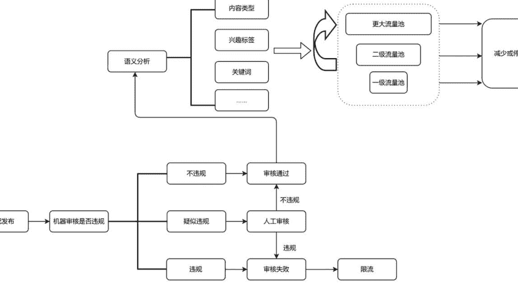

图 1-4 小红书笔记运行流程

如果笔记在初级推荐曝光后能够获得较好的互动反馈，那么这篇笔记会被推荐给稍大的人群曝光池，在更大的曝光池获得优秀互动就会继续被推荐给更大的曝光池。比如，初级推荐了100人，后面每次推荐的效果都很不错，最后可能推荐给10万，依此类推，直到一个推荐周期结束。

所以，这里需要注意，如果你的笔记关键词设置错误，或图文不相关，就可能导致推送的人群不精准，拿到目标用户的反馈，后续推荐时就会被系统认为内容质量不佳，减少推荐，从而导致流量越来越少直至没有。

比如你的笔记是旅行方面的，但是因为标签不精准或关键词选错，平台把你的内容推荐了美妆、美食领域的用户，那么这类用户看到你的内容自然不感兴趣或感兴趣的人很少，所以就不会产生转发、点赞等互动行为，没有这些反馈，笔记就不会得到更大范围的推荐。

每次系统推荐出去和用户反馈回来的过程，都会不断地让算法学习该把这篇笔记推得更合适。

了解了运行规则，就能好好理解为什么的笔记很好，但流量很差：很可能是因为发布时的标签没对，即系统还不认识，不知道推给谁或者没推了。

笔记内容不好固然重要，但更重要的是算法觉得这篇笔记的内容好不好。

## 其他推荐机制

- 基于深度学习的交叉推荐是对上述推荐规则的补充，可以理解为如果有一个一定粉丝量的博主关注了你的内容，那么你的内容也会被推送到该博主匹配的用户群体中，以此来增加你的笔记曝光量。这个逻辑很好理解：这些人喜欢你，那么这个个人相似的人可能也会喜欢你，所以系统会推荐并加以验证，系统会根据用户的习惯，上次浏览内容，刷新内容、停留时间、点赞收藏的内容来判断哪些用户可能会相似喜欢。
- 基于好友关系的推荐：小红书首页“关注”的Tab，会给用户推荐关注的达人，利用社交关系留住用户。
- 基于用户特征的推荐：性别、年龄、地理位置、学校、公司等信息来推荐。
- 基于距离的推荐：小红书首页“附近”的Tab，会给用户推荐距离20km以内的内容。
- 基于优质笔记的推荐：小红书有官方账号，发布时会对优质笔记进行推荐。对于一个新用户，在平台上对你了解少的情况下，小红书引导用户选择感兴趣的频道和博主，然后根据感兴趣的频道、性别、地理位置、年龄、学校、公司来匹配内容。当这个用户浏览了一些笔记并对这些笔记产生了互动时，小红书就会根据用户的浏览偏好、互动偏好、感兴趣的标签或话题以此来推荐内容。

### 1.2.2 小红书笔记的流量结构

打开小红书首页，我们可以直观地发现，小红书的流量主要分为三个入口：关注入口、发现入口、搜索入口。

- 关注入口：基本上是粉丝，所以流量占比小。当粉丝数量达到一定基数，初始流量非常有帮助。
- 发现入口：即系统根据用户已有的行为为用户推荐相似的内容，这个流量相对于来说较大的，因为大部分用户习惯于首页逛。
- 搜索入口：即用户通过搜索关键词召唤系统内关键词关联度较高的笔记，搜索流量是最能带来直接转化的价值流量，就需要搜索引擎优化（SEO）。

总之，用户在小红书留下的行为越多，系统就越了解你，从而更加精准地推荐内容。那么各自占比又是呢？不同行业的流量结构不一样，你可以通过小红书创作中心查看流量结构，搜索流量和推荐流量占比（如图5所示）。

## 1.3 为什么要做小红书

无论是出于个人爱好运营自己的小红书账号，还是因为工作需要运营一个企业的小红书账号，其背后隐藏着这个行为的出发点，即为什么要做小红书？你可能会下意识地回答：为了获取流量或是品牌表达，但更深层次的原因需挖掘得更明确。因为从流量获取的角度来说，你可以运营抖音、知乎、百度、视频号、微信公众号等，但选择了小红书。这是什么呢？下面将以不同平台的对齐给出我的思考。

### 1.3.1 小红书是匹配流量的连接器

如果基于生意目的，我们大多数认为小红书应该是做生意的，理解小红书底层逻辑，先看看生意是如何发生的。

有一次，我需要准备一堂关于交易流量的课。因为这节课是给复旦大学的同学们讲，并且要求课程内容只聚焦在流量上，所以关于流量方面都要摸透。为了全心备课，我把自己关家里一天，反复思考流量和交易的本质关系，脑中浮现出一个关于交易发生的：

交易=需求+连接+信任

回想一下你身边的一切交易，成立的前提不是这样？包括你想要购买这本书阅读，其实也是需求+连接+信任的交易。

为什么愿意买这本书？因为你学习小红书引发的想法（需求），京东、当当等购物平台提供了你这本书相遇的机会（连接），同时我在互联网上建立的专业度或口碑，已经向你建立了对书中内容好奇（信任），所以你买了这本书，这是一次正在发生的交易。生活中，你和你的客户之间每笔生意的发生也是如此。每当我希望某交易行为能够完成的时候，我习惯了不关注结果是否发生，我只看要素是否具备，在这个公式里，也许就是“需求+连接+信任”是否具备。

一旦促成交易的要素具备了，交易就会自然发生。如图1-6所示，我们看到这个公式的起点是需求和连接，连接有多重要？连接一切交易行为的开始，没有连接就没有交易。

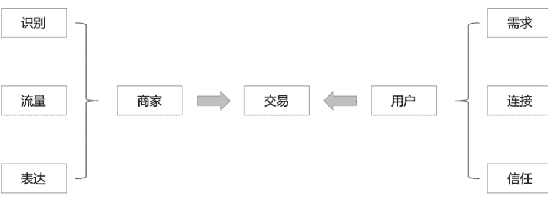

连接什么？连接商家和用户，连接供给和需求。小红书在我们想要促成的生意中间起到了什么作用呢？就是连接。

你也可以理解为：小红书整个新媒体平台引流的底层逻辑，就是两个字——连接。下面继续看在小红书上是如何完成的。

你肯定知道，小红书、抖音等平台的运营机制就是算法，算法其实不知道每个用户进入，每篇笔记的内容质量好不好，是沉淀在后台的标签。小红书通过标签把内容和用户做了区分，最终将合适的内容推给合适的用户，商家和用户在平台上看见，连接关系就形成了。

用户最常用的场景是搜索，这个搜索记录是需求，发出者是用户。小红书通过搜索行为记录下来，通过标签精准匹配，流量流量结构建立连接的过程（如图7所示）。

### 1.3.2 小红书运营的成本和收益

日常中，小红书运营有很多类型，我们可以从以下维度来比较：团队配置、获客成本、运营频率、难度、流量价值。

表1-1团队对比

| 平台 | 团队配置 | 获客成本 | 运营频率 | 效果 | 难度 | 流量价值 |
| :--- | :--- | :--- | :--- | :--- | :--- | :--- |
| 公众号 | 文案、设计 | 0 | 高 | 天 | 大 | 较好 |
| 抖音 | 文案、拍摄、剪辑、运营 | 0 | 高 | 天 | 大 | 一般 |
| 视频号 | 文案、拍摄、剪辑、运营 | 0 | 高 | 几天 | 大 | 弱 |
| 小红书 | 文案、设计 | 低 | 持续 | 小 | 强 |

团队来说，小红书的要求是最简单的，制作成本低，一个人也可以做。从获客成本来看，不做任何投流，小红书的获客成本为0，但其他平台都需要一定的前期投入。从引流效果来看，小红书对新号很友好，大量的新号都会出现爆款的机会。我们公司的实习生接触小红书第一个一个月，就写出了百万阅读量的爆笔记，反观微信公众号，今天写出阅读量1万+文章的难度已经非常大。

从长期价值来看，如果能够不断从小红书笔记引流到微信私域，这些精准的用户兼顾了短期价值和长期的品牌价值。实际上我们公司运营的一些民宿品牌号，模式从小红书引流到微信公众号，既有直接交易，又通过公众号增加了粉丝，还通过群和私人的方式收集了用户的长期复购需求，这样一来流量路径，商业效率非常高。

抛开经营层面的维度的考虑，我们还可以从内容获取效率、转化能力、品牌建设能力三个方面来衡量不同平台的效率。

在内容获取效率上，毫无疑问是抖音>短视频>长视频，图文内容获取信息的效率高于视频，这也是抖音已经很强大了，但小红书仍有机会和空间所在。

在转化能力上，考虑全品的话，应该是抖音>小红书>微信>B站>知乎>微博，其中抖音曝光量、刺激性强，但是抖音退货率比小红书更高。

在品牌建设能力上，考虑沉淀和长效营销，应该是小红书>微信>B站>抖音>微博>知乎>快手，抖音、微博、视频号等娱乐平台依靠热点获得击，导致消费节奏快，内容流转周期短，更适合做大类的品牌。

总的来说，我个人的一个有1万粉丝的账号的变现收益不如小红书100万粉丝的账号的变现收益，一个抖音10万粉丝的账号的变现收益大概低于小红书1万粉丝的账号的变现收益，这是平台属性决定的，所以自己的业务开始选择平台非常重要。从以上不同平台的分析和对比可以看出，进入发展成熟期的微信公众号、抖音、B站对普通人来说已经很难获得的机会了，但小红书对普通人来说认为是最好的平台，具备普性、低成本、可复制、可持续等优点。

所以，经过对需求连接、成本收益及未来机会的综合考量，你是否已经清楚了为什么要要做小红书？

# 第2章
## 定位：开始小红书运营之前

在开启小红书账号运营之前，我还需要帮你理清运营小红书账号的目的和基于目的的账号定位，因为我常常收到一些咨询，看起来是关于小红书账号运营的问题，实际上是做小红书账号的目的与方向问题。很多人做着就不知道为什么要继续做小红书，也不知道也不知道接下来的方向是什么，应该如何做。为了避免你也出现同样的问题，请我来梳理运营小红书账号的目的。

## 2.1 明确运营目的、量化过程管理

### 2.1.1 明确目的是小红书运营的开始

你有没有这样的经历：

- 运营的账号出现了很多爆，但是没有从中赚到一元钱；
- 运营的账号涨了粉丝，但是从来没有人咨询、问价；
- 运营的账号有很多很多点赞、收藏，但是评论很少。

这类问题的产生大多归属于一个原因，就是不清楚或逐渐模糊了账号的运营目的。

因为本书主要要讲变现，所以更多是从运营目的的角度做分析，实际即使是做品牌，最终的仍然是变现，只是没有量化在小红书的运营动作上，所以以终始思考有助于我们决策好每一个微小的运营动作。

从接触的账号来看，目前小红书运营者的状态主要有下面三种。

### 1. 个人运营为主，自己发着玩着

从商业运营的角度来说，这是最不值得讨论的一类，因为流量价值不成规模，但实际这种运营者很多，因为注意到小红书的价值，也会考虑着做，由于是注册了账号，把小红书当朋友圈发，没有很好的规划，走到哪儿算哪儿，做成什么样是什么，没有系统的打法和方法论。

最后的结果可能是做着做着就迷了，也可能通过小红书开启了自己的副业尝试，但终究变不多，价值不成规模。

本书提到的所有关于小红书的运营方法都是基于体系的、对预期的中具备价值规模的思维逻辑来开展，这是随意的开始、随意结束不同的一种路径。

### 2. 代运营或投放为主，品牌声量

我们“即刻下单”今年帮助一家运动服装品牌制定小红书频道的运营策略，因为这家品牌依靠达人投放在小红书已经很大的声量了，但投放的大部分是中头部达人或是名人，缺乏素人账号评价和口碑积累。我们团队在深入调研分析后，决定在保持人工投放策略不变的情况下，补足素人分享权重，使得整个品牌在小红书平台的声量结构是立体完整且丰富的。

这类账号的运营一般考核直接的GMV（成交金额），而是看天猫和京东到店流量的增量变化，细化下来品牌资产、话题讨论、流量增长、词条数量等关键指标。

### 3. 企业运营，引导私域转化交易

这一类是我们目前工作中接触较多的，也是今天小红书上变现流量账号的普遍形式，通过小红书收集用户的需求，从小红书架起一根流量管道，往公众号号或个人微信流量，从而完成从流量到转化的交易闭环。

从小红书获取需求流量结合自己的已有的业务发现是本书讨论的重点，从运营目的上，可以把小红书的运营理解为一次“销售”行为，只是不能说这话，也不用说“销售”的行为。

即使在2022年期间，旅游消费还没有恢复的时候，我们运营的旅游行业账号的日流量也能达到1000次。每一个从流量到交易闭环的操盘手都能感受到巨大的商业价值，因为旅游行业每一个信客（客户流量的）的价格低于50元，我们通过小红书笔记在没有任何流量付费的情况下，可以获得如此规模的流量，这给我带来了很大的启发，所以我下定了决定，带领团队开始投入小红书。

以上是常见的类运营小红书账号的出发，无论你是还是企业，运营小红书之前都要清楚到底为什么要要做小红书，是考虑做账号涨粉还是做交易变现，是做长期品牌还是卖广告，核心的思考原则必须清晰，运营小红书只是手段，更重要的是小红书解决了你的什么问题？

### 2.1.2 运营目标与过程管理

我还建议你在正式开始运营小红书之前，先想想你想赚多少，再来拆解你要做的账号定位、运营数量、选题内容、发布频率等。

如果把小红书运营当作一个完整项目来讨论，会有几个必须经历的关键环节：目的 -> 目标 -> 策略 -> 执行 -> 复盘。明确运营目的是我们开启小红书运营的第一步，接下来还需要需要运营目标与过程管理。

## 什么是量化运营目标

每当有人向我咨询小红书运营的问题，我就会问对方，为什么要做小红书？对方说是流量获客。那你准备获得多少？这些流量的变现路径是什么？大多数就开始说不清楚了。

我们发现很多人在“目的 → 目标 → 策略 → 执行 → 复盘”的项目执行闭环上，在目标这一步就下不去了，典型的原因还是没有想清楚。

我反复强调的目标的重要性，是因为出发之前没有想清楚，执行的过程便就会容易摇摆和不清。比如说企业通过小红书流量获取的目标是每天50个客户，而另一个的目标是每天500个客户，这两个目标匹配的资源投入和运营方法是完全一样的。

基于运营的资源投入和运营方法是开始小红书运营之前应该想清楚的，本书关于小红书运营运营方法的梳理更多以规模流量的获取为前提。

一般来说，如果你能够回答“我计划通过小红书平台实现**目的”，具体是在**时间内投入**资源每天**多少流量，最终实现**”，那么你运营小红书的思路就比较清晰了。

有目的和目标，接下来就是路径方法和执行策略。

如图2-1所示，我们将把一个小红书账号的执行过程分为这几步：定位 → 选题 → 内容 → 引流。其中对变规模的影响占比是定位>内容>引流，即内核定位最重要，笔记选题其次，笔记内容随笔记选题，引流方法对变规模的影响占比最小，这可能与很多人的认知、理解不太一样。

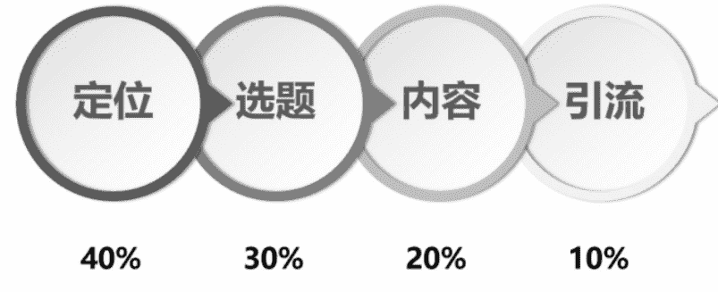

图2-1 小红书运营环节及权重

## 什么是定位

定位就是你要做一个什么样的账号。当然，大多数人都是带着自己的业务，结合自己已有的生意来运营一个账号，也有很多人把小红书当赛比，比如做如此修改、英语培训、在线查询等。账号定位阶段需要的，你应该明确自己的生意到底是什么。小红书只是获取流量的手段，就是交易公式中的一个环节，你可以通过小红书卖流量、卖衣服、卖房子、卖咨询、卖菜谱、卖资料保险。

我通过这一节希望告诉你是，小红书账号变大的影响要素中，定位>选题>内容>引流，即你日常关注的如何引流、如何加微信，其实并不是影响变现多少的关键要素，选择要如的逻辑在小红书运营上是不样的。关于如何做账号定位以及如何选择赛道，后面的对应章节会有更详细的拆解。

## 什么是选题

选题就是你要准备哪些内容。小红书首先是图文内容平台，我们是通过一篇篇笔记来吸引目标用户的关注和咨询。很多运营人员的选题都是临时想的，即当天发现当天的素材，想到什么写什么。但我们对小红书运营的理解和要求，在这个账号注册时，就想好这个运营的第一周、前三十天的笔记应该写什么，让结果符合预期，而不是将结果交给随机和运气。选题定的方法同样不容易，是需要围绕目标，完整和穷尽地调研，选题部分将在后面详细展开。

## 什么是内容

选题是框架，内容是对选题的填充，决定了一篇笔记的商业价值，内容环节涉及标题、笔记结构、封面制作等细节决定了笔记的大小和效果。

## 什么是引流

引流是大家最为关注的话题，但从我给出的逻辑框架发现，它的价值其实处于运营环节的末端，引流做到极致的账号变现规模可能弱于一个开始。关于定位—选题—内容—引流，在后面的章节中都有详细拆解，我想表达的是，哪些是运营中的术，定位是运营中的道。不同元素之间的关系和价值想清楚，会在运营过程中游刃有余，不会失。随着慢慢展开，你会发现选题是复制的，标题是有规律的，封面是有结构性的，引流是有方法的。

如图2-2所示的是我们“即刻下单”团队某个账号运营的SOP，从背景到研究、笔记标题、封面、一套流程来构建了一条流量到交易的闭环，实现结果，预期都是可控的。作为一个极其注重运营效率的人，思考在前，动作在后。

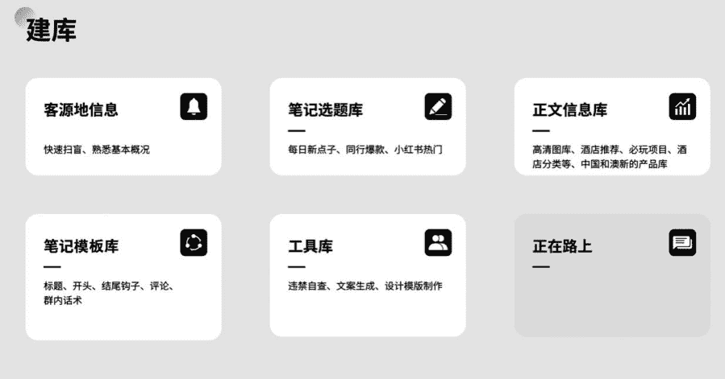

2-2 小红书旅行类SOP

### 2.1.3 为什么粉丝数量

在开始运营之前，我知道还有一个担心是关于小红书账号粉丝数量的，不仅是你内心会疑问，每次运营也会被问是不是从0开始，粉丝数量会显得没有。

## 1. 笔记与独立

同样也是理解误区，记得第一章提到，小红书和抖音、知乎的一个显著区别就是对新人友好，背后的机制是什么？算法使得每篇笔记都是独立的，上一篇笔记有影响不大，唯一影响要素是标签、内容价值，所以有粉丝、无粉丝，笔记之间的差距完全可以通过内容来平衡。

## 2. 连接关系

还记得“需求+连接+信任”公式吗？小红书交易可以简化为用户的互动（点赞、评论、收藏、关注），即用内容找到了人群，提供了什么价值，连接关系使得交易可以是大量的。

## 3. 流量结构

小红书的流量结构主要来自搜索和推荐，最新的数据显示，搜索已经占据60%以上，也就是大部分用户是通过“搜”看到你的。在这个流量结构下，结论很清楚，只要目标明确，用户需求下可能会有哪些搜索词，然后产生这些内容。

## 2.2 拆解对标账号，明确商业定位

明确了账号运营的目标，也清楚一个账号运营需要经历的过程，就可以开始搭建自己的账号了。

### 2.2.1 拆解对标账号

拆解对标账号有两个基本原则：第一是学习的，第二是值得学习的。为什么这么说呢？既然是对标，我们就需要尽量完整清楚对标相同领域的账号是怎么做的，这些账号用了多久，通过这种方式实现了什么结果，这些过程和结果哪些值得学习和模仿，哪些应该是拆掉的。

- 1. 名字、简介、标题、排版、内容：账号的名字和简介体现了定位和运营目的，这些定位是不是直接关联了商业目的？标题、排版、内容体现了内容的制作方法，是不是已经流程化？制作成本是不是足够？
- 2. 需求：这些账号定位的是人群的需求？是精准的还是模糊的？我的定位是不是一样？对方为什么要选择这个需求？对我有什么借鉴意义？
- 3. 变现路径：除了对标定位这些看得见的，还要对标交易的路径，即这个账号是怎么做交付的？交易路径是不是高效？可以用小号去模拟咨询，看看对标账号从定位到笔记创作，从引流到交易的闭环是否顺畅。
- 4. 多个平台：对标账号的学习不仅看小红书平台，还可以基于自己的人群定位来看不同平台有没有类似的账号，如微信公众号、抖音、知乎、视频号等，从运营上来更完善完整地成为全面的运营图。也可以通过第三方平台如新榜、抖音查、新红等来找到对标账号。

对标的过程应该是可以学习的值得学习的，不要只模仿优秀账号的形式和表象，而要看到对方的逻辑、框架、路径和打法，从实现看出这个领域所有的方式方法，最终确认自己的方式方法的目的。

### 2.2.2 明确商业定位

账号的商业定位是小红书运营的起点，商业定位即我要通过运营小红书以什么形式找到人的什么需求，交付什么产品最终变多少钱。如图2-3所示，小红书账号商业定位需要从四个维度来考虑：平台需求、用户需求、同行验证、资源能力。

| 细分人群 | 细分需求 | 交付产品 | 身份定位 | 内容形式 |
| :--- | :--- | :--- | :--- | :--- |
| 大学生 | 出游 | 度假套餐 | 导游 | 图文攻略 |
| 老年人 | 康养旅游 | 门票 | 司机 | 风景视频 |
| 女领 | 海滨民宿 | 旅行产品 | 定制师 | 视频+出镜 |
| 儿童 | 周末住宿 | 定制 | 产品经理 | 口播直播 |
| 青少年 | 户外游 | 门票 | 旅行老板 | 直播 |
| 宝妈 | 露营 | 机车 | 领队 | 视频+图文 |

例如，你可以针对人群，以旅行定制师的身份发布图文攻略和真人出镜，提供酒店、民宿套餐服务，获得变现。还可以针对宝妈类的，以宝妈的身份通过口播视频进行产品预订，获得变现。目前小红书上变现比较好的领域有：美妆、护肤、母婴育儿、健身、情感日常、生活实操、探店、美食等，你可以用提供的商业定位方法来尝试完成定位。总体来说，玩法最高的是打造自己是某领域的达人，多分享此领域的心得，最终通过接广告的方式变现。

## 2.3 的定位是什么什么样的

现在终于开始小红书账号定位及运营的实操部分了，我会从账号装修的方法及定位的基础原则两个方面告诉你一个好的定位是什么样的。

### 2.3.1 昵称、头像、简介、背景

#### 昵称

昵称是用用户理解的第一步，用户首先通过账号昵称来认识判断我们是谁，我们是做什么的。从变现角度来看，一个小红书账号昵称应该是什么样的？昵称应遵循一个原则：直接体现身份、关联交易目的。比如，旅行定制师云帆、小雨笔记、健身教练云云、房产中李享、携程门店经理直接体现了身份，关联了交易目的，每一篇笔记的每次连接都在告诉用户：我是谁，我是做什么的，你现在有需求时可以通过方式找到我。

昵称常常容易犯的错误就是把小红书昵称当成以前的QQ、微信昵称，私密化，让人看不懂，如英文、火星名字。这些昵称本身没有问题，但作为商业类昵称会增加用户的了解成本。从这种方法来说，你的昵称可以是名称+个性性、名称+类目、名称+服务内容、名称+地域等，总之最好直接体现信任，如小鱼在健身、李木子教练、陈阿姨上门做菜、小小鸭留学日本等。当然，具体情况具体，如果你是一个博主，已经有一定的知名度积累或者以短期的变现为考量，取一个具有个人色彩的名字长期来看很可能是一个不错的选择。

#### 头像

头像和昵称的原则差不多，也是直接。因为在用户浏览的笔记列表里，出现在信息流里的昵称，头像的视觉表达可能更为直接。从交易变现的角度，我们建议用文字的方式填充头像，比如学习定制、旅行管家、日本留学、上门做菜等提供提示信息的内容，如图2-4所示。

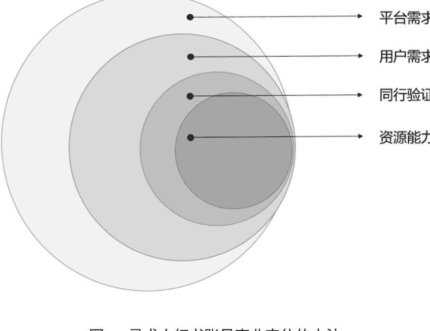

# 青年旅游人才公益成长计划

小红号：6270973199
杭州：上海

# 好梦特惠机酒

机酒赛代理中心 小红号：6983725075
杭州：上海

# 快速雷达

小红号：3847777676
杭州：上海

# 好梦 Trip-玩玩小团

旅游信息中心 小红号：6217961837
杭州：上海

# 好梦X小团定制

旅游信息中心 小红号：3856414644
杭州：上海

# 搞钱信息差

小红号：LOOK661
杭州：上海

图2-4 文字类型的账号头像

特别容易犯的错误是很多人喜欢用头像也变成自己的地方，比风景图、表情包，其实都容易增加用户的理解成本。在流量平台上做生意，要知道陌生感就是阻碍交易的最大成本。

比如你做马尔代夫账号笔记，很多人以为一定要用海岛图片做头像来体现马尔代夫，其实如果用到用户视角，笔记的头像面积很小，根本无法表现出海岛风情，即运营者的想法和想要表达的的用户视角已经打了很大的折扣，如图2-5所示，存在运营者和用户视角之间的视角差。一个好的运营者一定要有自己的运营视角，又有用户的阅读视角，灵活切换，从而保持运营策略的有效落地。

运营者想表达的
用户实际接收到的
图2-5 运营者和用户视角之差

在我们操盘的所有私域交易类账号的定位中，以文字方式形成的图像引流的效果确实更为直接有效，即使是新号，也可以在很短的时间内传达信息从而收集目标用户的有效需求。

# 简介

点进简介的用户，一般是通过笔记流进入你的主页更多地了解你的用户，区别于信息列表表的竞争，这个时候的用户已经看过笔记，对你已经产生了一定的兴趣。

如图2-6所示，一个好的简介，需要告诉用户你是谁，你是干什么的，为什么关注你，对我有什么用，甚至可以结合一些导流的功能，比如提醒进群、提醒点击小号、提醒微信，等等。

以下是一个旅行类账号的简介举例：

- 我独特：例如去过80个国家。
- 很厉害的，有脸背书、很专业：例如携携签约摄影师。
- 我是谁，做什么的，我能提供什么：例如“90后”川西旅游拍领队。
- 和别人有什么不一样，例如90后的年轻组织、纯粹小团旅行。
- 为什么关注，需要一目了然+定位+内容垂直专一+关注理由：例如每天分享带队上发生的一切。

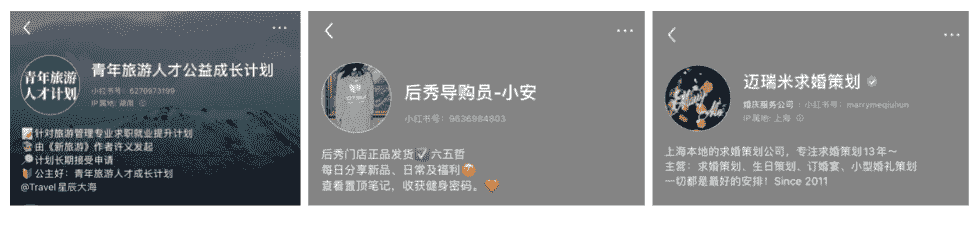

图2-6 不同定位的账号简介

每次在小红书上做一个新的业务时，都会花长的时间和团队打磨账号简介，理由简单，不同的简介传递不同的信息、体现不同的流量利用效率，从而触发用户的不同的理解和行为，对于账号变现来说，这是一件非常重要的事情。

# 背景

背景应当尽量与你的定位、调性符合且相关，目的是增加信任，传递信息，可以是办公场景、企业门店、公司背景、个人生活等，如果用背景来表达文字类信息，一定要确保显示的效果清晰、简洁。

如图2-7所示，就是一个优质账号的定位和装修，你可以从头像、简介、名称、背景和笔记内容上找到自己定位装修的启发。

# 新疆本地老司机

| 头像踏实、专业、质朴 | 司机身份 |
| :--- | :--- |
| 介绍清晰、透露服务 | 我愿意粉丝，80后 |
| 新疆本地老司机团队招人 | |
| 新疆的靠谱的本地老司机 | |
| 新疆旅游正规包车旅游团 | |
| 新疆旅游家，线路细分 | |

首条笔记最大化承接主页流量
图2-7 优质账号的定位

## 2.3.2 真实、垂直、信任、直接

上面介绍了昵称、头像、简介、背景的主页装修方法，方法的背后离不开对于一个好的账号定位表达的基础原则：真实、垂直、信任、直接。

真实很好理解，就是我们做的装修和表达是服务于真实生活中的真实人设的，不能撒谎欺骗，否则因为欺骗使得用户回到小红书对账号进行吐槽，会让品牌和账号受到伤害，这就就失去了一个账号运营的长期价值，尤其是对于一个已有品牌累积的账号而言。

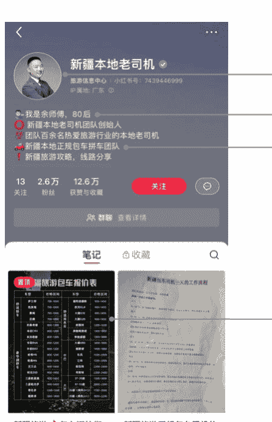

也会重复的小红书运营简单、低成本，比如一个西北旅行的司机每天简单分享旅行路上的的一切，这样的笔记内容可能选不讨巧、图片不够美观，但是已经传达了真实，也会收集到目标用户的需求，从而交易效率很高。

垂直是指定位要不要分散，不要今天这个明天那个，增加了算法系统和用户在识别时认同的成本。很多人问过我，如果有多个业务想往多个方向发展怎么办？很简单，多开几个账号，在小红书上垂直账号效率很高。

信任是指在极短的时间通过昵称、头像、简介、背景的表达，传达出专业且信任的形象。一个好的运营者一定要有自己的运营视角，又有用户的阅读视角，灵活切换，从而保持运营策略的有效落地。直接就是让用户不用思考，一旦用户开始使用，转化率就会下降。

## 2.4.1 新账号注册的注意事项

需要注意的是，从实际经验来看，小红书对账号注册要求严格，主要体现在：

- 不要在相同地址相同时间大量注册新号。
- 不要用同一个Wi-Fi，只可以用手机流量。
- 如果之前用某个手机注册过，注销再注册。
- 如果之前的账号出现违规、封禁，那么对应的手机设备可能会被影响。
- 账号注册好了，至少需要一周左右的时间，从开始没有注意这些细节，就会被浪费时间。
- 账号注册需要模拟一个真实环境。

## 2.4.2 新账号起号技巧

新号运营之前，一般需要简单地完成7天起号，尽可能避免被封禁流。

第一步：点击首页的“发现”看内容。
- 每天点赞3~5个，收藏2~3个，评论1~2个。
- 注意要按照普通人的习惯浏览笔记，在一篇笔记上停留的时间超过10秒。
- 不要下滑到底，也不要刚打开就开始关闭。
- 最好多搜索，慢慢滑动到底再开始阅读、点赞等操作。
- 原则就是一个真实用户会那样操作。

第二步：建议多去逛同行、同行笔记的内容。
- 做什么样的账号就刷什么类型的笔记。
- 另外，在刷笔记的过程中，每天关注2~3粉丝权重较高的账号，最好是在同一个垂直领域，这样小红书容易推荐这一领域的用户，后续也可以及时获取信息。

这个阶段是模仿活跃账号的行为习惯，让小红书判断你是真实账号，不要急着运营，同时通过互动和活跃提高自己的权重。

第三步：在起号过程中关注小红书官方平台的账号：创作者助手、小红书成长助手、美妆薯、校园等，甚至去逛购物增加真实感。

**注意事项：
- 前3天不改备注、昵称、简介。
- 前7天每天刷对应关键词，每次半小时，每天两次。
- 适当关注类型账号、点赞同类型笔记、笔记图片需要翻页停留、评论、完整视频、看直播，这有助于后续系统自动推给你同类爆款笔记。
- 前2天发笔记，第3~4天1篇笔记，第5~7天发2篇笔记，整个过程观察数据是否异常。
- 取昵称的时候要谨慎，7天只能改一次。
- 在起号准备期内，不能个性签名或其他地方联系方式，包括微信、公众号、微博、邮箱、链接等任何推广信息，账号还没有流量的时候，这种行为的意义不大。

# 新账号起号流程

如表2-2所示，这是我们常用的7天养号流程。

表2-2 新号7天养号流程

| 时间 | 第 1~2 天 | 第 3~4 天 | 第 5~7 天 | 8 天后 |
| :--- | :--- | :--- | :--- | :--- |
| 节奏 | 起号准备 | 起号准备 | 正常放量 | 投入使用 |
| 目的 | 1. 模拟真实用户 | 1. 测试流量是否正常 | 2. 完善标签 | 2. 打上标签 |
| 单周流量 | 300+ | 500+ | 1000+ | |
| 笔记数 | 0 | 1 | 2 | |
| 补充 | 寻找容易触发的选题 | | | |

起号流程是：
- ① 每天搜索相关内容，不同时间段3次。
- ② 每天阅读相关帖子，不同时间段2次。
- ③ 每天关注1~2个相关账号、同类型笔记、图片需要翻页停留、看完完整视频，让账号进入主页。
- 3~4天后可以适当发布笔记。

# 第3章 爆款：掌握方法

每一个运营的人都期待自己的账号出现爆款，但是进一步拆解后发现，帮助你理清的是爆款的底层逻辑和标准化生产流程。

## 3.1 爆款的底层逻辑

很多人的理解是，点赞、收藏、评论好的笔记都是爆款，这自然没错。爆款只是最后的结果，只是这篇笔记带了用户的点赞、收藏、评论、转发等互动行为，那点赞、收藏、评论、转发的原因是什么呢？一定是在载文中满足了用户的某项需求，这类群体规模很大，需求很常规。

点赞是因为用户在态度上表达支持，收藏是因为将来可能有用，评论是因为想要交互和表达，转发是因为这条信息值得分享给朋友，关注是因为希望收获后续更新。爆款是因为这些互动行为的结果，命中需求带来互动行为的原因。

小红书上的用户通常都有哪些需求？娱乐需求、情绪需求、偷懒省事、向美好生活……这些都是人性的需求，而笔记是用来满足需求的，爆款的背后体现的是强烈的人群需求，一个持续写出爆款笔记的人一定能够精准洞察用户需求的。

以上这些结论的推导是因为我们的流量团队每天在业务一线摸和监控小红书平台规则的变化，开始我们像一样流量享受受热后，是一段时间后发现最后没有等到成交效果，引导后发现原来我们需要的是精准需求。2023年随平台规则的收紧，我们的策略已经调整为“摆脱流量依赖”，从越来越多的咨询到越来越少的咨询，这些策略的转化都是对运营目的的精准聚焦，即只关心我的核心的，实现目的的手段在过程中不断调整，这也是带给你的重要启示，基于交换流量，不做爆款只做生意。

## 什么是有效流量

指那些能够触达用户，能够引起用户的需求，并且能够触发咨询或购买，点赞、收藏等互动的笔记。我们希望你能清楚我们的目标不是写出一爆款，而是找到能够交易的精准客户。如果是这样的标准和要求来写笔记，你会发现小红书运营是有侧重点和针对性的，而不是沉没在流量里。

有很多爆款笔记但是一分钱都没有；而有的笔记带来几位粉丝，最终没有人加到微信。这种情况下你或许还会追求爆款笔记吗？在实际运营中，符合以上标准的流量会有更高的商业价值：

- 粉丝数比点赞多的。
- 新号但是有千赞的。
- 评论数大于点赞、收藏。

粉丝数比点赞高说明转粉率更高，新号有千赞说明不是头部账号但选题和账号定位切中用户需求，评论数大于点赞、收藏说明笔记能引发用户的需求，产生了有效咨询。

理清了有效流量，我们继续思考，爆款是因为什么，以及爆款笔记的底层逻辑是什么。

有效流量是流量中核心的。

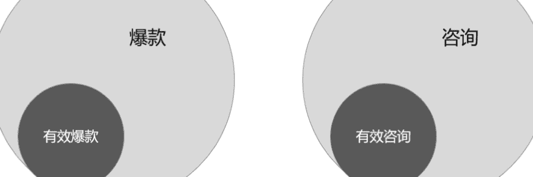

图3-1 爆款与咨询

| 题目 | 实用价值 | 尾部引导咨询 | 添加理由 |
| --- | --- | --- | --- |
| 收获 | 情绪价值 | 评论引导 | 图片微信信号 |
| 权重 | 收藏价值 | | |
| | 互动价值 | | |
| | 认同理由 | | |
| | 已有互动数 | | |
| | 引导阅读体验 | | |

挖掘需求
引起兴趣
展示价值
解决问题
触发成交

图3-4 笔记运营的全链路图

## 爆款笔记的5个转化率

继续沿着看见 -> 被点击 -> 被互动 -> 被咨询 -> 加上微信产生购买的路径分析，我们发现整个路径里有5个关键转化率：

- 搜索结果率：即用户搜索对应关键词，你的笔记是否出现在用户前 20 篇笔记的信息流列表里。
- 笔记点击率：出现在用户的信息流列表中的笔记是否被用户点击。
- 笔记互动率：用户点击阅读的笔记是否产生了有效互动。
- 账号咨询率：用户进入主页后是否对你触发咨询询问。
- 咨询微信率：用户通过私信咨询的有多少到了微信。

小红书运营其实就是收集需求变现转化的过程，就是需求捕获和客户收集，如果量化一下需求捕捉和几个转化的关系，我们可以用一个简单的公式来表示。

需求捕捉=需求规模×搜索结果×笔记点击率×笔记互动率×账号咨询率×笔记加微（实际上并不是每个咨询都需要经历互动，这个公式只是推演流量路径）

假设我们以装修业务为例需求捕捉。

### A运营：

10000人装修，你的笔记在搜索结果里排第10名被看到了500次，有50人愿意点开你的笔记，有5人看了你的主页，有2人给你发了私信，其中1人加到了你的微信。

需求捕捉就是：
10000*500/10000*50/500*2/5*1/2*100%=1

就是小红书平台上10000人想装修，你都能满足，但是你获得了1个需求。

### B运营：

10000人装修，你的笔记在搜索结果里排5名被看到了4000次，有600人愿意点开你的笔记，有200人看了你的主页，有50人给你发了私信，其中25人加到了你的微信。

需求捕捉就是：
10000*4000/10000*600/4000*200/600*50/60*25/50*100%=25

就是小红书上有10000人想装修，你都能满足，同时你获得了25个需求。

如图3-5所示，可以发现小红书上基于变现为目的的爆款笔记需要伴随着5个转化率的挑战，因此，基于变现为目的的小红书运营，可以总结为：

- 利用粉丝随和习惯的选择已被验证的爆款选题。
- 把静态的封面设计好。
- 笔记正文内容逻辑清晰、表达顺畅。
- 在这样的逻辑下，获得用户的连接机会（微信）。

| 搜索 | 列表页 | 笔记页 | 主页 | 咨询 |
|---|---|---|---|--|
| 搜索结果 | 笔记点击 | 笔记互动 | 账号关注率 | 咨询加粉率 |

图3-5 爆款笔记的5个转化率

如果定位阶段赛道选择、执行力强、有基础的审美和设计能力，普通人也可以在小红上找到机会赚钱。

## 3.1.3 爆款笔记的4个写作公式

如果你细心研究某些账号或某些账号的笔记，你会发现有一类账号的笔记几乎都是爆款，这些账号可能是新起来的，且发布的笔记数量不多，但每篇笔记都对应交易目的，如果你关注这个账号，系统又会给你推荐类似的账号，你发现，原来这个账号只是某个团队运营的多个账号中的一个。

这时你应该遇到过这种团队化运营、矩阵号操作，“即刻下单”就是众多团队中的之一，这一类团队往往采用标准的运营，迅速占领流量。

为什么会产出这么多爆款？这就是底层逻辑的重要性，一篇爆款不是本事，多篇爆款才是本事。下面分享我们常用的爆款公式：

### 1. 爆款=人群需求+表现形式+互动引导

人群需求：作为运营者首先必须清楚的是，笔记是写给看的，是满足需求的载体，这个需求可能是情绪需求、实用需求等。我们必须切换成用户视角来看读者正在面临哪些问题。例如，针对不同人群的具体需求：
- 正在装修的：有很多选材、避坑、风格、家具等。
- 正在备婚的：有很多关于选择酒店、安排流程、准备礼物等。
- 正在准备去新疆的：有很多选择、办理签证、预订机票、游玩等。

表现形式：是指用什么样的载体来和用户建立连接。笔记需要做好封面、标题、正文关键环节，让用户在这些环节中留住，这也是需要封面、标题、正文。

互动理由：除了让用户看到，真正的爆款还需要触发互动。互动是结果，要在笔记中埋下互动理由，才能让用户点赞、收藏、转发。如图3-6所示，爆款=人群需求+表现形式+互动理由，只要做好了这三个环节，你的笔记离爆款就不远了。

图3-6 爆款笔记第二个公式

### 2. 爆款=引起兴趣+抓住痛点+解决问题

引起兴趣：一篇笔记成为爆款的前提是能够看见，被看到的前提是引起用户的兴趣。封面、标题是否吸引用户是目标用户的需要，封面和标题起到了引流的作用。把好的笔记想象成在一个市场里搭建了一个摊位，如何吸引更多的人来到你的摊位？如果你做得好，很多人来到你的摊位形成了停留，这时候摊位红了，笔记更容易成为爆款。

把握痛点：依然基于目标用户的需求理解。比如写新疆旅行的笔记，希望用户看完这篇笔记来咨询、最后完成下单交易。在实际操作中要求用户整理痛点需求，即用户可能面临的所有问题都能整理出来，然后有针对性的写下去。比如，第一次去新疆的用户一定会面临：选择新疆还是北京？新疆旅游到底是跟团还是自由行？怎么选择靠谱的包车服务？那你就要笔记中给出痛点的描述，以及我是如何思考这个问题的，第一次去新疆我是怎么玩的，我的真实感受是什么，各种选择对应的优势劣势等等。同样的还有装修、抢票、后悔等都是痛点。

解决问题：引起兴趣和挖掘痛点以后是给出解决方案，体现你解决此项问题的能力。旅行笔记你可以整理新疆各地的交通、门票信息、价格、穿着攻略、注意事项等，这也是在帮用户解决信息层面的问题，还可以延伸表达我们是从新疆包车的旅行团，已经服务了2000多位客户，在新疆有100个车的领队，可以很好地解决新疆旅游随心行的问题，我们价格不贵，我们专业，我们赢得信任。

你可能会发现，两个爆款公式都是相同意的不同表达，爆款笔记离不开这几点：笔记给谁看？切中什么需求？击中用户的痛点是什么？解决了什么问题？期望带来什么样的反馈？是否埋了反馈的因？是否埋藏了我们期待的行为的理由？

### 3. 爆款=选题+标题+封面+正文

如图3-7所示，从笔记的结构组成上，可以将一篇爆款拆分为选题+标题+封面+正文。

- 选题：选题决定生死，决定了流量规模，即多少人对这个话题感兴趣、有需求，选题决定了用户会不会点开来看。站在用户视角，用户只关心他们关心的内容，所以选题必须理解人群、理解需求、找到痛点、提供价值。
- 标题：标题提供了阅读预期，最主要的价值是吸引打开。
- 封面：封面的价值是呼唤，即吸引更多的注意力同时召唤用户进来。
- 正文：包含开头、中间和结尾。

除了上面给出的三个爆款公式，还要给出一个最后一个爆款公式：

### 4. 爆款=70%选题（必然）+30%运营（偶然）

在实际运营中还有很多人有这样的困惑：“老师，我都按照你说的做了，为什么笔记还没有爆款？”其实算法非常复杂，一篇笔记成为爆款由很多因素组成，其中有一些偶然因素，也有必然因素。小红书是一个内容平台，离不开用户、需求、流量、算法等这些东西，而这些共性的部分是底层逻辑。从来哪一种方法可以保证100%成功，普通人只能增加概率。如图3-8所示，提升爆款的唯一方法是用70%的确定性对抗偶然的不确定性。

## 3.2 爆款笔记的三种方法

前面已经介绍了有效笔记以及爆款公式，本节开始进入笔记写作的实操层面：如何选题？前面在管理章节里提到：定位>选题>内容。选题选得好事半功倍，选题不好就容易陷入辛苦低效的努力。选题优先选择那些更靠谱、容易带来反馈和直接变现的。

### 3.2.1 需求蓝图选题法

回到笔记创作和账号运营的原点，笔记承接的是需求。通过运营某个领域，写出各种需求满足连接和互动，最终引导到私域完成交易。如何找到目标用户的需求？可以制定目标需求蓝图，完整地罗列目标用户可能存在的不同的需求，然后用不同的笔记承接这些需求。如图3-9所示，可以发现挖掘词的方法主要位置有：
- 搜索框下拉标签
- 横向标签
- 发现页大家都在搜
- 搜索栏猜你想搜
- 搜索发现

图3-9 需求图谱选题法

挖掘需求图谱最直接的方法就是去看小红书的搜索关键词。通过搜索框推荐及下拉框不断挖掘需求，系统给出的潜在搜索一定是大量人群已经搜索过的提炼为普遍需求的。如图3-10所示，就是对“新疆旅游”关键词通过变化字母持续挖掘细分长尾需求，实现对一个需求的完整挖掘。

需求图设计的原则是尽量完整和容易，意味着看着这项操作做完，关于可以写的选题和价值取向都有基本判断，而不是每天重复地想今天要写什么。关于选题的工作，我建议尽量在开始之前一次性都做完，因为这会最大化地帮你节省后续写作的时间，提高运营效率。

### 猜你想搜和搜索发现

如图3-11所示，还需要注意猜你想搜和搜索发现，这里也可以看到系统推荐的热门话题，包括小红书官方给出的灵感，都是找到用户需求的有效方式。

- 猜你想搜：根据你的使用习惯、搜索记录、笔记互动来推荐对应的话题。如果账号长期运营某个领域，系统推荐就会很准，让你更快发现需求。
- 搜索发现：是平台给出的最近热点，可以结合自己的领域适当添加热点，加大笔记推荐流量。

图3-11 猜你想搜和搜索发现

### 标签推荐和相关搜索

- 横向标签：当你搜索一个关键词，且这个关键词词频比较高的时候，小红书顶部会给出横向标签，一般来说，这些关键词是核心词的需求细分。
- 相关搜索：在搜索结果的信息流列表里，系统给出大家都在搜的词，获得很多的话题，如图3-12所示。

### 第三方挖掘

还可以通过第三方平台（如小红书、微信指数、百度指数）综合来看一个选题是否有热度。

### 评论区挖掘

还可以留意那些笔记下面的很多评论，因为互动本身相对较高，用户愿意评论的内容是需求，所以评论区也是收集需求的好方法。

### 电商平台挖掘

需求图谱的方法有很多，可以在电商平台上找到对应的产品、详情页、海报等。如果运营的是旅行类目，经常去携程、猪眼、京东、天猫等提炼关键词和文案。

以新疆之旅为例的爆款选题库：
- 新疆玩景点
- 新疆徒步路线
- 去新疆做的40件小事
- 新疆旅行人均五千元，12日攻略
- 去了新疆回来，朋友圈被赞了
- 刚从新疆回来总结的33个避坑建议
- 新疆旅游千万注意的15件事
- 来新疆旅游，这20件事不能做
- 2022新疆赏花攻略
- 毕业之旅去新疆玩嗨：8天9晚
- 新疆旅游景点分布大全
- 在线回答新疆旅游问题
- 这趟新疆旅行，全靠男朋友做的攻略
- 报名新疆旅行的8个注意点
- 来新疆旅行必须知道的10件事

这个爆款选题库，新疆可以这么发，西藏、云南、贵州也可以这么发。

## 3.2.2 爆款重复选题

爆款重复选题是什么呢？其实就是火过的内容再发一次，详细来说就是火过的内容换个形式、换个平台、换个风格。火过的内容之所以火，一定切中了某种需求，某一类人群的普遍需求是固定的。比如：
- 妈妈关孩子
- 学生关心成绩
- 老年人关注健康
- 女性时尚

你可以通过小红书网站找到对应关键词，来看他们的选题方向和写作角度。具体操作上不仅看小红书上有已经火过的账号和笔记，还要看知乎、抖音、微博、公众号、百度等已经火过的选题。曾经在公众号火过的文字形式，在小红书换成图片形式依然会火；视频换文字、文字换风格、内容换平台等方式都可以把火过的内容再次发布。

以新疆之旅为例的爆款选题：
- 新疆玩景点
- 新疆徒步路线

我们写旅行行的笔记，正常的做法就是去旅游网站把火过的爆款攻略和问答题提炼出来在小红书上重新发布，这种方法从0到1的原创选题更容易获得反馈。

### 3.3.3 组合公式选题法

有一类是沿用微信公众号选题的组合公式方法，给笔记增加新的流量。组合公式的本质是多个角度增加选题的吸引力和互动率。如图3-13所示，常见的组合方式有热点+群体+情感+价值的两种或多种组合。

- 按照热点+群体+情感，可以写出“某厂裁员后，一个中产家庭的突然没落”。
- 按照热点+群体+价值，可以写出“高考结束，毕业行的5个推荐地”。
- 按照地域+情感+价值，可以写出“在上海的山东人必吃的魔都大餐”。

如图3-14所示，这种组合还可以加上不同封面的不同表现形式，形成不同的创意封面和创意的表达，往往也吸引更多流量。

## 一个信息差

必会的10个六四四级作文写法。

中国最美的10所大学。

## 5. 悬念型

用肯定的语气，制造悬念，从而吸引点击。

比如：

- 90%女孩的恋爱观都错了！
- 去了新疆不下5次，才知道的喀纳斯正确玩法！

## 6. 反差型

和用户的认知形成反差，从而引发好奇增加吸引。

比如：

- 再不去新疆旅行了。
- 三亚旅游不要去，劝退一个是一个！

## 7. 互动型

很有强的对话感，激发用户的表达欲，从而增加互动。

比如：

- 月薪多少的人才配去马？
- 爸爸姓王，妈妈姓李，求给孩子取个名。

### 3.3.2 爆款笔记标题技巧

### 1. 提供预期
标题告诉用户笔记的内容，提供给用户一个阅读预期和回报，从而吸引打开。

比如：新娘必备，婚当天使用率100%！

### 2. 定位身份
定位身份是人群筛选，即什么人应该看这篇笔记，可以让笔记的流量更精准。

比如：想要冬天去长白山的姐妹们来看，腿细的女孩注意了。

### 3. 前置信息
笔记标题重点在前10个字，小红书标题可写20个字，但是小红书首页出现的笔记，标题过长是无法显示的。

比如：不用收费问价，直接看酒店价格，巴哈岛推荐的10家海景酒店。

### 4. 包含关键词
标题中必须包含关键词。标题中添加关键词，才能让用户在搜索时看到你的笔记。

### 5. 加入语气助词
在“安利种草”类笔记中，常用“!”，用夸张的语气“安利”好物，能够极大地感染用户情绪，从而促进用户下单。

小红书笔记的标题创作上，没有绝对这一说，只要符合内容的客观描述，越吸引点击越越好，所以在起标题的时候，可以适当加一些词汇，比如“必买”、“超好用”等，实际上小红书的用户已经熟悉了熟悉的“小红书体”。

提供预期+定位身份+前置关键词+加入语气符号和语气助词是小红书笔记标题的创作技巧，小红书的标题已经逐渐形成了自己的风格，我们立刻下单图团队总结以下可以使用小红书标题增加吸引力的词汇，你如何结合自己的笔记标题，尝试反馈：

- 闭眼、抓蹲、好物、干货、抄作业、太绝了、全在这里、用心建议、超级福利、请大家截图推文、这件事一定要要知道、就算是玩明白了、看了、大马、内幕、隐藏、神器、王者、炸炸、超厉害、不容易、宝藏精致口碑、狠狠折、颜值爆发、美到犯规、别错过、忍不住、帮你偷懒、帮你省钱、绝绝、骚骚、不流定、不会怕吗？被追着问、瞬间出圈、硬核的、简直、简直种草机。

### 3.4 爆款笔记封面的三个原则

小红书以图片信息流作为呈现方式，用户第一眼主要看到的还是封面，即用户通过字体笔记来理解这篇笔记的内容，一张好的封面直接影响笔记的点击率，如果笔记的内容很好，但是封面没做好，缺少吸引和打开，笔记的流量就在这个环节切断了，内容再好也没有机会用用户实现“连接”。

好的能够帮助笔记在搜索排列的同类笔记中变得更“吸睛”、更有差异，从而吸引点击打开。所以，封面在一篇笔记的结构中充当了非常重要的作用，从封面的类型来说其实有很多种，包括单图、多图（如图3-15所示），从尺寸上来说小红书提供了3:4、4:3、16:9、1:1四不同的封面尺寸。

| 单图 | 多图 |
| :--- | :--- |
| 侧重质感、简约、高吸引 | 侧重丰富信息、真实 |
| 图片风格均衡统一 | 内容提示 |
| 比如：人像、风景 | 比如：集合、对比、清单 |
|  |  |

### 1. 美食类
美食封面非常好用的：
- 风格：
- 多图拼接：提供丰富的信息和真实感，沟通最高。
- 双图拼接：展示制作过程或者前后对比，吸引力更强。
- 单文字：集中展示一种食物的细节，适合图文笔记。

### 2. 美妆类
一般来看美妆笔记策略较强：
- 风格：
- 多图拼接：展示不同妆受、对比、功效、测评。
- 大字话题：比如一个问题，用纯图大字突出话题。
- 知识科普：标题+知识点的方式突出干货。
- 双图对比：对比不同物品、使用效果。

### 3. 旅游类
旅游类的图片选择有很多：
- 风格：
- 单图封面：纯风景图或纯背景图+文字，吸引点击会强一些，同时笔记的方向更多是基于背景本身而在怎么预订。
- 多图封面：提供丰富的信息点，适合想要多种信息。
- 合集类封面：整理景点信息、游玩攻略、美食地等，收藏效果比较好。

### 封面设计的通用原则
好的能够帮助笔记在搜索排列的同类笔记中变得更“吸睛”、更有差异，从而吸引点击打开。所以，封面在一篇笔记的结构中充当了非常重要的作用，从封面的类型来说其实有很多种，包括单图、多图（如图3-15所示），从尺寸上来说小红书提供了3:4、4:3、16:9、1:1四不同的封面尺寸。

当创作者上传图片时，建议固定到相同的尺寸，一般系统会默认第一图的填充，如果图片不同的话，可能会丢失内容。从视觉来看，横比例占据屏幕，而竖比例占据屏幕则呈现更多信息，即满足“越大越好”。

今天分享几个案例，大家一起来学习：掌握封面设计技巧，观察色彩、构图、留白以及“如何出片”。

国内最火的9个风，今年代表的潮流封面。

### 3.4.1 封面类型
（此处对应原文中重复的分类内容）

### 3.4.2 如何提供丰富的信息点
除了提示内容，封面还可以尽可能提供丰富的信息点，给予用户足够的理由，用户觉得信息丰富、全面、有用，就会增加点击率。这一类非常适合合集类、攻略类、信息整理类，以标题+信息点+整洁排版作为封面，笔记的“赞”往往很高。你也可以思考你的业务领域有没有用户需要的信息，可以用这种封面的方式快速起号获得初始流量。这类笔记的效果都不会差。创作方法：如图3-19所示，采用标题文字+清单/多图的形式。

### 3.4.3 图片美观和精致
提供了阅读理由和信息点后，剩下的就是美观和精致。因为在平台上红书的用户对美有需求，小红书上一线的女性更多是希望在小红书上向往的美好生活，所以本身就是竞争力。对应封面上，具体来说就是整洁、干净、清晰、不错乱，如果再加上一些质感和配色技巧，整体显得有调性和温度，这样的笔记本身在传达是一个专业且值得信任的品牌。尤其是做高端产品服务的，比如高端酒店预订、高端红酒、进口食材、鲜花点心等，你的笔记内容和图片质感在传达这是一个有质感和美的账号。但是不要陷入误区，即小红书的笔记运营具备PS设计基础，图片的第一价值仍然是传达信息、触发行为，美观和质感的作用是次数传达。如果你能够做到排版整洁清晰，这样的封面就已经足够了，剩下的技能则是加分项。创作方法：一般通过在线图片网站模板完成，如图3-20所示，这些笔记封面根本不需要复杂的设计技巧，用一些简单的在线图片编辑工具就可以完成。

在实际的过程中，你可能会发现很多爆款笔记的封面并没有满足上面提到的3个标准，但是笔记的效果却很好，比如单风景封面、单人像封面，这又是什么原因呢？强调的是世界上没有一种成功的方法和路径，小红书运营也是，我们整理和提炼的方法只能增加成功的概率。

### 3.5 笔记正文写作技巧
笔记正文是承接标题的重要部分，我们希望通过正文触发用户的点赞、收藏、评论、转化等互动行为。如果标题是吸引，正文是交付，所以正文是影响能否实现目的的关键。

### 3.5.1 爆款笔记正文三个结构
拆解来看，一篇笔记正文由几个部分组成：开头、中间和结尾。

#### 笔记正文开头
正文开头需要布局关键词，其实是为了布局SEO，告诉算法这篇笔记有一定的相关性，从而在搜索结果中获得机会。把内容和自己联系起来，解答用户的疑虑，“为什么要写这个”、“为什么要看呢？”

例如：
- 刚到...
- 办公室跟小伙伴一起吐槽...
- 预留了机票和酒店没有涨价，因为...
- 219年拿到的酒店价格贵很多，今年要去真是太哈了...

#### 笔记正文中间
正文中间的内容往往很多，用户阅读起来会有成本和压力，需要帮助用户降低成本，让看着我们的笔记心旷悦目、非常舒适，不留神就能看完了。可以用分隔符、序号、表情包的方式后排版，使得阅读体验很顺畅。

- 尽量口语化：以对话、朋友沟通的口吻来说，小红书整体的社区氛围倾向于友好分享、真诚表达。如果用户在你的笔记中感受到了真实，往往更容易引起信任，所以表达还要可爱一些、生活化一些，像是生活中的友好交流。“家人们”“真实了都是很好的表达。
- 添加关键词：正文同样需要布局一些关键词，使得笔记的SEO效果更好。

#### 笔记正文结尾处
正文中间已经交付了阅读价值，但是用户看笔记不是目的，我们还希望笔记能够带来用户的关注、私信、点赞、评论等互动。

- 提醒互动：通过语言指令提醒用户点赞收藏，很多用户真的会因为你提醒了就顺便也做了收藏，而每一次互动都是在给笔记增加流量。如果希望用户用咨询，也可以直接告诉方式，比如“评论区我会回复”“直接私信我获取价格”。
- 如果用户进入主页，可以告诉用户“主页已经整理好了更多内容，欢迎大家看这是写的这个系列的第5篇，主页还有更多内容”。
- 身份介绍：要想用户用私信和信任行为，你还需要解除用户的内心意见。即使你是谁，你是否专业可靠，如图3-21所示，在旅行员的笔记结尾经常可以看到下面的方式。

【关于我】
5A上市旅行公司，巴厘岛直酒店100+，巴厘岛旅游指定接待单位

【怎么预订】
+ ...

### 马尔代夫热门岛TOP

| 岛屿 | 天数 | 上水活动 | 特色活动 | 价格 |
| :--- | :--- | :--- | :--- | :--- |
| 丽村岛 | 6天 | 5 | - | AB |
| 露西亚岛 | 5天 | 水上/运动 | - | 5019起 |
| 红环岛 | 6天 | 水上/运动 | - | 960/2019起 |
| 中外环岛 | 7天 | 水上/运动 | - | 2500起 |
| 库达岛 | 5天 | 水上/运动 | - | 2500起 |
| 慕拉岛 | 6天 | - | - | AB |
| 普特岛 | 9天 | - | - | 3010起 |
| 土土岛 | 7天 | 水上/运动 | - | 709起 |
| 大洋岛 | 6天 | 水上/运动 | - | 619起 |

比海清澈的青，天空更蓝的梦。马尔代夫（Maldives）是位于印度洋的一个国家，国有26个环礁，有192个度假岛，其中只有200多个度假岛，马尔代夫的...

# DAY1：黄果树瀑+滴水岩瀑+远观坝陵大桥

关于我们

2人成团，1人也可以安排，贵州
2~4人座车、5~6商务车

我们提供黄果树、小七孔、西江苗寨的包车服务，每日发

还有什么想了解的下方集合，我会解答您的出行疑惑

如果你对开头、中间和结尾有了更深的理解，还可以将整个正文的写作提炼成公式，即笔记正文=承接预期+引入痛点+描述情景+解决方案+互动理由。

## 表3-1 笔记正文结构拆解

| 结构 | 价值 | 动作要点 | 举例 |
| --- | --- | --- | --- |
| 开头 | 接承标题，强化标题信息，引导用户往下看 | 1. 提及关键词。 2. 把内容和自己联系起来，解答用户潜在的疑惑 | 标题是泰国旅行，“去泰国旅行，看这篇实测攻略就够了”；标题是新疆旅游，“多次去新疆，新疆真的是太美了，底面的攻略我亲手梳理” |
| 中间 | 有阅读价值，让用户觉得有良好的阅读体验 | 1. 写上序号或分符号, 2. 语句尽量口语化，可爱一些，生活化一些，像是生活中的对话，说服性强。 3. 添加爆款关键词；场景类关键词、需求关键词、结果关键词 | 统计这个领域的热门关键词，在正文布局 |
| 结尾 | 结尾部分要触发动作：关注、私信、点赞、评论 | 1. 提醒互动。 2. 身份介绍 | 1. 整理不用，点赞收藏方便找到，喜欢别忘了收藏，感兴趣可以私信我哦，评论区——回复！ 2. 其他推荐也可以在评论区告诉我哦。 3. 这是第3期推荐，下期我们来说说藏美食，可以看之前推荐过的种帖篇整理？ |

如果你对笔记正文结构还有更深层的理解，很容易复现不同的开头、中间和结尾其实可以不断地排列，这样可以批量生产出很多笔记。实际上 ChatGPT 出现后，我们第一时间将它应用在小红书，用不相同的 AI 工具，可以让笔记的写作更有效率，在后面的章节将会具体举例。

当你熟练掌握小红书的运营逻辑的时候，会发现小红书不仅能帮你业务放大，在整个运营的过程中也非常有趣好玩，充满空间和想象。

## 3.5.2 内容交付的3层价值

前面介绍了笔记正文的写作方法，在爆款笔记写作的最后，我想提醒的是内容交付的价值。

每一个笔记运营者当然希望用户能够对于我们的笔记互动行为，但是互动行为是有结果，持续产生爆款的笔记一定是因为我们提供了行为的因，即给予用户的互动理由。一般来说，用户可以在小红书笔记获得3层价值，即实用价值、情绪价值、决策价值。

## 实用价值

一般指的是信息或知识，用户看完后觉得有用、有帮助、有收获，用户通过笔记了解了新的信息或内容，节省了用户自己去了解的成本，笔记的价值可以是好玩有趣、省钱省力、长知识、有成长、用得上，如图3-22的实用价值笔记。

比如中国护照免签汇总，女孩20前要看的20本书、中国最美的10所大学、一个人也可以做的10道菜等。

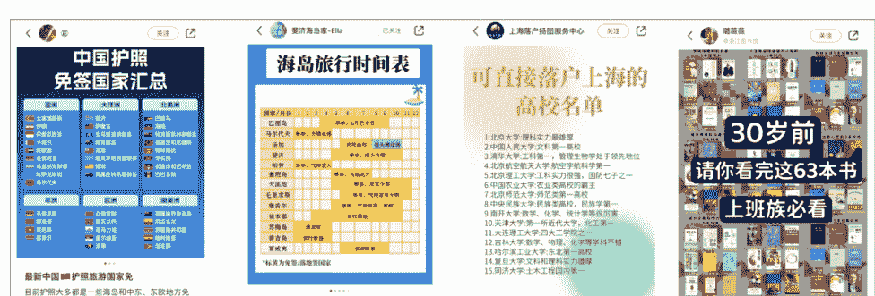

## 3-22 使用价值笔记

## 情绪价值

所谓“情绪价值”的笔记，就是指一些笔记或许没有实用性，但是能够给用户传递一种情绪，用户通过笔记获得了开心、有趣、认同、共鸣、愉悦、治愈的心情。

比如你的笔记是分享美学的，用户在看完笔记的当下去不了不了，但通过你的笔记用户感受到了旅行的放松和远方的向往，这就是一种情绪。

比如你的笔记是分享家居的，每个人都对自己的家里有很多想象，通过你的笔记构建了用户对美好生活的向往，会忍不住想跟着你的风格来装修，这也是一种情绪。

比如你的笔记是分享健身的，通过你的健身过程对比和健身日打卡，用户从你的笔记中获得了自律的力量和坚持的动力，以及对自己变得更美的倾情，这这也是一种情绪。

## 决策价值

决策价值是帮助用户解决一个真实生活的实际问题，比如一个正在装修、一个正在考研、一个正在买房的用户等，小红书之所以可以成为很多女生的“百度”，就是因为有巨大的辅助决策价值，用户通过对比、测评，完成了某项决策，常见的有合集、测评、科普、避坑、教程、攻略等类型的笔记。

比如：

- 618购物清单，值得手的价值电器。
- 减脂必囤的低卡零食、好吃不胖。
- 装修避坑的合同指南20条。
- 新疆旅行的8项注意！

决策价值的笔记我们称为交易型笔记，因为决策之后就是购买，所以决策类笔记的交易效果往往更好，更有商业价值。

在这一节我已经完整讲述了爆款笔记的制作思路和技巧，总结来说就是把每一篇笔记当作拆解，当作你的产品，想一下这篇笔记目的是什么，人群是哪些，他们为什么要看这篇笔记，对他们有哪些帮助，通过哪些内容来打他们，基于这个思考想封面设置，标题怎么写，正文怎么写，具体如何布局，要埋哪些钩子，让用户关注，怎么触发用户的交易行为。

## 3.6 爆款笔记运营

评论区同样是不可忽视的部分，尤其是对于爆款笔记，理解很好，我们发布和运营的是通过内容吸引流量，即让用户留下反馈，不要看笔记就走了，要尽可能增加用户的互动。

### 3.6.1 评论置顶

置顶评论的位置可以获取最多的注意力，根据笔记和评论区收集到的用户反馈信息，或者是你想引导用户的行为，可以把这些内容进行置顶。比如：

- 想要引导购买的，针对用户的顾虑做回答：订单截图、商品截图。
- 想要引导进入群聊，复制链接，方便用户直接进入。
- 想要引导到小号，可以在评论区@小号，告诉用户在这里咨询。

### 3.6.2 引流氛围

氛围是需要引导的，即让用户看完互动，你需要引导和设计，因为小红书上的从从效应，大部分人都是跟风，我们需要的是带动羊效应，给出指令。我们曾经做相同的笔记测试，一篇笔记下面主动评论“多少钱”“怎么订？”，第二天过主动评论就出现了大量问答，理解很好，并不是每个用户看笔记都知道你可以提供服务。

还可以做更多的氛围设计引导用户：

- 进入主页：主页里都是好东西，太有趣了！
- 询问在哪买：求链接，蹲脚。
- 询问价格：问价。
- 购物反馈：可用图片订单截图，增强真实性。
- 卖家秀：我也买了。
- 消除疑惑：针对用户提问，及时回答，打消用户的购买意愿。

### 3.6.3 给出指令

给出指令是引导用户按照你想要的方式互动，比如想要减少私信，留在评论区，你可以回复的内容为“私信不回，主页可以找我”“关注后发送详细信息”。如图3-23所示，这样后续看到笔记的用户就会按照你设计的互动方式来找你，降低你的回复成本。总来说，评论区同样一篇笔记的重要部分，如果运营得好，可以让笔记的互动和转化翻倍。

温柔桑作者建立了一个搞笑图片+视频分享大家，在封面上左下角可以点进来，希望能给大家带来快乐，你可以不说话，只围观，必要时想分享也可以。6小时前 安徽。置顶评论womo我想进群哈哈哈哈哈哈5小时前 广东。展开37条回复。

## 图3-23 评论区给出指令

# 第4章 引流：关键运营加速流量

这本书更多的是讲小红书变现，但在我的小红书交流群里很多人的关注讨论点仍然是引流和涨粉，尤其是刚接触小红书的新手，不具备完整的闭环思维，更多关注运营的细节而不是一个闭环体系。本章我会重点带你积累一个以变现为目的的小红书账号为什么需要涨粉和账号涨粉的方法路径。

## 4.1 小红书涨粉的底层逻辑和构建路径

### 4.1.1 账号涨粉的三个误区

你必须先清楚目的，然后才有实现目的的应对策略，不在执行中常常容易跑偏和返工。我接触过很多运营者向我咨询为什么账号不粉？其实对方运营是一个变现账号，一定需要涨粉才能实现变现，也有人做了很多爆款笔记粉丝涨粉很少，也有账号粉丝量十万但依然没有变现......

一个标准的互联网人开始运营动作之前的思维定是先目的，在账号涨粉的问题上一样，即账号涨粉的目的是什么？小红书账号涨粉的大概分为几种：

- 1. 提升影响力：在互联网上粉丝体现了账号影响力，更多的粉丝意味着更大的影响力，这些影响力可以被转化为带货变现、品牌价值或私域流量。
- 2. 长期运营：虽然这一类运营者没有直接的商业需求和变现路径，但是也想长期运营自己的账号，因为涨粉是粉丝直接的结果，所以粉丝量是这类群体最为关心的。
- 3. 方便广告：在小红书广告报价上，粉丝量是衡量博主广告价值指标之一，更多的粉丝量意味着更高的广告产出。

不同的涨粉目的决定了不同的运营策略，继续看看关于涨粉的三个误区，你可以对照自己有没有类似的情况。

误区一：有爆款笔记，不涨粉。实际中可能会遇到的问题，甚至很多笔记都是爆款，但账号不涨粉。一个账号涨粉涉及很多要素，包括装修与定位，涨粉的主要原因是笔记有价值，但是用户没有持续价值，用户却缺少理由。可能看到某笔记有很多互动反馈，评论区的讨论很热，但用户某种程度上没有“连接”，用户不知道你是谁，只是收获了笔记点赞和收藏，并没有触发关注动作。清楚了这点，你在运营中不用再盲目找热点、发表干货，其实做涨粉很简单，如图4-1所示，这些笔记是某种意义上的爆款，且这些笔记不能变现。

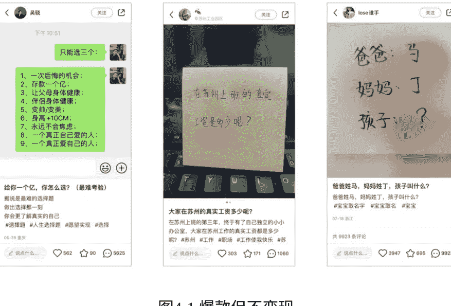

误区二：以为所有账号都要涨粉。必须强调，不是所有的账号都要涨粉，尤其是当你的目的是基于私域流量变现时，直接将粉丝引流到微信后转化效率更高，涨粉根本不重要。当然，账号涨粉和变现是不冲突的，需要注意的是，并不是涨粉顺带的结果，而不是运营出发点。前面的章节提过交易=需求+连接+信任，匹配流量。

误区三：涨粉可能能变现。从变现思维出发，我们应该从获得第一个粉丝的时候就开始赚钱，千万不要以为获得了几万粉丝就好了了，第一个粉丝挣不到钱，几万粉丝还是挣不到的。我就见过好个人做了几个粉丝的账号是没有变的，团队一周的时间折腾出来的账号从变现价值来说，流量不值钱，带着需求的流量值钱，粉丝不值钱，引流的粉丝才钱。我们不是做涨粉的，是做生意的。如果你是卖水的、卖衣服的、装修的、卖资料的......这些交易性非常强，直接寻找生意。可以通过笔记触发互动、进群私信，最后加到微信，就可以完全从第一篇笔记第一次连接开始变现，让流量和成交同时发生。以上是关于涨粉的三个误区。当你打开小红书时，可以看到很多账号停留在有爆款但不涨粉的、有涨粉但不安全的误区里，我特别希望不要陷入这样的误区。下面进入账号涨粉的构建路径。

### 4.1.2 账号涨粉的构建路径

换位思考一下，把自己切换到用户视角。我们平常使用小红书的场景一般是点开小红书，看到一篇笔记，觉得笔记不错就进入主页看看这个账号的装修（昵称、简介、头像），继续看这个账号之前的内容，感兴趣就继续，不感兴趣就关闭退出返回小红书首页。在这样的路径下，用户会根据什么判断是否关注一个账号呢？

#### 1. 垂直定位

垂直定位的好处是清晰地告诉用户你是干什么的，你会输出什么，关注你有什么价值，定位清晰能降低用户认同了解的成本，试想每个用户看到的你的笔记毫不思索就知道你是做什么的，知道你是专门做这个领域的，保持持续输出，就能很容易触发用户的关注动作。从行为的角度来看，关注的前提是认识你、了解你、喜欢你，那么我们就通过笔记运营来告诉我是谁。从算法的角度来看，垂直定位越垂直，熟悉的成本越低，用户更好理解也更容易认识你，只有系统认识了你，才能更好地推荐。如果你的定位不精准，不仅用户不认识你，就连系统也不认识，不认识你就无法精准推荐，推荐不精准则笔记的点赞、收藏等互动就上不去，系统会觉得这篇笔记内容匮乏，一旦停止推荐，笔记流量就会下降。比如，你是做网红人设，你的定位和笔记内容没有直接显示你的目的，系统会把你理解为做探美食攻略的，这样流量的开关就被切断了。所以商业账号的装修一定要在昵称、简介、头像告诉用户你是谁，记住这是最重要的。

#### 2. 真实人设

小红书整体是喜欢真实的，所以最好基于一个真实的人设来运营账号，因为真实就有价值。当你的账号出现爆款笔记后，涨粉的问题多半是因为内容和账号装修上体现人设的温度，如创始人、产品经理、销售顾问……可以真实地分享生活，让用户觉得你是真实的。

#### 3. 稳定风格

稳定风格的好处是给用户预期，同时降低制作成本，提升笔记的质感，让用户觉得值得关注。试想用户通过笔记进入主页，发现账号内容统一、风格一致、专业素养足够，很少会流失。

#### 4. 持续价值

持续价值是很直接的动作，是让潜在用户看到账号后续内容，所以你要持续更新，比如笔记的封面、标题、选题等。总之，被关注是结果，作为运营者需要思考的是：笔记做了什么？提供了什么理由？提供了什么价值？用户得到什么好处？比如获得知识、技巧、优惠、美丽、穿搭、做菜、减肥瘦身知识等启发。

### 4.1.3 决定涨粉的关键要素

你现在打开小红书，随意点开一个账号的主页，可以看到这个账号粉丝数，如图4-2所示，我们可以明确地知道这个账号是从开始到发布若干篇笔记，最终获得了这么多粉丝，那么决定账号涨粉量的是互动数量。

通常赞粉比小于5，说明涨粉效果很好；赞粉比为5~10之间，说明账号处于正常水平；赞粉比大于10说明涨粉率低。你可以对照看下自己运营账号的赞粉比。

### 4.1.4 账号涨粉的7方法

在实际的运营中，如表4-1所示，你可以通过7个维度的设置来提升账号的涨粉率。

## 表4-1 账号涨粉方法

| 运营模块 | 运营动作 |
| --- | --- |
| 首页装修 | 互动 |
| 置顶笔记 | 互动 |
| 笔记 | 封面、标题、选题 |
| 评论区 | 互动 |
| 社群运营 | 互动 |
| 私信交流 | 互动 |
| 内页 | 互动 |

# 笔记正文

每一篇笔记都是直接与用户沟通的触点，优质的内容将用户吸引进入账号首页，超级优质的内容在笔记阅读页面即可获得粉丝关注，比如以简短模式化的开头或结尾让用户建立该账号持续产出优质内容的认知，从而引发用户关注，还可以在笔记的封面或者标题中展现内容输出的系列性。

# 笔记开头

例如：

大家好！我是做了8年定制的资深旅行定制师，

每日更新全国目的地旅游攻略，

出行类疑惑解在行，

欢迎关注。

# 笔记结尾

例如：

心动不如行动，

点击右上角红色小框关注我，

然后发送暗号，

即可——一回复宝贝们哦。

## 评论区

评论区同样是用户注意力集中的地方，多加引导也有很好的效果，可以借助小红书打招呼有次数限制，互关可以实现互相消息的机制，留言触发用户关注自己。

例如：

6次旅行专注高端酒店套餐预订，纯玩小团定制服务，

每日打招呼次数有限，

请各位朋友关注评论消息，一键三连，

小编会第一时间赶到！

预订方式：私信

价格：某程的88折

快来截我吧！

可以先点右上角关注，这样我就能和您说话啦！

# 社群运营

不是每一个进入社群的用户都关注了账号，那么我们可以在回答完用户的问题、和用户建立了初步联系以后，在群内常常“刷脸”及转发热门笔记，也可以引导用户顺序进行关注。

# 私信引导

一般私信的用户对账号内容的需求都比较强，在回答完用户的咨询后，可以加一些引导关注的话术。

# 内页图片引导

除了封面的内容图片，也可以使用对应群、更新内容、加微教程、资料领取、持续性价值提供等利益点，吸引用户进入账号主页点击关注。

除了以上方法，还可以尝试在编辑笔记时带上账号标签，用户点击标签后即可进入账号主页，优秀的爆款笔记可以带来更多进入账号主页的流量，如果账号主页的优质、排版协调性较好，用户进入看到完整清晰的笔记内容，关注的欲望也会增大。

# 4.2 提升笔记流量的有效方法

终于到了提升笔记流量的环节，你可能会发现，在本节之前，我已经用了很多篇幅和你讨论定位、闭环、目的、需求等话题，因为当你清楚了这些以后，会发现引流其实没那么难。

我们从关键词SEO和权重收录以及流量结构的角度来看如何提升笔记的流量。

# 4.2.1 SEO：有搜索的地方就有SEO

在第一章中，我带你了解了一篇笔记的流量结构，通常来说，小红书的流量分为搜索流量、推荐流量和关注流量以及其他来源流量等。

- 搜索流量：即用户搜索某个关键词，你的笔记会出现在搜索结果中，被用户看到。
- 推荐流量：即小红书根据标签把你的笔记给予可能对笔记有需求的用户。
- 关注流量：用户刷新小红书首页会优先看到自己关注的账号的更新笔记，流量大小取决于粉丝量。
- 其他流量：如用户将链接分享到站外带来的流量等。

从小红书平台给出的报告指出，搜索流量已经占据整个平台的60%，其次是推荐流量，约30%，从流量结构和占比来看，搜索流量主要来源于搜索和推荐，其占比更大，搜索流量也有机会。

SEO你听说过，即Search Engine Optimization，搜索引擎优化，它是通过分析搜索引擎抓取、确定排名的技术。系统根据不同的搜索行为来呈现不同的搜索结果，某个搜索结果是否出现在前几，成为运营者的重点。

# 什么是SEO？

基于小红书上有大量搜索行为，将笔记内容化，使得笔记转化高，就是SEO。2023年5月，我在课程上讲了一堂关于SEO方法论，对于所有的流量类型，搜索流量是成交效率最高的流量，也是所有流量中最价值的流量，如表所示。

| 流量类型 | 流量规模 | 流量成本 | 信任度 | 成交效率 |
| :--- | :--- | :--- | :--- | :--- |
| 推荐流量 | 小 | 小 | 高 | 高 |
| 内容流量 | 大 | 中 | 中 | 中 |
| 搜索流量 | 中 | 大 | 中 | 高 |
| 自然流量 | 中 | 中 | 中 | 低 |

SEO就是专门用来承接流量的。基于小红书用户的搜索习惯和搜索流量占比，搜索流量是非常敏感的，实际上最有效的运营就是SEO。

那SEO如何做？

答案是埋关键词。在前面的章节提到过要完整、穷尽对应群体的需求，将这些关键词适当埋进标题、正文、标签、评论等，使得算法更好地识别笔记，从而实现在用户搜索关键词的时候，我们的笔记能够更多出现在搜索结果里，且排名靠前。

埋关键词的主要方式有：

- 标题中埋关键词：采用大关键词+小关键词的组合模式，一般不超过20字。
- 正文中埋关键词：在笔记的开头、中间和结尾处，恰当地提及核心关键词。比如，“酒店”是核心需求，那么你的笔记中就可以高频植入“酒店”。
- 标签中埋关键词：标签本身就是一种SEO，是为了方便告诉系统这篇笔记的内容，打标签的过程可以视为内容的结构化。一篇内容被结构化、标签化以后，系统就能进行更好的识别和推荐。
- 图片中埋关键词：在笔记的封面和内页图片中植入关键词。

这些都是埋关键词的方法，使得一篇笔记对目标关键词具有更好的匹配度和相关性。整体笔记的内容围绕关键词展开，适当重复使用关键词。需要注意的是，关键词的出现次数要结合笔记的篇幅进行调整，一篇200~300字的笔记，关键词重复出现3~5次比较合适，需要合理规划关键词的密度，不可堆砌关键词。

其实SEO的运营逻辑不仅在小红书上有，微信公众号、知乎的运营者在写文章的时候就有布局SEO的意识。早期厉害的电商运营者都有一个相似的经营逻辑，那就是在详情页中放入关键词，但是将关键词的颜色设计成和背景一样的颜色，让用户看到。聪明的你是否发现这些字是写给算法而不是写给用户的？其目的就是提升笔记的搜索相关性。

总之，流量的地方就有搜索，搜索的地方就有SEO。

从流量属性来说，即使是爆款流量，也有逐渐下降直到没有的一天，但搜索流量可以持续且具有长尾效应，因为用户的需求在，搜索行为是稳定持续的。

试图在任何一个领域，一篇笔记尝试1~5个关键词，一天10篇笔记，月度完成300篇笔记，一个月可覆盖300~1500个对应领域的关键词词。如果你在小红书上把某个领域的关键词都写完，在很多关键词搜索结果里你的笔记都能出现，你或许还没有流量吗？

在关键词的选取上，还需要区分主关键词和细分关键词。主关键词很好理解，就是被高频搜索的关键词。流量最大，搜最多，但是对应关键词的笔记很多。这一类关键词当然要布局，但是因为主关键词下的笔记数量很多，竞争激烈，反而不容易获得流量。这里有一个“供需比”的概念，除了主关键词，我还建议你关注对应领域的细分关键词。

# 4.2.2 权重：影响笔记排序的重要因素

如何提升笔记排名呢？笔记排名结果由权重分配，即排名=账号权重+笔记权重。

影响账号权重的7维度介绍如下：

- 原创率：文章是否原创，笔记内容尽量原创，不要直接搬运和采集他人内容。
- 垂直度：是否在某一领域深耕，而不是今天发A，明天发B，导致标签较为混乱。
- 内容质量：有的笔记数据怎么样，互动少意味着内容差。
- 活跃度：体现在发布频率、登录、点赞、评论、收藏等数据上，活跃度太低都不行。
- 账号等级：小红书账号等级是官方公布的，每个等级在满足一定的行为后即可升级到下一等级，最高等级专属。
- 品牌达人：小红书品牌合人，大部分账号不涉及。
- 签约MCN：报备给小红书的MCN签约账号，普通账号不涉及。

如果你的账号是新号或者规模起步，一般只关注前面5个可以努力的部分即可。

# 笔记权重

影响笔记权重的7个维度介绍如下：

- 互动转化：推荐到基础流量池的互动转化，一般的效果排序为转化>评论>收藏>点赞。
- 内容长度：600字及格，内容太少价值不完全。
- 相关性：该笔记与对应关键词的匹配。
- 标签：位置标签，如旅行笔记的位置、名称，可以方便系统识别。
- 话题：等同关键词。
- 违禁：内容是否包含违规，不可以出现违禁词。

由账号权重和笔记权重共同构建的权重得分决定了笔记出现在对应搜索结果中的位置，权重除了影响搜索流量，也会影响推荐流量。

# 4.2.3 投流：放大值得放大的流量

除了以上免费提升流量的方式，小红书还给热门笔记提供了两种投流方式：薯条和聚光。从内容创者的角度来说，这就是官方提供的正规渠道。

# 什么是薯条

薯条是小红书官方提供的一个工具，和抖音功能相似，想要针对性地提升流量，可以用薯条来放大。注意的是，薯条投放需要审核，违规笔记无法通过。薯条有三种模式：

- 点赞收藏模式：重点提升点赞、收藏，满足互动需求。
- 阅读量模式：重点提升阅读量，满足阅读需求。
- 粉丝模式：重点提升粉丝量，满足涨粉需求。

# 薯条类定向方式

目前有两种投放方式触达群体：
- 智能定向：系统根据个性化推荐将笔记给感兴趣的用户。
- 自定义定向：可以选择具体的性别、年龄、地域、兴趣标签等定向。

对于优质笔记，适当用薯条是一个不错的放大方法。

## 什么是聚光

聚光是小红书的一站式投放平台，针对商业化诉求，可以帮助笔记持续增加流量。在完成自然流量以后，建议多种模式交替投放。

# 聚光平台产品全景

| 营销诉求 | 投放方式 | 推广目标 |
| :--- | :--- | :--- |
| 产品种类 | 信息流 | 商品 |
| 占领赛道 | SPU | 落地页 |
| 客户收集 | | 店铺 |
| 商品推广 | | 直播间 |
| 智能投放能力 | | 精准定位：人群、行为等 |

按照官方解释，对比薯条，聚光有以下优点：

## 1. 一站式解决方案，覆盖多种场景

聚光平台深度适配广告主在小红书上的模式，支持“产品种草、抢占赛道、客户收集、商品推广、直播推广”等多种场景，一站式满足广告主的多种诉求。

## 2. 搜索&浏览场景突破，深度影响决策

聚光平台依托小红书的独特生态环境，提供浏览+搜索的双引引擎。通过“信息流种草—搜索产品收割”的独特模式，帮助广告主的品牌/产品快速提升口碑，深度影响消费者决策。

## 3. 智能投放能力，科学提升效率

聚光平台提供信息流和搜索产品的多种智能能力，系统化地实现营销效果优化，自动化减轻操作负担，帮助广告主提升经营效率和效果，有效降低营销成本。

## 4. 全链路数据支持，助力决策

聚光平台依托小红书的数据技术，提供营销场景下的洞察与分析能力。结合DMP能力，打造精细化人群营销，满足客户挖掘、洞察、圈选、投放等全流程需求，实现科学度量与有效归因。

## 5. 健康生态环境，实现良性循环

聚光平台不仅关注广告主的单次流量价值，更重视广告主在社区环境中实现长效经营，实现广告和自然流量间的相互助力，帮助品牌在小红书上获取流量复利，长期、健康、稳定地发展。

整个聚光投放的过程概览为投放准备（专业号认证、资质认证、聚光平台登录与账户充值）、新建广告（推广计划、投放单元、推广创意）两个阶段。

开通聚光对运营者来说意味着实实在在的花钱行为，这不仅对笔记质量本身有要求，还对投放方式、投放策略提出了很高的要求，因为一个推广计划没有做好就会带来金钱损失，可能花掉不少预算，却没有带来预期的效果。

# 聚光平台广告投放MAP：四步完成投放准备，三步即可新建广告

# 广告投放准备

## 新建广告

| 账号认证 | 账号认证 | 聚光平台登录 | 账户充值 | 广告计划 | 推广单元 | 广告管理 |
| :--- | :--- | :--- | :--- | :--- | :--- | :--- |
| | | | | | | |
| | | | | | | |
| | | | | | | |
| | | | | | | |
| | | | | | | |

# 小红书账号等级对照表

| 等级 | 称号 | 晋级要求 |
| :--- | :--- | :--- |
| 1 | 基础级 | 点赞、收藏、评论各1次，发布1篇笔记 |
| 2 | 奶级 | 发布1篇笔记获得5个收藏，累计发布1篇 |
| 3 | 粉丝级 | 发布1篇笔记获得5个收藏，累计发布3篇 |
| 4 | 泡泡级 | 发布1篇笔记获得5个收藏，累计发布5篇 |
| 5 | 甜筒级 | 累计发布12篇笔记获得10个收藏，其中5篇 |
| 6 | 小马赛级 | 累计发布50篇笔记获得10个收藏，其中5篇 |
| 7 | 文化级 | 累计发布9篇笔记获得10个收藏，累计发布100篇 |
| 8 | 铜冠级 | 累计发布12篇笔记获得10个收藏，累计发布30篇 |
| 9 | 银冠级 | 累计发布15篇笔记获得10个收藏，累计发布50篇 |
| 10 | 金冠级 | 累计发布18篇笔记获得10个收藏，累计发布800篇 |

png

细的对比。但蓄条和聚光的使用原则又很相似，即投流只“值得放大的流量”。

## 表4-4 聚光与蓄条的区别

| 流量类型 | 蓄条 | 聚光 |
| :--- | :--- | :--- |
| 适用账号 | 个人号、企业号 | 专业号 |
| 投放模式 | 订单模式、按曝光量付费、不可设置出价 | 成本效益模式、按点击量收费、灵活设置出价 |
| 推广目标 | 笔记阅读、点赞收藏、粉丝关注 | 笔记阅读、商品访问、落地访客、商品收藏、商品访客、私信咨询、表单提交 |
| 人群定向 | 性别、年龄、地域定向 | 信息流广告——高级定向、 搜索广告——关键词定向 |
| 投放数据 | 曝光量、互动量、粉丝关注 | 商品畅销、销售线索、私信营销、关键词指标 |
| 呈现样式 | 笔记 | 赞助 |

## 什么是“值得放大的笔记”

在付费流量上，我的观点是如果能够算出成本收益，就可以毫不犹豫地去投，成本收益算不出来的则需要谨慎去投，付费仍然是获取流量的手段，付费的本质是放大流量，但是放大的前提是值得的。什么是“值得放大的笔记”？

“值得放大的笔记”就是笔记的自然流量效果已经很好，互动数据反馈都都不错，但是自然流量总会有衰减和下降，此时用商业流量加力放大，会把笔记推入更大的流量池。付费是让本来好的笔记变得更好，而不是试图用钱让差的笔记变得好。付费是锦上添花，不是雪中送炭。

2023年，因为小红书对私引流的管控加强，不少人被迫升级为专业号，然后开通聚光，因为只有这样，才可以减少对账号私引流的限制。可以说，无论意愿还是接受，聚光都让内容创作者多了一个不得不使用的场景。

## 4.3 互动指数是小红书流量开关

做好笔记的选题和内容并不一定有流量，任何内容好的笔记都是从初始流量池一小步进入更大的流量池的。想要一篇笔记获得源源不断的流量，还需要打开小红书的流量开关。

### 4.3.1 什么是互动指数

小红书笔记的创作者们都很关注点赞、收藏等数据，其实这些数据对应笔记运营的视角就是一篇笔记的互动指数。互动指数很好地衡量了笔记带来的实际价值，因为笔记的内容，自然体现在用户的互动行为上，所以运营小红其实也是一个价值交换的过程，你写笔记的时候努力给用户提供价值，用户也会给你点赞、收藏的互动反馈。

### 常见的互动行为有哪些

常见的互动行为有点赞、收藏、评论、转发、关注、私信等。

### 什么是互动指数

互动指数是一篇笔记可以带来的行为为得分。这里需要一个CES评分的概念来帮助我们分清不同行为体现的笔记价值。CES评分：点赞数×1+收藏数×1+评论数×4+转发数×4+关注数×8。

从这个公式可以看到，评论、转发、关注的价值远大于点赞和收藏。我在实际运营中发现，有些点赞、收藏数据的笔记有时候并没有获得关注或评论，所以即使是爆款，我们也要拆开来看是哪类型的爆款。并不是所有的爆款都有高价值，一条真正有意义的爆款应该拥有很多结合你变现目的的互动行为。

如果你希望触发点赞、收藏、评论等互动行为，可以在正文或评论中采用利益点+行动指令的方式。

比如：

- 关注我，然后打“1”，发清单资料给你呀！
- 说出你想要的酒店店名，给我报价哦！
- 觉得不错就收藏一下，方便你想找的时候用上！
- 我写的是一套完整系列，可以进我的主页查看更多哦！
- 我会在群内分享操作细节，可以进我粉丝群呀！
- 关注我哦，悄悄悄哦！
- 详细完整的教程已经为大家准备好了，可以评论告诉我，私发！

如果希望触发交易的主动问价，可以在正文或评论中采用价格+套餐亮点+行动指令的方式。

比如：

- 宝子们，这个冬天长白山和延吉一定要一起玩，先去万达滑雪、泡温泉，再去北坡漂流、雪场摩托、雪岭驯鹿，最后前往延吉游玩逛吃，六行行程你玩转长白山、延吉。
- 2023冬季优惠套餐来袭，亲爱的宝宝们，长白山度假酒店季节销售，人均699元入住两晚华山山景，套餐内容也丰富，包含滑雪、早餐、接机、西景区定点巴士，还有超级梅花鹿和你互动。这么划算，还不冲，等着涨价吗？

对于有备目的的笔记来说，上面两种都是高价值的互动行为。

### 4.3.2 笔记没有互动，流量就不会流动

为什么互动对一篇笔记非常重要呢？我们可以从一篇笔记发出以后在小红书内的流量通过过程来看互动对笔记流量的重要性。

如图4-5所示，我们在小红书内发出的每一篇笔记大概经历了这样的过程：

- ① 审核标签。
- ② 推送给目标人群（基础流量池，可能是200人）。
- ③ 基础流量池人群对笔记“投票”（转发、评论、点赞、收藏帮助帮助打分。
- ④ 分较高的笔记进入新流量池（可能是2000人）。
- ⑤ 新流量池的用户继续互动，分数达标后扩大到新的流量池，把笔记推给更多的人。
- ⑥ 以此类推，每次次数对应流量池门槛，就会把笔记推给更多的人，直到新流量池用户反馈达标为止，才会停止。

通过这个过程可以发现，在流量池，前200个用户的互动反馈非常重要。如果笔记拿不到互动反馈，笔记无法在系统内流到下一个流量池，即使笔记内容很好，流量在这里断掉了。

### 如何触发点赞、收藏、评论、转发、私信等互动行为？

这些是行为的结果，我们不妨拆解一下互动背后的要素：

- 用户点赞：这篇笔记说明内容获得用户认可，引起共鸣。
- 用户收藏：这篇笔记说明内容有实用价值，未来可以用上。
- 用户评论：这篇笔记说明内容触发了用户的需求或具体问题。
- 用户转发：说明用户不仅认可你的笔记，还期待未来产出更多优质的内容。
- 用户私信：说明你可以解决某个实际问题。

回到算法视角，小红书其实判断一篇笔记质量的好坏，只根据这些提出来的互动指数来判断笔记带给用户的价值。互动指数高的说明笔记内容价值高，所以被推荐。小红书算法也是遵循“互动放大价值”的原则。

## 什么是深度互动

深度互动是指通过笔记带来的关注、长时间停留、转发、多次讨论，这些行为为了更具粘性。想象一个陌生用户看完笔记后决定关注，一定觉得你的笔记很有用。站在平台的角度来看，这些笔记留住了用户，增加了用户使用小红书App的时间，自然就值。

一旦笔记能触发更高流量指数的互动行为，笔记的流量就会不断放大进入更大的流量池，从而实现流量的加持，笔记在系统内持续流动。假设一篇笔记可以不断拿到互动反馈，理论上它可以不断在系统内保持持续流动，即流量可以做到无限，但实际很少看到流量超过1000万的。

一篇笔记从刚开始发获得百万级流量大概会经历几层流量池呢？

- 1级流量层级：笔记浏览量0~200。只要笔记不涉及违规，不管内容如何，基本上都能获得200左右的阅读量，如果篇笔记阅读量维持在200，则会继续进入下一流量池。
- 2级流量层级：笔记浏览量200~500。属于正常流量，大多数账号都能达到2级层级，从1级到2级需要账号活跃、垂直度、原创度及内容质量上做出改变。
- 3级流量层级：笔记流量500~2000。笔记流量比较不错，商业笔记的平均流量基本上都能达到这个水准，但互动率/点击率比大盘平均降低，所以只能到3级层级，无法到达下一级，到达这一层级已经超越80%的小红书账号了。
- 4级流量层级：笔记流量2000~2万。除了活跃、垂直度、原创度及内容质量上不错，笔记的互动数据也平均水平，具有爆款潜质，互动数据会持续上升。如果这时候用户互动行为增加，平台会继续给流量。
- 5级流量层级：笔记流量2万~10万。5级流量池是自然流量的最后一关，依然是用用户数据决定是否进入下一级，到达这一级的笔记已经是比较出的笔记，有一一定粉丝级及权重较好的账号才会达到这一层。
- 6级流量层级：笔记流量10万~100万。此时笔记已经进入热门笔记门槛，到达这一级的笔记说明内容具备一定的稀缺性，互动数据比较好，也是从这一级开始，算法会测试账号的基础数据，比如主页点击率、关注率、回搜率，很多依靠标题/封面获得高点击率的笔记，会在这一层级停止推荐。
- 7级流量层级：笔记流量100万~500万。笔记进入这一级就已经已经爆了，不管是互动数据还是账号基础数据，都有不错的表现，从这一级开始就有人工干预。
- 8级流量层级：笔记流量500万以上。到达这一级的笔记是难得一见的，互动数据和基础数据表现非常出色，远高于平台平均，且获得了权重推荐，算是现象级的爆发。

从图-6可以看出，从1级到8级流量逐渐增加，根据互动反馈，如果没有互动，流量就不会流动。

## 4.4 小红书引流与局限

引流是和目标建立连接的过程，前面提到小红书是匹配供需的连接器，引流是很多人做的重要目的。对于新手来说，从第一篇笔记开始实现引流到私域变现，随着小红书体系不断完善，所有的引流动作都有一定的风险，需要长期地思考如何在小红书上健康经营。

### 4.4.1 哪些行为容易被判引流

小红书如何判断引流行为呢？常见的有3种，可以通过这些方法规避：

1. 网络分析：小红书平台可以通过用户的网络行为和网络环境判断是否存在引流行为。例如：在同一个Wi-Fi下登录了5个以上的小红书账号；同一手机登录了两个或以上的小红书账号，且多次登录行为，显然一个正常用户不会这样做；同一条评论信息、一张图片或同一文字信息在很短的时间内重复发布，系统监控到这样的异常行为；某个账号组建了很多相似的群聊，群内发布相同的内容。

2. 文字、图片识别技术：有时候发给用户的信息用户并没有收到，这是为什么呢？因为系统和你用户之间增加一道检查，一旦检测到包含微信等私域联系方式的可疑信息，就会拦截甚至对你发出提示。例如：私聊直接发微信、邮箱、公众号、网址链接、二维码、数字等；个人简介留信号、数字、电话方式等。在今天小红书监控手段十分完善且限流非常严重的情况下，千万不要侥幸心理尝试这些高风险的行为。

3. 用户举报机制：不得不说小红书作为亿级用户量的平台，实时监控每个用户的行为是非常是非常昂的，有时候引流行为被发现不是因为官方监测到，而是被用户举报，平台收到举报后会对举报信息进行核实并采取相应的措施。最好的规避方法就是无限接近一个正常用户的使用习惯，在最新的操作矩阵方法中，为了避免账号被封禁和限制，已经开始这样操作，这意味着运营难度和投入成本越来越高。

### 4.4.2 如何避免账号被限流

如果小红书判断账号有违规行为，就会对笔记或账号进行不同程度的限流。如何判断自己的笔记被限流了呢？

### 笔记被限流的判断

如果你的笔记显示在审核中，分享给其他人的时候笔记无法显示，就有可能被限流了。这时应该检查笔记内容中是否出现违规词或者有什么违规行为，尽快修改笔记。

一般出现以下情况，大概笔记已被系统限流：

- 阅读量比以前突然滑落很多，不管什么曝光量都上不去；
- 搜索自己的小红书账号，搜索结果里没有自己的笔记；
- 给其他博主点赞、评论，对方收不到；
- 搜索自己的昵称，找不到自己的账号；

### 笔记限流分类

尽管都是限流，但影响方式不一样。具体来说分为：

- 单篇笔记限流：单篇笔记违规，导致单篇笔记流量限制。
- 账号限流：多篇笔记违规（如发布了多篇“硬广”），导致账号整体限流。
- 禁言：私信里出现违规词（如价格等），以及频繁招呼，容易触发禁言。
- 封号：频繁更换账号，或者发大量的“硬广”笔记，导致账号封号。通常分为三个阶段：
- 第一次：警告。
- 第二次：禁言7天。
- 第三次：禁言30天。

### 4.4.3 小红书引流的7个方法

引流是和目标建立连接的过程。为了规避风险，小红书提供一个互动的方法，具体如下：

- 1. 笔记置顶：笔记置顶专门用来承接流量，内容可以是自我介绍。
- 2. 个人简介@小号：用大号@小号的方式，大号吸引流量，风险隔离。
- 3. 瞬间或合集：在账号的瞬间和合集隐藏首页上微信的添加方法。
- 4. 控制私信量：私信量太多容易触发。
- 5. 引流方式迭代：任何一种引流方式都不可以重复使用。
- 6. 友好互动：与用户保持友好互动，增加互动反馈，增加权重。
- 7. 用Wi-Fi：避免使用公共Wi-Fi，尽量使用手机，不要在某个时间某个位置集中发布。
- 8. 敏感词：违反《广告法》的敏感词如下：
- 顶级绝对用词：最、第一、唯一等。
- 虚假广告：宣传医疗/疾病治疗功能/保健功效。
- 营销词：“割手”、推荐、回购、下单、价格、多少钱、买的、代购、赚钱、兼职、各种价格、活动福利、折扣等。
- 引流词：微信、手机号、链接、淘宝、天猫、京东、苏宁易购。
- 引导行为：点赞、收藏、评论、转发、私信等。

除了以上这些，还需要注意官方明确禁止的高危行为：

- 虚假广告：夸大产品功效，例如一秒祛斑、快速瘦身、超强美白等。
- 恶意营销：在没有依据的情况下，表辞过于激烈，恶意某个品牌、贬低产品、损害品牌形象。
- 发布谣言：发布不实信息、传播错误信息。
- 传播涉俗、低俗、有害信息：穿着暴露、带有性暗示的内容被系统判定为淫秽低俗、发布不正言论、宣传暴力、血腥等内容。
- 引流：如果在头像、昵称、微信签名、私信、评论中留下了微信号、手机号或者淘宝店铺名称及二维码等信息。
- 推广笔记违规：绕过官方平台，发布“软广”且不报备等明显违反小红书策略的行为。
- 发布非原创内容：笔记中未使用他人原创图文、照片和视频，是发布反社区规范的行为。

创建合集需要先认证为视频号，你可以在创作中心点击创建合集完成合集的创建。

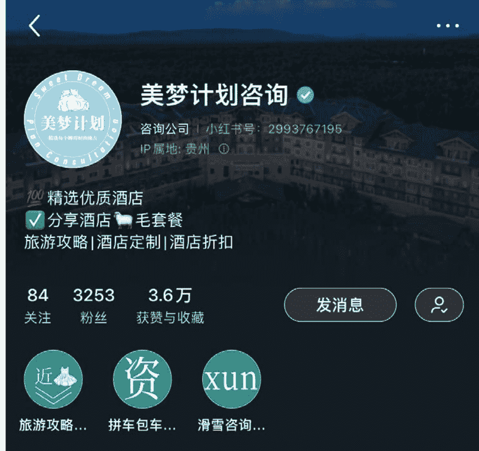

图4-8 瞬间引流

优势：合集名称中可以直接显示微信信号，通过合集介绍传递其他信息，合集能被转发至会话。

劣势：非常容易被系统检查出违规，可能出现今天正常，明天就触发违规的情况。

## 4. 手写图片

手写图片的方式增加了小红书监测的难度，因为系统是通过扫描对话框中的图片来判断其行为是否在引流，如果可以通过非标准的表达方式，让用户能够理解意图是系统难以理解，就可以很好地绕过监控，不过你需要不断变换图片，相同图片出现多次就容易触发系统的关注和检测。

## 5. 创建粉丝群

2023年，整个小红书平台的监测和管控比以前更加严格了，当咨询量大的时候私信容量受到限制，这个时候可以用来承接咨询，后续在粉丝群里引流到微信，一个账号可以创建5个粉丝群，设置主页展示，粉丝点击主页就可以看到。如果没有粉丝群，可以用有粉丝群的账号帮你代建，然后把你拉进来，创建再拉出来，你就会自动成群主。

具体的操作方法是：点小红书，点“消息”，然后点击右上角的“发现群聊”，选择“创建粉丝群”。需要注意的是，群名要与你的产品高度相关，而且让别人知道群内大概有什么，提供进群之前的预期和回报。比如，我要引流学习小红书的人，群名称可以设置为“小红书学习交流分享”等。如果你提供了学习资料，群名称就可以设置为“小红书资料领取”。如果是直接提供服务，群名称就可以设置为“酒店咨询群+lvxing001”。

群聊是目前用得较多的一种方法，操作需要注意的是“个人主页展示”这个功能一定要打开，否则别人在你主页看不到这个群，“对新成员展示历史消息”这个功能要长期的打开，方便后续进群的人看到之前的聊天记录，实现用户自动添加你的微信。“系统默认欢迎语”这个功能可以关闭，因为影响进群用户的感官体验。还要关联笔记，如果不关联笔记，别人就无法从笔记中看到你的群聊，之前发过的笔记也可以关联上，所有流量的笔记都可以关联。

不过新的困扰有很多，会有很多为了引流的账号进群发打广告，影响社群氛围，这时你可以考虑关闭自动进群功能，不过也会损失部分流量。

## 6. 评论区

可以在评论区用置群链接或@小号的方式有意向用户引导到群里或小号上，在笔记流量比较大的时候，需要不断切换小号提供的信号，避免单个微信号被限流。

## 7. 小红书账号ID改微信

小红书账号的ID只能修改一次，可以将负责引流的小助手小红书账号更名为微信号，这样做在万一被举报或出现其他限流等问题时，可以直接注销账号重来，对主账号影响较小。

优势：点击小红书账号可以直接复制，免去输入方便，截图也能直接传达信息。

劣势：小助手不发文，首页流量数量少，点击复制功能用户可能不熟悉，操作路径较长。

除了以上引流方法，开通店铺也是红书官方提倡的2023年商业化方向，相对管控得没那么严格，可以在私信中引导用户到店铺咨询，通过店铺提供的交易工具来引用户到私域。

从长期的角度来看小红书平台的变现，我还是建议小红书生态内可以完成的交易，尽量在小红书平台内完成，这样符合平台的利益，经营也更加稳定和可持续。另外，引流到私域后再交易的行为应当遵守国家的法律法规。

几乎每隔一段时间，小红书引流方法就会被淘汰，迭代越来越充分，未来无论是升级到何种引流方法，都离不开理由越充分和添加方法越顺畅两大原则。所以我们不用担心某种方法一段时间后就不行了，只要找到引流的逻辑，总能发现新的路径和方法。

我经常在小红书运营交流群中看到某个账号限流，过一段时间，大家又尝试新的引流方法，大家在运营上不同类目、不同账号相互交互，发现这个升级的过程充满了趣味和挑战，只要你足够快，你就抢占了先机。如果你还想了解更多小红书引流技巧和案例，可以在我的微信公众号回复“引流”，领取一份引流方法PPT。

# 第5章 变现：如何在小红书上赚钱

小红书上获得变现是本书的重点，所以几乎在每个章节都能看到。这一章将帮你梳理小红书变现思维和操作路径，以及长期投入的变现方向。

## 5.1 变现误区

在日常面对很多案例中，我经常看到一些作者很迷茫，从一开始到最后的焦虑，核心原因是运营没有带来正反馈，这种正反馈不是没爆款，而是因为没变现。从我接触案例来看，常见的类型有以下几种：

### 1. 定位
这个账号在运营之初没有明确的定位，笔记内容的创作上可能有一些价值，但是没有带来关注和咨询。这一类账号选题分散、排版混乱、风格不统一，今天分享的是生活，明天分享的是电影，后天分享的是单书，把小红书当作朋友圈，没有明确地向用户传达价值和人设，所以用户不会关注，不会咨询，无法变现。这是“小白”最常的一种情况。

### 2. 无变现路径
变现路径是关于流量转化的闭环，很多第一次接触小红书的人很难具备闭环思路。在开始账号运营之前，就需要深入思考如何变现。如果变现路径没有设计好，流量打开了却不知道承接，那是很可惜的。如果你考虑做小红书博主接广告，你在简介和笔记中就要传达你是接广告的，以及方便找到联系方式；如果你计划私域变现，就要在简介和笔记中告知你的服务内容，并且留下别人添加你的理由和方式；如果你准备直接交易，就要考虑在笔记中插入店铺链接。如今小红书变现路径已经有很多，可以看到大量的个体结合自己的生意年入百万，对于正在阅读本书的你，需要深入思考的是。

### 3. 无网感
无网感体现在运营思维缺失，不知道发什么、写什么，不清楚如何挖掘需求，写不出用户的话题和爆款笔记。一般做过电商、微信公众号、知乎、抖音的人来做小红书都会得应手，因为对于交易的底层逻辑是相似的，网感不是一种天成的，需要长的学习和积累。从小红书的内容要求不高，如果你按照本书的完整思路操作，那么你的小红书运营将会达到较高的水平。我们用书中的部分方法可以让没有经验的新手运营小红书，基础两周就能达到一个稳定输出的水平，用这样的方法，几个月就能出现过万粉的爆款。

### 4. 无内容流程
无内容流程，即对选题—标题—封面—正文笔记的写作缺少SOP（标准操作模板），体现在内容质量差、作品数量少、作品不持续。不得不说这是一件需要充分投入的事情。我经常看到一些账号笔记发布数量很少，选题不是用户关心的，发布时间不稳定，账号长时间没有更新，风格混乱，正文没有结构，这类账号不仅难以变现，离爆款也很远了。以上是常见的四类难以获得流量账号类型，你可以对照检验一下，尽量避免这些错误。

## 5.1.2 账号变变的5个步骤

从变现角度出发，我非常建议你从本书的第1章开始，按照我提供的步骤从认知、路径、定位、爆款、引流、变变的流程，完整考虑一个账号的运营。

第1步，战略定位：为什么要做小红书？目标变现多少钱？
第2步，交易路径：你卖什么？卖广告资源还是实物产品？要规划好变现路径，即通过何种方式拿到钱。
第3步，账号定位：根据产品和路径修改账号昵称、简介、头像。
第4步，打造爆款：思考和运营选题、标题、封面、正文、评论。
第5步，引流变现：引流到店铺或私域，完成交易。

如图5-1所示，通过这5步你可以发现，大家在小红书中最关注的引流不是最重要的，那重要的是什么？基于成交做流量的商业思维，是严谨闭环的运营习惯。经过这样思考后的账号运营、打法和操作都是清晰明确的，不会边做、边发现、边思考之后重来返工，而是有预期地推导变现结果的发生。

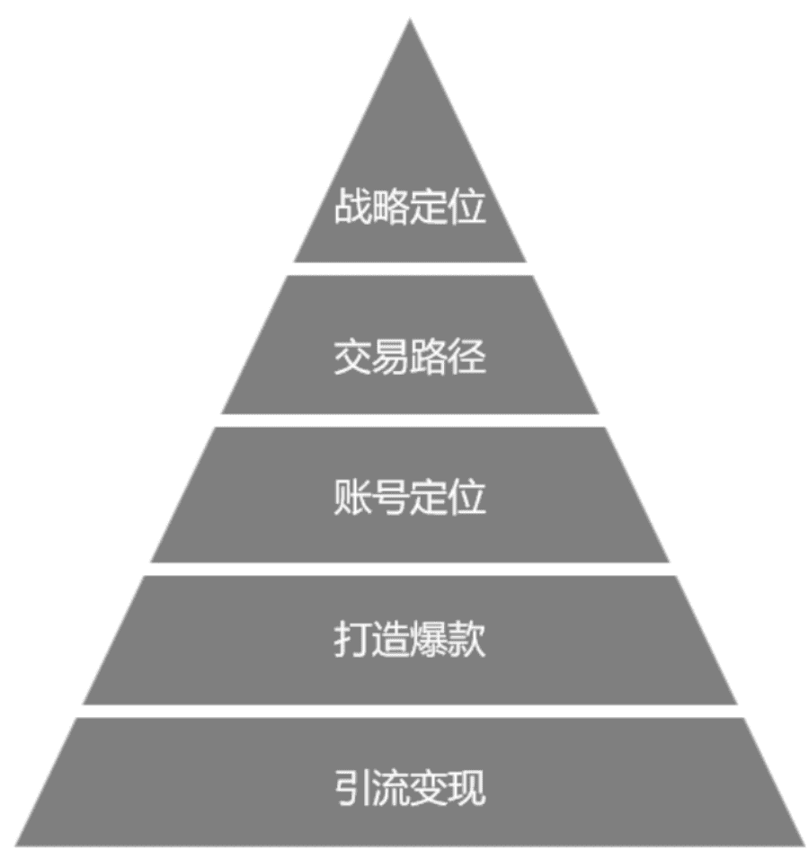

图5-1 账号变现5个步骤

## 5.2 变现思维和变现方法

小红书的目的有很多，但是正在阅读本书的你应该从变现的角度思考：通过小红书做什么，得到多少钱。它可以是一个工人的兼业，也是一家公司的流量来源。小红书的一点在于它的包容性，对普通的素人友好，也能支持专业的团队运营。实际上随着小红书逐渐成为生活中的“百度”“贴吧”“大众点评”，各行业都可以利用小红书重新一遍。获取流量的成本很低，效率非常高。

### 5.2.1 小红书是匹配流量的连接器

在本书开始，我就向你分享了我生意的理解，我还想告诉你以下两句话：

- 1. 规模流量：因为不同业务的流量诉求不一样，有的人运营一个号每天获得3到5个订单交易就已经不错了，但是也有一些业务需要的不是3到5个流量，而是需要300个甚至更大规模。只有真正做生意的人才知道流量的重要性。
- 2. 小红书是成熟生意的放大器：小红书只是实现手段，能够解决流量的问题。但是在之前，你想好你的生意是什么。如果你有一套自己的生意，并且已经过了转化和交付的能力，小红书大概率可以成为你生意的放大器。目前看到酒店、婚拍、装修、潜水店、到家服务、家教、服饰品牌等多个行业在小红书将生意的规模不断扩大。

注意的是，小红书只是流量渠道，你在小红书上赚到多少钱取决于你的生意是什么。这也是一开始阶段需要考虑的问题。在赛道选择上，除了离钱近，我还建议你多选赛道。我曾经指导过一家做黄金珠宝的运营企业，这种高客单价类目运营的第一月收益就超过了百万。

如图5-2所示，有了以上两个基于需求的理解，再结合不同的引流变现方式，小红书的变现路径就非常清晰了：即在小红书面对某个人群，针对这个人群的某某需求，发布一系列笔记获得咨询，然后引到私人号或店铺，最终成交。

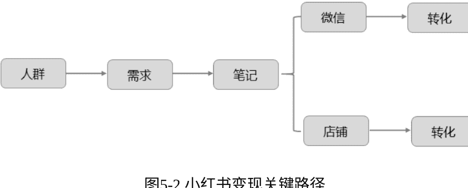

有很多传统企业之前不会上线获客，或者在线获取流量的成本很高，转做小红书以后业务规模就得到放大。以我的亲身经历来说，我是2022年正式进入小红书旅行业务的，当时正处于暑期旅游旺季，运营了两周就获得了单日100+的咨询量，迅速将行业的成交规模放大。现在的传统业务从业人员都可以考虑一下，如何借助小红书将你的生意规模放大。

### 5.2.2 矩阵号布局放大流量

想要在小红书获得更多变现，还需要采用常规的运营方法，矩阵号就是其中一种。矩阵号一般是专业化团队通用的运作方式，比如我们公司的团队，每项业务基本都采用矩阵号的运营方式，但需要提醒大家注意的是矩阵操作同样意味着高风险和高成本。

之所以采用矩阵号，还要有以下几点考虑：

### 1. 规模流量
因为不同业务的流量诉求不一样，有的人运营一个号每天获得3到5个订单交易就已经不错了，但是也有一些业务需要的不是3到5个流量，而是需要300个甚至更大规模。尤其是针对企业级需求的，通过矩阵号运营，流量的获取效率非常高。

### 2. 需比
矩阵号的另一个好处是容易出效果。我们把小红书抽象为流量市场，其实对应领域有多少需求和供给，主要有四个象限：

- 需求很多，供给很多：这是一个充分市场，竞争激烈。
- 需求很多，供给很少：这是一个绝对蓝海。
- 需求很少，供给很多：这是一个相对不错的市场，天花板明显。
- 需求很少，供给很少：这是一个内卷的状态，基本可以放弃。

如图5-3所示，小红书运营是一场流量与供给的游戏，需比。

### 3. 概率
矩阵号是对抗小红书算法不确定性的。效果=70%的概率+30%的运气。只要方向对了，多个账号一起做就会更快拿到结果。

### 4. 放大
矩阵号的好处是可以快速放大。一旦测试出某个笔记类型或需求有效，矩阵号就可以放大业务规模。如果短时间内想要规模，专业团队就会通过多篇笔记内容去提升命中率，快速将流量规模和业务放大。我们可以通过下面的公式看到对应的逻辑：

流量规模=账号数量 × 单个账号获取的平均流量
业务规模=流量规模 × 客单价 × 转化率

你会发现，在开始运营小红书之前，可以大概算出你的投入成本和收益。以上是我提供的矩阵运营背后的考虑，其实矩阵模式更能体现的是关于效率、成本与收益的复合思维。

## 5.3 值得关注的三种变现模式

小红书平台存在多种变现方式，包括店铺交易、付费专栏、直播带货、广告变现等。我们重点讲解三种：私域变现、广告变现、电商变现。

### 5.3.1 私域变现

私域变现即通过笔记引流到私域完成的一种变现方式，也是小红书主要的变现方式，目前有很多个人号和企业号都在这种方式变现。

### 流量—粉丝—客户的关系

在开始介绍私域变现之前，我想和你说清楚流量—粉丝—客户三者的关系，因为大部分运营者在小红书乃至整个新媒体上都赚不到钱的主要原因，都是没有搞清楚这几个关键词的区别与关系：

- 流量：小红书上的阅读量，或一切互动产生的连接。
- 粉丝：从公域到私域，带着需求、高频互动、有潜在商业价值的真实。
- 客户：可以向你提供服务获得变现，产生交易行为的买单者。

看到这里你就理解了即便笔记是爆款有流量，也不一定能够赚到钱。我们要从小红书公域转到微信私域，且需求、能够高频互动、有明确需求和潜在商业价值的一群，如图5-4所示，我们需要的流量，我们需要的是客户。

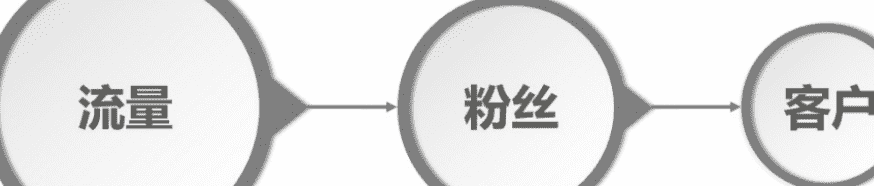

5-4 流量—粉丝—客户

### 私域变现的关键路径和适用场景

私域变现需要通过笔记触发私信加微信，在微信里完成沟通实现交易，如图5-5所示。从整个交易效率来看，还需要注意沟通效率和成本的问题，这里有几个重要的卡点：

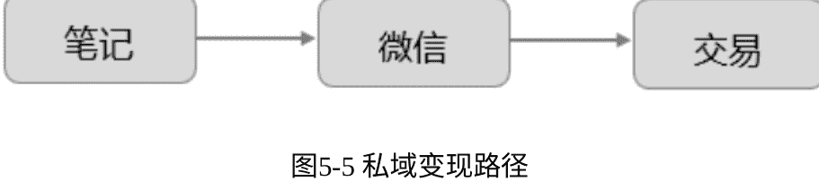

- 私信量：即笔记触发私信的互动量。
- 加微率：从即私信到微信的添加转化率，目前小红书管理限制非常严格，很容易触发封号限流。
- 转化率：即加到微信后的转化率。
- 周期：私域变现需要经历一段时间。
- 客单价：单笔交易的金额。
- 公式：利润 = 私信量 × 加微率 × 转化率 × 客单价 ÷ 周期。

上面的这套私域变的路径和品类选择，更多适用于规模流量、规模业务、规模变现的专业团队，你也可以结合以上路径和品类的标准思考，你的生意是否适合在小红书变现。

### 5.3.2 广告变现

广告模式是小红书主流的变现途径之一，无论粉丝多少，只要账号垂直、笔记优质，都有接到广告的可能，广告模式从变现方式和收益规模可以简单分为以下几种：

### 1. 好物体验

好物体验是小红书官方给博主提供的与品牌方合作的机会，如图5-6所示，博主可以打开好物体验站，结合自己的账号定位找到可以合作的品牌提交申请。好物体验里的品牌方都有关于内容的要求的，如发布时长、内容形式、是否标记品牌名称、绑定高级选项等，博主在认可要求以后可以向品牌方申请体验。

这种体验品牌方是不向博主付费的，一般适用于粉丝量和影响力较小的博主，对博主来说，相当于增加了一次案例和经验积累。

通常好物体验的申请者都大于开放的试用名额，这种合作方式对品牌方更有，如果账号内容一般，获得合作机会的可能性会比较小。

### 2. 合作置换

不知道你有没有遇到过这种情况，下线餐厅吃饭，餐厅老板告诉你在大众点个评后，就会多送你一道菜，其实就是一种置换。合作对博主来说也是一种不付费的合作方式，博主收推广费，品牌不收取产品服务费，博为主品牌方发布笔记，品牌通过试用、体验或其他其他置换博主的推荐机制。

相对于好物体验，这种方式不需要特别纠结于粉丝多少，即使是新号，笔记发布数量不多，只要垂直到位，符合品牌方的需求，很多品牌方也愿意考虑合作。

我们家开始装修后，我妻子也加入了一个小红书分享装修流程，并且这些笔记的互动效果非常好，大概发布了10篇笔记后，就有来自自家、家装、灯具等类的各种品牌联系合作，在家装修领域这样的案例有很多。

其实就是一个利用小红书“变现”的真实案例，虽然变得不多，但是投入很少，并且带来了生活以外的小惊喜。一个家庭主妈妈可以不断地回到家里好物的体验机会，以情绪价值这项获得已经已经非常大了，普通人在小红书里要努力就会收获，这就是小红书友好又神奇的地方。

一个连锁民宿的品牌方曾经找到我们，当时我就建议他们，用民宿置换的方式来换取旅行博主的小红书笔记发布。大概半年多以后，因为这些笔记带来的新客占了民宿预订的30%，而淡季的民宿房间本来就是空的，民宿本身并没有付出额外成本，这就是用资源换取营销的置换模式。类似的案例中有很多，在装修、家具、书籍、美容、美食、电器等领域都有很多机会的机会。

也有博主可能太不好接受这种没有直接收益的合作机会，但是有些思路，伟大的事情总有不起眼的开端，置换本身也是为了自己的账号积累案例，用一个合作机会撬另一个合作机会，每个万粉的博主都是从新号起步的，这也是运营中的杠思维。

那么，博主如何找到这种置换机会呢？

- (1) 等待品牌方找你：对于新号来说，可能性较小，因为需要一段时间的笔记积累才有可能被对应领域的关键词收录，出现在第三方的博主数据库里。
- (2) 主动寻找品牌方：主动找到品牌方，直接表明合作意向也可以，但是存在寻找过程长及沟通相对低效的问题，如果对方之前没有这样的合作方式，首次沟通和尝试的效率较低，同时由于主动找的品牌方，在价格谈判上的地位也较低。
- (3) 加入通告群：目前已经有“螃蟹通”“红通”等平台，充当了品牌方与博主之间桥梁的角色，可以理解为一个第三方的广告接单平台。

### 3. 付费合作

付费合作的模式是博主最为喜欢的，也是很多人运营小红书的终极追求，试想每月只发布几篇笔记就能获得几千甚至万元的收入，这对于很多人来说有着极强的吸引力，我身边就有好几非常成功的博主，每月的广告收入超过5万元，已经超过了当前职业打工人收入的天板。

付费合作方式有两种，分为报备和不报备。

### 报备合作：

粉丝数量超过1000的时候，就可以开启品牌合作功能，在小红书蒲公英平台上接单，俗称报备合作。品牌方通过公英平台下单，支付给博主合作费用，一切都在小红书平台监管之下，小红书会对博主和品牌方收取手续费，比例一般在10%。

如图5-7所示，报备合作对品牌的好处是在后台可以查看的数据，方便判断投放质量，优化投放方向，对于投放效果较好的笔记，品牌方还可以与博主一起购买流量大助推。

### 不报备合作：

即品牌方和博主单独建立联系后，不通过公英平台直接进行合作，此时不用向小红书平台支付手续费，但是小红书对不报备笔记也有一定的识别和限制，如果发现会对笔记进行限流，所以这一类笔记广告痕迹不能太强。

| 维度 | 描述 |
| :--- | :--- |
| 粉丝价值 | 粉丝价值 |
| 粉丝人数 | 粉丝人数 |
| 粉丝实力 | 粉丝实力 |
| 粉丝互动 | 粉丝互动 |
| 粉丝画像 | 粉丝画像 |
| 粉丝分布 | 粉丝分布 |
| 粉丝地区 | 粉丝地区 |
| 粉丝年龄 | 粉丝年龄 |
| 粉丝兴趣 | 粉丝兴趣 |
| 合作优势 | 合作优势 |
| 合作模式 | 合作模式 |
| 我们的优势 | 我们的优势 |
| 我们的案例 | 合作案例 |
| 粉丝需求 | 粉丝需求 |
| 粉丝反馈 | 粉丝反馈 |

### 5.3.3 电商变现

2023年小红书商业化的进程加速，在“618”前夕上线了很多电商板块的交易功能。数据显示，在2023年的“618”期间，参与小红书“618”的商品数量增长5倍，与2022年的“618”相比，日均购买用户占比增长4倍，在供给和消费端都实现大幅增长。与此同时，在达人直播、店铺直播、商品笔记、带货笔记、商品搜索、商城等各个交易场景，核心数据去年同期能够实现爆发式增长，由社区内容驱动的小红书多元电商生态正在加速形成。

### 1. 店铺带货

为了摆脱一直以来小红书用户在平台内草却在京东、淘宝下单的尴尬处境，在2021年8月小红书出台“店号一体”的平台政策，将店铺划分为专业号和非专业号，从此以后，小红书用户的“我的”主界面，多了一个购物按钮。在此后的时间里，小红书对于店铺交易的探索从未停止。

小红书店铺有两种类型，一种是个店铺，一种是企业店铺，无论是哪种店铺，都要首先认证为专业号。专业号也分为两种，个人专业号和企业专业号。

个人专业号只要申请就能通过，不需要任何费用，企业专业号需要有营业执照，且600元认证费用。一个营业执照可以最多申请3个专业号，开通3个店铺。

个人专业号开通的店铺最少需要1000元保证金，部分类的保证金可能更高，不过好的一点是可以等到实际订单后再缴纳，企业专业号开通的店铺一般需要2000元保证金。

个人专业号和企业专业号入驻都比较简单，如图5-8所示按照流程操作，基本3到7个工作日都能开通。

### 2. 笔记带货

笔记带货是小红书和商家提供的流量桥梁，即商家可以在开通店铺的同时开通分销功能，设置好佣金比例，博主可以将笔记和对应的商品关联，实现精准分销。这种模式用户是否接受还需要时间观察。如图5-10所示，目前笔记发布支持商品探店合作。

### 3. 直播带货

博主在完成实名认证后可以开启直播权限，带货和笔记带货的本质相同，都是连接用户的形式。小红书具有“三高一低”的天然优势：高转化率、高客单价、高复购率、低退率。如图5-11所示，在创作中心点击“直播选品”，可以进入选品页面看到佣金及商品详情，挑选自己想要的实现直播带货。

# 第6章 案例：一个正在发生的变现案例

这一章我想带你进入小红书变现案例拆解的部分，我会将我看到且觉得具有代表性的在小红书上已经实现的一个变现闭环拿出来，通过分析不同赛道的变现案例，更能让你理解小红书是适配精准流量的连接器，也是生意模型的放大器。

他们刚接触时可能和你一样，缺少思路和策略，能够在后续的一段时间里结合自己的业务实现一个变现的闭环，并且形成严密的逻辑框架和运营体系，相信他们能够带给你足够的启发。

## 6.1 机票代理小红书高额变现

你好，我是退婧，以后一直从事机票销售，在过去的三年里通过小红书卖机票，目前盈利突破万元。感谢许老师邀请我分享这段经历，作为一名机票代理如何通过小红书一步步引流最终变现的经验，希望可以给读者带来一些启发。

#### 一、机票项目背景

三年前，入境机票出现了断崖式萎缩，但我发现回国的需求在那段时间内非常旺盛，面对“供给”远小于“需求”的市场现状，在开始小红书之前，我做了如下分析：

- 技能方面：我自己从从事国际销售已有多年，可以熟练操作预订系统，对于机票预订、改签等操作十分熟悉。
- 资源方面：这些年来积累了一些机票资源，可以提供多元化的产品。
- 客户方面：以前主要面对的是B端客户，但是由于特殊环境，旅游的需求基本为零，这是一个短板。
- 拓客方面：之所以选择小红书，我发现用户质量较高，当时学生群体占了很大一部分。我记得小红书有一个话题“回国流程”，刚关注的时候，浏览量已经是30万多了。

#### 二、机票项目运营过程

第一次做小红书，也没有前人的经验，我的笔记经历了三个阶段。

- (1) 流量爆发期的笔记：2020年初的时候，回国需求十分旺盛，我的笔记即便只是简单的机票信息，都会收到很多私信咨询，只要你有票大家就会蜂而至。这是我刚开始的探索阶段，当时做的就是持续发布笔记，基本上不停地发，适当制造一些机票紧张的氛围。注意的是，笔记的话题和标签一定要准确，只要标签准确，就会源源不断流量进来。

- (2) 流量下滑期的笔记：2021年越后，小红书上的机票代理开始泛滥，机票诈骗案也经常出现，我开始体会到小红书越来越难了，笔记的浏览量越来越少。笔记被投诉的例子很高，我大概被封了4到5个账号。这个时候我开始思考笔记是否要调整，当时近期推出了航班机制，我就经常有航空公司取消的笔记提醒旅客。也是在这个时候，我开始重视昵称、简介，之前的名字就是随便喜欢的，不符合许老师说的昵称规则，我直接把账号修改成了务公司的名字，在简介方面也参考了同行的介绍，让自己的账号看起来专业了，具有一定的专业度。这个阶段我的笔记开始注重内容质量，虽然视觉仍然不高，但是为了保证笔记的持续输出，每天发一篇，同时也会去相关问题的笔记下面留言，我发现这其实是引流的一种重要方式。当然留言的时候需要用心，不能太直白，用我的专业度回答大家关心的问题，引起大家的注意和信任，效果非常好。

- (3) 流量平台期的笔记：2022年，小红书上的机票代理开始泛滥，机票诈骗也经常出现，我开始体会到小红书越来越难了，笔记的浏览量越来越少。于是我开始了如下调整：
    - 第一步：我做了小红书的企业认证，这样可以增加信任程度。我刚好有自己的票务公司，一个营业执照可以做3个账号的企业认证，认证年限为1年，年后继续认证。
    - 第二步：我认识到小红书笔记需要做到贴合内容，如航班计划、回国航班政策、核酸政策、编码策略等。每个帖子开始注重重构，从2022年开始我的笔记开始做一些相关的内容，从首页排版到文字描述都十分仔细。这很明显感受到内容的内容会吸引更多的观众，而且持续输出非常重要，一方面你要增加策略，另一方面你要把最新的策略第一时间传给客户。以前的笔记排版乱乱无章，现在的笔记看起来舒服舒服了。
同时我也利用小红书的瞬间状态，适合地给自己打广告，当时效果真的不错，简单来说写不下来或者敏感的词汇都可以写在这里，而且只要大家进入你的主页就能看到。

#### 2. 小红书引流

在小红书上有发微信咨询的朋友，我也加了个人微信，一加微信交流方便，可以告知大家会有实时的政策更新，可以第一时间了解到这些。这时候，朋友圈的运营就很重要了，我经常在朋友圈做相关信息的专业分享，这样可以体现我的专业度，同时朋友圈里真实的生活分享不能少，这会让客户觉得更完整。

# 许义解读

票款代理是偏线下的传统生意，退销之前的获完全在B端完成，特殊时期退销敏感捕捉到小红书上爆发的需求，借助小红书从引流到变现，并且获得了持续的用户积累和几十万元的收益规模，这是非常值得传统行业思维的变现案例，我相信阅读过这本书的很多读者都有自己的生意和业务，请大家思考你的生意是否可以在小红书上重新做一次。

## 6.2 公众需求赛道单变现万元

你好，我是漫，很多线下店铺都是高客单的蓝海赛道，可以在小红书利用线上引流的模式获取流量量。像我正在做的助听器类目，在小红书上就是一个高客单的产品，刚开始做的第一个月我就直接接受了4万元。在小红书上，我是通过打造自己的IP、利用关键词布局分享专业性的内容、操作爆款笔记的点击率和转化率，再引流到私域，最终引导用户到店成交。

感谢许义老师邀请我来分享我的变现经历，接下来，我就从以下五个板块和大家分享我在小红书上的具体做法：

- 一、项目背景介绍
- 二、账号定位与笔记规划
- 三、流量承接
- 三、变现方式
- 四、入局建议

我分享的这套流量并不适用于我所做的助听器赛道，对于和我一样线下有实体店的行业都适用，比如比美容行业、餐饮行业、派对、月子服务中心、家政等，希望对大家有一些启发和帮助。

## 一 项目背景介绍

来介绍介绍一下，我的名字叫逸，在五六线小城开了一家助听器门店。在小红书之前，我所有的客源都是通过发单或者跑合单单位获得的，这种获客方式的变现能力有限，为了提高收入，我就开始尝试自直播。

2022年初期接触小红书，问过很多人在小红书上做助听器赛道可行吗？当时得到的回答是不建议自己做博主，可以去找商家主做广广告带货。当我刚接触小红书，别听别人说什么，我就放弃了这个想法，开始尝试其他赛道。但是经过了将一年在小红书上的摸索，自己有了了一定的制作爆款的能力，而且知道我们品牌有加盟商家去年通过小红书给他们店铺推荐客资，变现了六多万元，我就想自己试一下。

结果没想到，这一试就成功了，一个月在小红书上就完成了从0到1的搭建和起号，并且成功变现了4万多元。

## 二 账号定位与笔记规划

不管我们做什么赛道，专业性是用户判断是否选择你的重要原因，尤其是高客单价的赛道，所以人设最重要的一点就是要有专业度，那么怎么让自己看起来专业呢？

这就我们需要在人设五套里下下功夫，就是——头像、昵称、简介、背景和瞬间。

### 1. 头像

首先选择一张有工作背景的生活头像，如果我们所在行业有专门的工作，那么就可以穿上工作服拍照，记得生活化一些，没专门去照相馆拍正式的照片，然后以此作为头像，既能体现自己的专业性，又能拉近与用户之间的亲切感。

### 2. 昵称

我建议用你的工作身份加上称呼的形式，比如我就是直接点名我自己是助听器配音师，再加上自己的称呼小朋，直截了告诉用户我是谁，我的工作身份是什么。

### 3. 简介

简介的内容是非常重要的，也是用户决定要不要关注的重要依据，我的简介主要由两部分构成：专业背书与用户共情。

专业背书就是写自己在专业领域取得的成绩或证书，从事这个行业的年限等，以此让用户对你产生信任。与用户共情，就是把一些你经历过的目标用户很大概率也会经历的事情表述出来，让用户由此产生共情，拉近你们之间的距离。

### 4. 背景

背景一定要设置，而且最好能放大你的人设的照片，比如我的背景是放了一张我自己店门口的照片，目的有两个：一告诉用户，我自己开了助听器店铺的，我是值得信任的；二是让我的用户知道我开了一家助听器店，可以来找我验助听器。

所以，别小看你的背景图给用户提供的信息价值，而且你只是放了一张图，剩下的信息用户自己会产生联想，这比直接用文字告诉用户，可信度更高。

### 5. 瞬间

很多小红书博主都没有设置瞬间，白白浪费了一个好的广告位，我们可以在瞬间隐晦地联系方式，用博主的真实案例，这是一个增加信任感和提高转化率的好方法，我建议你一定要看看自己是否设置了瞬间，如果没有的话，一定得安排上。

除了人设，干货笔记是体现我们专业度的最好方式，一篇好的干货笔记加上钩子，可以变成一篇变现能力很强的笔记，我的第一篇爆款笔记就是通过干货加上合集和钩子做起来的。并不是所有行业都需要写干货笔记，像摄影、美容行业等，直接展示产品、展示案例、分享和客户的故事可以建立信任。

在账号的设置上，还有一个需要注意的细节是故事名片笔记顶部。

故事名片笔记的重点是告诉用户你是谁，你做什么行业，你当初选择做这个行业的，从业期间的经历，你获得了什么成长，取得了什么成绩等。总之，就是用故事的方式，把你的从业经历写上去，这类笔记基本上对所有的赛道都适用。

喜欢故事是人的天性，我们总是会对别人的的人生感到好奇，而且分享自己的从业经历能直白地告诉用户你是做什么的，还能增强用户对你的信任。

写好故事名片笔记之后，可以放置它，这样每一个通过你的其他笔记点进你的主页的用户都能看到，进而加强他们对你的信任，虽然故事名片笔记的互动数据不会特别好，用户可能很少做出收藏的行为，但是这篇笔记在无形中涨账号转化率。

最后是关于关键词布局了，小众赛道，关键词布局是非常重要的。小众赛道的笔记数量很少，竞争没有那么大，所以基本上只要你做好关键词的布局，用户通过搜索关键词是有很大的概率能找到你这篇笔记的，而且你的这篇笔记的排名还能排在一个不错的位置。

我有两篇比较好的笔记，数据来源自分析中，通过搜索来的用户占比比都在80%以上。做小红书的都知道，小红书的长尾流量是非常用的，一个好的“关键词”，可以在笔记发布后的几个月都给你带来不断的流量，甚至更长。

#### 关键词库

- 助听器哪个牌子好
- 助听器老人推荐
- 助听器如何选择
- 助听器哪里配
- 助听器哪个品牌好
- 助听器年轻人
- 助听器工作配
- 助听器验配师

## 三、爆款笔记对标

找对标笔记分析，是在小红书快速起号必备的技能。通过对标笔记分析，我发现小红书的爆款笔记相对于其他类来说很少，方便我整理。

#### 共同属性

- 封面
- 封面图
- 标题
- 笔记内容
- 话题
- 评论区

#### 核心问题

- 助听器哪个牌子好？
- 助听器哪个推荐吗？
- 助听器哪个品牌好
- 助听器老人推荐
- 助听器如何选择
- 助听器去医院还是机构？
- 助听器会戴越聋吗？
- 助听器哪里配
- 助听器年轻人

- 助听器验配

#### 情绪价值
- 互动数据最好的笔记，就是拥有情绪价值的笔记。这类笔记基本都是个人博主分享自己过程过程中的经历，。

- 听力不好的人有哪些？
- 助听器是什么样的体验？
- 助听器困难吗？

#### 合集笔记
- 合集笔记在小红书的杀力是巨大的，只要你有产品，就要做合集笔记，这类笔记很容易出爆款。我的第一篇合集笔记从去年开始，每天都能给我不少咨询，同时我还做了关键词布局，所以首页前一定会出现这篇笔记，这就是流量的好处。

## 四、提高互动

老师说互动是小红书的流量开关，我觉得非常正确，我分享一下我当时是怎么提高账号的点击率和互动率的。

### 做小红书互动

小红书互动模拟用户的行为给新笔记提供数据，包括点赞、收藏或评论，以此来提高关键词搜索的排名，让你的笔记更容易被刷到。对于小众粉丝来说，小红书互动还有一个很大的作用，就是利用粉丝的从众心理。同样两篇首图、标题和内容完全一样的笔记出现在用户面前时，用户更大概会点开头那一篇，为什么？因为有很多人点赞的笔记，一定比一个好，就像我们在淘宝上买东西一样，同样的产品，我们更倾向于销量高的那家。

### 评论区引发

我的评论区有一个很有趣的现象，前期有的用户在评论区问我哪里不能提供热门服务，然后那段时间，评论区90%的人都在问哪里不能提供热门服务。过了这段时间，几个人直接问哪里有门店，然后评论区留言的人基本上都在问哪里没有门店。别人不要问，后面的流量就会跟着问，此可见，评论区多么重要。我们在发布笔记之后，可以尝试用小号去评论。很多时候用户自己不知道自己要去什么，或者根本没有想到自己买这个东西，但是当你直接告诉他，或者看到别人做出了这个行为，因为从众效应，他更容易做出相同的行为。就比如我走在路上，本来也没想，结果看到前面那人在吃冰淇淋，然后就感觉自己有点想吃，紧接着马上去小卖部买冰淇淋了。如果你你的用户产生什么样的行为，就让他看见别人在做这个行为，为此增大用户采取相同的行为。

### 利他

这里的利他主要是针对私域流量这个行为。在获客的过程中，慢慢地建立信任，从专业的角度回答一部分用户的问题，比如助听器效果怎么样？助听器哪个地方验配？这时候用户加微信的概率很多。

## 五、流量承接方式

小红书对引流限制很严格，所以流量承接就需要不同的方式组合。

### 群聊

- 设置主页展示
- 关联笔记在评论区留下链接并置顶
- 粉丝私信引导

### 私信

比起群聊，直接私信转化率高一些，但是风险较大。目前为止，我所有的变现都是这篇笔记带来的，其他笔记只需要辅助这篇笔记加强专业人士，然后适当分享一些相关的笔记来提高转化率。哪怕我已经有一段时间没有发布新笔记了，这篇笔记也会每天给我带来客户源。

### 小红书店铺

如果你的产品只能线下交付，或者你的线下比较近，比如月子中心、派对等，就没有必要开启小红书店铺。

## 六、变现方式

- 线下门店变现
- 线上域售卖产品
- 线下服务

## 七、入局建议

从我自己从0到1的经历来看，我觉得小红书是反馈快的平台，特别是最近开始大力扶持小红书店铺。如果你准备入局，我建议你要简单地告诉用户你提供的服务，不要藏着自己的优势，在文中体现专业性，或者是你能给粉丝哪些好处。比如我的店是全国连锁的，这样用户就会首先问某地方有没有门店，其次告诉用户提供的售后服务，腿脚不便的老人可能需要这项服务。

## 6.3 纯小白如何在红书做广告

你好，我是九七，目前在实体零售，副业则是刚启动的小红书。我是一个纯小白，但接触小红书以后也接到了商家获得了变现，非常感谢许义老师的邀请，我从以下四个方面向你分享我在红书的变现经历。

### 一、新手小白方法

#### 1. 目标

很少人提到目标这件事的重要性，但我认为明确目标很重要。老师书里也有提到账号运营的初期需要明确运营目的与过程管理，合适的目标会减少不必要的焦虑和盲目。我对目标的理解是：少就是多，慢就是快，前期开始得慢一些，目标具体一些，有助于建立建立信息和反馈。

#### 2. 选择：选择对标账号

在还没接手搭建账号前，建议使用简单的办法来对标账号。我的方法就是在小红书搜索框不断输入关键词，搜索对标账号。对于对标账号，建议选择3个干货账号加上2个草号。前者是为了借鉴仿干货笔记选题，后者是为了借鉴草笔笔记。

| 阶段任务 | 输出干货图文连接 | 干货账号 4:1 | 爆账号图文混合视频 | 引流发展朋友 |
| :--- | :--- | :--- | :--- | :--- |
| 100粉 300粉 | | 1000粉 | 2000粉 | 3000粉 |

| 商业进程 | 开通视频流量扶持 | 开通粉丝商业第一步 | 爆账号推荐获单 | 打造朋友、产品小号引流 |

精准目标跟着下方，商业账号为选1，例如第1个，仿第1个人。没有达到上一个目标后就选下一个目标，这样就不会流量。

#### 3. 选题

小红书的杀力是巨大的，只要你有产品，选题。

- 助听器哪个牌子好
- 助听器老人推荐
- 助听器如何选择
- 助听器哪里配
- 助听器哪个品牌好
- 助听器年轻人
- 助听器工作配
- 助听器验配

#### 4. 布局

- 封面
- 封面图
- 标题
- 笔记内容
- 话题
- 评论区

敢于放弃，知行合一，就少是多，就是快。新号第一个一个月一定要日更，因为新人会有流量扶持，我就是用量换取爆款的方法逐渐获得了反馈，初期数据不好的笔记就会逐渐隐藏。我就是这样脚踏实地做好每一笔记的，逐渐跑通了小红书项目的闭环，也完成了账号涨到3000个粉丝的目标。

以上是我作为新手小白在红书起号变现的经历，希望对你有用。

## 深度解读

我反复提到小红书是对普通人友好的平台，几乎可以在很短的时间掌握小红书笔记的运营流程和逻辑，并且接到广告商就是一个很好的验证。如果你也是新手，不像他一样，先尝试起来，设定一个自己运营小红书的目标。

### 6.4 小红书好物博主的成长经历

你好，我是参仁，感谢许老师邀请我来做小红书变现经历的分享。我是从2020年开始接触小红书，一开始做好物分享的博主。我觉得普通人通过小红书挣钱有难度，但是如果当当作带薪小项目，一个月有几千块的收入是可能的。目前好物分享号素人单量还可以到百，现在一个千粉权重账号是不能拿到一百元以上的。从发布第一篇笔记开始，我做一个千粉垂直账号大约需要一周的时间。

下面我从博主类型、账号搭建、笔记内容制作、数据分析和接单注意事项几项维度给你分享我在小红书的变现方法和经历。

## 一、小红书博主合作类型

我目前接触的小红书博主主要有软合作和品牌合作两种。

#### 软合作
- **有费用**：有费用合作软广，一般是私下联系，可以在简介中放入隐藏联系方式，让品牌方看到并联系你。即可对接私下合作的软广，报价合作的价格要低一些，文案也要写得很软，否则会被限流。
- **无费用**：品牌方拿产品给你，属于无费用的合作，其他方面有费用的合作差不多。

#### 品牌合作
- **门槛**：当你有1000个粉丝后，会被邀请开通公号和合作中心，此务必认证专业号，而还需要实名，合作方式有两种。
- **商品合作**：小红书目前已经有了分佣渠道“商品合作”，可以自己在合适的合作中心选品选品，后发笔记时可以挂上链接，有人购买就可以获得佣金。有部分产品是允许免费领样的，申请通过后商家会免费给你样品，你发布笔记时带上链接即可。
- **蒲公英合作**：开通蒲公英后，可以设置报价，一般价格为粉丝数的浮动。合作费用需要返点，比例在20%上下，剩下的70%才是自己的。

## 二、小红书账号搭建

首先是账号定位，账号搭建需要考虑赛道和人设。赛道选择可以参考几个原则：

#### 1. 选择感兴趣且擅长的赛道
只有自己喜欢或者擅长的事情时，才会花心思做。在选择赛道的时候，不要看哪个领域好，重要的是自己擅长、是否足够喜欢。
- 如果喜欢好看的衣服，就选择穿搭类目；
- 如果经常健身，就做健身类目；
- 如果喜欢折腾家居，就做家居类目；
- 如果喜欢母婴，就做母婴类目。

#### 2. 容易变现
只有自己擅长还不够，还要离钱近，做最终目的是赚钱。如何判断离钱近？如图6-4所示，参考千瓜、蒲公英的博主报价，一般情况下，靠前的类目：美妆、护肤等赛道变现都不错。

| 内容类别 | 全部 | 穿搭 | 护肤 | 母婴 | 美食 | 家居 | 时尚 | 运动 | 文化 | 萌宠 |
| :--- | :--- | :--- | :--- | :--- | :--- | :--- | :--- | :--- | :--- | :--- |
| 子类目 | 服饰 | 饰品 | 高级 | 服装 | 美妆 | 水果 | 出行 | 测评 | 健康 | 汽车 | 其他 |
| 主题 | | 身份信息 | 美食 | 特色标签 | | | | | | |
| 内容标签 | | | | | 生活方式 | 黑色系 | 护肤 | | | | |

#### 3. 赛道有前景
除了自己擅长，离钱近，赛道的成长情况也很重要。那些赛道可能两年能火，未来不确定很大，可能会被限制。

#### 人设定位
从主视角打造人设，如果赛道选择比较均衡，其实人设就在赛道选择中确认。有一个方法：直接找你喜爱的博主来对比，建立的人设需要满足几个标准：个性鲜明、识别度高、有记忆、接地气、真实。实在不知道怎么定位，可以参考这个公式：你是一个帮助XX解决XX人。
例如：
- 我是一个帮助新人解决流量问题的自媒体人
- 我是一个帮助小个女生解决穿搭不好问题的时尚人
- 我是一个帮助高中生解决成绩不好问题的学习导师

总结一下：定位需要满足自己喜欢、离钱近、有前景，需要思考你能给别人带来什么价值，最后做一个真实的自己。

#### 账号设置
好分享类型的账号不需要特殊的头像和昵称设计，只要把握一些基础就可以了。
- **头像**：可以使用真人头像，头像形象与账号本身调性符合。
- **昵称**：昵称要简短、好记、好写，方便用户查找和搜索。尽量少用纯表情、符号和生僻字，最好有一个方便用户叫的称谓，比如我希望别人叫我“参仁”，所以我所有账号都会带上参仁”。
- **简介**：一般都是告诉用户你是谁、你来干什么、提供什么价值。前期简介空着也没关系，后期尽量充实内容。个人基础信息包装不需要刻意，找到适合自己的封面类型，保持统一风格。

## 对标账号筛选

如何找对标账号呢？我一般用四种方法：

1. 直接搜关键词
关键词不要搜太小的长尾词，最好选择领域直接相关的关键词，如图6-5所示。做细分穿搭，可以直接搜初恋感穿搭，或者直接用小个穿搭。

- 初秋逆光拍照 ✨ | 我永远爱初恋感女孩 ☁️ 谁拒绝
- 秋冬一周穿搭合集 每套都喜欢～ 整理了一下去年…
- 溜汁肉zr 6711
- 九子梨 3573

2. 搜题池
大部分笔记都会添加话题，如图6-6所示。在找到第一篇笔记的时候，找到相关话题点进去，里面还有很多使用相同话题的笔记供你学习和参考。

- 秋冬一周穿合集 每套都喜欢 整理了去年秋冬的冬季~ 今年很喜欢！漂亮衣服不过时~
- #一周穿不重样 #初秋氛围感搭 #要风度也要温度 #今天今天长这样

3. 第三方工具
如图6-7所示，可以在第三方工具平台比如千瓜、新红书等找到相关领域的笔记。

4. 发现页
平时多刷相关内容，利用小红书算法，给你推荐更多优质笔记。

#### 如何判断账号是否适合自己

还有四种方法：
- **(1) 赛道相同**：只有跟自己赛道相似的账号，才有参考价值。
- **(2) 粉丝量级**：一般情况下，粉丝万以上的账号是头部博主，腰部博主值得参考。
- **(3) 笔记爆点**：寻找笔记中突然火的原因，看这个爆点是否符合自己，爆点账号流量高。
- **(4) 变现模式**：看账号变现模式是不是符合，不需要复制。

## 三、笔记制作

小红书的内容在形态上分为视频和图文两种。

- **视频**：好物分享的视频有很多，开箱、测评、展示、场景分享等。视频流量方面有一点优势，内容制作比图文难。
- **图文**：好物分享的图文也有很多，挑选、结合场景拍等。图文对于视频来说流量上没有优势，但制作成本低。

#### 拍摄工具
关于拍摄，光线足够，手机（iPhone以上型号）即可。

#### 构图
常见的构图方法：三角图、分图、对比图。根据自己的产品特性选择合适的构图，如图6-8所示。

#### 字幕选择
字幕选择上不要草率，要清晰统一；字体颜色跟画面协调，不要出现字体过于突出或模糊的情况。字体位置不要放在太低，不要让字幕挡住画面中的重要信息。

## 四、笔记选题、封面与标题正文

选题挖掘一般用下面几种常见方法：

- **对标选题**：找到对标博主的账号进入主页，看近期发布的十篇笔记是否有一篇的互动明显大于其他笔记。如果有且互动较大，可以加入自己的选题库。比如你看到某篇笔记互动超过900，但其他笔记互动就300左右，那么这个选题就是很不错的参考。除此之外，还要看笔记的发布时间，最好是在周内的爆款，这样参考价值才大。
- **关键词选题**：搜索一个关键词时，产生一系列下拉，可以在下拉中找到比较适合自己的关键词做选题。除了下拉，搜索结果中还有一栏小词，也可以作为选题。
- **评论区选题**：在爆款笔记的评论区也可以找到合适的选题。只要找到那些粉丝反馈的信息，并且获得许多粉丝认可的，都能作为选题。评论区点赞数靠前的评论都可以去看一看。

提醒大家注意：在好物分享类型中，选题只起辅助作用，最重要的还是产品本身，产品即内容。产品如果符合审美的，那普通也能效果好。

#### 笔记类型：
- **合集**：多个产品在同一篇笔记上出现，可以是不同产品，比如手机壳、手机架等同属性的产品一起推荐。合集类型的内容很容易爆款。
- **测评**：一款产品或多个产品的测评，测试性能、颜值、实用性等方面。常见的3C数码和护肤、彩妆类产品，测评不适合所有产品，根据自己选择类目。
- **知识科普**：通过分享干货获得流量，在干货中植入产品，比如服装布料知识、护肤知识等。知识科普制作难度相对较高，也容易爆款，长尾流量大。
- **产品种草**：直接推荐产品，比如开箱、书架分享、穿搭分享等。产品种草制作成本相对较低，但也考验选品，如果产品不好，效果就会差。
- **教程攻略**：如穿搭教程、彩妆教程、手账教程等，通过发布产品相关的教程吸引用户观看。这类选题有限，也容易出数据，和干货比较相似。

#### 封面设计
封面设计需要注意几个点：
- **(1) 尺寸和排版**：建议采用3:4或1:1，尽量保持统一。
- **(2) 字体、颜色和大小**：字体颜色跟画面协调，不要出现过于突出或模糊。字体位置不要放在太低。
- **(3) 爆点**：寻找笔记中突然火的原因，看这个爆点是否符合自己。

#### 标题文案
标题文案有核心思路：
- **开头**：写一下怎么吸引人，视频的前3秒要抓住开头。
- **中间**：写写这个产品解决了什么问题？带来了什么改变？
- **结尾**：最后留个钩，引导互动。

## 五、博主接单注意事项

如何成为抢手的博主？品牌看中的核心因素离不开：

- **蒲公英等级**：目前等级为优秀、普通、异常。一般情况下博主都是优秀的。如果数据变得特别，可能会降低为普通；违规、限流会被判定为异常。异常博主单概率低很多，等恢复后再接单。
- **与品牌调性的匹配**：博主的形象、人设与品牌匹配吗？如果是设计感强的品牌，发布的内容也应该是这种风格。如果你发低价好物，收入水平偏低，不好接高客单价品牌。这里的客单价是产品单价，不是合作费。
- **基础数据情况**：品牌方看近期数据，有没有爆文？爆文是否稳定？突然发布会造成流量断崖式下跌？评论是否有回响？行业作品会不会太多？
- **内容质量**：带货能力强不强？评论区内容是否跟产品有关？有细节和价格链接的带货能力。

在日常运营中，品牌尤其看近期笔记数据，我们可以刻意往这方面去做优化。数据不突出或平庸的笔记可以先藏，让品牌看到较稳定的好数据。

一般情况下，优质的合作是通过数据吸引商家主动找上的。与其去多个渠道去找商家，不如好好打磨内容，做好自然流量，这样主动找的商家可能合作不行。根本不需要主动找商家，我个人不是特别推荐通过社群和通告平台找商家，这些渠道对博主要求反而严格，且博主被动，广告质量低，不值得。

当商家找过来后，如何介绍合适的价格？其实没有标准。比较软垂直的精准，报价一般可以做到10%~15%，非报备合作会低一些，大约7%~8%。这不是固定标准，根据内容调性、差异化、人设和近30天的流量量下调调整，不同类目报价也不一样。

我建议大家合作时不要太高调，也不要太早，正常聊天即可，如近期数据好，可以跟品牌特殊说明并附上数据截图，诸如过去和近期的爆文、同类型字体笔记合集、合作的笔记案例，都可以提前准备好链接。

除了品牌单合作，还要探索和品牌长期合作的机会，因为品牌是有全年预算的。为了提升二次合作的可能性我一般是这么做的，合作前准备主页账号、报表报价及近期主页数据，放到微信收藏夹，添加到商家后可以快速流过去。

合作中及时反馈产品货情及拍摄情况，出图后给品牌方审核，配合品牌进行笔记修改，如果对方提出非常不合理的要求，也要拒绝他们。比如，有些商家会要求写硬广，这种要求提前没有告知的，要跟商家说明利弊，硬广流量会对内容造成变形，所以我一般不接受这个要求。

在合作3~7天后，主控数据和互动数据给品牌方。如果数据好，可以跟品牌方谈下下次合作，如果数据差，且品牌品牌方意见，可以给品牌方换日期重新发布笔记，或者给出笔记修改意见，去除敏感营销内容后重发。数据不好尽量不要跟品牌方竞争，大部分商家还是很有潜力多次合作的，做好售后后，再次合作的概率很大。

以上就是我在小红书好物博主上的变现，希望对大家有用。

# 许义解读

参厅的变现经历，几乎面面对地提到了小红书从新号到变变的运营框架和理论体系，既有实际操盘案例，又有自己的方法总结，非常值得深读，建议在想好分享博主路径上变现的朋友，按照这里的路径快速运行。

如果你想联系以上案例的分享者，可以在我的微信公众号：Travel星辰大海，回复关键词“案例”，获取以上分享者的联系方式；你还想了解更多小红书变现案例，可以回复关键词“即刻下单”，看看我们即刻下单团队做过的小红书营销案例。

# 第7章

## 工具：善用工具效率翻倍

工欲善其事必先利其器，专业运营和普通运营者之间的区别除了思维还有工具，工具的好处是可以让效率翻倍，节省时间不走弯路。

这一章将介绍一些我和团队正在使用的小红书运营和管理工具。

### 7.1 小红书管理工具推荐

小红书的运营过程中，除了运营思维和运营技巧的持续提升，还需要借助多种工具来帮助提升小红书运营的效率，工具不多，最重要的是服务目的、用得顺利。

### 7.1.1 小红书笔记自检清单

我们即刻下单的运营团队经常来新人，有的甚至是毫无经验的实习生，如何让一个人能够快速掌握小红书运营的基础技能、保证笔记运营的水平，提供了具体的操作方法，还需要提供一份运营自检清单。自检清单是在新人还没有掌握小红书思维和技能的时候，最大化保证每篇笔记的出品都是合格的。

本书看到这里，你应该清楚小红书笔记的运营无非做好标题、封面、正文、评论等几个重要的组成部分，如果每篇笔记发布之前都能自检以下内容：

- 这篇笔记目的是什么？期待实现什么结果？是账号涨粉，是引导交易，还是希望用户进页？
- 笔记的标题是否涵盖了用户常搜的关键词？用户是否好理解？是否容易触发用户的互动（点赞、收藏、关注、评论、私信）？
- 笔记的封面是否在信息流列表的打开率更高？封面是否提示了正文内容？封面是否有调整？整体格调是否统一？封面是否有质感促进信任？
- 笔记正文的开头是否抓住了用户的第一眼？是否可以吸引用户接着读下去？
- 笔记正文中间是否有用表格、分割符做好排版？笔记阅读体验是否清晰、流畅？
- 笔记正文结尾是否留服务于目的（评论、私信），是否有（产品、品牌）提及，是否有助于用户产生评论？
- 笔记评论区留言是否需要小号引导？评论区应该引导的行为有哪些（评论、进群、关注）？

那么以上自检的笔记概率都是合格的，真正运营过小红书账号的都知道，笔记的数量不重要，笔记的质量才重要。如果忽略了笔记的目的来发布笔记，其实是很大的浪费，自检清单就可以很好地规避这一点。

我们经常接到一些企业关于小红书运营投放的需求，在我们来不及接的情况下，会给出这份自检清单（如表7-1所示），让对方对照着做，这样出品的笔记基本都能合格。

#### 表7-1 笔记自检清单

| 结构 | 描述 |
| --- | --- |
| 选题标题 | 是不是爆款标题？点击率高？是否埋了用户常用的关键词？是否容易触发互动（点赞、收藏、关注、评论、私信） |
| 封面图 | 是否在列表页时点开率更高？是否提示了正文内容？是否有调性、风格统一，更有质感能直接建立信任 |
| 正文开头 | 是否抓住用户的第一眼？是否吸引用户接着读下去 |
| 正文中间 | 是否包含表情、排版、分割符？是否让阅读流畅、清晰 |
| 正文结尾 | 是否服务目的（评论、私信）？是否有（产品、品牌）提及？是否有助于产生评论 |

### 7.1.2 小红书笔记选题表格

在前面的章节我提到了选题的重要性，可以说笔记选题一定程度决定了笔记的流量大小。实际上我见过很多运营者对笔记的方向比较随机，或者是选题很少做分析，一个专业的运营者在设定选题之前都会做细致的判断和比较。那么如何做好笔记选题？分享以下我们常用的笔记工具。

#### 人群需求关键词调研

在选题章节中介绍了三种选题方法，在开始调研初期，梳理目标用户的潜在需求和对应的搜索词，通过表7-2来理解目标的人群、痛点、需求，再根据这些词思考对应的选题方向，这个步骤制作的笔记可以更好地溯源到用户的需求。

#### 表7-2 人群需求痛点调研

| 目标用户 | 用户痛点 | 用户需求 | 潜在搜索词 |
|---|---|---|---|
| | | | |

#### 对标账号研究

在研究具体的对标账号时，也需要完整地梳理学习的点，如表7-3所示，整理对标账号的名称、粉丝数、爆款标题、爆款数据、关键词及优点。

#### 表7-3 对标账号研究

| 账号名称 | 粉丝数 | 爆款标题 | 爆款数据（点赞、收藏、评论） | 关键词 | 优势分析 | 学习的点/我的选题 |
|---|---|---|---|---|---|---|
| | | | | | | |

#### 爆款账号研究

在研究具体的爆款内容时，可以根据笔记标签、关键词、浏览数据、点赞数据、收藏数据等数据，研究涵盖的需求和关键词，最后确认自己的选题方向。大部分运营者看到同行的爆款笔记只是简单看看，其实爆款呈现的数据结果作为运营者应该提取爆款背后的原因。

#### 表7-4 爆款账号研究

| 选题 | 关键词 | 浏览 | 点赞 | 收藏 | 需求提炼 | 关键词提炼 | 我的选题 |
| --- | --- | --- | --- | --- | --- | --- | --- |
| | | | | | | | |

遵循互联网运营的法则，即要做到到位，不遗漏、不反复、不重复。

### 7.1.3 小红书运营表格

针对多个矩阵运营的专业团队，小红书运营是一件每天持续、专业又细碎的工作，需要高效管理笔记的发布，同时还要分析数据，对运营中的异常值进行时的监测和干预，通过下面的飞书管理工具，我们形成了多人办公、线上协同的高效管理模式。

#### 测试新号初期的变现水平

一般新号刚上线都处于测试阶段，需要用不同的选题来观察不同话题覆盖的需求结果，比如哪些话题容易带来有效咨询、更容易成交。表7-5是以腾冲旅行案例为例，我们在一周的时间内用不同的选题测试效果，很快就可以得到笔记的变现规模及方向，从而预测出下一阶段如何如何精细运营，以及可以得到的运营结果是什么。

#### 表7-5 新号测试期数据监测

| 话题规划 | 上线日期 | 链接 | 点赞 | 评论 | 收藏 | 私信 | 微信添加 | 成交产品 | 成交金额 |
| --- | --- | --- | --- | --- | --- | --- | --- | --- | --- |
| 腾冲 | | | | | | | | | |
| | | | | | | | | | |
| | | | | | | | | | |
| | | | | | | | | | |

矩阵号往往是多个账号同时运营，需要了解每天的需求收集情况以及每个账号的笔记发布效果，飞书表格可以很好地支持多人同时在线编辑和共享，及时干预笔记的发布情况（如表7-6所示），方便了接到异常值，比如哪个账号的数据突然很好，某个账号的流量突然下降等，操盘手需要通过数据梳理得出应该优化的运营策略。不得不说，小红书当前的运营已经进入到颗粒度非常细的阶段，只有紧盯每个账号每一天笔记的数据变化，才能更好地拿到变现结果。

#### 表 7-6 小红书矩阵日监控报表

| 日期 | 账号 A | 账号 B | 账号 C |
| :--- | :--- | :--- | :--- |
| | 笔记量 粉丝收藏 粉丝量 微信进小红书笔记群 粉粉 粉丝收藏 笔记量 私笔记 粉丝量 粉丝收藏 笔记量 私信 粉丝收藏 笔记量 |
| 2023/27 | | | |
| 2023/28 | | | |
| 2023/29 | | | |
| 2023/30 | | | |
| 2023/31 | | | |

### 7.2 小红书运营工具推荐

小红书运营工具其实非常多，其中主要的制作工具和数据分析工具，下面分享我们经常使用的几款工具。

#### 7.2.1 数据分析工具

##### 千瓜数据

千瓜数据是一款小红书专业数据工具，帮助我们快速获取流量向。功能包括：数据盘（行业流量盘、行业大盘，如图7-1所示）、找红人（红人搜索、红人榜单、红人PK、MCN机构、地域标签）、热门内容（笔记搜索、爆款笔记排行、话题搜索、话题排行、流量话题、笔记传播）、流量分析（热搜搜索、热搜排行、笔记查询、删文查询、趋势查询、关键词PK）、品牌营销（品牌搜索、品牌排行、投放案例管理、SOV查询、品牌PK、品牌投放分析）、品类分析（品类搜索、品类排行）、线索挖掘（商监测、投放追踪）等。

##### 千瓜后台

| 关注人 | 数据导出 | 批量管理 |
| --- | --- | --- |
| 实时追踪/品牌/品类 | 自定义导出 | |
| 投放监控 | 数据监控 | |
| 流量上的 | 记录 | |
| 各类型的录 | 在这里 | |

##### 数据盘

| 行业流量 | 行业人大盘 | 品牌投放盘 |
| --- | --- | --- |
| 统计时间范围内含有信息的 | 统计时间范围内的达人 | 统计时间范围内品牌相关 |
| 内容收录 | | |
| 了解当前热度高与低 | | |

##### 新红

新红是新流量旗下针对小红书的数据平台，如图7-3所示，功能包括：数据概览、搜索数据

- 首页
- 我的工作
- 大数据
- 达人
- 热门内容
- 数据管理

| 筛选范围 | 标签 | 错误率 | 粉丝数 | 互动 | 标签 | 合作品牌 | 品牌及粉丝 |
| :--- | :--- | :--- | :--- | :--- | :--- | :--- | :--- |
| 最近24小时 | 最近7天 | 最近30天 | 最近90天 | 最近1年 | 自定义 | | |

| 数据维度 | 笔记数据 | 爆款笔记 | 粉丝数 | 热门笔记 | 热门笔记 |
| :--- | :--- | :--- | :--- | :--- | :--- |
| 笔记内容 | 笔记数据 | 笔记数据 | 热门笔记 | | |

排序：按时间 分布时间 互动量 粉丝数 互动率 收藏数 评价率 导出

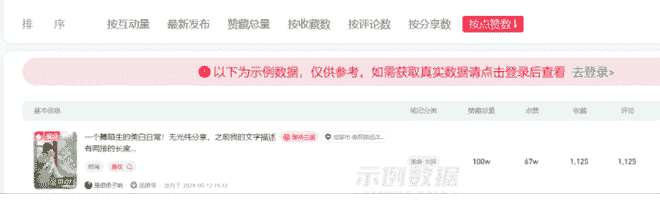
图7-3 新红数据后台

新红数据后台还支持表格的形式导出，支持作者进行多维度分析，对对应关键词最近30天按照互动量、收藏数等排序。

##### 蝉

蝉的功能和几乎类似，也是供给小红书运营的工具，如图7-4所示，功能包括：数据盘（行业流量盘、行业人大盘、品牌投放盘）

- 笔记库包含：
- 笔记库
- 笔记库
- 笔记监控
- 笔记监控
- 笔记监控
- 笔记监控
- 笔记
- 热门话题
- 热门话题
- 热门话题

##### 后羿采集器

后羿采集器是一款线性采集工具，如图7-6所示，基于人工智能技术，只需输入网址就能识别列表、表格，不需要配置任何采集规则，自动识别列表、表格、链接、图片等，可以满足非技术人员的需求，对非技术人员非常友好，用于整理小红书笔记、关键词提炼等，你可以登录后羿采集器的官网看到。

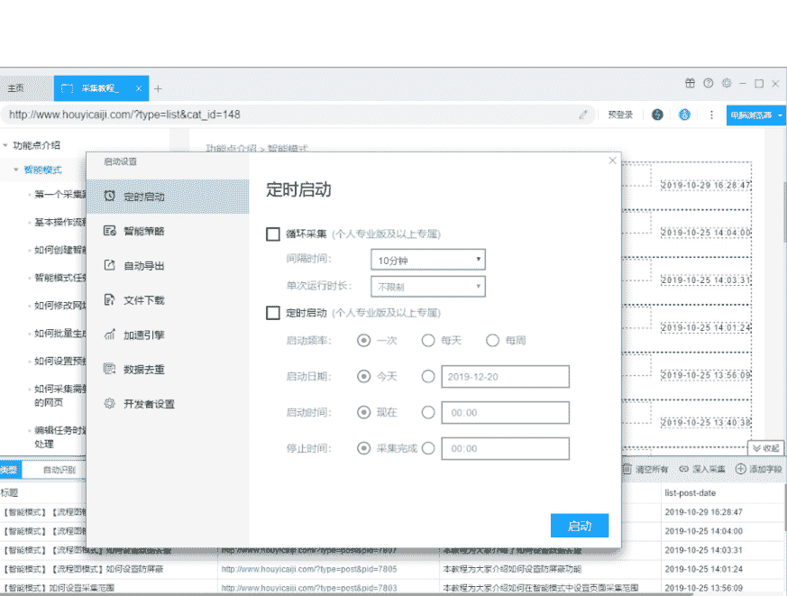
图7-6 后羿采集器界面

##### 微云

当我们收集了很多领域的爆款标题后，如何找到高频的关键词呢？如图7-7所示，通过微云标记导入即可显示对应关键词的词频，找到高频关键词以后，就可以清楚笔记的关键词方向以及业务创造。

##### 快速使用、精准分析、高清图表

大文本一分钟三步生成分析报告，轻松处理海量关键词关系，更多维度数据可视化

1. 支持输入任意词库（txt、doc、pdf词库）
2. 拥有强大的词云筛选（支持词云热点筛选、自定义列表）
3. 可生成可视化图表（原有多种图表可选、简单的图表）
4. 查看关联词网络与下载（自定义词云、颜色、样式）

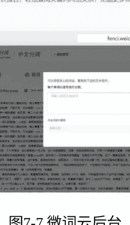

### 7.2.2 笔记制作工具推荐

##### 小红图

小红图的小程序和APP都可以使用，只需要复制链接，即可导出图片（如图7-8所示）。

##### 获取素材

观逸旅行定制发布了一篇小红书高清图、多图、视频下载、复制文案

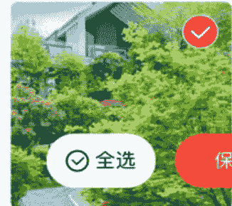
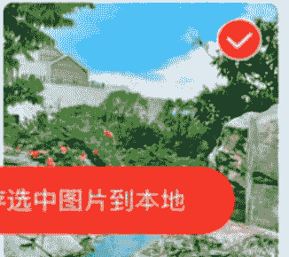

## 连禁词检测检测用无忧

用的笔记制作工具还有这些：

- 黄黄相机：一个调色APP，兼具了滤镜、调色、文字图片模板等功能，能够平淡的色彩增添一抹生动的色彩，很符合小红书的调性，适用于博主类别的账号运营。
- 美秀秀秀：也是一款好用的免费图片处理软件，基本上不用学习就会，拥有图片特效、美容、拼图、场景、边框、饰等功能，加上每天更新的精彩素材，基本满足用户的日常使用。
- 稿定设计：一个在线智能化平面设计工具，只要通过简单的拖拽操作，一分钟就能轻松搞定设计，让完全没有PS基础的设计新手，也能创造出精美的图片。
- 花样字体：如图7-11所示，是一款修改字体的程序，在小红书中直接逆向微信信号比较容易限制，这个工具可以增加系统检测微信信号的难度，可以帮助生成多种花样字体文字，如爱心文字、删除线、下划线等几十种字体，适用各种个性称、网名、签名等，支持一键复制。

## 花样字体

输入内容获取花样字体...

英文 中文 昵称 数字

you are my sunshine sunshine.

you are my sunshine.

YOU ARE MY SUNSHINE.

you are my sunshine.

uօօ αяҽ ɱყ ʂυɳ�ashιɳҽ

you are my sunshine.

уօօ αяҽ ɱყ ʂυɳashi菁ҽ

you are my sunshine.

уօօ αяҽ ɱყ ʂυɳashi菁ҽ

уօç αяє му ¢�$niҽ

微信、QQ彩色昵称制作 字体制作 上标电话号

## 图 7-11 花样字体

### 7.2.3 趋势、规则、渠道推荐

运营人员除了不断提升运营思维和技能，还需要及时关注官方的最新趋势、动态和规则，这就就需要需要关注官方发布趋势、规则的某些渠道，通常可以关注官方dc。关注官方不仅可以了解平台最新规则和功能，还可以获得平台热门活动和话题信息，包括平台创作方向的指，从而激发创作的灵感。

官方dc那么多，应该关注哪些呢？

小红书的官方账号几十多个，涉及直播、公益、审核及各垂直分类等多个内容领域。这么多的官方dc，其实不用关注，很多官方账号内容很好，但是不适合自己的账号运营，有些适合官方机构，有些适合品牌商家，有些适合个人内容创作者。一般根据自己的运营目的，关注自己需要的就可以了。

图 7-12所示的7个账号，是强烈建议内容创作者们关注的，这些账号涉及内容创作选题、投流、直播、接广告等方面方向，能给创作者们以全方的指导。

## 薯管家

官方账号
没有企业简介

## 直播播

官方账号
小红书直播官方账号

## 专栏成长学院

官方账号
我们提供知识，以应对日常运营的世界
@中中国

## 薄公英小助手

官方账号
小红书薄公英 | 内容合作官方账号
@中国 上海 黄浦

## 小红书视频账号

官方账号
小红书官方账号 | 最重要的视频号作者都在这里！

## 薯条小助手

官方账号
没有企业简介

## 小红书创作学院

官方账号
小红书官方号避坑指南创作技巧和完美

## 7-12 官方账号推荐

- 薯管家：可以了解小红书的社区规范，官方希望你了解的“审核规则”都会在这里公布，可以避免别人踩过的坑的
- 薄公英小助手：官方教你如何做的“恰恰姿势”，还有高质量合作案例，学习优秀的博主是如何接变现的。
- 薯条小助手：薯条相当于加推，可以付费给笔记做内容加热和营销推广，薯条助手这里有薯条投放教学，薯条使用小技巧，薯条爆款案例分析。
- 直播：可以看到优质的主播都是谁，分别是如何做优质直播的。
- 专栏成长学院：对于希望向知识、课程方向变形的创造者而言，专栏成长学院这个账号能详细解答开通专栏的一系列问题，包括专栏如何开，笔记如何关联专粉，专栏审核时长等。
- 小红书视频：笔记灵感热题，每周五点更新新选题，提供多多的热门点题供你选择，带货发文有机会获得官方的流量助推，日常创作不知道做什么选题，可以来这个官方素材库逛一逛。
- 小红书创作学院：定期分享创作技巧和攻略，关于封面标题、内容选题、拍摄技巧、剪辑包装等等方面，举办的创作直播请来大咖手把手带带你提升视频创作能力，还可以听到官方的免费培训课。

## 7.3 小红书AI工具教程

在你已经深度理解小红书的运营思维和技巧以后，如何借助工具提升笔记创作效率是本节需要重点解决的问题。

从前面的章节里发现小红书的笔记创作就是模块模块化的，拆解来看就是定位、选题、标题、封面、正文、评论等几个重要组成部分，小红书的笔记创作对内容的质量要求不像侧重深度、原创思考性，小红书更多的是知识整理、信息合集、生活分享。基于小红书内容模块化、生产重复、内容深度要求高的创作特点，如果借助今年新起的AI工具比ChatGPT，可以使得小红书的笔记创作效率大提升。

### 7.3.1 ChatGPT使用方法

在小红书的运营上，目前主流的聊天机器人程序，ChatGPT是OpenAI开发的，它能够理解和学习人类的语言进行对话，生成对应的文本答案，目前ChatGPT的应用非常多，在新媒体领域的讨论也非常高，对应到小红书创作上，可以帮我们做很多事情，包括账号定位、选题方向、标题生成、笔记写作等。

下面用ChatGPT帮助我们写出一篇某行业的小红书笔记为例，来看ChatGPT在小红书笔记创作的关键步骤：设定角色——明确含义——确认标准 -> 提供案例 -> 调教反馈。

### 第一步：设定角色

当你希望ChatGPT为你创作笔记时，首先需要赋予它一个角色和身份，给ChatGPT赋予了身份和角色，才能更好地匹配需求完成工作，比如“小红书作者”“新媒体达人”。

提问：假设你是一位小红书作者，新媒体达人，且有万粉丝，你清楚小红书上母婴行业流量笔记吗？

ChatGPT：作为一位小红书上的母婴内容创作者，我了解小红书上母婴行业爆款笔记的特点。以下是一些可能的特点：

- 1. 实用性：母婴爆款笔记通常提供实用的信息和建议，例如宝宝护肤、营养方法、儿童用品推荐等这些笔记分享实际经验并给出可行的解决方案
- 2. 人性化的：笔记通常分享自己的经历、成长过程和故事，给读者带来真实性和共鸣，人们感觉到作者之间有着紧密的联系。
- 3. 质量和可靠性：笔记通常经过作者精心筛选，提供详细的使用体验、测评等信息。这种专业的态度让读者觉得信任
- 4. 视觉吸引力：小红书是一个重视视觉效果的平台，母婴行业爆款笔记通常有精美的图片或视频，这种视觉效果吸引更多用户的点击
- 5. 社交互动：记者积极回应读者的评论，与读者建立互动，这种互动让读者感觉到关注和重视。以上是我小红书上母婴行业爆款笔记的特点。

### 第二步：明确含义

其次你需要和它后续沟通中一些词汇的含义，使得工具最大化的理解你的预期结果，其实目前ChatGPT具备的学习能力，也就是调教。

提问：如果你希望ChatGPT帮你生成爆款标题，你可以先列一下母婴行业用户的痛点，是否了解？

ChatGPT：作为一个人工智能助手，我对母婴行业用户的需求有一定的了解。以下是一些常见的需求：

- 1. 健康与安全：母婴群体非常关注，需要提供安全的环境、正确的营养、护肤品等知识
- 2. 教育与成长：群体希望获得关于教育的发展，包括早期教育、语言发展、心理技能等方面
- 3. 日常护理：需要关于日常护理的技巧，比如洗澡、换尿布等实用指导
- 4. 商品选择和购买：群体需要相关商品的选择，包括推车、玩具等评测
- 5. 社会交往：母婴群体希望分享经验、交流问题，获得社区支持和鼓励
- 6. 时间管理：照顾宝宝的同时需要合理安排自己的时间、工作、兴趣等方面的差异。

### 第三步：确认标准

提问：如果你希望ChatGPT生成爆款标题，你可以先确认一下爆款标题的特点。

ChatGPT：母婴行业的爆款标题通常具有以下特点：

- 1. 引起好奇：标题使用有趣的词汇，引发读者的好奇心和兴趣
- 2. 解决问题：标题可能直接提供了某问题的方法，例如“如何应对宝宝问题”
- 3. 经验分享：标题强调作者的个人故事，带来真实性和共鸣，例如“妈妈的游记”
- 4. 使用数字或数据：标题中使用数字吸引读者的注意力，例如“十大宝宝必备”“五个简单方法”
- 5. 关键词优化：标题通常包含目标相关的关键词，提高搜索引擎曝光和发现。总体而言，母婴行业的爆款标题会吸引人、解决问题和提供经验，同时采用一些心理引导的手段，吸引更多者的点击和阅读。

### 第四步：提供案例

提问：请总结一下爆款标题的特点。

ChatGPT：这一步俗称“投喂”，你给出想要的答案，然后工具会总结其中的逻辑和特点，帮你生成更多的标题，从而节省你的时间，更有价值。

- 1. 超实用！宝宝辅食大揭秘
- 2. 奶粉器推荐！妈妈们的必备利器
- 3. 婴儿护肤秘籍：打造健康可爱的宝宝
- 4. 宝宝睡眠拯救术：让宝宝安稳睡的五大技巧
- 5. 超萌宝宝穿搭指南：时尚妈的机
- 6. 宝宝早教必备：培养智力的好玩具推荐
- 7. 产后恢复锦妙招：让你重拾完美身材
- 8. 妈咪必备的衣服品牌推荐
- 9. 如何给宝宝洗澡？专属的宝宝方法
- 10. 超爱夏日必备清凉用品推荐：宝宝的最佳防晒

你你根据这些特点和我刚刚向你提供的案例，再写10个母婴行业的爆款标题。

ChatGPT：我可以帮你写10个母婴行业的爆款标题。以下为一些例子：

1. 宝宝辅食大揭秘：科学营养，健康成长
2. 哺乳奶器推荐：让喂养变得轻松愉畅
3. 婴儿护肤秘籍：守护宝宝肌肤的秘密武器
4. 宝宝睡眠关门：打造宝宝高质量睡眠的五大技巧
5. 超可爱宝宝穿搭指南：时尚妈咪必备的选择
6. 宝宝早起必备：培养智力的好玩具推荐
7. 产后恢复锦囊妙招：让你重拾完美身材
8. 妈咪必备的衣服品牌推荐
9. 如何给宝宝洗澡？专属的宝宝方法
10. 超爱夏日必备清凉用品推荐：宝宝的最佳防晒

# 附录A

## 一、小红书运营常见误区

- 1. 把小红书当朋友圈发
商业变现账号和笔记内容必须要有定位、有权重、有价值。

- 2. 真的把小红书当成表达自己的地方
商业变现类账号和笔记是基于引流和成交的运营，小红书不是用来表现自己的地方，没流量的时候的表达没人看，有流量的时候要流量和成交同时发生。

- 3. 不清楚每篇笔记的目的
每篇笔记都要有目的，是引流、还是交易、还是收藏，每篇笔记都是独立内容，写作之前必须想清楚，干货笔记引流、单篇笔记接交易，并且不需要所有笔记都带带货，也不是所有笔记都需要好的曝光，笔记的目的非常重要。

- 4. 不求清楚就开始小红书的运营，不知道为什么没效果，也不知道为什么有效果，盲目流量、无方向、无策略
开始之前清楚平台的运营逻辑，想好运营目的，怎么写是战术，什么是战略的出发、结果导向，中间填充的是方式和方法，否则容易越做越迷茫，浪费了时间。

- 5. 依靠“勤奋”发大量笔记，笔记数量多，没有咨询
没有质量的数量，没用。在小红书运营上，100篇庸的笔记不如一篇爆款的效果，爆款是没有时效性的，只要你的排名靠前，不管多久以前的笔记都能被用户搜索到，用户就可以持续因为这个爆文而点开你的主页，而且他们还是精准的用户，只要你的内容水平持续稳定，就会获得持续流量。

- 6. 满足点赞、收藏、评论，流量才有
只有流量没用，有需求的流量才有用。热闹虽好，但运营的目的是获得交易。笔记没有给出关注理由，账号昵称、头像和简介，让用户觉得关注也就没有收获和价值。笔记正文和评论要给出私信理由和私信方式，且提供自己的价值。

- 7. 不垂直，今天变明天变，引流的粉丝不精准，系统不知道怎么推、推进
可以将发红书理解为“传单”，告诉系统、告诉你是谁，应该将你推进来，应该被看到。

- 8. 不清楚目的就开始，运营没有效果就结束
慢就是快，先理解逻辑，心中有地图，做事才有针对性，开始前的慢，是为了开始后的快。

- 9. 目的追求笔记原则，但没有很好的效果反馈
先模仿再创新，模仿可以解决70%的问题，在理解逻辑的基础上再做创新。

- 10. 不知道如何设定选题，发什么的内容，每天为选题内容发愁
设定选题需要知道平台需要什么，用户需要什么。创造用户和平台都需要喜欢和需要的内容，站在平台的角度和用户的角度思考，不能只站在自己的角度思考。

- 11. 笔记的流量总是很低，感觉账号被推限流
笔记阅读不到200都是选题和封面的问题，对于流量可能不能再大，取决于互动指数的流量开关有没有被打开。

- 12. 抄袭同行笔记后被举报限流
要分析优质爆款为什么，提炼爆款的元素和框架，抄袭才能获得一篇的成功，学习才能带来可复制的成功，不仅看爆款，更要看到爆款背后成功的原因是什么。
同行爆款笔记提供了很好的案例参考，对爆款笔记的分析，要看关键词的选择、标题、封面、内容结构、脚本节奏、粉丝的互动方式、流量方式等。

- 13. 不知道笔记的最佳发布时间
笔记的最佳发布时间没有完全一致的标准答案，因为不同笔记对应的人群的集中阅读时间不同，核心原则是在你的目标用户手机阅读高峰时候来临前发布。比如周末之前，周三四周晚上九点后是浏览决策时间，在你在此之前1小时发布就好。

- 14. 一篇笔记的数据不好，直接删除
不要删除，发出的笔记尽量不要回改，会影响流量推送，频繁修改也在告诉系统这个账号的内容和更新不稳定，删除对系统是负反馈。这也提醒了我们质量比数量重要，宁要一篇爆款笔记，不要百篇平庸的笔记。发之前想清楚目的和逻辑，笔记数据实在不好，可以隐藏起来自己看。

- 15. 不知道一天更新多少合适
账号需要权重，需要告诉算法这个账号是活跃的，早期可以每天一篇笔记增加权重，两天一篇也可以，总之不能断，也不要一天太多，避免营销嫌疑。

- 16. 新手0粉丝感觉很难有机会
新手0粉丝在小红书完全有机会，已经有多个小红书账号0粉丝爆款，粉丝拿到精准流量实现变，基于目的的小红书笔记运营，本质是一个流量接游戏。

- 17. 发出的笔记找人赞藏增加数据
很多人这样做，但其其实是不对的，甚至有副作用，小红书是可以检测异常行为的，短时间内推流产生的赞藏互动会比较异常，只有系统正常推流的笔记互动行为（点赞、粉丝、评论、转发）才证明笔记质量不错，此外笔记的标签要准确，不是真实用户的点赞了，会干扰系统的正确推流。

## 二、小红书运营常见术语

这本书提到了很多基础的概念和术语，有些是行业通用，有些我们内部团队经常使用的沟通语言，在此做统一整理，方便你更好地理解应对词汇的含义。

- 1. CAC：Customer Acquisition Cost，用户获取成本。
- 2. LTV：Life Time Value, 客户总商业价值。
- 3. CPV：Cost Per View, 单次阅读的成本=费用/阅读量，阅读量就是笔记的小眼睛数据，CPV的数值越低，说明账号性价越高。
- 4. CPE：Cost Per Engagement, 单次互动的成本=费用/总互动，总互动的值越高，一定程度说明粉丝的活跃度和粘性越越高，单次互动的成本越低，说明效果越好。
- 5. CPT：Cost Per Time, 一种计算广告价值的方式，按照每次时间段展现计费。
- 6. CPM：Cost Per Mille, 一种计算广告价值的方式，按千次展现计费。
- 7. CPC：Cost Per Click, 一种计算广告价值的方式，按照点击计费。
- 8. CPS：Cost Per Sale, 每次成功交易收费，按照用户点击广告最后购买或者消费金额的一定比例分成。
- 9. CVR：Conversion Rate, 衡量广告效果的指标。
- 10. SEM：Search Engine Marketing, 搜索引擎营销，根据用户使用搜索引擎的方式，利用搜索引擎的机会将营销信息传递给目标用户。
- 11. SEO：Search Engine Optimization, 搜索引擎优化，通过分析搜索引擎规律，了解各种搜索引擎抓取特定关键词的搜索排名。
- 12. UV：Unique Visitor, 一般独立访客数，根据IP地址来区分。
- 13. PV：Page View, 是访客数量，一般指页面浏览量或者点击量。
- 14. 小眼睛：笔记左下角会有“小眼睛”标识，体现笔记的阅读量。
- 15. 小爆款：互动大于500，互动即点赞+评论+收藏。
- 16. 大爆款：互动大于1000，互动即点赞+评论+收藏。
- 17. 收录：笔记被搜索到。
- 18. 限流：系统限制流量，不再推流。
- 19. 粉丝增长：阅读量（小眼睛）×转粉率。
- 20. Impression：展现，就是笔记推送到人面前，但是在信息流列表里。
- 21. Engagement：互动，即点赞+评论+收藏。
- 22. 笔记指数：针对笔记到达主页的互动贡献（点赞、私信、收藏）。
- 23. 赞粉比：点赞数/粉丝数，用来体现账号的效果。
- 24. 赞评比：点赞数/评论数，更能体现交易价值。
- 25. OCPC：Optimized Cost Per Click，也称目标成本出价，本质还是CPC付费。
- 26. UGC：User Generated Content，用户生成内容，由用户创造而非平台创造，通过平台展示。
- 27. 洗稿：针对原创内容进行针对性的改写、替换等操作。
- 28. CES：一篇笔记获得的评分，评分=收藏数×1+评论数×4+转发数×8。
- 29. Vlog：Video Blog，是一种通过视频记录和分享生活旅行的形式。
- 30. 自来流量：用户发性的分享，在小红书平台上投放的一种广告，下方写两个字就是自然流量。
- 31. Brief：品牌给博主提供的具体的指导与合作之前的沟通。
- 32. KOC：Key Opinion Consumer，关键意见消费者。
- 33. MCN：Multi-Channel Network，专业培养和扶持网红人的经纪公司或者机构。
- 34. 通告：商家面向小红书博主发布的各种任务。
- 35. 置换：商家与博主之间的一种合作方式，赠送产品测评。
- 36. 报备：通过正常流程与品牌方合作。
- 37. PR：品牌公关，通常负责品牌推广接洽。

## 后记

本书的写作起点始于2023年初，当时深度接触小红书的时间已经超过一年，其间接触了几百个变现账号，对于小红书运营和流量，我终于有了一种理解透彻能够整理好这本书的决心。

但是写起来来说，经常在某些章节拖延了许多时间，一方面内容部分需要修改使得全书的内容更高，另一方面因为自己的小红书营销还有很多实际业务要做，在做本书定稿的时候，仍然感觉对于某些章节的表达不够满意，有些方法的表达缺少对应的实际案例让读者理解更清楚，由于部分企业的保密，非常值得分享的案例和打法无法在书中呈现，同时因为自身运营经历的局限，最终放弃了一部分我不擅长的环节。

同时，我负责的运营案例和提炼原理近乎毫无保留地分享，我也自信每一位认真阅读本书的读者都会足够的收获。这本书带着十个互联网人的运营思维和流量逻辑，结合了普通职场大到创业的思路，可以让每一位想要在小红书获得变现的人走通路径。

感谢过去十年给我提供职业机会的携程之旅，这段完整的互联网经历带给我提供了运营思维和商业训练。感谢即刻合作的每一位企业，如此多的商业项目让我们有机会对小红书理解得更加透彻。

感谢我们的小红书运营伙伴周柔，凭借极强的专业理解和运营思维，我们共同服务过很多企业。感谢创业以来加入我的团队的每一位同事，是很多会议的及时复盘才有了关于小红书运营方法技巧的系统总结。

感谢自己，从十年前如一日对于内容、流量、商业、运营的持续研究和探索，终于在今天可以交付一份的作品。

感谢出版过程中提供运营案例支撑的赖幂、段开心、王美娇、张小雨、吴小平、刘泽、王博、王飞、张啸、张镇、杨明浅。特别感谢王雨桐在本书写作逻辑和案例梳理阶段提供的协助，特别感谢谢古凪、刘佳敏在本书阶段提供的专业意见。

最后要感谢的是生财术线上社群，这里有一群对互联网、运营、内容、流量、生意经验最为敏感的人，我对小红书运营经验的首次分享在这里获得了快速反馈和点赞，从此开启了我在小红书运营方法上的持续探索。

如果你在阅读本书过程中遇到疑问，也可以关注我的个人微信公众号：Travel星辰大海，我将在这里持续分享我对流量的观察理解，回复关键词“引流”，进入本书读者群，领取一份小红书引流方法PPT，和更多运营者一起交流。
