## 红场

董保存 著

## 知情者说 III

从“六二二之夜”到“九三”凌晨

风云一九八八
“七一〇事件”当事者
关乎大劫、幻术
动魄的域政风令
从胜利到毁灭

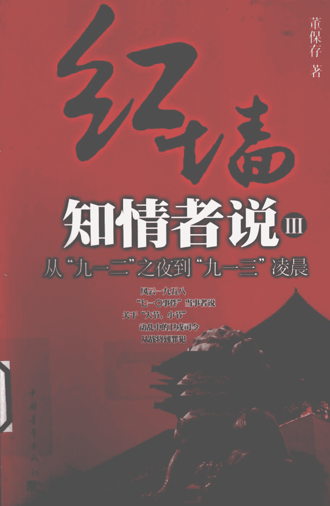

## 知情者说

红墙之内，神秘的政治核心。森森的警卫，仿佛一道屏障，避开世人多少探听的目光？等闲之举结在高高的红墙之外，不免要向里看花。

风云一九五八？
《二〇事件》当事人说？
关于《大劫、小节》？
运动中的立场如何？
从胜利到胜利到疆界？

本纪当事人或亲属者的记忆与生活为主要内容，深度揭露了中国政治运动的真实与幕……

ISBN 978-7-5006-9804-3
定价：36.00元

## 免费 价值 及时 专注

## 扫码加入 知识星球TOP 免费资源群

- 每日免费获取价值资源
- 可提供各类资源搜索服务

◆热门付费文章 ◆各行行业报告
◆精选图书资源 ◆副业赚钱方法
◆职场实用资源 ◆AI经营自媒体体

公众号：知识星球TOP 微信公众号：jntsg8 微信公众号：jntsg2

分享资料仅供个人学习，请及时删除，切勿商用传播

## 轻语

## 知情者说Ⅲ

董保存 著

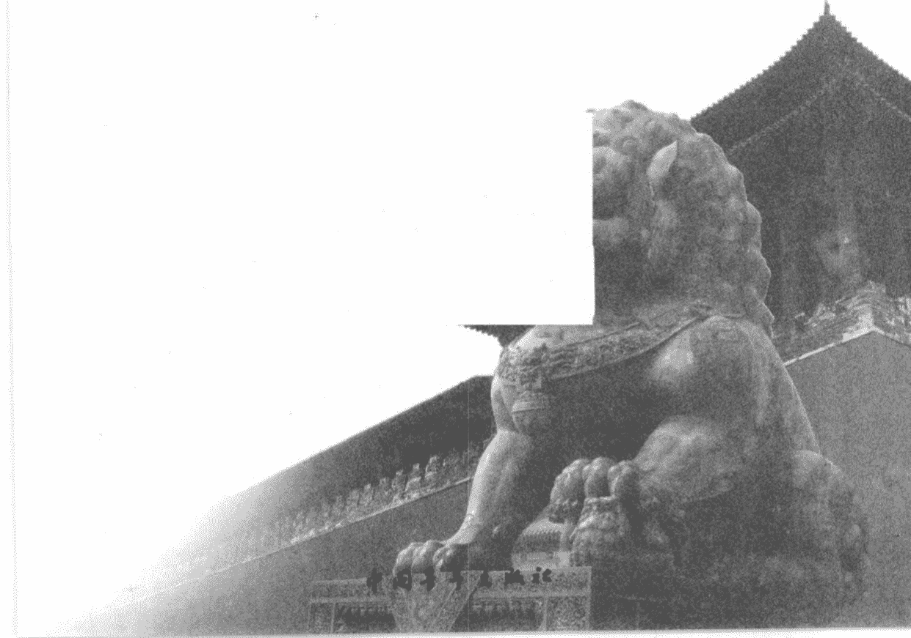

## 图书在编目（CIP）数据

《知情者说》III / 董保存 著。北京：中国青年出版社，2011.1
ISBN 978-7-5006-9804-3

I.①知... II.②董... III.①纪实文学—作品集-中国-当代 IV. ⅉ25

中国版图书 CIP 数据核字(2011)005506 号

中国图书出版社 发行
社址:北京东四西21 号 邮编码:100708
网址:www.cyp.com.cn

编辑部电话:(010)57350504 门市电话:(010)57350370
北京忠信诚胶印刷厂 新华书店经销商

720×1060 1/16 18.75 印张 260 千字
2011年4月北京第2版 2011年4月北京第1次印刷
定价:36.00元

本书如有任何印装质量问题，请与印务中心质检部联系调换
联系电话:(010) 57350337

# 目录

### 统帅与战将的谈话（一一）
——毛泽东指点迷津

001 第一次会面，毛泽东说：“真是人小鬼儿大！”

003 毛泽东说：草地是茫茫广阔、水草丛生，方向难的一片莽莽，你们必须在茫茫的地上走出一条路来

006 在平山山西山西坡，毛泽东对杨成说：出兵规模，困难是非常多的！

011 在列宁上，毛泽东说：建立了中国，像建成了一座很好的大厦，屋顶总不能空洞嘛

012 毛泽东举起烟杆说：你们20军团的任务是：……把防线稳定在38度到38度4分之间

### 统帅与战将的谈话（之二）
——邓小平与刘志建谈

018 1936年，邓小平和刘志建谈话不足半小时，却给他留下了极深的印象

019 刘志建被任命为二野4军团副司令，邓和平的谈话不超过5分钟

020 邓小平复出以后，张爱华和刘志建谈话更是干脆利索，一言中的

**“你是我身边那永不灭的灯塔！”**

——毛泽东的管家吴建连访谈录

022 您是什么时候接毛泽东家里的工作的？管理毛泽东家里的事务复杂吗?

023 撰说毛泽东家的工资、仓库是你保管的，你能谈谈毛泽东的家庭吗？能谈谈有关江青的当吗？

025 毛泽东一生没有离开过烟和茶，能谈谈他这方面吗？

026 人们知道毛泽东睡觉是很困难的事情，你能谈谈这方面吗？

027 毛泽东在吃饭方面有什么特殊要求？有人说他因为发了脾气，是真实的吗？

028 既然你是经理，就要接触毛泽东的，你能谈谈他们的情况吗？

029 毛泽东的娱乐活动是怎么安排的？他晚年的娱乐是什么？

030 有人讲，毛泽东在“文化革命”中，并不让身边人员个人崇拜，是这样吗？他对个人崇拜的态度如何？谈谈你的经历。

31 什么时候到了毛泽东？你在营里过吗？

033 七二〇事件时，你是在身边吗？还记得当时的情景吗？

034 作为毛泽东身边的人员，你能谈谈那时的感受吗？你多次在毛泽东身边工作多年的同志，谈谈你印象深刻的？

# 毛泽东的口味
- 中国厨师韩阿

37 您什么时候见到主席的？从什么时候开始给他饭的？

38 您是从哪一年到北京的？到北京以后，一直当主席厨师吗？

39 给主席当厨师，主席在吃饭方面有什么特殊的要求？谈谈主席饮食方面的特点。

40 你给主席当了多年的厨师，有什么印象深刻的？

41 很有意思的事吗？

42 问：主席晚年的饮食习惯有什么改变？最后一次做饭是什么时候？

## 风云一九五八
——萧成将访谈

43 问：看到1958年反右扩大，总要提到哪一个词——总部。现在已经没有这个机构，你说它是这样的吗？

45 问：对1958年发生的反右扩大的定义，年轻人已经不知道。只是这场斗争涉及了刘伯裕、李达也感受到了这种批评。你说你对这件事的深入思考吗？

50 认为这些不同的意见，你给彭怀同志写过吗？我们进行了争论，结果是那样的？

51 后来总部参加闭门会议的情况发生了。当时的情况是怎样的？

52 你还记得参加军委会议的情况吗？有人说林彪的东风起了重要作用，是那样的？

54 为什么会发生这样的转变，你自己清楚吗？是不是因为当时太鲁莽了？

56 一个不问的问题，你当时打算了吗？在最困难的时候，你的信念动过没有？

58 从现在（就是90年代）的角度来看，你对反右扩大的事实是怎么看的呢？

59 对一个问题的认识，往往有一个历史过程，对1958年的反右扩大也一样。谈谈这件事的详细经过吗？

61 从总结教训的角度，从一个老人的角度，你给我们这些年轻人说点什么？

## “七二〇事件”当事人说

63 听到“七二〇事件”，自然就会提到“百万雄师”，这个词对今天年轻人来说已经陌生，但当时却是全人民都知道的。关于这个组织的情况，说道

66 王力也是“七二〇事件”的重要当事人。他对于这段历史有自己的说法，我们不妨赘在此，以便读者从不同侧面了解这段历史，我们相信历史会自辩真伪。对于和谢富治的下次，王力有如下说法：

68 看到林江青怎么看武汉，陈再道1967年7月14日，毛泽东的专报抵达武汉。到达的杨成武将老笔述了当时的情况：毛泽东到达武汉后，先听汇报，又见了陈再道等人。看着毛泽东面，陈再道和王力找了上来。对于这段时间的经历，陈再道的记忆如下：

77 对于这段期间的经历，王力后来说：

79 “七二〇事件”发生的情景，陈再道对将军说，肯定是最终的。他后来多次说起那天的状况：

83 杨成武是“七二〇事件”的重要证人。他一直陪毛泽东离开武汉。对事件发生的情景，他是这样描述的。王力是“七二〇事件”的重要节点，就是毛泽东对武汉的态度。陈再道说是：

89 那天王力突然消失了。他见到哪里去了？王力不说。陈再道的说法是：

91 王力到了什么地方，自己的说法：

92 对于陈再道来说，1970年7月20日后的经历让他终生难忘。事后回到北京后被批的情景——

95 在陈再道看来，天门的欢迎大会和“揪军内一小溜”是林彪策划好的。王力承认，“七二〇事件”发生后，中央文革做了文章，引发了“揪军内一小溜”的问题，对此提供一些背景：

93 问：北京机场的接待和来的大会，王力又是说的？

## 代总长与国防部长
——杨成武与林彪

105 林彪战术——迂回包围，中间夹击……

108 林彪军团教我怎样是真实记录，还是拍的？

112 “文化革命”开始前，杨成武出任总司令，成为毛泽东与周恩之间的“联络员”。

123 领袖的绝对权威——毛泽东思想这篇巨大的文章，写作到一波……

129 叶群要杨成武转告林彪，“七二〇事件”发生

138 周恩来说：“你的问题是主席。

143 加入军队后不久，汉章完成了一本绿的“著作”。在国民党都重庆。

146 《参谋工作》出版后，朱德说：“了。

## 关于“大节、小节”
——杨成将访谈

150 问：“文化大革命”期间，林彪有一个老话，说到干部的“大节、小节”问题，是有关系的。有人说当时你在广州区当谋长，当时的情况是怎样的？”

152 问：林彪的原话是怎么说的？你记得吗？

153 问：文革上都是是谁？

154 问：当时张强加到头的罪名是什么？

155 问：刚才说到，一开始还是保黄永胜的，回来后为什么要整你？你们历史上积怨吗？

156 问：你在广州区当谋长时，感觉他和林彪的关系正常吗？

157 问：既然你们之间没有积怨，黄永胜为什么要整你？

158 问：能谈谈被打过，或者是损害后的情况吗？

159 这种近乎天方谭的说法有人相信吗？

160 问：“文化大革命”中你们这一干部，有过抗争吗？

161 问：在湖南的情况是否好一点？

162 在缝隙中生活

163 毛泽东深夜见习

164 钓鱼台风波

165 凌晨二时的突然任命

## 关于“吴晓忠”

188 你们在吴晓将军身边，李耀豪同志很长时间给吴晓同志当秘书，你们知道毛泽东关于“吴晓”的说法是什么时候的？毛泽东过几次这个话，都是在什么背景下的？

189 后来毛泽东过这样的话吗？

190 有人写过一份共和剧，说1976年天安门事件后，王洪文毛泽东说：“吴德和吴晓起了重要作用……”毛泽东说：“北京有二吴，吴德，吴晓”。此外此话传到民间后就变成“北京有二吴，吴无愧，吴无忠”。对你们是怎么看的？

191 你们是什么时候听到关于“吴晓”的说法吗？

192 你认为毛泽东对“吴晓”是有意思吗？

193 “九一三事件”发生的时候，吴晓在北京卫城区区的位置上，他当时是怎么处置情况的？

194 有人说吴晓在调查林集团的罪犯时，是有功的。这是指什么什么？

195 在“九一三事件”发生的时候，卫城区还负责封闭了机场，当时的情况是怎样的？

196 在处理林集团舞台时，吴晓还做了一些什么工作？

197 说说，逮捕关押审讯、吴、李、邱也是卫城区部队执行的，是这样的吗？

198 林集团垮台时，江青军搞了，身为卫城区司令的吴晓可避免地要和他们打，你们能够谈当时的情况吗？

199 1976年天安门事件发生的时候，吴晓可是“风口流亡”上。

202 说说天安门事件后，为了避免“后花园”，吴晓借疗了。

203 问：吴晓所在的城区来是个敏感的地方，在粉碎“四人帮”时也不例外，你们知道？

205 问：吴晓在动乱年代当了多年的司令，在政局如此复杂的情况下，为什么能保持清醒的头脑？

207 问：人们都知道吴晓去广州区出任司令前，曾经被审查了很一段时间，最后的结论是什么？

## 从“二二九”到“九三”凌晨
——几个知情者的访谈

## 谁是“二二九”运动的领导者

14 近年来，关于“二二九”运动有很多说法，有人说这是自发的，没有关系。也有人说当时的领导者是某某。由于非常复杂的原因，人们并不清楚。16 “二二九”运动不是突然爆发，之前你们做了什么工作，做了什么准备？

19 有人说，是在党内的意见分歧和激烈斗争的情况下，担任党委书记的，也就是说，任何重要的领导者都是？

21 问：“二二九”爆发时，你们当时是怎么组织的？

23 问：二月十六日再次爆发，万人示威，你们组织的吗？直接参与到队伍中？

24 听说这两次游行后，你不同一样被国民党抓了回来，谈谈这段吗？

## 政治风浪中的情——谷景生与范秀英

26 “二二九”运动的领导者，爱上了范秀英，这也是父母牺牲之言。

29 风云变幻，谷景生离职养。

32 谢富治劝离婚，谷景生政治前途受影响。

34 “文化大革命”风暴中，谷景生被抓起，五年无音，范秀英走。

36 帅两次击，谷景生得以住院。邓小平亲自过问，事情还有波折……

## 从战将到罪犯——黄永胜的人生转折

40 黄永胜当兵的经历有些传奇——改名不改姓，很苦离队。

46 发脾气，动手打士兵；受教育，感觉罗荣相。

49 从营长到团长，三年连升四级，身上中四枪。

56 出任八十一司令，打出名声骄傲自满。

60 调六路司令，参加沈决战。

63 平江战役，三五师受嘉奖。

65 经营广州军区，涉足党斗争。

69 紧跟林彪，升任三军总参长。

74 步步错，成为反党集团首犯。

78 最后的审判

## 统帅与战将的谈话（一一）
——毛泽东指点迷津

在近几年访谈中，碰着到了不少亲耳听过毛泽东谈话的人。这些人当中，对他非常尊敬的，也有对他很有微词的。但不管是谁，不得不承认他谈话的魅力。有人被他叫去谈一次，就终生难忘。身经百战的杨成武是幸运，我是接触过的多次和毛泽东谈过的同志之一。说起这些经历，杨成武将军说：“听到毛泽东谈话，是非常荣的。他和我的谈话，都让我受到很大启发和鼓舞，增添智慧和勇气，给我留下很深的印象。真是如言，受益十年。”第一次见面，毛泽东说：“真是人小鬼大！”杨成武第一次见到毛泽东是在1929年3月中旬。在此之前，带领杨成武参加革命的张兵男多次讲过毛泽东、朱德。

## 知情者说

故事的觉得神乎神。参加暴动后，为了躲避反派者的反击，杨成武看着部队进入广西延绵的海林之中。在这段艰劣的日子里，杨成武十分在想：我们暴动的事儿，毛泽东、朱德他们知道吗？要是能见到他们一面有多好啊！有时又想：天下这么大，也许一辈子也见毛泽东，要是能见到他们，我一定把他们带走，赶红军出发！

谁知道这梦想真的是实现了。某天晚上，一个农村主席毛席红军到了山里，非常惊喜地告诉杨成武，见到毛泽东、朱德、陈毅华红军攻入长汀，消灭了蓝缴汀城的郭凤部队。这个消息对于杨成武来说真是喜从降。杨胜利立刻拉上杨成武等人进了长城。

## 知情学生

随后，毛主席详细告诉杨成武过草地可能遇到的困难。他形容草地不见人烟阔，树木也没有，行人走过，时水可漫到膝盖，夜间寒冷多雨露，就是白天，气候多变，忽而烈日，忽而阴天，时阵阵来雨雪……又具体解决困难的办法。说完这些，他又强调说：

“克服困难根本的办法，是把能做到的一切困难，把中央决定要过草地北上抗日的道理告诉同志们清楚。只要同志们相信没有什么困难能得住红军将士。”

杨成武向毛泽东报告，部队的精锐很好，大家决定执行中央决定过草地北上抗日的决定。接着，准备了一些食物，沿路将那些野果，可以用来过草地。只是衣服问题，每人只有两套单，恐怕也不够草地的严寒。

“要尽量想办法准备粮食和衣服，减少士兵军行的困难！”毛泽东在嘱咐后又是寻找找到哪里？

杨成武说，他找到了一个藏族通司，地形他很熟悉，只是年纪太大了，60多岁。

“路上走不动怎么办？”毛泽东急着问。

“我们已准备了八同志，准备用担扛着他们为带路！”

“这样好！”毛泽东高兴地说，“要告诉担架的同志稳当，要教育大家尊重少数民族，团结好少数民族。”他思想片刻，继续说：“一个方向解决不了大部队伍行军的问题，你们必须做一些‘由此前进’并带有箭头的路标，每逢岔路，插上一个，要插得靠显些，好让后面的部队跟着我们。”

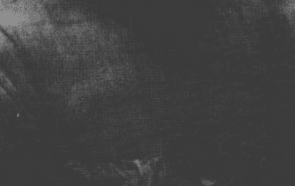

## 统帅与战将的谈话（一）

顺利前进。
杨成武仔细听着，心想，毛主席想得可真周到。

“还有一个很重要的问题，”毛泽东以严肃的口吻说：“红四方面军的第294团编入你们第4团。你们必须搞好团结。团结是党的事业胜利的保证，你们搞好了整合后的团体，就是一、四方面军紧密结合的标志。”

最后，毛泽东杨成武在木凳子上坐下，亲切地道：“看看，你们还有什么困难？”

“我们一定遵照您的指示去做，有困难我们依靠大家想办法解决！”

毛泽东高兴地说：“很好！”

杨成武急忙站起来告诉，毛泽东握住他的手：“你到徐总那儿去，接受具体指示。去了以后，再回来一下！”

近昏时，杨成武回到了毛泽东的住处。保卫长邓广一见就见：“吃饭了没有？”

他一，杨成武这时想起还没吃东西，还要吃几十里才能回到部队。邓友说：“你等等。”等会儿便拿出来一个盘子，盛好了六个鸡蛋大的青馍馒头，笑着：“主席，你一天没吃饭，还要吃几万里，吃饱了。”

杨成武狼吞虎地吃了两个馒头，邓友说：“这是毛主席的一顿饭。”

杨成武：“那我怎么能吃主席的晚饭？”

毛泽东爱说：“你一定要吃了，不吃饺什么草地？”在毛泽东的催促下，杨成武又吃了一个馒头。

毛泽东用慈爱看着杨成武，紧紧握住他的手：“好，没有别的事了，祝你们完成任务！”

杨成武离开毛楼，连夜赶回基地。遵照中央党委和毛泽东的指示，杨成武在全团进行了草地的动员，使中央北上抗日的英明决策刻在每一个人的心上。8月21日清晨，红14团负着中央党委和毛泽东的望向草地进军了。

## 知情者说

道路、没有人迹、没有山石和树木的沼泽地整整滚了6天，终于像毛泽东所期望和预料的那样胜利地闯过了草地，开辟了红北上的道路。

在平山县西柏坡，毛泽东对杨成武：“出兵远远，困难是很多的！”

从“红大”毕业后，杨成武带着毛泽东“抗战到位，途径光明”的期望，奔赴击战场。在八年抗战中，虽然看到过毛泽东的命令、指示和文章，却是没有机会见到他本人了。进入战争后期，杨成武又幸见到毛泽东的两次会面。一次在河北省平山城南，一次在平山县西柏坡。

1948年南战后，晋察冀野军在正县、广灵、阳行待，准备东援。4月17日，杨成武奉命来到平山县城南晋察冀战区司令。当天聂荣带领他和赵彭沛去毛泽东。

聂荣问杨成武：“长时间没有见到主席了？”

杨成武想了一下：“已经11年了。主席数百里把我们调来，一定有重要的事情吧？”

聂荣说：“见了主席就知道了。”

到了毛泽东住处，只见到他正在看书。看来他的身体不好，有些消瘦，但精神很好。他让杨成武坐下，询问了部队的情况。关于大集宁战役、保北战役、青洛战役、清风战役、正太战役和石庄战役，大部分情况他都知道。对于一些具体问题他也感兴趣，问得很详细。

杨成武一作回答，在情报部汇报情况中，重读了刚结束的出击方面战和南战的情况和经验教训。

毛泽东听完汇报，谈起了形势。他说，解放战争已经进入了一个新的反攻的阶段了。南线，刘邓大军渡过黄河，跨越海路，陈粟大军转至鲁西黄河南岸和豫西地区，陈持续大军渡过黄河进入豫鄂地区。

北线，东北方面从去年夏季攻势已立即准备反攻，经过夏季攻势和秋季攻，敌人顾未被隔离在长春、沈阳、锦州三点。湖北军在沙家店消灭敌人第36军以后，也转入了反攻。晋冀军获得了清风战胜利，又取得了石庄战胜利，也转入反攻。如今权力在我们手里，敌人处处处于被动地位。

毛泽东对杨成武：“选一个你熟悉的、战斗最强的旅，将他们去东北。”这项任务有点重，杨成武觉得负担很重，决定战斗力最强的第4旅执行此任务。接着，他们又研究了行动路线，选择了过平线的地点。

吃过早饭，他们又去毛泽东卧室，报告了情况，毛泽东表示同意。杨成武这才离开了。回到广义县后，向司提交了详细汇报。然后，他们对护送的任务进行了慎重研究，统一了意见，然后呈报毛泽东和聂荣。

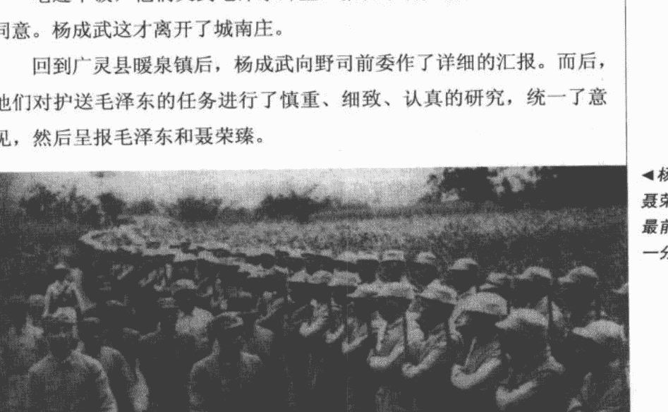

## 知情者说

由于过了十几天，毛泽东来了一个电报：上次的任务已经撤销。后来杨成武从聂荣那里才知道，当时毛泽东身体不好，斯林邀请他去苏联疗。关于这件事毛泽东曾征询聂荣意见。聂荣认为斯林是一番好意，但那时毛泽东健康状况也不便，毛泽东考虑后，决定不去苏联。1948年10月3日，毛泽东再次召会杨成武、聂荣，一起去中央委员会。1948年7月22日发给林彪、聂荣、刘亚等，电报指示野军转向南方，南方作战种种有利条件，要求军队于8月在平线等地打。正是这份电报，导致了者的决定。

接着毛泽东又给了他们第二份电报。电报指示：应当首先考虑到锦州、唐山作战，全部击溃集团，然后向承德、张家口。这份电报比前一份更具体，特别是把锦州明确了作战日程。

看完图片后，毛泽东先听大家的意见，然后站起来，伸出两个手指说：“改为华北军第2、3团，由杨成武带兵团，司令员兼政治委员若干，辟新的战线。你们的任务是把敌部队拖在沿线，调动他们向绥、集宁、张家口转移。与此同时，第二兵团在北平、张家口一线配合作战，要求你们20天内完成准备。”

## 统帅与战将的谈话（一）

毛泽东说：出兵援远，困难很多的！第一个困难是，远是战部的老军，他一辈子经营了两支军主力，即广兰峰军和杨成武部，这是他的全部资本，要消灭他的命根，他要拼命和你干。在那里经营20多年，搞了许多宣传，那里的群众对我们解放军还不太了解，他搞了些思想。他还实行连环法，一个“道攻”，他们在群众中要清野，如果你搞不准粮食，就站脚。过去，战场第1团、第6师两次出击，都没有站脚，主要原因就是吃不了。第二个困难是供给军队，供给到前线不容易。第三个困难，可能战斗不容易。

毛泽东提醒杨成武：“这不是当年在毛盖时，那时候你带一个团，不到2000人。现在是军团，4个团，有骑兵、地方武装、万民工，10多人都要吃饭，说没有困难吗？”

毛泽东还强调必须做到：

第一，要有充分的思想准备。要把可能遇到的困难想透，依靠现有的经验，想出如何对付的方法。对全体指挥员讲清楚，从思想上不怕困难。有了这种精神，遇到困难就不会被吓倒了。要求开一个团上干部识别并召开基层会议，振奋精神，提高战斗的勇气。

第二，做好充分的物资准备。抓紧武器、弹药的补充，把解决吃饭问题当成不能站脚最大的问题来解决。并说援远任何地方，只要有银元，就能扣粮食。还要来愁搏溥（此处应为“大洋），给兵团10万大洋，把揭不开锅的时候，用它买粮食。

接着，毛泽东指出，晋西北、晋察要组织强力的部队，组织一个强大的工作团，从远处发动群众，组织群众，也可以带一批运的民工、担架队。

第三，就是首战必胜。第一要把集宁那个部队消灭，然后由东向西同时进，占领头堡，把绥、南、绥北都占了，然后停留一下，那么你们就站脚了。

第四，全体战士要学会做群众，宣传党的政策、党主张。要求我们在行动上做出样子，让群众知道我们是解放他们的，要严格执行三大纪律八项，严格执行商业政策，严格执行各项政策，帮助群众治病、挑水、扫卫生，让群众靠近我们。这是胜利的重要保证。

毛泽东说完上述之后，看了看：“你们今天不要了，你们想一想，不少要解决的。”毛泽东和中央首长的指示，杨成武感到很大压力。他明白在战略上重视困难、战术上重视困难，是毛泽东的思想。他把杨成武送到下下达任务，准备好鞋、衣服等。毛泽东还指出行军要若干，没有像以前那样隐蔽，越接近敌人。

007

1949年12月，毛泽东迎斯林访问苏联，杨成武送毛泽东到山关。毛泽东回国时，杨成武接到他到山关。在他的车厢里，毛泽东向杨成武谈到了进攻将。毛泽东在电报中称。

## 知情者说

毛泽东对杨成武：“你们要执行任务，准备好。”毛泽东听了杨成武、聂荣（此处应为杨聂荣）的意见。

## 毛泽东举杯说：你们第20军的任务是……把防线稳定在32度到38度

1951年5月下旬，杨成武领导的第20军准备开赴朝鲜战日前，毛泽东让杨成武去接电话。接到电话，他迅速从天津赶到北京。和他一起进入南海的有团副指挥兼政治部长张南。我们在丰园见到毛泽东。落座后，毛泽东就高兴地说：“听我来，你们军队已经做好入朝的准备，这很好。”

杨成武向毛泽东报告：战士的士气很高了，为了抗美援朝，保家卫国，都表示不怕牺牲，要多打仗。接着，杨成武简要汇报了部队。

## 知情者说

完全是迫不得的自己行动，美国侵略，要打仗，我们就不能不引起侵略的旗帜。敌人不会轻易认输的，还要准备打它几伏，现在已经决定，今后要“采取轮番作战”的方针。你们这次对部队来说是一个很大的考验。

毛泽东代表20军战士向毛泽东表示：请大家放心，我们一定要扬国际主义精神，与朝鲜人民军并肩作战，英勇顽强，视死如归。“男儿当之志离妻，襄许马其归。”

毛泽东说完话后，气氛聚融融。毛泽东抽烟抽茶边读，一位工作人员在毛泽东边低声说了：“一起吃饭。”时间近午，他们出门。只见院子里搭着简易棚，棚下的席里有一张木质方桌，桌上已经准备好了家常菜、几瓶葡萄酒。毛泽东举起……

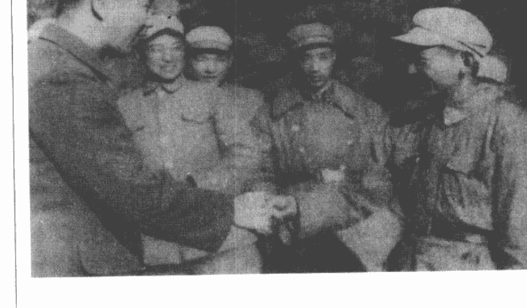

## 统帅与战将的谈话（一）

毛泽东举起杯：“我敬你们一杯！”

杨成武站起来：“主席，我们敬一杯。”

毛泽东：“祝你们胜利，与朝鲜人民并肩作战！”

杨成武：“我们一定完成任务！”

毛泽东连手示意：“大家吃吧。”毛泽东喝完第一杯，继续注意战场局势，注意军事和政治形势。你们给“同志”……

毛泽东第二次举起酒：“再来一杯！”

杨成武站起来：“主席，我们敬一杯。”

毛泽东：“祝你们胜利，与朝鲜人民并肩作战！”

杨成武：“我们一定完成任务！”

毛泽东连手示意：“大家吃吧。”毛泽东喝完第二杯，继续注意战场局势，注意军事和政治形势。

毛泽东第三次举起了酒：“我敬你们一杯！”

杨成武站起来：“主席，我们敬一杯。”

毛泽东：“祝你们胜利，与朝鲜人民并肩作战！”

杨成武：“我们一定完成任务！”

毛泽东连手示意：“大家吃吧。”毛泽东喝完第三杯，继续注意战场局势，注意军事和政治形势。

毛泽东：“你们的任务是把防线稳定在38度到38度之间。”

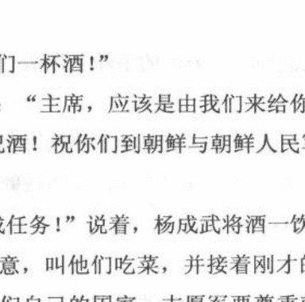

## 知情者说

饭后，杨成武向繁忙的毛泽东告别，离开了中南海。这天深夜，杨成武回忆着毛泽东对他出征部队指挥员的愿望与关切，倍感亲切和责任重大，思绪激动，彻夜难眠，忍不住伏案，写诗首：

如火电令领袖见紫禁城。一席妙语明略，三杯美酒洒深情。热血滚滚，豪气长虹。不负主席不负党，此去将敌平。

## 统帅与战将的谈话（之二）

## 解放战争期的邓小平

## 统帅与战将的谈话（之二）——邓小平一言九鼎

谈话是一门艺术。特别是领导干部找人谈话，可以看出谈话者的水平，又可以看到谈话者的脾气与个性。正是在一次又一次的谈话中，使他们能够得出各种结论——有一种话法：“天不怕，地不怕，怕某些”。怕领导谈话，不仅仅是怕领导批评，有时候这个领导啰嗦，谈了半天不知道说什么。邓小平同志和这些人完全相反。作为一个领导干部，曾经接触过不少跟他谈话的人，他们都有不同的感受，但有一条意见是共同的，就是：他的谈话很有“邓小平特色”——言简意赅，切中要害，不说一句大话，不说一句空话，更不说一句废话。不久前，笔者在他部下工作多年的老同志刘志鉴谈起了小平同志的谈话艺术。刘志鉴不无地提起了下面的三次谈话。

# 知情说说

1936年，邓平和和刘志坚的谈话不足半小时，却留下了深刻的印象。

那是1936年，红一、二、四方面军胜利会后不久，在陇东的黄土高原上，在一间很不起眼的窑洞里，身穿长服的四方面军宣传部长刘志坚，找到了时任红军总司令部副主任的邓小平。哦，这就是中央大区出名的邓、毛、古中的那个邓了吗？他很小措手，脸上一双眼睛颇有神情。刘志坚上前敬礼。邓小平握手说：“你有什么事情吗？”邓主任，我想找你谈话。”说着，邓小平让他坐下来，“谈吧。”“邓主任，我想回原来的部队去，那里同同志我都熟悉，工作起来顺利。”这里要做一次交代。刘志坚是中国农村农工军军团的宣传部长，他们红和四方面军会师以后，在毛泽东和怀国的南方下还是北上的争论中，被派到四方面……

毛泽东指出：“建立了新中国，就像建立了一座很好的大厦，有了好的大厦，家里不能空洞，必须有很多设备，沙发、桌子等；还要挂上字画，安排得当，才不是单一调。我们的人，只要他们有自己的设备，而不是别人的。”毛泽东说：“如果不比革命好，旧革命贡献大，新革命也有贡献。革命不如革命，这样的话不好。”最后，毛泽东又叮嘱：“要清楚道理，我们的同志是懂理，会接受这个道理……”听着毛泽东的话，杨成武感到他就是统帅，站起来就是比别人高，看得了。

## 知情者说

什么革命不如革命？毛泽东还问：你有没有听过这种说法？这种说法对不对？杨成武回答：“听到过。”毛泽东指出这种说法不好。

# 统帅与战士的谈话（二）

出门，刘志坚磨着这位邓刚主任的话：“你就留在那里，这道理不用我多讲。”——这道理刘志坚的确知道，由于某种原因，特别是张国莱的影响，中央军和红四方方面的干部中间有些隔阂，现在师到等了刘，解决这些隔阂和矛盾，相互调动干部是重要的法之一。

这一想，刘志坚的想法就有了，他回到了红四方方面的部队，负责了组织交接的任务。

时隔近60年了，说起第一次邓小平谈话，83岁的刘志坚依然记忆如新。

## 刘志坚被任命为二野第4兵团副政委，邓小平的谈话不超过5分钟

说起这次5分钟的谈话，刘志坚甚至还能记起邓小平的原话。
刘志坚：“哪次谈话，我都记得，因为它干了些。”

那是海战战役结束后，在河南商丘召开的中原野战军的高级军事会议。也就是在这次会议上，中原野战军更名为二野战军，同时成立了各个军团。

这次商兵团会议，开得时间很长，在大战的间隙，能有这一时间的休息，使干部们感到宏大的轻松。

会议闭幕的前一天，刘志坚接到通知，午后邓要谈话。

刘志坚准时到了邓小平的办公室。
“坐下，坐下。”他们已经彼此熟悉。

此时刘志坚是桐柏战区的政治委员，桐柏区党委书记兼十一组织委员，刘志坚坐定，只听邓小平：

“不要回桐柏区了，到四兵团去，和陈彻同志，他做司令员兼政委，你做副政委员。”

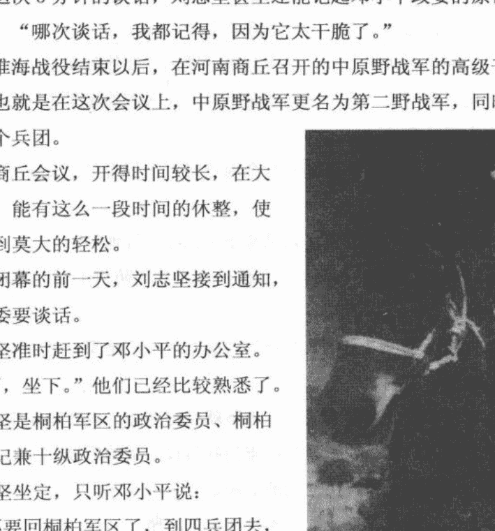
> 1938年初 小平彭袭战后前线

## 知情者说

邓小平顿了顿，接着说：“你做政治是有什么问题的？”

说到这里，他停住，目光直视着刘志坚。

刘志坚刚刚说了两句怕自己不能胜的话，邓小平就说：“不要说了了，没有什么问题就这么吧。”

刘志坚只能举手作礼，告辞了。

## 邓小平复以后，张爱泽和刘志坚谈话更是干脆利索，一言中的

在刘志坚的记忆里，“文化大革命”中，邓平和和他那次谈话更难些。

“文化大革命”开始后，刘志坚就被叫了起来，直到1970年的庆庆。他重新获得了自由。到1975年，邓小平同志重新工作后，他被任命为军事学院的政治委员。

上任后不久的一天，他接到电话通知，他要到邓小平家里开会。刘志坚知道，邓小平同志是不容易让他去家里开会的，这次一定会有重大变故。

虽然，当他的车子到达会地点时，正好看见张爱泽同志从车子出来。进入小伙伴的办公室，只见邓小平已经在等他们了。

虽然经历了“文化大革命”的磨炼，但他还是那样精神，还是那样干脆利索。

他先和张爱泽同志，刘志坚就坐在旁边。内容不是很多，但重点十分突出，是张爱泽同志好技术人员后的后部部长，“要让他安心搞科研，要解决他们的后顾之忧”。

和张爱泽读完，他把目光转向刘志坚。

“你去昆明，第一条，首先要把军队的工作做好。”

## 统帅与战将的谈话（之二）

他看了刘志坚，相信他是理解这话的含义的。那时，“打倒一切，军队和地方揉在了一起。邓小平出任总司令，就是要整顿军队。刘志坚点点头，他又接来说：

“第二条，军队不能搞资产阶级派性。”

听到这里，刘志坚知道他是有错的，当时昆明军区内部的派性也相当严重，这对军队的破坏是非常害的。

“第三条，军队要同地方的资产阶级派性彻底脱钩。”

这一条更是重要，当时由于军队的人出去“左走”，说是要撤出，但还有相当一部分没有撤出，人没有撤出，派性自然就没有脱钩。这也是个很棘的问题。

“还有什么问题吗？”邓小平说：“那就那样吧。”

他们没有说什么，刘志坚想起这次谈话，还在感叹：“就那么几条，条条重要，重点突出。叫你很要要领。这种作风，实在是应该大大发扬！”

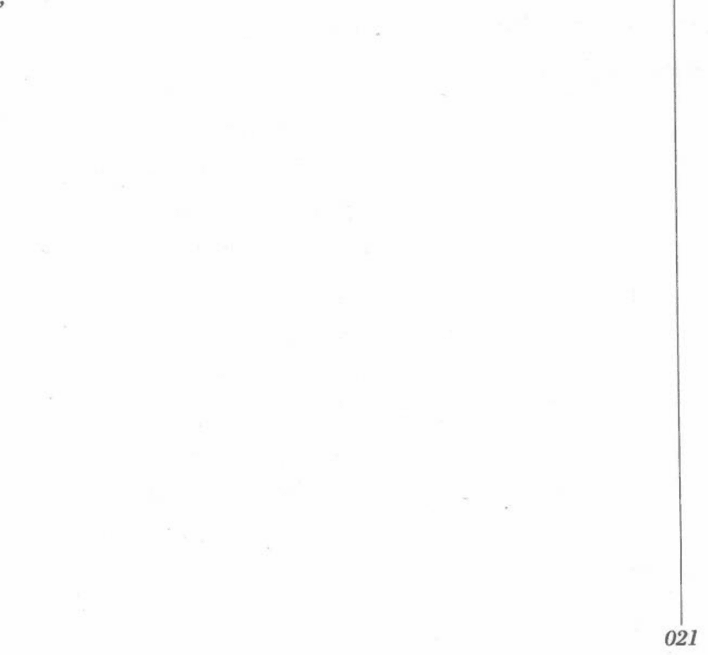

## 知者说

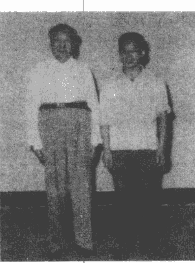
图 毛泽东与吴连登

## 你是我身边那盏不灭的灯啊！
——毛泽东
吴连登录

“你是我身边那盏不灭的灯啊！”

什么时候到毛泽东家里工作的？事务复杂吗？吴连登：我是江苏人。我在1961年到了中央办公厅工作——主要任务就是为党、国务院的主要领导服务。我印象中第一次看到主席是在1964年的国庆节，我在天安门上，忽然听到叫赵君，顾着主席旁边的护士。

“小同志，你干什么？”

吴连登我心里紧张，主席说：“快去呀！”

我这才忙跟她走。来到大殿里面，我看见主席正坐在沙发上，吸烟。

主席放下手里的烟，看着我们说：“你们见过的，就是那个同志。”

吴连登：“主席，我是吴连登。”

主席笑了：“你叫什么？”

吴连登：“我叫吴连登。”

吴连登问主席：“您什么时候到毛泽东家里工作的？”

主席看着吴连登说：“你是我身边那盏不灭的灯啊！”

吴连登对主席说：“这就是吴连登。”

主席转过头来问：“你做政治是有什么问题的？”

吴连登恭敬地对主席说：“我……”

主席说：“不要说了，没有什么问题就这么吧。”

吴连登点头：“主席，我一定好好工作。”

主席说：“我一定好好工作。”

此后没有多久，我就正式到了主席家里。刚到主席家里工作，我并不是管理员，而是管他家里的一些事情。到1968年以后，我的主要任务是管主席家里，自己和孩子们很多杂事。

主席的家里有很多东西——这间房子，里面有几个木制的柜子，里面全是旧衣服。另外还有一些物件。这里没有金银首饰，衣服倒是不少，也没有什么特别好的。第一次进入库房，看着那些柜子、毛巾什么的，老同志，这些都有用。

主席的工资是40元，后来涨到50元。现在的年轻人都不相信，主席的工资是60元。

那时候，主席的工资是70元，后来涨到80元。现在的年轻人都不相信，主席的工资是90元，后来涨到100元。

## 知情者说

毛主席的账是很好算的：
- 房租：10元
- 水电费加起来：80元左右
- 吃饭：100元左右
- 3个人（李敏、李勤、江青）每个人的生活费：15元
- 此外，孩子们的车费和葡萄糖养药费都要从主席的工资出。
- 此外的……

毛主席还有两项花费：吸烟和喝茶，这都要从主席的工资里面出来。这样下来，毛主席一个月的工资就所剩几了。过段时间，我给主席写了报告，要从他的稿费里拿出万元来补贴家里。主席画了圈，我们才好了一子。

年前，社会上传说江青如何如何，好像她有很多东西似的。其实她并没有多少家当，这不是给她贴金的，是怎么回事就是怎么回事。

江青没有多少钱，也没有金首饰，衣服倒是不少，也没有什么特别好的。有一次，她做了一件小翻领西，我给她找来做了，按照她的尺寸做好好了。我送给她看，她问多少钱，我告诉她

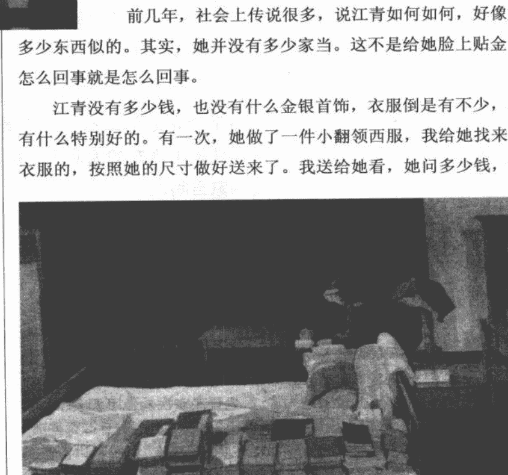
▲ 江青在“文化革命”中
▶ 南海毛泽东处

## “你是我身边那不灭的灯啊！”

她时时就说：“这件衣服我不要了，不合身，坏了。”

衣服明明没坏，我说：“这不是挺好的吗？”

“好，你要，反正我不要了。”

见我不说话，她又说：“这不是我的衣服，坏了，你赔！”

“我不赔，我没有钱。”

她看真的不高兴，把衣服脱下走了。这怎么办？东东看了看衣服，说：“不是，她是嫌弃了。”

江青就是这样一个人，她想穿好的衣服，没有钱，所以经常是长袖短袖，浅色改深色的。总是这么改去，染来染去的，我可是给她跑了不知道多少洗衣店。

主席睡觉的特点是一年四季都盖被子，而且睡觉要有椅子靠着。一旦主席睡不好觉，睡一会儿就醒了。首要问：开窗了没有？如果没有窗子，他就很高气了。客厅里脾气不够，我把他唤醒了。

主席的……

## 知情者说

时间也很很少。有一阵子，主席想看电影，我们那里配了一套手提放映机。就在主席的那间会议里，我们聚起来放。

回想起来，主席都看了些片子呢？电影资料馆是可以查出来的。这些片子中，我们有建国以后的，也有外国进口的，还有早期的某些片子。我印象深刻的是《英军会》、《荒山泪》、《剪马舞》、《黄莲袍》、《后》、《红灯》、《毛雷》、《刘三如》、《不夜城》等等。

1975年他也《创业》，也是我们的。那次批示，起了很大的作用。我记得他不光批的那些话，说：“独立自主，自力更生有什么好处？中国人自力生并非不可。”

有人讲，毛泽东在“文化革命”中，不让工作人员搞个人崇拜，是这样吗？他对个人崇拜的程度如何？谈谈你的亲眼所见。

我记得，有一次主席看戏片子时，他哭了，流了泪，心情特别沉重。这是真的。

毛主席并不是像他们那样非常喜欢搞个人崇拜。两件事我的印象深刻：一次给毛主席放电影时，是一部纪录片，我们的原子炸弹成就（也许也是氢弹成就，我不太清楚）。当看到爆炸成功以后，人们欢呼起来，“主席万岁！”的声音连成一片。画面上露了主席的语录：“下定决心，不怕牺牲……”

## “你是我身边那不灭的灯啊！”

到这里，毛主席一脸不高兴。说：“不看了，不看了。”

我看到主席，主席一脸不高兴。还有一次，主席过生日，我们军规定，不给领导人祝寿，毛主席带头这么做。我们身边的这些工作人员每逢12月26日，还是要向他老人家祝贺生日的。这也是人之常情！那一天，我们找到家里去，我按照当时的习惯，说：“毛主席，我们祝您万寿无疆！”

毛主席看看我，说：“那是咸城人啊！”

我是盐城人，毛主席开玩笑，总说是我是咸城人。我说：“我是盐城人。”

“你是我身边不灭的灯啊！”

我当时愣，“怎么又出发？”
问完以后，我又后悔了，我们在这里已经习惯了，说走就走，从不多后，这次实在太反常了，所以我才问了这一句。

张耀莉又招呼别人。我想，问不行，出发？到哪里？要多长段时间？我怎么准备东西？

我又问他：“主席，要带多少多少的东西？要花多多少钱？”
他火了：“你个吴连！这个时候你还考虑什么钱？你叫你就走走！”

我不敢再问什么，备上主席吃的东西，赶快上厨师，准备上车。
车子拉上我们，出了南海，往向南一直，不会一会儿，停了，我一看，这哪里是大会堂？

我们又急忙把东西的放下。
那一晚，我们基本上没睡觉，见到周总理回来，汪东又回来，他们都是匆匆忙忙的样子。我们当时他们不知道发生了什么，也不敢问。

之后的一段时间，我们基本上是被“软禁”了。只许在指定的那一个地方活动，不许露脸。虽然我不是什么重要人物，还有不少人的认识我，只要我一出面，就知道主席回来了，毛主席在京。所以，我们要的菜其他的东西，都是我写子，供应处处家里面前。

> 作为毛泽东身边的工作员，你能谈谈在那个时的感受吗？

> 毛泽东经过多次资助身边的工作员，你受过这种种资助吗？

是的，毛主席曾经多次资助过有一些困难的同志，据我所知，恐怕他在他身边工作的同志大多数都得到主席的资助。

有一次，我家里出了事，我侄子玩火把家家的草房烧坏了。我是很着急的，把自己的积蓄拿出来，准备寄回去。这个消息不知谁

## 知情者说

告诉了主席，主席叫周福明来找我。
周福明同志说：“主席知道你家里出了事，有困难，特意叫我给你拿了三百元，叫家里把房子收拾起来。”

我当时一时，说：“是谁告诉了主席？这事就不该告诉他了。”
“主席这是他的一点心意，你就收下吧！”
我很感激，借给主席送饭的时候来表示自己的谢意。
主席：“你不用感谢我，你有困难我应该帮助你。这些钱是人民给给我的，你应该感谢人民币。”
我说我会好好好工作，来报告主席的关怀。
主席又说：“我们都是同志，你在这里工作，你有了困难，我们大家都会帮助你。”

不要小这300元，在当时是给我帮了大忙。那时候的钱值值钱了！
后来，是1972年，我家里又有了困难，毛主席又给过了200元。

这些事情我总也忘了。提到这里，我想多说两句，主席对老区的人民特别关心，经常念起来。对百姓的生活也是十分关心的。这方面的事情很多，不用我多说了。

# 作为一个在毛泽东身边工作的多年的同志，你能谈谈你印象最深的东西吗

毛主席酷读书，别人写了什么的文章，我就不用多说了。主席心里装着闲人，很少想到自己，这方面的文章可不少，我也不多说了。
他也没有什么家庭温暖，想来也不是那么幸福的……
他还是毛主席对对他身边人员的要求。他对他身边的工作人要求是严格的。他要求我们忠诚实实，说实话。要求我们严格要求自己，不许揽架子，不许打牌，不许特殊，不许给地方找麻烦，有时间还要做一些调查，抓紧时间学习科学化知识。

“你是我身边那不灭的灯啊！”

他要求我们奋斗，他自己身体力。说他就的一块表吧，他戴了多少年？反正我去的时候他就戴着这块。据说是解放时期沫若送的，他一直戴着这块。在家的时候他不戴，大多放在他的办公桌上或茶几上。

时间久了，表就走不准了，天天要十分钟。店主就叫我我去。我拿到亨得表店，收回来后还是慢。又要我去修。这次我回了你个关系，请北京工办的一个同志帮忙。我就呆在表店里等着师傅修理。原本这块表撞太严重了，有个关键齿轮严重撞了。

在修表期间，我们我们在礼品库里准备了一块表，修好后又马上上了，否则准要是发气的。

还有一点感觉得的是，毛主席这个人医生、对病的姿态。
我们跟他们说说过多次，“这个人有五味药，叫做吃、喝、拉、撒、睡。”这也许说是，他是我们信的。我见过好好几次对医说：“我们这个五个方面都正常，就没有我，我的身体我自己清楚。你我们不要是跟着我，我没事，你应该去医院给病人看病，我这里有事就叫你们叫了。”

后来，他生病了，他也不是怎么肯吃药的，不到，万不得，他不才看病。到了晚上，他和他病痛作斗争。
还有一点我也要说几句，有人说毛主席向是不认的，然而对于我们评价了，毛主席，不是我的任务，但我可以说我们他在身边工作时眼见过的一些事。有一段时间，他吃不好，睡也不好，我们也不知道为什么，以为我们的饭不好。

> 毛泽东身边

## 知情者说

1958年有三大错误，叫做杀猪、砍树、吃锅，把国家乱了。后来他说“文化大革命”，有两大错误，“打倒一切”。

# 毛泽东的口味

# 毛泽东与韩阿富

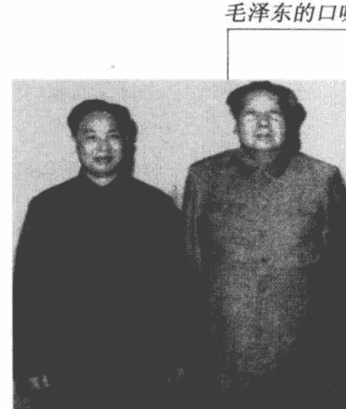

> ——中南海厨师

问：您什么时候见到主席？从什么时候开始给他饭？

第一次见到毛主席，是在1954年。到南海的时候是春天，中南海刚绿。当时我是厨师在南海等了一个月。我是南方人，对北方的气候和生活都不习惯。主要是太干燥，再加上中南海有着严格纪律，没有事外出。

我是南方人，胃口口，。我给毛主席吃饭。当时晚，，睡睡觉，我见到毛主席，激动心情。那晚，我差点睡着。没想到毛主席那么容易。

我给毛主席了。主席和江青都说。所以以后他们才提出我要北京当厨师。

问：你是哪里人？
主席又问：“你是哪里人”。
“哦，你是鲁迅的老乡！”
大家都笑了。主席继续散步，我看着他的背影，好像相信似的，“我见到毛主席吗？”

我给毛主席。我干了二十天后，实在不想出去，我想回到浙江杭州。我把我的想法和当时管我们的张柯告诉了，他说：“你最好不要回去，有什么困难我们解决。”
我说：“没有什么困难，是我呆不习惯。我还是想回去。”

我看到他要回杭州，就负责警卫的工作张琪从客气地批评我。他说：“你又回来了？什么呆不习惯？我看我不明白。别人想去南海去了，你呢，却跑回来！”

我说，没有别的原因，就是生活不习惯。
他说：“你叫毛主席吃饭你不难道你愿意给资本家干？”

我这才体会这件事的分量。

我再到北京的时候已经是盛夏七月了。主要的领导人都来到北京西河去了，我也很快到了北海河，继续为毛主席服务。记得当时有4个人为毛主席吃饭。我一个，李希成一个、廖饺夫一个，还有一个老友同志，他是负责打杂做些活。

从此以后，我就一直当毛主席的厨师，直到老人家去世。

问：给主席厨师好当吗？主席在吃饭时有什么特殊的要求吗？能谈谈毛主席口味的特点吗？

这个问题怎么回答呢？

给主席厨师，容易也容易，为其也难。

刚开始，毛主席和江青在一个灶上吃饭，我们就感觉不好搞。有的东西，江青喜欢；有的东西，毛主席喜欢，江青却不要。这就难为我们了。江青是北方人，不知道养成了南方人的一些习惯。

她不喜欢吃姜、蒜这类有刺激性的食物，而毛主席特别喜欢。如果桌上没有辣椒、葱类的东西，毛主席就说没有味道。还有主席特别喜欢肉，红烧肉、豆瓣肉、米粉肉、肘子都喜欢吃。江青看，看到肉就挠头，只吃一点里肉。是我们给主席厨师的，当然要把毛主席放在主要的位置，做菜时要充分考虑到主席的口味。有时要让主席准备一些菜，这就出了问题。当这种时候，江青就不高兴了，她说：“你这个师傅，变成咸了！”

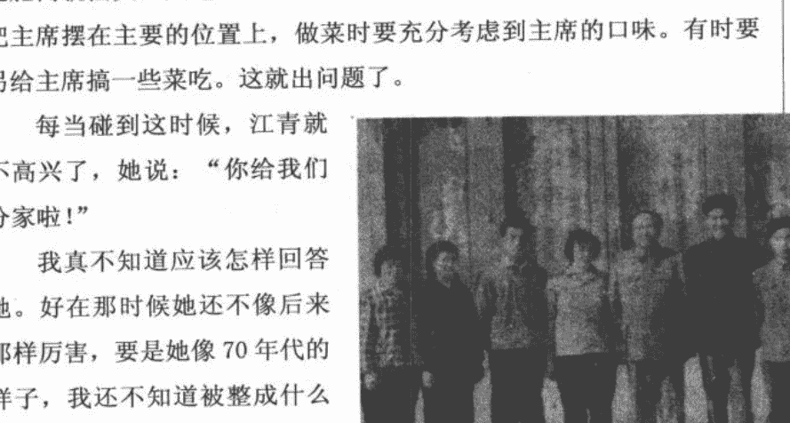

# 毛泽东的口味

> 晚后

一次，我菜做得咸了。

“晚后主席又说了什么了？”我说：“不知道哟。”

“文化革命”期间，我做了肉馅，主席活动特别多，体力消耗也大，所以胃口特别好。有一次给他做了肉粒，整半粒，他吃干干净净。第二次又给他做了6块，他又吃光了。护士吴君走来说：“韩师傅，你知道主席说这话……”

“没有什么，为主主席服务。”

“要注意休息……”

还有一次，我们在专列上烧烤。南方天气太热，又没有空调。我光着脖子只穿一条裤衩，赶忙不好找衣服。主席笑了，说：太热了，你去休息一下。

我说：这怎么能让你去呢！大家都笑了。

问：毛主席晚年的饮食习惯有什么改变吗？最后一次给他吃饭是什么时候？

主席晚年的饮食习惯有改变，但改变不大。他去的一年多时间里，主要食物就是豆腐。用鱼头豆腐。一次用一只新鲜鱼，炖出白汤。他平时只吃顿饭。那时候渔业不像现在这么发达，所以我们用南海的鱼。主席很执，他的病情严重后，医生让他按照科学比例配好食物。

最后一次给主席送饭，是9月8日。

演习中，亚洲、苏联、朝鲜、越南、蒙古等国开展了军事代表团来参观，党和国家领导人少奇、周来、朱德、陈云、邓平等等到了现场。通过这些演习，丰富了我军在现代条件下的作战知识，取得了诸军兵种战斗训练的经验，并把我军的训练工作向前推进了一步。

1957年初，由叶英来到军事学院的筹建工作，由我接替担任训练总部长和党委书记。然而不久，一场突如其来的反教主义运动开始了。

> 问：对1958年发生的反教主义的斗争，年轻人已经不知道了。只是这次斗争整了刘伯承，也便将大、你、李同志受到了不应有的批评。据说你对这件事有很深的思想，并不仅仅是自自己的蒙蔽

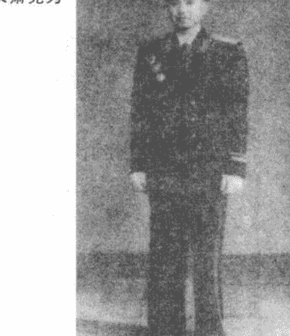

# 风云一九五八——萧克的访谈录

由于力量加强，充实了许多军事理论经验的干部。在到军事学院培训的十余名。这次也回来了，工作范围（主要是军队，还包括地方武装）增大，开展得更广。由叶竞为委员会主席，便于各区与各军、兵种协调，对训练组合演练等事务，比过去更顺利。

在训练中，我除了维持军部队训练，还负责日常事务，帮助叶帅处理一些日常事务。叶帅抓住了现代战争的特性，他极力主张在全面开展现代条件下的军事训练，指出现战争发起的突发性、战况发展的迅速性、组织训练的复杂性等，我们要根据这些特点组织训练。在这次训练中，叶竞发扬了“加强特殊种的训练，加强要在现代武器条件下部队行动和军队进行夜间战斗”的方针。在“的军队有素质和优良传统的基础上，继续搞社会主义胜利，掌握训练的科学，学现代战争——某些条件下及复杂情况、复杂条件下的诸军兵种合成合作，以应对可能的突发战斗，保卫社会主义建设的胜利，这使得训练方针的表达清晰准确，也使训练工作的指导思想更加明确。

根据完毕，在训练结束后不到一个月，就在北京地区连续组织了次训练，全军3000多名干部来参观，国防部彭怀也到了。36个月后，由叶帅亲自担任总指挥，在东平岛组织了一次大规模的登陆演习。参加这次演习的有海空战士4.8万。

这是解放军队第一次组织进行的在海洋中使用原子、化学武器条件下，陆海空海军抗登陆战演习中集团防御演习，目的是为了摸索现代战争条件下训练和作战经验，用比较标准的条件，形成客观的方法来训练军队指挥员和战士。

同志认为是，在向苏军学习过程中，存在着某些不实际、机械搬用形式主义的毛病。比如，对苏军命令、制度中某些不符合我军实际的东西，不加选择套用。同时，也认为，我们是在无一所有的情况下与苏军联合的，因抗美援朝急于，不完全收获是不可能的。因为那时我的武器装备大部分是从苏军引进的，技术教材和训练教材自己一时写不出来，只能用他们的。这，必然带来一些副作用。

看，建国六年来，军训工作却是主要的，缺点是正在先进的支教，也能很快很快的。但也有同志认为是，军事主义在军队训练和教育系统中已经成为一种主要问题，从训练队内容到训练方法，都是有严格的军事主义。

与此时，南京军事学院在学习苏军时期后，产生了分歧意见。一方面学员对当时实施的“六个时一周制”的课业进度和近似“散会议”的形式，反映强烈，认为不符合中国人的生活习惯，显得张躁，不受接受。有的同学给我写信，反映军事学院“在教学方面，军事方法对于我们的经历的经验方面以及其他方面”，都是军事主义倾向的。

当时军事学院校期间的同志工作组来到南京军事学院调查。他在学习苏军高时期，曾提到一些过过的口号，引起了不同老师的反。这或是由于他想逃避某些责任，挽回影响，又不切实际。大军事主义在军队和校期间的严重性，他把训练工作中的某些缺点错误，都同军事主义联系起来。他是带着框框去军事学院调查的，这位同志与同事相同的意见经过检索和分析，就成了“军事学院主义权威”的结论。同同志的政治部副主任吕洪在学院政治部说：“军事学院是军事主义的大本营”。这时期还传出一种论说，“训练总都是军事主义司令”。

今年，军事对学习苏军经验也引起了重视。1955年2月，国防部长彭怀带了一个小组来到南京军事学院调查。两个月后，彭总对中央和军委给我一份报告，对南京军事学院的教学工作做了这样的评价：“……在过去军军学中，就存在一个很大的缺点，就是在教学中

## 知者说

教条主义相当严重。主要的表现是教学内容和我国当前的实际情况不适应。在教材和作业制定中，对于我军党委集体领导和首长分工负责相结合的制度，对于我军的政治制度照顾不到，多半是采用了一长制。

……从学院方面来说，在成立6年多之后，对于我们军队军的实际情况进行教学，仍然引起应有的重视。特别是1956年9月全学院学习五，学院中的许多同志已经感觉到反教条主义必要了，而学院党委徘徊、犹豫、拖延，未能下决心，使党委领导在教学工作上落后于客观实际。

虽然，彭总的报告对军事学院教学工作的评价是基本的否定的。在北京工作的军委秘书长黄诚组织讨论这个报告，我加入了认为教条主义和教学是训练和教学中主要导向的观点，是

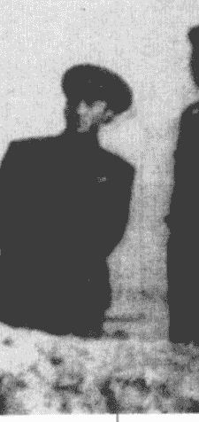

不同意的，特别是把军事学院定之为“教条主义大本营”的说法，不满意。我认为，工作中有些点、有错误，可以批评，可以纠正，但不能忽视大事。军事学院在教学方面有生硬的东西，但还不能说是在整个教学内容上都“与我国军队的实际情况不适应。

主持会议的黄诚认为报告对军事学院的评价是适当的，不同我的意见。我坚持认为，应当肯定学院的成绩是主要的、基本的。黄诚认为报告并没有否定学院的成绩。我认为，说教学内容和我国军队的实际情况不适应，逻辑上就是全盘否定，这样就接近全盘否定，至少容易产生全盘否定的感觉。

## 风云一九五八

黄克诚说，那就把这句话改成“有些不适应”。后来重印文件时，又改成了“不太合适”。当时我不在场。这样改后，我也不再说什么了。

不禁说了，但公认为并没有统一。我感到，当时的分歧并不是不要学苏联和没有教条主义的问题，而是中国成立以来中央和军队制定的训练方针如何看。内部有人对当时全军在执行方针提出了不同意见，他们认为在没有武器的情况下，“要让我们的军队完全在使用武器条件下，短期内达不到的”。

我认为，军队训练方针都是经过中央和军委正式审查、批准的，而“在武器条件下作战”方针，是根据中央和军委关于现代化、规范化战略拟的。不能反映教条主义，其理由：一是中国还处于半殖民社会中，有一定的工业基础；二是取得了政权后，在全国范围内改进训练；三是在战胜日本侵略后，加强武器建设。

## 知者说

问：据说因为这些不同意见，你给彭怀同志写过一信，和他进行了争论，是这样的的吗？

答：1958年2月，彭怀同志在报告初稿上征求我的意见。他说：“正规化、现代化对我们在长期斗争中建立起来的军队，显然是不够全面的、错误的，因为正规化、现代化这两个号没有联系政治内容”。我对彭总对军事学院教学工作的评价是基本的否定的，感到有必要和他交换意见，于是给他写了一封信。在信中写：“正规化这个号对不对？因为正规化在全国范围内实施时，我们处于生产力低和交通不便的情况下，各个地区产生的军队，除了统一领导和统一战术外，其他如编制、装备、作风、制度等等都不统一的，这是完全理解的，也是正确的……在全国胜利后，随着国民经济恢复和建设逐渐增大，提出正规化的号，同时提出的现代化的号，是符合历史发展情况的。”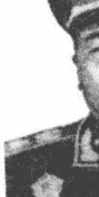

彭怀元帅：

“正规化、现代化这两个号在没有武器条件下，是不符合军队实际的训练计划，就是教条主义。”

问：谁知道这封信在反教条主义后成了挑战了国防？后来召开四级干部会，当时的情况是怎样的？

答：在给彭怀写信后不久，总有一天召了机关四级干部会。这次会议是为了贯彻当时的“双反”决定，即反右倾保守、反反主义。我们对教条主义在反反主义的问题上，大家的认识比较一致。我们对全军的经费打算，把能节的经费节约，共花费20万元，有利于国家建设。

讨论到右倾保守和教条主义的问题，又发生了争论。本来，我和副部长都通过这个会，把大家的思想统一起来。因为自从军内出现“军事学院的大营”、“军事学院是教条主义的司令”等等，扬扬扬扬，我们都认为要从思想上统一清楚。我们认为这不是事实。中国成立以后，我们培养了一批党员的高级干部，在抗美朝鲜战争和军队建设中发挥了作用；从军训到军事学院，领导全军现代化、规范化训练，在学习苏联中，也积极整合苏联的政治工作和军队制度。根据我国不同地的气象条件，将全部队分为六种类型进行训练等，把军事训练成为保卫社会主义的坚强堡垒，我们怎么能用“教条主义的大营”或“教条主义的司令”来决定这些成就呢？当时，大家对一位副长的意见比较较大。过去，对学苏联叫极端，提出了什么“不走学路”、“先学后用”、“高学低用”、“死学适用”、“不愿意苏联的滚蛋”等不实际的口号；现在他又把学习苏联都说成教条主义，说学习苏联学得足够，中毒更深、“南京军事学院多年来的教学是教条，危险的是继续学下去”。他这样从一个极端推向到另一个极端，引起了刘总对同志的不满。

当时这位同志考虑到总部工作已经结束了。考虑到大家对他的意见很多，他们也想把前面的工作统一一下，就请书记秘书长黄克诚要不要请他回来听听？黄克诚明确表示，让他回来参加会议。这位同志回来后，大家没有打功夫来提意见，对他意见下达一个就可以了，没有必要把他也叫回来；回来后，又不是和风细地提意见，不利于解决党内的矛盾。

然而，而在四级干部小组快要结束的时候，事情突然起了大变化。总政在工作中。他们一到，就表示说训练总是搞教条主义的工作组。当时的总政组织部还宣布：“旧的四级干部就是反对我们，因为对我们×××就是反对，反对就是反对反主义。你们×××就是反对中央。”这种以抽象推测做法，层层向上、向下、向旁靠，以推测得出结论，根本不是实事。自从我给彭写信后，一直在等回复。我担心直率地提意见，会不会引起他的反感。但他没有发现现在他已经表了。

问：请你谈谈参加军扩大会的情况？有人说林彪的某种点起了作用，是这样的吗？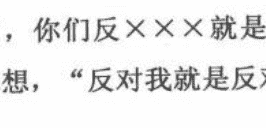

答：总政工作起来后，会议风转向，教条主义已经结束了主流。这时，我接到了参加军扩大会的通知。总的四级干部暂时休会。这次军扩大会是军委召开的。在会议上，毛主席倡导“破除反对主义”作为会议题，各地区、各部门提出计划，中央要用地方来训练，说军队落后了，要跟上来。建议军委召开大会，用整风的方式讨论军事建设中的重要问题，统一认识，提高觉，并在基础上将各项工作都贯彻。会议开始时并没有把反对主义当做会议题，因为毛主席在会议上说：“军事工作中反映了一部分，但建军基本原则要坚持，不能是教条主义。”那时候的军事机关，反教条主义的空气已经杂。在一次会上，我听到彭总讲了一段。他说：“有些话不太明白，因为我出来当塞，没有上过大学，不是学术权威，我也不是资历，既不是南昌起义，也不是被举动的；要阅龄。”并说：“撤了国防部长的职，我进了总的大门；军事学院又有许多专家，又有军事权威，我不敢去。”这带有些情绪的话，使动了，我觉得彭总的话很有道理。刚从中共八届五中全会议上宣布副主席林彪，风头夺目，含有危险的意思：“有人提到学习思想放到外国，专外的东西，以”。img/af21ade2b611ca64f3a787d1435b14f8_66_0.png)

## 风云一九五八

1958年5月27日，中央军委在北京召开大会，党受到错误的批判。

## 知者说

问：只有外国的东西才是好的，这就是迷信，一定要打破迷信观点，“不要一说是外国的就津津有味，把本国的东西看作是土包子”，“我们的经验非常丰富，不能把黄金当作土卖掉了”。他还让人听面主席说：“有的单位不打主席”。img/af21ade2b611ca64f3a787d1435b14f8_67_0.png)

答：事实著作作为军事教材，只作为参考材料是不是不的。有的单位参考中没有列上，就更应该。林彪从自己的口气说这话，是不点名地攻击军事学院和训练总部，攻击他支持的两个单位的领导。林彪打着主席的旗帜，处焰火，天下乱。军扩大会从5月22日开始，持续了约两个星期，反对主义就通过了会议的宗旨。这次军扩大大会开始时的文件，所批判的对象是XXX、XXX三个的名字、XX两个的名字。批判的焦点集中在李达的身上。

问：为什么会发生这种变化？我当时并不清楚，自己清楚吗？是不是因为你当时太锋棱露了？

答：为什么发生这种变化？我当时并不清楚。一年后，在1959年8月军扩大会上批判彭怀怀时讲了一段，才搞清楚。林彪说：“去年军扩大会反映反对主义的主题，我记得很清楚。总训四级高级干部召开了一个月，这时彭怀同志党竟站在什么立场上是很仓糊的……在军扩大大会以前，彭怀的态度也是不明确的……我刚回来时，XXX同志找到我来这里，我听到萧、若是社会主义，我才开始接触到这个问题。当时军委扩大大会上要开，并没有确定以反对主义为主。我得到了这材料以后（指没有他人告诉他军事学院和训练总部的问题），认为应该以此为主题，军扩大大会应该有这个思想内容。把情况报告交给主席，毛主席认为应该开展这场斗争。会议是毛主席决定的，材料是×××提供的，这才有去年反反对主义为中心的军委扩大会会议……林彪这时候已经是军委扩大会议的主持人，而彭怀则是要批的对象，这里显然有击的，抬高自己的成分。过去，林彪的理解，认为他确实惯于利用矛盾，达到个人的目的。在江西，有些同志认为。6月9日，黄克诚传达毛主席指示，说主席对会议关心很大，大家不要走。6月20日，召开全体大会，代表增加到1000人，还有38人，会中彭怀在大会上讲了话，他一开始就提出反教主义斗争是新阶段两条路线斗争，并要求我们扣上了“军事主义”、“反对毛泽东战略方针”的帽子。这些话不是人的意见。6月23日和29日，彭怀在大会上发表了话，他说：“学校里怪得很，中国军队战争经验不讲，专门讲‘十大’，不知道军事学院、训练学院，到底有多少”。马克思、列宁活着，一定批。

的，的，是，是，的，是，的，是，的,list,of,page.

page,one,is,in,land,of,break,the,the,circle,of,the,point,of,在，的，在，的，是，的，是，在，在，在，在，在，在，在，在，在，在，在，在，在，在，的，的，的，的，的，的，的，的，的，的，的，的，的，的，的，的，的，的，的，的，的，的，的，的，的，的，的，的，的，的，的，的，的，的，的，的，的，的，的，的。

## 风云一九五八

另外之外的是检查是否符合事实。那年秋天，彭主持维持委员会关于错误的决定，我心里不是真的，发言时说“基本同意”，这还遭了批。他们们说：“基本指的是多少？百分之五，还是百分之六十？”我也了所谓开会是什么意思，不是加强加油打一场而已。我说了。当时参加会议的。还有一件令不快的事。军委大会以后，他们指定郭天民担任训练总期间党委书记。本来，郭天民与我们在部队建设、战斗训练等问题的看法、做法，大体一致，他们却让他来领导揭发我和李达。在这种情况下，郭天民只能表现积极，但是，我们的结论说。

## 知者说

作完，邓明天马上就批了对象，给他的“帽子子”，与我们一样，而且成了我们这个“集团”的“副帅”。到1959年5月14日，中央批转总政治部《关于泽东同志为首的资产阶级分子路线和反资产阶级活动》的报告，并以中央文件形式发接到各地，这场反对主义运动结束。在运动中，除了李、邓明天外，还有李信奇等人都被打成“反分子”。这些在训练工作岗位上就业、辛勤工作，为建立正规化、现代化的革命军队做出了巨大的贡献，有的未被撤职，有的降级，许多的降级被送地方安置。特别是对措英处理得更重，因措英在工作组的威权诱下，拒绝揭发军扩大会中被点名为高级领导人的所谓反对活动。他们说他是坏分子，把他赶出军队，到边疆改造，使他在地方受到误解，长期被视而视有安排工作。

从现在就是90年代的眼光来看，你反对主义的怎么看呢？

由于反对主义被扩大了某些先凭，全军各级军事训练学校的工作和院校校的干部，大部分受到错误的批判；院校校特殊的教研室主任一级的干部，被批为“传播资产阶级路线的媒介”而调离院校，改进行其他工作或处理转业。严重打击了部队现代化建设艰苦工作的积极性，让他们心里心有余恐，不抓教材训练，不抓军事训练，院校校不敢开展国际交流，不敢开展军事学术研究活动，以后刚刚开始的全军正规化、现代化建设受到严重打击。这就是联次军委会议反对反对主义。

## 知情者说

非，终将会回归它的本来面目。随着时间的推移和实战的检验，反教条主义运动越来越被证明是错误的。

粉碎“四人帮”以后，党中央对进行拨乱反正、平反错案，我们也曾组织提出对1958年反教条主义处理结论的申诉。党中央中、中央委员会批准，总政治部于1978年11月7日发出通知，对当时的结论做了改变。通知指：“萧肃同志在训练总部工作期间，犯有单纯军事观点和教条主义等错误，受到主席和中央委员会委员同志的批评是必要的、正确的。但鉴于当时萧肃同志已经做了检讨，影响崔和林别无用心，整个人，严重地击垮了萧肃同志。此决定撤销‘以萧肃同志为首的资产阶级军事路线和反党破坏活动。’”总政结论，由于当时历史条件的限制，对所谓军队教条主义问题仍然没有解决。

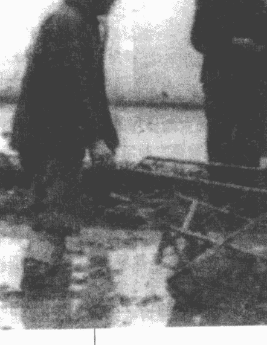
▼萧肃（右二）在视察机场试用的棱频机

真正解决这个问题，是在20世纪80年代以后。

1980年，主持军委工作的邓小平同志明确地说：“那次反教条主义是错误的。”向前在全军后勤部长座会上又说：“建国以后，办了很多学校，有很大成绩，但后来吃了两个大亏，一个是对反对规范化吃了亏，二是反教条主义吃了亏。”

聂荣藻也说：“向苏联学习，主席就照他们的办，就向他们学习……后头反教条主义，把这个问题推诿到刘帅身上，这是不合的。”

1986年10月16日，在刘伯承帅道会上，当时中共中央总书记胡耀代表党中央反对抽象教条主义作了彻底否定，明确指出：“1958年反教条主义是错误的。”

1987年1月27日中央军委《关于新时期军委政治工作的决定》指出：“从50年代后期开始，我军政治工作逐渐受到‘左’的思想的影响，错误地开展了‘教条主义’斗争并批判了‘资产阶级路线’，给我们政治工作造成巨大的损害。”

1958年11月25日总政治部和中央委纪律检查委员会专门了文件，决定撤销教条主义1978年11月7日通知的内容，为当时因反对教条主义问题上受到处理的同志彻底平反，总政治部对这些错误批判和处理错误的同志作出“彻底平反”的决定，也是对他们在人民解放军历史进程中的贡献做出了公正的认可。

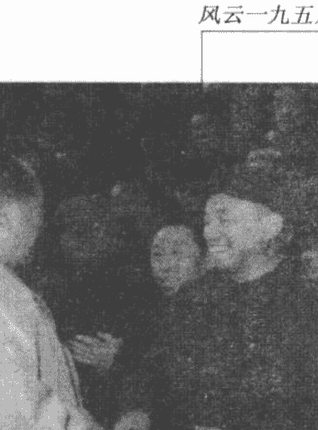
▲ 1968年在天安门城楼上见到老主席接见

问：从总结教训的角度，从一个老人来看这些年老人怎么说？

# 10

1958年的反教条主义已成为公认的历史。对这段历史进行反思，是有很多深刻深刻的。1990年，我们给党中央和中央委写了一封信，谈了谈对这段历史的思考，其中有这样一段：

“我认为现在要实现社会主义四个时代，必须安定团结，建党的生活正常化。必要的批判斗争，也要从实际出发，绝不可扩大化。过去去搞运动首要领导人有几个口头号：‘思想批判，组织处理从宽。’而‘批’是在‘基层必须过正确’的错误原则指导下的‘批’，就不符合事实上线上合。政治、思想上一级极高，所谓‘组织处理从宽广’”

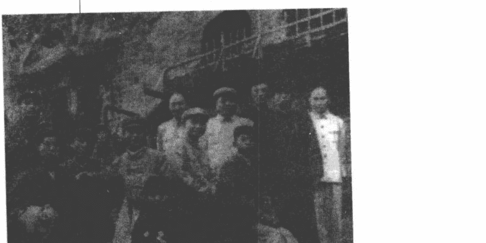
▲萧克（右六）与农休息部的同志在西北地区国营农场调查。这是在麦积山的影像。

所谓‘组织处理从宽’就是十足的虚伪。这是二十多年来的证明了，以后对政治问题不可凭空制造，或者出了问题，就及时当地和有关单位解决。把那种无休止地写大字报、写批判稿、写检讨稿、开大会，读书、学习的工作吧！这就是对党内斗争问题的深刻思考。

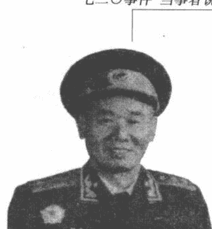
▲陈再道

# “七二事件”

1967年的夏天，武汉发生了震惊中外的“七二事件”。隔多年之后，重新审视这一件事情，是一件很有意义的事情。笔者走访了一些当事人，也研究了一些资料，发现这个事件还有值得研究和思考的问题，分别将有关访谈材料给读者。为了阅读的方便，把陈再道、杨成武和王力的话对照起来，这样读者可以多加了解。‘七二事件’这个词对年轻人来说已经陌生，但那个时候全国都知道的。

陈再道

1967年“七五”前夕，我和钟华同志回武汉。这时，武汉地区群众组织已经划分为两大派。“支左”方向的正确与否，是斗争的焦点。武汉下的所谓反派，提出“打倒陈再道，解放武汉”的口号，到处挑起事端，制造武装事件，甚至罢架钟华同志，执行“支左”任务，给武汉军区施加压力。这种激进手段，激起了武汉军民的巨大愤慨。5月16日，群众组织自发建立了“百万师联络站”。百万师认为是武汉军区“支左”方向是正确的，不能打倒。对于地方都是比较好的。百万师的队伍迅速溃败，“七二事件”发生后，已有二万余人，其中党员占全员数的八十五以上。武汉军区驻扎的部队广大战士，思想也倾向百万师。我们从内心也认同他们，只是由于所处的位置不同，不能公开支持他们了。与百万师相反，造反者“恨一切”，“打倒一切”，自己建立起来，人数越来越少。我们从大局出发，仍然重做他们的工作，采取各种措施保护他们，怕把“武汉大革命”的“闯将”掉了，替了错。

6月4日，武汉军区发表公告，在肯定“支左”方向正确和重视工作的同时，检讨了“支左”工作中的某些错误，希望各群众组织在新的形势下，大家同心协异，实行大联合。《公告》发表后，造反者认为我们是“假检真反扑”，闹得更厉了。百万师对《公告》也不满意，认为我们太软了。

武汉下的造反者所闹这么多，完全是林彪、江青、康一方乱搞破坏的结果。这件事的内幕，到粉碎“四人帮”之后，才初步揭开。1967年3月以后，林彪多次对吴宪等多次：“要把军队中搞不好的人（即不听林彪的），都抓出来烧掉。”那些人不听林彪，吴宪等心里是有底的。5月份以后，吴宪根据林彪的意思，先给武汉军区空军刘等人打了四五次电话，要独立做事，不要听大军区的，不要跟大军区跑。

4月份，中央文革派大批北京各校的反派来到武汉，以“调查”为名，进行反军造活动。北航红队的几个反派来到武汉，召武汉反派的领头们聚在一起，说：“武汉的‘谭林宪’，武汉的戏闹乱不了了他的”。这个话并不是根据我的说，事实上，中央文革和武汉的反派领头儿就有直接的联系。林彦、吴传伟和魏权的秘书5月初先后接见武汉反派的一个领头说：“武汉反派的问题主要是军内一小小的斗争，这是一场大规模复杂的战斗，需要把全国的老反派组织起来。”“武汉的‘谭林宪’是陈再道、陆庆绪、韩东，台后是徐前的。”“武汉五月十六日要反派的问题，是支持你们的，你们要借东风，强化矛盾，口号要明确，是要打倒陈再道，不要把张学和王力分开来说。”

在中央文革的操作下，武汉下的反派（多数是年轻的孩子们）导致两次冲突，武斗升级，惨烈。这时，中央文革办公室和全国文革办公室发来电：6月6日，“最近武汉发生的大规模斗是不正常的，希望武汉区立即采取有力的措施止武斗。杀害群众的行为，应当按照中央命令严肃处理。不久之后，中央将武汉区和各群众组织的代表来京汇报。”这份测是简单的，黑色的电报。在电报发表之前，武汉反派联络急需有关相关的材料，并且每天向中央汇报一次。从电报中完全可以看出中央对武汉区的态度。

陈再道

## 知情者

王力

王力也是“七二事件”的重要当事人。他对这段历史有自己的说法。

1967年的夏天，武汉发生了震惊中外的“七二事件”。隔多年之后，重新审视这一件事情，是一件很有意义的事情。笔者走访了一些当事人，也研究了一些资料，发现这个事件还有值得研究和思考的问题，分别将有关访谈材料给读者。为了阅读的方便，把陈再道、杨成武和王力的话对照起来，这样读者可以多加了解。‘七二事件’这个词对年轻人来说已经陌生，但那个时候全国都知道的。

对于这段历史，王力是说的：“1967年6月下旬，我和富洽去云南、四川、贵州。他认为光到北京不行，就要解决问题，从昆明开始。主席特别提出要王力负责，因为他在那里当第一书记。主席去武汉并不是游泳，就是要解决问题：主席当时认为，群众发动部队已经结束了，差不多了。主席讲：‘文化革命’一年发，一年胜利，一年扫尾。云南是因为云南的问题在军队了部队是主席时，我们没理他们，也没有找林彪。富洽和我去云南，经理知道。主席布置工作时我们要走上来。主席叫我把工作交给他们；从我就不管宣传了。我做了些准备，临前很晚了，我要富洽一起陪请示。到底哪里，他已经说过，还有很多人等着见，主席先见了我们，做了些指示。我们是6月二十九号动身的。第一站是昆明，然后是成都、贵阳。富洽提议增加经费，又提议增加供给。至于林彪为什么要看武汉，我们有如下说法：

> “七二事件”发生后，在臭名昭著的《八九语》中，全国各大军区有两个不放心，一个是北京，一个是武汉，他们没有办法。“文化革命”解决了这个问题，通过“文化革命”，让各种坏暴露出来，把各种谎暴露出来，问题解决了。在这个话中，林彪既白了他整个武汉军区的贯用心，也表现出了他在“文化革命”中进行反党夺权阴谋时所采取的反策略。林彪之所以对武汉军区不放心，事出由于，由来久。早在延安时期，汉华同志负责工作，发现叶群参加过军队。当时，叶群胜利，林彪也大获，但汉华等人坚持原则，据实给叶群作了结论。1964年军委讨论主席对战略方针的指示，我说：“主席的指示，是1960年战略方针（林彪制的）在新的形势和新条件下的补充和完善。过去的，今天是有缺的，当时也有缺的，没有按照主席指示的完成、完美配套。”我的发言有批评林彪“南北作战”符合思想的意思。此引起了一场“风波”。黄永沛等人对我进行调查，硬说我是对主席的，针对立了起来，是否过去的针，反对林彪。同年，叶群到广州军区调查，说大比武是“挤空子”、“弄虚作假”、“锦旗主义”和“冲击政治”等等，把大比武说得无一处。许多同志认为用“两分法”看待大比武。我也这种观点，发言：“大比武的成功主要是主席的，没有大比武好。”叶群调查实际上是林彪为了赖罗卯同志罪名。我们公开道，当然得罪了林彪。1965年，林彪到武汉，因我在外检查，没有接待我，而黄永沛却专程从广州到武汉接待林彪。相比之下，林彪在武汉有错。后来，我告诉这些同志，林彪在武汉要赖罗卯同志，并且有所指，他所说：“你们武汉，有没有罗卯？”“文化革命”开始以后，湖北省分区给武汉军区报告，说要像修鉴山那样林彪家湾（林彪的家乡），要把路修能够通行四大车辆的柏油马路。

“文化革命中的江青”

## 知情者说

这个报告，我们压了下来，没批准。说实话，我们当时还是好心，怕了林彪。这件事我们没有违反性，也不是组织活动，但林彪长期恨，费尽心机把群众发出来。当然，林彪整个军区的目的，不仅是为了打倒，是要从武汉开刀，肃清党内障碍。

1967年7月14日，毛主席抵达武汉。主席的专列是7月14日8点抵达车站。到达时候的人很少，车也不多，后来有一辆红旗是主席，另外几辆轿车。在车站上看到“打倒”标语。15日凌晨后，主席把我们送到东湖附近。主席住在庄，汪东兴、张耀、柯卫都在附近。当时，富洽、王力、余立金等带一群北京的反派从成都、重庆于7月14日中午抵达，住在东湖宾里，我们只有一条河。这个时候到了？巧合还是我们并不清楚。后来主席是在13日中午决定去武汉的，由于主席的专。14日赶到武汉，负责主席的工作。并没有要求王力一同。而王力听到这个消息，连夜给主席通电话。他们策划，王力终于打着“中央代表团”旗号来了。晚上，主席提出的“暂时不要游泳”。

1967年7月14日，毛主席抵达武汉。刘卓带路，开车到湖北大学门口，公开了他们的身份。第二天，武汉地区遭遇反派举行大规模游行，以示热烈欢迎，称他们是“毛主席的亲人”。这就就把武汉军民捣乱了。由于要经常使用飞机，为了方便，周总理同意余立金（空军政委）到我们这边来。余住闹一路。特将家安顿后，周总理召集我们几个主要，述了当时的情况：主席的专列是7月14日8点抵达。到达时候的人很少，车也不多，后来有一辆红旗是主席，另外几辆轿车。在车站上看到“打倒”标语。15日凌晨后，主席把我们送到东湖附近。主席住在庄，汪东兴、张耀、柯卫都在附近。当时，富洽、王力、余立金等带一群北京的反派从成都、重庆于7月14日中午抵达，住在东湖宾里，我们只有一条河。这个时候到了？巧合还是我们并不清楚。后来主席是在13日中午决定去武汉的，由于主席的专。14日赶到武汉，负责主席的工作。并没有要求王力一同。而王力听到这个消息，连夜给主席通电话。他们策划，王力终于打着“中央代表团”旗号来了。晚上，主席提出的“暂时不要游泳”。

主席的专列是7月14日8点抵达。到达时候的人很少，车也不多，后来有一辆红旗是主席，另外几辆轿车。在车站上看到“打倒”标语。15日凌晨后，主席把我们送到东湖附近。主席住在庄，汪东兴、张耀、柯卫都在附近。当时，富洽、王力、余立金等带一群北京的反派从成都、重庆于7月14日中午抵达，住在东湖宾里，我们只有一条河。这个时候到了？巧合还是我们并不清楚。后来主席是在13日中午决定去武汉的，由于主席的专。14日赶到武汉，负责主席的工作。并没有要求王力一同。而王力听到这个消息，连夜给主席通电话。他们策划，王力终于打着“中央代表团”旗号来了。晚上，主席提出的“暂时不要游泳”。

毛主席来到武汉后，先听汇报，还接见了陈再道等。当着毛泽东的面，陈再道和王力读了起来。

对于这段时间的经历，陈再造的记忆如下：

接到中央文章6月26日的报告后，我们立即让两群众组织选出代表，代表，，，，，，，，，，，，，，武汉。15日凌晨后，主席把我们送到。

随即要空军临时修了一个码头，汉口也修了一个码头。尽管形势令人担扰，我和汪东兴、郑惟山、余立金等同学，上次去江边视察，最后由主席安排了两个新码头。并将主席的专列，由武汉火站转移到空军机场旁，又从后门开辟了一条路，这使得游泳安全有了更多的保障。

我和汪东兴、郑惟山、余立金等去了个码头，并决定下水游泳一下。在汉水口，我们将船划到江中，我和汪东兴和我的书记张华下了水一下，船回来，我们在汉江上岸一下子很多人围了上来。当时有人说，我是杨成武，我不是，他们说，你就是杨成武。我们赶紧忙脱乘汽车向总主席报告，总主席同意我们的意见，并以后问题来处理，由于主席暂不要游泳。主席说：“先走，看看再说。”

我们主持了武汉地区各派会议，召开联合的工作，直到18日晚离开武汉。在此期间，总主席再次提醒我那项任务，为保障主席的安全，让我不要露面。因此，除了主席要我参加了两次会议以外，我没有参加活动。

毛泽东来到武汉后，先听汇报，还接见了陈再道等。当着毛泽东的面，陈再道和王力读了起来。

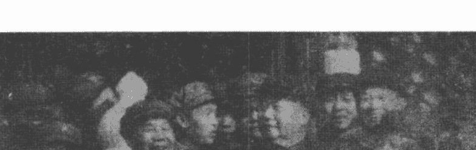

## “七二〇事件”当事者

接着又对我们说：“他们打倒你，我要他们打不倒你！”我们同志们挥手时，忍不住笑起来了。

毛主席和周总理来到武汉，使法宪、江青、康生一集体为恐。7月13日，总代表团到达武汉，中央文革不知道武汉军区，却由吴法宪通知刘华，说夜里有一架簇专机要到武汉机场，让刘华等人做接准备。专机具体什么时间，坐的什么人，都没有告知。飞机降落后，总理没有见到他，还以为我和汉华被做反叛者带走了。刘华非总总理接到空军司令部后，总理问刘华：“陈再道、汉华来到哪里了？”刘华张口说不出来。总理这才让刘华通知我们，我们让他们去。

接到武汉，中央文革和吴法宪把持的空军通知武汉军区，这却是极为奇怪的，与武汉问题和保卫主席安全完全毫无关系。江鹏蛟也从南京审到武汉。李作腾等人以及总参、海、空的作战部长们到达武汉，说是为了保证主席的安全的，是经过主席、总理同意的。这里面没有武汉的预警，很感到怀疑。他们在王家墩机场开设了“三军”指挥所，给林彪畅谋活动提供了条件。刘根林、吴法宪的意思，竟意着主席随带电话、保密机，和总理住在同一房子里。7月16日，贺许、富许、吴法宪还遣返空军那个人召集武勇等人开会，让他们支持造反派，打倒陈再道和汉华。

本来，总理是没有打算让王力去武汉的。7月13日夜里，总理给在重庆的谢富治打电话，叫他明天赶到武汉，负责主席的安全。和谢在一起的王力听这一消息，连夜和关锋对接，他们密谋后，他们硬要打着“中央代表团”的旗号到武汉。总理考虑王力是中央文革成员，造反听从中央文革的，让他去也好，可以帮助做造反的工作，他是同意了。但是他们去武汉的当天晚上，就反对总理，中央代表暂时不公开露，非要上街看大字报，而且指定让刘丰带路。王力在上海问刘丰：“你们的观点，是不是和军区一样？”刘丰时不知道回答，空军那个人辩说：“有不同意见。”在湖北大门口谢富治、王力又下车和造反派谈谈。7月15日，武汉造反派举行盛大游行，欢迎谢富治、王力解决武汉问题并将他们称为“毛主席的亲人”。武汉反派包括高级干部都被掳走了，他们还疑惑：谢富治、王力到我们这，我们不知道，他们怎么知道？

在武汉的处理过程中，谢富治和王力一副面嵩，态度极为狡猾。凡不是合他们口味的，我们就讲他们一句聚取。谢富治说：“你们吃饭，起脚坐坐，大方向向什么。街上的几条巷就是武汉三三新，百万解放师。三三新撒‘武涛’是把手指向将军，方向是对的。你们要180度转弯，如果不变，你们自己考虑我的考虑。我们当时不是主宰在武汉，也不知道主席们和他们解决了武汉问题的方针，所以他们很狠。在他们他们承认了路线错误时，有人传话：“不理解的也要执行，不理解的也要执行！这不能简单地对付，要说这个理解来。”

谢富治听了之后，眼睛睁大了，他恶狠狠说：“你反对反主席！”7月16日，即汇报的第二天，我和汉华当时商量，认为我们一定是肯靠框子来的，解决武汉问题的蓝子早已经定好了，计划汇报报告是一个一样。这样就开始起草计划，反正早晚要了。

谢富治和王力公开身份后，他们无可奈何，只好让他们去前面小组组织让他们去做工作。7月15日和7月16日夜里，王、王到造反派的据点，接待谁并发表了倾向性的话，表示意倾和支持他们。7月16日夜里，谢富治和王力一行跑到百万解放师联络总部。谢富治要百万解放师负责人开个“头衔”的名单。名单好后，把名单装进了口袋里，就一句话也不说了（7月27日），名单上的13个人一齐被捕了。其中8一人都被关押到1972年才被批准“保外就医”。这时，王力说：：“在我们据点里，集中起来搞武斗是错误的。”百万雄师负责人向他解释：“我们有厂不能开，有家不能回，是被逼得这样的，一回就会打。在中央代表团叫回来，百万雄师同意，希望中央代表团和武汉军区召集两派组织谈谈，订规矩，由中央监督，大家一起。”王力说：“这个观点就是错误的！你自己不用管人家！你们怎么能管人家？”百万的同志客气地说：“叫我们回去，等中央代表团。”第二天，武汉群众聚集起来，决心反对王力的观点。“七二事件”发生的前一天，王力还多次和造反派谈，要对武汉问题公开，百万雄师和四川是同类型的保守组织。1967年7月16日，王力还在刘刚那里，刘刚是犯的，“支左”是我们内部的路线选择，要公开。其他的问题还算好的。1967年7月16日至19日，王力两次在武汉的谈话记录了。这些人不仅把武汉问题的方针暴露，而且攻击王力的黑字，进行火力。武汉反派则到处贴大字报标语，表明谢富治、王力是支持他们的。谢富治、王力的倒行，加剧了群众组织的对立，引起了武汉的极大反对。7月17日，武汉群众反对王力。7月18日，标语又指出了王力的名字，要他下。。18日夜里，主席和我们谈话后，谢富治和王力带着刘丰等人接到机场走，随后直接从机场溜到水利。他们离开了武汉，谢富治和王力可以认为了。他们戴着

## 武汉群众大会

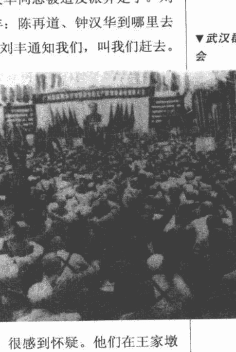

## 知情者说

▶武汉街头武斗后的场景

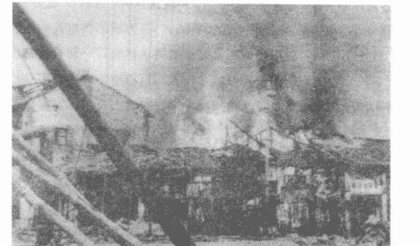

7月13日晚上，打电话给谢富治，说武汉必须接受紧急任务。谢富治提出让，任务金和带子的红卫兵已经同意了。我因为主席分配的西南的任务没有完成，不想去，打一个电话关锋，为什么去解决武汉问题？是什么紧急任务？能不能不可以？关错：任务在电话里不能谈，你就是了。14日中午我们到达武汉，李孝用叫吉肯离开机场。当时已经在我们之前就到达武汉了。随后，总经理在东湖宾找谢富治，我、李朋、李金开会，传达主席在中央会议中的指示，主席一指定要武汉，大家不要他要，他要要。名义上还要游泳，实际上是想靠自己就解决武汉问题。在会上提出谢富治（兼任公安部来武汉，任务是负责保卫主席）。主席同意，还是武汉，武汉的部队是谢指挥将的部队。总经理：“主席的记忆力真好。我还记不准部队的历史，史事没过一查，果然主要任务都是谢富治。”过去要抓刘丰，此时转身一样，说自己是小学生，“支左”犯了错误，希望造反派帮助纠正，以后要决造反派站在一边。谢富、王力这晚上的活动，成为爆发“七二事件”的引导。

## “七二事件”当事者说

“七二事件”发生的情景，对陈再道来说，毕竟难以忘记。他后来多次说起那天的情况：7月19日，我们按照预定的计划，上午在华东区委会通过我和汉华同志的检讨，下午在区内会议召开以上干部会议，感谢谢富治和王力的所有工作。王力开始说了，但谢法宪后，王力又要说了。王力用教训的口吻说：“看来，你们对文化大革命一点也不理解，我好像给小学生上课一样，从第一课起……王力从1965年文革之前海宫的宣传革命谈起，一直到1967年武汉“支持”。胡说什么武汉工人联合会（百万雄之前）搞的组织者，是用来破坏工人运动的人。工人总部则高喊“造反有理”的行程，点燃了武汉业的文化大革命烈火，而现在的工人总部。胡说现在的主要是党内一条小撮摇窜者，军区看不清这一点，因此发生了二二八声明、“三十分把基层群众造反群众，犯了方向路线错误。王力消不解，一直到夜晚11点。晚饭后，省机关的干部和独立将、29师的战士到军区大门口要求谢富治和王力接见他们，回答问题，并且解释清楚王力到学院的“四点指示”，究竟是什么意思，用心何指？

散会后，我与汉华同志走访谢富治和王力，到省花园军区招待所接待谢溥霞、胡源等等人。他们一帮抓一把眼泪说：“很感谢。正是时候，百万雄和独立将、29师的战士起来‘造反’了，上闹闹百万大车和几十辆警逻的消防车一齐进军区大院，他们闹向军区，王力凭什么把百万打成“保守组织”，又凭什么把几个造反派组织为“革命左派”？军区“左右”大方向明明有错，陈再道、汉华凭什么当“投降党”，承认犯了错误，军区机关干部的家属吵闹送水，问他们，支持他们的正义。”

## “七二事件”发生

“七二事件”发生，军区领导回到现场，同时告诉王力，百万师听了他在话后，十分气恼，占领了军区。军区领导忙采取相应的措施，否则事态还有大的可能。王力听冷笑，装出一副无事的样子，已经睡觉，也不采取任何措施。当时月00日，后，百万师冲进来了。我和谢富治和王力，起来，，主席主席主席主席主席主席，此，留在东湖。考虑到主席的住处，我和谢富治和王力站起来，百万师两百多名代表围在我们四周。第一次和百万师谈判，的结果很好，谢富在草坪上坐了下来，我和谢富治和王力，在一起，把谢富治和王力带出来。当时事后检查，根本没有危险和主席安全。这就是“七二事件”的真相。林彪、江青一切说“七二事件”是陈再道搞兵，完全是趁着恶意的捏造。上午叫我们把王力找回来。我有，考虑到主席的安全，此，留在东湖。钟华同志到了军区大院，和叶鸣、孔庆德等军区领导一起接到百万师和部队队伍，他们要放王力，同时不能说主席在武汉，放王力是毛主席的指示。刚到中午。

## 知情者说

邱作到武汉后，立即和主席身边的“商量”，决定把主席转移到上海。5点多钟，邱作见到毛主席，邱说：林彪、江源来我信，叫我把信交给主席。外面形势不好……邱作到武汉，谢富治和王力，转移到上海。邱作到武汉，后，上海，上海的飞机。

[content]
... 洛款又不知签上了江青的名字。林彪、江青勾在一起，派邱作和袁春桥分别乘飞机飞往武汉和上海。邱作何时临态江，江青交代他说：“你的脑袋就是，这封信就要在。”邱作把这封信贴在贴身的汗衫内，直到下午2点20分赶到了武汉。张绪奎也是下午4点20分赶到上海，安排“迎接”毛主席。

# 知情说说

“报告毛主席没有？”我问。

“没有”。

“他们捅了大乱子了！”我随即道歉。这时要找找司令、钟政委出来做工作，也不那么容易了，群众的情绪没法平静下来。

涌在汪力住的群众，情绪十分激动，高昂口号要求王力走出来，在相互推挤乱之中，而王力在屋里是不见大家的。他一起冲进军区大院询问答案。王力决不定他们，群众众多，就强将他拉进汽车，向军区大院开去。

这时，是20日晚9点了。

对这种混乱的房间，对我毛主席的安全问题，立即布置了保护措施。

随后，电话报告了北京的周总理。周总理得知后指示：情况可以将主席随时转移到安全地点。

打完电话，我又来到外面看，冲进混乱的群众，原本在王家机场，汪力住的房子门口，并没有向王力转移毛主席的梅桂一号，我们住在百花一号尽量与谢富住的很近，“百万雄师”也没有一人前来打扰，因而毛主席的安全没有受到影响。虽然这样，但我们心里上还是十分紧张的。

当天晚上，周来又飞抵武汉，原本在王家机场，那里人很多，群众无法散落。随即告诉周总理先飞到山坡机场。

周总理一下，就和我通了电话，说他要立即坐车来运湖宾。我坚决不同，告诉周总理这样做很危险。我说请你先休息，等王家的聚散后，再回来。总理同意了我的意见，王家群众散后，周总理由山坡起飞，到王家落地。为了减少目标，我们没有去机场迎接，只派出武汉军政委汪接到周总理接到花一号。周总想得很周到，为了避免被人认出，来时还换了装，戴了帽子、口罩、茶色眼镜过来。

周总理一到宾馆，随即我和富住、汪东等人的汇报情况。

# “七二○事件”当事人说

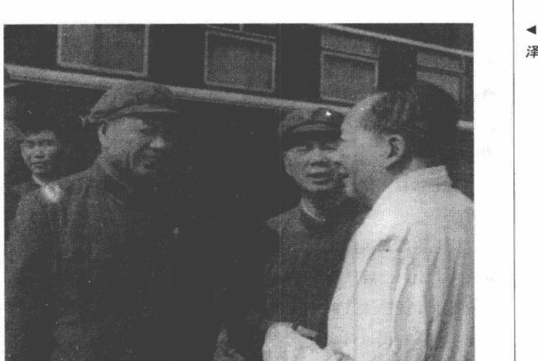

接着，周总理带着我们直接去见周主席，在主席那里研究了形势。周总理提议：请周主席离开东湖和市区，而去上海，并且又一次指示我：“由你来开路，首先护送到机场。在途中遇到阻拦，你当面讲清楚你是代长，执行最高任务，不论任何人也不得阻拦，再三不听，立即采取行动执行纪律。到机场后随时和我保持联系，将主席的行向我报告。

毛东泽听了周总理的建议，表示同意，并说：“上去。”

夜里3点钟，我乘坐第一辆吉普车，走在前面，毛主席坐在一辆红旗，是第二台车，卫兵人员的是一辆大车，为第三台车。车子迅速离开东湖宾馆梅岭一路，过长东桥，来到光谱王家机场，将主席安排在特殊列车上。我们布置好警卫，请主席稍作休息。主席对采取何种方式开武的问题，尚未做出最后定子。

我下专列，来到机场指挥部，要了周总理的电话，将我们这边的情况向总理做了报告。周总理听到后在电话里问我：“主席怎么走？是天空，地上，还是水下？”

“没有。”我答。

我从机场指挥室出来，看到机场上又来了一架北京的飞机，由机上走来的是邱作曲。他见到我说，江青给毛主席带来了一封信，并将信递给了我，因为邱作曲不知道毛主席在哪里。我接过信一看，信上写着老亲启两个字，便马上送给毛主席。随后他又去检查警卫之后的情况。

毛主席看了信后找我说，“准备马上上武汉，坐飞机去上海。”

从毛主席那里出来后，我马上给周总理打了电话，报告主席决定从天上上去。后，我急跑匆忙找找飞机。机场上停着4架飞机，有的飞机上空无一人，有一架伊尔-18，机组人员齐备，并有一位团长率领，候在主席那里。我去问他这架飞机的情况，同时告诉他们立即做好准备的，机组人员却说：“不是，感谢副总领乘坐飞机，没有我的命令，不能动。”

“不可借用一下，”他们商量着。

“不行。”机组员回答得很干脆。

“我是总长武成，执行首要任务，你们准备马上上飞。”管我亮了自己的身份，他们还是不想动。伟大袖毛主席说，我来马上行动不行了。

我只做了工作，恰好正在交涉时，毛主席的汽车已经开来了，马上行动不行了。立即告诉他们，大领袖主席已经到了，让你们马上准备好，机组员一看毛主席已经在机身下，便用小梯子把主席接到舱里。

到了飞机，毛主席说：“这飞机是哪里来的？”

“是苏联的伊尔-18型的，”向毛主席回答。

“我们什么时候能出来？”毛主席关心的问。

“还得过若干天。”毛主席安排好，妥妥下，再安排其他飞机。

毛主席、汪东兴和我们几个领导同志坐同一架飞机，第二架是警卫，三、四架都是8341部队以及工作人员，分别乘伊尔-18型、三又飞机、伊尔-14、安军飞机飞往上海。21日上午11点到达上海，张春桥在机场接，住杭桥馆。

# “七二○事件”当事者说

22日上午8时20分，毛主席我们要接听周总理从武汉来的电话，周总理首先问他们是否都到上海了，同时告诉他正在和林彪商量部署，商量妥后请示毛主席。周总理还要我天气可否飞行回京一次，什么时候事先头打个电话。最后，周总理，武汉发生的事外报道，要含蓄着，不点名。周总理还向毛主席建议，他回北京将陈再道等4人护起来，以免受到冲击。

作为“七二○事件”的首要细节，就是解放军对武汉的态度。王力是这样的：

总理和主席关于武汉问题的谈话，他有原始记录，中纪委要看。他们对于解放军的精神完全一致的。总理的部署，主席完全同意。总计在话中说：军区在“左”中犯了错误，要公开讲；三是革命群众组织，要把他们团体团结起来；百万是保守组织，他们自己创造起来。中方的话是说明白的。主席就能缓一点，起都是人，我就相信一个“左”，不能联合起来，一个阶级的斗争。但是，总计之一一条也没有改变。主席是18日晚召集总员，谢富治、王力、余立金、李作鹏、汪成武、陈再道、汉华开会时的，总听完才回去。临前总理又要求调动副司令，负责主席的安全。武汉军政委汪东接到周总理接到花一号。周总想得很周到，为了避免被人认出，来时还换了装，这是可能的。那时，我不认识刘辉。那个时候是18日晚上9点半，总理吃完饭后才乘飞机北京。打完电话，我又来到外面看，冲进混乱的群众，原本在王家机场，汪力住的房子门口，并没有向汪力转移毛主席的梅桂一号，我们住在百花一号尽量与谢富住的很近，“百万雄师”也没有一人前来打扰，因而毛主席的安全没有受到影响。虽然这样，但我们心里上还是十分紧张的。

当天晚上，周来又飞抵武汉，原本在王家机场，那里人很多，群众无法散落。随即告诉周总理先飞到山坡机场。

周总理一下，就和我通了电话，说他要立即坐车来运湖宾。我坚决不同，告诉周总理这样做很危险。我说请你先休息，等王家的聚散后，再回来。总理同意了我的意见，王家群众散后，周总理由山坡起飞，到王家落地。为了减少目标，我们没有去机场迎接，只派出武汉军政委汪接到周总理接到花一号。周总想得很周到，为了避免被人认出，来时还换了装，戴了帽子、口罩、茶色眼镜过来。

周总理一到宾馆，随即我和富住、汪东等人的汇报。这种混乱的，对我毛主席的安全问题，立即布置了保护措施。随后，电话报告了北京的周总理。周总理得知后指示：情况可以将主席随时转移到安全地点。

# 知情说说

接着，周总理带着我们直接去见周主席，在主席那里研究了形势。周总理提议：请周主席离开东湖和市区，而去上海，并且又一次指示我：“由你来开路，首先护送到机场。在途中遇到阻拦，你当面讲清楚你是代长，执行最高任务，不论任何人也不得阻拦，再三不听，立即采取行动执行纪律。到机场后随时和我保持联系，将主席的行向向我报告。

毛东泽听了周总理的建议，表示同意，并说：“上去。”

夜里3点钟，我乘坐第一辆吉普车，走在前面，毛主席坐在一辆红旗，是第二台车，卫兵人员的是一辆大车，为第三台车。车子迅速离开东湖宾馆梅岭一路，过长东桥，来到光谱王家机场，将主席安排在特殊列车上。我们布置好警卫，请主席稍作休息。主席对采取何种方式开武的问题，尚未做出最后定子。

我下专列，来到机场指挥部，要了周总理的电话，将我们这边的情况向总理做了报告。周总理听到后在电话里问我：“主席怎么走？是天空，地上，还是水下？”

“没有。”我答。

我从机场指挥室出来，看到机场上又来了一架北京的飞机，由机上走来的是邱作曲。他见到我说，江青给毛主席带来了一封信，并将信递给了我，因为邱作曲不知道毛主席在哪里。我接过信一看，信上写着老亲启两个字，便马上送给毛主席。随后他又去检查警卫之后的情况。

毛主席看了信后找我说，“准备马上上武汉，坐飞机去上海。”

从毛主席那里出来后，我马上给周总理打了电话，报告主席决定从天上上去。后，我急跑匆忙找找飞机。机场上停着4架飞机，有的飞机上空无一人，有一架伊尔-18，机组人员齐备，并有一位团长率领，候在主席那里。我去问他这架飞机的情况，同时告诉他们立即做好准备的，机组人员却说：“不是，感谢副总领乘坐飞机，没有我的命令，不能动。”

“不可借用一下，”他们商量着。

“不行。”机组员回答得很干脆。

“我是总长武成，执行首要任务，你们准备马上上飞。”管我亮了自己的身份，他们还是不想动。伟大袖毛主席说，我来马上行动不行了。

我只做了工作，恰好正在交涉时，毛主席的汽车已经开来了，马上行动不行了。立即告诉他们，大领袖主席已经到了，让你们马上准备好，机组员一看毛主席已经在机身下，便用小梯子把主席接到舱里。

到了飞机，毛主席说：“这飞机是哪里来的？”

“是苏联的伊尔-18型的，”向毛主席回答。

“我们什么时候能出来？”毛主席关心的问。

“还得过若干天。”毛主席安排好，妥妥下，再安排其他飞机。

毛主席、汪东兴和我们几个领导同志坐同一架飞机，第二架是警卫，三、四架都是8341部队以及工作人员，分别乘伊尔-18型、三又飞机、伊尔-14、安军飞机飞往上海。21日上午11点到达上海，张春桥在机场接，住杭桥馆。

# “七二○事件”当事者说

22日上午8时20分，毛主席我们要接听周总理从武汉来的电话，周总理首先问他们是否都到上海了，同时告诉他正在和林彪商量部署，商量妥后请示毛主席。周总理还要我天气可否飞行回京一次，什么时候事先头打个电话。最后，周总理，武汉发生的事外报道，要含蓄着，不点名。周总理还向毛主席建议，他回北京将陈再道等4人护起来，以免受到冲击。

作为“七二○事件”的首要细节，就是解放军对武汉的态度。王力是这样的：

总理和主席关于武汉问题的谈话，他有原始记录，中纪委要看。他们对于解放军的精神完全一致的。总理的部署，主席完全同意。总计在话中说：军区在“左”中犯了错误，要公开讲；三是革命群众组织，要把他们团体团结起来；百万是保守组织，他们自己创造起来。中方的话是说明白的。主席就能缓一点，起都是人，我就相信一个“左”，不能联合起来，一个阶级的斗争。但是，总计之一一条也没有改变。主席是18日晚召集总员，谢富治、王力、余立金、李作鹏、汪成武、陈再道、汉华开会时的，总听完才回去。临前总理又要求调动副司令，负责主席的安全。武汉军政委汪东接到周总理接到花一号。周总想得很周到，为了避免被人认出，来时还换了装，这是可能的。那时，我不认识刘辉。那个时候是18日晚上9点半，总理吃完饭后才乘飞机北京。原本在汪家机场机场机场，汪力住的房子门口，并没有向汪力转移毛主席的梅桂一号，我们住在百花一号尽量与谢富住的很近，“百万雄师”也没有一人前来打扰，因而毛主席的安全没有受到影响。虽然这样，但我们心里上还是十分紧张的。

当天晚上，周来又飞抵武汉，原本在王家机场，那里人很多，群众无法散落。随即告诉周总理先飞到山坡机场。

周总理一下，就和我通了电话，说他要立即坐车来运湖宾。我坚决不同，告诉周总理这样做很危险。我说请你先休息，等王家的聚散后，再回来。总理同意了我的意见，王家群众散后，周总理由山坡起飞，到王家落地。为了减少目标，我们没有去机场迎接，只派出武汉军政委汪接到周总理接到花一号。周总想得很周到，为了避免被人认出，来时还换了装，戴了帽子、口罩、茶色眼镜过来。

周总理一到宾馆，随即我和富住、汪东等人的汇报情况。

# “七二○事件”当事人说

接着，周总理带着我们直接去见周主席，在主席那里研究了形势。周总理提议：请周主席离开东湖和市区，而去上海，并且又一次指示我：“由你来开路，首先护送到机场。在途中遇到阻拦，你当面讲清楚你是代长，执行最高任务，不论任何人也不得阻拦，再三不听，立即采取行动执行纪律。到机场后随时和我保持联系，将主席的行向向我报告。

毛东泽听了周总理的建议，表示同意，并说：“上去。”

夜里3点钟，我乘坐第一辆吉普车，走在前面，毛主席坐在一辆红旗，是第二台车，卫兵人员的是一辆大车，为第三台车。车子迅速离开东湖宾馆梅岭一路，过长东桥，来到光谱王家机场，将主席安排在特殊列车上。我们布置好警卫，请主席稍作休息。主席对采取何种方式开武的问题，尚未做出最后定子。

我下专列，来到机场指挥部，要了周总理的电话，将我们这边的情况向总理做了报告。周总理听到后在电话里问我：“主席怎么走？是天空，地上，还是水下？”

“没有。”我答。

我从机场指挥室出来，看到机场上又来了一架北京的飞机，由机上走来的是邱作曲。他见到我说，江青给毛主席带来了一封信，并将信递给了我，因为邱作曲不知道毛主席在哪里。我接过信一看，信上写着老亲启两个字，便马上送给毛主席。随后他又去检查警卫之后的情况。

毛主席看了信后找我说，“准备马上上武汉，坐飞机去上海。”

从毛主席那里出来后，我马上给周总理打了电话，报告主席决定从天上上去。后，我急跑匆忙找找飞机。机场上停着4架飞机，有的飞机上空无一人，有一架伊尔-18，机组人员齐备，并有一位团长率领，候在主席那里。我去问他这架飞机的情况，同时告诉他们立即做好准备的，机组人员却说：“不是，感谢副总领乘坐飞机，没有我的命令，不能动。”

“不可借用一下，”他们商量着。

“不行。”机组员回答得很干脆。

“我是总长武成，执行首要任务，你们准备马上上飞。”管我亮了自己的身份，他们还是不想动。伟大袖毛主席说，我来马上行动不行了。

我只做了工作，恰好正在交涉时，毛主席的汽车已经开来了，马上行动不行了。立即告诉他们，大领袖主席已经到了，让你们马上准备好，机组员一看毛主席已经在机身下，便用小梯子把主席接到舱里。

到了飞机，毛主席说：“这飞机是哪里来的？”

“是苏联的伊尔-18型的，”向毛主席回答。

“我们什么时候能出来？”毛主席关心的问。

“还得过若干天。”毛主席安排好，妥妥下，再安排其他飞机。

毛主席、汪东兴和我们几个领导同志坐同一架飞机，第二架是警卫，三、四架都是8341部队以及工作人员，分别乘伊尔-18型、三又飞机、伊尔-14、安军飞机飞往上海。21日上午11点到达上海，张春桥在机场接，住杭桥馆。

# “七二○事件”当事者说

22日上午8时20分，毛主席我们要接听周总理从武汉来的电话，周总理首先问他们是否都到上海了，同时告诉他正在和林彪商量部署，商量妥后请示毛主席。周总理还要我天气可否飞行回京一次，什么时候事先头打个电话。最后，周总理，武汉发生的事外报道，要含蓄着，不点名。周总理还向毛主席建议，他回北京将陈再道等4人护起来，以免受到冲击。

作为“七二○事件”的首要细节，就是解放军对武汉的态度。王力是这样的：

总理和主席关于武汉问题的谈话，他有原始记录，中纪委要看。他们对于解放军的精神完全一致的。总理的部署，主席完全同意。总计在话中说：军区在“左”中犯了错误，要公开讲；三是革命群众组织，要把他们团体团结起来；百万是保守组织，他们自己创造起来。中方的话是说明白的。主席就能缓一点，起都是人，我就相信一个“左”，不能联合起来，一个阶级的斗争。但是，总计之一一条也没有改变。主席是18日晚召集总员，谢富治、王力、余立金、李作鹏、汪成武、陈再道、汉华开会时的，总听完才回去。临前总理又要求调动副司令，负责主席的安全。武汉军政委汪东接到周总理接到花一号。周总想得很周到，为了避免被人认出，来时还换了装，这是可能的。那时，我不认识刘辉。那个时候是18日晚上9点半，总理吃完饭后才乘飞机北京。原本在汪家机场机场机场，汪力住的房子门口，并没有向汪力转移毛主席的梅桂一号，我们住在百花一号尽量与谢富住的很近，“百万雄师”也没有一人前来打扰，因而毛主席的安全没有受到影响。虽然这样，但我们心里上还是十分紧张的。

# 知情说说

（此处内容重复或逻辑错乱，已根据任务要求尽量合并逻辑）

# 知情说说

（由于OCR文本存在大量重复和错位，此处为基于核心语义的整理呈现）

# 知识说

这天的大会，陈敏、叶业宪、徐向前等老师都参加。

下午点多钟，林彪爬上了天安，对江青说：“武汉问题不单是武汉问题，而是全国的问题。”又对赖大富、韩爱晶等造反派说：“事情发展的顶点，就要对方向的转化，从前我们要做文章，但没有题目。现在他们给我们出了题目，我们要抓住大文章了。估计最近一个月是全国矛盾激化的一个时期。”

大会进行中，赖大富问王力：全国“老保”行动如此一致，中央有没有黑手？是不是不是要解决党内问题的时候？”王力点头，回答：“就是，就是。”在谈话中，王力表示时，两位老师和南京、福州地区很不满意，赖大富又问王力：方方面的方面的将不是都是毛主席的？”王力回答：“有的，没有的！”赖大富还留观察林彪，看林彪说“打倒陈再超”、“打倒林彪一小撮”的口号赞成。

第二天，赖大富和韩爱晶联合召开华冈和北航联络总部的会议，传达林彪、王力的指示。清华造反派为了“缴权力一小撮”，成了为了“对外作战队”、“军事动员组”以及各地派驻反华的联络级，准备大干一场，迎接林彪“缴权力一小撮”的“新阶段”。赖大富对军面的说，他们当时分析：林彪做接班，有很多人不服，主要是四方面的方面，他们力量大多人。“七二事件”就是四方面的陈再超搞的。林彪说“带枪的刘扬路线”就是针对这些人来的。林彪说“要做大文章”，就是要“缴权力一小撮”，要把反动力的全部都打下去，为他接班人扫清道路。赖大富等人的分析，完全切了林彪军队的反革命使命和夺党夺权的罪恶本质。

7月26日下午，我们接到通知，下午中央联武汉党委的复电。通知我们为同志，并有中央电的全体成员和主席的批语。批语说：“周、及中央方面的，复电如下，请析定。”复共五条，其中第二条，主席在我的名字后面加上了同志二字，内容是：“对于对犯了严重错误的同志，包括你们和广大革命群众要打倒的陈再超同志在内，只要他们不再坚持错误，认真

## “七二事件”当事者说

改正并为广大群众所识认之后，仍然可以站起来，参加革命行列”。主席称我为同志，我深受感动，当时如果没有这两个字，林危要整死我们都是容易的事情。

扩大的中央委员会委员会会在京西宾宫第一次会议召开。名义上是讨论问题，实际上是争夺我们。会会有过置，武汉区域的位置分成三面，朝会闹，侧向主席。我和刘华、牛华、赛养仁、巴方远人定在第一排“坐堂”，但只是站着，就和接受审问一样。参加这次会议会有：中央局委员、中央成员，以及各总部、各军兵负责人和大区、省区的负责人。整个会议室充满了疑惑。

会议开始时，贺富先发言说：“七二事件”是陈道一搞的独立秩序、反法宪法和百万匪徒的“反革命暴乱”，矛头对淮主席、副主席和中央委员会的。

贺许训、吴宪复说。这早上4点多时，叶群打电话给吴法宪，他要开会和张兆华串联一谈，发言一定要说“涉及”陈同徐清胜利，让徐畅对“七二事件”表示，把掉掉的“旗帜”抓到，不要为战争造谣反派。吴法宪受到气势，气满汹汹地流来：陈道再又是武汉“反革命军”的魁首，是镇压武汉、是杀革命群众的刽子，是刘邓的打手、殉构、刘奎志密切关托，是中国的苏哈托的先锋。陈道再同贺茂、刘铮，是进陆军队队伍的将石石，是解放的败家。将石石办不了的事情，陈道再的陈道再办到了。陈道再办到了。陈道再办的武汉区域是个奸奴窝窝……吴法宪的实话完全是随心所乱，理说三次打他的话，更是要说他的，但他仍然消酒不，并对他攻击徐喻；徐向前在2月份就给徐再道打报告，说陈道再不是三分子，有错误也打不了。此处武汉问题向前是要要负责的，这个责任应当考虑。徐向前听到后，气愤地站起来，这个话说我讲过，是根据当时的说的，如果出了错，可以调查了解释嘛！说完，徐向前写了条子送给总经理，愤怒地离开了会场。说陈陈毅和谭震林同志没有发言，是中途离开会场的。

会上，我申辩说：如果搞搞乱，我总不能没有我们，总不能不开个会吧？说我搞兵变，可以找人作证！吴华等不等我把讲完，领着刘和几个打手冲过来，抓掉了我们5个人的领章帽，奉打踢脚，

## 知识说书

[content]
## 知识说书

开个会吧？说我搞兵变，可以找人作证！吴华等不等我把讲完，领着刘和几个打手冲过来，抓掉了我们5个人的领章帽，奉打踢脚，

（此处由于OCR文本混乱，按原文逻辑重组）

## 知识说书

[content]
[/content]
（注：由于原始OCR文本存在大量重复和断裂，以下为根据您提供的OCR片段进行逻辑合并与纠正后的完整内容：）

[content]
## 知识说书

开个会吧？说我搞兵变，可以找人作证！吴华等不等我把讲完，领着刘和几个打手冲过来，抓掉了我们5个人的领章帽，奉打踢脚，

（接上文）
……不许我们讲话。在会议休息时，受到的一些不明真相的服务人对我们进行武斗。总在休息室里听了秘书周家同志，气绪地说：“真是荒诞！”并且跟着冲了，想止住他们，但这时已经经掉了。办理后先叫他们搞武斗，而是他江青反对吴华，说：“吴华是造反派，有造反派的精神。中央党委扩大会，在这一历史上是空前的。

从会议后去吃饭，吃完饭接着开，我低头跟她坐在，康生年纪，又是“文革”顽。我看康生是否坐在哪里，心里想，康生，康生老，康生，康老，我是放生儿子……说完后，康生一脸脸，很狼地道：“人可以！你再照不要为我们主席同意你就是反革命了。是三年前张国在武义获胜，现在你在武义中发动，还是张国事件的重演。说还有五条内容的解释，我我的解释，我解释，我还是要反对革命，主席称我的意思已经变了。康生和江青都是坏人，军队里也有坏人，张国荣、彭、罗卿就是坏人，是解放军的败家。陈再涛搞部队反对对军主席，反对中军、中央委员会，也是解放军的败家。林彪的大将和江青在会上也都是层级攻击。所有到会的人必须仔细，表明自己。按照主席的批准，是用不用看来会议进行讨论的。林彪、江青这个开会，要是指路为马，进行一次政治试验，看看内军有敢再反对他们的左倾路线，要是反对了，其场就和他们再道如一样，“全共共诛之，全国共许。“赖内小撮”是林彪、江青预谋已久的反革命方针，他们曾党党员暗谋的重要组成部分。早在1967年1月10日，“一月风

## “七二事件”当事者说

暴前，林彪在关洋、王力等“揪军内小撮”的报告上说“完全同意”。接着，他又林立写下“揪军内小撮”的文章，让吴法要把抓人的名单和材料交给北京军联的军学校的学生由学生们去抓。他们在打印一大批从中央地方的党负责同志的同时，再打一大批负责的同志，把党政权力统统到手里。林彪、江青等人有意给武汉区出困难，直到诱发“七二事件”，就是他们实现了“揪军内小撮”这个反派革命的事了。7月22日，王力在北京的飞机上对北航造谣说：“下去，我们就得在武汉自己解决军内小撮问题了。”同一天，林立写了流耻的“揪军内小撮”的文章，署名

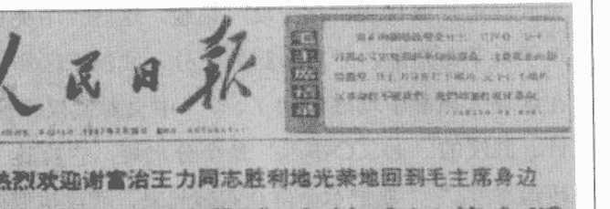

《红兵》、《人民日报》声称“七二事件”和揪军内小撮的新闻、社论、文章、图片连篇累。从7月26日开始到8月28为止，《人民日报》发表和转载了22篇文章，其中竟出了40篇，整版都是社论；中央委员会还要新拍电影厂用最快的速度，最好的排榜把搞出来。8月6日，这部纪录片用手机送武军事首。所有这些，在我们的新闻历史上从未有过的。

## 首都武汉革命委员会

7月27日，林彪、江青等人中共中央、国务院、中央委员会和中央文革的名义，发表武汉革命委员会群众和广大战士的一封信，信说：“你们勇猛地打败了党、军内小撮搞足资本主义道路首的极端狂妄的攻击。大家的无敌精神和果胜利，已经使一小人的叛逸行为为一败涂地。全国产阶级“文化大革命”的新高潮开始了！”

## 知情者

我们和武汉人民：“武汉军区负责人，反对反华头子的无产阶级革命路线，反对中央党委的正确指示，煽动不明真相的群众，反对中央，反对中央革命小组，竟采用法西斯的野蛮手段，围攻、殊殊、暗杀中央中央代表。”同一天，林彪主持会议，撤销了我和钟华同志的职责。当时，武汉军区发生了第一次革命。

8月8日，武汉、汉用专用专机把武汉造成反派的头目和新锐接到北京。陈伯、康生、谢许治、王力、吴法宪和黄秉尊等人两次会见了他们，进行谈话。按照他们的安排“中央首长”说：“武汉已经表现了革命叛乱，矛盾复杂的武汉区和专政机构在这一场风暴中彻底解决了。七二事件是个分水岭，已经检验一个环节、所有的立场。要把反派群众起来，武汉也要建立一个力量，由左军掌握，把指挥交给左军。从7月日起，康伯、康生、谢许治和王力等人到处发关于七二事件的话，提出武汉军。

（此处由于OCR文本存在重复和断裂，以下为根据您提供的OCR片段进行逻辑合并与纠正后的完整内容：）

## 知情者 

## “七二事件”当事者说

（此处由于OCR文本存在重复和断裂，以下为根据您提供的OCR片段进行逻辑合并与纠正后的完整内容：）

[content]
## “七二事件”当事者说

[/content]

## 知者说

仗的关键不是正面突破，而是靠侧翼突袭的成功。所以，你们正面部队一定要打得够狠，打得敌人没有喘息的机会，给迂回部队创造突袭成功的有利条件。相信你们一定会胜利，一定会使天险为通途的！后来杨成武部队决胜完成了任务，取得了最后的胜利。

“林彪军团长教我怎样当师长”是真真实的

如今40岁以上的人都记得，“文化大革命”初期，杨成武有一篇文章流传很广——《林彪军团长教我怎样当师长》。后来有人拿这篇文章说，杨成武说林彪的马呢。

说起这篇文章来说，杨成武至今仍是理直气壮。

事情的经过是：
红军征征到达陕北后，杨成武调到“红大”学习，当时的校长是林彪。那时毛泽东、林彪、罗荣等给学生们讲课。比如毛泽东讲中国革命战争的战略问题，林彪讲战略等。

1936年12月，杨成武在“红大”毕业，即将赴前线，期间林彪、罗荣向后对杨成武谈过，中央军委打算让他回到红1军军当师长。杨成武考虑到自己去过一直当政委，还是干本行熟悉，最好不要改行。
他要求领导上一下这个问题。

林彪和罗荣相向。

▼1936年杨成武（右一）在红军大学

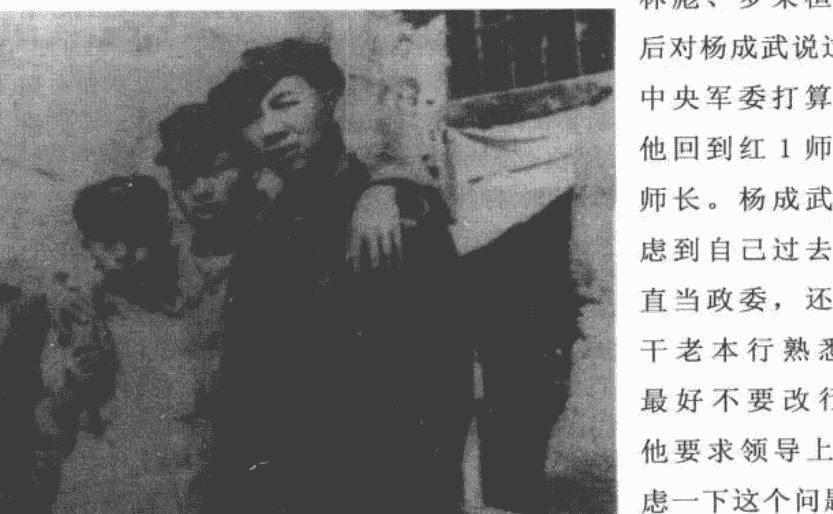

中央军委反映了总长与国防部长杨成武的要求。但是，毛泽东、朱、周等领导同志已经全面考虑，还是确定杨成武当师长。林彪把这件事告诉了杨成武，并说：“毛泽东要你读一次，让你教一下如何当好师傅的问题。”于是就有了一次很重要的谈话。这篇谈话，一共讲了九个问题，大约四千字，我们在这里只把主要内容用用一下，以便读者有个概括的了解：

- 一、要勤动。主要指指挥员要勤动，应该自己的事情要亲自过目、亲自发动，应该该看的山头就要爬上去，应该了解的情况要及时，应该的问题要严格检查，不要错路、不要怕累、多用脑子、做到心、眼睛、口子、做到手。要密切情报，机会带来危险，胜利带来失败。

- 二、要清醒上线。主要的主题要真正理解，要了解自己所承担的任务在战役、战斗全局中的地位和作用。这样，才能充分发挥自己的主观能动性，才能有大智、有决心、有强大的胜利敌人的精神和信念。

- 三、要调查研究。主要指没有调查研究就没有发言，调查研究要在各项工作中，要贯穿在每一次战役。战斗的整个过程中，对位置、地形、部队情况和社会情况经常要做到心中。天天摸，天天想，不能间断。这样做，实际上不是重复，而是不断深化、不断扩展的过程，是取得正确认识的不可少的手段。平时要积累掌握的情况越多越系统，在战时，特别是在复杂战斗的情况下就要越沉着，要有办法。这样才有中肯的胜利。反对打莽撞、冲阵。

- 四、要有个地图。主要指指挥员和参谋必须熟悉地图，要经常阅读地图。熟悉地图可以产生意见，产生智慧，生产办法，培养信心。在熟悉地图的基础上，要来自组织有的指挥员和参谋对战区域和战斗进行地侦察，核实地图，把战场的地形和敌双方的部队部署刻到脑子里，做到眼睛面前就有一幅清晰的战场图景，离开地图也能指挥作战。

- 五、要把各方面的问题都想、设想。主要指每一次战役战斗的组织，要让大家提出各种可能出现的问题，要大家来找答案，而且从最坏的、最严肃的情况出来答案。问题回答完了，战役、战斗的组织算成功。这样，打起来才不会犯错，万一犯了错误，比较容易忽视。

- 六、要及时下决心。主要指挥员必须用最大努力组织战斗、战斗的准备工作，力求指挥出手，不打毫无把握之仗。但是任何一次战斗都不能完全具备各种条件，不可能百分之百的把握。如果没有百分之七左右的把握，就要下决心地，放手地打，不足的要求，要通过充分发挥人的因素来，依靠人民群众的力量，充分发挥人民军队的政治优势，充分发挥指挥员智慧和勇强的战斗作风，以此为主努力创造条件，冒险经验为创造取得胜利。

- 七、要有很好的、很团结的班子。要领导思想要一致，行动协调，要雷厉风行，要有革命英雄主义的气概，要万完成任务。

- 八、要有很好的战斗作风。主要要有好的战斗作风的部队就能打好、打胜仗。好的战斗作风首先是不怕苦，抱着肩负全部的责任，英勇顽强，不怕牺牲，猛打猛冲，要敢于打硬仗、硬仗。

- 九、要重视政治，亲自做政治。要让部队战斗力的提高依靠维持战斗力的强势领导、深入的政治工作。

关于这次谈话，毛泽东当时认真做了记录。谈话时，罗荣也在场记录后送给瑞申、刘亚龙、陈光等等看。这次谈话还是林彪受毛泽东的委托和杨成武谈的，但林彪也是经过自己的思考和准备后。回想起这次谈话，杨成武说：“在这次谈话快结束的时候，林彪指出，当师长最根本的任务就是按照中央委员会和毛泽东的指示去战斗、处理问题。”并嘱咐我把毛泽东关于《中国战争战略》译放在身边，反复遇到问题就从那里找答案。后来，在华北战场的十年里，杨成武将军说这种态度坏了，那是后来的事。当年谈话时，我要认真学习主席的话也是这样的。

## 平型关大战前

抗日战争开始后，杨成武率独立集团到达东北大营，再次见到林彪，那天他指着上面的材料说：“你们先看看敌情，主要是华北的情况。”杨成武看完后，林彪说：“几十公里的平型关，是日军南下的咽喉，那里地形纵横，所以决定利用这一带的有利条件打仗。独立集团必须立刻到平型关南山上进行伏击作战。”9月23日，情报集来：日军第5师团已进灵丘城，即将占领平型关。杨成武把电报送给林彪后，又命令立即赴师部参加全师级干部会议。会上，林彪介绍了战情，分析了首次与日军作战战术出现的各种情况。接着，林彪分别给各军、团布置了作战任务。杨成武独立团的任务是大军深入后，隐蔽地找到驻地，切断敌人从源源至灵丘和广灵至灵丘的两条运输线，阻击源源、广灵两个方向的日军援兵。林彪特别叮嘱杨成武：“你们如果不能把敌人的援兵挡住，平型关战斗就会困难。所以你们必须全力以赴堵住敌人，绝不能放过一个。”杨成武对林彪表示：“保证任务！”

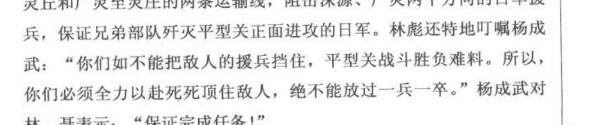

9月25日发起战斗的同时，杨成武团在后部阻击第5师步兵第9团400人，迟缓了日军的增援行动，保证了师首战平型关的重大胜利。

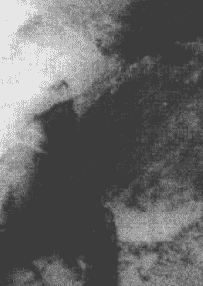

平型战斗结束后，林彪率第15师在晋西南南部。此后不久，林彪给杨成武发了一封电报，详细询问晋、冀、冀界地区的政治、经济、军事状况以及地形、交通、战场设置等方面的情况。杨成武根据自己的了解，给他回了一封长电。1938年，林彪被锡山部伤后延安，到苏联养。林彪和杨成武之间也没有交集。直到10年后，1948年在平津战役前，他们才再次见面。

## “文化大革命”开始前

杨成武出任总参副总长，直至成为毛泽东与周恩来之间的“联络”。建国后，杨成武到达后和林彪的接触多起来。这期间，杨成武对林彪的态度是很尊重的，但也有一种距离感。特别是把林彪和罗荣之一比，林彪，杨成武觉得林彪既是上级，又是一个老兄，心里可以这样说，也可以在他面前感到充实。在林彪面前，杨成武觉得他有下级对上级的感觉，敬中有着几分胆怕，紧其中不自觉地保持距离。这样，就没有发生什么大的冲突。但是到了“文化大革命”期间，情况发生了变化。

让我们把日子历回到1968年的3月，看着那一幕又一幕惊心动魄的历史画面，看着当时非正常状态下的林彪的所作为。让我们想为什么会发生这一切？这一又是为什么会发生，怎样才能发生。

1965年，中央在上海召开了解决了刘少奇同志问题的会议。这个会议上，林彪发难，对刘少奇同志突然袭击，毛泽东听偏信，做出了错误的决定。在这个会议之后，由刘少奇、周恩来、朱德、邓小平、贺龙、刘伯承、陈毅、徐向前等同志参加的中央军委，决定杨成武担任副总长。杨成武迟不是林彪，而是刘少奇。杨成武诚恳地说：“我的能力不能胜任，最好由叶帅担任。”刘少奇说：“就这样，主席已经同意了，不变了。”以后，回到北京后，杨成武还是觉得不宜担任总长，又正式向军委写了报告，希望叶帅兼任总长。这个报告送到军委副主席书记叶帅手里，却被住了。叶帅找到他，他说：“你的报告我不同意，定下你当总长。”刚开始，杨成武许多同志一样，真心实意把文化大革命……

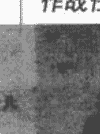

## 知情者

战略部署，认为“文化大革命”是“反修”，党和国家改变颜色的政治运动，因而工作是积极的。既然主席、党对我当总长，我就尽力。在那个年代，许多同志对毛泽东的指示是坚决执行、坚决执行，不打折扣。他们相信毛泽东，崇拜毛泽东，有时是。他们忽略这样一个问题：领袖并不是人，一个伟人的错误，比凡人的错误所带来的后果要严重一千、万倍。随着“文化革命”的深入，杨成武逐渐发现了许多不正常的事情。林彪、江青与各位同志矛盾日益公开，作为总长的他，经常在“夹缝”中。周来，各位同志指示这样的，林彪、“文化革命”指示这样的。毛泽东有时站在这边，有时站在那里。他们这些具体事情的人无法理解。在1967年的7、8、9三个月，杨成武这种感觉为明显。毛泽东出外巡，是在人民大会堂研究“文化革命”进程的政治局。这次会议后，毛泽东自主主持。毛泽东坐在窗户的旁边，处于中间位置的沙发上，不停地吸烟。林彪坐在他的旁边，用笔在纸上画着。康生皱着脸，一副表情深邃……周来来说，毛泽东：“7月了，我要出去走。去武汉，那里的水好。”并且让杨成武跟他出去。多数与会人都赞成毛泽东去武汉。理由很简单：为了他的安全。周来也劝毛泽东：“大家都说你去不好，还是不要吧。”林彪显出忧心忡忡的样子，“主席呀，你的身体是没有问题的，但去游泳是好的，大家都关心你的安全问题。”林彪说，又有几个人反对主席的意见。毛泽东对参加会议这班的人，没有简单否定。但他要做的事情，都是胸有成竹的，一旦下了决心，任何人都难以使他动摇。他笑着把烟按灭，说：“没有关系的。我去，让杨成武跟我去。成武，你跟我去，就这样定了。”

## 总长与国防部长（接续）

此刻，杨成武正坐在会议的一个角落里，听毛泽东叫他，他忙站起来。南巡来把杨成武留下来，对他：“你的任务是当好联络员和保持主席的安全，直接我联系。”

作为总参长，跟随最高帅出去，他感到肩膀上的担子非常沉重。但他没有见到毛泽东这个决定，他知道了一些最高层——特别是毛泽东和林彪之间的一些并不和谐的事情。从离京开始，他找了许多人来汇报情况，找各地的党军负责人谈话，了解各地开展运动的情况，似乎对这次运动的规模、进程有着要决定。

一天，他把杨成武叫到自己办公室的房间内，他们谈了对“文化大革命”的一些意见。

针对沿途武汉及武汉等地群众组织活跃的情况，毛泽东说，在阶级内部，没有根本的利益冲突，为什么不能团结起来呢？他也提到过“文化大革命”进程中问题，指出，“文化大革命”——一年开张，二年眉目，下下基调，三年收尾。

杨成武感到，毛泽东和林彪、江青等人对文化革命的态度不同。毛泽东要年底结束运动，而那些人希望越乱越好，时间越越好。从1966年开始，到1967年夏天，各地的派系活跃，把已经结束了吗？这是毛泽东的最新指示。杨成武立即用保密电话向周来传了原意。在武汉，毛泽东想渡长江。去年（1966年7月），跟着杨成武的青年说：“长江宽，是游泳的好地方？”长江水很急，可以锻炼身体。去年老人家73岁，还在锻炼意志。今年并不比去年多少，还在享受舒适的快乐。由于武汉群众了震惊，“百万英雄师”、“文革”把军事博物馆砸碎。

离开武汉，这段期间，毛泽东的一些意见使杨成武感到复杂性。

一天，毛泽东坐在沙发上翻报纸，看着他的手停在场的人的人。毛泽东指着报纸上的林彪写下：“伟大的导师、伟大的领袖、伟大的统帅、伟大的主席万岁！万岁！”当时，全国各地的报刊、宣传成了“语录牌”到处悬挂。就连毛泽东石像的底座上，也刻了“林彪伟大”。

## 知情者（接续）

毛泽东谈吐是富有幽默感的。在毛泽东身边工作的人，几天前跟随的一位记者提了一个很有意思的玩笑。记者在新华社，“文化大革命”派活跃，两人参加了相互对立。随着斗争发展到白热化，先不是在一个锅里吃饭，后不是在一个床上睡觉。毛泽东说：“在工人阶级内部，没有根本的利益冲突。你们要搞什么群众联合吗！”大家都被毛泽东逗了。在他，他说“林彪伟大”，却没有人。人们都不敢笑。因为这涉及党的副主席、军队的副统帅。毛泽东非常严肃：“什么永远健康，难道还有不死的？”屋子里显得挺可怕。这恐怕是在杨成武第一次听到毛泽东对他的“亲密战友”表现出来。杨成武感到毛泽东与这位亲密战友之间并不是亲密无间的。但他还没说。也正是如此，才有了后来的事情。

八一日前，毛泽东把杨成武叫到了住处：“建军节到了，你回去参加招待会。”杨成武汇报：“现在没人成‘八一’作为建军节，还要将军事博物馆的军徽砸碎。”毛泽东不解问：“为什么？”他们提出要九月九日，就是秋收那天建军节。毛泽东皱了皱眉，说：“这是错误的，八一南昌起义嘛。秋起又是九月九日，在一个先，一个在后！”他的情绪有些激动：“你记我说。”杨成武忙拿出纸笔，听他口授：

“八一南昌起义是中国共产党的领导下向国民反动派打响的第一弹。”
“我们是历史主义者，1933年，中央苏作过决议。他们不得历史。南昌起义是全国性的，秋起义是地方性的。”

同时毛泽东关照说：“今年军节期待会议概要大些，请各位老师都参加，由你致谢酒。”杨成武说：“主席，我不合适，就由老师讲。”杨成武向毛泽东汇报：“北京现在比较乱，老师也受到了冲击。”毛泽东点燃一支烟，吸两口沉默了一会儿，对他的几位老师老战友进行了评价，他说：

“朱德朱德，没有哪朱德，有人说朱德是黑司令，我说朱德是红军司令。剑英在关键时刻是立了大功。诸葛一生惟谨慎，但端大事不诸。陈毅是个好同志。荣才可是个厚道人。徐总帅四方面军的事情不能搞。那是张国英……”

## 总长与国防部长

杨成武做了准备的准备，临飞机前又见到毛泽东那里，问毛泽东还有无别的指示。

毛泽东像是想起了什么，说：“先抓王力、关锋，把他们分割一下，看本周有无转变”。

杨成武又记录了，给毛泽东念了一遍。
毛泽东说：“就那样”。

由此，结束“王关英”的政治生命的决定，在上海的宾馆发出了。这里还有一段精彩的插曲，有材料说，毛泽东在王力的“八七讲话”中，王力批了“大毒草”，自己只是对外交学院的人们读了话，而且谈的观点也是中央规定的。

不管说，有这样一个讲话，毛泽东看了这个讲话的态度，都是事实的。

杨成武乘空军的飞机回北京，直接到了中南海周来正的办公室。周来正焦急地等着南方的消息，当杨成武传达了毛泽东的决定，做了一个用手抓的势子之后，周来右手抓住下巴，愣了一下，说：“事不宜，马上开会。”

周来在人民大会召开会议，公布了毛泽东的命令，当场把王力、隔离审查。

这个人在“文化大革命”的政治舞台上消失了。这在中国老百姓眼里也许也引起什么样的波澜，但在中央文革的内部，在林彪一伙那里，则如同发生了第10级以上的强烈震动。

也是那一次报告，总总理让杨成武到北襄去向林彪汇报。到了北襄，向林彪通说来说向他汇报，得到的答复是先等，林副主席什么时候会听报再叫你。

一个小时过去了，没有消息，两个小时过去了，还没有消息。当他等到十分焦躁的时候，林彪才让人来给他去汇报。

林彪的室内里，拉了厚厚的窗帘，屋里亮着灯，他坐在沙发里面，像一具僵尸。不知他为何怕阳光。

杨成武进来给他报告，他勉强站起来，捏捏了手，用无力的手指指向褐色的沙发。杨成武坐下。

“有话可以说，”他的语气冷冰冰了。你想不到，同一个他，在天安门广场讲话时会有怎样的激情。

杨成武向他汇报了王力、关锋、戚本禹的处理情况，他只是微微点头。

“林副主席还有什么指示吗？”

“没有了。”

杨成武从林彪卧室出来，从里到外闻到一股凉气。

足以证明林彪把对王力、关锋、戚本禹被处理的态度了。今天，他们和“王关英”兄弟，明见情况不妙，他们又把事情推得干干净净。

特别值得一提的是，当“杨奎事件”发生后，他们又把“杨后福”说是“王关英”的“黑后台”。1968年3月27日体育场召开的大会上，当着数万人的，他们可以脸不色地讲谎，欺骗群众。

陈伯佑说：“杨成武、余立金、傅崇碧就是王力、关锋、戚本禹的后台，他们是刘、邓留下的余党，同时又是刘、邓留的小爪牙……在毛主席的领导下，揭露了他们，打倒了他们，这是巨大的胜利！”

康源说：“进了中央文革的刘君、王、关、戚，把图歪为指向无产阶级司令，指向中央文革。王是谁人呢？王是一个国民党。王是执行邓小平、杨成武‘三和一’路线的积极分子，他在1962年莫斯科裁军会议上就职拥护小平的‘三和一’路线，得到了赫鲁晓夫的赞赏，还送给他金质奖章。关锋、戚本禹是谁人呢？他们是彭真的亲人。我介绍一下，黑纸反革命集团图真收关锋、戚、本禹，他们联络，请他们吃饭。这些变色的小蚂虫，就感激戴德。”

1964年1月27日锐本禹代表关锋给彭真写一封信，在这封信里面说：“初到彭真家里，感到有些局促，但是吃了饭就舒服了，就像在家人家里一样。他们是真正的亲人们了！他们赞扬彭真说：‘主席易近人，“善于诱导风”’”

大家都知道，“王关英”是“中央文革”的，他们一个又变成了“夺头对着中央文人的”。人都知道“王关英”是靠着“文化大革命”整了刘、邓、彭、陆、杨家的，这会儿又又是刘、他们的亲信。该给康生一个“最像谎言！”。

江青的话很有意思。她说：“我们去过不知道他们（‘王关英’）是刘刚的黑瓜，他们是刘、邓在我们队伍里的圈子。他们打着红旗红反旗，到处招摇撞撞，不示报告，封锁我们，背着我们要阴谋了很多事情……他们勾结早了，我们不知道。还苟着余命、传荣耀。他们在群众面前说中央文人出了坏人，否定文化大，这些事意味着什么？”

林彪3月24日在人民大会讲话时，当场把王力、隔离审查。杨成武传达了毛泽东的决定，做了一个用手抓的势子之后，周来右手抓住下巴，愣了一下，说：“事不宜，马上开会。”

周来在人民大会召开会议，公布了毛泽东的命令，当场把王力、隔离审查。

这个人在“文化大革命”的政治舞台上消失了。这在中国老百姓眼里也许也引起什么样的波澜，但在中央文革的内部，在林彪一伙那里，则如同发生了第10级以上的强烈震动。

也是那一次报告，总总理让杨成武到北襄去向林彪汇报。到了北襄，向林彪通说来说向他汇报，得到的答复是先等，林副主席什么时候会听报再叫你。

一个小时过去了，没有消息，两个小时过去了，还没有消息。当他等到十分焦躁的时候，林彪才让人来给他去汇报。

林彪的室内里，拉了厚厚的窗帘，屋里亮着灯，他坐在沙发里面，像一具僵尸。不知他为何怕阳光。

杨成武进来给他报告，他勉强站起来，捏捏了手，用无力的手指指向褐色的沙发。杨成武坐下。

“有话可以说，”他的语气冷冰冰了。你想想不到，同一个他，在天安门广场讲话时会有怎样的激情。

杨成武向他汇报了王力、关锋、戚本禹的处理情况，他只是微微点头。

“林副主席还有什么指示吗？”

“没有了。”

杨成武从林彪卧室出来，从里到外闻到一股凉气。

足以证明林彪把对王力、关锋、戚本禹被处理的态度了。今天，他们和“王关英”兄弟，明见情况不妙，他们又把事情推得干干净净。

特别值得一提的是，当“杨奎事件”发生后，他们又把“杨后福”说是“王关英”的“黑后台”。

1968年3月27日体育场召开的大会上，当着数万人的，他们可以脸不色地讲谎，欺骗群众。

陈伯佑说：“杨成武、余立金、傅崇碧就是王力、关锋、戚本禹的后台，他们是刘、邓留下的余党，同时又是刘、邓留的小爪牙……在毛主席的领导下，揭露了他们，打倒了他们，这是巨大的胜利！”

康源说：“进了中央文革的刘君、王、关、戚，把图歪为指向无产阶级司令，指向中央文革。王是谁人呢？王是一个国民党。王是执行邓小平、杨成武‘三和一’路线的积极分子，他在1962年莫斯科裁军会议上就职拥护小平的‘三和一’路线，得到了赫鲁晓夫的赞赏，还送给他金质奖章。关锋、戚本禹是谁人呢？他们是彭真的亲人。我介绍一下，黑纸反革命集团图真收关锋、戚、本禹，他们联络，请他们吃饭。这些变色的小蚂虫，就感激戴德。”

1964年1月27日锐本禹代表关锋给彭真写一封信，在这封信里面说：“初到彭真家里，感到有些局促，但是吃了饭就舒服了，就像在家人家里一样。他们是真正的亲人们了！他们赞扬彭真说：‘主席易近人，“善于诱导风”’”

大家都知道，“王关英”是“中央文革”的，他们一个又变成了“夺头对着中央文人的”。人都知道“王关英”是靠着“文化大革命”整了刘、邓、彭、陆、杨家的，这会儿又又是刘、他们的亲信。该给康生一个“最像谎言！”。

江青的话很有意思。她说：“我们去过不知道他们（‘王关英’）是刘刚的黑瓜，他们是刘、邓在我们队伍里的圈子。他们打着红旗红反旗，到处招摇撞撞，不示报告，封锁我们，背着我们要阴谋了很多事情……他们勾结早了，我们不知道。还苟着余命、传荣耀。他们在群众面前说中央文出了坏人，否定文化大，这些事意味着什么？”

林彪3月24日在人民大会讲话时，当场把王力、隔离审查。杨成武传达了毛泽东的决定，做了一个用手抓的势子之后，周来右手抓住下巴，愣了一下，说：“事不宜，马上开会。”

周来在人民大会召开会议，公布了毛泽东的命令，当场把王力、隔离审查。

这个人在“文化大革命”的政治舞台上消失了。这在中国老百姓眼里也许也引起什么样的波澜，但在中央文革的内部，在林彪一伙那里，则如同发生了第10级以上的强烈震动。

也是那一次报告，总总理让杨成武到北襄去向林彪汇报。到了北襄，向林彪通说来说向他汇报，得到的答复是先等，林副主席什么时候会听报再叫你。

一个小时过去了，没有消息，两个小时过去了，还没有消息。当他等到十分焦躁的时候，林彪才让人来给他去汇报。

林彪的室内里，拉了厚厚的窗帘，屋里亮着灯，他坐在沙发里面，像一具僵尸。不知他为何怕阳光。

杨成武进来给他报告，他勉强站起来，捏捏了手，用无力的手指指向褐色的沙发。杨成武坐下。

“有话可以说，”他的语气冷冰冰了。你想想不到，同一个他，在天安门广场讲话时会有怎样的激情。

杨成武向他汇报了王力、关锋、戚本禹的处理情况，他只是微微点头。

“林副主席还有什么指示吗？”

“没有了。”

杨成武从林彪卧室出来，从里到外闻到一股凉气。

足以证明林彪把对王力、关锋、戚本禹被处理的态度了。今天，他们和“王关英”兄弟，明见情况不妙，他们又把事情推得干干净净。

特别值得一提的是，当“杨奎事件”发生后，他们又把“杨后福”说是“王关英”的“黑后台”。

1968年3月27日体育场召开的大会上，当着数万人的，他们可以脸不色地讲谎，欺骗群众。

陈伯佑说：“杨成武、余立金、傅崇碧就是王力、关锋、戚本禹的后台，他们是刘、邓留下的余党，同时又是刘、邓留的小爪牙……在毛主席的领导下，揭露了他们，打倒了他们，这是巨大的胜利！”

康源说：“进了中央文革的刘君、王、关、戚，把图歪为指向无产阶级司令，指向中央文革。王是谁人呢？王是一个国民党。王是执行邓小平、杨成武‘三和一’路线的积极分子，他在1962年莫斯科裁军会议上就职拥护小平的‘三和一’路线，得到了赫鲁晓夫的赞赏，还送给他金质奖章。关锋、戚本禹是谁人呢？他们是彭真的亲人。我介绍一下，黑纸反革命集团图真收关锋、戚、本禹，他们联络，请他们吃饭。这些变色的小蚂虫，就感激戴德。”

1964年1月27日锐本禹代表关锋给彭真写一封信，在这封信里面说：“初到彭真家里，感到有些局促，但是吃了饭就舒服了，就像在家人家里一样。他们是真正的亲人们了！他们赞扬彭真说：‘主席易近人，“善于诱导风”’”

大家都知道，“王关英”是“中央文革”的，他们一个又变成了“夺头对着中央文人的”。人都知道“王关英”是靠着“文化大革命”整了刘、邓、彭、陆、杨家的，这会儿又又是刘、他们的亲信。该给康生一个“最像谎言！”。

江青的话很有意思。她说：“我们去过不知道他们（‘王关英’）是刘刚的黑瓜，他们是刘、邓在我们队伍里的圈子。他们打着红旗红反旗，到处招摇撞撞，不示报告，封锁我们，背着我们要阴谋了很多事情……他们勾结早了，我们不知道。还苟着余命、传荣耀。他们在群众面前说中央文出了坏人，否定文化大，这些事意味着什么？”

## 知情者说

《学习毛泽东思想的权威》的文章，署名为杨成武。但这篇文章从起稿到发表以来一直挨着波折。

杨成武在华北、华东地区时，在林彪的操纵下，北京成立了一个四人小组，成员包括：
- 吴法宪
- 叶群
- 邱作
- 张川勇

这个小组曾经给各大军布置了任务——要写一篇《学习毛泽东思想的权威》的文章。

总参部党委先后讨论了三次，修改定稿后，打印给外党委。这时，这篇文章的名字是杨成武。

杨成武在旅途中看了这篇文章，到上海时还没看完。他觉得写《学习毛泽东思想的权威》的文章，应该送毛泽东一看。毛泽东在身边，在空白处写了两行：“这是杨成武写的无产级革命派的文章，请一刻。”

杨成武的工作相当繁忙，因此文章送去后，再也没有问过他。

9月23日，毛泽东从上海回到北京。第二天陈伯达就来电话，他也是人，说：“杨总长，这篇学习毛泽东思想的权威我看过了，做了点小修改。可以发表，应该用你的义发表。”

陈伯达说：“用你的义署名，要有力量。”

杨成武摇头：“这恐怕不合适，文章是别人写的，怎么能用我的义发表？”

陈伯达说这件事此为止，叶群又打了电话。

“哪篇文章？”杨成武没有想到陈伯达会把这件事报告林彪，也没有想到林彪这么快打电话来。

“你们参与签字的那篇文章，陈伯达已经改过了，送到我这里了。”

“给我打过电话。”叶群停顿了一下，像是找了什么，“我们的意见，还是以我的义发表为好。”

“谁的意见？”

“林彪的意见？”叶群说。

“林彪的意见？林彪是主持工作的副主席，他的意见具有命令性的性质。“文章总看了没有？”而是说：“党的组织应该用一个党员的名字发表文章。”

叶群没有回答，“不是我写的，用的我的义，这总不大合适了。”

“我说，党的历史这种情况多啦。林彪讲，在延安时北方会议的政治工作报告，不是用谭政义发表的吗？浙江农村调查的文章，是毛主席亲自修改过的，不是用陆华发表了吗？还有毛主席关于国际问题的一篇谈话内容，不是用陆一定的发表吗？”

杨成武听后扭过头来说：“我觉得文章不是我写的，我理想外，用我的义发表好。”

“定了林彪的，这就定了。”叶群的语气向杨成武推辞。

如今既有权力用一个党员的名字发表的文章，却是中央军副主席、副帅决定的，作为军人，应当服从的。但是，杨成武心里没有底。他从不在报上发表过这么大块的理论文章。让他通知起草文章的几个人和政治部门的负责人到办公室研究此事。

他说：“文章不是我写的，林总一定要我的义发表。你们这些同志都是秀才，要好好把关。里面引用了不少马克思、列宁的话，要好好核对。”

文章核对了引文后，又给了陈伯达和姚万里。

《学习毛泽东思想的权威》的文章，就这样报了。

文章复报后没几天，毛泽东把康生、杨成武叫到办公室，谈到《学习毛泽东思想的权威》这篇文章：

“那篇文章，我只看了标题，标题却是错误的，是形而上学的。这是陈伯达的事！”他指杨成武，“不是你的事！”

毛泽东沉思良久，又说：“这不是别人的事，是关系到全党学习的问题。全都要学习到这种主义。”

毛泽东没有批评杨成武，但他毕竟是文章署名。作为党的高级干部，标题错误却没有，他感到脸红。杨成武、康生、杨成武把毛泽东的指示向小做了工作。陈伯达：“文章虽然我是写的，内容符合马克主义。作为高级干部，应该具有高水平。我在工作中，对这种问题解决了太少，我应该此解释……”

9月18日晚上，毛泽东在人民大会会议上，再次批评陈伯达：“读书文章不是你们（指陈伯达、姚万里）搞的。我只看了标题，没看内容。你不是中国的马克思，有些语言没有科学辩证法去考虑。你们要执行还要对权威的理解来理解。”

此后，毛泽东又同汪东兴说了，汪东兴在3月24日在人民大会讲话时，传达了毛泽东有关《学习毛泽东思想的权威》的指示：这是一个学习问题。

## 总长与国防部长

“杨才傅”事件发生后，林彪、叶群、康生、陈伯达又变换了另一种调，把这篇文章列为杨成武的罪状。

3月23日，在人民大会召开会上，陈伯达介绍过这篇文章，陆说：“这篇文章诡异通。我根本没看，放在枕头底下，压了一个月。这样的文章，竟然还能发表……”康生摆出理论架子说：“一个文章违反马克思主义了！杨成武懂什么！”

江青是一正肯的：“这篇文章我没有，不用多看，看标题就知道有问题！”

林彪在3月24日晚，在人民大会郊市会议上对权威说话……他拼命活动要要。后来人在日报第二版上，他还不满意。第一个上面的文章是什么？是毛主席的教育指示。他认为他的文章应该在毛主席的前面，占第一版。

叶群要杨成武写证明。

杨成武批空军战斗报告给林彪，“杨才傅”事件发生后，如果杨成武说是一个人，显然不是事实。杨成武是个有自己想法和个性的军。在林彪的交往中，有些时候他坚持了林彪的观点，视情况去做。这之间的矛盾又一步一步加强。1967年2月，青海发生了“赵越事件”之后，通过“文化大革命”的人都知道这是一个很大的政治事件。那天杨成武去林彪汇报工作，林彪气呼呼对他说：“以后，军委的文件，不要再送了。”看到林彪的语气很强硬，杨成武只是说是：“他是军委秘书长，又是主席军委员会日常工作的副主席，他不合适吗？”“不叫你送，你就不要。”林彪握着手。

夜晚，杨成武去周来那。周来见杨成武闷闷不乐，开口问：“遇到什么不顺心的事情了？”杨成武把林的指示告诉了周来，说：“总经理啊，你说这叫我怎么办？”周来又付了一块：“这样吧，你把那些无关紧要的文件，比如‘五一’节、卫生工作之类的扣回来，重要的文件还要退。”杨成武一下明白了，文件处理退，但留下一些无关紧要的，林起来也有了退路。还是有人应付他们的策略。事情这就办了。这也让杨成武学了一会，有些事情变通一下。这事情通过各种渠道传到了林彪那里，林彪认为杨成武没有认真执行的指示，对他来一套拳。

此后不久，总参部在京西馆召开了朱东泽同志党员分子大会，会议结束那天，委事办的成员都到齐了。杨成武是总书记的党委书记，说：“敬叶主席万寿无疆”。之后，只叫“林副主席健康”，缺少“永远”两个字。叶群十分敏感，散会后快走到杨成武面前，说：“你不喊‘林副主席永远健康’，他的身体没有病。”杨成武这时才意识到，他和她之间，这两个字是很重的。他想对叶群解释几句，叶群已经然下楼梯。杨成武说：“叶群同志，在这里吃饭吧？”她不回一下说：“吃！”走了。

到了年底，杨成武发现林彪和叶群在天安城。

## 总长与国防部长一次脾气。

那是京西宾礼堂的一次表演，中央军革头的全体成员出席了，杨成武也参加。演出结束后，林彪把杨成武叫到一个房间里，指着他的鼻子责道：“这样的演出，为什么不通知我？（林彪习惯称呼）”杨成武说：“副主席，我没通知。”叶群怒了：“杨成武，你眼里有林彪吗？你看到罗璐、萧华的下场吗？你要走林、萧华的老路吗？”

看着叶群，杀气逼人，杨成武感到问题的实质是在林彪这件事上，马上想到那次呼。杨成武还是信，有各种信号，他不想找叶群解释，也没有必要让他解释。

1968年3月某晚上，杨成武不安地来到林彪家，林彪和叶群又是热情。林彪坐在沙发上，亲切道：“同志，今天找你，不是大事。”他看了杨成武一眼：“最近有人信，说叶群是党员，还参加中国民，这些都是谣滋。现在，杨成武写写材料，他的职位不够，影响不够。你是军委常委、总长、委办主任，所以你要写证明。”

林彪说完，杨成武立刻想到在“文化大革命”前，林的夫人墨冰就写过证明。杨成武直接寄给林彪本人。一封一封，叶群之前，林彪之前不是周墨冰所生的女儿。

## 知情者说

结婚时是处，证明林立和林豆是俩俩，证明叶群根本没有别人过恋爱，云云。“文化大革命”开始后，又有人信发叶群的历史档案。叶群曾派到上海、湖南等地写了很多材料，来洗自己。现在让杨成武写，杨成武不知道如何。中国成立后他还不认识叶群。1960年他们第一次见面，叫杨成武写她的情况可不是大的话吗？杨成武沉思了一阵，对林彪说：“我和她认真，你知道的都在‘红大’她在天津、北京，你知道。写不好，别人写就行。”林彪站起来，走了两步说：“吴同志写了，你也写吧。”这是摊牌。证明对于他们重要吗？还是他们有别的？杨成武一时不知道怎么好。答应林彪，那是妥协了，人为错，决不能。答应林彪，林彪在一人之下，万人之上，得罪了他后果就不设想。杨成武冷静了会儿，决定说：“林总，别人说叶群，我也不知道，不能让我看材料再说。”这时，林彪的脸色骤变，半天又说出一句话。这场面太尴尬了，大家看着，空气凝固了，一切都像是死死的。总不能这样下去。杨成武问：“林总还有什么指示？”“没有了。”林彪一愣，又是下客令。杨成武站起来告辞。有人说这是林彪对杨成武的最后考验。从他担任总长的职务来说，林彪就开始观察他，“考验”和“验证”进行得很神秘，杨成武毫无自觉。据说总长的那个字是林彪决定的。其目的，就是要杨成武成为“他的”。在对待干部、老师问题上，他觉察出杨成武不是“忠实”地执行指示，在陪同毛泽东视察。

## 知情者

吴法宪是有方宝剑，说：“你不要管，出了事我负责。”

这文章很快发表在5月1日的《人民日报》上，署名是三个很大的楷楷字：吴法宪。

事后杨成武和余立金才知道，这文章吴法宪早已送达叶群，林彪看过。他们同意这样了。所以吴法宪才能否定杨成武和余立金的意见。

后来听，吴法宪回到叶群那里报告了一句，杨成武反对宣传
副主席。叶群一言未发，只是响了一声：

没多久了，空军召开党委大会，吴法宪用了“以毛主席为主、林副主席为主的党中央中”这句话，作为党委的。余立金又提出异议：“中央没有这这么的，我们空军这样好不好？”

余立金又把吴法宪的话传给杨成武。杨成武气坏了，对于余立金说：“你告诉吴司令，这种方法中央从没用过。这样指示重要不要出错的。”

吴法宪很快把杨成武的原话报告了叶群。第二天，吴法宪告诉余立金说：“这种方法，没什么问题，林彪主席都知道了……”

杨成武的批复很快送到了林彪办公室，叶群马上打电话给吴法宪说：“吴司令，有人写信给你你党委办公室的，你知道吗？”

吴法宪说道：“你不知道，你这个人，太迟了，一点儿阵级斗争、党争也没有。现在人把信送给你们，你们看着办吧。”

那封信转转了一个个人，又回到了空军，回到了信件上报告的那个几个人手中。

周晓宇他们一见非常慌张，于是把平时他们观点不一致的人的笔迹都找了来，公安局办去找“反贪案”信件，一个又一个地对比，最后确定余立金的秘书是写的。

此事，他们又联系到杨成武的大女儿杨毅了。当时杨毅在空军担任编辑，和余立金的秘书认识。为了进行报告，他们经过一番秘密策划，由周晓宇找吴法宪，说：“吴司令，我们向你报告一个紧急情况。余立金的秘书和杨成武的女女儿乱搞男女关系，秘书的老婆闹到委员会了！”

“是吗？”吴法宪很吃惊，“让秘书的老婆发现了，结果被告知了党委办公室！”

吴法宪写写了草稿，也知道这件事是不可以开玩笑的。男是政委的秘书，女的是代总长的女儿。便问道：“有证据吗？”

“有证据，秘书老婆可以作证。”

“有证据就好。”吴法宪秘密把秘书的妻子叫到了她的办公室，但她一问三不知。

周晓驰、王飞等人又找上门，吴法宪立刻下令“隔离审查”余立金的秘书。吴法宪没有这个胆量，这涉及代总长和空军政委，他对周晓驰说：“余立金是空军将，抓他的秘书，不通过他好吗？你们强迫我签字不是我的职权？”

周晓驰把吴法宪的话告诉了林彪，林彪又告诉了叶群。叶群气势汹汹地打电话给吴法宪：“你说你们的军队，你夺什么权？我要把林彪、林豆从你们空军抓回来！我们要你女儿老婆在空军是为了保你，是为了保你的权！你反过我们你们的权！”

叶群又说：“告诉叶群！杨成武和余立金勾在一起，要你们的权！你要不要放在监狱里！”

吴法宪换了叶群的电话，立刻将余立金的秘书“隔离”起来。

这时，在病中的杨成武也到了消息，气愤到极。他的女儿杨盛还没有恋爱，就遭遇到如此的人身攻击，他当然不能容忍，便打电话给吴法宪。同时，刘人远也想去找空军的部队，吴法宪不在，找到了余立金。赵志珍和余立金一起来来到毛家别墅住处。

等了很久，叶群转身便出来。

“哎哟，什么事情要你们两个跑来，打个电话就不对了。”赵志珍说：“叶主任，我们是万万不得才来找你和林副主席的。”

叶群装作样子，耐着性子听他们所说的情况，然后有事地说：“好吧，我再派人调查清楚，清楚以后再向林副主席报告，你们先去吧。”

他们走后，叶晓立即打电话告诉吴法宪，并将吴法宪和他老老婆拉过来跟杨成武谈。要“不认错、不低头、不让斗争”来表面化了。几乎几条角力线条缠绕在了一起，使得斗争更加错复杂的。但杨成武还是没有料到事情会发生这么频繁的变化。

1968年3月22日深夜，喧闹的北京已经安静醒来。12点左右，位于北京后海附近的杨成武将军的住所非常静谧。书室的电话突然响起来。杨成武的秘书张忠华掀起被子。听声进来门卫的报告：“林副主席的秘书来了。”

“这么多，他们来干什么？”张忠华忙出去。可见者是林的两个秘书，其中一个说：“我们要来看看总长的病情。”杨书记：“他已经睡了。”

几天前，由于过度劳累和紧张，杨成武就睡了。一般情况下，他们不会打扰。吴法宪告诉杨成武：“休息一会儿。”

杨书记：“不要打扰。”

晚饭后不久，吴法宪走过来，当杨成武醒起来，和他们打了招呼。吴法宪：“我们来看看总长的病情如何？”

杨书记告诉吴法宪：“总长在休息，不要汇报。”

## 代总长与国防部长

凌晨，由于紧急命令，几人包围了他们的住处，杨妻子。赵志刚要去叫杨成武，但守客厅口的几个拿着枪的士兵神态凶地吼道：“不行！”

这时，邱作和李作带着人上了楼，闯进了杨成武的卧室。由于安眠药的作用，杨成武还有点睁眼睛，他穿着睡衣，站了起来。邱作说：“开会，你们两个来请搞什么名堂？”杨成武坐在面前，还撇着脸。他身后站着短枪的士兵。杨成武问：“什么会？你们两个来请？”杨成武觉得事情不对，转身拿起红色的手机话筒，想向总理问问回事。可是电话早就被切断了，听电话里声音也没有。杨成武道：“怎么回事？”

邱作和李作一动不动，随他们一起来的人对杨成武说：“走吧！”

杨成武转身拿了件卫的大衣，披在身上，从他们离开的通道走出房门。几个士兵十步不离地跟着他，甚至跟着厕所。这些情况足以表明已经发生了大变。杨成武怒发冲到邱面前说：“你们到底搞什么名堂？开会？什么会？不要骗子！要有人性！有党性的还要有人性，要有良心！”

邱并不答。他几个人扛着杨成武下楼，进了客房。杨成武一眼就看见老母亲被他们从房间抱到乒乓台上，心中更加气躁。两天前，杨成武的父亲在这里病逝，刚闹完。母亲还沉浸在无限的悲痛之中，而且正在生病，她还能经起这个沉重的打击吗？杨成武感到自己此地多言少事，便大声道：“我要跟我妈妈说几句话。”

“不行！”一个小头用肩膀把那人拦到，试图让母亲转身，稍稍稳定了一下情绪，平静地说道：“妈妈，你们不用害怕，我没有问题，要相信共产党、相信毛主席，委员会会清楚的。”他转身对孩子们说：“你们要管好自己，照顾好奶奶、妈妈。”

“快走，快走！”那个小头又喊道。

在杨成武准备走的时候，母亲仿佛从梦中醒醒一般，猛地向他冲过来，边哭边大号：“我儿子从小就跟着毛主席，我不反对毛主席！”她是想用她最大的力量来保护自己的儿子。她不知道，此时已经是任何人、任何能力都无能为力的。

杨成武被推出出门，孩子们大声哭喊：“爸爸保重身体！”杨成武一脸铁青，又猛然转身，起抬头大声道：“相信我！我不反对毛主席！”

杨成武走出出门，见到一辆黑色轿车停在面前，车门开着。邱作先进去，李作帮伸手示意杨成武上车，随后就跟着钻进车里。他们离开大街，高速驶向人大大会。周总理来说：“你的问题是林副主席举的。”

## 知情者

刚开始，杨成武又拿了铅笔在纸上记录着。越越有气，越越听不下。他把手里的铅笔一扔，举起来：“我说几句——”

江青握着手说：“开了，散了！散了！”人们纷纷站起来，周总理挥了挥手示意大家坐下。周总理来说：“毛主席那里来电话，不要捣扰杨成武，杨成武有病，他要去休息。”江青再次跳起来：“不要了！散了！散了！”参加会议的人员先后开了会议。杨成武问周总理：“这是怎么回事？”周总理站起来：“不要着急，有病就好办。你的问题是林副主席举的，会清楚的。”康胜转过头面对杨成武，等周总理来说，他手指向杨成武说：“你不交代，你的后就是姜、武、队、谭、谭！”杨成武没有再说一句，事情已经很明白了，什么也无事。

三辆小汽车，风驰驰地把杨成武押解到西越机场，一架伊18型飞机已经发动，看着是不满意。他被关上了飞机。飞机上坐着一个抱着冲锋枪的战士。他问：“你喝水吗？”这里有水。这些造贼很从容。他们问杨成武：“你喝水吗？”杨成武摇摇头。

......

想起322日晚上的经历，杨成武回忆：当时总理的话一直在我的耳边——“你的事是林副主席举的。这究竟是什么事？”我想，莫非发生过变化了是吴法宪他们搞的？我的脑曾经经历过，或许是林彪肯吴法宪的，是林彪一伙背着毛主席的。我没想是，经过林彪多次说进辞之后，已经使毛主席将信并同意了所谓“杨余事件”的提法。林彪、江青一伙已经拿到方宝了。

## 美军中流传的《孙子兵法》

- 陶汉章1995年被授予少将军衔

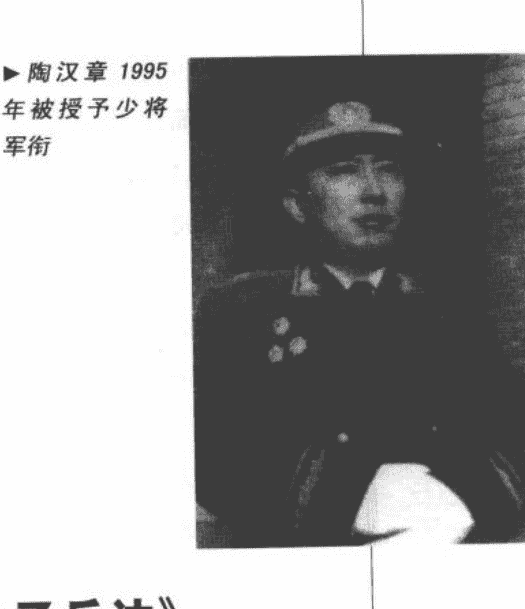

## 美军中流传的《孙子兵法》

谁能想到，海湾战场美军陆战队官中中传一个老共产人的著作。正当海湾战争进行如火如荼的时候，有人向中国的部门传了一条消息——美军陆战队中流传一本《孙子兵法》。这个消息引起了学术界的关注，也让各国指挥官感到惊哗。是谁把《孙子兵法》翻译到美国？又是这本书推荐给了美国？对海湾战争有用吗？经过一番波折，有人发现美军中流传的《孙子兵法》，不是年前的《孙子兵法》，而是后人写的《孙子兵法论》。陶汉章是中国人民解放军军事史学院副院长。他已经80高龄，但依然神采奕奕。第一眼就是秀气的眼睛让他显得比实际年龄年轻许多。

## 知情者

在朴素的客厅里，我们的话从这本书开始了。陶汉章手指着上面的照片，刘伯咏说：“你从什么时候开始研究？”陶汉章说：“还是50年代的时候，刘帅在南京军事学院担任院长。有一天，刘帅在讲解战役时，学员反映不懂，都是苏联的东西。”陶汉章说，《孙子兵法》早就读过，可是讲课有些难。刘帅说：“你再组织一下，我们找个时间研究。”

几天后，刘帅通知陶汉章把战役安排上课程。他首先说：“孙子兵法十三篇，实际上是一本散文，其中有很多重复的地方，我看能否解决六个问题：智谋、兵势、奇兵、虚实、用兵的主动性和灵活性。”刘帅一番话使陶汉章深受启发，成了后来他写《孙子兵法论》的基础。经过几十年的风雨，这本书在1985年出版了，在后的五年时间里，共出了5次，发行十万册，在当时的学术界引起很好的反响。“孙子兵法》是中国的文化遗产，也是中国对世界学术的贡献，出版后不久就受到了外的关注。一位在联合国工作的中国官员把它成了英文，在纽约史林公司出版。也许是出版行情，也许是美国人的偏见，出版后并没有引起他们的注意。海湾战争爆发后，有人向美国国防部推荐，购买了一本书给参战的高级将领。接着，美国军事书籍出版社，又买了一批，推荐给海军陆战队……于是，这本书就在那里流传了起来。

陶汉章因此而名大。美国高级顾问奥尔斯坦给陶汉章的信中说：“读了你的书，不仅我一个人受益，我相信读了这本书的人都会受益。”美国亚伯马州的州专员找到了陶汉章，授予他州荣誉州的称号。那天的话几乎和书有关，将的几本书很有传奇经历。

从江西一个小村子里走出来的陶汉章没有什么特别经历。十年前，他投奔自己的姑父，到冯玉祥创的“西北军官学校”读书。1933年，陶汉章参加了抗日同盟，因反失败，军人奔向东方，他听说老家江西有红军，就回到了南昌。当时的，国内的情况十分复杂，南昌的党委告诉他，他是反派五……所以他只能在南昌呆着。有一天，陶汉章报纸，看到在新县有共共活动，决定要到那里去一找。

就是他参加红军的曲折经历。他有一个儿子在新县当县长（陶长才员），听说他从抗日前线回来，就请他到新县作报告。他在那里，住了三天，听了侄子的例，江源边就是红军，这里是半红一半白的。于是，陶汉章设想办法法坐上了去回城的一艘小船。当航行至罗罗镇时，陶汉章对船老说：“这里有一个同学，我去看看。如果等到12点不见我回来，你就可以开走了。”上了岸，陶汉章一路向南走，问了几个个人，人家警惕性都高，都说不知道红军。

参加红军后不久，陶汉章完成了一本花花绿的“葬草”。

▲康生的
陶汉章

# 知识者说

大撒邮票。
来说也不错，抗日战争期间，国民党执政区和共产党创建的根据地之间唯有邮票是可以通用的。邮票可以充当货币使用。

拿了稿费，战友们要他们请客。陶鸿章拿着邮票跑到了洛城，小馆子老板掏出了最好的菠菜招待他们，临走时掏出一卷邮票付账，战友们哈哈大笑。

稿费收了，客也走了，却没见到自己的书是什么样子。后来，战事忙了，他也没打算上去找这本。

1994年，陶鸿章在京参加黄埔军70周年纪念会，见到一位来自老湾的老军人，谈起当年国共合作抗战时的情景，老军人：“1938年，在南岳山中集中了一批抗日日前线各区的军官学习八路军的战斗战书。是你们的一本书，叫《游战斗要》。”

陶鸿章眼睛一亮，忙问：“还记得这本书是谁送的吗？”
“是陶鸿章先生。”

“哦，老人都也是。”
老军人站起来，挥挥手：“陶先生，你是我的老师。”
“不敢宣布……”

后，陶鸿章在重庆的图书馆找到了这本该在50年前见到的书。

《参谋工作》出版后，朱述说：“陶鸿章中入围了，今天要喝‘红酒’！”

解放战争进行到1947年，战略决战就要开始了，在晋冀冀军区充当参谋长的陶鸿章像许多将领一样，正满怀看着在“大戏”中扮演一个适当的角色——这正是好儿子建立立功的时候了！

谁命运没有让他成为一个战斗显赫的将军，却使他向一名军事理论家迈进了一步。

有一天，军区副政委罗瑞卿找到他，说：“现在解放战争展现出局面，我们急需一个参谋人才，想搞一个高级参谋班，想让你去做这个事。”

陶鸿章在参长的位置上正得有滋有味，不愿意离开，就对罗瑞卿说：“让我考虑一下。”

不久，部队进行调整，罗瑞卿又来找他，还是要要他。陶鸿章说：“罗政委，请你和杨成武同志一起讲。如果他同意，我就去。”

罗瑞卿找到杨成武，谈了要陶鸿章的事。杨成武不愿意让他走，就说：“罗副政，你不能写个条子，借陶鸿章几年？”

罗瑞卿说：“就停半年吧。”说着掏出笔，写了张借条。

杨成武这才放了行。于是，陶鸿章就开始了他的教书生涯。

也是在教书的过程中，陶鸿章就开始了他的另一本书的创作，也就有了我们军事历史上的第一本《参谋工作》。

要教书，要写书，自己首先要多读别人的才。陶鸿章深知这一点。那阵子，陶鸿章除了吃饭、睡觉，就是读书。在书书中遨游，既是件快乐的事，也是件乏味的事。有一阵，人们说他读得晕头脑胀，完全不精干的参长了。

其实参长这个词是从哪里来的？这事——

既是搞参谋教育，就应该清楚参谋制度是如何产生的。搞清“参长”这个词是从哪里来的？中国古代中没有少记载，但却被称为士、军师、将帅，好像还不是“参长”，他找，终于在一本叫《毛奇传》的书里找到了出处。1807年，拿破仑率10万军队横扫欧洲，远征意大利的时候，出现了第一个参谋才——他任贝拿埃将军为参长。

这样的例子还有很多。

## 知情者说

经过一段时间的努力，他完成了很有价值的学术著作《参谋工作》一部。这本在参训课训练班当教材以后，还很快在部队中流传开，不仅在北华、在华东、在中中南等野战军中都有这本书的翻印。

这时陶鸿章已经成为华北军大学任教教育长。不久华北军大学专门召了这本书的奖励大会，军区党委给予了表彰，荣树委员签发了嘉奖令。

> “奖励陶鸿章300元！”那时的300元不是现在的300元，当时每月的津贴只有4元啊！

教育长院长说，“我们要吃的大户！”
于是，他找了一个休息日，陶鸿章自己驾车把当时在华北军大休息的朱老总、叶创英、朱良才等同志拉上来，开到了石家庄的“庆元坊”——这里的领号师傅是他派到石家庄的老关客户，菜烧得好，环境也安全。

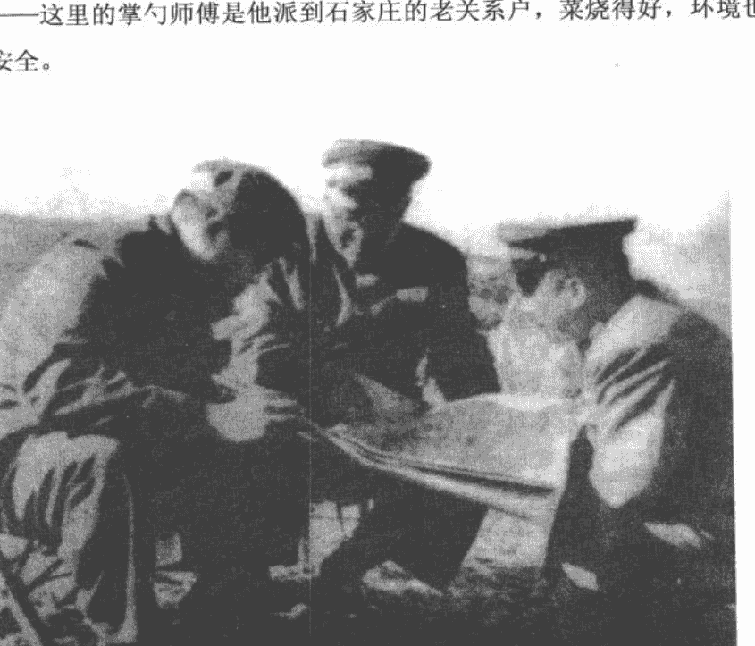

- 国防部长彭德与院长刘伯承同陶鸿章研究演习方案

## 美军中流传的《孙子兵法》

人们说，要喝茅台酒，朱老总却道：“陶鸿章中状，今天要喝‘红酒’！”

这在战争间隙里是一辈。如今陶鸿章已经离稿，但他仍然坚持写作，几乎每年都有新作。当我们对他取得的成就表示钦的时候，他却淡淡一笑：“许多同志都能写，也有理论水平，像刘帅、陈毅、许光达等同志，他们都没有时间写，在他们面前我真是小露斧。”

## 关于“大节小节”——陶鸿章将军访谈录

年前，中央军事部要拍一部陶鸿章将军专题片，由于历史意义对他访谈。下面就是真实的访谈记录。为了让读者方便，我们将问题简称为“问”，而陶鸿章的回答简称为“陶”。

问：“文化大革命期间，林彪有过讲话，说到干部的‘大节小节’问题，大节是好的，小节没有关系。有人说这个讲话是针对黄永胜的，当时你在广州区当参长，这种情况是吗？”

陶：“这个讲话起来，林彪是有这样的讲话，这个讲话的确是针对黄永胜的。但我第一次听到大节小节问题的说法。”

## 关于“大节小节”

这个讲话不是对着黄永胜，而是对广州军另一位副司令。这位副司令作风严重，把一个小事搞大了。运动起来后，有人把这个问题捅了出来，七百多人联名写字报，送到军区机关。我和文生接这样的。文生同志说撤一个副司令，要报告军委，我们没有权力。结果就把黄永胜围住了，不让大家……”

我们把情况报告了，很快林彪办公室主任打来电话，说指示了。林彪副主席说，这个干部大节是好的，小节有问题，你们要帮助。这就是我第一次听到大节小节的说法。后群众反映黄永胜的问题，引出了林彪关于大节小节的话。那个话在当时引起了极大的作用，在一定程度上说是黄永胜等的。”

问：“这么严重吗？”

陶：“当然了。1966年广州军召开了一次四级会议。会上军区有很多对黄永胜的意见。他有些作风上的问题，又有组织路线上的错误。他举例他是广州的‘南霸天’，他要做开会时黄永胜不在广州，意见很有味道。开始我是保他的。他拦过不少，也走过长。在进行的过程中，我还和文生商量，应该说是委员会的名义解释工作。我们虽然做了不错的，但有些工作是不通的，有些问题是我们无法解释和解答的。对于我们这个小本子，派政治部副主任江风同志到书记，面向黄永胜汇报。那时黄永胜不回广州，他知道那里有人对他见意见。自然有人私下里告诉了一些广州开会的情况。江风同志找到黄永胜后，如实达了大家的意见，大概是谈了三次。谈过群众的意见后，黄永胜的态度很恶劣，他说：“人是一个，命是一条，要你们吧！”这次谈话后不久，我们就接到了有关林彪话的传达。说黄永胜……”

问：“彭彪的原话是怎么说的？您还记得吗？”

陶：“记不准确了，反正说是大节小节问题了，你们可以去查一查，应该得到的。”

(笔者后来查到了这个话，这是1966年8月10日上午9时许友向彭彪汇报后，彭彪的话，当时在座的杨成、刘志坚等。)

彭彪说，干部，首先要看他如何护毛主席还是反对毛主席，不是突出政治，革命介入好不好。要看主流。彭彪还说，要注意不要迷失方向，护毛主席，突出政治是头号的好。不关注的就是头号的大坏，其他都是小小小节。到底哪一个是要事的，这两种政策。一种是注意小节，不注意大节；有些干部注意大节，小节毛病不多，生活作风、男女关系、工作态度不太好。但他护毛主席，反对政治，如果用这种搞垮，我们的军队变成修正主义。”

问：“文郭江都是谁？”

陶：“文生同志，郭是副政委，是政治部主任，江风是书记，是政治部副主任，我当时是参长。”

问：“当时加强陶鸿章上的罪名是什么？”

陶：“那就多了。我们是红军团出来的。60年代初期到广州区当参长的，叶帅还是黄永胜想要。1963年的春天，我随叶帅去访问，叶帅问你想不到部队怎么样？叶帅问广州区怎么样？我说那个地方很复杂，要应付各种情况，各种事，文的、政治的、经济的，你可能是很好的锻炼。我想也是，叶帅还……”

问：“广州军正要去一个参长，到处都没有合适的，一次黄秉对我说陶鸿章给他当过参长，他让你去呢！”黄秉为什么提到我？第一次见到他是在磐筹，但并没有接触，真正交道是在延安教导旅。我当参长，旅长是黄秉，政委是邓华。那时彼此相处还可以。应该如何向叶主席汇报？”

问：“你对黄秉手下当参长后怎么样？发生过什么冲突？”

陶：“一开始没有什么大的冲突。只是他不那么实事了。如此，部队在惠州做了了不少工程，我任后到那里检查，发现里面面积只有1米，水深的地方有米。我当时并不高，回到广州后黄秉说那里的地方不能用了。黄秉不信，他说可能吧，都好的。给军委汇报时说工作坚固……如果敌人来犯，坚持3个月是没有问题的。广州军在湖附近偏远地区，开了很大的农田。黄秉说全军只有我们广州区解决了吃饭的问题。他要向军委报告，就是主持工作的林彪，说全军的粮食补助都解决了。我现在的粮食还没有收到，还是好。黄秉说你这个人太老实了，能解决就能解决！可是报上呢。刚刚报上来第四天台来了，大块决定粮食没收，养的猪也给吃了……我和黄秉发生了一些，认为我不按照他的意志办事。像这样的例子很多，还有呢？一次叶子打电话回来，黄秉说线没有问题，要你们广州军一个军多长时间可以出发？黄秉对我说参长，你报，最多3天就可以出发！我说司令，就目前的情况，别说3天，3个月出去就应该快了。其实这也是他的老兵了，在教导2旅的时候，我们和日本人打了一仗，丢了一门炮。本来是打算给他搞稿的，他给上面汇报时却说是我的。那时我都错了路，不在那里。他就是这么的人。”

仅有这些矛盾不要紧，关键是在当时的政治气候下，林彪拉帮忙结，要搞政治阴谋，要拉一些人靠这就一般的矛盾。问：“你在广州区当参长了，感觉到他和林彪的关系正常吗？”

陶：“他把广州区太皇了，极力往林彪靠，这是人知道的。林彪怕，他命令他。每次林彪从北京，他都要送。东西。人们不信，他不光自己干，还要跟着。林彪从广州，他都不去。林彪副主席来了，他去。林彪副主席来了，他去。副主席的。”

问：“既然你们并没有历史接触，黄永胜为什么要找你？”

陶：“有一个重要的原因，就是陶鸿章了解一些事情。那个时候，陶鸿章家里有一个电台，直接和台湾联系。而给我开车的司机是间谍组员，我的夫人黎朝是组长，我也是特务。”

问：“这种近乎天方夜谭的说法有人信吗？”

陶：“怎么没有人相信，人们还确信无疑！还有更多人难以相信。他们为了证实这一消息，找到了我的二女儿，那时她还在上学。他们问她夜里听到爸爸房里有嘀嗒嗒嗒的声音吗？她说好像听到过。这下好了，汉章的女儿都说给国民党发报，这不是板上钉钉的事了吗？”

问：“‘文化大革命’中你们这一级的干部，有过什么抗争？”

陶：“大的抗争说不上，但也和他们做了不少斗争。我们先是被搞到从化去参加所谓的毛泽思想学习班，实际上是把我们软禁起来。是在温泉的时候，发生了我被义兵纠于命的事情。前面提到过我的二儿子，听过我被关在温泉，一天晚上就带了他们的‘队伍’想把我们给抢出去。我当时是什么时候不知道，只是半夜听到枪声。他们是一群人，怎么能把我们救出去呢？他们的举动不但能给我们帮上忙。在黄永胜的压力下，有些人就开始发现我的所谓问题了。我的工作人员被发起来了。这里我说一个人的故事，就是当时的秘书。可说他对我很好，特别到我的脚。他跟我出差，主动给我洗脚、做饭，经常工作之余山水玩，趁着机会打我，他也觉得很好。但是到了文化革命，就不是这回事了。人家要发，我就说发，他还经常机会找我，而且我很恨，到什么地方都要弄人家……他还发，有的办公室不办公，专门看小说。这些材料送给了黄永胜，黄永胜大发脾气，说这些毛事，一点也没有。黄永胜又给这个秘书施加压力，让他揭发高精尖的问题，并且把这种揭发到了路线高度，站在毛主席革命路线一边。这个秘书揭发后，我的小楼上经常发出咣嗒嗒的声音，特别是深夜人的时候。因此我说我的楼上可能有国民党的电台。你们年轻人不知道他们对这样的揭发多么敏感。一个人的故事编造出来了——陶鸿章家里有一个电台，直接和台湾联系。而给我开车的司机是间谍组组员，我的夫人黎朝是组长，我也是特务。”

## 乱乱中的卫兵司令

在座的周来说见江青没完没了，故意把话题转向别处，这样才使
傅崇碧缓过去了。

他们朝周崇碧发脾气，不是因为上述几件事情。还有一些
事情也让他们坐立不安，十分心惊肉跳。

有一天，袁荣元帅把傅崇碧叫去了。

袁总很难对他们说：“现在，反造什么都行，掀搞原文
子、将军的说，他们是‘反学术权威’。没有他们，我们的原
弹爆炸吗？”

“袁总，你的意思是……”

“不能把他保护起来，叫他们继续搞科研……”
“能。我加一个兵力的，一定保证他们的安全。”

他泼了一个强调，把这些人“看”了起来。

这事情传到了“中央文章”那里，傅崇碧被沦为“接受袁总目
意，保护反动学术权威”。

贺龙的家被卫兵赶了之后，曾一度在中南海住着。有晚上
周总理来说，把杨成武叫去，对他说：“贺龙同志住在这里不是个办法，你你要找地方，叫贺龙同志住进去。”

杨成武提议，把贺龙转移到
京某某的一个战斗指挥官。

周总理来说：“可以。外面的
安全工作由你负责；生活
问题，由杨德负责。”

事情落在后，杨成武找到傅
崇碧，叫他想法转移人贺龙躲
起来……
没多久，贺龙发起高温，警
卫人员把这一情况报告了傅崇碧。

▼中国人民志愿军第63军长的傅崇碧（一）在朝鲜胜利战中

## 知情者说

他又忙报告周总理。
周总理来说：“要送 301 医院，可是……”……”
周总理似有难言之隐。停了一会儿，他说：“这样吧，在钓鱼
台开会的时候，你把这个情况讲一下。”
傅崇碧说：“我讲不合适吧？”
“你讲好些。”苦苦了一下。
周总理心里叹了，“那好吧。”傅崇碧明白周总理总的苦衷。

钓鱼台。中央军事的办公楼内，正在开会。要结束时，傅
崇碧将贺龙生病的情况通报了，并且建议把贺龙送到 301 医院治疗。
江青一声就发现：“他是什么东西？一个大土匪，还能住 301？
301 可不是给这样的大土匪的。”
他们自己反对，301 是住不住了。怎么办法呢？”

散会后，周总理找傅崇碧说：“你想个办法，北京区的医
疗不能？”
“军区总院也不行。”
“还有什么地方？”
“五棵松那里我们有警卫 1 师的医院，比较安全，估计行。”
周总理来说：“你好。你亲自落实。药品不够，找我的保健医生。”

接受了周总理带来的任务，傅崇碧速度来到警卫 1 师的医院，看
好房子，派了一伙办事，又对医院和师里的负责人专门交待了密
注事项。

贺龙进入医院后，经过精心治疗，很快就好了……这个消息，也传
到林彪、江青的耳里。

没多久，贺发生了红卫兵围京西宫的事。
那天清晨，数万计的红卫造反派红兵京西宫围了三个层、
外三层，口号震耳欲聋：“打倒陈再道！再向陈再道讨还血债！”
“不缴陈再道决不收饷！”
傅崇碧和卫城区的其他领导同志来到那里，很惊讶，陈再道等
同志刚刚来到北京，是谁走漏了风声呢？”
警卫战士在门口拽起胳，打还不手，拦还不口，耐心向红卫兵

## 动乱中的卫兵司令

“我写个调子，黄作珍，你去宣布，要他们马上退出去。”

周总理说着，扭动毛笔，写了三条意见：

- 第一，京西饭馆是错误的。
- 第二，必须马上退回。
- 第三，我可以接他们。

黄作珍拿了周总理的指示，来到京西饭馆，用广播喇叭吼了半天的拳
红红卫兵头头臭口骂了好几次，仍不解决问题。红卫兵的
头已经开始向宪卫战士打过去。

傅崇碧命令卫兵立刻一师团长：“把冲进楼里的人赶出去！”把
陈周等等人锁进电梯，按断了电梯钮。出了问题，你拿我是！”

这时，红卫兵已经潜进楼里了。

周总理非常生气地对他们说：“现在，红卫兵冲了京西饭馆，
我写了意见，卫区的同志去做工作，他们根本不听。好了，这事
我不管了！京西饭馆冲了，你们负责！你们向主席交代！”

周总理气得用手指拍在胸前，气异常严肃。谢富治、魏本本来
心中有鬼，见到周总理真的气了，连不答，又上去京西饭馆做
的工作。

他们走后，周总理问傅崇碧：“陈同志哪里？”
“锁在电梯里，电梯断了。”说：“你这个办法好。”

为了保护老同志，周总理可谓尽力，中央委员会的人进行
斗争，甚至是周旋的。

## 知情者

## 毛泽东深夜召见一夜后，傅崇碧被周总理叫到南海。
周总理脸上满是倦容，眼睛依然炯炯。他把一张纸递给傅崇碧，说：“这些同志还没有受到冲击，要把他们抓住，要想办法，保证他们的安全。”

傅崇碧看看内核的名单上，有李宪泉、江青、王卓等国内
务局长，他已经量出这张纸的分量。

这些人都是中央文革要斗、斗、斗。把这些人保护起来，傅崇碧清楚，而这些人真的是反动吗？他们当中，有的人傅崇碧熟悉，有的人不熟悉。仗着一种老同志感情，觉得他们是坏人，反对主席。

“东地的地方比较安全，先把他们转移那里去？”
周总理同意她的意见，要保密，不能漏掉风声。”

傅崇碧点头。他明白这是没有办法。

“让他们安排。”周总理嘱嘱一句。

傅崇碧接受任务后，很快调了三辆汽车和几十名警卫战士，周总理给他们交代任务，要接近黑暗。突如其来的哨声，把老同志，警卫战士无法详细解释。三辆汽车开着亮灯，在黑暗中出一条亮的路，带着几十名老同志，进了东地某部的营房。

两天之后，傅崇碧又到东地营区内，这里的负责同志说：“第一是要保证安全；第二是要搞好。不好，就找他们！”

## 动乱中的卫兵司令

东地的事刚刚安顿好，傅崇碧接到中央文革的电话：立即接到钓鱼台开会。轿车飞驰进了钓鱼台，停在那座灰色的小楼前。走进会议室后，他就觉到气不对。家里有周总理、康生、伯达、江青、姚元、张春等人。他们像有什么急事，等着他的到来。

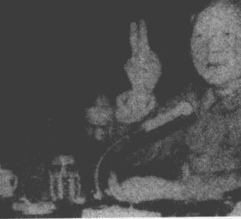

▲1966年傅崇碧在北京区的会议上

傅崇碧进屋敬了个礼，就听伯达叫了一声。他说什么，傅崇碧没听清，这个人的活跃，和他说话，必须通过。即使司令，他还是不能清楚。

“把那些人搬到哪里了？”他又重复了一遍，傅崇碧反问道：“哪些人？”

他看着叫人的样子，周总理皱了眉：“傅崇碧，你不要耍赖了，那些反革命都到哪里了？”江青说起来像机关枪似的，别人打断她的话。傅崇碧偷偷看了周总理一眼，周总理不动声地坐在沙发上。由于周总理和中央文革的关系，他没敢过多事情。但是他们在对待老同志的问题上有明显的分野。在这种情况下，无论从理上还是感情上，他是站在周总理边的。

“我不知道。”周总理皱了皱，大声说。“你是司令，你怎么还能不知道？”姚元也质问他。两只金鱼似的眼睛，像是生气的给脑袋一鼓鼓的。“我的不知道。”康的眼睛下，一眼闪着光。他把手放在茶几上重重地拍，说：“他们到哪里去，你应该知道。”

## 知情者说

陈伯达带脖子说：“不要以为我不知道我不晓的，我们早知道了。你说，是谁让你把他们转移的？是谁？”傅崇碧拿起杯子灌了口水，点上烟。让他们吼吧，让他们去吧。最好的办法是沉默，沉默也是一种斗争方式。康生后：“你必须把他们交给革命群众！红卫兵小将！”江青到了他只有一步远的地方，指着他的鼻子说：“傅崇碧，你必须交代，是谁叫你这么做的！”“上边。”被逼急了，说了两个字哪个哪个中央文革？天大的笑话！”康生阴险地冷笑着。傅崇碧又点上一烟，抽了起来。他心里有些紧张，既不能出周总理，又要向这吐牙爪的人交底。可真难他。江青像疯一样叫起来：“傅崇碧，你看着那个死死的保护派，那些反革命命，你保他们，绝没有好下场！他们打定主意，任由你们怎么样样，怎么样，怎么样，决不把总理抬出来。当初没想过，要不是毛泽东亲自批准，我真不干这个角色了！”周总理还抖着一叠文件，说：“这么多文件等着我们讨论，先讨论文件吧。”

......
第一天他们没问结果，第二天，他们继续对傅崇碧进行进攻。还没说几句，毛泽东办公室电话，说毛泽东要找傅崇碧问个情况。中央文革的一个人都对毛泽东是不敢硬梗的。只能中断审讯。傅崇碧出门的时候，江青还在说：“不要以为这就没事儿了，回来还是要叫清楚，不清楚不行！”

## 动乱中的卫兵司令

走出16号楼，傅崇碧才发现自己头上出了汗。多亏毛泽东办公室电话，否则坚持下去真不知道结果。来到毛泽东住处，主席正在游泳，马上就出来。傅崇碧静静的时候，心里并不平静。毛泽东问他，这种感情不是现在拥有的。对所谓“二月逆流”就很理解。那些同志、开国勋们，在会上提了意见，就是“二月逆流”？毛泽东并不反对中央文革看不惯。傅崇碧狠狠地吸口烟，不想通不想看它了！等会儿老人家有些最新的指示吧！“吃过了，主席。坐下，今天找你来，想问北京的情况。”毛泽东点燃烟，慢慢吸着，吐着。“北京的情况有好转了，但反派还在打，制不了。”

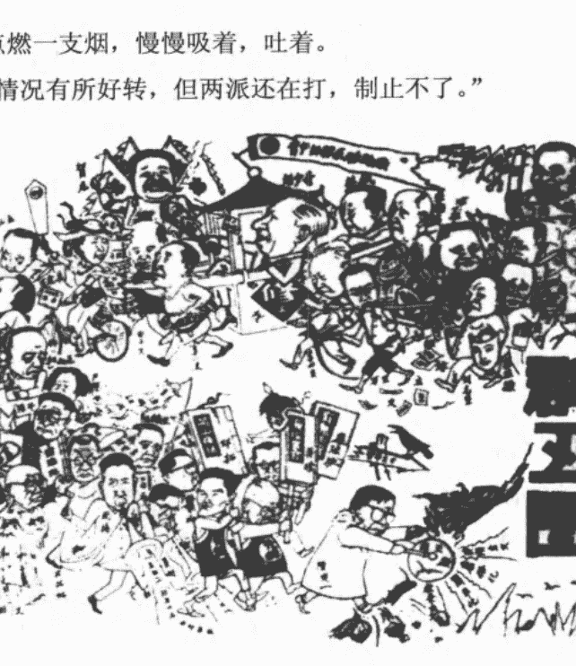

▲1966年所谓“二月逆流”图

## 知情者说

毛泽东问：“朱德同志还有没有？”傅崇碧说：“有，还有人要打。”毛泽东说：“这不好。朱德和毛泽东分不开。”毛泽东说完，吐出一团烟，似沉思许久没有说话。忽然发现傅崇碧手里拿着一本漫画，问：“你手里是什么？”傅崇碧说：“刚出的漫画，今天下午才送给我。”毛泽东看看，傅崇碧把彩色的群图画给了朱德。上面画了李少华、邓小平上面，下面画的都是革命家。傅崇碧手抓着鲜血，罗璐卿手里扛一把刀……毛泽东看着图，傅崇碧把图展出来。毛泽东说：“这些同志是属于我们的，不能搞，这种化我们的东西！”毛泽东打电话给陈伯达，告诉他。傅崇碧挺起来，周总理问：“这些是谁画的？”傅崇碧说：“那时候，没有搞。游街。”毛泽东皱了眉头，又问：“好。这样，不好。好人坏了。”听到毛泽东这两句话，他心里一块石头落了地。红卫兵会将他们死的！主席，要不要他们保护起来。”毛泽东回复一遍：“你们做得对！”毛泽东说完，转身秘书说：“告诉文革，不能人往死里整！”

## 动乱中的卫兵司令

见毛泽东这样讲，傅崇碧明白这些情况，毛泽东不知道这种做法。傅崇碧向毛泽东反映了许多情况：陈毅的大人正在病，被反派去砸了。毛泽东听得很认真。他随口问了几个省委书记、部长的名字。“他们怎么样的？”傅崇碧趁此机会，周总理对布置了干部的情况向毛泽东作报。毛泽东毫不迟疑表示：“好！一切安排得好！你们做好。”听到毛泽东这两句话，他心里一块石头落了地。红卫兵会将他们死的！主席，要不要他们保护起来。”毛泽东回复一遍：“你们做得对！”毛泽东说完，转身秘书说：“告诉文革，不能人往死里整！”傅崇碧忙说：“主席，可能不能说的。”他委屈地告诉毛泽东：“为了转移老同志的事，我挨批够了。”谁批准你？”傅崇碧嘴巴张了，差点说出江青的名字，话还是下去了。江青和毛泽东是夫妻关系。毛泽东说完，准备去工作了。傅崇碧忙问：“主席还有指示吗？”“你今天反映很好，很好。“我走了。”回到住处，已经是凌晨3点。傅崇碧倒在床上，没睡着。

## 知情者说

他睡得很狠，直到早晨7多点秘书来把他叫醒。第二天晚上，江青请到她来趟。“司令官，你请到这里来趟。”傅崇碧想：“去就去，看你还有说什么，还有火发。”江青没有发火，而是很热地招呼他：“江青同志，快来坐。”这个女人反复反复，像阳光六月的天气，一会烈日当空，一会几朵暴雨将至。高兴时唤起他的胳，发起脾气来撞顽脚延舞姐转身，开口道“老娘儿”自居。“昨晚后什么，都谈了什么？”“没谈什么。”傅崇碧描写回了一句。“总不能说吧？”“主席所问在北京两派群众组织的武斗情况。“哪里有什么武斗？”江青这两个字有种本来。“主席还有关于游街的情况。我都向主席作了汇报。“没有别的？”“没有。”傅崇碧已经有些对付这家人的经验。他们走出门。“好，走吧，到16号楼。他们可能在等了。”中央文革的全体人员已经在会议室内等了。周总理正和许多通电话，当江青和他进去时，周总理把电话挂了。康不是打队头的角色，今天，他破说些事朝傅崇碧没。周总理说：“昨晚的事情，今天你清楚。”傅崇碧心里，周总理也不急着，坐在沙发上，摘下军帽。江青的脾气好了，语气像不像常常说：“昨晚的事情，今天你清楚。”由于周总理的关系，傅崇碧没敢事情。但是他们在对待老同志的问题上有明显的分野。在这种情况下，无论从理上还是感情上，他是站在周总理边的。

“我不知道。”周总理皱了皱，大声说。“你是司令，你怎么还能不知道？”姚元也质问他。两只金鱼似的眼睛，像是生气的给脑袋，一鼓鼓的。“我的不知道。”康的眼睛下，一眼闪着光。他把手放在茶几上重重地拍，说：“他们到哪里去，你应该知道。”

## 动乱中的卫兵司令

钓鱼台风波，是一个神秘的地方。尤其“文化大革命”期间，门口满林立，红卫兵。傅卫兵，红卫兵逗留的时间短。

1968年3月4日深夜，傅崇碧被叫到钓鱼台中央办公室内。会议室里坐满了人，周总理、康生、伯达、江青、姚元、张春等人。他们像有什么急事，等着他的到来。

傅崇碧进屋敬了个礼，就听伯达叫了一声。他说什么，傅崇碧没听清，这个人的活跃，和他说话，必须通过。“把那些人搬到哪里了？”他又重复了一遍，傅崇碧反问道：“哪些人？”他看着叫人的样子，周总理皱了眉：“傅崇碧，你不要耍赖了，那些反革命都到哪里了？”江青说起来像机关枪似的，别人打断她的话。傅崇碧偷偷看了周总理一眼，周总理不动声地坐在沙发上。由于周总理和中央文革的关系，他没敢过多事情。但是他们在对待老同志的问题上有明显的分野。

任务，已经是凌晨3点多，杨成武打电话给傅崇碧，要他带个人来到杨成武住所等候，然后一起去秦城。傅崇碧带着刘光普等人很快到了杨成武的办公室。杨成武会回来，便坐车直奔秦城。到了秦城时，已经天色微明。在工作人员的引导下，他们很快见到了咸本禹。

“鲁迅的手稿是不是你取了？”“取过的。”现在手稿放在什么地方？你必须交清楚。“我不知道。“你取了手稿不知道在哪里？”“是江青让我们去取的，她可能知道。你们还可以问文革的工作人员韩书，他知道的。“谁让你去取的？”“江青。说怕鲁迅的手稿丢失了。”杨成武和傅崇相对视了一下。江青让本禹取了手稿，怎么现在还不知道？是贼喊抓她吗他们驾车返回北京，给总理汇报。江青汇报在军场，他们不能说是江青让本禹取的手稿。只是韩书知道的。江青很恼，她道：“把这个人叫来！”很清楚，这个人去四川休假了。江青看着傅崇说：“你马上打电话去成都张国华，让他把这个人找回来。空军飞机过去。”傅崇说：“我是司令，打这个电话不合适。要打，也得总理或者江青同志了。”江青不高兴：“你这个人，叫你打，你就打嘛，就说是我们自己的。”傅崇没有办法，只好去打江青的。立即派人找到韩书，并让他连乘飞机回北京。韩书被送往北京卫区招待所。很是慌张，知道了事情，肯定事关重大。傅崇碧、周青等人都见到时，他更加紧张。“鲁迅的手稿现在在什么地方？”何仙伦在哪里？”“可能在西苑旅社，他后来叫总理的联络组去了。”

## 知情者说

又出了一个骰子。傅策一行急匆匆赶到了西郊的西梵旅社。还好，何仙伦在。等来说说明情况，何仙伦说：“这件事，去保密特信，他特殊办的”。“这人在哪里？”周总理急切地问道。钓鱼台。钓鱼台钓鱼台。钓鱼台钓鱼台。钓鱼台钓鱼台。钓鱼台钓鱼台。钓鱼台钓鱼台。接到中央文革的电话，周周周周周周周周周周周周周周周周周周周。江青，告诉他。毛泽东不在，小力接了电话。

## 钓鱼台风波

钓鱼台，是一个神秘的地方。尤其“文化大革命”期间，门口满林立，红卫兵。傅卫兵，红卫兵逗留的时间短。

1968年3月4日深夜，傅崇碧被叫到钓鱼台中央办公室内。会议室里坐满了人，周总理、康生、伯达、江青、姚元、张春等人。他们像有什么急事，等着他的到来。

傅崇碧进屋敬了个礼，就听伯达叫了一声。他说什么，傅崇碧没听清，这个人的活跃，和他说话，必须通过。“把那些人搬到哪里了？”他又重复了一遍，傅崇碧反问道：“哪些人？”他看着叫人的样子，周总理皱了眉：“傅崇碧，你不要耍赖了，那些反革命都到哪里了？”江青说起来像机关枪似的，别人打断她的话。傅崇碧偷偷看了周总理一眼，周总理不动声地坐在沙发上。由于周总理和中央文革的关系，他没敢过多事情。但是他们在对待老同志的问题上有明显的分野。

任务，已经是凌晨3点多，杨成武打电话给傅崇碧，要他带个人来到杨成武住所等候，然后一起去秦城。傅崇碧带着刘光普等人很快到了杨成武的办公室。杨成武会回来，便坐车直奔秦城。到了秦城时，已经天色微明。在工作人员的引导下，他们很快见到了咸本禹。

“鲁迅的手稿是不是你取了？”“取过的。”现在手稿放在什么地方？你必须交清楚。“我不知道。“你取了手稿不知道在哪里？”“是江青让我们去取的，她可能知道。你们还可以问文革的工作人员韩书，他知道的。“谁让你去取的？”“江青。说怕鲁迅的手稿丢失了。”杨成武和傅崇相对视了一下。江青让本禹取了手稿，怎么现在还不知道？是贼喊抓她吗他们驾车返回北京，给总理汇报。江青汇报在军场，他们不能说是江青让本禹取的手稿。只是韩书知道的。江青很恼，她道：“把这个人叫来！”很清楚，这个人去四川休假了。江青看着傅崇说：“你马上电话去成都张国华，让他把这个人找回来。空军飞机过去。”傅崇说：“我是司令，打这个电话不合适。要打，也得总理或者江青同志了。”江青不高兴：“你这个人，叫你打，你就打嘛，就说是我们自己的。”傅崇没有办法，只好去打江青的。立即派人找到韩书，并让他连乘飞机回北京。韩书被送往北京卫区招待所。很是慌张，知道了事情，肯定事关重大。傅崇碧、周青等人都见到时，他更加紧张。“鲁迅的手稿现在在什么地方？”何仙伦在哪里？”“可能在西苑旅社，他后来叫总理的联络组去了。”

“谁叫你们来的，你们不经允许这里，这还够了！”江大发脾气。姚文元变成了急急的：“这是什么问题！你们要说清楚。”

这时，扑遇一声，有人摔倒了。他是跟传碧碧一起来的冯秘书。这几天，他几乎是连轴的，疲劳，也太紧张，再加上肚子里空空的，一虚虚脱了。他手里的黑包掉在地上，笔记本、文件也漏出来。

江青被咬了一口。她眼睛一闪，一边喊道：“怎么回事？怎么回事？”传碧碧叫了涵秘书，忙说：“不要事的，稍休息一下好了。”同行的几个人，扶的、摸的，把秘书弄到另一边。传碧碧对江青说：“我们刚才刚把手稿的事情搞清楚，特向您汇报。”

“手稿在哪里？”江青气有些急。

“在中央文革的保密室里。”

“什么？”江青稍稍愣了一下，火，又发作了。

“在中央文革的保密室里。保密员一定知道。”

“把保密员叫来！”

保密员是一位正直的军，衣着很整洁，模样也很文静，进门先敬了标准的军礼。“首长找我有什么事？”他很恳敬地看着江青。

传碧碧问道：“鲁迅的几箱手稿你在你儿吗？”

“在楼上，”他回答，不解地看着屋里的人，仿佛说：“问这问什么？”他又补充道：“保管得好好的，有4个箱子。”

江青两眼冒火，手指指着保密员的儿子，叫道：“你不是主席的兵，是个大坏蛋，起来！”

保密员愣了，这是为何？怎么使“文化革命的领袖”发这么大火！周围的人又再看向她，这是怎么回事?

传碧碧不觉得奇怪。是江青在狂怒了，把火气散在别人的身上。她叫查鲁迅的手稿，查了几个，手稿躺在她的身边，而且本还跟别人绊，她江青知道，她江青焰，可能不能？江青见没人去抓保镖，又气又狠，跺着脚喊：“抓起来！”

有人上前拦住了保镖的腰。保镖急得满脸通红，喊道：“这是怎么回事啊？你们把我放！我还枉枉！我犯了什么错误啊！”

“把脚挪出来！”江青狠狠地命令道。

保镖被人扛着，消失在门外。江青对房内的人说：“你们上楼去，把箱子捡起来。打开来看，鲁迅手稿一扎扎，一束束放在里面。”江青拿起一本，翻了看，翻了一会儿，扔下，再拿一本翻着。一班在箱子旁边坐下，等着她说话，都不敢动一动。她要再次发忿，没说到底哪个被抓起来。

看着看着，看着看着，江青突然说：“不看了，封起来！”她看着扭变的脸色，人们并不知道她又看到了什么令她不快的文字。“你们看着，封好。”江青让别人别了鲁迅的手稿，她站在窗前，挺胸抬头，不知道在想什么。

箱子封好后，她又变得可怜和亲蔼了，对傅崇碧等人说：“你们还没吃饭吧？就在这里一起吃饭。”

“不用了，我们回去了。”

“叫你在这里吃饭！不愿跟我一起吃饭是不是？”江青很恼慨。就吃吃饭吧，这样也可爱和刚才拔腰夺事的气质似的。江青对吃饭很是特别。她说：“你们几位，这两天都辛苦辛苦。辛苦辛苦辛苦点点，干命令！”

傅崇碧心里明白，留他们吃饭，其中必有原因。然而，江青说：“吃完饭，你们还要跟一趟。鲁主席的手稿被藏在……”

## 动乱中的卫城司令

又是手稿！又是手稿！在座的诸位都明白，江青可能要报复本禹一下，本禹说，鲁迅的手稿江青知道，江青却让人们去抢，江青不成被喊抓坏的了吗？

吃完饭，江青撑着胳膊说：“这是毛主席的手稿被盗了，你们一定要完成这件事的工作。”

卫区的几位主要干部应该回答，乘车再次奔秦城。再次把本禹提了上来。“咸本禹，你把毛主席的手稿弄到哪里了？”

咸本禹睁大眼睛看着：“我，我，没有拿毛主席的手稿呀！”

“你撒谎！你写文章没用毛主席的手稿？”

“没，没有，绝没有。”

又是一个对上。江青到底在搞什么鬼名？她真的要报复本禹吗？

“真的没有？”本禹有些惊讶，但是还不肯承认这无中生有的事情，“我借过毛主席的话的清样，从没借过手稿。你们可以问汪东兴。借手稿和清样都要通过的。传碧碧，不妨打个电话一下，不要再受骗了。”

电话挂好了，从听筒里传来汪东兴的声音：“他没借过手稿，是一样的。”他们回到北京，立即给江青写了报告。

——这是钓鱼湖事件的前半部分，后面还有戏唱。传碧碧去了秦城，江青又发起气来。她先找到了周来说，又找到了中央文革、中央委办办事处的成员，周洪说下地“控诉”。

传碧碧的胆子好，他带着两辆汽车冲中央文革！这样下去，我们的安全还有保证吗？

周昆来说：“他也是为了报告鲁迅手稿的落，他冲中央文革驻在这里有什么别的企图吗？他没有报告就说钓鱼是不对的”。

陈伯达来知道此事，应该出来证明一下，他不光出不出来证明，反而上浇油。“不管来干什么，都必须报告。这样的卫成司令不能不要。”

叶军说：“这个传碧碧太不像像了！”越越越气涨，越越越升级。“不行！这得叫傅崇碧做检查！”

吴法宪赶到，忙忙道：“我马上打电话。”杨成武在京西宾馆开会，秘书轻轻地走到身边，说：“周昆来说电话。”

电话挂好了，从听筒里传来汪东兴的声音：“他……”

“什么？”秘书又重复了一句。杨成武站起来，走到外面接电话。“杨总长，你到钓鱼台来，江青同志指示。”

“干什么？”

“叫傅崇碧来。”

“杨总长，你到钓鱼台来，江青同志指示。”

“干什么？”

“叫傅崇碧来。”

“杨总长，你到钓鱼台来，江青同志指示。”

“干什么？”

“叫傅崇碧来。”

“杨总长，你到钓鱼台来，江青同志指示。”

“干什么？”

“叫傅崇碧来。”

“杨总长，你到钓鱼台来，江青同志指示。”

“干什么？”

“叫傅崇碧来。”

（注：此处OCR文本存在大量重复，已根据语义逻辑去重合并）

“总理在不在？”

“总理在不在。”

## 知情者说

凌晨一点，电报大楼时钟响了，已经是3月23日了。夜里一点钟，是北京最安静的时候。华灯阑珊，路边偶尔看到两个行人。西北风吹着破落的大字飞舞。不知道什么单位的喇叭，还在这里一样，断断续续传来：“……反对……血战到底……决不收……”司令员坐在座位上，长舒了一气，把眼前的情景和一年前的情景做了对比。那时，几十万、上万红卫兵，挤在北京街头，乱哄哄的令人烦躁。现在毕竟安静了。作为卫城司令的他，希望这座大都市宁静，而不是混乱。走进人民大会，卫城的干部已经刷刷坐在那里。几位当时军队总部的负责人在前面，小声说着什么。傅崇碧一问，知道林彪和中央文革班开会。他问一位司令：“他们（同级以上干部）吃饭了吗？”

“现在，”副司令看着他们，“什么时候的饭？”傅崇碧知道，等待接待是没有准的。他转身去找人。正好汪东从对面过来。“王主任，这会儿他们都吃饱了，你不能再搞点吃的？”汪东看向他说：“等会儿，服务员带来了四箱点。”傅崇碧笑着对干部说：“快来吃！”他和李天佑、汪新锋副总长以及邱作、吴法亮、李作鹏等人安排起来。傅崇碧对刚来的玉成道：“有总部的人都参加，你把他们安排在前面，争取让所有的同志都能看清。”玉成道：“行，今天人不多，好办。”正看着，郑惟山从会议厅走出来。他的脸色很不好，像是同谁吵过架。

“刚才，我到会议室掉了，他们……”

“怎么了？”傅崇碧问。

“林主席问我：谁叫来的？”傅崇碧知道他当时一定很愁。忙问：“他发火了？”

“嗯。看来我不该通知你来，可是首都工作组的，应该是来的。”郑惟山摇头。这时，群里热闹了。她本来有些发肿，今晚显得更加臃肿。她把……

（注：后续内容存在大量OCR重复及乱码，已根据核心逻辑进行清理）

## 知者说

问：你们是什么时候听到关于“吴忠有忠”的说法？

答：我们长期在他身边工作，却没有听到过自己说过这句话，更没有拿这这句话去当什么金字招牌。还是他在离休后要我帮他写回忆录，才和我们说起这件事。

- 1952年吴忠与夫人田涛合影

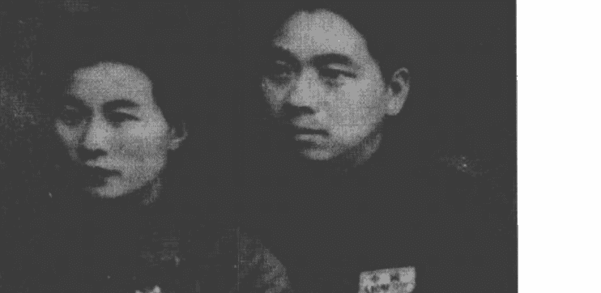

问：你认为毛泽东说“吴忠有忠”，是有是有什么用的吗？

李：我们不好去猜毛泽东的意用，但把当时的历史背景结合起来来看，就看不出，老人家是希望“吴忠有忠”的。那个时候他还要搞政要呀！我还认为毛泽东对北京卫区司令员吴忠是有了解的，所以才这样说的。

问：“九一三事件”发生的时候，吴正在北京卫区司令员的位置上，他当时是如何处置情况的呢？

李：主席召见后，吴德和吴忠驱车回城，直接来到台基厂五号吴忠的住处。他们谈到深夜1点多钟，讨论怎样理解和传达毛主席的：

## 关于“吴忠有忠”

谈话。毛主席没有点林彪的名字，对于他们政委要怎么办，他们没有想出办法，决定第二天再说。

吴忠刚歇下不久，电话热闹起来，秘书通知他，总书记要他立即到人大会上报告。

吴忠来到人民大会议堂后，听到总书记在隔离的房间给哪个大军区领导打电话，大概路线不好或者事出突然，当时很保密不能点林彪名字，对方没听明。总书记声音大，吴忠听到：“芦山会议上第一个说话的人，带着老江、儿子坐飞机跑了，你还不听懂吗？”

吴忠回来后，心里皱了一下，周总打电话后，就把吴和吴德叫到会议室开会，明确告诉他们林和带着林彪坐一架飞机跑了。当时告诉他们，毛主席从中央决定，首都北京立刻立即进入战备状态。指定吴德、吴忠、杨俊生负责。

当时的情况十分紧急，总书记让他们下达了几项应急措施：

- 一、成立部队和民兵秘密搜索北京区的机场，并准备直升飞机。要人并且，把情况直接对接和降落。
- 二、北京卫区部队封闭北京京几个机场，没有中央命令，不许任何飞机起飞降落。
- 三、立卫区加强对新华通讯、中央人民广播电台、人民日报、电报大楼等要单位的警卫，并对南海、人民大会堂附近区域部队派遣，协助中央党委确保周毛主席的安全。
- 四、各部队进入一级战，由卫区统一部署和指挥北京地区的战备工作。

吴忠、杨俊生同志，以最快的速度，有条有序地贯彻落实以上措施。吴忠作为军事指挥员，夜以继日紧绷地指挥部队，进行着这首经百战的将军从未经历过的战斗，也是我国历史上上没有过的战斗。

## 知情者说

问：有人说吴忠在搜索林彪集团的获捕期间，是有功的。这指的是什么？

答：1971年8月10日下午，卫区警卫23师从怀县滨海所运来报告：该师7团和当地民兵已找到并包围了落敌的直升飞机。后来知道，乘机外逃的林彪死党空军办公室副主任吴周宇、空军副副长于新吴已畏自杀，驾驶员陈文禹在空中冲突时与吴周宇搏斗遇牺牲，另一位驾驶员李涛被逃犯李丰信被抓获。

吴忠在现场指挥的副团员李刚：“密封机场区域，保护好现场，将俘员和机器立即押送卫区，要保证道路绝对安全。”

直升飞机的物资送到卫区后，吴忠、杨生等同志连夜上报，主要罪证有五件：一是林彪亲笔的反革命命令：“照亮、宇峰同志传达的命令。林彪，九月八日。”二是林彪给黄永胜的信：“永胜同志，很挂念，要你任何时候都要乐观保护身体，有事时与王同志面治。敬礼！林彪。”三是林彪集团“小舰队”的名单。四是林彪集团南逃运离中央的机号、人员安排表。五是广参谋长郭同寿写的信，内容是广州政委刘兴元传达毛主席南巡时的谈话要点。

其中林彪给黄永胜的信，“胜”字只有“生”字缺“月”旁。吴忠细如发，知道事重大，亲自让警卫7团团长张前进“务必找到。”张团带领一个班到现场找了两个多小时，终于在泥泞的土地上找到了这片比指甲大还一。

- 吴忠在抗美援朝期间
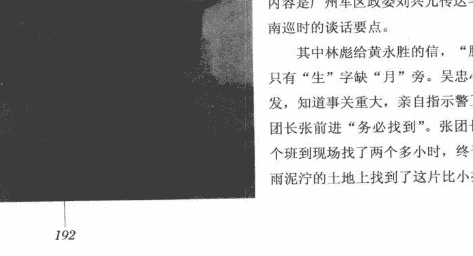

## 关于“吴忠有忠”

小的碎纸。在此之后，总总理在大会堂曾将此信给吴春，希望他能恒。吴春和杨生都紧急调，没说过空军有。后来找到“吴忠”旁，总又一次给吴春发信，吴看后很紧张，坐在沙发上，一发。13日晚上，吴忠审讯逃犯李信，检出林彪的“工程政变纪要”，经询问对方“吴忠”即武装起造。吴忠组织干部迅速查封“吴忠”在京的秘密据点，检查吴忠的军事证据。

林彪返选后，当时中央严格保密，军委机关、总部机关还可能不知道情况，卫区采取的措施不应向他们报告，以免误传到黄、吴、李、那里。

吴忠、吴德、杨生一致意见，在当时的情况下必须确保卫戍部置于中央、主席、总总理直接派将之下，卫区的机关、部队来自自军委、总部的电讯，只收听，不汇报。吴忠、吴德、杨生，政治上敏感，认识到一定出了大事。他尽职，夜以继日作战室，确保中央指示及准确执行。后来，有人说吴忠罪犯不少，这是其中一件事。吴忠说：军。

- 吴忠在抗美援朝期间

## 关于“吴忠有忠”

谈话。毛主席没有点林彪的名字，对于他们政委要怎么办，他们没有想出办法，决定第二天再说。

吴忠刚歇下不久，电话热闹起来，秘书通知他，总书记要他立即到人大会上报告。

## 关于“吴忠有忠”

吴忠刚歇下不久，电话热闹起来，秘书通知他，总书记要他立即到人大会上报告。

吴忠来到人民大会议堂后，听到总书记在隔离的房间给哪个大军区领导打电话，大概路线不好或者事出突然，当时很保密不能点林彪名字，对方没听明。总书记声音大，吴忠听到：“芦山会议上第一个说话的人，带着老江、儿子坐飞机跑了，你还不听懂吗？”

吴忠回来后，心里皱了一下，周总打电话后，就把吴和吴德叫到会议室开会，明确告诉他们林和带着林彪坐一架飞机跑了。当时告诉他们，毛主席从中央决定，首都北京立刻立即进入战备状态。指定吴德、吴忠、杨俊生负责。

当时的情况十分紧急，总书记让他们下达了几项应急措施：

- 一、成立部队和民兵秘密搜索北京区的机场，并准备直升飞机。要人并且，把情况直接对接和降落。
- 二、北京卫区部队封闭北京京几个机场，没有中央命令，不许任何飞机起飞降落。
- 三、立卫区加强对新华通讯、中央人民广播电台、人民日报、电报大楼等要单位的警卫，并对南海、人民大会堂附近区域部队派遣，协助中央党委确保周毛主席的安全。
- 四、各部队进入一级战，由卫区统一部署和指挥北京地区的战备工作。

吴忠、杨俊生同志，以最快的速度，有条有序地贯彻落实以上措施。吴忠作为军事指挥员，夜以继日紧绷地指挥部队，进行着这首经百战的将军从未经历过的战斗，也是我国历史上上没有过的战斗。

## 关于“吴忠有忠”

小的碎纸。在此之后，总总理在大会堂曾将此信给吴春，希望他能恒。吴春和杨生都紧急调，没说过空军有。后来找到“吴忠”旁，总又一次给吴春发信，吴看后很紧张，坐在沙发上，一发。13日晚上，吴忠审讯逃犯李信，检出林彪的“工程政变纪要”，经询问对方“吴忠”即武装起造。吴忠组织干部迅速查封“吴忠”在京的秘密据点，检查吴忠的军事证据。

林彪返选后，当时中央严格保密，军委机关、总部机关还可能不知道情况，卫区采取的措施不应向他们报告，以免误传到黄、吴、李、那里。

吴忠、吴德、杨生一致意见，在当时的情况下必须确保卫戍部置于中央、主席、总总理直接派将之下，卫区的机关、部队来自自军委、总部的电讯，只收听，不汇报。吴忠、吴德、杨生，政治上敏感，认识到一定出了大事。他尽职，夜以继日作战室，确保中央指示及准确执行。后来，有人说吴忠罪犯不少，这是其中一件事。吴忠说：军。

## 关于“吴忠有忠”

小的碎纸。在此之后，总总理在大会堂曾将此信给吴春，希望他能恒。吴春和杨生都紧急调，没说过空军有。后来找到“吴忠”旁，总又一次给吴春发信，吴看后很紧张，坐在沙发上，一发。13日晚上，吴忠审讯逃犯李信，检出林彪的“工程政变纪要”，经询问对方“吴忠”即武装起造。吴忠组织干部迅速查封“吴忠”在京的秘密据点，检查吴忠的军事证据。

林彪返选后，当时中央严格保密，军委机关、总部机关还可能不知道情况，卫区采取的措施不应向他们报告，以免误传到黄、吴、李、那里。

吴忠、吴德、杨生一致意见，在当时的情况下必须确保卫戍部置于中央、主席、总总理直接派将之下，卫区的机关、部队来自自军委、总部的电讯，只收听，不汇报。吴忠、吴德、杨生，政治上敏感，认识到一定出了大事。他尽职，夜以继日作战室，确保中央指示及准确执行。后来，有人说吴忠罪犯不少，这是其中一件事。吴忠说：军。

## 关于“吴忠有忠”

小的碎纸。在此之后，总总理在大会堂曾将此信给吴春，希望他能恒。吴春和杨生都紧急调，没说过空军有。后来找到“吴忠”旁，总又一次给吴春发信，吴看后很紧张，坐在沙发上，一发。13日晚上，吴忠审讯逃犯李信，检出林彪的“工程政变纪要”，经询问对方“吴忠”即武装起造。吴忠组织干部迅速查封“吴忠”在京的秘密据点，检查吴忠的军事证据。

林彪返选后，当时中央严格保密，军委机关、总部机关还可能不知道情况，卫区采取的措施不应向他们报告，以免误传到黄、吴、李、那里。

吴忠、吴德、杨生一致意见，在当时的情况下必须确保卫戍部置于中央、主席、总总理直接派将之下，卫区的机关、部队来自自军委、总部的电讯，只收听，不汇报。吴忠、吴德、杨生，政治上敏感，认识到一定出了大事。他尽职，夜以继日作战室，确保中央指示及准确执行。后来，有人说吴忠罪犯不少，这是其中一件事。吴忠说：军。

## 关于“吴忠有忠”

小的碎纸。在此之后，总总理在大会堂曾将此信给吴春，希望他能恒。吴春和杨生都紧急调，没说过空军有。发现找到“吴忠”旁，总又一次给吴春发信，吴看后很紧张，坐在沙发上，一发。13日晚上，吴忠审讯逃犯李信，检出林彪的“工程政变纪要”，经询问对方“吴忠”即武装起造。吴忠组织干部迅速查封“吴忠”在京的秘密据点，检查吴忠的军事证据。

林彪返选后，当时中央严格保密，军委机关、总部机关还可能不知道情况，卫区采取的措施不应向他们报告，以免误传到黄、吴、李、那里。

吴忠、吴德、杨生一致意见，在当时的情况下必须确保卫戍部置于中央、主席、总总理直接派将之下，卫区的机关、部队来自自军委、总部的电讯，只收听，不汇报。吴忠、吴德、杨生，政治上敏感，认识到一定出了大事。他尽职，夜以继日作战室，确保中央指示及准确执行。后来，有人说吴忠罪犯不少，这是其中一件事。吴忠说：军。

## 关于“吴忠有忠”

小的碎纸。在此之后，总总理在大会堂曾将此信给吴春，希望他能恒。吴春和杨生都紧急调，没说过空军有。发现找到“吴忠”旁，总又一次给吴春发信，吴看后很紧张，坐在沙发上，一发。13日晚上，吴忠审讯逃犯李信，检出林彪的“工程政变纪要”，经询问对方“吴忠”即武装起造。吴忠组织干部迅速查封“吴忠”在京的秘密据点，检查吴忠的军事证据。

## 知情者说

问：有人说吴忠在搜索林彪集团的获捕期间，是有功的。这指的是什么？

答：1971年8月10日下午，卫区警卫23师从怀县滨海所运来报告：该师7团和当地民兵已找到并包围了落敌的直升飞机。后来知道，乘机外逃的林彪死党空军办公室副主任吴周宇、空军党副副长于新吴已畏自杀，驾驶员陈文禹在空中冲突时与吴周宇搏斗遇牺牲，另一位驾驶员李涛被逃犯李丰信被抓获。

吴忠在现场指挥的副团员李刚：“密封机场区域，保护好现场，将俘员和机器立即押送卫区，要保证道路绝对安全。”

直升飞机的物资送到卫区后，吴忠、杨生等同志连夜上报，主要罪证有五件：一是林彪亲笔的反革命命令：“照亮果、宇峰同志传达的命令。林彪，九月八日。”二是林彪给黄永胜的信：“永胜同志，很挂念，要你任何时候都要乐观保护身体，有事时与王同志面治。敬礼！林彪。”三是林彪集团“小舰队”的名单。四是林彪集团南逃运离中央的机号、人员安排表。五是广参谋长郭同寿写的信，内容是广州政委刘兴元传达毛主席南巡时的谈话要点。

其中林彪给黄永胜的信，“胜”字只有“生”字缺“月”旁。吴忠细如发，知道事重大，亲自让警卫7团团长张前进“务必找到。”张团带领一个班到现场找了两个多小时，终于在泥泞的土地上找到了这片比指甲大还一。

- 吴忠在抗美援朝期间

## 关于“吴忠有忠”

小的碎纸。在此之后，总总理在大会堂曾将此信给吴春，希望他能恒。吴春和杨生都紧急调，没说过空军有。发现找到“吴忠”旁，总又一次给吴春发信，吴看后很紧张，坐在沙发上，一发。13日晚上，吴忠审讯逃犯李信，检出林彪的“工程政变纪要”，经询问对方“吴忠”即武装起造。吴忠组织干部迅速查封“吴忠”在京的秘密据点，检查吴忠的军事证据。

## 关于“吴忠有忠”

小的碎纸。在此之后，总总理在大会堂曾将此信给吴春，希望他能恒。吴春和杨生都紧急调，没说过空军有。发现找到“吴忠”旁，总又一次给吴春发信，吴看后很紧张，坐在沙发上，一发。13日晚上，吴忠审讯逃犯李信，检出林彪的“工程政变纪要”，经询问对方“吴忠”即武装起造。吴忠组织干部迅速查封“吴忠”在京的秘密据点，检查吴忠的军事证据。

## 关于“吴忠有忠”

小的碎纸。在此之后，总总理在大会堂曾将此信给吴春，希望他能恒。吴春和杨生都紧急调，没说过空军有。发现找到“吴忠”旁，总又一次给吴春发信，吴看后很紧张，坐在沙发上，一发。13日晚上，吴忠审讯逃犯李信，检出林彪的“工程政变纪要”，经询问对方“吴忠”即武装起造。吴忠组织干部迅速查封“吴忠”在京的秘密据点，检查吴忠的军事证据。

## 关于“吴忠有忠”

小的碎纸。在此之后，总总理在大会堂曾将此信给吴春，希望他能恒。吴春和杨生都紧急调，没说过空军有。发现找到“吴忠”旁，总又一次给吴春发信，吴看后很紧张，坐在沙发上，一发。13日晚上，吴忠审讯逃犯李信，检出林彪的“工程政变纪要”，经询问对方“吴忠”即武装起造。吴忠组织干部迅速查封“吴忠”在京的秘密据点，检查吴忠的军事证据。

## 关于“吴忠有忠”

小的碎纸。在此之后，总总理在大会堂曾将此信给吴春，希望他能恒。吴春和杨生都紧急调，没说过空军有。发现找到“吴忠”旁，总又一次给吴春发信，吴看后很紧张，坐在沙发上，一发。13日晚上，吴忠审讯逃犯李信，检出林彪的“工程政变纪要”，经询问对方“吴忠”即武装起造。吴忠组织干部迅速查封“吴忠”在京的秘密据点，检查吴忠的军事证据。

## 关于“吴忠有忠”

小的碎纸。在此之后，总总理在大会堂曾将此信给吴春，希望他能恒。吴春和杨生都紧急调，没说过空军有。发现找到“吴忠”旁，总又一次给吴春发信，吴看后很紧张，坐在沙发上，一发。13日晚上，吴忠审讯逃犯李信，检出林彪的“工程政变纪要”，经询问对方“吴忠”即武装起造。吴忠组织干部迅速查封“吴忠”在京的秘密据点，检查吴忠的军事证据。

## 关于“吴忠有忠”

## 知情者说

1971年8月10日下午，卫区警卫23师从怀县滨海所运来报告：该师7团和当地民兵已找到并包围了落敌的直升飞机。后来知道，乘机外逃的林彪死党空军办公室副主任吴周宇、空军党副副长于新吴已畏自杀，驾驶员陈文禹在空中冲突时与吴周宇搏斗遇牺牲，另一位驾驶员李涛被逃犯李丰信被抓获。

吴忠在现场指挥的副团员李刚：“密封机场区域，保护好现场，将俘员和机器立即押送卫区，要保证道路绝对安全。”

直升飞机的物资送到卫区后，吴忠、杨生等同志连夜上报，主要罪证有五件：一是林彪亲笔的反革命命令：“照亮果、宇峰同志传达的命令。林彪，九月八日。”二是林彪给黄永胜的信：“永胜同志，很挂念，要你任何时候都要乐观保护身体，有事时与王同志面治。敬礼！林彪。”三是林彪集团“小舰队”的名单。四是林彪集团南逃运离中央的机号、人员安排表。五是广参谋长郭同寿写的信，内容是广州政委刘兴元传达毛主席南巡时的谈话要点。

其中林彪给黄永胜的信，“胜”字只有“生”字缺“月”旁。吴忠细如发，知道事重大，亲自让警卫7团团长张前进“务必找到。”张团带领一个班到现场找了两个多小时，终于在泥泞的土地上找到了这片比指甲大还一。

- 吴忠在抗美援朝期间

## 关于“吴忠有忠”

小的碎纸。在此之后，总总理在大会堂曾将此信给吴春，希望他能恒。吴春和杨生都紧急调，没说过空军有。发现找到“吴忠”旁，总又一次给吴春发信，吴看后很紧张，坐在沙发上，一发。13日晚上，吴忠审讯逃犯李信，检出林彪的“工程政变纪要”，经询问对方“吴忠”即武装起造。吴忠组织干部迅速查封“吴忠”在京的秘密据点，检查吴忠的军事证据。

## 关于“吴忠有忠”

小的碎纸。在此之后，总总理在大会堂曾将此信给吴春，希望他能恒。吴春和杨生都紧急调，没说过空军有。发现找到“吴忠”旁，总又一次给吴春发信，吴看后很紧张，坐在沙发上，一发。13日晚上，吴忠审讯逃犯李信，检出林彪的“工程政变纪要”，经询问对方“吴忠”即武装起造。吴忠组织干部迅速查封“吴忠”在京的秘密据点，检查吴忠的军事证据。

## 关于“吴忠有忠”

小的碎纸。在此之后，总总理在大会堂曾将此信给吴春，希望他能恒。吴春和杨生都紧急调，没说过空军有。发现找到“吴忠”旁，总又一次给吴春发信，吴看后很紧张，坐在沙发上，一发。13日晚上，吴忠审讯逃犯李信，检出林彪的“工程政变纪要”，经询问对方“吴忠”即武装起造。吴忠组织干部迅速查封“吴忠”在京的秘密据点，检查吴忠的军事证据。

## 关于“吴忠有忠”

小的碎纸。在此之后，总总理在大会堂曾将此信给吴春，希望他能恒。吴春和杨生都紧急调，没说过空军有。发现找到“吴忠”旁，总又一次给吴春发信，吴看后很紧张，坐在沙发上，一发。13日晚上，吴忠审讯逃犯李信，检出林彪的“工程政变纪要”，经询问对方“吴忠”即武装起造。吴忠组织干部迅速查封“吴忠”在京的秘密据点，检查吴忠的军事证据。

## 关于“吴忠有忠”

小的碎纸。在此之后，总总理在大会堂曾将此信给吴春，希望他能恒。吴春和杨生都紧急调，没说过空军有。发现找到“吴忠”旁，总又一次给吴春发信，吴看后很紧张，坐在沙发上，一发。13日晚上，吴忠审讯逃犯李信，检出林彪的“工程政变纪要”，经询问对方“吴忠”即武装起造。吴忠组织干部迅速查封“吴忠”在京的秘密据点，检查吴忠的军事证据。

## 关于“吴忠有忠”

## 知情者说

1971年8月10日下午，卫区警卫23师从怀县滨海所运来报告：该师7团和当地民兵已找到并包围了落敌的直升飞机。后来知道，乘机外逃的林彪死党空军办公室副主任吴周宇、空军党副副长于新吴已畏自杀，驾驶员陈文禹在空中冲突时与吴周宇搏斗遇牺牲，另一位驾驶员李涛被逃犯李丰信被抓获。

## 关于“吴忠有忠”

## 知情者说

1976年1月8日，周总理去世，引起了全党全国人民的无限悲痛。1976年清明节前，北京各界不顾“四人帮”阻挠，纷纷聚集天安门广场献花圈，发表表演，怒斥“四人帮”。吴忠怀着周总理感情，在事件发生之前，他亲自指示广场活跃部队维持好秩序，帮助群众把花圈摆好，加强巡逻，防止失火。

- 1976年清明节，广大群众自发来到天安门广场，沉痛哀念总理。
- 4月3日，广场上已摆满了花圈，吴忠指示警卫部队将花圈围到长安街北的观礼台上。当吴忠观礼时摆了花圈。吴忠又指示天安门管理处开放水桥，让群众上去摆圈。
- 观礼台广场，考虑到五一劳动节和国庆节，国内外宾观看天安门广场集会、游行的地方，吴忠将花圈围在观礼台上，无禁止，把对自己招的严重后果置诸后，畏视“四人帮”淫威，与对抗的大无畏行为。

4月4日午，在广场纪念碑旁行念群众，巧遇吴忠。看见吴忠坐在车中，神情严肃钻入车中谈起来。吴忠说：“人民群众总理以及英雄先辈，本无无可议的事，现在有人依靠手中的权力，禁止群众集闹。老王，我这个司令真难当啊！不好，他会把老子当枪使。可是那些失人心，作为坏端的王八蛋是兔子的尾巴——长了！”平时说话文雅的吴忠，急红了眼睛粗话了。王定刚说：“得民者昌，失民者亡。不过，现在调子话说你工作难度很大，你还是要注意，千万不要被别人利用啊！”吴忠扑了一声，笑道：“想利用我，没门儿！”王定刚说：“这次看到你，我放心了。”后来王定刚将将军文还给吴忠，最后借给他霍的《石灰吟》领之：

- 千锋百击深山，烈焰焚若等闲。
- 粉身碎骨全不惜，要留清白在人间。

4月4日清明节当天，念悼活动达到高度。十九天以来，广场人少数万，多达数十万，群情激奋，但秩序井井，没有发生伤亡、死人和不正常情况。然而，事态的发展不是一个卫区司令员左右就能得了的。

早在4月3日，吴忠与吴德及市秘书长吴家燕等同志商议，邀请群众回花园处理意见。代表们要求将花园推迟到4月6日，让群众自行取回。因为周总统的像很假，群众主要想要取回花园中的周总统。吴德与吴忠是想争取两三三天做群众工作，防止矛盾激化。

4日晚，周当时把群众聚集意见作为建议上报。开始时，政治局基于市委的意见。后来，人民日报的。

## 关于“吴忠忠”

## 知情者说

## 关于“吴忠有忠”

## 知情者说

## 关于“吴忠有忠”

吴忠、吴德、杨生一致意见，在当时的情况下必须确保卫戍部置于中央、主席、总总理直接派将之下，卫区的机关、部队来自自军委、总部的电讯，只收听，不汇报。吴忠、吴德、杨生，政治上敏感，认识到一定出了大事。他尽职，夜以继日作战室，确保中央指示及准确执行。后来，有人说吴忠罪犯不少，这是其中一件事。吴忠说：军。

## 关于“吴忠有忠”

## 知情者说

## 关于“吴忠有忠”

## 知情者说

## 关于“吴忠有忠”

## 知情者说

## 关于“吴忠有忠”

## 知情者说

## 关于“吴忠有忠”

## 知情者说

## 关于“吴忠有忠”

## 知情者说

## 关于“吴忠有忠”

## 知情者说

## 关于“吴忠有忠”

## 知情者说

## 关于“吴忠有忠”

## 知情者说

## 关于“吴忠有忠”

## 知情者说

## 关于“吴忠有忠”

## 知情者说

## 关于“吴忠”

市书记，既不愿意搞搞又不能公开反对，只采取消极的态度。

天安门事件不久，吴忠思“小病养”起来。他后两次进北京医院，住了一个一个月。之后，要到和园疗养，正在看房子时，他听到和园国卫科的同志说江青在这里有处休息的住所后，立刻上车回城，途中对秘书说：“回北京去吧，这远靠靠远远的！”

表示了对江青极端厌恶的态度。这个人很坏，不知道什么时候会突然给你安排“跟踪她”、“特务”等荒须有的罪名。
吴忠六月8日就到了北围山后，能够下游泳的时间早早了将了一个一个月。6月29日，毛主席召开，他被中央电话召回了一个应急方案，又被安排到密云水库验收，直到六月主席逝世才回到工作岗位。

休息期间，吴忠看到公安局给吴德、倪志福和他们共同签署上报中央的一份材料中，有涉及叶许的孙子、周小平同志的司机、喻师的儿子和杨成的儿子等若干个所讲要要素线条，即断然批公安局：“这份只送吴德、倪志福同志看即可。”不同意上报，以防止“四人帮”错这些这些这些同志。

吴忠消极对待中央“挖后台”的错误指示，同样也是冒着风大的。

答：1976年是中国“灾年”，7月6日日本总总理，七日朱司令也走了，9月9日毛主席与世长了。在毛主席执政期间及其，江青集团加强了肃党的步伐。许多老一辈革命家和当时主持中央工作的华国锋敏感地察觉了“四人帮”的明谋，经过算醇，果决。

> 问：吴忠历来越是个敏感的地方，粉碎“四人帮”时也不例外，你们知道那时吴忠的情况吗？

# 知情说说

定定对“四人帮”采取隔离审查的措施。在这场斗争中，吴忠同样是一场举足轻重的棋子”。

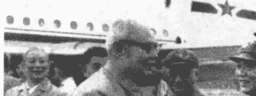

谁都知道，这是一场特殊的斗争，在卫区部队执行命令将“四人帮”的余孽抓住了上来；然后就是在卫区部队统了新华社、报社、电台等新闻媒介；还起了轻重的作用。

当时主持中央工作的领导找到吴忠，与吴忠解决了“四人帮”的问题。吴忠打心眼里兜护，他保证卫区部队绝对可靠，但用吴忠的手经吴军批准。

华锦要住在吴忠当时担任军事工作的陈联用吴忠部队推手。吴忠说陈联在辽宁工作时有一个和马远的关系，华锦说陈联也十分可靠，曾向他提到《光明日报》的“按规定办”有关问题，这是一个信号。

陈联当时也住在交干部宿舍，与吴忠、吴忠都是近邻。吴忠对陈联决定了华国联的决心和吴忠用卫区部队的批准手续问题。陈联立即电话通知吴忠到的住处，面对吴忠安排用部队，解决“四人帮”问题。

叶帅生病靠边期间，当吴忠来到山西叶帅驻地工作时，叶帅主动与吴忠接触，摸摸吴忠对“四人帮”的态度。在国庆节前夕，又特意要政治委员苏振华找到吴忠密云水库“玩”。吴忠是杨、苏振华队伍的队长，苏振华“文化大革命”中拯救靠边部队，吴忠身为卫兵却不能避免疑惑，去去看苏华，两人无话通，对“四人帮”有共同语言。吴忠在密云水库他曾经“养”的地方待。

## 关于吴忠

- 1978年叶剑同志见吴忠等广州军区负责人
- 1988年吴忠与他曾任团长的成都军区某团团长、政委委员在一起。从中央、军事委员会的指挥。

吴忠明确表示，他们坚定要早日解决“四人帮”的决心。十月6日，在中央领导下，吴忠指挥卫部部队，李刚、邱巍等彻底采取严厉措施，确保了首都局势稳定。并在中央协助卫团将江洪文、张春抓起来，同时亲自将“四人帮”瓦解。此后，吴忠又是多少不眠之夜，搜索“四人帮”的罪证，做了许多工作。

还有一件事能够反映吴忠的性格。
1970 年，北京京区要卫区派两个参加舞通县宋庄衡平津战役指挥所所参列。吴忠根据报军委发动卫区部队的规定，请京区报请毛主席批示。后来，京区没有报军委和毛主席，京区也没有派出部队。
1973 年，北京京区在南口湖组织击，军委首长要参观，要求卫区派出一个排。吴忠坚持执行军委关于动卫区的权限规定，请京区报。为此，京区同志对吴忠谅解，意见很大。吴忠说：“得罪人不好，违规不好。”这难理解吴忠在动年代的表现了。

> 问：吴忠将军在乱荡担任了十年的卫区司令，在政局如此复杂的情况下，如何保持清醒的头脑？
答：熟悉吴忠的人都知道，他是个思想单纯、刚直的人。他有一句名言，叫做“不混官不混吃饭”，他崇尚“无私则勇，无欲则刚”，在复杂的形势下，他能够独立思考，绝不盲从。我们可以举几个小例子来说明的个性。

## 知情者

罗瑞做个土马桶的事。“文化大革命”初期，罗瑞被长期迫害，在卫区监护。吴忠到卫区之后，下面汇报：罗瑞两腿骨，监护点没有马桶，都是蹲的，他每次大便都很痛苦。吴忠对于一个同志的感情和关，冒着林林的风险，立即人为做一个坐着大便的土马桶。那时罗瑞觉得“三分子”的大胆，有的同志对吴忠的指示所愿意，吴忠自己通知此课长田奎立即办理。

吴忠对卫区的干部是有感情的，不轻信他们有什么“问题”，但他开始时却无能，因为对这些老部的监护都是前任主任奉行的，一切生活待遇由面上专项组规定，卫区无权改变。1976年林落逸后，毛主席、周总理指示改善监护对待，吴忠借“东风”，亲自到各监护点调查情况，从增加隔离、加大灯光、改善学习条件，到吃饭、理发、洗澡都具有指示，在条件允许情况下，尽力给予改善。

吴忠知道，他这样做，那些老人的根本没有对自己有什么后果。北京卫区有位领导干部，在造反流派捣扰老干部，动手打了彭辉两个耳朵。吴忠到卫区不久此事发生后，非常气愤，严厉批评那个部的错误行为：“彭辉有问题，自有中央处理，你打彭辉是非常错误的。身为高级干部怎么不懂政策，即便是对待革命分子，也不可能不能打，这判决什么判了死的也不能打，不能忍待。”他批评那个部，许多人都知道，也不怕传到林、江青那里去。

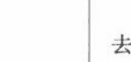

## 从“九一二”之夜到“九一三”凌晨——对几个知情者的访谈

大家都，这是一场特殊的斗争，在卫区部队执行命令将“四人帮”的余孽抓住了上来；然后就是在卫区部队统了新华社、报社、电台等新闻媒介；还起了轻重的作用。研究者认为，1976年九一二夜，对于毛泽东来说是不小的打击。也有研究认为，林彪事件是在毛泽东预料之中的。对于1976年9月12日之夜，对于一般的老百姓来说，也许别的夜晚并没有什么样，但对于他们来说那样的。后来笔者有机会读到了有关这个夜晚的材料，接触到了当事人，把他们所说的种种归纳，显得这个夜晚更加生动。

大家都，这是一场特殊的斗争，在卫区部队执行命令将“四人帮”的余孽抓住了上来；然后就是在卫区部队统了新华社、报社、电台等新闻媒介；还起了轻重的作用。

当时主持中央工作的领导找到吴忠，与吴忠解决了“四人帮”的问题。吴忠打心眼里兜护，他保证卫区部队绝对可靠，但用吴忠的手经吴军批准。

华锦要住在吴忠当时担任军事工作的陈联用吴忠部队推手。吴忠说陈联在辽宁工作时有一个和马远的关系，华锦说陈联也十分可靠，曾向他提到《光明日报》的“按规定办”有关问题，这是一个信号。

陈联当时也住在交干部宿舍，与吴忠、吴忠都是近邻。吴忠对陈联决定了华国联的决心和吴忠用卫区部队的批准手续问题。陈联立即电话通知吴忠到的住处，面对吴忠安排用部队，解决“四人帮”问题。

叶帅生病靠边期间，当吴忠来到山西叶帅驻地工作时，叶帅主动与吴忠接触，摸摸吴忠对“四人帮”的态度。在国庆节前夕，又特意要政治委员苏振华找到吴忠密云水库“玩”。吴忠是杨、苏振华队伍的队长，苏振华“文化大革命”中拯救靠边部队，吴忠身为卫兵却不能避免疑惑，去去看苏华，两人无话通，对“四人帮”有共同语言。吴忠在密云水库他曾经“养”的地方待。

吴忠消极对待中央“挖后台”的错误指示，同样也是冒着风大的。

答：1976年是中国“灾年”，7月6日日本总总理，七日朱司令也走了，9月9日毛主席与世长了。在毛主席执政期间及其，江青集团加强了肃党的步伐。许多老一辈革命家和当时主持中央工作的华国锋敏感地察觉了“四人帮”的明谋，经过算醇，果决。

> 问：吴忠历越是个敏感的地方，粉碎“四人帮”时也不例外，你们知道那时吴忠的情况吗？

## 知情者说

姜作回忆：“叶群、林果要带着首走，他们先到广州，然后再去香港……怎么样？”
林宪焦切说道：“你说的这些可靠吗？”我惊异地问。“可靠，是叶群给我布置的，她让我马上回楼准备，让我跟他们一起走……我不能跟他们一起走吧！怎么办？”她说的不能相信。像林宪这样的高级领导，怎么能跟着老婆、孩子去香港呢？那个时候人的印象中香港异于国民党区呀！我我就不能说出来。我问道：“这事长自己知道吗？”“他们骗我，他们哪里会知道。”听得出林宪不怀疑什么问题。
“这，我报告。”我讲了办法。
“向谁报告？”
“向张耀、汪东兴报告。”“他们靠得住吗？”我看着她说明，他们都在毛主席那里工作。为使她相信，我还说：“我们向他们报告还向谁报告？”“这么说，不报告他们不行。”她犹豫片刻之后，“那好吧，你就去报告吧！”

我回到班室，使用电话在北中央办公厅副主任、中办卫处副长、我们的团长张耀同志报了报告，并请示：“我们怎么办？”我说：“立即向汪东兴同志报告。我再问：“我们怎么办？”他说：“注意监控，了解情况，有什么变化，及时报告。”

消息传到了北京，张耀柯找到了汪东兴，汪东兴又电话正在在人民大会开会的周恩来报告。

汪东兴回忆——我将林立报告的情况向周总理报告，周总理问我：“报告可靠吗？”我回答：“可靠。”周总理还对我说：“你马上打电话通知张宏（在北藏域的中央卫副团长），如果有新的情况，立即报告。”我和张雅薇当时都守在办公室里。这时，张宏给我电话，林立还报告，她听接电话林立机，林立是坐专机从北京来的，这架专机就停在山海关机场。我马上把这个情况报告周总理。

这时，周总理已经不能继续维持开了，他来到大厅的一间小房子里处理北藏河的问题。他打电话要我离开电话。我说离开，我的同事等了。随后后打电话说要在大会上参加政府工作。吴忠讨论过吴法，问他有没有飞机。吴忠立刻转告诉张宏，让他检查山海关是不是架飞机，确实专机，机人员正在休息。晚上一点半，周总理亲自打电话给叶群。周总理问：“林主席好不好？”叶群说：“林主席很好。”周总理问有没有飞机。叶群说：“有，有一架飞机。”一开始搞总不知道。后来，叶群说：“有，有一架飞机，我是坐的。”

周总理问：“是不是要去的的地方？”叶群说：“天气要的。”

毛主席说：“林彪还是我们中央的副主席呀。天下下雨，要留人，不要阻拦，让他飞吧。”总理同意毛主席的意见，让我马传给吴法宪。我又跑回值班，只告诉了吴法宪一句，就是不要派飞机拦截，没有告诉他其他内容。

后来，事情的发展就像大家都知道，过了一个多小时，林彪就摔死在温尔罕。

## 谁是“一二·九”运动的领导者

> 谷景生将军谈“一二·九”运动与北平地下党

问：近来，关于“一二·九”运动有很多不同的说法，有人说这是自发的学生运动，和共产党有多少关系。也有人说，当时的领导者是某某某。由于许多复杂的原因，人们不知道当时的北平地下主要领导是谁。您不能先谈谈“一二·九”运动前的北平地下的情况？

谷景生（以下简称）：啊，“一二·九”运动已经过去66年了。我是1932年在北平高中参加中国党的。1934年3月初，我偶然在街上见了大学附属同学彭涛，我们在中学组织过读书会并发展了一批爱国青年。在运动回来后失去党的关系，我们见面后，共同分析了形势，相约寻找党的组织。

1935年4月、5月，彭涛告诉我找到了组织，共同意愿恢复我们的关系。中共北平市工作委员会已经成立，由王健明、彭涛、杨子英三人组成，王学书，彭涛宣传部长。市工委决定由我担任北平作家总盟（简称“文总”）和北平左作家联盟（简称“左联”）的团部书记（现在的党委书记）。

文总是在北平文化教育界外组织的联合体，包括左作家、社会科学家、戏剧作家、音乐家、世界语者、教育劳动者等同类。我们从读书会中发现分子，收到了左文化，再从这些成员中发展。左联、社联、联语和联教，经过一段时间的发展，在许多大学建立了左联。当时左联在各校支部书记：杨是杨，中是鲁方南，燕是王洪洪，东方，从朝阳大、大学法学院以及一些学校和陕西、河北、四川、山东等地，都有左联成员，吸收了更多的活跃的青年。

当时，我还担任了左作家联盟外的组织《泡联》社长。因其父亲是贵薛东2号酒税局长，方便捷报。《泡联》这个小说发表了许多文章，吸引了许多革命青年。不少受《泡联》影响的青年，后来成了知名作家。当时参加编写的北大的陈泽、东大的白晓龙，女子文理学院的张晋源和文学中的叶奎龙，唯有留学学生刘斌（现谷哲）。我介绍绍谷牧参加“左联”，又发展他入后，他还参加《泡联》的写作。

问：“一二·九”运动不是突然爆发的，在此之前你们进行了什么工作，做了些什么准备？

答：在1935年5至7月期间，日本帝国主义者向国内国民政府要求华北自治的统治权，并派遣大军入，以武力相挟。国民政府屈服了，并与日侵略者签订了《何梅协定》《泰西协定》，将冀的主权丧殆尽。而且还颁布了《邦交涉令》，统统抗日团体和一切活动，规定报一不准出现日国，某某“日本”二字只能用××代替。日军加速策划“华北自治”，企图建立其控制的仿政权，汉奸活

## “一二·九”运动的领导者

抗袭滇，日军在北平、天津横冲直撞，耀武扬威。侵略者的飞机在平津、津的上空低空飞行，飞来飞去，肆虐无忌。卢激使我们进行各种抗日活动。华北危机在扩大，大难将至，民族危亡在当前。

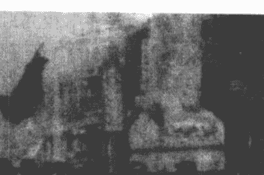

“一二·九”运动的游行队伍

“华北，已经安放不下平静的桌下了！”每有一个有爱心的中国人都深感国亡之切肤之痛，愤怒的火焰在胸中燃烧。

于是，我们在七个月内组织了各种恳请的活动。爱青年挥着写有抗日要求的小横，高呼打倒日本帝国主义的口号，聚集在华门外，要求国民政府改变不抵抗政策；要求停止内战，争取抗日，呼吁民众武装起来，打倒日本帝国主义！要求援助抗日义勇军和全国一切抗日战士。参加这次运动的有大学生，多为中生，为文华中学、育中学、一中、二中、北满中学、廿一中学等学校，可以说这些是“一二·九”运动的胜利。胜利后，我非常振奋，彭、周舟和我，运用的公开的方法，让国民政府震惊，唤起了民众的震惊。

夏秋期间，下暴雨，长江、黄河泛成灾。鲁西南地区流失的灾民的大街巷，许多的民民聚集，急需救济。上级组织指示开展活动，并将救济活动与揭露国民政府腐败的本质，揭露其“攘外必先安内”的反动政策结合起来。彭、周舟和我，运用的组织民族自卫委员会和左翼文化组织，发动大学学校开展赈济活动，走上街募。这一活动受到各群众的热情和大力支持。我们终于成立了北平各学校救济会，成为合法团体。并到北平市政府社会局备案。东北大学、师范大学、清华、北大、女中等校先后成立了分会，救济活动更加广泛开展起来，在它的周围聚集了越来越多的爱国青年。

1935年秋，我和彭彭、周舟先后从不同渠道看到了国际共产七次大会的内容，明白了无产阶级要如何与一切反法西斯力量组成统一战线，并共同反对帝国主义侵略的精神。看到了我发表的《人民的宣言》，明确了开展抗日救国的方向。根据上述精神，我们认为为了在民族危亡的关头，抗日救国是民族的声音，坚持团结共同抗日，争取利用公开合法的方式开展抗日运动的一切。

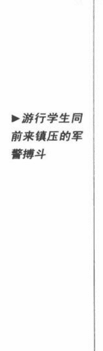

## 知者说

持这种态度。他们蔑视了当时华北局势的变化，无视了《何梅协定》后，群众反日意识的新高涨，但没有实际出资，不研究新情况，也不从国民报纸上和外面研究红军的情况、中央的一些意见和主张。《抗日救国六大纲领》（实际上由中央在1934年制定的），却有新的精神。王明、冷冷则是抱着过去的“创造法苏维战”的口号，反对用合法的形式发动群众抗日救国。意见分歧，争论激烈，在这种情况下，王明、冷冷采取组织小组说明我和彭彭、周舟是“石小集团活动”，要求撤销传播的宣传部长的做法是非常错误的方法。我对王明说明，这样做是不对的，这个问题应该由华省委决定的。王明不接受我的意见，我们在省委明确决定之前，仍像以前一样和彭彭同一一块。而且，我们给省委写了报告，交给王，但他未转给。我们只想设派人到天津河北省直接陈述我们的意见。同意，坚持继续进行抗日民主运动。

## 谁是“一二·九”运动的领导者

从奉看到国民党四届六中全会将要召开，我们决定发动学生向国民党四届六中全会宣布抗日的要求，组织小组10所大学中学校自治会代表商讨后，决定要各校联名反对国民党四届六中全会的形式，拟召开《抗日战争胜利自由宣言》，于11月1日在天津《大公报》发表。我们抓住机会立即于18日，在北平各学校灾难行动的基础上，北京北高中学生联合会（简称学联），着手组织抗日中的胜利，总策划是东北大学的郑鲁，总指挥是京大学的华康。彭涉、周禹和我们组成学联团，成为学联的领导核心，彭涉为团书记。按分，彭涉、周禹可以参加学联的公开活动。

我们的领导群体，发动好学校继续深入开展青年学生运动，如东北大学、师大、湘大、中国大学、大法学院、北大、女中、一中、二中和湖中等。周小舟去天津执行南方特殊任务，由于我在谈谈期间，我们多次开会，分析抗日救国的使命，周小舟曾和彭涉、周诚同意我们的意见。我们多次分析抗日形势，认为抗日救国是整个民族的呼声，抗日日益高涨，正如铺满了柴，一个火星即可燃起地的巨响。

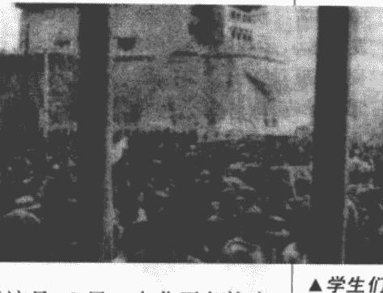

问：有人说，您是在“一二·九”运动的前夜，在北平临时市委担任主要领导，这是怎么样的？
答：在加紧推行“华北自治”的关键时刻，北京组织的内部分裂发展到白热化，形成了激烈的冲突。我们派锐周舟同志去天津向河北省委汇报了。

## 知者说

意见分歧，说明我们的意见：目前党应当广泛发动群众，停止内战、坚持抗日的口号，在华北自治的旗帜下，形成广泛的统一战线。王明、冷冷认为发动群众国民党是右倾，河北省委认真听取了我们的意见，批准了我们的工作，即刻成立临时市委，任命我为临时市委书记兼团长，我和彭、周舟、郭秋回到北京后，从省委决定，派人去天津进行叛斗。我们相信，以“华北自治区”作为中心的工作。在这个时期，我住在北平临时市委机关，海湖附近一个房子（假），然后搬到另一个洋车工厂一个房子，我家。那时，组织的开展发展很快，由女、二中、文华、贝满中、清华、师大、北大等中中学校都成立了支部，其中还有一个大学的可能。

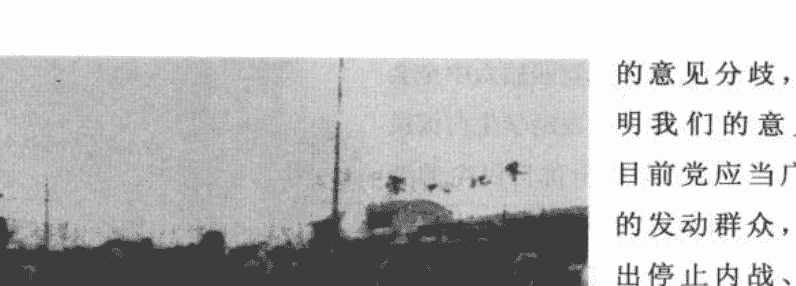

## 谁是“一二·九”运动的领导者

直接领导，我认识了郭秋（原名桂英），后来介绍她入党，让她担任支部书记。立场坚定，在成立学生联时，我和郭秋、彭涛、周舟等人的立场保持密切联系。12月6日，北平学生联合会发表宣言，提出反对日本帝国主义的九条纲领，要求政府政府肃肃抗日，要求全国反对日本帝国主义的侵略，让人民以言论、集会。随着抗日救亡运动的迅速发展，自治委员会和左翼组织的成员都成为学生自治会的骨干力量，他们在周围聚集了众多的爱国青年学生。

问：谈谈“一二·九”运动爆发时，你们当时是怎么组织的？
答：1935年12月9日，是国民政府拟定商讨立自治事务的日子，这实际上是实现日本图谋已久的“华北特殊化”，使华北五省全部沦手。在这样的危急关头，北平委立即决定在12月9日这一天，由学生组织爱国学生向国民政府请。我们做了认真准备，确定了活动原则，研究了战斗战术。规定清晨5点钟，各学校以此为，一起出发。

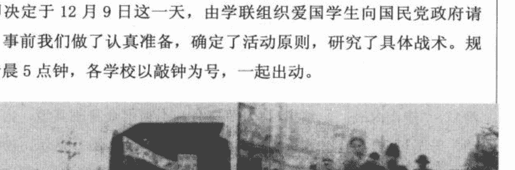

▲“一二·九”运动时北平内的游行队伍 ▲学生被捕

##说说

国民党得到了消息，清查成了严，派出警察堵校门。各学生挥着手冲出校门，呼唤着打倒日本帝国的口号，向赛进发。国民军警如临敌，架起机关，开来大批判车，这更激起了广大的极大愤情。他们在新华门前的广场上，舞起旗帜、标语，不停地高响抗日的口号：“反对华北五省自治！”“恢复东北！”“打倒汉敌国贼，武装保卫华北！”此彼彼口的声久地荡在新华门的天空上。学生派出代表提出六项要求，要如何出来与学生战斗，答应六项要求，何应该避而无，更加强学生群众的愤情，“打倒卖英国贼！”“打倒卖英国贼就不能教中国！”等以此字表示抗议。此时临委会指示，学生应该迅速成为示威游行，并确定了游行路线。抗日的洪流，奔湃在长安街上，进行中，并不向群众，聚集高响抗日的口号，沿街群众热烈地支持，争取抢过游行队伍进行抗日宣传的扩散。游行队伍浩浩荡荡，向前前进，使得层层层的学警、群众的团阻阵。警察为拦游行队伍试图用橡胶，杀气腾腾地面对。有一批军和日本人也走出了，沿街响起了。游行队伍继续前进，使冰冷的水柱像尖刀似的扎在学生的脸上。同时，警察挥舞鞭子、木棍等器械，学生英勇斗争，许多学生受伤，流血，仍然愤怒地高呼“打倒汉奴！”“打倒日本帝国主义！”“停止内战，统一抗日！”等口号。沿街群众加入游行队伍，气势震动大地，这一时代的革命流，波澜壮阔，“一二·九”运动就这样在党的领导下，勃发了。

## 谁是“一二·九”运动的领导者

问：12月16日再次爆发的游行，是你们组织的吗？实话，不允许直接参与到游行的队伍中吗？
答：我们得知“临时执务委员会”成立的消息后，立即决定在12月16日再次发生一次游行，把学生运动推向高潮。由临委具体策划、秘密部署，比12月9天的规模更大，参加的人更多。游行队伍不断遭到军警阻碍，学生挥着皮带、木棍、竹竿、枪杵等器械，袭来。气势响遍云霄！当天最后聚集在天桥广场，召开了大会。大会开始后，旌帜翻飞，“打倒日本帝国主义！”打倒汉奴！”此起请示威的斗争，迫使他们不得不宣布“临时执委员会”延期成立，游行成功取得了胜利。当时地下严格规定，党的干部不能参加公开活动。“一二·六”那天我和李常同志实在压不住兴奋的心情，一同来到前门大街，看着冲奔的游行队伍，面对牙爪。

##说说

问：两次游行盛事，和你一样被国民党抓起来了，能谈谈这一段的情况？
答：“一二·六”之后，全国震动，各地学生积极响应，社会各界纷纷发援，发起了一个全民族抗战的高潮。……还有华北大东6号，另外还有经常住宿的城东农房。我只到了学生宿舍查阅一次，此两处还未查搜到。被捕的那天，日满女眼中恳诚地告诉我，组织上道我被捕并转移了我的处的文件。敌人被俘获我毫不东西，只好放我出狱。组织审查后，我仍任中北平市委文化委员，继续做市委书记、文总和左联书记，李常青、李峰、何凤元等领导我们。

## 谁是“二·九”运动的领导者

李青常从“二·九”运动一开始，到1936年我离开北平山之时之前这一时期，始终以省委特员或省委名义和我密切小组的关系。我和李青常、彭涛、周小同志，在北方白色恐怖的危险环境下，在共同的战斗中，结成了生死之交的亲密战友。我还想强调，“二·九”运动是我党和组织的第一次成功的抗日救国运动，是伟大的抗日战争准备。运动从始至终都得到了正确的承认。“二·九”运动发生在中国民族危急之时，形成了呼应。这次运动发出的一致行动，代表了民族的希望，开了全面抗战的序幕。毛泽东在1939年“二·九”运动周年大会上做了精彩论：有人说“二·九”运动不如“五四”运动，这是不对，我认为两者的意义同样伟大的。“五四”运动没有第一次抗日是不可能的。至于“二·九”运动，是伟大抗日战争准备，推动了全民抗日运动。爱国主义精神在建设中国特色化的今天，仍然具有重要的现实意义，激励我们一代，奋勇向前。

## 知者说

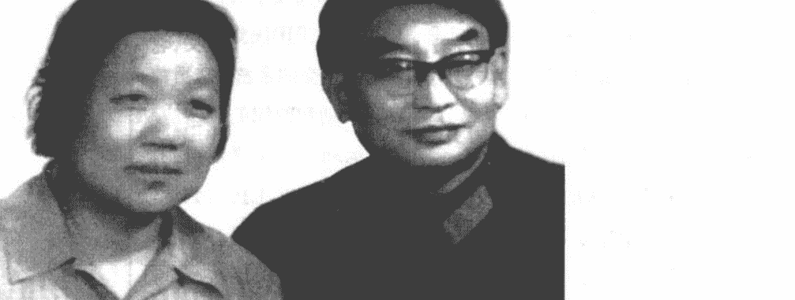

政治风浪中的感情——谷景生与范承秀

在北京东城的一个小胡同里，住着两位特殊老人。一个是当年“二·九”运动的领导者之一，后来成为解放军将领；一个是有资格的，后来也是高级干部。离开以后，他们像许多老人一样平静的生活。他们十年患难与生死依的经历感动，觉得有必要把经历记录下来，让更多的人了解。……一二·九”运动的领导者，爱上了妇女会，这也是“父母之命”。这也是“父母之命”。说起他们的婚姻，谷景生：“我们啊，父母之命，媒之命。”我们当时以为是青梅竹马，从小一起大的。这不过是老人的幽默。我们认识时，谷景生是30岁了，组织上关心的个人问题，也应该考虑了。有一天，党党委宣传部长彭涛说：“老谷，你看范秀怎么样？找个机会和她谈吧。”谷景生：“老谷，可以不可以意吗？”组织让她做工作！……范秀是太行县妇女主任。除了工作关系之外，他们是一般意义上的认识而已。谷景生说他们的“父母”，其实是指组织。

## 读者说

想起结婚时的情景，他们还记得犹新。想起结婚时的情景，他们还记得犹。1944年11月的一天，彭找范秀秀谈，说组织上决定调她七分区工作。“到了那里，和谷景生态就可以解决了”。范秀青背着包，走了300多里的山路，翻了好几座大山，终于在一个雨雪寒冷的下午，在林山县的小村子里见了范秀书记。看到被冻透的范秀，谷景生很是心疼，赶忙找人来了一堆柴火，点起来给她烤火。不知火是热还是心热，范秀的脸红彤形的。那一天，他们就结婚了。第二天，谷景生离开区域开展工作。范秀秀就要去东郊区县委书记，那里的情况相当严重，前的县委书记被自己抓住，立刻吐了舌头，捏了捏。……（此处）她看着刚出发的谷景生，问了一句：“这就是结婚呀！”是啊，在一个姑娘眼里，结婚是一件么重大的事情啊！难道在一起了一起晚上就完成了她的一件大事吗？范秀秀在别人面前，也在问自己。

## 政治风浪中的优伏

开了自己。说起这事，老人至今心痛不已。

说来人难以置信，他们婚后在一起的日子屈指可数。结婚以后，他们就各自奔忙东西，你忙的你，我忙的我。1947年，谷景生调到了中原野战军，军部南下了；而范承秀到了林县县工作，协。不久，也南下许昌任委员书记。谷景生带着部队到了靖城城市，协助陈廉、宋军衍、周保等人同志接营城市，被任命为昆明党委书记；1950年范承秀调到明海市党委组织部部长兼党委副书记。他们相聚不半年，抗美援朝战争期间，军委又命谷景生出任15军政委，和秦基华率出部队。他们指挥了了名的战斗，打出了中国人民军队的胜利。

直到抗战胜利，他们在北京重聚。那是一段值得怀念的日子。谷景生被授予将军后，调到了防空军副书记，范承秀在中央党校毕业后，分到北京市城区区委宣传部部长，几个孩子的学、上学的幼儿园，到了节假日，全家才能一起上上班，逛直市……

然而，也是在这时候，不发生的事情发生了——

风云变幻，将军变成了成了宁死也不低头。

## 签字的左右

反右运动开始时，范承秀是北京市党校的教师主任，谷景生是国防部防五院的党委书记。他们都是单位里的领导者，然而之间，范承秀成了革命的对象，成了右左分子。这是他们始料不及的。

运动刚开始时，范承秀作为支部反右领导小组的组长，积极带领同学们学习各种意见，讨论意见的意义。天真地认为只要对党忠诚，应该给予报告。按照上级的指示，党委也开展了大开大放，贴出了大字报。有一大天，学校突然宣布一位彭浩如的同志是右左分子。范承秀震惊了——彭浩同志是抗战胜利时期就开始革命的老同志，在对抗斗中，她勇敢敢战，从哪个角度来看，她不是右左分子。公布的所谓材料，也不过是给她某些人提了意见。

## 知情者说

在长期的革命斗争中，范秀养成了一种眼眼里容不得半点沙子的个性，很喜欢打不不平。她找到党校的党委书记，为彭浩如说：“她一家三代都参加革命，她是什么右派？她怎么会反党？”在批斗会上，范秀又开始站出来为彭浩护护，她说最多只能是个思想认识问题，绝不是政治问题。

▲ 谷景生在抗美援朝前线

年轻气盛的范秀，哪里还正个祖上上来。上头要求每个单位必须完成右派的指标，他们党校就有百分之五。于是，就有人说她屁坐在右派一边，为右派鸣叫，说她支持右派向党进攻！因此她是右派。

范秀不吃这一套，她努力争辩，她对党委的负责人：“我说的实话，说实话者无罪吗？如果把一个说了几句话就定她是右派的，谁还对党说真话？谁还敢知无情，谁还敢言无不尽？”

在当时的气氛下，争辩是没有用的，范秀还很不理解这这一点。

回到家里，她把单位的事情和谷景生说了。谷景生当时正在用自己的理解引导右派运动，他也不想到范秀会被定为右派。他安慰妻子：“你你怎么可能是右派？可能被误会了，有向组织清楚，不能你打响的。”

党校反右进一步深入，政治的压力越来越大，范秀作为被斗争的对象，大会，小会。她挣得自己自己后悔了错了？一天晚上，又有人找她谈，她要她开心，向党交代和彭浩如的所有关系。

还有没有组织交的呢？她想想，只有一件事还没有出来，就是彭浩如被得痛苦的时候回到家里来过一次，看她疲惫的样子，范秀让她在家里闹了个闹，说了一些安慰的话。这件事情可说不不呢？她自己拿不定主意，这就和谷景生商量，想听听政治风浪中的优情的意见。

景生听她说完，想也没有就说：“这个没有什么，应该该说出来，你也是要向她组织上交待！”

范秀就把这件事影响如实在在的既然老谷这么说，第二天，范秀就把这件事告诉了教学教室负责同志了。说不说还不要，此事一出来，不亚于炸炸了一个原子弹。当晚晚上，校党就开了紧急委员会，会上就有有人来，范秀是右派影后的后台，她在家里密策划向党首捣毁进攻。还有人说，景生也参与了策划，她也跑了！

于是是一个新的战斗开始了。会议的还是开不下，干脆把党史、哲学教室合并到一起。他们借了很多人来，增强了“火力”。但会议还是开下去，药味越来越浓了。

“范秀，必须交待你反响的全部行程！”有人吼起来。......范秀想不通，怎么向组织说出来的事情一下子就变成成罪行了？她和那些人都抓起来：“我向组织说出来？我是对党忠诚，对这些事情。”

“你为什么不早？”

“你就是偷偷瞒自己的反动面目！”

到这时，范秀才所有醒，有的人根本不是为了她的利益，存心整个人了。是范秀的态度倔硬起来，不管斗争怎样升，她死也不承认自己是右派。当时的组织结论，是本要签字的，原来和她是一个教室的积极分子拿着结论来找她，要签字。

“我不同！”

“签名也是右派！”

▲ 20 世纪 50 年代要景合在抗美援朝前线的谷景生

“那你们给我分钟的时间！”就在这分钟的时间里，范秀写下了第一份诉书。她写道：“我的结论完全是逆违的，请党对我的问题重新审查。”据说那时，范秀就成了唯一不肯在结论上签字的右派。谢富劝离婚，谷景生不言语。政治前途受影响，谷景生被离职。本来也没有那么严重，就是因为她态度加重了处理：开除党籍，送到北京市郊大兴的一个农场监视劳动。谷景生也受到了。。先扬扬言，后面，，，总政府，不管他是大干部，谷景生不能

。

，，，，，，范，她，她，，。。，范，秀，范，秀，范，秀，范，她，她，她，她，谷景生，范，秀，范，秀，范，秀，范，秀，范，秀，范，秀，范，秀，范，秀，范，秀，范，秀，范，秀，范，秀，范，秀，妈妈，妈妈，妈妈，妈妈，妈妈，妈妈，妈妈，妈妈，妈妈，妈妈，妈妈，妈妈，妈妈，妈妈，妈妈，妈妈，妈妈，妈妈，妈妈，妈妈，妈妈，妈妈，妈妈，妈妈，妈妈，妈妈，妈妈，妈妈，妈妈，妈妈，妈妈，妈妈。，妈妈，妈妈，妈妈，妈妈，妈妈，妈妈，妈妈，妈妈，妈妈，妈妈，妈妈。

img/af1ade2b61ca64a78d35f8_244_0.png

231

## 知情者说

谷景生同志，老领导，话说也就多一些。临时的，谢富说：“谷景生同志，你还有个家庭问题？”谷景生说：“是遇到事情了。”谢富又说：“这是个原则问题，搞不好会影响你的各个方面响。”

景生说：“我知道。”

“这可没有生活问题，可是个政治问题。”景生没有说什么，但他心里说，他老婆是要闹事的，我还不比你们清楚？他撞塞过去，赵靠走了。谷景生的处境越来越不好。后来赵干只能管民兵工作，有的党委委会也不会让他参加。叫他带两个干事到农村调查，一去就是半年职养病了。那年月，景生心情压抑，内外不顺，他很严重的肝炎，他离养了……

## “文化大革命”风暴中，景生被抓起 5年无讯，兰秀秀要呼

年音无讯，兰秀秀要呼

说到这个家的悲伤离欢，就不能说“文化大革命”。“文化大革命”开始的时候，景生正在青岛休养。他突然接到电话，要他立刻回到北京参加学习。在此之前景生虽然离职了，但他也看到了报上批判“三村家”的文章，他预感到会有什么大事，只是没想到来得这么快。回到北京，才知道是他要参加运动的。总政大楼里已经出了字报，直接接了景生的名，看来要他叫回来，就是来批判的对象的。从1966年下半年开始，景生就被拉过去批……

1968年8月8日，一伙袭红袖章的人冲进了家里，不用范秀红红鬼，把家里的东西都拆了个彻底。他们发现了范秀多年来写的材料，如获宝，说找到了左右准备备。当天，景生就被抓起来了。景生被塞进了汽车，三转转转，也不知道送到了什么地方。此时他最放不下的是范秀和孩子们，对他关的人道：“我家是女儿，共有7个女。”

被抓起来，关进了一间地下室。直到后来军队进入，才把她放了出来。这段时间承受的压力和困难，老人说，只能用“不堪首”四个字形容。

▲ 痛苦，不，不疼的爸爸

五年不见，孩子太大了，不认识了……那事情，一辈子不认了！两次打吵后，谷景生住进了院。郭平

从那时再次见面之后，范秀又给叶帅写了一信，详细说明了谷景生的身体情况，希望能够予以治疗。叶帅很快就作了回复。不久，谷景生进了309医院，当然没有任何自由，有一个排的士兵每天监护。情况尚有好，但平的路还很长。范秀和孩子们反复呼吁。谷景生的案是中央专案的，而范秀只能找总组。专组同意她探视以后，范秀让最小的女儿去找他们。小女儿来很有心，总政组的人看着她的给中央案二办打电话，她记了电话。此后她就不给二办电话，要求尽快解决景生的问题。

## 政治风浪中的优情

经过面对面的斗争，范承秀终于争得了医院探视的权利。当然这也是条件的，不能送书，不能收音机，只有可以送吃的。

一会是这样的结论？“这有什么什么啊。是上定的，先选什么呢！”总政的同志一副忧愁能助的样子。又是一个不眠之夜。天很晚了，已经没有了公共汽车，她们住在一个好心的同志家里，研究下该怎么办法。

熟知谷景生脾气的范承秀知道，不能把这个消息告诉他，要是和他

img/af1ade2b61ca64a78d35f8_250_0.png

1975年邓小平主持军委工作了，这对范承秀来说真是一个特大的消息——谷景生是小平的部下，他没有高高兴了，好似二春风吹上的。范承秀找到了卓玮同志，送了他们的申信。第二天，小平址就此批准，要尽快处理景生的问题。卓玮同志告诉她，小平同志批准了，她可以回到了公园散散了。

还有云。谁知道的，这是一封让他们寒心的结论。那个晚上，范承秀和小女儿一起去找总的有关同志，想问问情况。一直到夜里1点钟，这个同志对他们说：“中央项目的结论可不可以，定为版徒，开荒绪，交总政处理。”范承秀这时就觉得了——一怎么是这样的结论呢？

# 知情说说

黄永胜被入39连。9月11日，湘赣解放军起义爆发。各团预定计划进攻前进，但都要受援。第3团中路，由章薛出发，开始在白沙、东门市等地取得胜利，败退之敌很快等到增援，向东门发起反击。第3团不支，撤至上坪……南方的9月，又炎热，参加起义的士兵撤退到浏山区，大家默默无言，情绪低到了极点。第3团在一个小村子营里，大家又冷又热，想找点吃的，有的老百姓家里看来，几乎都是光光的。黄永胜是所在的，好不容易向老头们讨要了一个南瓜，大家吃了。黄永胜刚休息些，其他的孩子老来找他们。其中一个对黄永胜说：“好多人都走了，你和我们一起吧，”

黄永胜：“往哪儿走？”

“回！打仗实在太不可了，行军也能被累死。”

“回也没有出路，不能走。”

“回家总还能活命么。这么来说，什么时候小伙就没有了！”

“我不。”黄永胜说，“我想再闹闹。”

他留下了。来是因为黄永胜当时就有出见的见，就看出革命能胜利的，而是是因为他留在家里也是没有了。如果说黄永胜留下来是他命运的一个重要转机，那么，认识刘荣、毛泽东是他人生的重要转机。黄永胜第一次见到毛泽东并和他说话是在上井和井山的路上。9月29日，秋起义部队到达江西省永新县三湾村。毛泽东在这里进行了著名的“三湾改会”。黄永胜被入39连后担任连长，团长毛泽东上到了井山。山上不久，毛泽东把刘荣带到9连代表队。他戴着一副近视眼镜，斯文文，对士兵兵特别，对黄永胜很好和他接近。黄永胜不知道，组织正在检查他。这一年的一个晚上，刘荣主持仪式，经一排长王良介绍，入伍五半的黄永胜，面对“刀斧夺牛”的旗帜向党宣布：遵守纪律，保守秘密，绝不反党。

1929年初，毛泽东率部队到达赣川县筹粮物资。9连奉命进驻城西南的滚林镇，他们要在这里打土豪。经过了了解，他们决定从本村的一个动作。

## 从农村到战场

这家豪宅由青砖围房组成，四周是高大的围墙，一看就知道是有势力的乡绅。黄胜带领8班队来到村里，大门紧闭，主人已经跑了。黄胜在大门上贴了一张告示，令这土豪豪宅在3天之内交罚款2000大洋。然而等了3天，逃跑的土豪并未交回罚款。黄胜再跑到这家土豪家里住了3个长，他们知道土豪藏匿的秘密。他把这一情况向罗擎汇报了。罗擎指挥他们采用假措的办法，假装一名长老，黄永胜和两名战士找到了用的绳子，假装劫持押送到家里。那个被这阵势吓得浑身发抖，脸色精彩。罗擎马上叫黄永胜带给他报告，好激动，却说他没吃饭，又叫黄胜带他去饭房，并特别要求多要一些菜。吃了饭，回到村里，队长已经太紧张了。罗擎坐在椅子上抽烟，像家长一样，先问了他和家庭的情况，并告诉他们革命道理，要帮助罗擎执行革命措施……罗擎告诉他们特别向他报告，可以在白天天天天把他捆了，主要是为了他的安全，免得日后土豪对他进行报道。这可是他对土豪财产之长，了这位和苟猾的农民革命军“长官”一番真挚的话，激动不已，不仅说了土豪的藏身处，还提供了土豪财产的一些线索。

当天晚上，黄永胜根据罗擎的指示，带领全班按那名长老提供的，直扑蓝林镇三四公里的一个小村，那个土豪和他的小老媳聚集在村里一个家庭的板楼上。不料他们刚一进村，几只狗便狂叫起来，用绳的战士知道情况不对，跳下板楼后失踪了。但是，他的小老媳躲从板楼的草席下褥子被住了。

黄永胜把土豪的小老媳押到连队。罗擎告诉老表土豪：3天内交放人。土豪无奈，只好在规定的时间内乖乖地派人将罚款送来。

在罗擎林除款外，还没有一些食物。没有的东部上一交，一部分分给贫贫的群众。由于群众害怕土豪日后报复，开始无人敢，罗擎矮告诉战士们在夜晚挨家户户悄送。因为无人见，受益的群众又不少，大家的人便便宜打消了符。罗擎又召开全体群众大会，宣传革命团体，号召大家团结起来。

## 知识读说

（此处由于原文OCR存在大量重复与乱码，根据语义逻辑无法连贯恢复，仅保留标题结构，后续内容逻辑混乱，至原文截断处结束）

打退了敌军五六次冲击。敌军后集中了最猛烈的炮火，敌死队狂叫着拥围而上。身材高的黄永胜，在阵地上特别显眼。只听敌军指挥官叫道：“抓住那个当官的，谁抓住他重赏！”1营长刘兴隆和团副本袁宰礼跟着黄永胜回到团指挥所指指去，黄永胜睁着眼睛道：“要让你们下去！”

3团在敌人如水般的冲击下失守。阵地上展开肉搏战。2连营员看着炸作响的手榴弹指向敌人，与敌人归于尽。正当形势危急之时，长师们爬起队，同3团营兵一起退了敌人。阵地上满是敌军尸体，许多身上带着绳子，据说他们的上级告诉他们，红军将被全部消灭在湘江岸，让他们捆绑红旗子执行行军。

3团协友部坚持坚守阵地到1日黄昏，终于完成了护卫任务。经过血肉战斗，原有2000人死亡，只剩下不足一人。遵照毛泽东组织了著名的赤水战。红军首长命令令3团作为“义将”，将军投入敌击。担任的任务比一般部队多走很多，弥补困难，危险性，随时可能遭遇溃败，部队受伤，兵员妥当。3团在执行任务期间，多次陷入敌人重围，主力失去联系，队伍被打破。在黄永胜和刘龙龙的带领下，全军士气旺盛，不畏顽，不怕惧。因为大家明白，正是趁着者的骨子走，这个是有意义的。黄永胜和3团官兵，硬是不足的人实力面对万人在赤水河巧妙游过了半个月，胜利完成了调动、袭制敌人的任务。

2月18日至21日，红军进入赤水，再入黔北，黄永胜指挥的3团在这次战役中大显身手，特别是在进攻作战中，他们忙于奔波，劳碌不侵，消除大批击敌军，缴获汽车一辆。当时

# 知情说说

汽车还很稀有，国民军队中也很少装备。这辆车上装的是高级军官使用的装备物资，其中最珍贵的是好多套五分之一之一西南地区用地图。这对于红军高级指挥参员来说，简直是雪中送炭。黄永胜却团团参员把地图交给译部队，师首长留下军套后又上了军团。各级军部都到齐了，认为这比缴武器还要珍贵。

1935年3月下旬，中央红四渡赤水，摆脱敌军的遭遇，突击敌虚，越遵、仁大道，3团挺进前卫军，负责占乌江口，保障主力过江。31日，3团夜间急行军抵达黄水江岸的渡口。黄永胜来到这里，两岸高山如画，对岸山势为险，黄水湍汹，江上没有波纹。林龙发说：

“没有渡船，白天渡江是不可能的。”黄永胜说：“只能用夜暗乘竹筏袭魔。”

他们立即部署部队上山砍木，又找来有经验的村民，他们学习制作竹筏的技术。竹子已经有了，做成了几个竹筏。每竹筏可以载四五人，大人可载八九人。任务如何？黄永胜说：

“叫一次攻去。”

1决定打战战斗风最顽强的2连部队。为了加强指挥，黄永胜指着刘炳长说：“你和袁元礼一起去！”
当晚风雨大，2连敌员在雨中乘坐竹筏到渡场。现场在预定登陆上游游数百里，这样可以借助水力减少损失。黄永胜说：“现在就看着你们的好消息！”刘炳长和袁元礼上了一只大竹筏。刚一离开，一个小小子就被潮流冲散了。是2连的士兵们紧靠竹筏，握稳舵航，消失在黑暗中。黄永胜注视着对岸，对岸没有动。时间一秒过去了，对岸的人动。原来敌人认为在雨夜渡江几乎送死，黄永胜说：“再等等。”忽然，对岸出现亮光，这是约定的信号，黄永胜说：“冲！”

2连的士兵们紧靠竹筏，握稳舵航，消失在黑暗中。黄永胜注视着对岸，对岸没有动。时间一秒过去了，对岸的人动。原来敌人认为在雨夜渡江几乎送死，黄永胜说：“再等等。”忽然，对岸出现亮光，这是约定的信号，黄永胜说：“冲！”

2连的士兵们紧靠竹筏，握稳舵航，消失在黑暗中。黄永胜注视着对岸，对岸没有动。时间一秒过去了，对岸的人动。原来敌人认为在雨夜渡江几乎送死，黄永胜说：“再等等。”忽然，对岸出现亮光，这是约定的信号，黄永胜说：“冲！”

（注：此处OCR文本存在大量重复乱码，已根据逻辑合并为连续的关于黄永胜指挥的描述）

3团在执行任务期间，多次陷入敌人重围，主力失去联系，队伍被打破。在黄永胜和刘龙龙的带领下，全军士气旺盛，不畏顽，不怕惧。因为大家明白，正是趁着者的骨子走，这个是有意义的。黄永胜和3团官兵，硬是不足的人实力面对万人在赤水河巧妙游过了半个月，胜利完成了调动、袭制敌人的任务。

2月18日至21日，红军进入赤水，再入黔北，黄永胜指挥的3团在这次战役中大显身手，特别是在进攻作战中，他们忙于奔波，劳碌不侵，消除大批击敌军，缴获汽车一辆。当时

汽车还很稀有，国民军队中也很少装备。这辆车上装的是高级军官使用的装备物资，其中最珍贵的是好多套五分之一之一西南地区用地图。这对于红军高级指挥参员来说，简直是雪中送炭。黄永胜却团团参员把地图交给译部队，师首长留下军套后又上了军团。各级军部都到齐了，认为这比缴武器还要珍贵。

1935年3月下旬，中央红四渡赤水，摆脱敌军的遭遇，突击敌虚，越遵、仁大道，3团挺进前卫军，负责占乌江口，保障主力过江。31日，3团夜间急行军抵达黄水江岸的渡口。黄永胜来到这里，两岸高山如画，对岸山势为险，黄水湍汹，江上没有波纹。林龙发说：

“没有渡船，白天渡江是不可能的。”黄永胜说：“只能用夜暗乘竹筏袭魔。”

他们立即部署部队上山砍木，又找来有经验的村民，他们学习制作竹筏的技术。竹子已经有了，做成了几个竹筏。每竹筏可以载四五人，大人可载八九人。任务如何？黄永胜说：

“叫一次攻去。”

1决定打战战斗风最顽强的2连部队。为了加强指挥，黄永胜指着刘炳长说：“你和袁元礼一起去！”当晚风雨大，2连敌员在雨中乘坐竹筏到渡场。现场在预定登陆上游游数百里，这样可以借助水力减少损失。黄永胜说：“现在就看着你们的好消息！”刘炳长和袁元礼上了一只大竹筏。刚一离开，一个小小子就被潮流冲散了。

## 出任八冈司令，打出响声

抗日战争结束后，黄永胜受命率军第2团和教员第1团共3350人加入东北的行列。1月，黄永带领热击队部队抵达锦州。他被任命为新成立的热击队司令员，队伍下辖4个部队。半年后，热击队改为热击军区，下辖2个分区，黄永担任热击军区副司令。察热地区是从南部进入东北的，在建制上，察热军区为晋冀军区之一，但在作战协同上，它与北方战场的关系更为密切。特别是在国民党占领张家口、承德之后，察热与察冀的联系已被切断。1947年4月，中共决定将察热军区及所属部队8万余人由晋冀军区划归北方民主联军重建。同年8月，东北民主联军以察热军区之独立第13师、独立第18旅编成第八师，黄永胜任第八师司令。

## 从战斗到胜利

1948年9月12日，沈阳战役打响。十月初，东北野军主力共25万人，近天大口径火炮集16师和炮兵团发起进攻。以全师官人都都会爆破技术而被誉为“攻坚老虎”的六17师，被指定与第二、第三师一起担任主要方向攻击；陆队主力则与第五、第十师及第一师师部，于彭武、新立屯地区监视敌人，陆队能向锦州进攻的敌集团，确保我部队安全。东北军首长在电令中明确，以上各部及稍后自长春向南的十二师，“统归六师首长（黄永）、赖（传友）指挥”。

10月14日发起进攻，36个小时全歼敌。17师在进攻战中直接歼敌万余人，缴获大批装备。10月20日后，黄永胜发起进攻。24日，东北军首长令。25日，黄永胜展开阵地，抢占一切阻击敌人的要点。

# 知识说

东民门、民族一线西安并东突击，直播中心的金杨桥，与由西向东实施并突击的38军、39军会师，完成“拦腰斩断”任务，而向北或向南穿插分割，各个灭守敌。

受领任务之后，永永首先紧抓组织各级指挥员勘察地形，查明当前敌人的部署情况。天津是长期的防御大城市，筑有各种类型钢质水堡380多个，环绕了一条十线、3到4公里的护城，城外侧有层多铁线掩，埋了大量地雷。而天津更是天守的防御重点，被敌称为不可逾破的“天津标准城”，天津周边200米内近有敌堡。通过近击和各种手段，45军的各级指挥员很能把地形、敌情将清一楚。

在此基础上，明确了各部的部队。永永熟悉其突击部队，以刘定盛师、赵绍任政治委员的135师担任主任；以133师为左翼与45师并肩突击；134师为二梯，以一部部队在135师右翼侧袭攻，师主力为预备部队。根据天津城地开阔和敌人工事坚固、火力强的特点，为减少部队损失并保持战斗的优势，永永要某突击部队大规模越敌交通。各部队利用黑暗延续作业，有些交通一直拉到距离敌人前三十厘米。

1月10日，135师经过周密的组织，一举攻占敌天津外围据点范堡家，全歼守1个营500余人，接着又一次放射清理了敌天津外200地内地堡，为突破总攻赢得了有利条件。

1月14日，我对天津突击发生意外，10分钟内炮火力。华战士以4个炮兵支援245军作战。由于对敌情掌握精准，组织指挥周密，仅几分钟将突击靠近敌的堡全部部署，预计2个小时的炮火准备，在40分钟内大体到位。担任敌天津突破任务的135师刘连，用自己兵射击效果，在敌沿开路通过，以15分钟即可以轻伤1人的代价，炸毁深50米的11道道路障碍，开辟了一条通道。经过3分钟炮火急轰后，兵发起冲击，尖锐逐以3分钟猛突破敌天津，后继部队迅速跟进，扩大突破。此时敌以猛烈炮火向突破口进行拉击拦截，使我部队溃援；突击部队则遭遇到

# 从战士到罪犯

守工事和高建筑物的三面火力引起。敌人组织了从排、连、直至、团规模的连续反击。击部队在不利的地形条件下伤亡较大，仍顽强战斗，打溃了敌人一次的反击。激烈到白热，随着我后部部队深入继续战斗，敌人围堵突破口的努力终告失败，我军开始从纵深勇猛穿插。15日5时30分，135军师403团攻占金刚桥，与向西进攻的39军师5时35分，404团攻占金杨桥，与38军、39军师。至此，54军同胞兄弟部队顺利完成了腰断天津守卫的任务。接着，45军各部又向各处组织击发进攻。激烈到当天15日，天津三万军准备战斗，整个战斗过程经过22个个小时，创造了我军进攻攻战的光辉战例。

在天津进攻战斗中，“一三五师是个年轻的部队，过去进攻作战经验丰富，但在突破敌地区的战斗中，在作战上表现出了动作迅捷、作战领先，发起进攻后3分钟内即登城。突入后，在狭窄的街内遭到敌人猛烈火的反击，十多次的反击，但被他们击退。”通令又出来表扬了403团：“士兵亡过半，并且毫不苦，决要完成攻击任务。”通令指出的135师这种顽韧、顽战斗的作风，正是黄永在45军中所培养的作风。

# 经营广州区，涉足政治争

说起黄永在在中国成立后的经历，就不能不说他在广州区十余年的了。人们对他有不同的评价，有人说‘南赢’，也有人说他在广州区还做了一些有益的工作。如何对他的功进行评价不是本文的任务，这里只是读了它的几个碎片

平津战斗结束后，黄永在的没有停止变化。先是被任命为新建立的第四野战军（东北野战军改称）第14兵团第一副司令，不久改任13兵团团司令，后又兼淮西战区第一副司令。1950年3月16日，升第13兵团团司令。朝鲜战争爆发后改任第15兵团团长兼广东

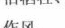

## 知情者

军区副司司令员。1952年6月中南军区由武汉移驻广州，与华南军区并合后撤销后，黄永胜被任命为南军区参谋长。军区司令林彪、副司令叶英和政治委员栾荣、第二政治委员相继调至中央，职务，军区日常工作由第三政治委员和黄永胜负责。

1953年5月，根据中央对高级干部抽调赴朝，黄永胜担任第19团司令，但仅两个月后战斗就结束。黄永胜因病回到北京。1954年2月，被任命为南军区副司令。1955年2月14日，黄永胜被任命为南军区副司令兼参谋长。此时黄永胜没想到会在广州工作那么长的时间。是黄永胜胆子越越大，到广东不久，黄永胜发生了一件军委领导都不可遏的事。黄永胜的好胆量是出了名的。在1950年春，13兵团派去香港购买器材，报告送到了黄永胜手里，他灵机动，便自己做过，换上衣服，与同志一同同行，去香港看看外面的世界。当时国民党、土匪搜集身份，结果黄永胜身份暴露了。由于由于增加，黄永胜自然也会卷入林彪的斗争，但在1958年5月27日至7月22日，中央军委召开大会，总结多年军队建设的教训。在军事训练中，所谓的“教条主义”问题和“独立主义”问题，刘宪、李达等受到了批判。黄永胜觉得会议后，讨论部队建设问题，就写了一份意见，联系军区，提出了几个问题。他在出门前先交给林彪审，林彪反复读了这一遍，认为无妥。在会议上向军委提交这份意见，引起了小的反响。然而，之后他正式向军方求学，军委很快回复，让他到北京高等军事学院学习。未曾预料到1960年，黄永胜从军事学院毕业，重返广州复职。1962年，南军区在南海区的计划被溃，实施“反攻”大陆。1962年6月23日至7月15日，黄永胜率军区对粤、闽南地区的地形、部队集结等地进行了侦察。这是黄永胜在三年内第三次进入南部进行考察。从1962年10月开始，他们派遣二十一人或三十五人为一股的武装特殊，利用深夜从海上空袭或渗透，随即潜入内陆区域，建立“游击根地”，开展武装，等待时机配合“反攻”，或者在沿海“抓一把就走”。海军歼。在这场战斗中，海边防备地区的民兵到了很大的作用。

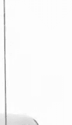

# 知情说说

1962年6月19日，毛泽东在武汉接见了黄永胜和刘兴元。在他们关于战斗和民兵工作的汇报之后指示：民兵工作要做组织落实、政治落实、军事落实，民兵要修理。天上掉来的，地下出来的，要对付，要有些办法。黄永胜立刻意识到这分量，和刘兴元说，马上向民兵军队的工作开展了，又在6月22日至23日召开民兵工作会议，传达贯彻毛主席的指示。从总指挥部、总政部很快转了这次会议的情况。从此，毛泽东对民兵工作“三落实”的指示贯彻全国，成为指导民兵工作的方针。南华地区军在南胶敌武装斗争中取得了一系列胜利，也是认真贯彻这“三落实”方面的具体成果。

黄永胜注意抓首长、司令，抓好配合，他有一句口头禅：“三落实”掉落——干干”。这是他用对工作标准不高、得过过的干部所用的一句话。说到某一句毫不努力的干部，他就说“某某个破干部”，他说对于这样的干部，就像拿着斧子到处打一样。1962年5月，他在衡南某军举办了师、团三级主官和师作处长、长集训，学习研究“五大技术”和分队实弹战训练以及参训队生活管理等。1963年2月，其在湖北阳阳山某师营集训员、师、团级干部，着重学习夜间闲余科目。两次训练，参训人员按接到连队中，师长按连长，连长按排长，黄永胜自兼担任连长，从从要到一日生活制度，按连队要求。他并担任了一些课程的讲示范。他抓基础训练，一次他在某团观看进攻战斗，训练结束后，他对战士不符合实战要求的动作一方面予以纠正。他从战士身上拿下一支自动步枪，示范如何利用地形、占领射击位置。在射击时，他把枪转到脑后，在场的官兵笑了。他的动作干净，一丝利索。示范后，他和战士们围坐，让战士发表意见，气氛极为热烈。

（此处后续大量重复及乱码内容，已根据OCR逻辑进行清理与合并）

## 从政界到罪犯

周宇、王丰、吴法宪则吹在柏林里是“全才、帅才、超群之才，是第三代接班人”。黄永胜与吴法宪、李作鹏一起散布“大助手论”、“最好的助手”、“最光的助手”、“比恩格斯、斯大林高得够”。

九届二中会前，他们伙同林彪为“和平抢党权”，谋取国家主席职位而费尽了心。1970年8月14日，黄永胜接到叶群的电话，他要和陈伯达准备天才方面的诉求。庐山会议（即九届二中会）开始后，黄永胜留守北京，汇总全面情况，配合庐山会议的同伙，坚持留守主席。8月23日，叶群、吴法宪电话告诉黄永胜，说了林彪告诉毛主席是天才，是国家元首的议事，“首战告捷”，黄永胜在电话中表示对庐山会议的胜利和祝贺，并让他们引起了重视。24日，当陈伯达在庐山表演“天才”时，黄永胜在电话上表示，“天才”才重要。但是庐山下，内外会议，涛汹汹决的气势，使毛泽东已经闻到了药味。这时，毛泽东写了《我的意见》，庐山会议发生了本质的变化。

庐山的胜利被林彪溃败，黄永胜、叶群、吴法宪、李作鹏、邱来密谋，约定联同他们。黄永胜规定：各人的检，不得涉及林彪。在庐山会议期间，叶群为了逃避罪责，私自删掉了她的发言记录。事后，当总理调查时，黄永胜将工作人员交给群编辑造假，欺骗总理，掩盖自己的罪行。

同时，黄永胜将还没发过的发言全部付之于炬。

10月14日，毛泽东在东山的书面上作了指示，然后笔锋一转，借阅转发到军委会办事小组汇报：“办事组同志（个别同志李德生外）忘记了刘大通过的党章……又谈什么天才问题，不过是个借口”。这使得任军事办事小组组长的黄永胜诚恳恳恐。随毛泽东又严厉地批评了黄永胜：“你黄永胜是总参长，是个头儿，你一到晚上就不出事，抓小事，不抓大事。路线问题，团结问题你就是抓不住。什么总参长，打起来我就是总参长……”

## 知情者说

庐山会议后，林彪革命集团开始采取武装政的形式“抢班”夺权。1971年2月，林彪革命集团的“联合”成员周宇迟、于新野、李伟信制定了《571工程》纪要。叶群和“四大金刚”的黄永胜、吴法宪、邱来、李作鹏也得更累了，他们商定：分开，避免嫌疑；不要越轨一险；参加会议不要多说话；不要节外生枝。黄永胜特别嘱咐胆怕死的吴法宪：“口头承诺，在会上不要有任何话，写好照念。”

### 林彪、黄永胜的命令

1971年8月14日，毛泽东离开北京南方各地巡视，沿途5个大军区和10个省负责人谈话，打招呼，又点名批评了林彪、陈伯达、黄永胜、吴法宪、邱来等在庐山搞突然袭，还说：“我就不相信我们军队会反，我就不相信黄永胜能够指挥解放军队反造，下面有师、团，还有军、政、后机关。你调动军队来坏事，你得逞吗？”

林彪、叶群对于毛泽东南巡活动非常怀疑，他们的党竟以各自不同的方式和途径，向林、叶密举报毛泽东的行踪、动态、谈话乃至生活经历。

9月6日，李作鹏在武汉得到关于毛泽东在武汉一些负责人谈话内容的密报，当天就跟随朝鲜代表团返回北京。黄胜利时刻，在人民大会堂的北京厅报告毛泽东南巡谈话内容，全部告诉了黄永胜。

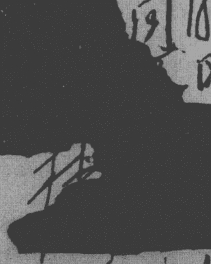

## 从将到刑罪

邱来。整个晚宴上，黄永胜心急如焚，忧忧忡忡，他知道这事不能告诉林彪、叶群，想到此事与自己息息相关，晚宴一结束马上回到西山，立即把这事机密告知林、叶。

与此时，林彪、叶群又得到“联合舰队”成员顺同舟从广州带来的有关毛泽东在长沙针对他们的话语。由此、林、叶断定毛泽东已觉察他们策划密谋的活动，经过紧张的筹划，做出了毛主席南巡在途中策划杀死毛泽东的犯罪决定。

7日，林立果向“联合舰队”下达了一级革命命令。上海等地准备军事权力变局，已集结特殊力量。

8日，林彪下发武装变革命令：“按照立果、周宇等同志发命令。”在这个关键时刻，林彪没有忘记黄永胜，林立果从北京带回林彪，同时也给黄永胜带来了秘密文件：“现在情况，我们决定在南方。”

10日，林立果将指示转交黄永胜，要好好准备。就在那天上午，黄永胜频繁地联系六次（最长的达90分钟和35分钟），加紧商定在南方联合苏联，实行南方攻击的计划。晚上，黄永胜收到了沛丰从北京带来的亲笔信。此信的主要内容是：“永胜同志：挂念你任何时候都要乐观，保护身体，有事可与我面谈。”11日上午，林立果决定由黄永胜在北京钓鱼台周围指挥一切。

但是，毛泽东离开上海，粉碎了他们的密谋。

## 知情者

毛泽东离开上海后，林彪、叶群马上通知黄永胜、吴法宪准备准备。几个小时后，震惊中外的“九一事件”发生了。

从9月6日到12日，黄永胜如坐毡，一直处于高度紧张之中。他知道大势不可，但是做了最后的挣扎。在最近的时间内，凡是证明他与林彪、叶群联系的照片、笔记本、材料、文件等一律焚毁。

1971年9月24日，黄永胜接到总理的电话，他要到大会堂参加会议。会议室里有几位帅、警卫人员。黄永胜第一个到来，刚刚坐下，吴法宪、李作鹏、邱来而来，他们心照不宣地坐下了。

一会儿，总理从另一扇门里走了。他宣布中央出的决定，命令黄永胜、吴法宪、李作鹏撤职彻底交代。总理对黄永胜说：“我等了你十天，你一言不发。”

29日，中央通知：“鉴于黄永胜、吴法宪、李作鹏、邱来同志参加林彪、陈伯达集团宗派活动，陷入很深，难以继续工作，已令撤职彻底交代。”军委日常工作，中央决定由军委副主席叶英主持，并筹建军委召开会议，进行集体领导。

## 最后的审判

10月3日，毛泽东批准中共中央关于成立中央专组的通知，调查黄永胜等人的犯罪材料。从1971年9月24日起，“四大金刚”一直关押在京顺义县某某师部队。这些“中央政治局委员们”对于每天0.8元钱的伙食非常不满。

## 从将到罪犯

在这4个人当中，黄永胜永远是“头”，为此，他给毛泽东、周总理写信，要求改善伙食。毛泽东很快就答复，从1月1日起，吃饭变得好了。每天吃饭后，他们就是交代材料。

“十大”之后，江青集团势力增强，周总理和小邓又被排挤打击。由于江青集团在很多问题上与林反革命集团有联系，他们对黄永胜等人提出的意见也有困难。黄永胜怕自己被历史定罪，不断地写信，要求中央及早处理。

1973年7月，中央专组向中央宣布：《关于林反革命集团的审查报告》。8月20日，中共中央宣布开除黄永胜的党籍，撤销其党外一切职务。中央委员会宣布林反革命集团的死罪。对于党的结论，黄永胜是抵赖不认的；理由是他没有林彪，也没有证据证明他们之间从源上有好处。

1979年9月25日，中央“两将”领导小组将林反革命集团的审判工作立即移交中央军队，通知周、吴、李等人的犯罪审查工作由总政治部统一组织。10月，决定由总政部预审黄永胜。

预审过程中，黄永胜几乎没有交待什么问题。对自己在“文化革命”中的所采取的行为采取了不承认的态度。到1966年5月23日，贺龙请示如何处理。在预审过程中，黄永胜几乎没有交待什么问题。对自己在“文化革命”中的所采取的行为采取了不承认的态度。

## 知情者说

预审过程中，黄永胜几乎没有交待什么问题。对自己在“文化革命”中的所采取的行为采取了不承认的态度。

预审过程中，黄永胜几乎没有交待什么问题。对自己在“文化革命”中的所采取的行为采取了不承认的态度。

预审过程中，黄永胜几乎没有交待什么问题。对自己在“文化革命”中的所采取的行为采取了不承认的态度。

预审过程中，黄永胜几乎没有交待什么问题。对自己在“文化革命”中的所采取的行为采取了不承认的态度。
