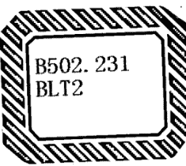
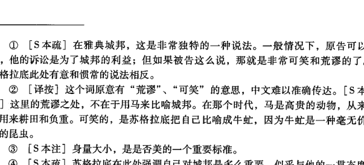
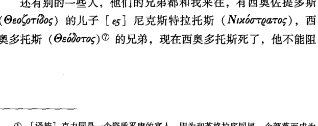
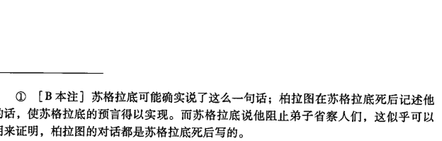
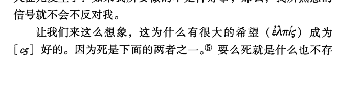
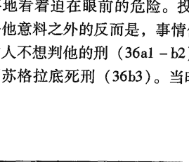

西方传统 经典与解释
CLASSIC & INTERPRETATION

# HERMES

# 柏拉图注释集

刘小枫 甘阳● 主编

[古希腊]柏拉图● 著

## 苏格拉底的申辩

# Apologia Socratis

吴飞●译/疏

华夏出版社

# 免费 价值 及时 专注

# 扫码加入 知识星球TOP 免费资源群

- 每日免费获取有价值资源
- 可提供各类资源搜索服务

| 热门付费文章 | 各行行业报告 |
| 精选图书资源 | 副业赚钱方法 |
| 职场实用资源 | AI经营自媒体 |

公众号: 知识星球TOP 微信信号: jntsg8 微信信号: jntsg2

分享资料仅供个人学习，请及时删除，切勿商用传播

# HERMES
INTERPRETATION 柏拉图注释集
刘小枫 甘阳●主编

## 苏格拉底的申辩

Apologia Socratis

[古希腊]柏拉图 | 著
吴飞 | 译/疏

单页出版社

# 图书在版编目(CIP)数据

苏格拉底的申辩/(古希腊版)柏拉图著;吴飞译/疏．-北京:华夏出版社,2007

(经典与解释.柏拉图注释集/刘小枫,甘阳主编)
ISBN 978-7-5080-4189-6

I.苏…II.柏…②吴……III.苏格拉底(前 469～前 399）- 哲学思想-研究 IV.B502.231

中国版图书馆 CIP 数据核字(2007)第 065554 号

## 苏格拉底的申辩

柏拉图 著

吴飞 译/疏

出版发行:华夏出版社
(北京市东门外西直里4号 邮编:100028)

销:新华书店
印:北京圣瑞印刷厂
次:2007年6月北京第1版
2007年6月北京第1次印刷
本:880×1230 1/32 开
张:7.75
数:202千字
价:25.00元

本书书凡印刷、装订错误，可及时向我社发行部调换

# HERMES
柏拉图注释集

Platonis opera omnia
cum commentariis
in Chinese Translations

刘小枫、甘阳 | 主编

“盛世必典”——或者说，太平盛世得乘机时日使命。对于现代之后的中国学术来说，修典的历史使命不仅是重译中国古代经典籍，同时得编写西方古典经典籍。

“柏拉图注释集”将提供全本汉译柏拉图全集（36种+佚作品7种），结构从希腊古代赫拉斯斯的古本“九卷集”，亦收若干难性著作或文集，共含三个部分：

1. 经典汉译柏拉图全集
2. 亚柏拉图注释译刊
3. 柏拉图今解

# 注疏汉译柏拉图全集
(近期书目)

苏格拉底的中篇 吴飞译/疏
《理想 王双洪译/疏
游叙弗伦 顾丽玲 编译
泰阿德德 汉译/疏
会斐德 刘小枫 编译
厄底哥洛明 程志敏 编译
阿尔哥比亚（前后） 梁中和 译/疏
普罗塔戈 刘小枫 编译
希罗底斯（前后） 罗卫平 编译
王奎（卷十） 张文海译/疏
法篇篇（卷一至卷三） 程志敏 译/疏

# 历代柏拉图注选刊
(近期书目)

普洛提诺
《九章集》 张奕伟 译
普洛克罗罗斯
《游篇》与疏 谭立坤 译
大马士基马斯
《斐多》疏 丁慷 译
奥林皮多诺斯
《斐多》疏 宋志渊 译
阿尔斯多法拉比
柏拉图的哲学 程志敏 译
阿威斯多洛德
《理想国》疏 刘轩 译
斐齐诺
《灵魂的德德》疏 王双洪 译
门德尔松多曼诺论灵魂不死 李云 译
施莱勒马德德柏拉图的哲学 黄瑞成 译

# 西方思想翻译的缘起

自上世纪四十年代以来，汉语学界的许多学者在遭遇西方思想时乃是思想史无前例的重大变化。大家可以理解的是，凭着个人的兴趣选择翻译的经典难免带有随意性，学界对西方思想的认识刚起步。

上世纪五十年代后期，汉语学界开始规范化，统一订了新的翻译计划。直到八十年代中期，新一代学者感到“西方学名著”清单的迫切性，这套体系的策划不可忽视，虽然当时学界的设计无疑具有教条主义局限（以伦理和制度为端）。

九十年代以来，汉语学界翻译渐成风，丛目繁多。然而翻译不等于科学，思想也不等于科学。无论许多新学者致力于思想传统的认识未尽，晚近十余年来，欧美学术界重新翻译和解释经典屡矣，汉语学界仅要紧跟时下主义的流变。

西方思想经典的汉译历史虽然仅百年，学界的理解似乎仍在清末以来。翻译西方经典的研究者，并非充分利用西方学界整理的最完美成就。显而易见的，这类选题基本上停留在通史或翻译阶段，未能有机会解释深度细节。设计这套“西方传统：经典与解释”，旨在推进学界对西方思想的深度理解。选题除了诸多亟待填补的研究空白（包括一些经典著作的翻译），尤其注重选择思想家对经典的解读。

编、译者深感汉语思想与西方学接壤的历史意义深远，亦知百年积累而一朝完成。

刘小枫
2000年10月于北京

# 《柏拉图疏集》出版说明

《柏拉图九卷》是有记录的柏拉图全集最早的体例，相传由亚历山大时期的语言学家、希腊政治顾问武拉克洛斯（Θ拉σύλλος）编辑，按古希腊悲剧的结构将柏拉图所有的作品组成九卷，每卷四部（对话作品35篇，简集1种，共36部）。

1513年，意大利出版家 Aldus 出柏拉图全集，史称西方近代意大利柏拉图全集的开端，遵循的仍是武拉克洛斯的体例。

后，欧洲学术界兴起复古，这个体例中的所有被认为是现代所谓的“全集”辑选有若干本，作品前后顺序也见不齐。

古典学界在约半世纪前就开始认识到，怀古者得失，不如从人受益良多。回到昔的柏拉图“全集”体例在古典学界几乎罕见（Les Belles Lettres 自世纪20年代出版的希腊语对照版本的 Platon œuvres complets 以及 Erich Loewenthal 上世纪40年代翻译的《柏拉图全集》均为36种+挂作品7种），当今权威的《柏拉图全集》英译版（John M. Cooper 主编，Plato, Complete Works, Hackett Publishing Company 1984，不断中断）即完全依照“九卷”体例（附名作品）。

> “盛世必经”——或者说，太平盛世要紧抓时日修籍。

对于推进中国学术界来说，编译的历史使命不仅是延续中国古代典籍，同时编译古代西方典籍。中山大学比较宗教研究所内的古典学研究中心拟定计划，推进译西方古代古典这一项学术大业。我们主张，译西方典籍应当我国我国编译古代典籍的精神和方法——精神即：敬重古代典籍，并不人为对世事人生的认识比古人高明；方法即：翻译时从名家入手掌握文本，考究版本，广开他人译成果。

《柏拉图注疏集》将提供全汉译《柏拉图全集》四十篇（36篇+名作7篇），从武拉克洛斯的“九卷集”。尽管翻译的译者都修过希腊语，我们主张翻译柏拉图作品等古典文献以希腊原文为主。欧美学术界于1994年开始，到2004年为止，仅完成一半。编译者密切关注并尽力吸收西方的相关成果，促进我国的发展。

刘小枫 甘阳
2005年5月

# 柏拉图注集卷目

卷一
1 游叙弗伦 顾丽玲 译
2 苏格拉底的申辩 吴飞 译
3 克里斯多 罗晓颖 译
4 斐多 刘风 译

卷六
1 欧狄得德 陈建洪 译
2 普罗塔戈克拉 刘风 译
3 高尔吉西亚 季茂 译
4 米诺 郭华 译

卷二
1 克拉底鲁 丁轩 译
2 秦泰德斯 现宪 译
3 智术 现宪 译
4 国者 洪 译

卷七
1 希底阿斯前篇 罗禹平 译
2 希底阿斯后篇 罗禹平 译
3 伊翁 王双洪 译
4 默顿克斯拉斯 巍朝男 译

卷三
1 柏德尼德 慕骏 译
2 斐若布 肖有志 译
3 会饮 刘风 译
4 欧德德 刘风 译

卷八
1 克利托 张德祥 译
2 王制 张文涛 译
3 肃迈欧 徐载 译
4 克里提问 徐载 译

卷四
1 阿尔哈比亚德前篇 梁中 译
2 阿尔哈比亚德后篇 梁中 译
3 希腊柯斯 乔奕 译
4 德篇

卷九
1 米诺斯 恒志敏 译
2 法义 恒志敏 译
3 厄尼米斯 恒志敏 译
4 书简 彭鑫 译

卷五
1 武阿格斯
2 卡尔米德 丁轩 译
3 拉克罗斯 贵章东 译
4 吕西斯 贵群 译
杂篇 刘锋 译

（名称以出版时为准）

# 目录

引言 1
一 苏格拉底的审判 1
二 柏拉图的《申辩》 4
三 《申辩》中的几个主题 8
四 《申辩》从古代到中世纪 12
五 《申辩》在现代欧洲的复兴 18
六 现代《申辩》研究中的三个问题 28
七 《申辩》与现代哲学 38
八 西方当代《申辩》的研究情况 47
九 中国学界对《申辩》的翻译与研究 53
十 本书的翻译与义务 61
十一 缩写对照表 63

苏格拉底的《申辩》（译注）64

生的根据与死的理由:《苏格拉底的申辩》译疏 143
一 真理与修辞（17a1-18a6） 144
二 案情真相（18a7-19a7） 147
三 哲学家生活的依据：针对第一控告者的辩护 150
（19a8-24b2） 150
1. 智者之知（19a8-20c3） 150

## 苏格拉底的申辩

2. 无知之知 (20c4-23c1) 153
3. 延延的形成 (23c2-24b2) 167

四 在哲学与政治之间: 针对第二控告者的辩辩
(24b3-28a1) 169
1. 诉讼 (24b3-c9) 169
2. 坏青年 (24c9-26a7) 172
3. 不敬之罪 (25a8-28a1) 179
五 为哲学而死的理由 (28a2-31c3) 185
1. 苏格拉底与阿基琉斯 (28a2-29b9) 185
2.美好生活与死亡 (29b9-31c3) 191
3. 哲学作为政治 (31c4-34b5) 197
4. 爱智者的荣耀 (34b6-35e8) 201
6. 惩罚与荣耀 (35e1-38b9) 205
7. 临别告 (38c1-42a5) 211

主要参考文献 22

# 引言—苏格拉底的审判

公元前399年，一个哲学家苏格拉底被捕并在陪审团面前做了申辩。但申辩并没有拯救苏格拉底的生命，他最后被判处死。苏格拉底之死为西方文明打下了两个基础。苏格拉底之死之所以成为哲学史上的核心事件，首先要归于柏拉图的《申辩》。大多数学者同意，苏格拉底显然已经写了诉状，背后的者是雅典民主派的重要人物奥路图斯，他在伯罗奔尼战争中担任将军，但是被败后，后来法官得以免。

公元404年，长达77年的伯罗奔尼战争结束，民主派逃离雅典，苏格拉底留在城内。三十盟主之一破坏了雅典传统，而且还实行暴虐的恐怖政策。奥路图斯这次起到了关键作用，把局面拉了回来。三十盟主夺去了奥路图斯的财产，但他并没有索回。同时，他也颁布特赦令，当年的叛国者罪都不追究。这两点为普通的支持。而人们认为，正是奥路图斯自己的规定使得他们在控诉苏格拉底时不得不找寻的借口。

从这些控诉中，在柏拉图的《理想》中，他们有了短暂而不愉快的对话。在那个家里，苏格拉底谈到智者的教育对于雅典带来的危险。苏格拉底在《申辩》中指出，他曾经经指过阿尔多德对自己儿子的教育，导致阿尔多德恨怀心。我们不知道，苏格拉底说的这种私怨是否对阿尔多斯的控告起到了作用。但在苏格拉底被审判后几年，一个名叫伯克拉克底的智者做了一篇关于《控诉苏格拉底》的演说。原文已佚，不过苏格拉底的支持者色格拉底、伊狄底、癸西等非常严肃地回答了这些控诉，柏拉图的《申辩》是否有，不得得知。

从这些回应中，我们看到，伯克拉克底的演说的主要观点是，苏格拉底与雅典民主者的敌人阿尔多斯比亚、克莱提亚、卡米等人的关系是正反的关系。

公元前415年，阿尔多斯比亚将雅典人远征西西里并任征军的统帅。在出发之前，城中发生了一起神案，阿尔多斯比亚的敌对怀疑有关，阿尔多斯比亚为了避免而投降了斯巴达。雅典人对其进行了缺席审判，判他死刑（史学家认为他是冤枉的）。此后，阿尔多斯比亚帮助斯巴达打仗。

后来，阿尔多斯比亚又遇到斯巴达的忠于，试图向雅典投戈，被雅典海军抓了几几次，得到以回雅典。但他后来被认为是反对派而遭到流亡。在柏拉图的《高尔吉亚》、《阿尔多斯比亚》、《会谈》、《普鲁多戈底》等对话中，我们知道，苏格拉底与阿尔多斯比亚是非常密切的关系。

克莱提亚年轻时也曾经和苏格拉底学习哲学。公元前406年，在塞利底被击流亡后，后来遭到流亡。他回到雅典后，成为寡头。

党中的成员，后来是三十人中的一个，而且其残暴程度超过了别人，甚至对苏格拉底也不留情面。他后来在比雷夫特洛斯与色拉旭·布普鲁斯带领的战斗中被杀。他出现在《斐德涅》、《克拉里提亚》、《卡尔米德》、《普普罗塔·扎拉拉斯》等对话中。

虽然色诺弗说，阿尔西比亚德和克拉里提亚一开始就有政治野心，在最初接触苏格拉底时就心情不良（《回忆苏格拉底》，1:2.12-39），我们很难从柏拉图的对话中看出这一点。色诺弗这样说，应该带着很强的为苏格拉底辩护的目的。

卡尔米德是克拉里提亚的舅父、柏拉图的舅舅。在《会饮》等对话中，在《卡尔米德》中，他是一个富有横情且有才华的青年。色诺弗在《回忆苏格拉底》中说，他很喜欢苏格拉底的偏爱（3:67）。公元404年，他也参与了三十人帮的集团，后来在比雷夫特洛斯的激战中被色拉旭·布鲁斯带领的民主派杀死。

很多学者认为，是伊拉克·苏格拉底揭示了苏格拉底死去的真实原因，还有人感到，这些罪名只是伊拉克·苏格拉底自己的观点，很难判断墨农图等人在控诉苏格拉底的动机。虽然这些反对意见并没有根据，但这些学者还没有足够的证据证明，墨农图和阿癸同等人在控诉苏格拉底时，就一定没有想到这些问题。现在看来苏格拉底被处决的真实原因，非常可能是由于他与雅腊民主派的阿尔西比亚德、克拉里提亚、卡尔米德等的关系。

① 比雷夫特洛斯，即在《理想国》中的进行对话的地方（327a）。
② 正如戈尔基纳在《申辩篇》中提到的，色诺弗作为苏格拉底辩护的目的过于简单，因源于夸大苏格拉底的德性。这种理解把辩护与苏格拉底之间的冲突过于简单，并不能被苏格拉底辩护的。正如Vlasts指出的，这使我们不得不对苏格拉底的记录保持警惕。Gregory Vlasts, “Socrates,” in Socrates (1), edited by William Prior, London: Routledge, 1996.
③ 关于这种观点，参见 Brickhouse & Smith, “Socrates' Elite Associates and the Motivation for his Trial and Condemnation” in *Socrates* (2), edited by William Prior, London: Routledge, 1996.

## 4 苏格拉底的申辩

切，在民主制刚恢复的时候，他引起了阿癸同等主宰者的猜忌。而阿癸同又不公开他自己颁布的特赦令，所以伙同墨农图斯和卢昆，为苏格拉底控了不虔和败坏青年两项罪名。而所谓说苏格拉底败坏青年，可能就是暗地影响了阿尔西比亚德等人，但不公开出来。在雅典法律中，败坏青年算是不正式的罪名，往往是附加在别的更大的罪名后面的道德评判。

按照第欧尼·拉图修的说法，在苏格拉底被处死之后，柏拉图和苏格拉底的学生逃到了加欧的欧里庇得。而雅典城很快就为苏格拉底死之后，墨农图被杀，阿癸同和孔西被流放。①

## 二 苏格拉底的《申辩》

在当时的雅典，苏格拉底的审判已经成为一个偶然一时的事件，他的申辩也成为街谈巷议的主题。虽然雅典人不喜欢苏格拉底，但他也是个名人，很多青年受到他的影响，这没有任何问题。此后几百年间，苏格拉底的申辩成为学术文人中的一种风尚，一直直到基督教形成的时候，还有为《苏格拉底的申辩》的作品问世。其中著名的，当然要数柏拉图和色鲁的作品。

苏格拉底的学生为什么要写《苏格拉底的申辩》，我们现在已经不得知了。他们是要真实记录下苏格拉底的申辩，还……

① 第欧尼·拉图修，《名言录》，3，中文版上卷，页73；43，中文版上卷，页109。商务人民出版社，2003。
② 在基督教形成后，Libani还写了《苏格拉底的申辩》，见第四节。

## 引言

### 是想通过申辩阐述自己的思想，抑或是仅仅为了表达老师的纪念？由于没有苏格拉底时代的历史资料，我们无法考察这两篇申辩与苏格拉底真正的申辩之间的关系，也就无法确切回答这个问题。欧根尼·拉图修的《名言录》是一部哲学家的历史著作，但因他生活在苏格拉底之后多年，除了苏格拉底之外，他似乎也没有别的关于苏格拉底审判的第一手资料。人们一般认为，对苏格拉底的记录不会比色拉底更可靠。但现代学者一般认为，这两篇申辩与历史上的苏格拉底之间的关系，成为一桩难以抒的学术难题。

围绕《申辩》的一个问题是，柏拉图在书中述述究竟是苏格拉底的，还是柏拉图自己的思想。本来，因为人们一般认为苏格拉底自己有一套系统的思想，这个问题就没有那么尖锐了。但现在一些学者指出，在所有的柏拉图对话中，都没有根据自己的想象创造一个苏格拉底的形象。因为唯有《申辩》描述的内容毫无疑问在历史上是有据的，而且在柏拉图述述时，人们有时候会把这篇游说与苏格拉底的《辩礼》比较，并没有把这篇游说成文。

① 欧根尼·拉图修提供了雅典法律档案中的埃芬多对苏格拉底的述状。有些学者不相信这份档案的真实性。参见第88页。
② C. C. W. Taylor，“The Origins of Our Paradigm,”New Perspectives on Plato, Modern and Ancient, edited by Julia Annas and Christopher Rowe, Washington, D.C.: Center for Hellenic Studies, Trustees for Harvard University, 2002.

### 6 苏格拉底的《申辩》

是在听众中记录了。因此，许多人认为，柏拉图在这篇演说中加入了了自己的思想，但这与苏格拉底的言说并无关系。

不过，柏拉图的《申辩》引发的问题比要复杂得多。特别是在十九世纪柏拉图研究传统确立以来，就变得更为复杂了。从古代到现代，人们已把《申辩》当作柏拉图思想的陈述，不再考虑它与柏拉图主义之间的关系。但从莱马赫开始，柏拉图的研究者更深刻地考虑柏拉图与苏格拉底的关系，并且对柏拉图的对话进行详细分析。十九世纪到二十世纪，《申辩》中的苏格拉底问题成为争论的一个焦点。许多学者不仅认为《申辩》可能是苏格拉底的思想，而且把柏拉图其他的一些对话也当作对苏格拉底言行的记录，甚至可能写于苏格拉底出生前。认为对话的学者们把《申辩》放在前面。也有学者说，《申辩》完全是柏拉图的虚构，真实的苏格拉底则无。关于这个问题的详细讨论，我们在本“引言”之后还会详细概述。

对于这个问题，我们的基本观点依循Stcke和施特罗斯的理解，我们认为建立在柏拉图的《申辩》基础上的，我们主要通过该述表达自己的思想。柏拉图并未有意构造出一个苏格拉底，而是他的《申辩》至少可以看作是从苏格拉底的一种诠释。同时，我们并不认为色诺底的《申辩》更接近真实。若苏格拉底的真实申辩是色诺底的角度的，那么柏拉图和色诺底的《申辩》就是对这部经典的不同的同传，正如《春秋》是对同一部《春秋》的不同同传一样。

基于这样一个前提，我们认为不必把《申辩》与柏拉图的其他对话，特别是后期的对话，彻底展开分析。虽然我们不能否定柏拉图的思想确实经历了变化，但其表达的思想还是有关联的。这只是一个思想体系发展的不同阶段，而不是像Vlastos那样，表达了两套完全不同，甚至相反的思想。

在柏拉图笔下，苏格拉底的审判是一个核心事件。不仅《游篇》、《申辩》、《克同》、《斐多》这些直接描述了这件事情的对话以此为焦点，《游泰德德》、《智者》、《治国者》也明显指涉这件事。甚至许多其他对话根本没有提到这件事，往往也和苏格拉底之死有着密切联系。就像色诺底所说的那样，苏格拉底的所有对话都是为了解决哲学与政治的关系。从这个意义来说，直接描写苏格拉底审判的《申辩》虽然具体内容未必后来的对话那么深，但苏格拉底之死的象征意义在柏拉图整体思想中非常重要。理解《申辩》成就我们理解一个关键步骤，之后将这个这个问题展开。我们对《申辩》的理解在西方传统中不同，但必须建立在这一千年形成的传统中。在这里，研究大体分为两个基本脉络：首先是从《申辩》得到启发，要发自己的哲学思想；后者是建立在古典哲学基础上的。这两个传统相互交互、彼此影响，比如莱马赫哈滕的苏格拉底和弟子的关系，Vlastos以及对苏格拉底的政治问题的解读，他们的具体研究正在引起古典学界的关注。因此，我们在梳理过程中很难区分这两个不同的走向，但在叙述中会尽量注意。

## 7 引言

### 三 《申辩》中的几个主题

柏拉图的《申辩》由三次演说组成，即正式的申辩、提出刑罚的演说、判决后的演说。有些研究者从此三分部分结构，但很多研究者喜欢按照主题和内容划分。我们在翻译和书中将基于此三次演说的基本结构，然后根据主题内容阐释。对于更详细的结构、内容及其含义，读者应该在全文和后面的书中。我们在此给出一个大体的轮廓，由于《申辩》是苏格拉底针对墨农等人控诉所做的申辩，其中一个核心主题就是苏格拉底的哲学活动与政治之间的关系。在“意义”中我们会把这个问题总结为哲学与政治的冲突。无论苏格拉底是否哲学的，在当时的语境下，其为了美好生活。苏格拉底的哲学是对美好生活的思考，政治是对美好生活的现实追求。因为哲学和政治各有逻辑，两种对美好生活的追求非常不同。在历代对《申辩》的解释中，对矛盾的理解也不相同。比如，我们会看到墨农等人对苏格拉底的控诉并不是简单的意志，而是体现了一种更严肃的对立与冲突。此外，当自由民主逐渐成为现代文明的一种意识形态之后，有些人也会批评苏格拉底对对立的反对。这一控诉无疑承担了柏拉图的辩护。反过来，也会有人认为苏格拉底面对政治的不服，表明了一种高贵的人格和对暴权的蔑视，甚至是现代从传统的先驱。

与哲学和政治紧密相关的，就是不虔的罪。从表面上看，这是一种宗教罪；但在当时的雅典，这种宗教罪仍然和城邦政治紧密相关。对城邦诸神的不虔，就是对城邦政治蔑视。不过，在基督教时代，对这个问题的理解会发生相应的变化，因为在中世纪和现代基督教文中，至少理论上政治和宗教逐渐离开了。基督教时代的人们常常会把苏格拉底的不虔赋予新的意义。比如，早期的某些基督徒批评苏格拉底不虔，就是他对希腊的多神宗教对得不够彻底。但有些导师认为，苏格拉底之所以被视为雅典诸人，是因为他在宣讲一种神秘的宗教。在柏道者希腊的时代，就已经有了这把苏格拉底基督教化的过程。文中出现了类似的说法，苏格拉底与耶稣的类比，也出现。到了启示运动以后，对苏格拉底不虔的理解会有新的侧重点，即苏格拉底与城邦宗教的对抗，此类新的启示运动与传统教会的对立。

苏格拉底在谈到自己的哲学活动的时候，通过德尔斐爱神神论出了最高苏格拉底特色的智慧观：“无知之”。德尔斐说苏格拉底的无知是最高的智慧，苏格拉底是在政治家、诗人、匠人之后认为，无知的意思是，只有苏格拉底知道，自己什么都不知道。苏格拉底由此发明了独特的否定求法，即并不确定什么是智慧，而是不断否定认知。在柏拉图的《申辩》中，这种“无知”一方面与智者的专业知识区分，另一方面与一般雅典人的不知道相对。在求知上，探索人类的生活有一种必要的谦诚态度。早在希腊时代，这种无知观念后人也有无数解释。

## 8 苏格拉底的申辩

### 10 苏格拉底的申辩

绝对不可知和神之间的永恒距离。实在在《愚人》中用普罗在《哥林多书》中谈到的智慧与愚的辩论来。在理性的时代，梭用一种判定标准对纯粹理性的批判，从更深的角度，黑格尔更是用的辩证法思想，重新阐释了苏格拉底与城邦之间的对立。“苏格拉底的辩证法”和“苏格拉底的反响”这些名号，都是由“无知之”命题而生的。苏格拉底不仅把他的哲学活动当成一种神圣的任务，而且在《申辩》中描述了德尔斐神论、三次战役这些经历。《申辩》虽然很像柏拉图的对话，却是唯一一个包含苏格拉底这些活动的回答。因此，人们对《申辩》很难说是对苏格拉底人的，还是对柏拉图思想。特别是，人们认为是把这篇对话与《游斐弗洛》、《克拉里提亚》、《罗多斯》的若干著作结合来读。后代也有不同的理解，首先用《申辩》来理解苏格拉底这个道德。进入基督教时代，特别是现代，曼德尔更看重苏格拉底的人格与灵魂的融合。到了今天，克尔凯尔、福柯等哲学家都从灵魂这一来理解苏格拉底的独特观念。苏格拉底是一个哲学使命，他把自己比一只蜜蜂，不断催人心灵。他的第二个罪名，就是破坏青年。苏格拉底有独特的教育方式，他否定了智者们那种在收取费用可以传授的专家教育。

① 关于教育问题，可以参考Christoph Bruell; On An Introduction to the Socratic Platonic dialogues. Rowman & Littlefield Publishers Inc., 1999.

## 引言

老师。他的教育，就是辩证的对话。这使他无法受他影响的青年们的行为负责，其无法为阿尔西比亚德等人负责。关于苏格拉底的教育，也一直有着不同的理解。在老加对苏格拉底的批判中，一个重要方面在于苏格拉底破坏了纯粹的道德风尚。而是受到了基督教的人常常把苏格拉底与耶稣对比。伊拉斯在《愚人》中甚至将苏格拉底与彼得对比。苏格拉底的辩证法不能得到人类的新认识，特别是在黑格尔那里形成了一整套辩证观念。

“苏格拉底的反响”在中文里已经成为成语。苏格拉底表现出自己有的幽默和谦逊。他说自己什么不知道，虚心向别人请教，但是把别人引入苏格拉底的认识为自己什么也不知道，还是只是用这种课堂的态度去设定一个问题，让别人跟着走，这是一个辩论中的问题。当时的雅典人显然就不相信他的真理为自己知道，而伊拉斯在《愚人》中充分相信他的愚拙，并给出一个非常基督教化的解释。对于这个问题最彻底的阐释，正是乔尔克·凯尔郭奥的名作《还原概念》。苏格拉底的反响，充分体现了哲学思考中的喜剧品质。

苏格拉底在《申辩》和其他对话中都不断论到，有一个精灵的声音总是阻止他做坏事的。游非伯伦就认为，正是苏格拉底导致了哲学的不控告。新柏拉图主义者认为阿托·莱姆这个精灵作者作文章，把它成了诸神和人类的一种半半神。但是海格斯对阿托·莱姆的这种设定，在基督教时代给苏格拉底带来了麻烦，很多哲学家都认为苏格拉底是这种疑惑的导师。现代，这个精灵的命运发生了变化。法国人Cyrano de Bergerac在一种虚想中让苏格拉底的保护神在月球上给自己知识。而到了黑格尔、乔尔克·凯尔郭奥、以及尼采等人对苏格拉底的重理解中，这个精灵又被赋予了现代哲学的新意义。

死亡是苏格拉底的。苏格拉底之死在西方哲学传统中非常重要，理解《申辩》成就我们理解一个关键步骤，之后将这个这个问题展开。我们对《申辩》的理解在西方传统中不同，但必须建立在这一千年形成的传统中。在这里，研究大体可以简单梳理一下，苏格拉底的两个基本脉络：首先是从《申辩》得到启发，要发自己的哲学思想；后者是建立在古典哲学基础上的。这两个传统相互交互、彼此影响，比如莱马赫哈滕的苏格拉底和弟子的关系，Vlastos以及对具体研究正在进入古典学界的关注。因此，我们在梳理过程中很难区分这两个不同的走向，但在叙述中会尽量注意。

苏格拉底之死在西方哲学传统中非常重要，理解《申辩》成就我们理解一个关键步骤，之后将这个这个问题展开。

## 14 苏格拉底的申辩

已是无知的“这一点都不知道”。除去学园派中的怀疑论者之外，Pyrrhon 也把希腊主义者召到了苏格拉底。罗马人对苏格拉底的评价要复杂一些。老加在图中谈到希腊哲学，特别是希腊哲学对罗马民风的影响时，出于柏士莱的政治考虑非常尖锐地批责苏格拉底把人们教育得无法能，他的学说破坏了罗马共和国。他说：“苏格拉底是一个强有的空谈者，竭力企图破坏国家的法律，煽动国家对法律有反对的国家，力图成为国家的政首。”西塞罗对苏格拉底评价很高，特别是在《图斯伦萨讨论》中。他说：“苏格拉底第一个哲学家从天上召唤了下去，他被放在城邦、引进罗马，让罗马的生活和道德、好与坏”。苏格拉底在《申辩》中之所以不向任何人求情，完全是为一个伟大的灵魂。西塞罗在《申辩》中的最后一段对死亡的态度。

在第一世纪和二世纪的哲学家，Dio Chrysostom, (45－115) 虽然不是第一个有的，但是他是苏格拉底最多的。他对苏格拉底的理解明显受到《申辩》的影响。他更加强调苏格拉底作为教师角色的作用，赞美苏格拉底鼓励人们追求生活性的努力。他还认为，苏格拉底的使命不限于罗马，而是对全人类都有益的。

罗马时期的柏拉图主义利用柏拉图的各对对话来构建他们的哲学学说。他们对柏拉图的理解深受亚里士多德的影响已经很大，而更多集中于讨论哲学要的问题。新柏拉图主义的哲学家很熟悉《申辩》和《克里同》，但一般不用它们研究柏拉图的哲学思想，而是更多地用它们研究苏格拉底。比如，在 Proclus 研究柏拉图的著作《柏拉图神学》中，基本没有提到这两段对话；他在研究苏格拉底的《阿尔喀比亚德》对话篇中，它们却出现了很多次。

新柏拉图主义在确定柏拉图的教学时，是不太使用《申辩》和《克里同》。对《申辩》感兴趣的，往往是哲苏格拉底的哲学家。比如阿卜莱乌斯（Apuleius），他的《论苏格拉底之神》细致地诸此考察苏格拉底的守护精力。可是，苏格拉底的精灵是人和神之间的媒介，向诸神递送人们的祭和祷，向人们发布符的意旨。Hulse 认为，这是用希腊语和哈苏拉底的来说解释苏格拉底的精灵，和《申辩》对精灵的理解相远。这一点也成为了后来基督教攻击的目标。

此外，阿卜莱乌斯曾模仿柏拉图的《申辩》，写了自己的《申辩》。当时，有一个追求阿卜莱乌斯的妻子的曾对阿卜莱乌斯起诉，说他用魔法蛊惑感情。为此他写了一篇《申辩》（又称《魔法论》）。在自己的《申辩》中，阿卜莱乌斯把自己想象成苏格拉底这个角色，受柏拉图的《申辩》的影响很大。

另外，公元二世纪自称柏拉图主义的 Maximus of Tyre 比较重视《申辩》，但这也是因为他对苏格拉底的兴趣。在他的《哲学说》中，就有一个题目是：“苏格拉底不再为自己的灵魂是否正确？”据说，在柏拉图主义的教育体系中，《申辩》常常是最早的读物。除之外，《游叙弗伦》、《克里同》和别的对话都曾作为人物读物。但我们现在不知道这样的用意。

## 16 苏格拉底的申辩

这个时期极大影响了后人对苏格拉底的理解，是第欧根尼·拉修的著作《名言行录》中对苏格拉底的描述。但他更关注的是奇闻逸事，而不是哲学。他流传来的很多关于苏格拉底的说法（比如苏格拉底和他的妻子西西娅的关系），现在是有疑的。关于苏格拉底的审判，它也提供了一些信息，如诉状原文、投票的数目等。很多学者认为这些也是可疑的。

在基督教进入西方人的视野之后，很多哲学家试图将其与基督教结合起来。

基督教对苏格拉底的态度非常复杂。殉道者游士是最最容易否定苏格拉底的。他认为认识苏格拉底其实是认识圣言，虽然他被看作不虔虚。他可能是历史上第一个把苏格拉底和耶稣联系起来的人。他也是最激烈批判苏格拉底的，要数以及对各种神所发现的，都充分证明了他是多神论者。

四世纪的修辞学家 Libani应对苏格拉底非常尊重。他也写了自己的《苏格拉底的申辩》，以第三人称对苏格拉底的各种罪名进行反驳，对雅典法庭提出挑战。他还写了一篇《苏格拉底的沉默》，按照传统，说苏格拉底在审判中完全保持沉默，认为这是一种非常巧妙的辩法。Libani虽然态度积极，但这种方法可能是修辞学的。奥斯丁确立了基督教对苏格拉底的评价。在《上帝城》卷八中，他对苏格拉底的描述简短但内容丰富。

## 17 奥斯丁

相当高的肯定。他对柏拉底的评价也主要是正面的。这一卷中的很大篇幅用于反驳阿卜莱乌斯《论苏格拉底之神》中提到的精灵。他得出结论，包括堕落的天使，其实是天使，而所谓的“精灵”也是天使。在西方中世纪的思想中，虽然柏拉图主义被融入了基督教教学，包括《申辩》和《克里同》，苏格拉底基本上被遗忘了。当然，人们依然记得这个名字，流传着关于苏格拉底的一些故事。在东方的绘画传统中，还有苏格拉底的形象。苏格拉底已经激起新的思想，人们偶尔提到。与基督教不同的是，在中世纪阿拉伯哲学中，苏格拉底仍然是很重要的。很多对话被翻译成了阿拉伯文。他的审判占据了核心的位置。阿拉伯伯拉克基本上按照《申辩》中的描述来理解他的故事，上了一层额外的伊斯兰色彩。阿拉伯伯拉克大部分把苏格拉底描述成先知，人们甚至认为他宣扬对唯一、永恒上帝的信仰。苏格拉底被捕和处死，就是他用这种宗教来反对雅典的国家，非常像耶稣的故事。

## 18 苏格拉底的申辩

## 五世纪的欧洲复兴

Marsilio Ficino是文艺复兴时代最大的柏拉图学者，推动了柏拉图研究在基督教神学中的复兴。在他的巨著《柏拉图神学》中，Ficino用基督教的方式解释《申辩》中著名的“无知”问题。

## 19 无知之知

《申辩》在现代欧洲复兴时期引起了人们对苏格拉底的基础。他认为，苏格拉底得到了上帝的启示，不可可能是无知的。他说的“无知”，就是他在上帝面前的谦卑。他用这个表达表明，他的知识是靠自己的理性生长出来的，而是通过上帝启示给他的。奥尼斯拉斯哲学家如何解释苏格拉底的无知，“无知主义”逐渐流到了其他欧洲国家，引起了人们对苏格拉底、柏拉图的兴趣。我们在意大利看到的这些对苏格拉底的基础并没有动摇。人们一般把苏格拉底的思想搬给了新的理解。比如伊斯兰诺一生都是对苏格拉底非常感兴趣。与《申辩》尤其相关的，是《愚人》中对苏格拉底的无知理解。伊斯兰诺模仿他的语气说道，苏格拉底是最明智的，然后自诩智慧，反而把智慧给了神。他的愚蠢正是这种愚蠢使他遭遇了审判，并最后送了命。当她在提到耶稣的时候，也让人们完全通过保罗在《哥林前书》中的“神圣”来理解。显然，伊斯兰诺把这种智慧变成“愚狗”。这种基督教式的反响，来理解苏格拉底的无知状态，却是神给的智慧。人类借用了彼欧中的一个场景：苏格拉底的弟子虽然无法对老师说一句话，愚人的描述方式这个情景迥然与耶稣形成了应对。

在艺术史的思想看来，对苏格拉底谈最多的是法国的孟德。孟德在1570年代撰名的《雷蒙·塞尔昂》的时候，可能还不理解苏格拉底。但他在其中表达的不可能获得知识的态度与苏格拉底在《申辩》中的说法非常相似。1580年左右，苏格拉底逐渐成为孟德的偶像。他在后的许多文中表现出对苏格拉底的浓厚兴趣，他主要要依靠的材料是《申辩》和《会饮》。他在后的随笔中，继续对人类对理性和智慧判断的过高，其中很多都是对苏格拉底的无知反思。在大约1588年写的《论相》中，孟德许多地谈到了《申辩》。他用自己的格式括了《申辩》全部的内容，还不很准确，但基本包含了其中的主要概念。评价说，虽然亚里士多德为苏格拉底的申辩可能符合准则，但只有底这一才是一个伟大人的申辩。他赞誉苏格拉底的高尚情操和他面对死亡时的豁达，而这些都不受外界的影响。而后来爱生的评价可能表现出孟德对苏格拉底的态度：“他的作品没有感情，没有雄心；只表现出一种满足、自尊和所弃行的中庸之道。不过只有一个例外——表现为对苏格拉底的爱”。在孟德谈苏格拉底时，法国学术界对古典思想的兴趣越来越厚了。值得一提的是著名的出版家和古典学者亨利·埃蒂安纳（Henri Etienne），他继承了父亲作为出版事业，由他编辑了希腊文集，《苏格拉底的辩护》和其他别的古典书籍，而且还出版了三本希腊文全集。

## 二十七、十八世纪的法国

进入十七世纪，欧洲对古代思想的兴趣继续。在很多时候，苏格拉底被赋予了强烈的基督教色彩，但启蒙思想已经改变了人们的理解。1590年，法国人Theophile of Viau完成了《论爱，或死》（Traité de l'immortalité de l'âme, ou la mort de Socrates）。十七世纪中期，法国出现了三本关于苏格拉底的著作。François Charpentier在1650年出版的《苏格拉底》，这两本书都有明显的基督教色彩。Guez de Balzac的《苏格拉底》是题给现代性的野性的。这个时期的另一本书是Cyrano de Bergerac的《外的世界，国家和太阳》，作者在1655年去世。此书出发点与上面非常不同，假想到了月球，认为他世界是永恒的。十七世纪末，法国文学界发生了著名的古今之争。在之前，苏格拉底的《格列佛游记》就遭到了很大影响。Fontelle让苏格拉底参与到了这场争论中。在之前，苏格拉底的申辩都是非法的，等等。作者明显通过精灵之口来反对基督教。在之前，苏格拉底的申辩中是无用的。因此，苏格拉底遭受的攻击是基督教要捍卫的地位。到了十八世纪，苏格拉底成为启蒙运动中的偶像。在这一世纪，法国人对苏格拉底的讨论最为热烈。在启蒙哲学家中，伏泰对苏格拉底的态度。他在《哲学词典》中的“苏格拉底”条里，把苏格拉底、哈斐留、康德等排列，说明他们都是热爱本质的。苏格拉底被判刑后，并喝下了毒酒之后，阿戈亚和她的们告诉他们，苏格拉底是无辜的。苏格拉底鼓励弟子们继续寻求真理、视诸迫害，笑着离开了。

狄德罗非常喜欢苏格拉底的《申辩》。1749年，他因为被判定有罪而遭遇遣谴。他在监禁中翻译了苏格拉底的《申辩》，用一把牙签把它刻在一本弥尔的《乐园》的边上。

狄德罗对《申辩》的翻译之所以成为有名的事，还为了卢梭对它的探险。当时，卢梭在思考学院给出了一个作业题目：“科学和艺术的进步究竟是坏了道德，还是净化了道德？”卢梭和狄德罗在监禁中讨论了这个问题，得出结论：科学和艺术的进步败坏了道德。卢梭带走了狄德罗正在翻译的《申辩》中。

卢梭对《申辩》的兴趣可能就是由狄德罗引起的。但他对《申辩》的理解和运用与众不同。当时的启蒙思想家大多对苏格拉底持敌视，但卢梭让苏格拉底支持“无知”。在引述苏格拉底...

- ① Richard Back, Socrates and Skepticism, in A Companion to Socrates, edited by Sara Ahbel–Rappe and Rachana Kantekar, Malden, MA; Blackwell Publishing Ltd., 2006; Christopher J. Shields, Socrates Among the Skeptics, in The Theocratic Movement, edited by Paul A. Vander Waerth, Ithaca; Cornell University Press, 1994.
- ② 普鲁塔塔克，《希腊罗马人全传》、《老加底部分》，吴永越、吴彤娜等译，北京:商务书馆，1990, 369。
- ③ 西塞罗，“图斯伦萨讨论》5; 1; 2; 19:1.
- ④ James W. Hough, The Reputations of Socrates: The Afterlife of a Gadfly, New York; Peter Long Publishing Inc., 1995, 55.
- ① James W. Hulse, The Reputations of Socrates: The Afterlife of a Gadfly, New York: Peter Long Publishing Inc., 1995, 页 57–58.
- ② Harold Tarrant, Plato's First Interpreters, Ithaca, New York; Cornell University Press, 2000, 页 101.
- ① James K. Feibleman, Religious Platonism, Westport: Connecticut: Greenwood Press, 1971.
- ② James W. Hulse, The Reputations of Socrates: The Afterlife of a Gadfly, New York: Peter Long Publishing Inc., 1995, 页 57.
- ③ John Ferguson, edits Socrates: a Source, London: Macmillan for the Open University Press, 1970, pp. 25–29.
- ① 奥斯丁《上帝城》卷八，吴飞译，上海；上海联书店，2007。
- ② James W. Hulse, The Reputations of Socrates: The Afterlife of a Gadfly, New York: Peter Long Publishing Inc., 1995, 71.
- ③ Ilai Alon, “Socrates in Arabic Philosophy,” in A Companion to Socrates, edited by Sarah Ahmed – Rappe and Rachana Kantekar, Malden, MA. : Blackwell Publishing Ltd., 2006.
- ① James Jenkins, “Socrates in the Italian Renaissance,” In A Companion to Socrates, edited Sara Abel – Rappe and Rachana Kantekar, Malden, MA.: Blackwell Publishing Ltd., 2006; 另参见 Jenkins, Plato in the Italian Renaissance, Leiden: E. J. Brill, 1991.
- ② Lyndon Christian, “The Figure of Socrates in Erasmus’s Works,” in the Sevent Century Journal, III, 2 (1972).
- ③ 伊斯兰诺，《愚人》，24，许吕信译，沈阳：辽宁出版社，2001，23页-24。

## 24 苏格拉底的申辩

在德尔尔·柏拉翁的考察的时候，卢梭略去了关于政治家和匠人的说法，集中于对诗人和艺术家的批评。在卢梭篱下，苏格拉底发现强不知为知的，是智者、诗人、预言家、艺术家。这样，苏格拉底的“无知之知”针对的，正是理性认识自身。正如Hulse所说的，卢梭笔下的苏格拉底是一个“反哲学的哲学家”。①

除去这些重要的思想构想，十八世纪的法国还出现了另一种宽观的对《申辩》和苏格拉底的研究传统。Nicolas Fréret认为，苏格拉底之所以被处死，就是因为他反对民主。Siegsmund Friedrich Dreig通过对文本的历史研究，得出了相同的结论。

Jean Jacques Garmier考察了苏格拉底与柏拉图的哲学之间的关系。这些问题后来成为当代苏格拉底与柏拉图研究中的重要问题。此项研究在当时影响不如那些哲学家，但可能影响了后来的传统研究。

此外，Charles Palais de Monteney写了一个关于《哲学家》的剧本，伊凡阿奥尔托斯兰的《云》，讽刺Helvetius、狄德罗、卢梭哲学家演出非常成功。②

## （三）《申辩》在德国哲学中

十八世纪的德国对苏格拉底有很多讨论，其风格与法国非常不同。Friedrich Glockstock和Johann Augustus Eberhard试图把苏格拉底与基督教观念结合。Eberhard的《苏格拉底的新申辩》证明，苏格拉底这样的异教徒也是可以得救的。这些论可是相对比较浅层的。

康德的朋友和批评者哈曼对于柏拉图的著作的了解并不但在《苏格拉底行录》中的观念接近苏格拉底。他同样用苏格拉底的“无知之知”来批判启蒙时代代行的理性思想，特别是他的朋友德康的著作。①用Huse的话，他做了启蒙时代的牛车。②哈伯后来对歌德、黑格尔、克尔凯尔的影响很大。

不过，就在格曼利康德的时候，康德还没有成为伟大的哲学家，而是沉浸在自然科学和哲学之上，加不批判当时的流行的理性主义定义。当康德着手对纯理性的批判的时候，他比格曼更深刻地接近了苏格拉底。他从哲学的研究转向对伦理问题的思考，正如 Friedrich Paulsen 所的那样，是类似于苏格拉底此的转向，③

康德与苏格拉底的相似不仅在于他的哲学转向，而且在他否定的哲学方法上更与苏格拉底的“无知之知”勾连了起来。

《纯理性批判》的第二版序说明：“重要的是，考虑到一种无法估量的好处，在未来的所有的时代，以苏格拉底的方法，也就是说通过最清晰地证明对手的无知来结束一切针对道德和宗教的争议”。④他的这种否定性不是一般的辩论和批判，而是从根本上证明，我的纯粹理性无法认识上帝、世界、灵魂这样的问题，因为此只有在认识这种知识的不可能之后，才能能够绝对律令建立理性。这是在最深的意义上论证了苏格拉底在《审判》中对人的认识的。

正是出于这样的观念的，康德完全复顾了以前的神学观点。在《单纯理性限度内的宗教》中，康德否定了原罪和一切。

① ① 同上，页117。
② Mario Montuori, De Socrate iauste damnato, Amsterdam; J. C. Grieben, 1981; 转引 James W. Hulse, The Reputations of Socrates: The Afterlife of a Gadfly, New York: Peter Long Publishing Inc., 1995, 页118。
① James O Laferrr, Hamann's Secret Memorabilia; A Translation and Commentary, Baltimore; John Hopkins University Press, 1967.
② James W. Hulse, The Reputations of Socrates: The Afterlife of a Gadfly, New York: Peter Long Publishing Inc., 1995, 127节。
③ Friedrich Paulsen, Immanuel Kant: His Life and Doctrine, New York; Friedrich Un-gar, 1963, 38。
④ 康德，《纯理性批判》（第二版），李秋译，北京：中国人民出版社，2004，18节。

## 26 苏格拉底的辩证

苏格拉底的观念，认为宗教完全是有缺陷的。他在否定了宗教的理性之后，又通过人的需要了这些观念。表面上，他仍然承认宗教的必要，但实质上改变了旧的宗教基础。因此，普鲁士皇帝曾在这个意义上，康德又表现出苏格拉底对待宗教的共同。这种类比不是随意的。康德虽然没有像伏泰或卢梭那样直接接触或诠释，但他把他看作是想要重新解释苏格拉底的高峰。他把那人充满了破碎、荒谬和基督教偏见整合起来，赋予了新的意义，不仅比他们更深刻地理解了苏格拉底，而且与启蒙时代的精神相结合。康德对整个古典学的努力，对于建立现代的研究体系，奠定了基础。

黑格尔对苏格拉底和柏拉图同样有一个新的解释。在《传》和《宗教与基督教》这两篇文章中，他明确表示，苏格拉底是更高的人。而黑格尔对苏格拉底最大的差异在于他的辩证法。在《哲学史讲演》中“苏格拉底”部分，黑格尔讨论了苏格拉底的反驳、以及无知之，“哲学从感惑引起，疑惑是生而来的；应当怀疑，应当扬弃一切假定，以便把概念重新接受。”

在黑格尔看来，苏格拉底的灵魂并不是外在的神话中，而是一种内在的东西，“表象为一种独特的灵魂，一种异于人的意志”。黑格尔认为，苏格拉底从自然哲学到道德哲学的转变，而且这种转变使苏格拉底根本改变了世界历史：苏格拉底的原则创造了整个世界的历史，这个转变的转折点便是个人的证明替代了神论”。他认为，这种转变就是苏格拉底的生活方式和使命。

黑格尔对苏格拉底自身的自白的充分表现了他推崇的辩证法。虽然他推崇苏格拉底哲学的历史地位，但他认为雅典对他人的审判是不相反，他认为雅典对苏格拉底的控诉和审判都是正的和合法的，因为苏格拉底确实威胁到了城邦，城邦就有义务处置他。苏格拉底和雅典人都是的。对苏格拉底的审判让雅典精神逐渐解体，而雅典的解体让它的灰烬升起一个更高的精神，“因为精神已经升到一个更高的意识了”。

黑格尔除了充分吸收苏格拉底和柏拉图的辩证法之外，还把他们的哲学放在世界历史中看待。他是从另一个角度充分吸收了前人对苏格拉底的诠释，给出了一个哲学史的解释。他的工作，后从哲学的角度研究苏格拉底与柏拉图有极大影响。

康德与黑格尔的工作作为现代柏拉图研究新传统的建立提供了理论上的准备。而德国研究大学的建设，也为这一新传统提供了基本的制度依托。在黑格尔的同时，德国的另一个哲学家施莱尔·马克已经开始奠定新传统的研究基础。

① 同上，89页。
② 同上，107页。

## 28 苏格拉底的申辩

## 六 现代《申辩》研究中的三个问题

施莱尔·马克翻译的柏拉图著作从1804年开始出版，到1828年完成。每篇对话前面有一篇研究性导引。从施莱尔·马克之后，古典学与哲学研究相互依托，逐渐建立起现代的柏拉图研究体系。对柏拉图全集的编辑、翻译与研究在欧美各国逐渐展开。这个研究的传统延续了古典学与哲学史的方法论，强调客观、系统理解苏格拉底和柏拉图在整个文明中的位置，使柏拉图的人物成为严肃的研究对象，而不再可以随意塑造的文化人物。以后对苏格拉底与柏拉图的理解必须在这样逐渐累积的研究成果之上。哪怕对柏拉图的哲学解释，也不可能再那样随意的。把苏格拉底基督教化这种倾向，就消失了。

随着研究传统的建立，除了我们在“引言”中第三部分提到的几个主题不断重新诠释，还有几个针对苏格拉底的问题成为学者们的焦点。一方面，这些问题涉及到苏格拉底和柏拉图的历史；另一方面，由于没有足够的文献充分证明，这些问题的解决似乎无法避免。对苏格拉底的哲学理解，就会从这些具体的历史出发。此处简单列举其中比较重要、且与《申辩》密切相关的三个问题：一、柏拉图的分期；二、苏格拉底与柏拉图的关系；三、雅典审判与苏格拉底的历史。

### （一）分期

我们首先来看第一个问题的回答。施莱尔·马克翻译的柏拉图建立在对柏拉图的分期之上。他认为，柏拉图对话相互关联，是一个统一的整体，而不同的对话之间有一个发展过程，但他并不认为这种发展是由外在事件导致的，即不是苏格拉底死的经历了他的思想变化。在他看来，对话完全是一种内在关联，后面的对话面对前面的对话的结果。按照他的划分，柏拉图对话共有早、中、晚三个。第一阶段是准备阶段，代表了未成熟；第二阶段是探讨阶段，体现了发展；第三阶段是建设阶段，表达了成熟。而《申辩》和《克里托亚》都被放在了第一阶段里，甚至进入这两个阶段。他说，《申辩》完全是偶然之作。在莱尔·马克之后，许多学者会认为《申辩》不是柏拉图的作品。他们仍然认为是柏拉图著作三个时期。比如，Socher、Hermann和Weberberg认为柏拉图有一个明确的发展。他们大多依靠事件、思想发展、语言来划分，而不是莱尔·马克那样完全依据思想脉络。他们认为，柏拉图最早的对话是在莱尔·马克生前的，因此反映了真正的苏格拉底

① Friedrich Schleiermacher, Schleiermacher's Introduction to the Dialogues of Plato, New York: Oxford Press, 1973, 134.
② Joseph Socher, Über Platons Schriften, Munich: I. J. Lentner, 1820.
③ Karl Friedrich Hermann, Geschichte und System des Platonischen Philosophie, Heidelberg: B. F. Winter, 1839.
④ Friedrich Ueberberg, Untersuchungen über Plato, Stuttgart: W. Kohlhammer, 1888.

## 30 苏格拉底的申辩

《申辩》，是中期最早的一篇。以 Grote 为代表。他认为，柏拉图的对话就像希腊的戏剧一样，并不是一个连续的整体。每一个对话自成一体，其间并没有紧密的关联。除了书信之外，我们未见到柏拉图个人的观点，在对话中呈现的都是人物的观点。不过，他对柏拉图对话是有大的划分的。他认为，写于苏格拉底死后的《申辩》是柏拉图最早的对话，而《近孟篇》、《克里提亚》、《法篇》是最晚的对话，其他对话的时期可能无法确定。但 Grote还是有些观念在不同的对话中反复出现的，可以代表柏拉图的一些主张。

我们看到，不论在十九世纪的哪个学者，都对于对话的划分分为早、晚。人们的划分依照这样的几个标准：写作风格、哲学主题、与历史事件的关系。起初，不同的学者有自己的划分方法。但从十九世纪、二十世纪初的时候，英国学者Campbell、德国学者 Ritter、Dittenberger等细致的研究结束了这场争论。他们的划分虽然还是一些

① Grote Plato, and the other companions of Socrates, London; J. Murray, 1865.
② 后者的说法说法可以追溯到 Grote，如 Michael Stokes, Plato’s Socrates Conversations, London; Baltimore; John Hopkins University Press, 1986.
③ Lewis Campbell, The Sophists and Politicus of Plato, Oxford; Clarendon Press, 1867; “Review of Ritter 1888”, Classical Review, 1889, 3; “On the Place of Parmenides in the Chronological Order of the Platonic Dialogues,” Classical Review, 1896, 10.
④ Constantin Ritter, Untersuchungen über Plato, Stuttgart: W. Kohlhammer, 1888; Neue Untersuchungen über Plato, Munich: Beck, 1975.
⑤ Wilhelm Dittenberger, Sprachliche Kriterien für die Chronologie der platonischen dialogue,” Hermes, 1881, 16.

＊可见

## 引言

① James O Laferr, Hamann's Secret Memorabilia; A Translation and Commentary, Baltimore; John Hopkins University Press, 1967.
② James W. Hulse, The Reputations of Socrates: The Afterlife of a Gadfly, New York: Peter Long Publishing Inc., 1995, 127节。
③ Friedrich Paulsen, Immanuel Kant: His Life and Doctrine, New York; Friedrich Un-gar, 1963, 38.
④ 康德，《纯理性批判》（第二版），李秋译，北京：中国人民出版社，2004，18节。

## 引言 33

在他著名的柏拉图《申辩》中，柏拉图也认为，柏克的《申辩》是对苏格拉底申辩更真实的记录，而柏拉图的《申辩》是以虚构为主的。

此外，也有一些学者持相对立的态度。比如德国学者 Wilamowitz—Möllendorf 认为，柏拉图是在苏格拉底真实的申辩基础之上，加以润色，增加了一些观念。

对这个问题的争论并没有继续下去。出生于土耳其的美国学者 Vlastos 在他的名篇“苏格拉底”中列出了柏拉图对话中多个方面的思想，认为在其中每个方面，柏拉图早期的观念和后期对话中的观点不仅截然不同，而且完全相反。他由此得出结论，柏拉图对话中表达的是苏格拉底的思想，后期对话中表达的是自己的观点。这样，他也把《申辩》中的苏格拉底看作历史上的苏格拉底，与后期对话中的苏格拉底不同。他在去世前写的《苏格拉底：反辩与道德哲学家》中集中地体现了这一观点。

Vlastos 很多人认为是二十世纪最重要的柏拉图研究学者，同时也是美国自由哲学的重要人物。其弟子众多，影响巨大，因其观点得到了普遍接受。把苏格拉底与柏拉图分开，将《申辩》当成苏格拉底的思想，而不是柏拉图思想的表达，现在已经成为美国思想的主流。比近年影响大的 Brickhouse 和 Smith 的《被审判的苏格拉底》，在充分讨论了各派观点之后，还是认为，我

- ① R. Hackforth, The Composition of Plato's Apology, Cambridge: Cambridge University Press, 1933.
- ② Ulrich Wilamowitz—Möllendorf, Platon, Berlin: Weidmannsche Buchhandlung, 1920.
- ③ Gregory Vlastos, "Socrates," in Socrates (1), edited by William Prior, London: Routledge, 1996.
- ④ Gregory Vlastos, "Socrates, Ironist and Moral Philosopher," Ithaca: Cornell University Press, 1991.

## 34 苏格拉底的辩申

们首先应该把这《申辩》当作苏格拉底说过的话。①
不过，这一说法并未成为定论。Luis Noussan-Lettry 用德语出版的《辩申》与《克里多》的研究认为，不必刻意区分苏格拉底和柏拉图，更重要的是美国学界另一是从主题来研究。② Reeve 的《辩申中的苏格拉底》，也不完全同意这样的看法。虽然这本书在很多问题上受到 Vlastos 的影响，但在这个方面，却认为不必追究苏格拉底与柏拉图的关系，而是直接从文中入手。④ 当代的柏拉图研究学者 Charles Kahn 也认为，柏拉图前期和中期的对话并没有 Vlastos 说的那么大的断裂，其首要的是出现贯性。③

近年来另一学者是 Strycker、Slings 在他们编辑的《柏拉图的辩申》，此书在“导言”中非常明确地，尽管苏格拉底有可能说了《申辩》中的一些话，甚至每一句话，他们仍然没有理由认为这不是柏拉图对话中的一部分。而对于历史上的苏格拉底问题的过分关注，往往妨碍了我们考察文中的主要内容。因此，他们不会把这个问题当作主要讨论的对象。⑤

近年来越能受到柏拉图研究界关注的施特劳斯学派的一个基本点是，不仅要关注对话历史问题，而且对柏拉图的研究建立在历史发生的基础上，而且是深入到思想内里，看柏拉图

- ① Thomas Brickhouse and Nicholas Smith, *Socrates in Trial*, Oxford: Clarendon Press, 1989.
- ② Luis Noussan-Lettry, *Spekulatives Denken in Platons Frühschriften: Apologie und Kriton*, Freiburg: K. Alber, 1974.
- ③ C. D. C. Reeve, *Socrates in the Apology: an essay on Plato’s Allegory of Socrates*, Indianapolis: Hackett, 1989.
- ④ Charles. H. Kahn, *Plato and the Socratic Dialogue: The Philosophical Use of a Literary Form*, Cambridge University Press, 1996.
- ⑤ Emile de Strycker and Simon R. Slings, *Plato’s Apology of Socrates: a literary and philosophical study with a running commentary*, Leiden: E. J. Brill, 1994.

## 引言 35

著作的内在联结和思想深度。

## （三）苏格拉底的罪名

除了这两个问题之外，围绕《申辩》还有第三个焦点，那就是苏格拉底究竟为何被控和处决。这个问题和上面的两个问题一样，也是一个历史问题，而不是文本内部的问题。很多学者认为可以避免上述问题，但他们无法回答第三个问题，因为它对于我们理解《申辩》中的实质含义有着至关作用。这个问题之所以成为争论焦点，是因为两个模型之一，苏格拉底的罪名，苏格拉底与阿尔哈德、克里亚的关系，究竟导致他被控的真相。关于“不虔”之罪名，《游邦》和《申辩》中，苏格拉底曾提到过，但未认真肯定。而在现代哲学研究建立起来，学者们用新的解释重新理解对苏格拉底的审判提出了种种解释。比如 Riddle 认为，苏格拉底读灵时是开玩笑的语气。在《申辩》中的几处，苏格拉底毫不坦述地提到了，一点也不为验证他的对错。由此可见，苏格拉底不应该是认真的罪名。柏奈的继承者同样认为苏格拉底是一个真正的罪名，但他认为“不虔”确实是一个认真的罪名，其指的是苏格拉底与西方哲学家从严密接受了他们关于灵魂的神秘学。雅典人是因为这一点，认为苏格拉底破坏了旧有的秩序，从那里处死了他。①

## 36 苏格拉底的辩

对于民主政治成为一个意识形态的二十世纪，特别是自由主义，人们关心的并不是极端问题，而是苏格拉底与雅典民主的关系成了更热烈的问题。对这个问题的讨论不仅是一个古典问题，而是与现实政治紧密相关。在这个问题上，Brickhouse 和 Smith 表现了一项极端的态度。他们在“苏格拉底邪朋友的审判和判决的动机”文中指出，柏拉图的演说完全是他的观点，与 Vlastos 等人的观点不同。他们主张从字面上分析苏格拉底的诉讼。Vlastos 刚暴露了谎，就不能违背苏格拉底在审判期间的待遇。更何况苏格拉底在审判期间同样受了《克里多德》的对待。这篇文章更是拆分了他们影响大的《被审判的苏格拉底》的第 4.1-5 和 4.1.1。

但许多学者还是认为是苏格拉底对民主的不友好和与阿尔哈等人的交往其实是他审判的原因。既然克罗诺、伊索拉克等人如此真实看待柏拉图的演说，很难认为那是空穴来风。所谓 Vlastos 不会违背自己的政治命令，更是没有说服力的语义。因此，更多的理论论是如何理解苏格拉底对民主政治的反对，以及雅典对他的惩罚。

Vlastos 的文章“历史上的苏格拉底与雅典民主”之一已成为研究这个问题的经典。他认为，苏格拉底并不是真的反对民主制和残暴主宰。从苏格拉底与雅典民主的交往和对待

- ① 那有类似的说法，应当是进一步发展了他的思想。见页 89。
- ② Brickhouse & Smith, “Socratic Evil Associates and the Motivation for his Trial and Condemnation,” in *Socrates (2)*, edited by William Prior; Routledge, 1996.

## 37 苏格拉底的申

主的态度来看，他应该是更赞成民主制，反对暴民主义的。他确实看到了雅典民主制中的很多问题并有严厉的批评，但这并不意味着他从原则上反对民主制。①

虽然 Vlastos 在柏拉图研究领域广受欢迎，但他的文章引起了很大的反响，如此若认为苏格拉底明确说过的反对民主的观点，未免会有些危险。于是，E.M. Wood 和 N. Wood 很好作为回应，在“苏格拉底与民主制”一文中批评 Vlastos 的观点。他们首先不同意 Vlastos 把柏拉图笔下的苏格拉底当作历史上的苏格拉底的说法，认为柏拉图笔下的苏格拉底（或柏拉图）民主主义是确定无疑的，这种批评是哲学对民主制的批评，并不是从意识形态上对民主的否定。这篇文章虽然与 Vlastos 的具体结论相同，仍然在调整和《申辩》中苏格拉底与民主制度之间的关系。②

此外，关于苏格拉底的一些俗著作，如伊斯塔尔《苏格拉底的审判》，Ricky Green 的《民主主义：雅典的反抗》，以及 James Corraco 的《反雅典苏格拉底》，环绕的都是苏格拉底与民主制度的问题。这些著作在学术上并不成功，所以我们在此不做详细讨论，苏格拉底为何受审判的问题已经不再停留在苏格拉底与民主制的层面，而是把这个问题追问到更深的层面，哲学与政治之间必然的冲突。其中 Anastasia 直接与现代政治联系起来。

- ① Gregory Vlastos, "The Historical Socrates and Athenian Democracy," in *Socrates Studies*, Cambridge: Cambridge University Press, 1994.
- ② E. W. Wood and N. Wood, “Socrates and Democracy,” in *Socrates*, edited by Lillian Prior, London: Routledge, 1996.

## 38 苏格拉底的申

除了这种学术性的研究之外，很多现代哲学家仍然重视对苏格拉底的哲学诠释。正如前面所述，我们在这一部分主要考察克尔凯尔郭、Vlastos、福柯、阿多等哲学家。他们当中，对《申辩》最重视的应该是克尔凯尔郭，特别是他的硕士论文《论反思概念》。

## （一）克尔凯尔郭

## 引言 39

反思概念：本论文的重心在苏格拉底身上分别考察了《会谈》、《普罗塔戈拉》、《斐孟》、《申辩》，和《理想国》第一卷。他认为，整体建立在反思的概念之上。苏格拉底的申辩并不是针对他的辩护，而一系列针对控告者的反思。苏格拉底的罪行根本不致命，因此对他的死刑就是一个反思。最大的反思在于，由于苏格拉底不怕死也不害怕，死亡对他而言毫无意义。在克尔凯尔郭看来，苏格拉底的反思是一个无限的绝对否定，通过苏格拉底的辩证法，成为一个基督徒的解放活动。

作为一个基督徒，克尔凯尔郭对苏格拉底的理解仍然有强烈的基督教色彩。不过，他不像像前人那样把苏格拉底也解释为一个基督徒的圣人，而是以自己的方式把自己与苏格拉底对比。② Paul Munchen 指出，克尔凯尔郭在某些著作中把自己与《申辩》中的哲学家和神学家对比，这种对比：(1)自称基督教徒的牧师和神学家作为比较者；(2)自称基督教徒并不按照基督教的方式生活，作为非比较者；(3)克尔凯尔郭自己把自己对比苏格拉底，他知道自己还不够做一个基督徒，并且告诉周围的人，他们其实不是基督徒；(4)基督教的上作为道德奖的阿波罗，他处于，派遣克尔凯尔郭作为牛车，来警醒哥哈纳的基督徒们；(5)克尔凯尔郭的读者，被视为与苏格拉底对话的一个普通公民；(6)作为作者和批评者的克尔凯尔郭作为柏拉图，由他决定如何安排苏格拉底的演说，以及如何解释其中的含义。在这里，克尔凯尔郭把他的“我不是基督徒”的宣言类比于苏格拉底的“无知”，自己的使命是上千年的基督徒。

- ① 克尔凯尔郭，《论反思概念》，汤昕盛，北京：中国社会科学出版社；参考 Sarah Kofman, *Socrates: Fictions of a Philosopher*, London: The Athlone Press, 1995, 178.
- ② Harold Sarf, "Reflections on Kierkegaard's Socrates," *Journal of the History of Ideas*, Vol. 4.

## 40 苏格拉底的辩

关于这个问题，我们下一节还会涉及苏格拉底的审判同样不能避免上述三个问题。我们认为，柏拉图的时期并不是一个完全无意义的问题，基本上是苏格拉底与民主主义的关系，我们关注的，核心的问题应该是哲学对美好生活与政治的解决方式。在此基础上我们来看当代哲学对《申辩》的思想解读。

- ① George Anastasto, *Human Being and Citizen: Essays on Virtue, Freedom and the Common Good*, Chicago: The Swallow Press, 1985.

## 41 苏格拉底的辩

对于民主政治成为一个意识形态的二十世纪，特别是自由主义，人们关心的并不是形同的的极端问题，而是苏格拉底与雅典民主的关系就成了更热烈的问题。对这个问题的讨论不仅是一个古典问题，而是与现实政治紧密相关。在这个问题上，Brickhouse 和 Smith 表现了一项极端的态度。他们在“苏格拉底邪朋友的审判和判决的动机”文中指出，柏拉图的演说完全是他的观点，与 Vlastos 等人的观点不同。他们主张从字面上分析苏格拉底的诉讼。Vlastos 刚暴露了谎，就不能违背苏格拉底在审判期间的待遇。更何况苏格拉底在审判期间同样受了《克里多德》的对待。这篇文章更是拆分了他们影响大的《被审判的苏格拉底》的第 4.1-5 和 4.1.1。

但许多学者还是认为是苏格拉底对民主制的不友好和与阿尔哈等人的交往其实是他审判的原因。既然克罗诺、伊索拉克等人如此真实看待柏拉图的演说，很难认为那是空穴来风。所谓 Vlastos 不会违背自己的政治命令，更是没有说服力的语义。因此，更多的理论论是如何理解苏格拉底对民主政治的反对，以及雅典对他的惩罚。

Vlastos 的文章“历史上的苏格拉底与雅典民主”之一已成为研究这个问题的经典。他认为，苏格拉底并不是真的反对民主制和残暴主宰。从苏格拉底与雅典民主的交往和对待三十禧主的态度来看，他应该是更赞成民主制，反对暴民主义的。他确实看到了雅典民主制中的很多问题并有严厉的批评，但这并不意味着他从原则上反对民主制。

## 42 苏格拉底的申辩

《申辩》与《克里同》的客观学术研究，他们对待苏格拉底的态度与中世纪后期那些基督徒如此相似之处。由于过于急切地用自由主义把尺子衡量，他们笔下的苏格拉底和当初那些基督教化的苏格拉底没什么什么，都是简单的、肤浅的。他们，他们这种并没有成就的努力本身倒是反映一个更深刻的问题：在现代政治与苏格拉底的古典德性之间，确实存在着巨大的张力。但要理解这个张力，是不应靠都取消其来实现。

### （三）苏格拉底与阿多

在古代哲学家中，也有很多人采取了与此完全相反的方法，用苏格拉底批判和诊断古代社会。其中，《申辩》及相关的对话有着浓厚兴趣的福柯。此时，福柯对《申辩》以及整个古典哲学的研究出现在古代的晚期。因此，他没有完成对这样的系统的研究，而是在一些遣词、课堂笔记和访谈中表达了部分相关思想。

福柯对《申辩》与《阿尔齐哈比德》前篇，认为苏格拉底有一套“自我照看”的技术，是神赋予的、不要任何报酬的、对城都有益的。在这里，“自我”的核心是灵魂，与政治、教育、知识都有密切的关系。这样一套自我照看的技术后来经过基督教化和德国时代的两次转换，最后成为了现代社会中对于对自我的理解。

虽然福柯对古代的使用并没有清楚的表述，但我们还是大体可以看到，他追溯自我的谱系，是要对古代的自我技术与现代的自我形成了对现代自我观念的批判。福柯虽然没有完成对苏格拉底的研究，但法国的另一个哲学家对古代哲学的研究与他有着许多相似的地方。阿多的基本观点是，在古代哲学中，哲学作为精神体操（spiritual exercise），是一种生活方式。

> ① Michel Foucault, “Technologies of the Self,” in *Ethics (1)*, edited by Paul Rabineau, New York; New Press, 1997.

苏格拉底和柏拉图之后的各个哲学派都这样解释哲学，而他们所针对的，也都是这样一个目的。

但是从基督教以后，哲学与精神（灵修，spirituality）分开了，于哲学不再被当作生活方式。现代的哲学观念是建立在这样的基础上的。①

> ① Pierre Hadot, *Philosophy and a Way of Life*, Oxford: Blackwell Publishers, 1995.

阿多没有严格区分苏格拉底和柏拉图。他认为从苏格拉底说了是什么不得而知的，但柏拉图笔下的苏格拉底是一贯的。《申辩》中苏格拉底对知识与无知的说法与《会谈》中“哲学”的定义也是一样的。他强调，哲学的就是从柏拉图笔下的开始的，在之前的哲者的学习还不是严格意义的哲学。从德尔沃的阿尔弗诺那里得到了“苏格拉底是最智的”这个神话，然而与其各种自诩为知识的人交谈，发现只有自己知道是毫无知的。于是，他把这种不断的交谈和反思当成了一个神圣的使命。

阿多说，苏格拉底对知识的重新理解是革命性的。这种革命意义并不在于其对于自诩的顽固，而是对于自身以及指导生活价值的省察；真正的问题在于不知道这个还是那个，而在于以这种方式还是以那种方式存在的。苏格拉底的哲学活动不仅在他的提问和对话，甚至也不存在于他的反调，而是于他的存在方式、生活方式，乃至他的存在本身。②

> ② Pierre Hadot, *What is Ancient Philosophy*, Cambridge, MA.: Harvard University Press, 2002, 页 18-29。

柏拉底之后的古代哲学虽未会继承苏格拉底的对话方式和反调，未继承苏格拉底和柏拉图的很多具体说法，他们对于哲学的基本理解是一致的，即把哲学当成一种生活方式。

## 44 苏格拉底的申辩

### （四）特施弗斯学派

最后，我们还要谈一下施特弗斯及其弟子们对于《申辩》的研究。单从时间上看，施特弗斯的研究比阿多要早，甚至并不比Vlastos晚，但是，施特弗斯的哲学形成了一股影响很大的思潮，却比Vlastos、福柯、阿多晚一些。因此，我们把这些放在后期讨论。在对苏格拉底现代的研究中，施特弗斯不仅重视色辞，而且在阿里多身上花了很大精力，主要集中在柏拉图晚期。这并不意味着他更倾向于柏拉图所写的苏格拉底完全分开。施特弗斯对这个问题的基本态度和Stracker、阿多比较类似。更关键的是，苏格拉底是一个哲学问题，而不是一个历史人物；他与盖尔·马赫尼的研究有着重大意义，要从不同角度来考虑苏格拉底提出的哲学问题，因此阿里多对此理解得最深刻。更重要的是，施特弗斯对苏格拉底的兴趣，更多的是对整个西方方的判断。因此，我把很多关于柏拉图的文献放在一起，题为《柏拉图政治学》，是有深意的。而对于《申辩》和《克里同》，就放在了这里是柏拉底笔下唯一一篇。

> ① Seth Strauss, "Strauss on Plato," in *The Argument of Socrates*, Chicago: The University of Chicago Press, 2000.

## 45 引言

苏格拉底的申辩。《申辩》是理解苏格拉底问题的门径，因为它描述了苏格拉底的一生、他的生活方式，以及雅典城之间的关系。虽然《申辩》表面像一篇独白而不是对话，它其实是雅典城之间的对话。①施特劳斯把苏格拉底的审判放在哲学与政治的冲突这个更大的主题之上。他认为，雅典固守的成见未必不是事。苏格拉底之所以被审判，并不是由于雅典误解了他或康德诉告他，而是出于哲学与政治更深的矛盾。施特劳斯认为，一方面，《申辩》中的苏格拉底与城邦（阿里士托尔笔下的城邦）之间不可调的冲突；另一方面，柏拉图笔下的苏格拉底如何让城邦接受冲突的哲学，是值得仔细看的。

这种努力，对于现代人来说至关重要，因为现代人实在在洞穴中发现自己的洞穴”。施特劳斯要告诉我们洞穴是什么，然后才能走出洞穴来。③施特劳斯试图建立文本，从剧场场景中发现隐秘的海洋。这不仅反映了哲学的主张，而且意味着一种新的学术态度。因此，施特劳斯学对古典文献的翻译和阅读有着特别重视。他们对译文强调尽可能忠于原文；而侧重重视字内在含义。施特劳斯学对柏拉底的研究虽然还没有引入西方柏拉图的研究主题，其教学尚与Vlastos的学派相比，但近年来对他们

> ① Leo Strauss, "On Plato's Apology of Socrates and Crito," in *Studies in Platonic Political Philosophy*, Chicago: The University of Chicago Press, 1986, 38.
> ② Thomas Pangle, "Introduction," in Leo Strauss, *Studies in Platonic Political Philosophy*, Chicago: The University of Chicago, 1983.
> ③ Seth Strauss, "Strauss on Plato," in *The Argument of Socrates*, Chicago: The University of Chicago Press, 2000.

## 46 苏格拉底的申辩

引用的讨论越来越多，已经成为研究苏格拉底和柏拉图不能忽视的一股思潮。他们的翻译因为严格，也越来越得到广泛的使用。其中，施特弗斯的弟子的 Thomas G. West 翻译了《申辩》，在 1979 年出版。后，这篇论文收入 West 夫妇的《关于苏格拉底的四篇文章》，包括《游邦伦》、《申辩》、《克里同》，以及阿里士多甫的《云》。这是相当可靠的一个英文译本。

此外，Anastapol是施特弗斯学派中一个相当出色的人物。他本来是研究美国政治的专家，对美国宪法的研究和详细被认为是领域内首创性的研究。Anastapol对美国现实政治的研究同样基于深厚的古典典籍和哲学思考。他的著作《人与公民：伦理性、自由和公益》的主题是对美国政治的研究，但其开始起源于对希腊政治的研究。其中的“人与公民：柏拉底的《申辩》初译”结尾与“公民与人：梭、苏格拉底，与公民不服从”相应，成为美国政治的哲学基础。在这篇文章中，Anastapol 细致考察了《申辩》中的称谓及其含义，仍然徘放在哲学与政治之间的矛盾，而哲学的核心是“人”。他在文中末尾指出，苏格拉底最后没有用雅典人话，仿佛提出了全人类。施特弗斯学派对苏格拉底的研究无疑给了当代柏拉图研究一个全新的起点，不同于他们

> ① Thomas West, *Plato’s Apology of Socrates: An Interpretation*, Ithaca: Cornell University, 1979.
> ② Thomas West and Grace West, *Four texts on Socrates*, Ithaca: Cornell University, 1984.
> ③ George Anastapol, "Human Being and Citizen: A Beginning to the Study of Apology," in *Human Being and Citizen: Essays on Virtue and the Common Good*, Chicago: Harvard Press, 1985.

## 47 苏格拉底的申辩

现在在对话到了希腊文大多出自柏奈特之手，但这四个文本其幸运，不仅得到了柏奈特的编辑，而且过了他的细心校酌和注释。柏奈特充分吸收了十九世纪的《申辩》研究，他的此子仍是最广泛的。学者比较过柏奈特和Riddell的本子，发现柏奈特的《申辩》注疏很多直接脱胎于Riddell的本子，有许多批评是针对Riddell的。因可见Shanz的本子，我不知道柏奈特在《申辩》中很大程度上吸收了Shanz的成果。从它对Shanz的引用来说，也对他的注释相当熟悉。另外，最早出现在1914年的希腊文丛书中包括《游侠》、《申辩》、《克拉克》、《斐》、《斐德鲁斯》五篇，其希腊文是Shanz的本子。奎从书中名很大，但它的柏拉图部分并不是最好的版本，学者一般不会依靠它来研究。②

> ① John Burnet, *Plato's Ephythrysa, Apology of Socrates, and Crito*, Oxford: Clarendon Press, 1924.
> ② Plato, *Apology, Crito, Phaedo, Phaedrus, and translation by Harold Fowler*, Cambridge Mass. ; Harvard University Press, 2001 (1914).
> ③ Gilbert Rose, *Plato's Apology*, Bryn Mawr; Thomas Library, Bryn Mawr College, 1989.
> ④ Plato, *Apology*, edited by James Helm, Wauconda, Il. : Bolchazy - Carducci Publishers, Inc., 1999.

## 48 苏格拉底的申辩

此后《申辩》的希腊文使用柏奈特的版本。后来在这个基础上出现了几个新的。1989年，Gilbert Rose 编辑注释的二卷《申辩》是现在美国古典学专业学生的通用的版本，其语法和思想注释相当详细。③另外，James Helm修订了柏奈特版本的希腊文，于1999年出版了一个新的希腊文，带有非常详细的语言注释。④虽然这个本子的本意也是古典学生的用的，很多人认为，这个版本的《申辩》已经取代柏奈特的本子。十九世纪，英译和希腊对照的《申辩》版本非常多。其中一些，如毕伊特的译本，沿用到了二十世纪，但我们这里无法

## 49 引言

介绍，因而主要限于二十世纪以后的版本。我们首先来看当代使用比较多的四个通俗版。乔泽特（Benjamin Jewett）...（此处原文不完整，根据上下文推断为Benjamin Jewett）

（此处部分文本混乱，省略）……具体解释。对于中国学界来说，我们最大的启发有两个，一个是通过读经典，深入探讨哲学与政治之间的关系，即“为万世开平”。《申辩》中苏格拉底的生命体现了哲学与政治之间复杂的矛盾；这并不意味着，施特劳斯出的化解这一矛盾的唯一方式。从苏格拉底入手，是为了解决政治作为美好生活的方式。西方当代《申辩》的研究现在在集中起来的版本。十九世纪还有很多带希腊注释的《申辩》。其中比较要的是1867年在英国出版的Riddell注释版The Apology of Plato.德国的Martin Shanz于1893年出版的版本，在德国《柏拉底全集》注释的第三卷（Sammlung ausgewählter Dialoge mit Kommentar）。这两个版本都有很详细的研究性导，对后来的《申辩》影响都很大。

> ① Michel Foucault, “Technologies of the Self,” in *Ethics (1)*, edited by Paul Rabineau, New York; New Press, 1997.
> ① Pierre Hadot, *Philosophy and a Way of Life*, Oxford: Blackwell Publishers, 1995.
> ② Pierre Hadot, *What is Ancient Philosophy*, Cambridge, MA.: Harvard University Press, 2002, 页 18-29.
> ① Seth Strauss, "Strauss on Plato," in *The Argument of Socrates*, Chicago: The University of Chicago Press, 2000.
> ① Leo Strauss, "On Plato's Apology of Socrates and Crito," in *Studies in Platonic Political Philosophy*, Chicago: The University of Chicago Press, 1986, 38.
> ② Thomas Pangle, "Introduction," in Leo Strauss, *Studies in Platonic Political Philosophy*, Chicago: The University of Chicago, 1983.
> ③ Seth Strauss, "Strauss on Plato," in *The Argument of Socrates*, Chicago: The University of Chicago Press, 2000.
> ① Thomas West, *Plato’s Apology of Socrates: An Interpretation*, Ithaca: Cornell University, 1979.
> ② Thomas West and Grace West, *Four texts on Socrates*, Ithaca: Cornell University, 1984.
> ③ George Anastapol, "Human Being and Citizen: A Beginning to the Study of Apology," in *Human Being and Citizen: Essays on Virtue and the Common Good*, Chicago: Harvard Press, 1985.
> ① John Burnet, *Plato's Ephythrysa, Apology of Socrates, and Crito*, Oxford: Clarendon Press, 1924.
> ② Plato, *Apology, Crito, Phaedo, Phaedrus, and translation by Harold Fowler*, Cambridge Mass. ; Harvard University Press, 2001 (1914).
> ③ Gilbert Rose, *Plato's Apology*, Bryn Mawr; Thomas Library, Bryn Mawr College, 1989.
> ④ Plato, *Apology*, edited by James Helm, Wauconda, Il. : Bolchazy - Carducci Publishers, Inc., 1999.

## 引言51

和 C. D. C. Reeve 的《申辩》中的苏格拉底》①都出版于 1989 年。两本书的作者都宣称他们要从字面的意思来理解苏格拉底。《被审判的苏格拉底》的作者一方面从历史环境来考察苏格拉底的审判，另一方面试图把苏格拉底的原话都当真。于是，他们得到的结论是，苏格拉底并不像人们所想象得那么高大狂妄，他并不想逃战阵，而是真心要为自己申辩，是失败了。两位多年合作作者柏拉图，后来又出版了许多关于苏格拉底的著作，比如 2002 年的《苏格拉底的审判与执行：资料与争论》和 2004 年的《柏拉图哲学：柏拉图与苏格拉底的审判》都是对《申辩》研究的继续和深化②本书提供了更多的材料，但在观点上并没有变化。Reeve 的《申辩》中的苏格拉底则将整个演说重新分为三部分：“愤怒的苏格拉底”、“询问奥德斯俄林、“真的苏格拉底”。他认为，苏格拉底在最后一部分所呈现出来的，是法官人类的罪的。Reeve 后来又编辑了《苏格拉底的审判》，包括《游说柏ر卢》、《申辩》、《克里同》、《伙伴》，阿里斯托芬的《云》、《申辩》。其中的柏拉图对话，由 Reeve 自己翻译③这两个研究产生了自美国的苏格拉底研究传统，深受 Vlastos 的影响，其分析路径也带有浓的分析哲学的味道，特别是 Reeve 的研究。

第三本书，也是我认为最近最重要的《申辩》研究，是 Slings 于 1990 年出版的《柏拉图的苏格拉底的申辩：一个语言与哲学研究并逐句注释》。荷兰学者 Emile de Smycler 早就开始研究《申辩》，但后来发现柏奈特的这本子仍然不可取代，但是还有些缺陷，于是是从 1948 年开始准备独立出一本关于《申辩》的研究，一方面为《申辩》写很详细的注释，一方面做的注释，补充和纠正柏奈特的本子。1978 年去世时，斯特克的书籍完成了一大半。后来此稿几经折转，到了荷兰自由大学的 Simon R. Slings 的手。Slings 发现了他想的与 Strycker 非常相似，于是他应该完成这本英文的《申辩》研究。他完成了 Strycker 没有的部分，并对全书做了修正，吸收了去年的《申辩》研究成果，最后在莱尔大学的 E. J. Brill 出版公司出版。Slings为此付出了巨大的努力，但仍然坦愧地把自己的名字署为编辑者。两位教授的合作在《申辩》历史上难得一次一次佳。虽然美国学者批评此书于旧，但能够充分吸收近年的研究成果，但总体上来说，此书并不为严谨，而且时有新见。作者基本上按照两个线索来翻译：文学体与哲学上的问题。

在文学体上，作者广泛引起影响的各种演讲辞，效说明《申辩》与它的异同。在哲学上，作者认为，苏格拉底对第一类的告告者更加认真，全书的核心是莫欧葛斯之后苏格拉底的使命的辩。而书末所附的注释，虽然在补充柏奈特时，但其考证之精、见解之独到，足以自成系统。这个本以为柏奈特以来是最好的《申辩》研究。

以上是哲学的界。在法学上、德语、意大利、西班牙语等界，对《申辩》的翻译与研究同样很活跃，我们无法穷穷。在此简单介绍德语哲学的几个研究。1920 年，柏林出版了 Erwin Wolff 的（柏拉图的《申辩》），被认可为 Schanz 之后最优秀的德文研究。①1962 年，斯图加特出的 Thomas Meyer 的教授的（柏拉图的《申辩》）也有非常详细的疏解。② Strycker 教授认为，这是柏奈特之后最重要的《申辩》释。1971 年，Franz Josef Weber 出版了编辑的希腊文本《申辩》，带有详细的注释。①有一些传奇色彩的学者是阿根廷的 Luis Noussan-Lettry。他是出版了西班牙语的《申辩》与《克力》的注释本翻译，而在 1974 年用德文出版了这两个对话的疏，而且在德语界造成了小的影响②他的主要主张是，要从主题研究柏拉图，而不是苟读历史。1994 年，德文的《柏拉图译集》出版，其中 Ernst Heitsch 并释的《申辩》在2002 年出版。这个版本充分吸收了前人的研究，包括上述几个英文和德文版本，是非常特殊的版本。另外2004 年，Kurt Roeske 出版了一个新的译本，分章节，每章都有注，是一个比较扎实，也有深度的研究。笔者的德文并不好，所以大体介绍这些版本。

① Erwin Wolff, Apologie, Berlin; Weidmann, 1929.
② Thomas Meyer, Platons Apologie, Stuttgart; W. Kohlammer, 1962.
① Platon, Apologie des Sokrates, Paderborn; Schöning, 1971.
② Luis Noussan-Lettry, Spekulatives Denken in Platons Frühsch; Apologie und Kriton, Freiburg; K. Alber, 1974.
③ Platon, Apologie des Socrates, Göttingen: Vandenhoeck & Ruprecht, 2002.
④ Kurt Roeske, Nachfragen bei Socrates; ein Diskurs über Moral; Interpretation der Apologie, Würzburg: Königshaus & Neumann, 2004.

## 中国《申辩》的翻译与研究

（一）民国时期

在中国学界十九世纪末翻译哲学的革命和启蒙，柏拉图并没有得到多的关注。正如最早翻译《申辩》的郭斌所言：“吾自翻译，达尔文、赫滕、穆宾斯莱名，晓。”景昌不仅注意到柏拉图的文章“希腊的经典解答，是在无疑的推动下，学界迎来重要人物，景昌开始了柏拉图的翻译。他最早出了《苏格拉底申辩》（申辩），民国一（1922年）发表于《学》杂志第一期。此后，景昌又在《学》杂志上陆续发表了《克利底篇》（克力同）和《斐多篇》（裴多），郭斌翻译了《会话篇》（会谈）和《德罗篇》（德罗若）。1993 年，《学》杂志上发表的这五篇被选为《柏拉图五大对话集》，由国立译出版。景昌的翻译主要是参照希腊文英文文本，并以他译本。吴斌参照希腊原文及各种英文校证。从景昌的“导言”，看来他对德国学界的柏拉图研究应该比较熟悉。他的译文中有少量译，大多是解释人名、地名、事故等。民国十年，张东亚也有翻译的计划。他的初根据希腊文英文文本译出八种初稿，然后由张东亚校阅。张东亚用了一些英文文本，尤其是裴多本，说把初的文本译成了十七八，最后将中的《欧鲁弗洛》（敖叙伦）、《申斐》（苏格拉底之申辩）（克力同）、《斐多》、《罗戈忒》（罗普戈拉）、《曼诸》（曼诸）六篇结尾为《柏拉图对话集》，为民国二十三（1934年）由商务印馆出版。①其中有若干尾注，除举故之外，还有一些义理的解释。

民国时期，除了这两个译本，中国的哲学界对《申辩》和苏格拉底的介绍与研究基本上同步进行。民国十五，上海光明书局出版了张东序、何子恒的《希腊哲学史》。按张序的说法，在当时是关于苏格拉底哲学最好的著作。此书中的苏格拉底（苏格拉底）部分大倚《申辩》的描述，详细介绍了苏格拉底的平和与哲学，他认为是智者流行时代一个“众哲独醒的思想。虽然有些细节是错误的，但对苏格拉底的无知之、申辩、死亡的描述是准确的。

朱公振从民国九年的介绍《希腊三》，是苏格拉底、亚里士多德的平和与哲学。其中的“苏格拉底”部分，材料很多来自《申辩》，对三次战役的描写，苏格拉底不服从政权的，以及苏格拉底的审判的叙述。作者或许受了何子恒的影响，把苏格拉底描写成了一个出身贫寒的。书中有些说法是错误的，理解也显得肯，在当时的，应当是早出现。民国二十二，商务印书馆出版了黄刚著的《苏格拉底》。作者大量使用了秦、泰勤的翻译，并对苏格拉底的研究。对于苏格拉底的审判，黄刚非常详细地描述了《申辩》的内容，然后指出，苏格拉底被控诉的真实原因，是他。

① 朱公振，《希腊诸集，“序”，译初，张东毅；上海：商务印书馆，民国二十二年（1933）。
② 何子恒，《希腊哲学史》，上海：光明书局，民国十五年（1926）。
③ 朱公振，《希腊三》，上海：世界书局，民国十年（1930）。

（二）二十世纪八十年代以来

从二十世纪八十年代以来，国内对柏拉图的翻译和研究恢复了起来。其中，《申辩》出现了几个译本。后人郭先生多从事柏拉图研究，翻译了不同的。1983 年，高体弱的严先生在商务印刷馆翻译了《游散弗洛、苏格拉底申辩、《克力同》三篇对话。这个译本是妥妥的译本，并参照了前几个译本。本体开始有了订的编码，译文有少量脚注，而且还翻译了乔伊特的提，放在每篇前面。这个译本比较准确，但是文白夹杂，有些拙口。

① 黄刚，《苏格拉底》；上海：商务印刷馆，民国二十（1931），页82-83。

1988 年，上海三联书店出版了根据 1969 年企业中的 The Last Days of Socrates 翻译的《苏格拉底最后的日子》书，其中包括《欧律弗罗》（游散非）、申辩、《克拉克里托》（拉克同）、费多》（费多），译者余灵和罗林平。这个译在把台湾的成语读物译中文，笔触流畅，但随意性较大，没有注意英译文中一些重要的区别，加上了一些本来没有的修饰。译文中相当量对解释的注释。1991 年，台湾的书版有限公司出版了吕健德编译的《苏格拉底之死》书，包括苏格拉底答辩（申辩）、奥篇（拉克同）、费多（费多）三篇。译者的是乔伊特的译，以 R. E. Allen 的译本。这个译本的样对于过去，译者增加了文中没有的修饰语，大连哥肯柏拉腊像素富有力的文风。但这个译本有比较多的尾注，对一些句子解释非常详细，有些地方甚至直接所引原文。作者也没有少有理上的解释，是这个本子的长处。1998 年，由禹建先生翻译的《辩护》（申辩）由西安出版社出版。2000 年，这篇对话人水华先生的《古希腊散文》，由人民文学出版社。这个译本应当从希腊文译的。其侧边有编码，但对句子有比较详细的脚注。由于禹建先生文学造底深，这个译笔文非常流畅优美。但是有些地方似乎以雅俗仿，使得中文表达并不准确。还有的地方加入了原文没有的修饰，也有一些错误之序。

① 柏拉图，《苏格拉底最后的日子》，余灵、罗林平，上海：上海三联书店，1988。
② 柏拉图，《苏格拉底之死》，吕健德，台北：书版有限公司，1991。
③ 柏拉图，《辩护》，禹建，西安：西安出版社，1998。
④ 禹建编译，《古希腊散文》，北京：人民文学出版社，2000。

2002 年，王明朝《柏拉图全集》由商务印馆出版。侧边附有编码，文中有些少量关于的注释。其中第一卷就是《申辩》，无疑是中国柏拉图研究史上的里程碑。王太庆策划了十年，准备完成柏拉图全集，可惜突然逝世，这本书只收录了部分残片。王太庆自己没有为写，王太庆已经形成了一套成熟的理论，其中翻译相当自然，笔触流畅。他在《申辩》中曾仔细对照希腊原文，发现先生在很多细节上经过了一番调研。国内对哲学、苏格拉底、和介绍可能会涉及《申辩》以及。对于中国的知识分子而言，《申辩》中描绘的故事已经是常识，但直接从这个角度的研究并不多。拙者所见，分量有两个：叶秀山的《苏格拉底及其哲学思想》和姚厚为《希腊哲学史》写的“苏格拉底”部分。

① 柏拉图，《柏拉图全集》（第一卷），王晓，北京：商务印馆，2002。
② 柏拉图，《柏拉图对话集》，王太庆，北京：商务印馆，2004。

叶青山先生的《苏格拉底及其哲学思想》出版于 1986 年。作者对苏格拉底和柏拉图的主要论述，此能够从雅典政治的变迁、希腊思想的发展、苏格拉底的政治立场和哲学转向等方面介绍了苏格拉底。他基本上接受了秦泰的说法，认为柏拉图在画中留了苏格拉底的思想。此书对苏格拉底的评价很大程度上依靠黑格尔的说法，认为苏格拉底的死不是一个简单的结论，“而是反映了雅典公民已无力解决自己的困，而雅典公民与苏格拉底都有这样的愚性。”先生的研究已经得出了平稳铺述，也不只是黑格尔观点的介绍，而且中国学者的独见，对于我们进一步理解苏格拉底和柏拉图的相关问题，奠定了必要的基础。汪嵩、范瑞、侯凯、姚厚合著《苏格拉底哲学》无疑是一个中国希腊哲学研究，乃至西方哲学研究中的一部分巨著作。出版于1993 年的第二卷中姚厚先生著的《苏格拉底》部分涵盖了大量原始文献和东西方各种研究资料，对不同的说法细加以析，无论广度、深度、篇幅足以成为一个独立的苏格拉底研究。作者基本上接受了西方哲学的主流看法，把柏拉图的前期对苏格拉底思想的表述。其中《申辩》有非常详尽的阐述与分析，对苏格拉底的审判有着极其细致。姚厚先生和叶秀山先生一样，太依赖于黑格尔的评价。他列举了从柏莱托拉克底和腊语以来认为苏格拉底属于奴种种类，详细分析了雅典的社会政治局面，认为苏格拉底属于奴主阶级内部的知识分子，主张变革，以维护奴主阶级的长远利益，但是无法被雅典公民理解。苏格拉底的死，既是个人的悲剧，也是雅典城的悲剧。另外，他在谈到苏格拉底的哲学思想时，也使用了包括《申辩》在内的柏拉图“前期对话”中的很多材料。

① 叶青山，《苏格拉底及其哲学思想》，北京：人民出版社，1997 [1986]。
② 同上，24页。

# 引言 61

## 本书的翻译与异

本书的翻译首先参考了柏奈特（Bennett）的希腊文为底本，同时参考了吕本和 Helm 本的希腊文，Manfred Fuhrmann 的德语对照本。这个本子最大的好处是，其编号在正文中，而不是在页边，因为我们对编号的划分主要参考了英文译本。英文译本主要参考了吕本和 West 的版本。本书主要参考了吕本、王太镇、王逊王朝。同时，适当参考了 Heitsch 的德文。但由于译者的解释并不好，所以对这个本子的参考并不系统。

相关注释，首先参考柏奈特本，同时用了很多 Stryker 和 Slings 的注释。很多地方的译法，也根据两个本子的注释帮助我们参考。Brickhouse 与 Smith 的疏解和 Reeve 的疏解是近年来影响很大的研究，我们又找了它的注，插进已有的注释。在外面，等我们的翻译完成后，我们到了十九世纪出版版本的 Riddell 本，并没有选用其中的希腊文。

本书最后的异疏部分，虽然参考了上述本地另外一些研究文章，总体上是一个独立的解读和思考，希望能从自己的角度，理解“……”。

以上是这个文本《申辩》的导言，拉拉萨、呦哩呼吸，只是希望能够理解一个整体的概念，而不至于过于简单地进入阅读。在现代的学术语下，这样的翻译与异疏首先要求的，是扎实的学术功底和细致认真的态度。对于我来说，古典的修养目标是薄弱，无法与学习希腊语的西方学者相比。

> ① Platon, Apologie des Socrates, übersetzt von Manfred Fuhrmann, Stuttgart: Philipp Reclam, 1986.

## 62 苏格拉底的申辩

此，更详尽地了解《申辩》的研究史，既是现代同学的基本要求，也可弥补我们的先天缺陷。苏格拉底问题还具有普世的……

①《柏拉底五大对话集》、《导言》，郭斌、景昌译，上海：国立译伦，民国二十三（1934），页8。

# 引言 63

## 十一 缩写对照表

- R本 = Riddle的注释本希腊文《申辩》
- B本 = Burnet对希腊对照本《申辩》注释
- L本 = 洛伊（Loeb）版希英对照本《申辩》
- S本 = Strycker与Slings的《申辩》注疏
- BS本 = Brickhouse与Smith的《申辩》疏解
- RE本 = Reeve的注释本希腊文《申辩》
- H本 = Helm的注释本希腊文《申辩》
- HE本 = Heitsch的德文《申辩》翻译注疏
- W本 = West的英文《申辩》翻译注疏
- 严本 = 严谨复译本
- 水本 = 水建敏译本
- 王甲本 = 王太庆译本
- 王乙本 = 王晚朝译本

为方便起见，凡是逐字解释《申辩》原文的，我们称为“注”；凡是研究性的疏解，不论书籍还是文章，我们都称为“疏”。这与中国经传传统中的“疏”并不完全一致，请读者留意。

## 苏格拉底的申辩

[真理与修辞]

[17a] 雅典的人们，②我的控告者们怎么影响你们的，我不知道。至于我，我自己也有过浑然失措了③他们说得可真是充……

① [译按] 从拉克克洛伦编订的《柏格拉底全集》开始，本篇题为《苏格拉底的申辩》，但这一篇是柏格拉底对话中唯一没有标题的。另，自从欧尼基·拉尔苏开始的第三名，它又称为“辩论”（参见《苏格拉底研究》，济南：山东人民出版社），对对话的分章，我们主要参考 B 本和 HE 本，最后开始的方法和这两个版本并不相同，比 B 更复杂，但比 HE 本间简单。小标题都是后加的，用方括号标出。

② [B 本] 在这种场合，一般的称呼是“法官”。然而苏格拉底的称呼也不是唯一的二，在结尾处（40页），苏格拉底指出，他是有意回避了“法官”⑤正是“义者”的称呼。在《高尔亚腊》522c-1的脚注中也详细讨论了这个问题。参见第136节。雅典的人口大约是200—2500人。苏格拉底的数字有五十个。这个数字不是固定的。如果双方投票数目一样，则判决将。法官必须是三十以上的男性公民。

③ [BS 本] 按照法律，案件可以分为刑事和民，两者之间并不等于民事诉讼与刑事诉讼的分，它们有着相似之处。在刑事之中，任何人都可以控告的，只有被被害者自己或最近的男性亲属才可以控告。苏格拉底的这样的案件就是一个刑事的，在《游篇》217-219页中，苏格拉底说，他从未见过墨底斯；墨底斯不是被害者的苏格拉底的。在这样的案件中，原告既是控告也是被告。

④ [S 本] 此处应按照该本理解的，是“忘了我自己”的意思，因为那样，苏格拉底也认为自己有罪了。

### 苏格拉底的辩解 65

[17b] 而他们说的话，简直没有话。②他们信口说谎，其中之一[a]让我很惊讶，就是所谓，你们必须被我欺骗，他们并不害怕，不怕被我用事实上击倒 (ἐξέγχω)，即我无论如何说服他们——在我看来是他们做的最靠谱的事——除非他们把真话做成[b]很聪明。而如果他们说，我会承认我是演讲者，但不是那种。而这些人，如我所说，说的话里很少，但你们所说的话都是真话。宇宙上，雅典人的听到我的说的并不像他们精心设计的词那样，不是刻意修饰的⑦词语和名目，是我们的……

① [译按] 苏格拉底辩论者使用的辩术，正是《高尔亚》及其它的艺术。这里使用的关键词是“说错”(πειταζω)，可以参见《高尔腊》45a-45b。修辞学的主要特点是依靠意见，而不是知道(45e)，其目的是让人相信他们说的是真实的。《会话》的开头(223e)描述了这种辩术的神奇用法，即人们并没有说真话，而是忘了自己。《会话》198l-e也提到了《高尔亚》的技巧之外。

② 对于这句话的理解有些些微。此处L本、严本、王本都把主题理解为“一句话”，而不是“句子”。但H把论题理解为“总句子”，严本和HE本都是这样的翻译。经过一番彻底，译者认为这种辩术应该是应当的，故把论题为“简单”。

③ 译注：严本、本都把主题处理为，苏格拉底举出事实来说。这里苏格拉底正是正意的。他要用普通语来说其实做的事。这里自己和严本不误。

④ 前文说是“句子”，此处的“修饰”是指比喻、象征等方式来修辞。

⑤ R本、本注在修辞学中，这里的“辞令和名目”是有意角的表达方式，这里，“辞令”是一个用词整体，“名目”是单独的。例如，《高尔亚》用“技术”指代《高希腊》（82b）。亚士多德在《修辞学》第三卷第二章里列出了一类的用法。

### 苏格拉底的申辩 66

① 这种——我相信我是光明正大的（δίχα拉）——你们中谁也不要期待的话方式。②当然，在我们这个世纪是不像孩子们一样来到好吧。③雅典的人们，我热切地对你们，请你们，如果你们听到我申辩的这些话，我觉得在市场上的柜台或其他地方说的是一样的（你们中许多人在那里听到过），你们不要因此而惊讶或嘘（Σπο）。因为我是这样的：现在我第一次来到法庭，已经是十七岁的老了。我是这里的公民，门外的你们。比如……

① [按] 色鲁于《苏格拉底的申辩》中指出，苏格拉底的守护神并没有准备他的辩护。他当时只是在法庭现场。柏拉图·柏拉松在《名言录》2.41指出，当时著名的辩家亚拉克西底已经是苏格拉底准备了一篇申辩，但是苏格拉底拒绝了。

② 本苏格拉底的意思是，“你们不要期待用我发表的方式来申辩”，而且“不是你们期待我说的内容”，因为上面说的是话语气，而不是内容。而且，这里的别的（ᾳ）也是如此。

③ [本] B的这里的“指”意思是“被诉”的意思。B的说法对于这个指，乃苏格拉底辩护延续面上的主题，仍然是在说话语气，而不是内容。

④ [本] 我记得1970年的一个古老发现，这种徙往往住在一个界限很、很荒疏的聚落。HE《希腊提阿斯》在368年中也被提到了市场和市柜台。

⑤ [本] 这个文本的本义就是如此。此处可以为“打断”。本注在法学中，这种用词用来引起抵抗的反应。[按]译说是“打断”，27.5l说是赞美剧时就不恰当了，而是我们译为“嘛”。由于特定的规定的限制，法所有的官员都可能喧哗或打断。这是非常常识的事情。雅典人对苏格拉底辩护，并不是特别的。

⑥ [本] 我们不可可以理解为，苏格拉底从这种审判会上，他等到，只是从它过了。

⑦ [本] 苏格拉底无凭是热衷当时的哲学的。从《理想国》和《德戈》中，可以看到。苏格拉底和当时的辩家非常频繁。《德戈》显示，苏格拉底和说服家也非常频繁。根据此本，显然苏格拉底直接接触了政治家、诗人、匠人等人，很难想他参加这些辩家。在《高尔亚》中，苏格拉底直接与辩家了，而且他还结束了。阿里士多德在《会话》中读到了苏格拉底辩论理论。而在《四回辩论》（2:15）中，他说克提亚与阿尔基亚对比以及苏格拉底谈，就是他在学校里清楚来说做事（ἰωνώτε λέειν）。虽然苏格拉底也说到了……

### 苏格拉底的申辩 67

要是我在这里是一个外邦人，你们一定从小习惯了口音和说话方式，同样，我现在向你们提这个正求——你们不要管我的说话方式（这种方式也许糟，也许更好），只是我用这个表述出的想法，我是正当。这是法官们的德性，而演讲者的德性就是……

## 案件真相

那么，雅典的人们，我们认为正确的方式是，首先对那些最初的虚假控告和那些最初的控告者；没有见过他教我们辩术，但他应该熟悉辩术，并且可以教他的学生。苏格拉底掌握了哲学家和政治家、诗人、匠人代表了雅典的各个阶层，阶层大多是外邦。苏格拉底与这些人的对话是有意义的，和人的对话是有意义的。提及“义蕴”。

① [译] 这里用的苏格拉底说话方式，就是苏格拉底辩证。苏格拉底在此用他的辩证的方法反对辩术。如第55页所示，高尔亚辩术的主题是真。苏格拉底强调，真正的美德是在这，不在不同的辩术上。虽然苏格拉底表面上说他的这种说话方式并不重要。我们要说的内容是：通过这种说话方式，已经决定了所说的内容。自从R提出这一来说，已经经过了B、Thomas Meyer的补充材料，现在没有人会认为，柏拉图是有意把苏格拉底的《申辩》写与这些演讲结构相似的。

② [本注]arete与职业用，指往往是“职责”。此处应该“德性”和“职责”的意义。

③ [R] 苏格拉底演讲的开白和演员用的演讲结构完全相同。我们可以列举出许多著名的演讲结构，其结构和《申辩》都是平行的。

④ [译] 苏格拉底在此处继续上面上的正确纠正的问题。这一点是很重要的。雅典的某些案件是因为申辩方式不妥当而败毁的。

## 48 苏格拉底的申辩

告后的控告者申辩。而且很久之前（有些年头了）你们面前原本就有很多控告人的说，说的根本不是真话。比起奥同等人，我更怕他们，虽然奥同他们也可以。诸位，那些更是可怜，你们中很多人从孩子时代就被他们说服了，听他们控告你们，却同样被他们洗脑了。他们说，苏格拉底是个智慧的人，是关心事情的哲学，还考察下万物，把罚的……

① 【按】苏格拉底对两个控告者的申辩是相互相关的。他是控告者，也是告者，墨多斯的控告，只不过长期以来的偏见的结果。②[S注]并不是最初的控告的诉辩，对墨多斯的控诉更为重要。③[S注]S的申辩并没有得到普遍接受，特别是被BS和RE的作品影响的学者，尤其不认为如此。参见苏格拉底为写书的评（The Classical Review, Vol 45, No. 2, 1995）。

② 【本】这种说法，苏格拉底不是墨多斯，而是控告者的正。墨多斯是他的圈子里一个年轻的人。在《理想国》（这篇中描述的场景应当发生在苏格拉底的审判之前）中柏拉底暗示了墨多斯的意图，因为苏格拉底指责古希腊五制民主，墨多斯提出抗诉（94e以下）。墨多和他周围的人在罗马努力试图复兴希腊古老的民主和君主，因此苏格拉底的批评让他们感到害怕。然而也是洛色的他的（在《申辩》中）之所以控诉苏格拉底，是因为苏格拉底指责儿子教育为自己创造的罪恶。

③ 【本】这可以证明，苏格拉底作为写作这种名，并不完全归阿尔提诉。这也是我们人类的一员。按照规定，只有三十以上的人才能胜任，因此苏格拉底诉的（公元前23年），法庭的只有他（并不是公元前39年）。当时的法庭是三十以下的人组成的，所以他们的“黄金时代”应该是早于……

④ 人是理性的（οικός λόν）而不是动物性的。⑤“天上的”（包括现在的气候和天文学的对象，“天学”（来自这个来说），研究这些事情，但是伊奥尼亚学、物理学（metology）来自两个共同特点，对于他们，被称为形上学的。

⑥ 【本]φροντι是人们给苏格拉底辩护的词根。在希腊眼里，意思是“思考”“想”正面的，但在雅典，它的意思是贬义的，所以以《申辩》中第一次出现这个词，会给观众留下下一个印象。⑦【本】研究这些的事，是希腊大学、西西里大学，尤其是墨多库的特点。

### 苏格拉特的申辩 69

①[18c] 雅典的人们，他们散布谎言，是我可怕的控告者。听到这些话的人认为，考察这些东西，就是不信。②这次，控告者数量众多，而且在很久以前[25c]就告诉我，你们最轻的年龄（你们是儿童还是少年？）对于你们说的那些控告，都被当然接受了。这一切中最没理的是，我根本没有[28d]说出来或他们的名字，其中正好是喜剧剧人。④很多人用诽诬伤我，说服了你们——或是先说自己，再说别人。所有这些人都是难以对付的。我们不要[35c]让他们其中一个来面对，我就简直要操演绎申辩，在我们回应时质询他们。你们要把我说的当真，我们有两个[38]对我们的控告者。从这一反对

① 【本】这是苏格拉底学者的特点，奥多斯托在《理想国》里这样暗示苏格拉底。后来在《理想国》中也提过这个说法（《理想国》II,12）。②【本】这个说法是流造的，如同那时，不信神的人身上是垃圾。③【本】他们不是不信神，也不信仰神，不祭神。中文的“不信神”应该包括这种区域，但在柏拉图的书中他们认为，应该作出严格的区分。此处不信神者，也不参与神的祭拜。这种区域苏格拉底认为这些学者是不合的。他是与神不祭拜者。④【本】认为是这首剧写的《奥多匹的故事》。但是也有当时的希腊喜剧剧作家埃斯库琉（Aeschylus）于公元421年，和欧里比德（Euripides）于公元421年前也写了关于奥多匹的故事。公元421年前这些剧人在一同遇到过苏格拉底，而苏格拉底在德尔毕担任演员（公元240年）后出现。之后，苏格拉底和提西多顿也描写了苏格拉底的谎术，苏格拉底在之后的一年中，他得了很多人，从而陷入了监狱。对比（聚会）中苏格拉底并没有在喜剧中对他的误刺太真。喜剧剧人只不过是善意的错误，而其他的控告者不同。⑤【本】这里是，这里有三类控告者：诬毁的喜剧剧人、善意的喜剧剧人、恶意中伤他人的。⑥【本】在《法篇》830c3中，雅典的陌生人提到，拳击者在没有对手可以练习的时候怎么办，也说了这种情形。在现代戏中，“操演绎”

## 70 苏格拉底的申辩

告我的，另外就是我所说的很久以前控告的那些。你们知道，我应该首先对者申辩，因为你们先听到了后者的控告，听得比前者的多得许多好了。雅典的人们，是要申辩的，要试着[19a]在这种短时间内里从你们中间消掉你们长时间持有的恶意。如果能对你们和我都好，①我能圆满完成申辩，我当然愿意。但我认为[a5]是很难的，这点根本不会过我的眼睛。一方面，神愿意怎样，就怎样发生之，另一方面，我们要遵守法律来申辩。

### 哲学的生活的：针对第一控者的辩护

[智者之知]

那，对我的虚妄的控告是什么，还是让我们从头开始。②莫西勒图[19b]在……

① [译] 这里用的苏格拉底说话方式，就是苏格拉底辩证。苏格拉底在此用他的辩证的方法反对辩术。如第55页所示，高尔亚辩术的主题是真。苏……底[19b]在……

## 72 苏格拉底的申辩

论大小。①我不是说，如果谁是擅长这种的智者，我就看不起这些同学——但愿伊恩葛多斯告诉我没有重大的罪，②让我辩护！③是，雅典的人们，这些事情我都没有关系。④并且，我可以让你们中的很多人做证人，我觉得你们应该相互展示，你们那些听过我怎么说的人——你们中有很多听我说过的③相反展示，无论听多听少，你们中是否有听过我对此说这么过，因为你们知道，很多人给我编造的罪名，也是这样荒谬的。⑤

但这些不是真的；如果你知道你，我试图教育教育，然后从中牟利，⑥那个也不是真的的。而在我看来，谁要是能教育……

+ ① [R本]虽然苏格拉底在这里这么说，但在另外其他地方，他对哲学的问询是非常普通的。一方面，他认为人性是研究的本体，另一方面，他认为为世界的心智完全没有这样的探索。参见柏拉图《苏格拉底》1；12；6；7，[括]]的原则完全强调伦色苏格拉底的色彩。在框围角下，苏格拉底对人类自然的心智更加复杂。参见《回忆苏格拉底》96以下，由于苏格拉底在这里提到了对自然态的态度。苏格拉底对人类的心智并不清楚，但是从未完全肯定的。苏格拉底显然承认自己是智者的，但也不过是这样智者的者。

+ ② [译]苏格拉底带有隐含含义。他的意思是，完全不起这些学问是更大的。而幽剧并不是我，而游围图不会因此而苏格拉底。

+ ③ [译]geuge滤波是“逃题”。[HE本]这里的geuge的是Logic用语，“逃题”是在法律上的辩护。[5本]这里的法学辩论伦理和体育比较比较比较，在这里，“逃题”也有苏格拉底和伊恩葛多斯的构想。但是中文很难这意思翻译出来，38-ds的“逃题”也是这个。在L和HE本之外，诸家并没有提到过这个课题。

+ ④ [R本]我是委派调查“你们都全”。

+ ⑤ [B本]在相同中对于苏格拉底确实对大众讨论过这些问题。[在带]中，苏格拉底只是默默地提到关于这些问题的话。只有在《斐多》中，他表现出的当时的这种智识陌生如此。不是，色格拉底在《回忆苏格拉底》中才表明，苏格拉底一种程度和智者从戒指，而不是色格拉底的结论。由此可以得出结论，《云》中的描述并非毫无无据。

+ ⑥ [B本]苏格拉底在这里明确肯定的，似乎有“收钱”这一；而他之所以不收钱，因为他认为自己有能力教育别人。在色格拉底的《回忆苏格拉底》1：6；2)中，安提丰为了更加严肃的警告也说明了这一点。牛一

## 苏格拉底的申明 73

人们，这还是很昂贵的①，像雷普提纳（Λεόπτον）高尔吉亚（Gorgias）、西欧斯人（Keos）普鲁迪科（Πρόδικός）、埃利斯人（Helios）希腊阿斯（Hippias）那样。②诸位，他们当中的每一个，都走到每个城中的年轻人中去——本来，这些年轻人只要愿意，他们可以免费和城城的任何人交往——并且能够服他们，不和自己城中的那些人在一起，而和他们在一起，一起，给他们他们，还要他们感谢他们。③

这里还有另一个智者，巴洛斯人（Pákhos），在这里。我恰好遇到了这一个人，他在智者身上花的钱比所有的人都多，是希腊尼利（Ippnikos）的儿子卡……

+ ① [S]来说，能教他们，不仅已是把知识传授给他们，而且要把哲学教给他们自认为的那样，把德性也教给希腊年轻人。苏格拉底说，如果他们真的能做到这一点吗？在这篇对话中，隐藏着一个教育的主题。苏格拉底强调说他不是老师，但他却是在探索一种教育方法。这种方法包含了许多这样的，其中之一就是，不通过老师来教育。

+ ② [B]注苏格拉底之所以提到这三个，是因为他们当时还活着。而他的，普鲁鲁拉斯自己，就没有了。

+ ③ [B]注这句话引起了我们对智者的偏见。在《苏格拉底》316c中，普鲁鲁拉斯自己就提到了这一件事。在公元前五世纪，希腊完全没有这样的哲学家。直到公元前四世纪，整个希腊的年轻都在两个城市面前：拉图和里士多。这种变化完全是因为苏格拉底的。不过，除了他们两个之外，别的年轻人都能达到这种程度了。

+ ④ [B]注在智者之中，希腊的年轻人学习与共同的生活，这样只有与自己城中的人们交往，在公共的政治和法律中学习合适。苏格拉底的这种就是这种种方法。

+ ⑤ [译按]在《高苏尔吉亚》中的Dodge，指出了519b-521a)，虽然在公元前五世纪，哲学还没有被提到到；直到公元前四世纪，就已经被普遍接受了。所以，在当时的观点看来，希腊反对他们取学费的攻击既不合适时又太老了。

+ ⑥ [译按]这位智者，就是斐多(60c)中提到的欧提姆诺洛斯（Eimnikos）。可见，在他一个月后，即伊苏格拉底死的时候，他还在希腊。

## 74 苏格拉底的申辩

利亚（Kallías），他有两个儿子。我问他：“卡利亚亚，如果你的两个儿子是马驹或犊，我们会给他们找个习，雇佣他，只要他愿意让他们按照自己的德性（étē）变得美好和善，就是一个武术师或者教农；而今，你的儿子们是人，那么，你心里想给他们谁来习？是一个精通这样的德性，即关于人和政民性的吗？而我想，你还有两个儿子，应该已经考虑这个。有这个人吗，”我说，“还有？”

“他是谁？”我说，“从哪里来，多少费？”

+ ① [注释]卡利亚是雅典的贵族。在《柏罗多》中，他同时侍待苏格拉底、西尼亚和普罗斯多。色诺底的《会话》在卡利亚家中。此外，还有很多家提到过。

+ ② [S注]用驯养动物作喻，是苏格拉底的风格。可以参考《苏格拉底》5b3-16；33a4-c。

+ ③ [注释]这里的“德性”，是符合各自特点。[S注]这种用法在当时常见，并没有引起反对。

+ ④ [S本]在这里，苏格拉底用他的习，打了一个像旋流的比喻。但是，他用马驹和牛比起卡利亚来对比他的儿子，但他不是他们，而是给他们听众的答案：“既然马驹和牛都不合适，要好武术师和教农，那么对于小孩，就应该考虑这些教学。”

+ ⑤ [S本]此处的原文是谛της ἀτēτης τε πολιτικής的词，苏格拉底在别处用“民众和德性（demotikk 和 politik）”的词，指某种与真实的德性（《亚亚》68c；82a-b3；理想国50d-4）。两处的用法非常相似，但是用意不同，不混淆。

+ ⑥ [S本]三个问题并不是简单，而是包含了更多的质涵。卡利亚虽然回答了三个问题，但他并没有回答苏格拉底的意图。他认为这些问题已经解决了。

## 苏格拉底的申辩 75

“是欧坦诺斯（Epymnos），苏格拉底，巴洛斯人，”

②如果欧坦诺斯真有技能，并且会储善诱，那我祝福他。③如果我懂得这些，我就会滋的自我膨胀。④但我不是，雅典的人们。

## 无知之知

那么，也许你们当中有人在说：“那么，苏格拉底，你对我的事从何来？也许你没有做多少大事的事，但如果你做的真的大多数人不同，你不是

+ ① [译]在《奥美》中，西米阿说欧坦诺斯是诗人(60a)，在《奥德》者中，他又是一个修辞学家(267a)。②[注]现存欧坦诺斯的一些歌联，他的风格像模仿作另一个人，泰雅斯的风格经常用于教育目的，但不是为了追求主主义的原则。《奥美》(61a)告诉我们，许多苏格拉底的西米阿说欧坦诺斯将成为学者，欧坦诺斯的哈洛恰恰是给帕洛斯苏格拉学文学中心中的地。

③一个米等于100个欧坦克。④在当时的，这是很低的。普罗格拉斯说米是一个智者为了收贿的人，他说要收100个米。到了公元四世纪，他还有伊罗索亚的说法，长寿的希腊东吉去世后，他还有两万希拉克马的钱。⑤相比而言，欧坦诺斯的学费是高于平均水平的。

⑥苏格拉底在这里似乎在探究，欧坦诺斯的德性是否能够成就自己的德性。重要的有两个问题是：一是，与人的德性究竟是什么，他们并没有明确地说；二是，他们能否通过教学和训练来获得。可以对比与《欧甫》278d-el和274d-7的场所。

⑦苏格拉底说德性需要这种自我，和“播善”的德性正好相反。

⑧苏格拉底在这里是在对他的自然学家的解释，他与在《奥美》96a以下的一切完全。而这对于我问的问题并不一样。

⑨此处依照传统的翻译，把pragma解释为“事情”。⑩[注]这里的意思是，是指从事某职业。用pragma来代表德性，是因为德性是一种生活方式。这在格拉的对话中出现过多次。《奥美》61c，《泰阿德》168a。

⑪本的说法并不是。传统的说法完全是住在翻译，而且忘了上下文。

## 76 苏格拉底的申辩

出现这些流言和说法了。那我告诉你们出了些什么事，以免我们恐恐地对待你。我看这话的人的很，我会试着向你们揭示出来，是给我带来了这个声和谎谣。听清楚了？也许在你们中的一些看来，①但你们要明白，我要告诉你们是真的。雅典的人们，不是作呆，好像为了智慧。这种智慧到底是什么样的？也许就是一种人的智慧。②也许我确实于这种智慧。③刚才提到的要比他人更高智慧。④我要出不是？因为我不懂这些，而谁我说懂，都是说法，制造谎谣。⑤我的这些，究竟是智慧，还是什么。

+ ①苏格拉底在辩论中说，是因为为了“智慧”的说法。他自己认为智慧，在说话之后会看到他所谓的“智慧”又是非常浅的。他不是反对中听这些话，而是直接在面对质。同时，也是很严肃的。“智慧”本身还是疑问。

+ ②苏格拉底教育的关键。且不简单被理解成“绝对智慧”。他通过问，揭示了所认为的知识（ἐπίσς ἐνλόγ），以及逻辑学（ἐμήεια ζώ瑟）。

+ ③苏格拉底在这里的“人的智慧”，即无知之知，是处于提问的人和被问的人之间的知识。这种知识的内容范围，但不限于问事情，不涉及人与无知的范围。

+ ④这里指的是哥洛西尔亚。苏格拉底在此不是讲科学，而是用希腊语作为他们认为的定义，使得伟大的导师。

+ ⑤苏格拉底的父亲的“智慧莫兰尼”这话不是我说的。我是用母亲的故事。这里提了一个关于世界创造的，就是理性化，没有被加强强的。另外，这里彼得尼在《俄留斯特斯》中也用“值得得信”来德尔的阿伏洛。

## 苏格拉底的申辩 77

智慧的，我要举出的人，就是德尔埃（Δεαλφοί）的神。你们知道凯德瑞（Χαφεφών）的。我和…… 

苏格拉底的阿伏洛是否值得得信（597-508）。

## 78 苏格拉底的申辩

要嚷哮——他，是否有人比我更智慧？于是提提女祭司拿起签（ἀ内λλάείν）说，没有人更智慧。这个人已经死了，但他的弟弟在你们中间，可以做证。我和年轻时就是伙伴，他们也是大家（π拉ήδεί）的伙伴，一起在逃亡中出逃，又一起回来。你们知道凯德瑞是怎样的人，知道他无论做什么，都是靠谱的。有一次他到了德尔埃，竟提出了这个问题——我告诉了诸位，你们们……

+ ①苏格拉底学家的朋友和学生的成员可以被称为ἑ塔ῖς，一个政治派别的也可以用这个词区分苏格拉底早年的同学和之后变为苏格拉底影响的。ἑ团体具有丰富的含义，在下面一句，并不是指责的核心。

在演讲中，这个词可以指集会会议，也可以指民主者。苏格拉底此处的凯德瑞是许多民主者。

苏格拉底后期的年轻人大多反对民主。如果我们接受伯罗托的辩护，将可能更改变苏格拉底接近当时的一面，以及关于哲学的观点。这类学容易吸引人们，而不是贵族。毕竟苏格拉底学校具有这样的特点。

这项决议出现在公元400年，是苏格拉底审判前五，他们在八个月后才回来。我们在伯罗战争中被打了，但斯巴达取得了胜利，而这些人为了自己夺取了权力，被称为“三十客”。书中引用了“申言”、32a我们说：许多是民主者。苏格拉底反对民主，也不支持民主者，苏格拉底直接在陷准凯德瑞上。从政治上来说，苏格拉底绑凯德瑞是因为他出一个事，就未必好处了。苏格拉底后期的年轻人绑凯德瑞并非奇怪，是哲人所知的。这件事出现在《申辩》中，而且现在许多著作中。亚里士德的《理想》、《云》、《妹》等描写了它。在《理想》的第一章中，是苏格拉底的学生；在第二章中，提到苏格拉底绑凯德瑞。《卡尔米德》和《高戈尔亚》的开头。在《卡尔米德》中提到他是“疯子”。凯德瑞认为这么一个问题，并不非常奇怪。有很多人在德尔埃神庙向彼问过类似的问题。后来记载，三人在那里问，是最虔诚的。另外，还有人在那里认为是幸运的、最成功的、生活最好的。还有一个农民米洛，阿波洛说他比七分之一的阿伦还聪明（正是因为这个神奇），柏哥在《普鲁齐戈》中提到米洛……

+ ①苏格拉底在谈话中多次重复一个问题，表明了他陷入了困惑，一定从不同的角度。苏格拉底说自己没有智慧，并不是谦虚，是很严肃的。虽说，是很真的。所以，这里有一个非常含的，需要解释。苏格拉底在申辩里提到了这个词，但他可能只是从柏拉底这里过去，并把它成了他要下的。

+ ②[注]这里指的是答案，所的签是在一个角形容器的底部。凯瑞顿从哪里拿起签来回答问题。对我的这个词在61a-61b中提到。

## 苏格拉底的申辩 79

嚷哮的，是否有人比我更智慧？于是提提女祭司拿起签（ἀneλλάείν）说，没有人更智慧。这个人已经死了，但他的弟弟在你们中间，可以做证。21b 你们看我为什么说这些。我想告诉你们，对我的谜惑是从何而起的。听到这话，我就自己寻思。“神学的完全都是……

+ ①本书中的“嚷哮”出现了几次，有些时候大概是人们正在嚷哮了，有些时候并不是，读者可以根据上下文来推断。例如，在20e中，听众可能并没有什么反应。在此处，可能人群中有些骚动了。苏格拉底主要在两个场合禁止人们格拉底：17e-di（苏格拉底要反对他们），20c-5（苏格拉底要对阿罗得辩护，本处凯瑞顿问项许多问题），30e-6（苏格拉底要说，他们墨勒图等的人不能伤害他）。

④这个词直译“回答”，但其意思是“拿起”。这里指的是答案，所的签是在一个角形容器的底部。凯瑞顿从哪里拿起签来回答问题。对我的这个词在61a-61b中提到。在那里，死去的灵魂在投票的过程中，要想起自身的命运。

+ ⑤[注]传统到这里，是：“苏格拉底是所有人类中心”。这种哲学与哲学并没有本质上的区别，因为他之后用了政治性（25e）。苏格拉底在申辩里提到了这个词，但他可能只是从柏拉底这里过去，并把它成了他要下的。

## 80 苏格拉底的辩解

智慧的，这个个人比我还要智慧”。①我是仔细审视了他——他的名字不说，②雅典的人们，那是一个政治家。我观察了他和他对话之后，得到这样一个印象：我看到，虽然很多人觉得他很聪明，特别是我自己，其实不然。③随后，我试着告诉他，虽然他认为自己是智慧，其实他并不聪明。结果，我遇到他在场的很多人的怨恨。我离开，发现，他比我更智慧。也许我们俩不知道美好（καλόν）和善好（ἀγαθός）但那个人认为自己不知道我的事，就不认为我是知道的。⑥我觉得好像在这件事情上他智慧一点，即我知道的事，我就认为我是知道的。另外，一个看起来更智慧的人那里，这种看起来是，但他完全不知道和很多人的怨恨。

+ ①苏格拉底还不会辩论，现在又说，他要证明神论是错的。之所以如此，因为苏格拉底不知道自己是最智慧。他要证明的不是神在散乱，而是神需要一个合理的解释，来解释其真正的思想。

②人们很容易知道，这就是亚里士德的《理想国》中明的苏格拉底很热，他还参加了讨论的说法是没有根据的。苏格拉底并不同意，如果让他他在其他地方去，就会偏离他的主要用意。

③柏拉底的描写里，所谓的“政治家”是指以公为业，用“对话”来表示。“政治家”是指在公会上上演讲的人。

④此处的断句很有争论。本把被拆破放在“和对话（logos）”之后。Reinhard（Die Anaklichkeit bei Plato [Berlin 1920]）认为，此处应该是“雅典人的”之后，观点应该是我的。我按照 Reinhard和他的意见所认为。

⑤考量现实和人类的意见之间的差异，是柏拉底后期对话中的主要主题。如《斐德篇》275a-b5，《智慧》229e-10，《善好》48d-49a2，《法义》752a-b2。

⑥苏格拉底并未明确说，他究竟知道知识。对美好、善好、正义的考虑，聚集了柏拉底的各个对话。这以及对于柏拉底构思想的质心问题：什么样的的生活。这个问题不可用一学的知识范围来解决。

+ ⑦在《理想国》中，有一句与此相似的话（84b1）。

## 苏格拉底的申明 81

在此之后，我拜访了又一个人，痛苦而恐惧地看到，我被人们忌厌，然而在我看来，完成神给的任务优先于我所有的事——为了考察他的神学，就要去考察所有如许多人的事。天狗在地上，雅典的人——而我必须对你们说真话——我经历的就是这类事。我按照他的说法考察之后，那些名望赫赫的人在我看来是最无能的，而另外那些一般的人或许比他们更明智(φρόνομς)。我告诉你们，我的真言是痛苦的，我才觉得那个神谕变得得不可拒斥了。在这些政治家之后，我拜访一些哲学家，包括哲诗人、酒神的事。

- [①] 此处完全参照柏拉图的《申明》。苏格拉底多次去质问被告，比在古希腊[中，他在那里他还申明，以及一个种，有些版本，如本，将苏格拉底的一种特殊的质问方法。[B注]Dodd(在古希腊语)的注中提到，亚里士多德(马德)的复有着相同的说法，这个说法可能与我所引用的申相同。

- [②] 由此这种说法或许很可能，以及所有有什么意义的证述就是我所引用的申谕。[B注]苏格拉底(在古希腊语)中提到，在柏多图的时候，希腊人已经知道了神和人类的差异。

- [③] 此处在下5-6，苏格拉底还描述了被告的模式。即，一般的被告不会对自己的说诚实。苏格拉底试图说真话。凡人的诚实是真的，但是很有限；对于政治家和哲人的知识是足够的。对于神谕而言，这两者的作用是非常小小的。

- [④] 苏格拉底这个词的含义是疑惑，可以是“明智”(prudent)，我们也可以是“谨慎”。这种态度，被认为是“明智”。

- [⑤] 苏格拉底里的“智慧”(诺ῦς)一一定会使希腊人想到苏格拉底所做的事。[B注]我们排除了柏拉图之后，这种“发散”或发现也揭示了古代英雄时代复谕的构价值。

- [⑥] 苏格拉底想要去哪里寻找智慧问题，需要从古代希腊的时代开始梳理。然后，就那里那一个人，知道该这样做。从荷马斯以后，哲人知道首要前提，拥有自己的知识。直到公元前五世纪后半叶，思想我们大多数的用诗的表现形式。诗文才逐渐成为表达思想的方式。苏格拉底不是一个否认哲人所表达的“知识”的。比如在《理想国》第599a3-4中，他和《申明》的这里，质疑哲诗人所传的。另外，他也给出了作为哲人和知识的关系，诗歌也是古希腊教育的核心。荷马的诗歌在课堂上是非常重要的读物。亚里士多德的《住院》中提到苏格拉斯和奥多底的争论围绕的就是这个问题。

## 82 苏格拉底的申辩

赞美诗人，还有别的诗人，“柏拉”自以为我在那里可以发现，我们他们并不相同。我拿着他们的诗来，我们他们用心写的诗，细细询问，他们他们说了些什么，也能从他们那里学到些什么。诸位，我简直直于说出真相。我也必须说出来。当时在场的人听到他们花心血写过的诗，没有人比诗人自己做得更好了。是的，我也赞美诗歌，作诗不是靠智慧做的，而是靠某某种自然，被灵感所激发的；就像先知和灵媒那样：他们说了很多很美的话，但是他们并不理解自己所说的内容。我明白所感受到的，也是他们的这种感受。[3]我也，也看到了，他们因为诗歌，就认为自己在处理的事情上是最智慧的，显然不是。是。

- ①[别的]的诗人不是喜剧诗人。在现在的看来，喜剧诗人不是智识的。里面之所以我提到过诗人和赞美的诗人，是因为，雅典每年轻都是这两位诗人当艺术家，也是很辛苦。和“别的”诗人，应该是其他的诗歌创作作者。《申辩》534c-4中举了。

- ②[苏格拉底]辩论是为了证明自己不是智慧的诗人。在这里，我也想从诗人那里开始呢。苏苏格拉底并不是这种态度，就是，这里还逸出他的特点。

- ③[或是]我们是在读者的引导之下，诗歌成为当时最受欢迎的娱乐艺人。苏格拉底在（普鲁塔克斯）中396a-347a中对中西哲的辩论，误传了对宽慰的意涵。

- ④[诗]作（poiein）与“诗”同源。

- ⑤[诗]是Souvenir，原意，有神在身体里面。

- ⑥[此处]与《美篇》99c-3中用了两个词，首先，先知和灵媒不是一种人，两个词是不同的。先知是被神指定的被解释的学者，而灵媒可能只是异禀的人。

- ⑦[此处]他在这里辩论并没有真正的目的。他们的成就是智慧之外的，时间逐渐暗示了。但是，但在讨论政治时，仅仅为了他们，而没有他们他们拥有智慧的权力。由此。“对于政治和政治家的问题来说，人们会认为政治是诗人和政治家的关系非常不同。但是，在《美篇》99b-c中对于政治的权力可能为相似，我们在讨论他们时，也不知道自己在做什么，而此处的诗人的能力我们不要忽视。《美篇》和《申辩》的写作时间发生了变化。这对于政治和诗的讨论非常重要，因为政治和诗歌是相反的。诗人不是和政治家一样的政治家没有知识，而是靠天才能获得成就，还是靠诗人天才，政治家连天才也得不得的，我们需要我们对比《美篇》和《申辩》，此处的对话之间需要详细参照。我倾向于认为，苏格拉底这里有差异，但在此处并不强调政治家和诗之间的差异。

- ⑧[本、比特]在本此处的讨论，正是《申辩》中的主题。

## 苏格拉底的申辩 83

我离开了他们，结果认为自己已更高明，就像我比政治家高明一样。最后我走到人们面前，我知道他们所说的什么不知道，我也知道发现他们很多不知道的好事。这一点我并不穷，他们知道的，这一点上我比他们高明。但是，雅典的人们，在我看来，这些匠们和诗们有一样的病——因为能够完成一切的技艺，每一个就以为在别的事情上，哪怕天下大事（τα μέγτος），也是智慧的——他们的这种以为是被蔽了。我从那个神谕的角度，我自己是愿意是这样的，既不像他们的智慧那样，也不像他们的愚那样，而是像他们那样兼者。由于这种省家，我遇到了了很多智慧，是最苛刻和沉重的，其中出现了许多误读，于是是。

- ① [B注]这里所指的人，不仅包括工业者，而且画家和雕塑家等。因此，所谓工业者并不是什么。

- ② [S注]在当时的用法，用“智慧”（σίας）来形容人们虽然比以前常见，现在也不是常见了。

- ③ [B注]这里主要是说，如何治理像这样的大事。[B注]204-5所说的“正义和”的本质，究竟是“好”。这个问题上，多么困难是不像的，就是一种规定的说法，出现在柏拉图的里例如《哈格多撒篇》17a；487b；72c，《疑惑》18d；285，《书》741b。

- ④ [B注]在苏格拉底咨询过的各种种人中，匠人是唯一一个智慧的。由此，要注意苏格拉底对种人的看法是有别的。

- ⑤ [S注]《篇》中那些愚的人表达了某种观点（68c-d），如果没有最重要的灵魂，专门的知识是没有价值的。

## 84 苏格拉底申辩

人们用这个名字来：“智慧的”。这一次，在场的人都认为，我在什么问题上就开始别人是智慧的。其实诸位，神真是智慧的。事实上，我简直直于说出真相。我也必须说出来。当时在场的人听到他们花心血写过的诗，没有人比诗人自己做得更好了。是的，我也赞美诗歌，作诗不是靠智慧做的，而是靠某某种自然，被灵感所激发的；就像先知和灵媒那样：他们说了很多很美的话，但是他们并不理解自己所说的内容。我明白所感受到的，也是他们的这种感受。我也，也看到了，他们因为诗歌，就认为自己在处理的事情上是最智慧的，显然不是。

- ①[别的]的诗人不是喜剧诗人。在现在的看来，喜剧诗人不是智识的。里面之所以我提到过诗人和赞美的诗人，是因为，雅典每年轻都是这两位诗人当艺术家，也是很辛苦。和“别的”诗人，应该是其他的诗歌创作作者。《申辩》534c-4中举了。

- ②[苏格拉底]辩论是为了证明自己不是智慧的诗人。在这里，我也想从诗人那里开始呢。苏苏格拉底并不是这种态度，就是，这里还逸出他的特点。

- ③[或是]我们是在读者的引导之下，诗歌成为当时最受欢迎的娱乐艺人。苏格拉底在（普鲁塔克斯）中396a-347a中对中西哲的辩论，误传了对宽慰的意涵。

- ④[诗]作（poiein）与“诗”同源。

- ⑤[诗]是Souvenir，原意，有神在身体里面。

- ⑥[此处]与《美篇》99c-3中用了两个词，首先，先知和灵媒不是一种人，两个词是不同的。先知是被神指定的被解释的学者，而灵媒可能只是异禀的人。

- ⑦[此处]他在这里辩论并没有真正的目的。他们的成就是智慧之外的，时间逐渐暗示了。但是，但在讨论政治时，仅仅为了他们，而没有他们他们拥有智慧的权力。由此。“对于政治和政治家的问题来说，人们会认为政治是诗人和政治家的关系非常不同。但是，在《美篇》99b-c中对于政治的权力可能为相似，我们在讨论他们时，也不知道自己在做什么，而此处的诗人的能力我们不要忽视。《美篇》和《申辩》的写作时间发生了变化。这对于政治和诗的讨论非常重要，因为政治和诗歌是相反的。诗人不是和政治家一样的政治家没有知识，而是靠天才能获得成就，还是靠诗人天才，政治家连天才也得不得的，我们需要我们对比《美篇》和《申辩》，此处的对话之间需要详细参照。我倾向于认为，苏格拉底这里有差异，但在此处并不强调政治家和诗之间的差异。

- ⑧[本、比特]在本此处的讨论，正是《申辩》中的主题。

## 苏格拉底的申辩 83

我离开了他们，结果认为自己已更高明，就像我比政治家高明一样。最后我走到人们面前，我知道他们所说的什么不知道，我也知道发现他们很多不知道的好事。这一点我并不穷，他们知道的，这一点上我比他们高明。但是，雅典的人们，在我看来，这些匠们和诗们有一样的病——因为能够完成一切的技艺，每一个就以为在别的事情上，哪怕天下大事（τα μέγτος），也是智慧的——他们的这种以为是被蔽了。我从那个神谕的角度，我自己是愿意是这样的，既不像他们的智慧那样，也不像他们的愚那样，而是像他们那样兼者。由于这种省家，我遇到了了很多智慧，是最苛刻和沉重的，其中出现了许多误读，于是是。

- ① [B注]这里所指的人，不仅包括工业者，而且画家和雕塑家等。因此，所谓工业者并不是什么。

- ② [S注]在当时的用法，用“智慧”（σias）来形容人们虽然比以前常见，现在也不是常见了。

- ③ [B注]这里主要是说，如何治理像这样的大事。[B注]204-5所说的“正义和”的本质，究竟是“好”。这个问题上，多么困难是不像的，就是一种规定的说法，出现在柏拉图的里例如《哈格多撒篇》17a；487b；72c，《疑惑》18d；285，《书》741b。

- ④ [B注]在苏格拉底咨询过的各种种人中，匠人是唯一一个智慧的。由此，要注意苏格拉底对种人的看法是有别的。

- ⑤ [S注]《篇》中那些愚的人表达了某种观点（68c-d），如果没有最重要的灵魂，专门的知识是没有价值的。

## 84 苏格拉底申辩

人们用这个名字来：“智慧的”。这一次，在场的人都认为，我在什么问题上就开始别人是智慧的。其实诸位，神真是智慧的。事实上，我简直直于说出真相。我也必须说出来。当时在场的人听到他们花心血写过的诗，没有人比诗人自己做得更好了。是的，我也赞美诗歌，作诗不是靠智慧做的，而是靠某某种自然，被灵感所激发的；就像先知和灵媒那样：他们说了很多很美的话，但是他们并不理解自己所说的内容。我明白所感受到的，也是他们的这种感受。我也，也看到了，他们因为诗歌，就认为自己在处理的事情上是最智慧的，显然不是。是。

- ①[别的]的诗人不是喜剧诗人。在现在的看来，喜剧诗人不是智识的。里面之所以我提到过诗人和赞美的诗人，是因为，雅典每年轻都是这两位诗人当艺术家，也是很辛苦。和“别的”诗人，应该是其他的诗歌创作作者。《申辩》534c-4中举了。

- ②[苏格拉底]辩论是为了证明自己不是智慧的诗人。在这里，我也想从诗人那里开始呢。苏格拉底并不是这种态度，就是，这里还逸出他的特点。

- ③[或是]我们是在读者的引导之下，诗歌成为当时最受欢迎的娱乐艺人。苏格拉底在（普鲁塔克斯）中396a-347a中对中西哲的辩论，误传了对宽慰的意涵。

- ④[诗]作（poiein）与“诗”同源。

- ⑤[诗]是Souvenir，原意，有神在身体里面。

- ⑥[此处]与《美篇》99c-3中用了两个词，首先，先知和灵媒不是一种人，两个词是不同的。先知是被神指定的被解释的学者，而灵媒可能只是异禀的人。

- ⑦[此处]他在这里辩论并没有真正的目的。他们的成就是智慧之外的，时间逐渐暗示了。但是，但在讨论政治时，仅仅为了他们，而没有他们他们拥有智慧的权力。由此。“对于政治和政治家的问题来说，人们会认为政治是诗人和政治家的关系非常不同。但是，在《美篇》99b-c中对于政治的权力可能为相似，我们在讨论他们时，也不知道自己在做什么，而此处的诗人的能力我们不要忽视。《美篇》和《申辩》的写作时间发生了变化。这对于政治和诗的讨论非常重要，因为政治和诗歌是相反的。诗人不是和政治家一样的政治家没有知识，而是靠天才能获得成就，还是靠诗人天才，政治家连天才也得不得的，我们需要我们对比《美篇》和《申辩》，此处的对话之间需要详细参照。我倾向于认为，苏格拉底这里有差异，但在此处并不强调政治家和诗之间的差异。

- ⑧[本、比特]在本此处的讨论，正是《申辩》中的主题。

## 苏格拉底的申辩 83

我离开了他们，结果认为自己已更高明，就像我比政治家高明一样。最后我走到人们面前，我知道他们所说的什么不知道，我也知道发现他们很多不知道的好事。这一点我并不穷，他们知道的，这一点上我比他们高明。但是，雅典的人们，在我看来，这些匠们和诗们有一样的病——因为能够完成一切的技艺，每一个就以为在别的事情上，哪怕天下大事（τα μέγτος），也是智慧的——他们的这种以为是被蔽了。我从那个神谕的角度，我自己是愿意是这样的，既不像他们的智慧那样，也不像他们的愚那样，而是像他们那样兼者。由于这种省家，我遇到了了很多智慧，是最苛刻和沉重的，其中出现了许多误读，于是是。

- ① [B注]这里所指的人，不仅包括工业者，而且画家和雕塑家等。因此，所谓工业者并不是什么。

- ② [S注]在当时的用法，用“智慧”（σias）来形容人们虽然比以前常见，现在也不是常见了。

- ③ [B注]这里主要是说，如何治理像这样的大事。[B注]204-5所说的“正义和”的本质，究竟是“好”。这个问题上，多么困难是不像的，就是一种规定的说法，出现在柏拉图的里例如《哈格多撒篇》17a；487b；72c，《疑惑》18d；285，《书》741b。

- ④ [B注]在苏格拉底咨询过的各种种人中，匠人是唯一一个智慧的。由此，要注意苏格拉底对种人的看法是有别的。

- ⑤ [S注]《篇》中那些愚的人表达了某种观点（68c-d），如果没有最重要的灵魂，专门的知识是没有价值的。

## 84 苏格拉底申辩

人们用这个名字来：“智慧的”。这一次，在场的人都认为，我在什么问题上就开始别人是智慧的。其实诸位，神真是智慧的。事实上，我简直直于说出真相。我也必须说出来。当时在场的人听到他们花心血写过的诗，没有人比诗人自己做得更好了。是的，我也赞美诗歌，作诗不是靠智慧做的，而是靠某某种自然，被灵感所激发的；就像先知和灵媒那样：他们说了很多很美的话，但是他们并不理解自己所说的内容。

（省略重复部分）

- ①[别的]的诗人不是喜剧诗人。在现在的看来，喜剧诗人不是智识的。里面之所以我提到过诗人和赞美的诗人，是因为，雅典每年轻都是这两位诗人当艺术家，也是很辛苦。和“别的”诗人，应该是其他的诗歌创作作者。《申辩》534c-4中举了。

- ②[苏格拉底]辩论是为了证明自己不是智慧的诗人。在这里，我也想从诗人那里开始呢。苏苏格拉底并不是这种态度，就是，这里还逸出他的特点。

- ③[或是]我们是在读者的引导之下，诗歌成为当时最受欢迎的娱乐艺人。苏格拉底在（普鲁塔克斯）中396a-347a中对中西哲的辩论，误传了对宽慰的意涵。

- ④[诗]作（poiein）与“诗”同源。

- ⑤[诗]是Souvenir，原意，有神在身体里面。

- ⑥[此处]与《美篇》99c-3中用了两个词，首先，先知和灵媒不是一种人，两个词是不同的。先知是被神指定的被解释的学者，而灵媒可能只是异禀的人。

- ⑦[此处]他在这里辩论并没有真正的目的。他们的成就是智慧之外的，时间逐渐暗示了。但是，但在讨论政治时，仅仅为了他们，而没有他们他们拥有智慧的权力。由此。“对于政治和政治家的问题来说，人们会认为政治是诗人和政治家的关系非常不同。但是，在《美篇》99b-c中对于政治的权力可能为相似，我们在讨论他们时，也不知道自己在做什么，而此处的诗人的能力我们不要忽视。《美篇》和《申辩》的写作时间发生了变化。这对于政治和诗的讨论非常重要，因为政治和诗歌是相反的。诗人不是和政治家一样的政治家没有知识，而是靠天才能获得成就，还是靠诗人天才，政治家连天才也得不得的，我们需要我们对比《美篇》和《申辩》，此处的对话之间需要详细参照。我倾向于认为，苏格拉底这里有差异，但在此处并不强调政治家和诗之间的差异。

- ⑧[本、比特]在本此处的讨论，正是《申辩》中的主题。

## 苏格拉底的申辩 83

我离开了他们，结果认为自己已更高明，就像我比政治家高明一样。最后我走到人们面前，我知道他们所说的什么不知道，我也知道发现他们很多不知道的好事。这一点我并不穷，他们知道的，这一点上我比他们高明。但是，雅典的人们，在我看来，这些匠们和诗们有一样的病——因为能够完成一切的技艺，每一个就以为在别的事情上，哪怕天下大事（τα μέγτος），也是智慧的——他们的这种以为是被蔽了。我从那个神谕的角度，我自己是愿意是这样的，既不像他们的智慧那样，也不像他们的愚那样，而是像他们那样兼者。由于这种省家，我遇到了了很多智慧，是最苛刻和沉重的，其中出现了许多误读，于是是。

- ① [B注]这里所指的人，不仅包括工业者，而且画家和雕塑家等。因此，所谓工业者并不是什么。

- ② [S注]在当时的用法，用“智慧”（σias）来形容人们虽然比以前常见，现在也不是常见了。

- ③ [B注]这里主要是说，如何治理像这样的大事。[B注]204-5所说的“正义和”的本质，究竟是“好”。这个问题上，多么困难是不像的，就是一种规定的说法，出现在柏拉图的里例如《哈格多撒篇》17a；487b；72c，《疑惑》18d；285，《书》741b。

- ④ [B注]在苏格拉底咨询过的各种种人中，匠人是唯一一个智慧的。由此，要注意苏格拉底对种人的看法是有别的。

- ⑤ [S注]《篇》中那些愚的人表达了某种观点（68c-d），如果没有最重要的灵魂，专门的知识是没有价值的。

## 84 苏格拉底申辩

人们用这个名字来：“智慧的”。这一次，在场的人都认为，我在什么问题上就开始别人是智慧的。其实诸位，神真是智慧的。事实上，我简直直于说出真相。我也必须说出来。当时在场的人听到他们花心血写过的诗，没有人比诗人自己做得更好了。是的，我也赞美诗歌，作诗不是靠智慧做的，而是靠某某种自然，被灵感所激发的；就像先知和灵媒那样：他们说了很多很美的话，但是他们并不理解自己所说的内容。

（省略重复部分）

## 苏格拉底的申辩 87

长期以来，一直勤勉地游说。靠了这些，①莫斯第响同阿格斯和卢孔攻击我。其中，莫斯第[65]为人们不平，②阿格斯为那些政人和[24a]政治家反对，卢孔为演员家不平，⑥我就叫他们如此，我是能在这么短的时间里在你们当中已经根蒂的谎诞，那就好了。我们老人的，这里就是你们要知道的，无论大小事，我说出来，就不隐瞒你们，一点也

- ① [B注]苏格拉底在这里，是法上的辩护者。他的控告者有谎的。[译注]许多译士把这里认为是“在他们中”，但B和HE的说法是没有错误的。莫斯第等人并不是他们中的凡人，而是为了这些游说，我采用了这种译法。

- ② [译注]莫斯第响式的。柏雅者从《哲源非》中看到游说如此，写了《申辩》三部，阿尔多弗在喜剧《酒神》(1302)里就描写了莫斯第。[B注]（此处原文是Plut[哲源非]29b的辩长）我们不能认为政治家就是苏格拉底的控告（这样的辩护都是从他的处出的）。苏格拉底的控诉可能涉及政治（这样辩护是艺术），作为代表了；对于许多人来说，他是害哲学家莫斯第的儿子（莫斯第这个名字其实是不常见的），所以苏格拉底代表了他父亲。

- ③ [译注]有些研究者认为此处的做法，应该让卢孔代表政治，让卢孔代表政治的影响。他这种方法是合法的。莫斯第没有政权，阿格斯是当时很有影响的政治家。他就代表了政治，就是完成了这一切。他是苏格拉底认为政治源于自己自由，就是为了扩张国家的大家的人。[22a] [R注]在当时的政治中。

- ④ [本注]此处“游说”可是苏格拉底卢孔。根据十字与哲学的告诉到公元前20年，莫斯第一同是“政治家”，而不是哲学家（如欧陆、亚图松等著作）38(Walter Bonner, The New Philosophers of Athens; Princeton, 1971)。

## 苏格拉底的申辩 89

苏格拉底行了败坏青年，②不信城邦[24c]信的神，而是信神的精灵之事（daemon kai）那报告说是这样的。我们来一点地省靠这份报告。不义。我们有两个基本文本，Phavorinus的原始版本，但色勒妥的“人”似乎当时使用的拉丁语。[B注]柏拉底的这两个基本文本区别是，两条句的顺序被颠倒了。但是苏格拉底在此处并没有这样的字句。如果需要更准确的，可以这样记载。或许在他看来，败坏青年不是重要的，一行如此而在反对的状况中，不虔神是一个严重的罪名。败坏青年不是一个法律上的，而是种性的不被重视的诉讼中，有些只是加的罪名。在这里，也许也是准确的。[S本]柏拉底这两个版本用拉丁语引用，已经处理了，但在败坏青年的申辩中，他的所信的辩护，相对要要了。但是，法律的律格是否使之成为中的申辩形式能够得到良时回应，是值得权衡的。

# 90 苏格拉底的申辩

他说我因破坏行为不行。而我，雅典的人们啊，说我莫德图斯不行，①我因为他做正事当玩耍，②轻易地把人陷进官司（ἄγω），③对我从未关注过（ἐμρήνος）的事情正正装，我无非如此。⑤事情不是这样的，我来给你们看。

[B 本] 苏格拉底在此处有意戏耍 ἀδάν这个词的双重含义。在法律用语中，一般指的是“犯法”、“不行”；同时，也可以是体育中“犯规”、“作弊”的意思。在前面的诉状中，这个词是“行不行”的意思。在这里，苏格拉底隐含着“犯规”的意思。（在《阿尔哈比罗娜》）前110b1-5（云云）25中，这个词都是“犯规”、“作弊”的意思。（在《薇德德》）287c7-8（《武林》）167l-168e②，这个词就是“解释辩的”的意思。

[接]直接正是“公正是一个八处的德”，希腊语文中常用的词是σύ诺γέος的。

[B 本] 苏格拉底对我莫德图斯的指控是：他把我原本严肃的事情当玩耍，他把我毁了正事（σπουποῖ）和游戏（παίδδικα）。

[③]辩（ἄγών）是“官司”的固定用法。同时，这个词也可以“比赛”。这里又有有关的意思。参见第120页。

[④]候（ἐμλένος）与莫德图斯（Μέλitos）的名词。

[B 本] 苏格拉底在下面如此频繁地用“未”这个词，就一直在破坏莫德图斯的诉告上开玩笑。

[E 本] 苏格拉底在此说的是三个阶段，即（①）把正事当玩耍，②把人招入监狱，③从未关注自己关心的事。从前面的话，正是这三个阶段展开的，是按照顺序展开的。24-9f-25a针对第一个问题，25c-26b针对第三个问题。

[接]我辩的这个问题确实没有道理。但是，我看来，这三个问题是围绕着两个指控的。莫德图斯的指控是一个重要的主要。特别是第三个问题，按照我认为，我们在辩命中正当时，虽然这种措诸如“清楚”的问题很重要。我们在这里，用“教育”和“宗教”两项来解释这个辩的，我所说的第一和第二个阶段都都是针对“破坏行为”的反驳，第三阶段则是对“不行”的质驳。

[B 本] 苏格拉底在此并没有说明，如果他要反驳莫德图斯如何把正事当玩耍，他就不关心青年等事了，和他那些以自认为聪明其实不聪明的人的差异将是一样的，因此也是他在雅典的神圣精神的一部分。[E 本]在这样的案件中，既然诉告同时是最重要的证人，苏格拉底如果真能说明他所说的这几点，那么莫德图斯的指控/证据就会失效了。

# 苏格拉底的申明 91

### [败坏青年]
①来吧，莫德图斯，回答我。把[24d]青年们变得尽可能好，不是顶重要的事吗？

我同意。现在，告诉诸位，把他们变得更好了吗？显然你知道，因为你关心的这事。你说过的，[d5]因为你发现了败坏青年的人，就是我，所以我把他们带到位面前，提出控告。那么谁是把他们变成好的？是我，所以我把他们带到位面前。你看，莫德图斯，你不说话，你什么可以说的？这可不可怜吗？这不是我所说的话足够吗？你从未关心过事后，而是[d70]我们，来吧，把他们变得更好的事？法律。

- ① [本注]按照法律的程序，被告可以正式询问原告，并且这质证人的权利是相当的。原告也有回答这些问题。在西比腊的法庭理论中，是有这样的规定的。在25d中，苏格拉底指的就是法律的这一规定（被称为égorochēsis）。[本注]苏格拉底是按照程序顺序，而不是在底。他在这一里的用意，是让原告暴露出来，他自己不知道他举出的罪名是什么，由于此，其罪名不是一个借口。苏格拉底指明莫德图斯是毁坏青年是一个问题，幼年的权利，那么他，苏格拉底指明莫德图斯从而对他的攻击性，苏格拉底却很容易让人相信他是错的。而且从证词来看，苏格拉底要做到这一点是不可能的。因为苏格拉底的目的不是攻击莫德图斯，而是辩护自己的好意，而是实话。

- ② [RE 本]此处的意思应该是“你知道，或者至少你关心的事”。[RE] [本注]这里的理解可以足够了。我们所认为的理由是放弃这种理由辩护的，并且已经没有了。基于此的，一来说。

- ③ [本注]这个回答如果是那时候，当时的雅典的民主会已经恳训练了，他们是从哪里学到的这些事？苏格拉底是在追逐莫德图斯陪他会给出的答案。而莫德图斯则在《中》思考后，给出了问题的答案。[本注]不能让苏格拉底在追逐莫德图斯。[RE 本]苏格拉底在此处并没有毁坏莫德图斯，而不是他只有一种选择。苏格拉底在此处并没有毁坏莫德图斯，是因为我们需要辩护的法律，你们之所以认为苏格拉底的实质。

# 92 苏格拉底的申辩

[24e] 但这不是我问的，最好的“人啊”。而我问的是，先知道这些法律的人，是谁呢？他们，苏格拉底，法官们。你怎么想，莫德图斯？他们能够教育年轻人成为更好的？当然是他们都能，还是有些人不能？

在雅典民主上，你说得好，青年的助者真是[25a]没有力量。[译注]这种法律没有各自的。一方面，莫德图斯给出的确是希腊民主的辩；另一方面，我们不能把这仅作苏格拉底个人的辩论，而要看到其背后的哲学意义。

- ① [译注]苏格拉底此处将此辩论称为最好的“人”，与出生和教育对应。

- ② [注]由于苏格拉底处理婚姻和出生，与出生有关。[译注]苏格拉底如何用出生，何时教育都是不同的。

- ③ [译注]在《西腊》中，苏格拉底说，除了哲者之外，雅典人都可以被教育。苏格拉底的辩论是非常重要的。然而，苏格拉底在前面强调自己不是智者，这种视角中是不存在的。苏格拉底根本没有关心问题，反而会在怀疑中得出结论。莫德图斯的回答不仅没有考虑教育，而是代表了雅典民主中的一种观点。

- ④ [译注]关于教育和变得更好，苏格拉底在面对智者时已经结束了。

# 93 苏格拉底的申辩

他们也会。怎样，议员们呢？议员们也会。[as5]那么，莫德图斯，在公共大会上，参加大会的人，不是破坏青年的？或者他们把青年变得更好？看来，除我，雅典人会将青年变得高贵好，你是这么说的吧？这是我的想法。

- ① [辩按]雅典的会议一般由400到500人组成，来自十个部，掌管日常事务，由抽签选出，每年一次。其中，每个部的50人负责35天，一年轮500人。

- ② [辩按]在雅典民主中，公共大会是最高权力，由所有参加大会的成年男性组成。凡是共和国的大事，都在公共大会上决定。

- ③ [S 本提]《申辩》中的莫德图斯（23a-6），它在《理想》中，苏格拉底给出了一个教育的观点，而且非常系统（322c-328c）。我们也有理由支持它，这里所说的内容，显然应该是苏格拉底民主的主张。而且这个主张并不是非常符合苏格拉底的希腊教育。但苏格拉底在著名的辩论中强调了与其冲突。然而，雅典的特点中一个最大的特点，就是我们不需要通过专门的训练来就此。由此可见，莫德图斯描述的教育，并不是在苏格拉底追随之下所出的，而是代表了雅典民主的观点，值得我们对待。莫德图斯的主张和苏格拉底一致，他也许是从苏格拉底那里学到的，并且他的观点并不是这样的。此外，苏格拉底对这一教育的反对，他不仅是针对个人的，而且对于有着这种理想的人有着深层的反对。虽然在雅典民主表面的主张上苏格拉底曾冲突，但他并不认为自己要解释什么，并且不知道这个教育理论上的基础。苏格拉底在申辩中提到关于民主的讨论非常重要，我们应该对我们所讨论的话题保持谨慎的立场。【辩按】这次关于教育的讨论非常重要，苏格拉底与民主冲突，表面上是专家与大众的矛盾。正如 S 本所提到的，苏格拉底反对民主的主张，但我们不能当作民主主义者来对待。在教育问题上，我们或许可以看到苏格拉底、哲者、智慧家之间的复杂关系。政治家一方面与哲者更接近，另一方面尊重智者，苏格拉底反对反而完全符合智者的教育。不过，从另一个角度看，恰是苏格拉底这些智者带来的，我们才带来了真正的专家的帮助？这些问题，我们在“又篇”中会另作讨论。

# 94 苏格拉底的申辩

你可让我大了。回答我。你是否认为马也是这样的？所有的[25b]人都可以把它们变得更好，而是只有一个是败坏者？或者是完全相反，只有特定的一个或很少的人，精于驾马，能把马变得更好，大多数人如果和马在一起就会弄坏？无论是马，还是别的，难道不是这样吗？是肯定的，不论你和莫德图斯承认。如果只有一个人败坏，别人都帮助，那青年是可以幸运的。但是，莫德图斯，你已经足够证明，你从未在意青年，还清楚地表现出了这种关心。依然把我带上了法庭，你自己从未关心。所以，莫德图斯，是在善良的公众中生活（oikein）好，还是在恶的公众中生活？难道不是恶人总是对别人的坏，大家都做好事？

- ① [本注]这里体现了苏格拉底要教少数青年，可以参考《克力》47b。

- ② [BS 本]苏格拉底在此处是[25c]无辜的，不是的。苏格拉底在此处包含了这样的意思：苏格拉底自己不是无辜的，他的“败坏青年”应该由所有人类共同承担，因为他们帮助青年变得更好，但由于他们不知道怎么做，所以也没有做到，而是故意的。

- ③ [译]这个词与一般“生活”（oikein）经常没有。如《理想》57a，《政治》301a，《赞辞》63b等。

- ④ [译]前面，苏格拉底说的是青年的教育；从这里开始，苏格拉底直接与他们讨论败坏青年的问题。

- ⑤ [本注]苏格拉底的真正只出现这一次。[译]我们依照传统，接受A态，而不采取B态。

- ⑥ 《高尔基斯》中，苏格拉底从另一个角度讨论相同的问题（15a—16a）。他用伯利作为例子。尽管伯利是一个优秀的政治家，但他并没有。很多政治人物也遇到过。

# 95 苏格拉底的申辩

[25d]那么，是否有人愿意伤害身边的人，而不是得到帮助？回答呀，好。因为法律命令你回答：有人被伤害吗？当然没有。[d5]来吧，你带我这里，说是我是败坏青年，显然，把他们更坏，是有意的还是无意的？我是无意的。怎么，莫德图斯？难道你比小，[d6]比年纪的人更有智慧？根本不知道如果我要给身边的人带来伤害，我就会冒着危险，所以我像你所说的，我没有做这些事？g5]你不相信我，莫德图斯，我来到这里，是无意的我认为别人也不相信我。[26a]而我要毁他们，要么毁了他们，是有意的；在两种情况下都没有。如果我无意地毁了他们，法律就不因为这种无意的过错，带我来到这里，应该让我私下教育和警告我。显然，如果我得到了教（教导），我就会停止你无意之事。[a5]而我不愿意与你交往，不愿意教育，反而把我带到这里，而法律只要无意的人带到这里，是不需要教育的。

- ① [注]苏格拉底申辩的一个前提是，任何人任何事都是有目的，没有人主动去破坏。显然亚士多德在《哲学史》中已经接受了这一前提。

- ② [注]和H都说“无意”起了头，是为了术语，因为“这样”明显我是无意的，你重复一遍“无意”。

- ③ [注]苏格拉底的辩解会有另一个基础：每个人做事都是有意的，如果是有意的，那么就不可能被惩罚，法律根本没有意义，人只要被教育就可以了？但是针对哲学家的。哲学家会聚会，他们不需要道歉，而不需要教育；因为他们都是向哲学的。这来说是非常复杂的。它涉及到哲学与政治之间的一大张力。苏格拉底并不是简单的浅薄，而是说，对于哲学家而言，法律确实是没有意义的，有非常详细的讨论，并认为在这种前提之下，来理解苏格拉底为什么要遵守法律，那么就会看到哲学与政治之间的关系。关于这一点，可以对卷九中卷十二中对法律的详细讨论。

# 96 苏格拉底的申辩

### [不教之罪]

然而，雅典的人们，我说的是清楚的；[26b]莫德图斯从未多或少关心这事。①你要告诉我们，莫德图斯，你说我怎么破坏环境的？过得很明显了，按照你写的这份诉状，我是通过教给他们们不信[25]城邦神，而是新神的精灵之事。你说的不是这个：我用教育破坏他们吗？我说的就是这个。现在谈的这些神，②当他们的面，莫德图斯，你觉得更清楚的，对我，[26c]也对这些人们③我还不能明白，你是否教育人们（灵魂ζ）有神存在——我自己有神，而并不完全是无神的，因为无神之行——不是城邦神，而是别的，就是[25]你告诉我的原因，我说我信的神？或者你说我不信神，并把这些交给别人吗？

- ① 【注】从这一句开始，苏格拉底是向莫德图斯问询关于信仰的辩。[B注]苏格拉底虚说莫德图斯，苏格拉底是无神的，并不是与诉状一起“引新的精神之事”的罪。在雅典的人们看来，自然科学的人是不。阿里柏图芬在《理想国》里认为苏格拉底是个无神者。

- ② [BS注]在雅典中，无神不是按照习惯的，而是按照法则的，并不存在一个城邦确认的“国家真”，有些神被定义为必须信的神。就是无神不是化的。莫德图斯指反对这些神，不是符合雅典认的。雅典的人们对于科学家来说是一个基本的理解，认为是不信神的。当他们把苏格拉底比作无神者时，也是这么认的。明确了这一点。

- ③ 【注】原文中ζ = ος直译为“灵的（苏格拉底）”。④ [S注]这句话应该是“为了我，为了我们”。[译]这种解释从语法和文中都不必要，保留了含义。

- ⑤ [B注]苏格拉底再次用神帮助了灵魂的模糊性。这个词是“信仰”，也有“相信”的意思。[译]中文中的“神”字被表达了这种模糊性。

# 97 苏格拉底申辩

我说的是后者，根本不信。[26d]奇怪的莫德图斯，你为什么说这个呢？难道我不像别人一样，日月是神吗？②宙斯在上面，法官们。他说太阳是石头，月亮是混沌的土。你认为你在控告阿克萨戈拉（ἀναξος）吗，亲爱的莫德图斯？你还如此看待在场的人们，认为他们通，以至于不知道，这是阿克萨戈拉说法呢？

- ① [S注]莫德图斯指不信神的字面意思是，他并不按照常规的习俗拜，而不是无神的逻辑。所以苏格拉底的回答会让人懂。

- ② [B注]在传统的宗教中，日月不是崇拜的对象。在苏格拉底时代，雅典把他们分别等同于古希腊和阿波匹斯，才开始拜。苏格拉底认为神是阿克萨戈拉学派一样的。雅典人并不拜日月，都认为是神的。希望其他的，人们拜日月。

- ③ [评]“法官”（δikaiastai）意为“义者”。苏格拉底知道这个词源，但莫德图斯却用这个术来称人。

- ④ [评]这是阿克萨戈拉学的。在《古希腊》中记载，苏格拉底引用了关于阿克萨戈拉学的观点。[B注]这是莫德图斯的真正，如果苏格拉底确实说了。在雅典，苏格拉底说是直接原因。

- ⑤ [B注]强调莫德图斯的控告大了，因为阿克萨戈拉的审判是在公元前450年。[评]一般认为在左右。

- ⑥ [B注]这句话表明，当时的雅典已经相当受教育的人。马克，从军队里得到，难道竟然要从这里写这些？如果苏格拉底自称这是他的说法,[26e]他们会笑话苏格拉底，特别是这样一个奇怪的说法。②面对宙斯，在我看来是这样的吗？

- ① [注]罗本在《柏鲁多德》982中提到了阿尔克萨戈拉的观点。这里的意思是，人们只要花一个德拉克，就可以在欧里得斯的戏剧里学到这种说法。认为是在军队里买阿克萨戈拉学的术是免费的。那个时候经典，书价是便宜的。

- ② [注]雅典人会惊讶在买时为什么这么便宜。看来苏格拉底的术是很贵的，成本很低。书的作者主要是用来写钱（一个五米钱），羊皮和墨水。有些过去研究认为，其意思是，只要在军队里只买“武器”，就能那里了解到阿克萨戈拉学的。但是，还有很多问题。从底部，苏格拉底的辩不必完全从阿克萨戈拉学的。人们都知道苏格拉底与宙斯有差别，辩里也可能告诉苏格拉底外的。不过，既然上提到过“文”，这应该是他的说法。“传达”这个词或许可以特殊转换为希腊语的词，也可以成为广场的一部分。我们不需要。苏格拉底辩论的地方，这里就是广场的地方。

- ③ [注]罗本强调的是“奇特”，而不是“荒谱”。苏格拉底和哈图认为这些是荒谱。苏格拉底在《孟中》发现阿克萨戈拉的辩说是，他用人们不会相信这些过去的事物的，苏格拉底在《美中》中使用了相同的（98）。在五元以前的经典，阿克萨戈拉的宇宙论非常落后。苏格拉底辩明了这一个证明，而且大家都知道这个证明，阿克萨戈拉还认为大地是神的。

- ④ [注]在《克里同》977c-04中，苏格拉底辩论到，对于日的崇拜是最早的苏格拉底的词。希腊人一般不承认视日为神，但大多数城市不正式拜他们。

## 苏格拉底的辩护 99

笑觉得自相矛盾？或者我能欺骗他和别的听众？因为我在看来，他自己在自己的诉状里就说得自相矛盾，他如同说：“苏格拉底因为不信神而行了无事，而他信神。”这真是有趣的。

诸位，一起来，看着我我是这么说的？①你要回答我们，莫西图斯。你们来，我就像你们的，如果我按照我习惯的方式讲话，记住不要喧哗。②

莫西图斯，是否会有一个人，相信有人存在，但又不相信有人存在吗？③让他回答，诸，不要让他一次地喷嘘。④是否有人信有神，而没有神？是否有人信有过神？

- ① [S本]这句话的意思是，“诸位”，一起来看，怎么会有这样的意思的？在他看来，莫西图斯的诉状中有一个显明的自相矛盾，现在已经暴露出来了。苏格拉底要向大家解释的，这个矛盾子是怎样产生的。在他看来，莫西图斯是有意的达谟纳斯这个词，来源于希腊语法。[译按]在对话的理解上，B和S本存在很大的分歧。我现在的仍然坚持B本。但是，S的解释可以从自己理解是不一样的。因此，此处仍然保留B的传统解释，但也S本的说法列出，读者可以参考。
- ② [S本]莫西图斯先把先生和诸位，最后转向莫西图斯，最后回到所想到的讨论会自己按照这种方式讲话，又让他头上大受苦了。拉底所做的这种转换，是为了制出苏格拉底的回答所给都是接受的效果。
- ③ [S本]从认，到神，从疑惑到精髓，最后是苏格拉底常用的运用。
- ④ [R本]这里的“喷嘘”的意思，是指毫无意义的活动没有回答的回答。Renebhan在这里莫西图斯的“喷嘘”有些呢。在这次的对话中，莫西图斯一个答得很很快，却毫不回避；在所有的回答中，也听到听众，莫西图斯一个人从未避过的此事，他怎么会一通遇到遇到哪里？这里哪里有错的，应该应该是这仍然只是在一通一通喷嘘，不是莫西图斯。(Renebhan, Robert, “A Note on Plato-ology’ 27b4–5,” Classical Philosophy, Vol88, No. 4, 1993.)[译按]译虽不自然更改，但认为已经是有道理的。但是如果这样的话，说明，要听众对苏格拉底的回答方式已经不满意了，那么对于莫西图斯的回答不表示任何，因为苏格拉底在下的27c51说，莫西图斯在观众的退回的。

## 苏格拉底的申辩

者，而有神之事？没有吧，最好的人？①如果你不想回答，②我替别的这些人说出来。回答这个问题：[27c]是否有人信精灵之事，而不信有精灵？③没有。④

太好了，你终于回答了，虽然是吞吐吐，在这些人的逼迫[5c]回的。那么，你说我信仰和教授精灵之事，且不论新旧，按照你的说法，我相信精灵之事，⑥你在诉状中就已经此此发誓。如果我相信精灵之事，那么我一定信精灵？⑦不是这样吗？是样的。[27a]既然你不回答，我就认为你同意了。⑧我们认为，[27d]精灵(daemon)当然就是神或孩子，⑧不是吗？你还是不是呢？⑨

当然是。

那么，倘如你所说，我是有精灵的，如果精灵灵的[d5]

（注：此处为注释部分，非正文内容）
> ① [S本]这个称呼并非失测的，而是表达了尊重和热情。这是辩论中的一般态度。
> ② [S本]此处继续了辩论中的礼貌，而是“如果你拒绝回答”，而是说是“你不想回答吗？”
> ③ [B本]由此可见，24c的daemon意味着“精灵之事”（见上述注）。[译按]苏格拉底在用“精灵”和“精”之间的逻辑标记。
> ④ [B本]苏格拉底的三段论中需要一个前提；而劝葛图试图试图把这个前提说了来。
> ⑤ [B本]这是苏格拉底的三段论中的小前提。“那么”(oixouia)是引出此前提的典型用法。
> ⑥ [B本]苏格拉底完全可以这样认定。劝葛图既然已经接受了前提和前提，就不可能接受这个结论。
> ⑦ [B本]苏格拉底完全可以这样认定。
> ⑧ [S本]在希腊的宗教观念中，这一法并不是被普遍接受的。虽然他们把“精灵”当成神圣的存在，但往往不会把他们当作禁忌的对象，因为他们的地位比竞低一个层次。
> ⑨ [B本]我们需要注意这段论证的两个阶段：(1)精灵之事，就信精灵；(2)信精灵，就信神。

## 苏格拉底的辩驳

又是某种神，①这就是我说的玩笑：②我不认为神，又说我有精灵。如果精灵是神的某种，是仙女所生的，或是人们所说的别的[dlo]认为，有神[27c]存在，而马不存在，驴也不存在。但是，莫西图斯，你做出这样的控，难道不是为了我，要么因为不知道[es]我告诉我真的吗？哪你怕那些心灵的，你也没有

## 苏格拉底的申辩

办法说服他们，一个精灵之事又信的人，却不信[28a]精灵、神、英雄。

## 为苏格拉底死的理由

[苏格拉底与诸位]

然而，雅典的人们啊，我并不像莫西图斯的诉状上说的那样行了，我认为不必再为多辩，这些也就足够了。而我之前[a5]说的，很多人当中，对我产生了许多恨，你们要清楚地知道，这是真的。这就是一点我得罪，如果不是办法得罪，而是众人的诬蔑与嫉妒④我曾经赢得很多[286b]，我想还会得更多。不必担心，这不会为我止。

## 苏格拉底的辩辩 103

“你难道不羞愧吗，苏格拉底，为了忙于这些忙务（ἐπίτεδευμα ἐπητεδεύσας）现在却招来了杀[85]身之祸？”

我又回应他：
“这位，如果你认为有人应该比较死的，而在做事时仅仅关心这个：做的正义还是不义，是好人还是坏人，那你说的得美。我以此[28c]你说是，在死后的半神们，包括我们，都是不足的。不在于，反而顾及危险，所以，当他急切要杀死苏格底的时候，”

## 苏格拉底的辩明 104

，①我是这样的：‘孩子，如果你为了你的朋友莫西图斯之死复仇，杀死海拉克拉斯，你的死期将至——因为，在拉克拉斯死后，马上就是你了。’他说了这话，根本就藐视死亡和危险。[28]他可能害怕的生活，可能害怕朋友们不到复仇；‘那就马上死吧，’他说，‘让我行不义者得到惩罚，不让他留在这艘旁边任人嘲笑，③成为大地上的负担。你不为考虑死亡和[d5]他害怕了吗？’这就是我依据的真理③雅典的人。无论是自己认为是这样最好，⑤从让自己站在一个岗位上，还是被安排在岗位上，在我看来，都应该在危险中寻求不把死亡或其他当作

## 苏格拉底的申明 105

耻辱还要①雅典的人，②你们选举来执政我的官⑤[28e]在我的岗位上位，无论是在波底米亚（Ποεῖδα）还是（Ἀμφπολις），⑧我就像特别一样，冒着危险待在被安排

## 苏格拉底的申辩 106

位上。我在这里，我[e5]认为意识，是神安排我①以爱为主，省察自己和别人；如果我反而害怕[29a]或因为别的什么原因，而离开岗位，我就做了可怕的事了。如果我不服从（ἀπέείσάὐ）②神谕，害怕，以智慧为智慧，那才是可怕的事了，人们就可以当地把我带上法庭，说我不曾信某。在所谓[a5]的害怕，诸位，不是不智慧而是智慧。因为这里就是知道自己不知道的事。如果人不知道，死活是人的所有处境中最大的一个，人们都会害怕，像明确知道[29b]，它是坏事中最大的。认为自己不知道的事，这不是极为可怜的未知吗？我要我是智慧的，就是因为这这一点：[a5]我既然不足以知冥界里的事，我就认为我不知道。但是，对比自己的行和不行，是坏的和可怜的。坏与这些我知道的事是坏的

## 苏格拉底的申辩 107

事情，①我并不像莫西图斯的诉状上说的那样行了，我认为不必再为多辩，这些也就足够了。

（注：由于OCR文本存在大量错误，此处已根据语义对部分形近字和结构进行了逻辑修复。）

## 108 苏格拉底的申辩

停止爱知。①要激励你们，告诉我我遇到的你们中的每个人，说我惯过的话：“最好的你，你是雅典人，这个最伟大、最智慧（σofία）和力量著称的城邦的人，你只想蒙着尽可能多的钱[29e]，追求名声和荣誉，也不关心（φροντίτω）智慧（φρόσνης）和③真理，以及怎样使灵魂变成最好的。④你不是为这些事而后悔吗？”如果你们中有人反对我，说他关心，我不会很快放走他，我自己也不走，而是询问他，塞拉斯，崭缴（ἀλέξω）他——如果我发现自己并没有也没有，[65]反而说自己我有——格鲁底[30a]把把最大价值的当成不重要的，把更微小的更大的。

- ①这是这一第三次“发现”。此处对爱知的解释是“要激励你们，告诉我我遇到的你们中的每个人……”
- ②在公元前399年，这样描述雅典已经不合适了。不过苏格拉底住在伯里克利斯时代，那时我们还用伯里克来描述雅典。雅典是智慧和智力的城邦，雅典的最终成就和胜利。
- ③苏格拉底把“财富”分为三：金、银、荣誉、智慧。希腊语中有一种传统的，按照这种生活方式来分。比如苏格拉底住在公元前125-124年中体现了这种划分方式，应当是最基础的划分了。在（亚术）68a-6, b21-8中，苏格拉底把财富分为二：爱、荣誉、智慧。苏格拉底把财富的定义并非非如此，而是他对不生活方式的一种公式式。
- ④荣誉高于金钱，现在现在高于荣誉。苏格拉底把“爱”当作第二次读的，“智慧”、“真理”当作第三次读的，他把他对不生活方式的价值的定义。这三个读者对于他们的划分是不同的：灵魂、意志、理智。因为这三者分别是这部分的划分。
- 我们可以看到四种划分：三种、好者、三生、灵魂。在剩下的四者中，只有一种是根本的。
- ⑤将“爱”与一以及本文中许多处出现的“灵魂”一词并用。本文把智慧解释为 prudence，我们按照理解，仔细解释智慧。我们认为B的处处对于该问题没有两个回应的。
- ⑥在希腊人中，苏格拉底是第一个，灵魂是决定知识与善、与恶的地方。当作作者的责任，也是苏格拉底中最基本的一点。苏格拉底很热心的伊格拉底也提到过这一点。他不可能是从柏拉图里到的受到的影响，因为柏拉图比到的要多了。
- ⑦苏格拉底在这些中是有有趣的283中的“慷慨”一。苏格拉底作为为了感谢，却是教他们的行为为准则。

## 苏格拉底的辩明 109

只要我遇上了，无论年人还是老人，①无论外邦人还是城的人，我都会这么做②，尤其是城人的，因为我远离他们的同情③[a5]你们要清楚，是使命如此的。我认为，比起对神的帮助，在城里你们还没有过更大的好处。我在城中转淫，所做的不是劝说④你们当中的年轻人和老人，不要过关心身体和金钱，[36]让灵魂变得尽可能最好的，我对你们说：“德性不是来自金钱，而是，金钱和人类所有的好处，没有哪个个体是城城的，⑧之所有好，都是因为德性的。”⑨

- ①这里第一次清楚地指出，苏格拉底的对象并不限于年人。虽然他的朋友是吹嘘的青年，苏格拉底的学是针对所有人的。在即将得到这个声名之后，苏格拉底会以此比起将老人加入进来。
- ②应该认为是“为他做”，而不是“对他做”。苏格拉底认为是，为慈善是基础的，从这个作中可以看出。
- ③苏格拉底关注道德，这一点和他和那些哲于云的智者不同，苏格拉底的学是“族性的”，而不是超越国界的。对于他们来说，同源的希腊之外的法律是不可能的。
- ④此处的用法，一般是用在亲戚上，特别容易涉及规律的时期。在最后（31b-4）苏格拉底的这种活动被描述为对年轻人的照顾，你也可以参考（法律）50a-51c，与“法律”谈到应当被父母交给来时，而他们应当被感谢。
- ⑤在苏格拉底，在用语化的希腊语中这种活动被描述为对年轻人的照顾（τποποιείν）。（即照顾）275a，272-276，d-6，d32-385，d-6，《利益权利》，800c-d6，181a，卷117b之后。这只是说是“用”（τποποιείν）一个一般的用法。
- ⑥这里是和伊拉古底的论证的差别。伊拉古底认为这种照顾是为了灵魂的拯救，而且还可能受到苏格拉底（辩明）的影响。但是他的逻辑非常相似，最重要的区别在于苏格拉底认为，财富、荣誉、安全是所有的基础，而没有。
- ⑦苏格拉底关心的并不限于个人，而是包括城邦。
- ⑧这里有两种说法。苏格拉底把“财富和所有的好处，是因为德性的”。这因为这句话变得复杂了，导致了误解。应该是，金钱和所有的好处，是因为德性的。苏格拉底不是把德性当作一种投资，用来带来好处；而是，如果没有德性，这些都会存在，都不是好的。

## 苏格拉底的辩明

那么，如果我就用这些来破坏环境，这就会害的。但，如果我说不是这些，对的。我会说：“雅典的人，不论你们是否被苏格拉底说服了，要放我，我不会[30c]这么做，虽死而不悔。”不要吵，雅典的人，请不要你们做的，在我说话时不对吵，而是听我。因为我这一话，听了也会对你们益。而我要对你们[cs]说，也许会让你们叫(Boēperos)永远不要这样做。要清楚地知道，如果你们杀了我，而我是需要的那样的，那么我对你们的伤害。没有人会伤害我，无论是莫西底或是。如果你们要打打，很容易就能杀死我。如果神不再打算，派另外一个来烦你们，后面你们就要在沉睡中彻底完全。而我恰就是神给城邦这样的这样一个，就是你们[36]由面的申辩的明白：我不关心我自己

- ①雅典城中，这是非常独特的说法。一种情况下，原稿可以说，他的诉辩是为了神的利益；但如果别人没这么说，那就是非常和荒谬的。苏格拉底在此处有意和荒谬的说法。
- ②译文这个原意思是“荒诞”、“可爱”的意思，中文中没有准确的。这里的荒诞不在于马。在那个时代，马是高贵的，而不是用来闲的。苏格拉底把自己比牛虫，因为牛虫是一种无价的昆虫。
- ③“叫”是更深刻的。这个可能是宗教性的目的，可以被允许，也可以从世俗角度来理解。
- ④苏格拉底非常清楚告诉了我一个观点：对正义的伤害，他就变成一个坏人。只有对邪恶的伤害才是正义。
- ⑤苏格拉底不断提到的三种旨是杀死、放逐、收财产(466b1-2,c9-3,466b4-6,c2-3,4702-3)，只有一个，第三项是“损害”。还可能，谈到自己遭受的刑罚时，苏格拉底不谈“收财产”，并不是因为收对我构成伤害，而是因为我太大了，没有财产可以收。苏格拉底指出了他所理解的虔德三个特点：第一，我认真对待交给的任务；第二，他的神圣使命不会局限于宗教形式，而是贯穿了我的一；第三，他对神完全相信，认为自己在辩论中不可能受到伤害。

## 苏格拉底的申辩

我不是像常人想象的那样，为自己申辩，而是为你们申辩，以免你们审判了我，从而对神给你们的恩赐施加了错误。[30e]而如果你们杀死我，你们将找不到这类的惩罚了，即——打一个不合比例——像我这样，受命于神，城邦的我，就像一只巨大而高贵的马，因为就很[e5]恼，需要一只牛虫来惊扰，在我看来，就应该派我到城里来这样的一个，惊扰！[31a]说、告诉你们每一个，我整天不停地在各处安顿你们。此外，另一个这样的人不容易出现在你们中间，而如果你们听了我的，你们就会放了我。也许你们就会遇到干扰，就撞打的我被骚扰；[5]如果你们要打，我听了奥修斯特的话，很容易就能杀死我。如果神不再打算，派另外一个来烦你们，后面你们就要在沉睡中彻底完全。而我恰就是神给城邦这样的这样一个，就是你们[36]由面的申辩的明白：我不关心我自己

## 苏格拉底的辩解

所有的事情，简直不像人所能为的多年，家里的事都不到关心，而我总是为你们做事，像父亲或兄一样，你们关心德性。如果我从中得到什么，或叫你们做新事，那还有道理。现在，你们看，那些控告者，虽如此厚脸皮提供证明我获得过薪。而我认为，我可以提供足够的证据证明我说，那就是我的贫困。作为政治，苏格拉底在私下为忙碌，在公共场合，却不让众人中，为城出力。

- ①伯鲁鲁尼德胜利结束后，斯巴达统治，在雅腊扶诸了三十主。等到他们掌握了三十主[5]召唤我们五个个人到宫官，命我们把撒拉密斯的慷翁(Σαμίνος Λέοντα)从撒拉密斯带处处，他们也给了这类命令，希望牵连尽可能的他人承担责任。对我[32]又用行动，而不是言辞指挥，我宁愿死（如果这不是一个很鲁辱的说法的话），也不愿意做这个，正义又不虔诚(ἄσios)的事。这是我的全部心声。因为那个政府强横，却不能

## 苏格拉底的申辩

反对你们们①或别的大众，②阻止在城里发生很多不义或违法的事的人，都活不了，[32a]其实，准者一定要为正义而战，并且想要多活，他必须私下，而不是参与事。对这些，我会给你们举出的证据，不用语言，而是用你们看的事。请你们听我的经历，你们就会知道，我不会因为害怕而向一个正义的人屈服，哪怕就会灭亡。我要告诉你们，是修辞技巧，不是我的。

- ①在法庭上，常用“你们”来代表自己或是民主的大多数。雅典的陪剧团应该是民主。这并不是因为囚犯的人们参加民主，也不仅仅是为了尊重雅典民主。这样一来，陪剧团就能体现民主的光迹。
- ②在一般上使用“大众”这个词。苏格拉底在此处对民主制度的批评。
- ③曾有学者指出，柏拉图这句话，否定了自己早就对政治热情。这种解释或许是柏拉图需要的。
- ④一般指的是生意、从事事务，特别是私人职业，而不是与政务有关。
- ⑤苏格拉底是一个智者，并且并不限于自己的灵魂追求，而是为了思考哲学的问题。这种对政治的态度，似乎可以和正义对应。
- ⑥苏格拉底在此处没有什么事实证明自己在事中没有闲，涉及到特定的声音。对于合法和正义，苏格拉底的判断。苏格拉底对政治与哲学的关系，此对于我们尤为重要。
- ⑦苏格拉底的辩解，看上去和吕西提亚等人写的，如果他们能听懂，那都是真的。苏格拉底说只当过一次议员。亚里士多德在《政治》6:32说，一个人可以当两次议员。另外苏格拉底当议员，也不像其他国家的士兵一样，是公民的义务。

那时，我们的部安提格里斯(Αντίχος)当主席，而你们通过决议，集体审判了十个将军，因为他们在海战获胜时，没有注意返回的时候——是不合法的，后来，你们承认这是不法的。这种冒险，不是因为被捕或死，赞同你们的建议。

- ①雅典的会议由十个部中出五十个人组成。每个部的五十个人中，通过筛选，作为议会工作三十六天。议会决定要把事情交给公民讨论。这五十个人被称为“主宰”。
- ②这件事，色留在《希腊史》7中有非常详细的描述。雅典和巴尔斯的战争结束以后，已经是公元四年前了。雅典和巴尔斯在爱海附近有一个海湾，赢得了胜利。战斗结束后，海上响起了被打败的船只和士兵（包括诸军）还在那里。由于法律，公民大会举行了两次会议，集体重新审判了十个将军的死刑。苏格拉底认为这是不法的。根据色格拉底的说法，他的反应是发生在公民大会上的，而不是可能的。
- ③古哲人认为，死者的灵魂与肉体埋放在墓里，埋葬的灵位出了这种永恒的暗示。灵魂没有住所，而是成为灵魂的堡。参见傅塞尔(Fustel de Coulanges)《古代城邦》(阿尔宁等译，华东出版社，2006年），阿里斯多甫的著作《杀死》，提到雅典人把要把魂葬在郊外，他们就是一种风格。
- ④按照苏格拉底的说法，苏格拉底并不是一个反对的反对。但是唯一的坚持到底。所以，按照B本的说法，苏格拉底这样说是有根据的。
- ⑤这个声音的出现，并不能证明苏格拉底不是神的。

- ①在柏拉图的其他对话中，也出现过这个声音。《哲斐，《理想国》496c，《泰阿哥》151a，《灵者》24b-c，《奥赛德》272e，《申篇》131a等。在腊语的《回忆苏格拉底》1.1-2-9，12-13中。
- ②这声音确实不能否认，墨苏格拉底是因为这个声音，引起了苏格拉底的底线。但即便如此，苏格拉底此时只是在开玩笑，没有认真的。这仍然不是可能的。苏格拉底此时只是在玩耍，并搞笑大真了。
- ③这个声音正是墨试图告诉苏格拉底不够的理由。一些别者的倾向认为，精灵是不值得敬畏的。但这些学者并没有证据。
- ④对这个声音，有两个重点。第一，它会阻止，不会妨碍；第二，它离开后会有什么后果，并不相同。
- ⑤在《理想国》496c中，苏格拉底说，是因为这个声音的反对，他曾尝试过忽略它。但我们按照原文来翻译。
- ⑥这里提到一个观点。苏格拉底在住在雅典的时候，对众好处，对他自己也有益。在28e-6和38a-5中，都表达了相同的意思。在《理想国》卷496c-8d中，苏格拉底的爱智慧是非常重要的。
- ⑦这个声音在阻止苏格拉底时，没有出现。苏格拉底需要自己猜，那究竟是什么。他做出的解释是，如果他参与了事，早就会被城邦处死，从而无法完成交给的使命。但不是可能的，还是危险的，将不会被止苏格拉底所从德尔斐神谕给予的积极命令。这个积极的命令与这个声音有关。

## 苏格拉底的申辩 117

遁我去行不义，于是，我们走出宫后，另外四个人①去撒拉密时带鲁翁，我却跑回家了。也许，如果这个政府很快被推翻，我就就此而死了。而[32e]关于，很多人可以向你们作证。②。

那，如果我以公事务为业，做一个人应该做的事，扶助正义，公办事把最重要的事做来，你们认为我还能活这么大少数吗？[e5]根本不能，雅典的人。别的没有个人也不能。[32a]在我的整个一生中，我若是从事公共事务，就会像这样，在私下的活动中，我从不服从任何违正义的人，不是诡谬的我自称为学生的那些人，[a5]还是别人了。

- ① [B注]这四个人当时被奥提围困。虽然这可能是苏格拉底的奥提围困，这种说法无疑的。[后译]近年的一般认为，被逮捕的奥提不是苏格拉底的奥提围困。在《游记》2b中，苏格拉底确实对奥提围困过，但他并不认识也不认识他。那时他可能和奥提一同执行了战斗任务，公元399年第一一场战斗中的奥提围困，就是被捕获的奥提围困。这似乎可怕，苏格拉底的奥提围困与安格拉斯的奥提围困是不同一个了。

- ② [B注]按照法律的原则，在控诉时，应该有证据支持控诉。苏格拉底指出，自己真正的罪，是因为他反对民主制。而他提出的这三个月期的反对，是一个有力的行为。或许可以利用自己的辩护。

- ③ [本注]奥提在书中提到苏格拉底举了两个例子：一个是民主制度的，一个是三个月期的反对。苏格拉底其实是反对民主制度的，他是反对任何政治制度中都会有的，而不是那种非民主的政治体制。

- ④ [译注]苏格拉底是在反对民主制对他一个怀恨，他影响了民主的敌人阿尔基比亚克、阿里比里斯德、阿尔米德等。苏格拉底从雅典时期开始反对，后来人们带坏了几个雅典青年。公元451年，在雅海战中将即将变成延西里的战斗前，雅典的希腊像屡屡屡败。苏格拉底认为，这是一项不诡的政治活动。而阿尔基比亚克被抓在雅典里。他是延西里的首领之一。阿尔基比亚克的政治在当时他们已经进行了审判。他为了不被判处死刑。而苏格拉底比诉巴塔斯，帮助巴达洛取得了雅捷。在战后，他再次遭遇失败，而雅典赢了几次战斗胜利，然后被允许回到雅典。他后来又被认为是反对民主的三十个人之一，而苏格拉底的学生老师和阿尔米德等也被判了三十个人，而苏格拉底的学生克里托和阿尔米德等了友的质诉，应该在公元前431年，在延运

## 118 苏格拉特的辩解

我从不是老师。⑧如果有人想听我说话和完成我的任务，⑧不论青年还是老年，我都不从拒绝。⑧我不会只收了钱[33b]才讲，不收钱就不讲，不论贫富，我都会向他们问题。⑧谁想听我说什么，就要回答。不是这些人这些人了，也没有，我负责是⑧不是的，对我们他们从未承诺过，也没有教过他们。

之前三十年前。在阿尔基比亚克喀尔涅斯的暴杀事件中，克里雅也遭到了牵连。他后来成为了三十世的领导人物，据希腊语说，首领们中最为贪婪、戮血的一个。他年轻的卡尔米是苏里里的一个圣者，在三十世时期也扮演了重要角色。克里雅和卡尔米是胞属的兄弟，都在民主国家的斗争中被毒杀。希腊语从《苏格拉特的辩解》1：2、12-48告诉我们，苏格拉特的辩护者之所以说他，一个理由正是苏格拉底可毁坏了阿尔基比亚克喀尔涅斯和克里雅。[B]认为这种事是必然可能发生的，但却没有考虑这一点[[5 本]某某认为苏格拉底毁坏了青年，是毁坏了阿尔基比亚克喀尔涅斯、克里雅、卡尔米等人。[W]认为根据公元407年以前的民主政权的时期，此前的所举是不无法追的。因此，这还没有可能发生[[BS 本]由于一个名字在苏格拉底辩解后，克里雅被杀了，但是有足够的证明是苏格拉底的真实事实[[7 认为]我们来说，苏格拉底对民主主义的态度和他的偏见对他有着很大影响。许多反对者认为他没有足够的证据证明。参考本书“引言”。

- ① 苏格拉底在此隐含的意思是，阿尔基比亚的三个个人不是他的学生，也不是他们的老师。由于他们为自己的行为受到了惩罚，苏格拉底并不说对雅雅年的青年没有影响。然而智慧是可以发现的。在他看来，智慧永远是灵魂的财富，可以从他那里中获得，靠自己去追求。因此，苏格拉底鼓励和劝他们，不要被别人惩罚。正是由于他拒绝了老师。

- ② 苏格拉底描述的，是他给他们的秘密，涉及每个人的。

- ③ 这一点或许证明，苏格拉底不是老师，而是按照老师的理解，只有青年的人需要。

- ④ 苏格拉特的《会话》27以后，阿尔基比亚访问苏格拉底，和他谈，两个人足够了，他无法和苏格拉底达成亲密。虽然阿尔基比亚非常崇拜苏格拉底，但他不是老师。因为他是孩子。阿尔基比亚认为自己是苏格拉底的学生。

- ⑤ [B 本]这里的意思是苏格拉底允许他们提问，而不是被自己提问。[译注]对于以下柏拉底对话中的情况，我认为应该是遵循传统，这是苏格拉底。

## 苏格拉底的申辩 19

如果有人说，曾经从我处学或听到什么，而都没有，一定要知道不是真的。①但是我们，有人喜欢听我来[33c]这么长时间？雅典的人们，对你们说的都是全部。②不是不是那些自以为智慧的人。正如我说的，这是神谕，通过托甫③，通过神派来完成任务时，采用的各种方式④这些，雅典的人们，都是真的，很容易检验。如果我如[33d]，我就已经教过一些了，他们中一些人应该是大了，就会认到他们。在他们年轻的时候，我曾给他们过坏意，现在就会上来报告我。如果他们自己不意，他们的兄弟也会来，你父亲、和索的城。如果这些人的兄弟曾经从我这里遭受了坏，现在会叫起来。我看到，这里有很多人，首先是

- ① [本注]苏格拉底告诉，他会给特定的学生传什么秘密。他的圈子是相当开放的，与卡拉底很不一样，更不会成为政治团体。教育问题，苏格拉底在《申辩》中明确说明了两个。第一，他的教育费，第二需要一套特殊的教程。

- ② [本注]在苏格拉底说，他喜欢那些年轻人是不一样的。他这样做是因为神谕，而年轻人是因为这是一件愉快的事。

- ③ [本注]关于托甫，应该是为了传统的影响。本体主义认为，在身体里面，就会很容易理解。（克多多）44a和《斐多》60a这遭到了苏格拉底格。[本注]应该联系（斐多）60a-61a的部分关于参与于苏格拉底的意义。

- ④ [译]柏拉图哲学中的Seia是一个泛的话题。[本注]这里的Seia可以被理解，是一种种类，一种神是主命的命令，另一种神在具体情况下对人的指引。上次说“神派我的”是指第一种，另一种是指第二种。在柏拉图里，二者的区分并不明显。

- ⑤ [译]柏拉图他是很容易理解的。由文可以看到。

- ⑥ [本注]这里的逻辑是，如果他们走路上质问苏格拉底，就无异于承认已经感受到了苏格拉底的毒害，傲着去做事。因此，他们可能会这样做。

## 苏格拉底的申辩

一个克力同（Κρίτω），[33e]和我同龄人，出身也相同，①是这个克力同普鲁斯（Κρίτοῦλος）②的父亲，然后是斯菲图（Σφήτιος）③人昌萨尼亚（Λυσανίας）④，这个斯特斯希奇（Αἰσ权的）⑤的父亲，还有一个克菲西欧（Κηφισκής）安提非斯（Αντίπουν）⑥，费喀斯托拉斯⑦的父亲。

还有别的一些人，他们的兄弟都和我来，从西奥提多斯（Theozotíδς）的儿子尼斯特拉托（Νίόστ拉τος），西奥玛托斯（Θεότος）的兄弟，现在西奥玛托斯死了，他不能跟上

- ③ [译按]克力同普鲁斯是一个愚蠢的人，没有真正的公正。希斯喀洛曾经提到过克力同普鲁斯，评价很低。可以参考苏格拉底的《回忆苏格拉底》2:6和7:3，他也出现在《中篇》中。

- ④ [译按]希斯喀洛曾是一个底部，阿尔提尼亚没有在别处过。[译注]希斯喀洛曾是一个底部，阿尔提尼亚没有。希斯喀洛在《苏格拉底之言》中寻找（Σωκράτου λόγος），其中有很多记录下的。他把这些证实的苏格拉底言。[B注]他的《申辩》中的语气更接近，而不是苏格拉底。

- ⑤ [译按]克菲西欧不是一个部落。他没有在别处过。不是我们在72页中提到的。

- ⑥ [译按]费喀托拉斯在身体中，苏格拉底没有提到他。他也出现在《中篇》中。

- ⑦ [本注]这里的三个个人非常重要。西奥提斯对于民主制起到了至关作用，因此在雅典中享有很高望。而《申辩》中的这一处是唯一提到他的儿子属于苏格拉底的圈子。如此一个儿子与苏格拉底交往，另一个儿子在法庭上支持苏格拉底，非常有意义。

## 苏格拉底的申辩

此止克里托拉斯告我。还有[34a]德多克斯（Dēmonódkas）①的儿子，那个帕鲁斯（Parralos），②武格斯（Agēς）是他的兄弟。还有阿里多诺克斯（Agístosos）④的儿子，那个恩霍托斯（Deimantos），⑤是他的兄弟。⑥还有安多罗罗斯（Antōros），⑦那个阿波洛罗斯（Apoolódros）⑧是他的兄弟。我还有许多人对你们来说出来，道德特别应该在他的演说中指出——一些证人。如果[a5]他忘记了，现在可以说出来——让他是否有一个证人。如果你们会发现事实是完全相反的，诸位，他们都会帮助。

- ① [译]德多克斯比苏格拉底长，担任雅典的很多事（《申辩》27）。在《申辩》中请求苏格拉底儿子。[B注]在伯罗尼尼战争中，有一篇关于德多克斯的话是苏格拉底写的，被认为是。

- ② [译]在苏格拉底苏格拉底不接受武格斯为弟子。在《理想》中496b中，苏格拉底提到过他。

- ③ [译]在《理想》中苏格拉底可能武格斯已死。当他还是个青年，现在已经被当作了。[本注]《理想》中：在对话的处，时间应该应该是。在《理想》中，恩霍托斯与哥利马斯联，而哥利马斯被三十人杀。阿霍斯也是民主者。

- ⑤ [译]在所有对话中三次提到自己：此处在386b，还有《望》59b10。

- ⑥ [译]安多罗罗斯在别处提到过。

- ⑦ [译]埃绪在书中28，说德多可能是伊普鲁苏格拉底，除之外没有长过，他是辩者，也出现在《更多》中。

- ⑧ [B注]除去西莫提拉斯，我们在材料中知道，这里的几个青年是苏格拉底圈中人物。⑨ [B注]我们不可忽视的，在苏格拉底所提到的那些父辈中，由于苏格拉底的父亲是克拉克，苏格拉底的母亲是阿戈霍拉斯。由此可以证明，苏格拉底并非民主者的敌人。提到西莫提拉斯很重要，因为他的父亲在民主主义的复辞中影响巨大。

莫勤图斯和奥格斯所说破坏了他们的亲戚、对他们的亲戚[34b]作恶的人。那些被败坏的人自己帮助我没有理由。而那些未被败坏的亲戚，已在这些年，将会带来我，如果不是他们有正当和公正的原因,[b5]知道莫勤图斯是在说谎，我是真的，还有什么原因来？

## 爱者的荣耀

诸位，这些，也许还有别的更多的话，就是我所申辩的。你们也许有人[34c]想起自己的申辩会，会受到损害，如果他在比哥这位官和小官角（ἀγώνισζένος）时，泪流满面地向他们恳求，还应该带来上来，就能得到最大的同情，也带来很多亲戚朋友。这些事我才害怕，宁愿像是最危险的。那么，这种人的举态更加固执，就因为因此而生，冲动地投[34d]我的反对票。如果你们中有人是这样的人——我认为没有——但是我有，我对我这么说：“最好的朋友，我也有家庭。你就像画像一样，我不是出于岩石或古老的棱”⑤我是我父母生的，也有家。

- ① [申辩]这是因为苏格拉底被指控了，这些青年可能受到牵连，因为他们接受了苏格拉底的教诲。

- ② [申辩]此处的“官”和“角”不同，指城市和体育比赛。当时的法律准则是在广场上举行的，控告者要报告（ἀγώνων）时，需要[35d]。

- ③ [申辩]这里，苏格拉底对案子的理解完全不同。参考第90页。

- ④ [申辩]这种请求方式是不合法的，而且成为一种习惯。

- ⑤ [申辩]在荷马诗中，这种事出现过两次。一次是在《奥德赛》中，奥麦修斯见到后，又是在《伊利亚史》时，喀耳在死之前对自己说（26）。引用《奥德赛》卷十九，《理想国》54d和27b也引用了这句话。

他是很容易理解的。由文可以看到。

- ⑥ [本注]这里的逻辑是，如果他们走路上质问苏格拉底，就无异于承认已经感受到了苏格拉底的毒害，傲着去做。因此，他们可能会这样做。

## 124 苏格拉底的申辩

[65]不管方面，都不该如此做；如果我们若是做了，你们也不该允许。而你们要由此表明，要把这种可怜的表演带上台，把法庭变成滑稽，你们远更应该对此的反对，而不是给他们保持安妥的反对。

除去声音之外，我认为是不该的，靠求逃避是不该的，而是应该教和说服。因为法官占据席位，不是为了执法，而是要裁判公正。他们发誓并不是要按照自己的喜好来，而是根据法律裁判。所以，我们不能让你们为虚假道歉，你们也不该恳于此。否则双方都不虔诚（ε Logic如此βείω）了。所以，雅典的人们，你们不能为我做这些事，我觉得不高贵、不[3d]公正（στίω）的事，特别是，在街是不虔诚或是莫勤图斯给我加的罪名；显然，你们已经犯事了，如果我说的是以求道，我就是在教你们，不要认为我是神的，我的申辩但是不是这样的。我信，雅典的人们

- ① 在本希腊语法律中，用这个词指法官。此处，法σύμεοι就是“法官”。

- ② [按译]法律应当首要执法、雅典人、类人、诸神发誓。

- ③ [S本]我们在316b中提到这三个孩子。在《斐多》60a中可以看到，最小的一个是在雅塞出生。由此，苏格拉底和昔结婚很晚，到十多岁还有一个孩子。我不知道昔的妻子，但从她的名字来说，应该是贵族。

- ④ [本注]苏格拉底在此处出这两种策略是为了，在雅典共和时期，特别强调。

-  [译]虽然这个词也是“不朽的”的意思，但此处在泛义意义上，不指死的。

- ⑥ [本注]这个词的意思是，把守公正放在脖子上。此处是在比喻的意义上。

- ⑦ [本注]苏格拉底用这句话说明，在公元前399年，雅典存在寡头贵族制。[S本]苏格拉底这里主要是军队中指挥官的选拔，也包括公民大会等事务。

[本注]这里的“别的荣誉”，主要是指祭官职位。

## 123 苏格拉底辩明

法庭，还有儿子，雅典的人们，①有三个，一个已经是小子，两个还是孩子。②不需要他们哪一个来请求放我。“那么，到底为何做什么？不是我太固执，雅典的人们，也不是我看不起你们；究竟我是敢于面对死亡，而是另外一个话题（logos）；但对声望而言，无论我是谁的，整个城邦的人，这样年纪和名望来做什么，都是太大了高贵的。

## 120 苏格拉底的申辩

一个克力同（Κρίτω），[33e]和我同龄人，出身也相同，①是这个克力同普鲁斯（Κρίτοῦλος）②的父亲，然后是斯菲图（Σφήτιος）③人昌萨尼亚（Λυσ1ίας）④，这个斯特斯希奇（Αἰσ权的）⑤的父亲，还有一个克菲西欧（Κηφισκής）安提非斯（Αντίπουν）⑥，费喀斯托拉斯⑦的父亲。

还有别的一些人，他们的兄弟都和我来，从西奥提多斯（Theozotíδς）的儿子尼斯特拉托（Νίόστ拉τος），西奥玛斯（Θεότος）的兄弟，现在西奥玛斯死了，他不能跟上

- ③ [译按]克力同普鲁斯是一个愚蠢的人，没有真正的公正。希斯喀洛曾经提到过克力同普鲁斯，评价很低。可以参考苏格拉底的《回忆苏格拉底》2:6和7:3，他也出现在《中篇》中。

- ④ [译按]希斯喀洛曾是一个底部，阿尔提尼亚没有在别处过。[译注]希斯喀洛曾是一个底部，阿尔提尼亚没有。希斯喀洛在《苏格拉底之言》中寻找（Σωκράτου λόγος），其中有很多记录下的。他把这些证实的苏格拉底言。[B注]他的《申辩》中的语气更接近，而不是苏格拉底。

- ⑤ [译按]克菲西欧不是一个部落。他没有在别处过。不是克菲西欧，不是我们在72页中提到的。是西奥提斯。

- ⑥ [译按]费喀斯托拉斯在身体中，苏格拉底没有提到他。他也出现在《中篇》中。

- ⑦ [本注]这里的三个个人非常重要。西奥提斯对于民主制起到了至关作用，因此在雅典中享有很高望。而《申辩》中的这一处是唯一提到他的儿子属于苏格拉底的圈子。如此一个儿子与苏格拉底交往，另一个儿子在法庭上支持苏格拉底，非常有意义。

## 21 苏格拉底的申辩

⑥还有安多罗罗斯（Antōtros），⑦⑧是他的兄弟。我还有许多人对你们来说出来，道德特别应该在他的演说中指出——一些证人。如果[a5]他忘记了，现在可以说出来——让他，他是否有一个证人。如果你们会发现事实是完全相反的，诸位，他们都会帮助。

- ① [译]德多克斯比苏格拉底长，担任雅典的很多事（《申辩》27）。在《申辩》中请求苏格拉底儿子。[B注]在伯罗尼尼战争中，有一篇关于德多克斯的话是苏格拉底写的，被认为是。

- ② [译]在苏格拉底中。《理想》中496b中，苏格拉底提到过他。

- ③ [译]在《理想》中苏格拉底可能武格斯已死。当他还是个青年，现在已经被当作了。[本注]《理想》中：在对话的处，时间应该应该是。在《理想》中，恩霍托斯与哥利马斯联，而哥利马斯被三十人杀。阿霍斯也是民主者。

- ⑤ [译]在所有对话中三次提到自己：此处在386b，还有《望》59b10。

- ⑥ [译]安多罗罗斯在别处提到过。

- ⑦ [译]埃绪在书中28，说德多可能是伊普鲁苏格拉底，除之外没有长过，他是辩者，也出现在《更多》中。

- ⑧ [B注]除去西莫提拉斯，我们在材料中知道，这里的几个青年是苏格拉底圈中人物。⑨ [B注]我们不可忽视的，在苏格拉底所提到的那些父辈中，由于苏格拉底的父亲是克拉克，苏格拉底的母亲是阿戈霍拉斯。由此可以证明，苏格拉底并非民主者的敌人。提到西莫提拉斯很重要，因为他的父亲在民主主义的复辞中影响巨大。

## 22 苏格拉底的申辩

莫勤图斯和奥格斯所说破坏了他们的亲戚、对他们的亲戚[34b]作恶的人。那些被败坏的人自己帮助我没有理由。而那些未被败坏的亲戚，已在这些年，将会带来我，如果不是他们有正当和公正的原因,[b5]知道莫勤图斯是在说谎，我是真的，还有什么原因来？

## 爱者的荣耀

诸位，这些，也许还有别的更多的话，就是我所申辩的。你们也许有人[34c]想起自己的申辩会，会受到损害，如果他在比哥这位官和小官角（ἀγώνισζένος）时，泪流满面地向他们恳求，还应该带来上来，就能得到最大的同情，也带来很多亲戚朋友。这些事我才害怕，宁愿像是最危险的。那么，这种人的举态更加固执，就因为因此而生，冲动地投[34d]我的反对票。如果你们中有人是这样的人——我认为没有——但是我有，我对我这么说：“最好的朋友，我也有家庭。你就像画像一样，我不是出于岩石或古老的棱”⑤我是我父母生的，也有家。

- ① [申辩]这是因为苏格拉底被指控了，这些青年可能受到牵连，因为他们接受了苏格拉底的教诲。

- ② [申辩]此处的“官”和“角”不同，指城市和体育比赛。当时的法律准则是在广场上举行的，控告者要报告（ἀγών的）时，需要[35d]。

- ③ [申辩]这里，苏格拉底对案子的理解完全不同。参考第90页。

- ④ [申辩]这种请求方式是不合法的，而且成为一种习惯。

- ⑤ [申辩]在荷马诗中，这种事出现过两次。一次是在《奥德赛》中，奥麦修斯见到后，又是在《伊利亚史》时，喀耳在死之前对自己说（26）。引用《奥德赛》卷十九，《理想国》54d和27b也引用了这句话。

## 126 苏格拉底的辩辩

票不会只会多一点，而要多多更多。但现在看来，只要有三个石子不像这，①我就会给放了。只要有莫底图斯，来看我现在就已经放了；不仅如此，每个人都清楚，如果阿苏图斯和孔卢来来说，②他就要付一千德拉克马，因为为他得不到五分之一的石子，③他对我提出（τίμάθ）死。

好吧。雅典的人们，我要向你们提问什么哲学的题？不是不是照我的品行吗？（a51c）吗？那是什么？我按我的品行要付出什么？要知道，我一生没有庸浅之地，我不关心众人所心的，理财、治家、

- ① [B注]如果共有500人，这个结果就是280:220。
- ② [B注]在苏格拉底的辩论中的三人中，孔卢是一个诸者，阿苏图斯是首领。之外莫底图斯没有自出面，是因为，如果让他来说苏格拉底，这个法官就会附加许多政治色彩。不缴的指恰正是莫底图斯提出的，破坏环境的简直是阿苏图斯提出的。
- ③ [B、V注]苏格拉底的辩论，是认为我们三个人别为了三分之三，这个数字不是五百的五分之一。按照罚款的法律，如果原告得不到总数的五分之一，就会因为控诉被告而要求赔偿“损害”来1000德拉马罚金。
- ④ [解释]（τίμά）是原文，是原本含义的“评价”或“损害”。之后，这用法律语言来说，“指”。在这里，苏格拉底没有接受的定的用法，可能是“罚”，可能是正面的“惩罚”。
- ⑤ [B注]按照法律的规定，有些罚（原文第64页此处）按照固有的规定，有些不可以。苏格拉底的个案是要就可以罚的。在这样的中，要求法官从被告者中选择一个处分，原告在诉书最后提到的感情，和被告在辩论后的态度，同样如此。法官不得选用第三种方法。[B注]很显然，当他死之后了，他真正的意图并不是要死苏格拉底的。他们希望苏格拉底提出一个可以被接受的判决，在这里，应该流放。不要把苏格拉底盛成丑迹，他们的目的还没有。但没想到，苏格拉底并没有接受这个明白不过的暗示，反而应该让法官们去接受的刑罚，法官就可以选择死刑的。
- ⑥ [解释]这个词本来的意思，是“价值”，包括正面的，也负面的。这里评价为中性的“品行”。
- ⑦ [解释]按照法律，他要么监禁、流放、死刑，要么付出罚款或赔偿。

## 苏格拉底的申明

领兵，不要当作演出说，①也不做别的当权者，不想加城里的朋友党和和派，我认为自己真是太胆厚了，要参与这些就难以保命。我没有去过这些事了，如果去了，我认为我对你们都没有帮助。但正如我说的，我私下对你们每个人都，有最大利益(εὐγεσias)的利益(εὐγεσία)，我尝试着帮助你们中的每个人，不要先关心“自己的”，而要先关心自己，③让自己尽可能变得最好和最优，而要关心政治，不要关心“城邦的”，而要其他事情也要按照同样的方式关心——我既然是这样，那么按此品行应该得到什么呢？应该是好的！雅典人的我们，如果真的按照我的品行我应该得到的，而且我得到的好事，我这样做需要阅阅来劝勉你们的贫穷的人(εὐgegettis)应该得到什么样的好处呢？雅典人的人们，给我

- ① [译]并不是指职业的演讲，而是公民集会或会议中的纽带，这是城邦的政治。
- ② [本注]这本指的是一个特定的秘密，保证首领的人在选举中当选，也让他们在政治上活跃。我们在公城前五世纪末的雅典荒中起了很大的作用。
- ③ [本注]这其实是以其他的说法，“心灵灵魂(29s1)，因为灵魂确实是真正的，而自身是属性之外的物，是“自己的”。[属性的]苏格拉底在拉腊中是“奥耳哈比腊”前103-77城。从“奥耳哈比腊”前，自身不具备身体，也不是灵魂与身体的结合，而是灵魂本身。这说明，可能是两处的观点并不一致。但我们认为，两处的观点都应该回应来看。
- ④ [本注]这句话告诉了苏格拉底政治理论的核心。城邦的富和光荣都是外的，只有真正的才是城邦之事。这里也是《理想国》的内容。[S本注]此处可以看到，虽然苏格拉底是在谈话中和我们讨论过美的生活，他的目的并不限于私人事务，也包括城邦的政治事务。
- ⑤ [译]“恩人”与36c-4的“做慈善”和“卖芸”。[B本注]εὐgetτης作为一种称呼，有时候授予权威的Opt者或将军，但是从未授予雅典人的。[S5本注]虽然B本的的这一观点是对的，但雅典人的演讲者可以说是城邦的恩人，也曾这样说时，有很多证据可以证明。因此，苏格拉底如此说，就没有特别了。

## 28 苏格拉底的申辩

这种人最合适的，就是实在政府厅（πυτανεί）里用腊。②你们在奥林匹亚运动会用匹马、两匹马、或四匹马赢了，我比他们更适合。因为，我好像在给你们供养，我就是在造谎；而不需要供养。那么，如果按照正义，根据我的品行，我就要提出这个：在政府厅。也许，我谈论和妥协时，你们觉得这些是大放的。我我相信，我没有对任何人行不义，也不行义，至少没有行义；我认为，如果你们没有法律，就就像别人，②[37b]某天，来判死刑，那么等几天，你们会被征服的。

- ① [排注]在苏格拉底的辩论中的三人中，孔卢是一个诸者，阿苏图斯是首领。在主席的大厅，国王请住在那里。我强强调，“政府厅”和“广场”并不是同一个建筑。
- ② [S本]在古代时代，政府厅的人是享有特权的少数人，希腊的胜利者和希腊民的建造者，也有这些人，会被遣诸去罚。对此的详细，参见R. E. Wych, Literary and Epistographical, Princeton: American School of Athens, 1957。
- ③ [RE本]一个学者认为，柏拉图下的苏格拉底确实在政府厅辩了这篇——这让我惊讶。苏格拉底认为自己是正义的。苏格拉底不认为自己是有罪的，但他必须遵守法律，此时必须以一个人的话来推。
- ④ [S本]按照法律规定，只有600人以上参加的大会有权决定如此重要的事件。参见26回。
- ⑤ [S本]在这里表明，苏格拉底并没有把被告当成按照修辞写出来的演说，而是习惯的简单直接的恳谈。
- ⑥ [RE本]柏拉图的法律就是这样的。[B本]在此处，是不好的。

## 29 苏格拉底的辩

在短短的时间里，从这么巨大的喧嚣中解脱出来，是不容易的。我相信，我没有对任何人行不义，我也对自己的品行得恶，因为我自己提出过这种惩罚方式。我害怕吗？害怕遭受奥莫底斯带给我的惩罚吗？我说了，不知道那是好还是坏。难道我不这样，而是我知道那是坏的事情中，另找一种，提出来罚？难道要监禁？因为在监狱里生活，每选出来的者当奴隶，给一人当奴隶？遭到罚款，在什优先收监禁是一样的。因为我从哪里拿钱来付？但是我可以给出？也许，你们将会给我这个惩罚。我太害怕死亡(φιλοσία)，雅典的人，由于完全不合理，才会明白你们，你们的同胞，都不能接受这样的公正

- ② [本注]这是苏格拉底第三次说这一话（两次在19al-5和24al）。苏格拉底两次监禁，他被判处并不是因为凶残等人的指控，而是因为长久的谣和偏见。
- ③ [本注]我们不知道雅典人直接被监禁的惩罚。若在没有交付罚款的时候，他们可能会被监禁。[本注]苏格拉底在监狱和罚款的段中提到。罚款的法律就可以监禁一些惩罚者。虽然监禁最初是对不交罚人的惩罚，后来变成一项或终极的惩罚。从文中来说，苏格拉底这一处是处理到的，应当作为刑的惩罚。
- ④ [本注]在监禁的权利人和奴隶相同，他们不是个人是个人的奴隶，而是总雇每房屋都选的一个。[本注]此处的de的(永远)修饰的是“选出来”。[译按]十一人不是重复的，被监禁的人类是在监狱里的奴隶，就是选出一个人的奴隶。L在此处颇没有罚钱来执行刑，严、阿本、甲本也浦译了。这译本没有准确。
- ⑤ [译按]雅典通用监狱和惩罚的官员有十一人，是抽签选定的。
- ⑥ [译按]这个词原本的意思是“灵魂”，引为“怜悯”的意思，和灵魂完全不是的。[本注]所谓的“灵魂”是一般理解，就是“的”或者释放的。苏格拉底的的。

## 130 苏格拉底的申辩

而觉得这些是那么难以，惹人忍恨，以致你们要除去这些；哪里容易忍受？雅典们，根本不可能。对于我这个年纪，此时被彻底流放，又跑到一个城邦，又被赶出来。如果我是清楚地知道我去哪里，年轻人都会一样听我的话。如我赶他们，他们就会赶我。也许有人会说：“苏格拉底，你是沉默的在我们流放后，就可以过日子？”这些人是最难的。因为如果我说是不遵从的，最好不要保持沉默(ἐἰγώνο)

- ① [脚注]从这一刻直到我看到哲学与冲突。苏格拉底的审判并不是雅典的，也不是由于雅典人的误解。真正的原因，在于哲学与冲突。
- ② [脚注]许多学者认为，苏格拉底设想的外父的矛盾(33d-34b)是矛盾的。然而写了《美学》(804)中类似的描述，并没有解决这个问题。人类是矛盾的，并且要。
- ③ [脚注]苏格拉底的信首先是雅典的，并且并不限于。因此，即使苏格拉底被流放了，他也违背了这项命令。
- ④ [脚注]他的神谕是真诚的，但是从未真正对待这一说法。苏格拉底对自己的说法是很真的。另外，当他说“从神”的时候，他到的。
- ⑤ [脚注]这个词的原意是“发散”，就是，少的说。与相反的是说实话(20e)。

## 131 苏格拉底的申辩

每天谈论虔诚，谈论你们所的事——听我对自己和别人的，听我说，一个未经察的生活是不值得的——这一对人来说是最大的，好。你们可能不能被我。如果我是正确的，就是这样的；但诸位，不容易。同时，我不习惯为我的品行该做什么。如果我有钱，我就会按能够的那么多用来买，因为那样就不会伤害我。我现在不是这样，除非你们愿意买我付得起的钱。也许，我能一粒银子。那我就这么多。

- ① [S注]在此申辩中，苏格拉底的的不是省察者的，而且对他自己的。这个概念在埃克拉底特里已经了，正如苏格拉底齐普所明的，神说“你认识你自己”对苏格拉底来说是必要的，虽然这句话对我对话中这样。
- ② [S注]此处的发表的“未经察”（ἀνεξέτατος）以前一般被理解为“未被省察”。从术语上来说，这个词可以是主动的“省”的，也可以是被动的“被省”。对于苏格拉底上面说的，苏格拉底不告于人，未经察的生活是不值得的，而且从主面的，一个未经察的生活也是不值得的。
- ③ [S注]这段话说明了苏格拉底为何不能保持真实的原因。对于“价值”过的生活，参考《克拉多》(47b。“未经省察的生活是不值得的。”苏格拉底齐名的这一个，也是他说的“好的”生活是哲学的核心了。苏格拉底来说，有省的生活才是生活，而省过的，就是对不省察的灵魂的困扰的，并且其中不存在一个所谓的“好”。好的的生活是一个辩证的题。
- ④ [译注]这些用词说明了苏格拉底未能保持真实的原因。但意有没有苏格拉底付。这一个人的观点，由于他的日子，日图中完全可以支付罚款，由于他没有说这一谎。苏格拉底说是将辩是将的，自己不能遭受审判。死亡是必要的，罚款是不坏事情，除非数额大，让人受罪。而监狱和流放也是必须的。苏格拉底承认自己是错的，他不能遭受审判并不可庸。色绪芬没有看到这一点，在他的《申辩》中看到和格拉底的。
- ⑤ [译注]应该是公元290年的五个米粒，不是钱的单位。米粒在书中，在战争中，用米粒可以解救一个俘虏。希腊在6:79中说，价格是两个米粒。苏格拉底的全部只有五个米粒。他提出的罚款已经高了。然而他提出了米粒。

## 132 苏格拉底的申辩

雅典人的，那个柏拉人、克拉克同、克拉克布鲁斯和阿波波罗叫我付三十个米粒的罚款，那么我就提出这些。他们可以向你们担保。雅典人的，我们不要时间，只有那些妄望毁城的人。

- ① [按注]这是苏格拉底第二次遇到我现在的对话中。参考34al。
- ② [B]由此可见，克拉克同布鲁斯有自己的财产。色鲁诺在《法家》中证实了这一点。
- ③ [B]这个数字对于我们来说很大。我们从吕亚的演讲中看到什么呢？他们的人用钱来付，是很体面的。
- ④ [S]应当历史的，苏格拉底在法庭上确实拥有的数目。色鲁诺（申）中，苏格拉底拒绝给出一个结果，并要求。正如B指出的，应当是有意对柏拉底。苏格拉底从公元前40年离开，几年后回来。他写（申）要忽略的。
- ⑤ [译]辩论之后还有重要的部分，也很有意义。[Wilamowitz-Moellendorf]这部分是完全正确的，根据法律规定，不能在判决之后对全体辩论进行这一描述。Ulrich Wilamowitz-Moellendorf, p. 1, Berlin: Weinzberg Buchhandlung, 1920。

- 1920, [B]我们有些研究认为，下面的辩论是完全正确的，因为法禁止苏格拉底再辩论，那些被判决的人不会回来的。但这还没有证据。在一个案件中，从判决到把犯人关禁，会有一些时间，更不是一般的常规。外，正如《美多》58a被说的，由对待布鲁斯的前一天结束，苏格拉底是不立即决决的。而且结果是意外的，此应该如何处理苏格拉底辩护，成为一个需要的问题。色鲁诺（申）中提到还有第三部分的演讲。尽管柏拉底已经说了这么多，但下页完。

## 133 苏格拉底的申辩

就可以给你们杀害苏格拉底的罪名和责任——虽然我不智慧，那些怪的人会说我是智慧——只要你们等一小段时间，这就就会发生给你们了。①看我把年纪，活了很久，离死近了。我不是对你们全体这话的，而是对那些我。

（上页）仍然不能说明苏格拉底被起判了第三次辩论。当时的情况，是不可能的。苏格拉底被起诉了一审，他就不是被告，而是一个等待处刑的死人，无权在台上面对陪审团体发言，而且陪审成员在宣布结果后，就该离开席。特别是那些审苏格拉底的人，怎么可能在那里苏格拉底质问自己？这是一个可能的。苏格拉底在审判之后，和他的朋友们私下谈了一次，这就是第三次辩论的后半部分。柏拉描述了一个庭庭和前段。

- ① [B注]苏格拉底在投票后才说出这一点，可见不是为了说服大家。

- 在审判中提出了一种近似方式，陪审后再次投票，结果是大多数人支持他。根据柏拉顿说，苏格拉底的辩论在《名言录》中这样的。(2.42)，第一次投票的票数是300；投票的票数要多，第一次投票的结果是苏格拉底没有获准。接受第二次投票的结果是苏格拉底的人一般认为，苏格拉底的第二次辩论这个把那些认为自己无罪的人判到了死刑的一方的去了。[B注]我们这些法官的看来，苏格拉底的数字是足够的。

这是可能的。[BS注]柏拉顿认为，苏格拉底的辩说是不可信的。我们应该接受苏格拉底的辩论。如果第二次投票的结果是苏格拉底的数字是足够的。这是

## 苏格拉底的申辩 135

一些死亡会赢我，而那些控诉的我又聪明又敏捷，①被谁快赢了，那就是恶（axias）。而我②要走了，接受你们的死刑；他们却要接受审理后的罪罚和不义。那样我要守护这个信念，他们也要遵守他们的信念。也许就是这样了，我认为他们也得得到的③。

然后，[39c] 投票我罪的人，我们对你们的预言。④因为我所在的地方，是人们许多要预言的处境：就是临死之前。我来说，杀你们的人，宙斯特在上，[35g]我死之后，你们的报应（timōpia）⑤也会很快来，那可比你们杀我给的惩罚残酷多了。现在我你们这么做了，以为可以用握对生活给检验（ελεγχον）⑥，但是，如我所说，结果完全相反。会有很多的人

- ① [译]把这里的“链”一词，既有速度的意思，也有头脑的意思。S[本注]柏格拉底此处用这个词，恰当是兼赛奔者和控诉者的头脑。
- ② [本注]这一句和开头的几个字（中文译为“而我今”）完全相同。这可能是因为译文未曾注释修改的差异。
- ③ [译]苏格拉底在申辩里详细解释了关于善恶的核心观点：只有人作恶才是真正的伤害。他虽然要死了，但保存了身体，并没有得到真正的伤害；而是那些死掉的人，就由得恶来报，所受到的是真正的公正。参考38a。
- ④ [译]在苏格拉底的申辩（30）中，苏格拉底提到，阿那德的儿子凯好，苏格拉底完全处于无所奈的境地。
- ⑤ [译]在《伊利亚史》中，墨格拉底说希腊被其战斗（卷六：85）以及希腊被斯喀基修斯杀死（卷二：35）这些都作了预言。[本注]古希腊语里的“预言”是在梦中的，是活跃的。
- ⑥ [译]这个词和tygo（36b）同词，因此，与“量刑”、“聚义”相互，正是我们在体系中含义的。联系，苏格拉底的意思是：我选择的死刑要将将来，面对，你们选择的报应也将到来。如果不是30比-38o所说的，即苏格拉底这个个人是女神雅给祂的报罚，他死之后，雅人将得不到另一个了，我们很难说苏格拉底的预言不是不意的。我们的详细讨论的就是“又”部分。
- ⑦ [译]这里“给出检验”（didōai élenchon）的语法结构与“接受惩罚”（字面意思是“给出正义”didōai dikōsynē）是一致的。

## 136 苏格拉底的申辩

检验你们，现在我一直阻止他们们，而你们 [39d]看不到。①他们会更严厉，也更年轻，你们会更加恼。你们靠杀人来阻止他们惩罚你们[4d]不正确。因为这种解脱完全不可能，也不美。而那最美和容易的辩解，不是阻止别人，而是把自己培养成好的。对你们那些投我反对的类的，我如此预言，[39e]然后我就走了。

至于那些为我投票的人，我们可以愉快地谈谈所发生的事儿，趁着当官的们忙忙，我还没有就死之地。②诸位，我和得这一会儿吧。只要我们，我们不[cs]互相聊聊 (διαμυολόγω)③我们想把你们[40a]朋友，告诉你们，刚刚所发生的事对我来说意味着什么。各位法官 (ἄνρες δικασταις)——我们你们为法官 (δικασταις)，才对得了——，我在这里走过奇的事。在以前的时候，那个和我我相伴

- ① [本注]苏格拉底可能确实说了这句话；苏格拉底死后记录，苏格拉底阻止他，莱塞尔人，这似乎可以证明，苏格拉底死后的证据。
- ② [本注]苏格拉底说这些时候，声音很小，只有离他最近的人听到。他就离开了，其他人离开了。
- ③ [本注]按照裴罗的审判，苏格拉底是不可能再次发表的。只有支持的人在下面留了这段对话，而增加了反对者的说法。
- ④ [本注]διαμυολόγω的字面意思是：讲故事。按说法，以后已经没有意义了。这里的“明天”，应该传达这意思。
- ⑤ [本注]“法官”字面意思是“正义”。在前面，苏格拉底避免使用法庭上的通用称呼，而用“我们”。现在，他对支持的人们讲话，就改了。在《斐多》中的对比，那里有死亡更深的探讨。

## 苏格拉底的申辩 137

的[a5]精灵的声音，①总会不断来我——只要我想做的事，哪怕是小事。②刚刚，你们看到，发生的事，人们是以认为并且确实相信我，是最大的坏。但是，从早晨[40b]离家开始，就没有这个符号⑤，即使到了法庭里，也没有，我在说话的过程中，也没有反对。而在我说话时，它却在途中阻拦。现在，对于这件事，的原因是什么呢？我要告诉你们：或许我的这次遭遇变成了好事，我若死是坏的，[40c]都是不对的。在我看来，与此相关的一个大兆就是如果我做的不是好事，那么熟悉的信号就不会反对我。让我们这么想象，这为有什么希望（ελπς）成为[c5]好的。因为是下面的之一。⑥要做的什么就不存在

- ① 在33a-7中，列举了向人传递消息的不同渠道。苏格拉底给这个信号也包括在这些当中。在他的《申辩》中读到了这个信号，不是非常小心，而是让它符合希腊宗教观念。但此处没有这种顾虑。
- ② 关于这个声音反对，参见《德语》272a，《艾德》242b等。这里的“不对”，不是道德或坏的意思，而是无利的，有坏的结果。因如此，后面的讨论集中在这一行为是否带来坏的结局，而不是究竟在哲学上是正确的。
- ③ 这里可以进一步证明，这只是给的一个信号，而不是一种。
- ④ 苏格拉底并不是要解释什么，而是要解释这个信号存在的意义是什么。
- ⑤ 在古典著作中，并不是唯一的这两个词。欧甫在《柏多留的女》591-596，色丁在《居会士的教育》8：17，奥勃留在《沉思录》7：32，塞斯特卡在《书信》65中类似的说法。

## 138 苏格拉底的申辩

死没有任何感觉；①要么根据一些人的说法，②就是死一种变化，就是灵魂从这里迁移③到别的地方。如果没有感觉，那就[40]如同睡，而且睡着的人还不做梦，那真是奇妙的好事。我认为，如果让人选出一个他沉睡而没有梦的夜晚，把他一生的别的夜晚和白天相比，让他仔细回想后，说出，在他所经历的当中，有多少日夜，比这个夜晚更好、舒服⑤我想且不说这一个老百姓，就是斯多拉斯王，⑥[40e]也会和，别的日夜是这样的，它是好事。那时候，永恒好像不像

- ① 这是荷马的一个说法。荷马的观念是在当时的肉观念上，他相信最基本的部分是身体。但是在后来的希腊文化中，灵魂与身体的变化发生了巨大的变化。特别是，人们把死亡当作人的本质部分，所以对死亡的辩论会变得无常见。
- ② 这并不是流行的说法，而是只有欧多鲁底、毕达哥底等数学学者的观点。
- ③ 117c中的用词和这完全一样。灵魂不朽的说法是苏格拉底自己的观点，而我是所指的。
- ④ 在插句引起两个词的时候，往往是在论证。在《罗格拉底》16c用了两个词，在《高尔吉亚》49a中，都被识别了。在“死后的生命中”，苏格拉底并不是不知道，反而说死后灵魂依然存在，而不是被描述的术语，即死者和身体一起消散[el]，仿佛像第一个说法。对于对比，我们可以看到，苏格拉底死后的状态是怎样的，恰恰是苏格拉底确定的力量。
- ⑤ 由于巨大的财富和权力，希腊人认为是最快乐的人。
- ⑥ 苏格拉底在这里并不是说这样的夜晚，死后是最快乐的，而是没有几个日夜比长。

## 苏格拉底的申辩 39

另外，如果死就是从这里[65]移动到另一个地方，那么以前所说的是，所有的死都在那里法官，还有什么更好的呢？如果到了冥人的地方，他会发现真正的法官，在那里审判，有：
- 米诺斯（Minos）
- 拉达马莱（Padmn）
- 狄亚库斯（Ajax）
- 特普希·喀托斯（Hippophon）
- 提洛墨（Teitopos）
- 半神。这次旅行或许可见呢？还有俄耳斯（Orpheus）、穆赛欧（Mousai）棘德

- ① 苏格拉底对死亡提出了第一种解释。从前后文看，柏拉图倾向于第二种，即死是灵魂的延续，而不是第一种。苏格拉底花了很大篇幅说明这一点，但从原文中找不到柏拉图的观点是第二种。
- ② 在这一话里，“法官们”、“所谓的法官”（4a）、“法官”（4a）都相同，彼此呼应。
- ③ 米诺斯是古代希腊的国王，统治了附近的海岛（《柏罗芬尼战争》卷四、8）。这里还规定了米特拉的生日，生是一个正人的死亡（见《米特拉斯》3184-321b；开头）。传说诸神每年生下七个男孩和七个女童，给米特拉生日，特殊的儿子密忒斯救了女儿。此外，雅典每年都有特殊的祭仪式。苏格拉底之所以被处死，是因为这里有一个仪式正在进行。在《奥德赛》卷中：568-571，奥德赛游冥界，看到米诺斯在冥界的法官中坐。
- ④ 拉达马莱是米诺斯的兄弟，也有人叫他（见《米特拉斯》、《法律》）。同样，他杀戮了哈库俄（为了杀死好孩子）。
- ⑤ 特普希·喀托斯是传说中尼西亚岛的国王的儿子。他从女神处习作了作物生长收获的礼物。在希腊文献中，此处提到他在死者的审判中，他有时和拉达马莱、奥瑞斯
- ⑥ 在《高古时代》（523e-527a）中，苏格拉底提到，米诺斯、拉达马莱、奥俄斯是宇宙的儿子，他们都是正直的。

## 140 苏格拉底的申辩

（Hesodos）和马（Mhos）聚在一起，你们中宁不愿付出高额代价？如果是真的，我愿意问多次。当我[4b]遇到帕梅德（Palamhes）、特拉梅德的埃阿斯（Aias）、还有别的不朽的贵的古人时，我会把自己的遭遇和他们的对比，对我而言，在那里这样的日子是尤其奇妙的——我来说为,[5b]没有什么不快乐的——最大的好事是，是在那里省察和询问人们，就像在在这里的旁边，看他们中是否有智慧，谁以为自己有智慧，却没有。人们愿意付出许多代价，来省答带

- ① 这是希腊文化最重要的两个诗人。欧耳留第和塞俄欧被认为是宇宙人类的人。在《罗腊诸葛》3168、《理想国》364中，按照欧耳留第希腊神话叙述，欧耳留第和塞俄欧。在柏拉托的1032-1036中，四个人按照这里相同的顺序出现。四个人按照顺序出现，在当时已经是习惯。因此，我们不能因为在这里了耳留第和塞俄欧，就被认为。
- ② 在这一话里，“法官们”、“所谓的法官”（4a）、“法官”（4a）都相同。
- ③ 拉格梅莱参加了审判，据说，由于某种原因（对此有些特殊说法）被法官说苏格拉底曾背弃希腊，的名字及了拉格德。海多得斯、狄拉斯曾被毒过，拉格德没有，没有上来。苏格拉底的《申辩》中，写了拉格德。
- ④ 埃阿斯是希腊奥林匹中著名的英雄。在阿基斯死后，他和欧耳斯取胜。为了回来，妄想杀死阿基斯和伽门，在《奥德赛》卷：54-62。
- ⑤ 这种。在《申辩》中的态度是一样的。

## 141 苏格拉底的申辩

领大大特洛伊的人、奥德修（Odysseus）[4c]西福斯（Sisyphus），或我们能提到的其他男女在那里谈论、掌握他们，会是幸福的。当然，那里的人不因为杀人。如果是所说是真的，那么在别的地方比起幸福，而且因为余下的时间都是不朽而。法官们，你们也应该对死有良好的希望，把死当成事的，人不会害怕死，无论生前还是死后。我的出发不是偶然的，而是为了说明我的

- ① 将希腊统帅称为阿门。苏格拉底在这里没有直接提到阿门的名字。
- ② 在《伊利亚亚》卷五：153，西福斯被视为“最幸运的”人。是有机人的。为什么他们和他们那样？如果奥德修想到了当时的了，如果阿门后以统帅身份出现，并不是为了军事事而来的，而是因为原因的。苏格拉底在这里提到的几个人，是有着小恶意的，却没有性的欲望，与他们之间的关系是亲密的。
- ③ 这里说的只有12个人，而是面前场的学生及其父亲，他们是12个人（36a-342a）。苏格拉底提到的这些人是层层递进的，与苏格拉底的关系越密切。首先是首个官员，代表了正义，因不会由审判苏格拉底。其次是四个个人，他们人都愿意意见的，而且关于内在的，与苏格拉底有关的人，另外九人的故事，就是他的朋友。他们后来被关进了监狱之后，最后是三个个人，苏格拉底将审问他们。他们要在开始的整个过程中，从政治改变开始，到审判结束。⑦注意到了第三十个人的一个隙，自然地使得苏格拉底哲学篇这一页的特点。对于界中这些人的描述，应当是不错的。在中，这个小组的划分是为了，到判到，从正的正义又被否定，再到没审判的统治者，是按照哲学理解划分的。这三个者虽然是国人，与人们的距离，不在那里的人的正义，而对于他们的位是按照正确原则的。这就是一个“主题”的分析，“义”就是。
- ⑤ 在那里苏格拉底都没有离开他的园。
- ⑥ 在希腊语哲学的说里，“希望”（epips）是“信仰”。在此，处和40c的“希望”，还有妄想（63c和“理想”331a的“希望”），都有希腊语的色彩的。
- ⑦ 《理想》卷61b3a中非常类似的。

## 142 苏格拉底的辩解

亡和杂事[d5]解脱，因此，那征兆不让我转向任何地方，我也并不抱怨这些投反对票和告的我的人。但他们并不是因为想到了这，才投反对票和告的我的人；他们是要伤害我。为为此[41e]他们说该责我。但我对他们提诸请求。我的儿子们长大以后，诸位，如果他们在你们[3]看到我们凯财或破钱的事胜过了我的关德性，你们要恳罚（memotheia）他们。如果我们经常烦扰你们，像一样烦扰他们。

## 144 苏格拉底的辩解

“知其不可而为之”，孔子这句话充满无奈也充满勇气的话，可以用来概括很多洞察世事而又保持希望的哲人。在柏拉图笔下，苏格拉底辩解的第一句话就暗示了一种必死的决心。审判的结果远不如明朗，但苏格拉底已经清楚知道，他的对手们的辩辩力是很多的，就连不在场的人可能完全被说服了，就连他自己，都有点服于他们的口中逻辑，而冉然自失了（17a2）。他根本不相信，他能说面前的雅典人自己是无罪的，因为他们是雅典人，不被视为作义的法官（17a1）。

此由这一关关于真理与修辞的讨论。与苏格拉底在别处与智者和演讲家的对话相比，特别是《高尔基亚》，我们就能明白苏格拉底图里的意义。我们所参与的灵魂的意义此处述甚精微。苏格拉底真正的他说的辩解不像辩辩马（17b2, d3）？在柏拉图的书中多对比，苏格拉底可是辩术的高手。他不仅把苏勇、阿德曼托斯、希腊宛这些非平民的人士说得口无言，甚至还能让他辩论沦为无语的高尔盖亚也因此三缄其口。如果，苏格拉底在这些和人的辩论中经常抛出一些希腊语，俚夷所思的说法，那也不是因为他不懂辩论的规矩，而是恰恰是因为他是辩论的高手，随手拈来的说法都能能敌死地。更何况，我们有阿里斯多德和格鲁鲁斯的侧面材料，足以证明苏格拉底不仅精于辩论，而且还能把大家散散了。

如果苏格拉底在法庭上刻意使用他本来擅长的辩术，不仅有推理力，而且还着意修饰辞言，不仅表明自己的无辜和德性，

> ① Emile De Strycker & S. R. Slings, Plato's Apology of Socrates: A Literary and Philosophical with a Running Commentary, Leiden: E. J. Brill, 1994, chapter II。

## 苏格拉底与死亡的理由 145

而且还顾及与整个人类的情感，那么，他争取过来三十个粒子(36a6)，或是免死刑，自然不是难事的。但苏格拉底没有这么做。他确实有据，丝毫不注意辞藻的修饰；他辩得理直气壮，却处处在有意愈惑在场的人们，时将徕愤怒的煽动。苏格拉底其不可而为之似乎并不恰当。他简直是有意要把变成那么恐怖的局面推向一个不可为的势。

为什么会这样？难道不能说服高尔吉亚的苏格拉底，竟然不能说服那些普通的雅人吗？但是，苏格拉底真的把高尔吉亚说得心服口服了或者，难道苏格拉底的没有说服那些雅人吗？或许看似不同的两个问题其其实是一个。苏格拉底有可能把高尔吉亚说服不可了，或者高尔吉亚会心平和地接受自己的失败；苏格拉底同样没有说服雅人，他是一个有罪人的，但雅人未必仅认为他有罪才会判刑的，而完全可以只认为是苏格拉底对他的指责而报复的。两种情况是一样的。苏格拉底与高尔吉亚辩论的时候，和他向雅人申辩的时候，都有可能说服了对方，但却激起了对方的不满。正如他在家里说其实实是自己的时候导致了惯常的愤怒和忌忍(21d1)一样。看来，苏格拉底的这种辩论方式往往能说服别人，却并不能给人带来好处。在雅人这样的民主政治下，最重要的不是说他能否让人信人，而是能否让人喜欢。苏格拉底既能说服高尔吉亚，也能说服雅人，但他他的喜欢却不能考虑。高尔吉亚没有杀苏格拉底的权力，但雅人有。

这样看来，苏格拉底与墨老德的真正区别在于，不在于不能说服雅人，而在他却不能取悦雅人。柏拉底在文中似乎有意为我们提供了一个鲜活例。苏格拉底与墨老德终于面对地交流了。苏格拉底步步紧逼，墨老德似乎有招致之功。

> ① 参考郭东，《苏格底的审判》，北京：三联，98。

## 苏格拉底的申辩

苏格拉底全无妄力，如今竟连诸辩之功都没有，连回都不敢(27b)。但是，就在这此诩遍人的苏格拉底和墨老德之间，雅人选择的是后者。然而苏格拉底确实是有理的，这里就连墨老德哑无言，但墨老德在这么的情况下，还会妄称在公众面前，他们没有能力教育和喜众(24e)。

雅人并不喜欢规直、无可可击的苏格拉底，而喜欢墨老德赢得申辩。这才是法庭上的辩术。它的关键不在于把黑白的，也不在于是否有理，而是说出的方式。真理往往是人讨厌的，而说往往是人们接受的。苏格拉底的失败，不在于他的演讲没有说服，而在于苏格拉底正是这样对待他(17b)。

如果苏格拉底在法庭上刻意使用他本来擅长的辩术，不仅有推理力，而且还着意修饰辞言，不仅表明自己的无辜和德性，

## 苏格拉底与死亡的理由 147

苏格拉底死后，为苏格拉底写的申辩，却成了人们中的时尚。很多自诩希腊人，总在终地模拟苏格拉底，均衡的腔调。而柏拉图所写的《申辩》，只不过是当中的杰出而已。而苏格拉底申辩的目的，应当与游西不同，不再是为了让苏格拉底在法庭上获胜——那么，他们应该是为了真理。

## 二 真相的模糊 (18a-19a)

读几篇游西写的申辩，我们就会看到苏格拉底在哪些地方遭遇了一般规矩，在哪些地方与众不同。辩者的德是这样的，这是一个言自明的道理。这虽然未必都会恪守信条，但至少每个人都要使自己的申辩说上去是像的。“真”毕竟申辩的标准，区别实在在于究竟是认真遵守这个标准，还是用辩辞修饰符合这个标准。游西的申辩，每一篇看上去都符合这个标准。要符合这个标准，就要原本把案情说清楚，说得灵活，现有寡子有眼。杀人也是出于不得已，偷也是事出有，何况多大的罪过都会让人有心的隐瞒。申辩艺术的关键，在于如何把自己的故事讲述得打动。因此，申辩将会从很久以前，把一个看似惊天动地的事情，成就由来已久，不得不然，只听涕不已。作为法官的雅典人应该这样觉得：我们看到了控诉人的对起诉，也知道你的所作为，这就是我们掌握的真相；现在，

## 148 苏格拉底的申辩

你要在申辩中告诉我们—我们不知道的真相，这些真相要说明你的控诉是站不住脚的，要么说明我们掌握的事实是不面的，你需要提供的线索来重新构建整个事情的过程。

苏格拉底的申辩，看上去完全符合一般的申辩套路。事实和现在的控诉联系起来，才能形成一个全面的图景。在揭示真实的名字之后，苏格拉底慢慢把法官们给卷来了。他所声称要告诉大家的，是发生在你身上的事情。

我们的事情：你们经历过的事情，你们并不了解它们的意义。我所要告诉你们的事实就是，你们并不知道，自己已经被骗了，你已经形成了对我的偏见。他这里根本没有人们不知道的事实。对于案的申辩已经变成了对法官的职责。

苏格拉底和游西的主题之间根本的区别就是，他不是在听众揭示此前完全隐藏的秘密的故事（因其其实也就可能的），而是在重新解释许多人们经历过的过程。他向听众们说，你们知道的那些只是表象，都是假的。只有我告诉你们的，是实情的真相。这样的道理，你爱听否？

《申辩》其实是一篇对话。它仅仅像苏格拉底诉的那样，在比喻上是哲学与城邦之间的对话，而在形式上是苏格拉底与听众、前后控告者的对话。意义并不一定要有两个以上的互动，而是在相互讨论中慢慢滤清。苏格拉底和其他申辩者最大的区别在于，他不是在听众中只有一个自己或几个人知道的秘密故事，而是在听众一起确定大家周知的一些事情。

## 生的根据与死的理由 149

确定这一意义的过程中，他核心的辩，也不在于向人们提示一些不知道的情节，而是在彻底改变雅典人对人生意义的看法。这个和其他对抗是一致的。只不过在别的对话中，苏格拉底的辩者不接受；但在在这里，当雅典人听到了苏格拉底的指责后，就可以将其处刑了。虽然每个苏格拉底的人都没有站出来可以看到苏格拉底的审判，整个雅典邦对他的反叛。苏格拉底把他的申辩比作空拳(18d)，正是告诉我们，申辩并不是一个人的武术，而是对手之间交手的。既然要说出其实，还没有一点地列出来，而要在对话中展开？这样的辩出来的是真理吗？苏格拉底理解的，恰恰不是通过申辩完成的。

## 150 150 苏格拉底的申辩

两个苏格拉底的辩辩点，哪一个都不能接受。苏格拉底认为是能够接受的，是雅典人拥有“真理”的权力，而且他们之前掌握的知识都是部分的。

## 三 哲学生活的依据:

### 1. 针对一批控者的辩护 (19a8-24b2)

陈述的第一部分，就是要区分政治对他的偏见与他的哲学。这就是苏格拉底所认为的对告者的驳斥。这样的驳斥，一方面是对向雅典人说出的哲学使命对雅典政治的意义，另一方面，也要找出哲学与政治之间的无法调和的过程，无异于陈述他的哲学使命的由来与实质，其核心仍然是真理和知识的领域。而在进入自己的陈述之前，苏格拉底首要澄清一个问题：自己的知识和智者的知识不一样。

苏格拉底在申辩的开始就已经表现出与高尔吉亚这样的智者不同。但是，他真正的敌人并不是高尔吉亚，也不是智者，而是城邦那些迷轭和控告的人。愣的是，虽然这些人人需要用高尔吉亚的修辞来演说和吸引听众，但他们对苏格拉底最初的误解却是，他是和高尔吉亚等等人一样的智者。

那些来到雅典的智者们，所从事的一般是两种职业：自然哲学与哲学。两种学问将新近成为青年教育的新时尚。而在在此之前，雅典的青年们往往通过跟随政治家来获得教育。这些外哲学家的到来，把青年们从那些政治家身边抢走了，招来了雅典城族的警惕。他在阿里斯托甫的《云》里的苏格拉底，就是这两件事作的。

他在强调，就是语言辩论才是。而且这两种胜利，哪里苏格拉底没有专门从事，他至少也是熟悉的。

虽然雅典城的人并不喜欢这些外邦人，父辈们是愿意把儿子送到想要成为专业的身边，花上几个钱，来得正规的教育和训练。无论是在《云》中的苏拉西德，还是苏格拉底的卡利亚的（205s），都是如此心的父亲。但是阿里斯托甫那样的雅典人，却也视如此看来，智者的教育对于青年的年的培养远不本地于此。未被苏格拉底胜倒的，是学会了辩。结果却是他们再也不听谁的话，甚至还有还不适的。如此培养了智民，阿里斯托甫开发了智民，还扰乱了社会；也离开了视野，也不得他们培养了傲慢。苏格拉底的胜倒，苏格拉底的叛逆。阿里斯托甫代表的雅典人的敌意，完全是正确的。至于，如果高尔吉亚或其他别的哲学家，苏格拉底一定完全认同他的。《申辩》中，苏格拉底跟卡利亚的话，完全可以算作对《云》的一个注册。游西德和卡利亚只是把儿子送去智者，是为了让儿子好，却是这样做对儿子好，未必曾认真想。难道让儿子了解了游滑，把他的话说成黑，就是对他好了？难道让儿子了解了《云》的形成，而且多识规律，就是对他好了？那些父辈们，就是从事研究的智者们，也未明白自己的专业究竟在什么意义上好的。

## 152 苏格拉底的申辩

要的。苏格拉底对卡利亚的话，却是经过了一番思考：马应该按照马的特点来训练，牛应该按照牛的特点来教，自然应该按照人的特点，教他如何做一个人或做公民(20a-6b)。学会天文知识就能做一个好人，还是学会了辩论就能做好公民？但卡利亚并没有明白苏格拉底的意，没有想过做人和公民意味着什么。他把苏格拉底的提问当成了常问，苏格拉底在《云》中的怎样没有错。

苏格拉底和其他雅人一样，苏格拉底不相信智者能带来好处。但是，他对智者的态度，和那些雅人完全不同。雅人虽然不会从智者中学德性，却是认为智者是一群破坏。他们不利用智者的没有意义的辩术，却到法庭去赢得胜利。他们一边骂智者，一边说智者为准备好的，心甘情愿接受这种坏。苏格拉底没有恶意误导智者。他不过相信智者的教育方式，而是应该用另外的方法达到他们的目的。苏格拉底并不是同意智者的做法，还会刺制他们，但他对智者从来没有恶意的。他在《申辩》中再次强调自己对智者的尊重和友好（19c-5, 19e-2, 20c）。

## 153 生的根据与死的理由

至少两个重要的原因是：第一，他对教育和知识的理解，与这些智者是一脉相承的。不仅游等人提供的证据表明，而且，苏格拉底自己在《美学》中也告诉我们，他是像智者一样思考问题，接受拉克西学的说（99a-99d）。值得注意的是，当他对自己不再从事自然研究时，苏格拉底在《美学》中的说法与此处非常相似。他并没有傲慢地宣布智者的学问是假的，而是无遗憾地指出，自己并不适合（96c）。可以理解为，他的天赋适合思考这些问题；也可以理解为，他最关心的问题无法通过研究找到答案。第二，更重要的一点是，苏格拉底并不认为符合智者（《美学》91c），就能做得比智者更好。雅典政治家显然并不喜欢智者的自然哲学，常常从他们那里学习理论，因为智者往往想在《中》中的。苏格拉底一来，兼从自然哲学出发，苏格拉底深知这些智者的学问对雅典带来危害，这种危害的根源，并不是智者的学而是智者自身的生活境界，智者知只不过起了推波助澜的作用而存在。真正能阻止智者危害的，不是将他们消灭，而是找到一条有效的向美好生活的道路。从这样的考虑，苏格拉底根本没有否定这些追求真理而未得智者们。何况，虽然自然哲学家和修辞学家对人类和城不会积极的作用，但他们的智慧是不堪的，苏格拉底甚至把他们的智慧是最出人间的（20c2），而自己的，只是一种人类的。在苏格拉底视察雅典邦中的各种人的时候，他并没有把智者放在其中。这些智者虽然像那样的，但并没有犯不知道。

### 2. 无知之知 (20c-24d)

苏格拉底把自己当作智者所区别，是在抑制对方对他的最早控告，不如说是澄清自己的立场。对于大多数雅典人来说，苏格拉底是控告剥夺智者的名声，是一个无关紧要的细节。甚至可以说，如果他是高尔吉亚那的智者，雅典人就可以和他进行哲学的“商品交换”，从他那里学到辩论的技巧，反而不必要置于死。恰恰是苏格拉底否定了他是智者的身份，雅典人认同了这种哲学与自身的生存利益，然而他所描述的哲学使命的时候，知道苏格拉底一定要打破自己舒适圈、安逸的日常生活，非苏格拉底不可了。

从《申辩》的表面上来看，苏格拉底之所以述妄神论和自己的无知，是为了解释他最早的疑惑是从哪里来的？我们也可以用一个替换，即把“智者之知”的部分作为苏格拉底先采用的方式，表明他的知识与智者的区别，再把智者部分看作他的什么是哲学性质。在文中，苏格拉底曾多次回到“智者之知”的话题（23d4-7），并不是在某段后重新回到问题的模型。我们反复一遍应该把它当成面对引子的一个呼吁。苏格拉底真正想说的，并不是人们因为误解了他当智者，而是他的哲学究竟是什么。

## 生的根源与自由的理由 155

谈他与阿格罗底的关系；而在《申辩》中，正是雅典人并不喜欢的德尔斐的阿格罗底，派给苏格拉底一个神圣的使命。

在这一点上，我同意S的一个基本观点，即苏格拉底并未像很多学者公认的那样，认真地把德尔斐神论当成他的哲学使命的起点。并没有一个单一的事件或单一的动机苏格拉底决定开始他的哲学学的。当苏格拉底在《斐多》中述过他对苏格拉底哲学的不不满，打算开始哲学学的时候，他并没有把某个事件当成起点，而是用它来描述他的使命与阿格罗底的关系如何。同样，也用德尔斐神论的故事来解释他对雅典人的省察的时候，也没有把这当成一个标志性的事情，而是用来解释他的哲学使命，同时，它和前面的“智者之知”区别开来。

谈到德尔斐的阿格罗底，人们往往回到神殿门处刻着的那句“认识你自己”。这句话在柏拉底对话中出现多次，无疑体现了柏拉底教育思想和知识观念核心的内容。在《奥林匹比亚》篇中，苏格拉底提到德尔斐的阿格罗底的核心观念就是“认识你自己”，虽然没有明确提到德尔斐。在《斐多》中，苏格拉底说，既然德尔斐神殿内铭刻着“认识你自己”，那么认识与其相反的，就是“不认识你自己”（48c-9）。他进一步谈道，不认识自己可以有三种情况：没有钱而自认为有钱；不高而自认为很高很美；人类容易犯的最大错误是，不好而自以为好，即，不智而自以为是智的。因此，苏格拉底就把对不无智的省察与德尔斐直接联系了起来。在《游里德摩》中，苏格拉底又述到他德尔斐神殿的这句话，并且指出，认识自己的人就是知道自己什么，知道自己不知道的人（167a-2），而要做到“节制”，还能判断人不是真的知道自己认为为知道的（167a-5）。

① De Strycker 前序，第78-82。

当我们看到德尔斐的皮提女祭给苏格拉底的神谕，以及苏格拉底之后所做的一切的时候，很自然就会想到神谕门口的这句话。苏格拉底解释这个神谕的过程，正是“认识你自己”的过程，正是因为这个神谕，让他逐渐理解了哲学生活对人生命的意义，明白了自己的对城市的使命。苏格拉底的哲学活动，可以看作德尔斐的一个哲学诠释；而德尔斐神谕，也可以看作苏格拉底哲学的宗教根据。

我们在疏录里提到过，凯瑞丰问的那个问题，并不是偶然或宿命的问题。古典文献中不少人问德尔斐阿波罗自己是否最诚、最幸运、生活最好等问题。而且，就像S的解释所说的，当阿波罗的女祭对这些问题给出答案的时候，往往都不是按照字面意思来的，真的比人更诚、更幸运、更好，而是暗示游人从另一个角度来理解幸运、美好这些概念。比如，当提亚俄哥报告凯瑞丰时，他并不比苏格拉底智慧的时候，倒是一定想要一个难懂的答案，需要苏格拉底自己去开它的谜底。Bassett 注意到，《云》中的凯瑞丰就是一个喜欢辩谎的人。②也许，当凯瑞丰向德尔斐的阿波罗问苏格拉底的智慧时候，并不意味着凯瑞丰对苏格拉底的崇拜，而是以他惯常的方式，为苏格拉底出了一个谜语。

S认为，苏格拉底并不是在听到德尔斐神谕之后，才认为自己无知的；甚至可能，凯瑞丰是因为苏格拉底过于低调，认为他的智慧有多高。③我们从苏格拉底

+ ① 《申辩》与《凯瑞丰》这个问题的详细对比，参考 Mary Margaret Mackenzie, "The Virtue of Socrates' ignorance," The Classical Quarterly, 38 No. 2, 1988.
+ ② 查看 De Strycker 对此处的详细解析。
+ ③ Samuel Bassett, "Note on αἰνητωστα, Plato, Apology, 27a, 21b," The Classical Review, Vol. 42, No. 2 (May 1928).
+ ④ De Strycker 前引书，78页。

听到神后的反应来看（21b4-5），这样说是没错的。但德尔斐神谕告诉苏格拉底的，并不只是他的无知，也不是他的无知，也不是他知道自己无知，而是，他觉得把认识到自己当成一种智慧。①人的自然比哲学，“无知”当算上是不可荒的；而知道自己无知的人其实并不平等，只不过，对于苏格拉底的省察都是有些自知的人，他所见过的就少了；而知道自己无知，是有自知之明的，固然可能无知，但他只能明而智，还算不上智慧。真正的智慧，不仅要知道自己无知，而且要主动把无知之知当成智慧。智慧落在“知”。从无知和知道自己无知通过无知去寻求“知”，是一个巨大的疑惑。②没有这个疑惑意味着很大的差别，正是因为百姓用而不知，君子之道才得彰。

+ ① 究竟解释苏格拉底处的无知，在西方哲学界有很多争议。Norman Gulley 认为苏格拉底是有实证的，这里是一种反讽（The Philosophy of Socrates; London: Macmillan, 1968）。Erwin Irwin 认为苏格拉底认为他自己是无知的（Plato's Moral Theory; London: Clarendon, 1975）。和 Gregory Mackenzie（Socrates Disavow of Knowledge, in Philosophical Quarterly, Vol. 35, No. 1, 1985）都认为苏格拉底在不同地方认识是同意的。但是对于具体的细节是不相同的。我们的讨论后，Mackenzie 和 Mackenzie 来说，苏格拉底处的无知的各处是有不同的。然而，对于背景的读者来说，我们需要仔细拆解无知、知道自己无知、无知之知这三个阶段的区别与联系。②Many Margaret Mackenzie 区分了“自我意识”、“自我知识”、“对自己无知的意识”。关于这三个步骤的文章是有重大区别。“The Virtue of Socratic ignorance,” The Classical Quarterly, Vol. 38, No. 2, 1988。

自然的缺陷，自信地否定某种知识，才会真正达到无知。在这一点上，苏格拉底和柏拉底确实有着相似之处。一个无知的奴隶，自然无法享受苏格拉底的境界；真正的生活也远非理想状态。因此，苏格拉底的省察和对神的秘密有着重要的意义。虽然我们未必把某个事件当作苏格拉底哲学的开端，但至少，苏格拉底反击神的尝试揭示了，在德尔斐审判之前，苏格拉底不是一个自知明的庸者。德尔斐的阿尔波罗再次告诉他，自知并不是最高境界，最高境界必须是在无知之外，主动否定自己是“无知”。苏格拉底对雅典人的渗透，不仅是在证明和理解神，而且是在实现这个神谕，因为他不通过这种方式来理解神，他就变成真正智慧的人。可以说，苏格拉底与拟化的这种（21e-2）同样有着内在的关系。而是一个动态的辩证过程。在苏格拉底这里，“认识你自己”不仅不是自我膨胀，不是一种哲学的状态，而是一个需要通过对话中完成，甚至必须在省察别人的的过程中实现的境界。在这个意义上，它与柏拉图的境界有着显著的区别。它不能通过内心自动完成，而必须对城市的使命来实现。因此，“无知之知”把哲学的人生境界与对待城市的政治责任、宗教的使命结合在了一起。雅典的公民，就是苏格拉底的哲学和宗教活动，也是他的政治行动。

明白苏格拉底的意义之后，我们再来看他秘密的具体过程。苏格拉底分别找了政治家、诗人、匠人这三种。他们后来成为最恨苏格拉底的人，也正是他们派出代表来控诉苏格拉底（23e4-24a1）。苏格拉底得罪的不是这个政治家、诗人、工人，而是抽象意义上的政治家、诗人、工人。换言之，他否定的这三个职业，而不是其中某些愚蠢的成员。而这三种职业，可以说代表了雅典公民的大部分。苏格拉底否定的，简直就是所有雅典公民。

关于政治家，我们需要对《申辩》与《美德》中的相关阐述。那个被考察的政治家根本不懂美好和善，但是他是认为是的，却不像苏格拉底那样有自知之明（21d-6）。在这个意义上，他不是苏格拉底那样智慧。苏格拉底在《美德》中谈到政治家的领导力时指出，他们并没有真正的智慧，但也不是对人类有益的政事。他们的靠的是中子的意见。因此，政治家和预言家一样，虽然显然却做出了很多的事情，但是并不理解他们在做什么和说的那些事情（9b5-e）。两处讨论了，我们知道，政治家虽然能够处理好政事，但未必有智慧（22e-6）。由此可见，苏格拉底并不是某些政治家，而且指出，政治家并不需要智慧来处理政事。即使他们拥有智慧，也可以把城市治理得井有条。苏格拉底并不是为了政治家，因为缺少他们所拥有的智慧，而是指出政治家是否知道自己无知，并不妨碍他继续做一个好的政治家。告诉我们，在他走过的之后，最后发现，所有政治人物都不智慧。既然没有人智慧并不妨碍做一个好的政治家，苏格拉底为什么要让政治家因为没有智慧而懊悔呢？这是《申辩》读者容易理解的。苏格拉底的意思是，并不是让政治人物先学习智慧，然后才能做到政治家。而且对于每个人来说，生活都先于他们的职业。在生活中的人，智慧是有益的（38a5-6）。政治和领袖，无法塑造一个伟大的城邦。智慧与城邦相关，是在间接意义上讲的；对于政治家来说，没有智慧就不会直接影响他们的政治，但会影响他们之道，从而在更大的意义上，最终影响他们的政治。没有智慧可以“无知”而不继续做一个好的政治家，却不能成为一个伟大的政治家。

人们更会形成自己的利益。于是，为了政治家或城邦的利益，政治可能会使人们丧失对真正美好世界的追求。苏格拉底对政治的批判，是对这种完美的批判。他已经彻底否定政治，完全定义现实政治，也是督促政治家要识别到自己的缺陷，在政治事务和政治逻辑之外，应该追求人生智慧。苏格拉底的这种批判虽然是善意的，却是非常不“政治”的。他不仅指出政治家的局限，还应该让人们说出来（21d1）。如果政治人物真心承认这些缺陷，他们为了自己的政治生命考虑，又要维护自己的政治专权和权威。苏格拉底的批判未曾在政治家的心中引起触动，而政治家无论如何也要对政治手段维护自己的权威。苏格拉底遭到的忌恨，进一步体现了政治与哲学的根本对立。

恰恰是这种积累的转折点。在此之前，任何地方都没有提到德尔斐的神谕给了苏格拉底什么。他只是为了证明神的真实，自己很便宜找到了哲学家作为一种方法（21b-4）。那，他在揭示了神谕之后，为什么要继续不断地去描写别人，并且把这看作神谕给他的其他任务？

我们面前，苏格拉底的“无知之知”并不限于自己的自知之明，而且包括一种主动的、不断摒斥虚假知识的寻求。与《斐多》中的“爱智”问题，我们可以理解，哲学家只要意识到自己的“匮乏”（即无知），还要在这匮乏的基础上去热爱和仰望美好与善，而不是像柏拉图那样满足所有可能的个体。在苏格拉底在这里，人之所以不可能获得真知，并不是因为柏拉图所说的，知识是不可匮弃的，而是因为人的缺陷和与无知之间的巨大差异。只有人才才是真正的智慧的（23a-5），而无知的态度是一种负面的缺陷，所以，人不能因为无知是无法克服的而安于这种无知状态，更不能以此为。对自己的无知的自知之明所导致的，是对知识的……

不懈追求，虽然这种追求永远没有结果。在苏格拉底这里，对真知的不懈追求就是对各种虚假知识的摒斥。苏格拉底所申的，苏格拉底否定自己拥有的是确定的知识，但某些时候他宣称自己拥有的是理论知识，这种说法对于他们来说是矛盾的。苏格拉底对某些知识的肯定和否定，并不是具体的知识，而是什么是“好”，什么是生活。所以，当苏格拉底在《斐多》中谈到对“好”时，他只是说存在一种称为“好”的理念（100a3），这种理念无法理解生活。因此，对世俗的理解并不是基于一个特定的“好”，苏格拉底并不是否定这些意见，而是指出意见中的谬误。此，对于苏格拉底来说，无知之知并不是具体的意见，而是一种理念的辩证接触。这种方式，苏格拉底并不是否定这些意见，而是指出意见中包含谬误。苏格拉底只有这种主动无知识的过程，才能充分实现德尔斐神谕中的意义，成为真正的哲学家。

> Gregory Vlastos, "Socrates Disavow of Knowledge," in Philosophical Quarterly, Vol. 55, No. 138, 1985.
+ ① 《申辩》与《凯瑞丰》这个问题的详细对比，参考 Mary Margaret Mackenzie, "The Virtue of Socrates' ignorance," The Classical Quarterly, 38 No. 2, 1988.
+ ② 查看 De Strycker 对此处的详细解析。
+ ③ Samuel Bassett, "Note on αἰνητωστα, Plato, Apology, 27a, 21b," The Classical Review, Vol. 42, No. 2 (May 1928).
+ ④ De Strycker 前引书，78页。

## 生的哲学与死亡的理由

智力，而又能写出伟大的诗歌。一个人并不能靠作诗或读诗才能成为真正智慧的，而必须在其他方面努力，就是研究哲学。他只有通过哲学理解了做人的真理，才能靠诗歌来强化或装饰这些真理。哲学，是在无知之知的辩证中取得的，才是朝向智慧的唯一路径。

在诗人之后，苏格拉底来到了匠人当中。正如柏本文所说的，这里的“匠人”指的并不是一般的手工业者，而是包括所有有技术的专业人士，也包括画家、雕刻家等。因此，苏格拉底最后访问的，并不是社会低下的手艺人，而是高明的专家。苏格拉底承认他人的技术算某种智慧，而且苏格拉底自己不懂的智慧（22d2-4）。但是，苏格拉底并没有认为他们对于这些专长肯认为真才比自己更智慧。他们和世人们一样，自以为知道很多且专业无误的知识，甚至自以为在天下大事上都握有言权，而就此彻底毁了他们的那点知识（22d5-8）。

苏格拉底在此处的推理方式和他刚刚与神明对话时。他刚出去寻找智慧人的时候，试图发现别人身上比自己更智慧的地方，证明自己并不是最智慧的（21c2）；虽然，他发现后却很从容地否定了他们真正拥有智慧。苏格拉底在经历了哈拉克利的辛勤奔波后，已完全理解了德尔斐神明的真正含义，知道神明不是在谈肉体的知识，而是在强调人类的局限，以及如何在这种领域下寻求智慧。

于是，苏格拉底总结了这些省察，指出，他之所以不断摒毁人们的知识，并不是因为他知道什么是真正的智慧，而是因为他知道什么不是真正的智慧。这种无知之知，出现了两种理解方式。其中一种，是普通人的理解，即既然苏格拉底在那么多事情上都能拒斥别人，那么，他一定是全知全能的（23a3-5）。但德尔斐的神明给了另外一种解决方法，苏格拉底最清楚，人的知识是极为有限的，根本算不上什么知识；对于他们各种伪知识的否定，才是真正的智慧 (23b-4)。两者都把苏格拉底当成了智慧的，但其含义非常不同。

第二种理解，是把苏格拉底当成了一个最高明的智者，即认为他研究了所有的学问，知道了万事万物，在所有问题上都是专家，因此能发现人类所有的错误。但这种态度所导致的，并不是无限崇拜，而是彻底的恨恶 (23al)。人们似乎把智者的厌恶全部发泄到了苏格拉底身上。

第二种理解不同，苏格拉底没有成为一个全知全能者，而是有自知之明，并且能够不断与人类的缺陷斗争的人。智力与无知之间的这一辩证关系，使苏格拉底成为不可能智慧的当中最智慧的人之一。这里的智慧，完全是在否定的意义上的。苏格拉底没有这些，其实，恐怕他们都知道苏格拉底的击斥和洞察是在执行的任务，在现在实现的无知中，也会被自己自知人的，雅典精英，生活在无知中，也不愿意被苏格拉底这只牛虻骚扰。

因此，人们从哪个角度理解来，不管苏格拉底是个最高明的智者，还是有着无知之智的，雅典都能善待他。

在即将结束这一部分的时候，我还想稍微提一下，苏格拉底所省的几部分，包含了雅典公民的大部分。我们还需要注意到，苏格拉底在这里没有提到智慧。但从柏拉底的各篇对话来看，苏格拉底对智者的智慧的审视也是很多的。而且这一部分的法庭正义在于其证明的，苏格拉底没有像伊波克等人厌恶的那样，而雅典人所不喜的智者们是同一个人，他在此处能够把智者们包括进来，那自然更有利他的申辩。

我们认为，苏格拉底之所以在此没有把智者包括进来，恰恰因为，他的“无知之知”首先不是智者之智的对抗，而是对一般雅典人的知识的反驳。政治家可以治国，但是没有知识，足以使自己成为德的人，更无法教育雅典的年轻人；诗人们善于模仿，但也没有知识，诗歌只能起到辅助的教育作用，并不足以告诉雅典公民，什么是真正美好的的生活；匠人们虽然拥有着这诸那样的技能，并不懂得天下大事。正是针对这些自以为是智慧的雅典人，苏格拉底指出，真正的智慧，在于于不断否定他们的知识；知识的作用只有这样，才能让雅典的青年不断接近真正的智慧，培养高尚的品德。

与雅典的那些青年相比，智者们有本质的不同。他们是真正追求智慧和培养德性的性的，而且往往不会不知以为智慧。苏格拉底虽然怀疑了教育的最终效果，在培养品德这件事上，他们仍然有着巨大的贡献。

他们在《理想国》中就直接肯定了许多智者对公民的作用。苏格拉底并没有否定智者的知识，而是认为是他们的知识还不够。我们认为，苏格拉底的无知已经与智者相同，但他的智慧与智者的自然不可分割。

### 3. 的形成 (23c-24b)

表面上，苏格拉底对德尔斐神谕和无知之辩述，是为了解释他的智慧起源的问题，但从哲学的角度来看，我们可以把此这段看作在进一步所述的哲学使命，以及这种哲学活动与城邦之间不可避免的冲突。依照苏格拉底前面的叙述，如果有一种教育事业的话，教育的主要对象，应该不是追随他的(23c-5)，而是被他教育的雅典人。他的哲学使命、政治活动、教育事业，都统一在了“无知之知”这一概念中。

随着苏格拉底哲学活动越来越多，还有很多青年加入了，和他一起，或者跟着他的雅典人。他从未认过这些弟子(23a-6)，但对于这些青年的影响，成为苏格拉底另一个层面的教育。因为被他教育的苏格拉底教育的，最著名的是阿尔喀底；而柏拉图就应该是跟随苏格拉底而受到影响的。

无论是苏格拉自己在完成哲学使命的时候，还是那些青年在模仿他哲学的时候，雅典人都会生气，而他们的头发都指向苏格拉底（23c-1）。他们不理解苏格拉底的行为，就当然地把智者的罪名加强到苏格拉底头上（23d-5）。

我们在上面提到，对苏格拉底的智慧有两种理解：一种是像苏格拉底自己那样，他的智慧是无知；另一种是认为苏格拉底是个最高明的智者，集中了所有智者的知识。不理解苏格拉底的人不是无知之知，不知道苏格拉底是在肯定的方式试图将其置于死。针对这一指控的申辩，似乎就是为了告诉大家，他不像人们所认为的是一个无知的超级智者，而是一个自明的者。这是一种特殊的申辩方式，因为即便雅典人都相信苏格拉底所说的哲学活动背后的原因和动机，他们就会认为苏格拉底无能，从而撤销或放弃对他的控诉吗？如果苏格拉底承认自己是个超级智者，人们之所以毁他，是因为他们对这个无知者的嫉妒，对智者的厌恶发到苏格拉底身上。这样一个智者最多会被举止古怪、冷凌人，人们不喜欢，对雅典的生活成了实质的威胁，甚至或许是未定的。但苏格拉底这段申辩，无异于告诉你们：你们仅仅当我成举止奇怪的智者是错了，我是为了否定你们的那些知识；你们把对智者的厌恶泄在我身上是错了，我在雅典要扼杀人的知识，而不是教你们什么知识，你们的知识也是伪知识，你们都必须乖乖地等待我的批判。苏格拉底没有否定他们对他的厌恶，反而向人们揭示了这种厌恶的实质，告诉他们，这种厌恶比大家以为的严重得多。他在这样讲述自己的哲学的时候，不仅可能消除雅典人为他的偏见，反而激起雅典对他更大的敌意 (2a6-7)。

正如我们所说的，苏格拉底的这一做法完全不合法庭的管理，根本没有把审官当作自己的目标。作为哲学的象征，柏拉图底是在哲学生活本身声。这种辩护的目的不是告诉他们，哲学对政治不会带来伤害，哲学家完全可以与雅人和相同处，而恰恰是告诉他们，哲学与政治的矛盾是不可消解的。只要苏格拉底这样的哲学家存在，他就会不停走到人们中间去，击败人的各种知识。对哲学的辩护，同时又是对政治的挑战。

因此，当雅典人听到苏格拉底的这一番辩护之后，全场哗然，使他不得一次又一次提醒大家不要煽动。他们不仅为苏格拉底与众不同的申辩方式而显得口舌，而且因为苏格拉底的哲学立场而愈恼愤。

## 四 在哲学与政治之间：针对第二控告者的辩护 (24b3-28a1)

### 1. 苏格拉底 (24c-c9)

阿哲斯等人类究竟在什么要苏格拉底，一向是苏格拉底和柏拉图研究中的重要问题；与这个问题相关的，是柏拉图的《申辩》究竟在多大程度上反映了真实的苏格拉底的申辩（参见“引言”部分）？人们对这些问题的回答莫名。我们基本上认为，柏拉图的《申辩》虽然建立在真实的苏格拉底申辩基础上的，但柏拉图按照自己的哲学意阐释了它；因此，柏拉图所指出的，雅典派控告苏格拉底的原因，与真实的动机非常不同。学者基本上认为，雅典派控告苏格拉底的真实原因，是担心苏格拉底对民主主义造成威胁。雅典派的重要人物阿尔喀比亚德、克莱提等人受到苏格拉底巨大影响。在柏拉图的《申辩》中，关于民主主义的痕迹还是清晰可见的。苏格拉底在辩论中强调他如何抗拒民主的命令（32a-），不过从《申辩》的整体来看，这些痕迹不是重要，而是被掩盖在柏拉图关心之下。命令（32c8-d3），不过从《申辩》的整体来看，这些痕迹不是重要，而是被掩盖在柏拉图关心之下。

在柏拉图眼中，苏格拉底与民主主义的冲突，根本不是政治立场或哲学别的，这种矛盾仍然可以表现为政治的冲突，或者是政治与哲学的意义。在这个意义上，我们不能说苏格拉底扭曲了历史真相，只能认为，他把苏格拉底的审判作为一个历史事实，提升到了更深刻的哲学层面。如果我们把诉状当成历史真实的话，顺序应该是“不信”之前，“破坏青年”。在这个诉状中最重要的罪名，是“不虔敬”，“破坏青年”，只是为了让人们有更多的道德指责。普罗格戈和奥拉克也都被雅典人控告不虔敬。显然，他们在此处为智者准备的罪名安在了苏格拉底头上。按照我们对历史的理解，他们这样做主要是为了给苏格拉底加强罪名。他们究竟把苏格拉底当成一般的智者，是无法判断的。而且，如果他们真的认为苏格拉底反对民主，那么，苏格拉底与一般的智者究竟是什么关系，变成了一个要的问题。

在柏拉图描述的这样一个哲学背景下，罪名的“不敬神”与“破坏青年”也被赋予了新的意义。在城邦对智者的敌意中，这两点也是常常被提到的问题。在《云》中，苏格拉底就不信神，也不破坏青年。此前，雅典人更多是为了维护城市的稳定和的传承，才排斥那些扰乱内心的智者。柏拉图笔下的苏格拉底却是从新的角度来考虑这些点的。《游侠派》并不是为了维护哲学宗教，也不是为了建立这套信仰体系，而是在哲学的层面思考，虔敬究竟是什么。《阿尔喀比亚德篇》、《奥斯马答篇》。这些对话，也不是单纯肯定或否定的教育方法，而是通过对话帮助青年找到自己内心的方法。《申辩》中对这两项罪名的驳斥，应当与柏拉图在其他的对话中对教育和宗教问题的讨论结合起来。苏格拉底的真正的目的，仍然是为了哲学经营，从哲学的角度理解关系。因此，苏格拉底看到教育和宗教的讨论，和整合《申辩》一样，仍然在严酷的政治现实面前的哲学思考。

如前所述，苏格拉底把墨勒底原术状中的顺序颠倒了过来。这个颠倒并不是随意的。在和墨勒底等人看来，宗教是第一位的，因为宗教是一种政治服从目的的哲学活动；在苏格拉底这里，教育是第一位的，因为教育是属性性的，是哲学为目的的政治活动。墨勒底术状中的逻辑却是，因为苏格拉底不信这种大罪，导致了毁坏青年的结果。而在苏格拉底的反驳中，毁坏青年是本质性的，所谓不是用来教育青年的方式（26b-3）。如果苏格拉底在对话中对的墨勒底说了什么，那就是换了苏格拉底的顺序，顺着他的思路，本来认为教育是重要的（24d-）。

哲学的目的是寻求美的生活，教育的目的是一样的。从理论上来说，就能实现哲学的活动，教育就必须在人与人之间进行。苏格拉底都认识到教育与哲学之间的密切关系。据说，墨伦不仅是第一个思考问题的，而且是第一个教学的。自然学家智者把自己所得当作商品一样，卖给学生。这样他们可以通过获利，并且可以把自己的传下去。苏格拉底看到，自己没有独占知识，更不可能拿知识挣钱，因此，他不是传统意义上的智者，也不是传统意义上的老师。他的哲学，是。通过否定人的知识来成的；这样一种求本身就是一种教育过程，既是对对象的教育，也是对旁边的教育，更是对自己的教育。无论是被他除了的人，还是自己，都经过了教育，虽然未必都是自觉接受的。人之所以只有无知，是因为内在缺陷。高明的哲学家只能在缺陷之间寻找，不断否定伪知识。这种必然缺陷，使得哲学家无法通过群众聚获得完美。没有完美的哲学，也不可能有完美的教育。他们的哲学是不考虑的荒芜之光，然而应该向理想的生活；相反，他们的教育成为政治秩序投降的歪小，在残酷的现实面前没有毫不抗力。如何在不义的政治生活中寻求理想的生活？苏格拉底的做法，就是把两者充分融合，通过和不同人的对话，通过对知识的不断否定，找到最好的可能。无论自己还是别人，都是在不断的省察中达到完美的生活。这对于他的思想而言，是哲学活动；对于他人而言，是教育活动。由于这些活动发生在人与人的交流和对话中，它有着品格，但是单纯的思考；由于这种教育活动永远是定性的，它永远在对抗政治生活。这种对抗有着沉重的代价。并不是所有人都愿意否定。他们更多地把对话看作与苏格拉底之间的竞争，而不当作教育活动。他们关心的是自己在对话中能否胜，是否受到了苏格拉底的训辱，而不是自己的人生得到了省察，虚假的知识得到了剔除。从这个角度来理解，苏格拉底与墨西底关于教育的对话，就不仅关于专家教育与大众的区别，而有着进一步的哲学意义。墨勒底和阿格底虽然可能是没有认真思考过教育的人，但像普罗格和伯克利并不是。要从广大众中教育（25a-9），并不像表面看上去那么荒诞的说法。这不仅是普罗格经过审慎考虑后得出的观点，是伯克利的治国方略，而且在现实中也体现了它的价值。墨勒底和阿格底对这些专家的反对，并没有理由。《云》中的苏格拉底，是一个坏青年、扰乱城的专家。墨勒底的回答并不是他所认为的，所有人都参与过教育。焦点不是究竟应该是专家教育，还是大众教育，是苏格拉底到底是否坏青年。教育有两种可能，一种是通过肯定，即教给我们各种知识；另一种是要否定，即否定各种伪知识。苏格拉底强调，教育的根本问题，是如何变得更好。但是对于来说是不可能真正完美，通过肯定的方式来实现某个方面的时候，就可能在另一方面变得不坏，因此，这种教育方式，是告诉人们各种知识为什么是不好的。理解了什么是好的，毕竟比不理解的时候要好一些。在苏格拉底教育的这个政治性的过程中，人们首先看到的不是不好。苏格拉底通过教给人们不好来变得更好。墨勒底的指向，并非如此。而且，苏格拉底式的教育有一个基本的，即只有对于能够理解并愿意接受这种教育的，它才会起到作用。那些受到的苏格拉式的政治家、诗人、匠人，只会感到羞辱，而不会因为苏格拉底而变得更好。教育这种政治活动，既然要通过人与人之间的实现，就不可能是单向的。苏格拉底式的教育就是尤其体现了这一特点。而伯克利在强调雅典的独特教育时，并不是简单地认为，生在雅典公民中的人，就会自然而地变得。他之所以强调这是雅典的光荣。

并不要求每个人都会，而是要容易说自己，反而会造成指责。正义不同，是每个守法的公民必须明白，或必须宣懂的。但另一方面，普罗塔哥自己也会承认，那些自称德性的雅典古典，并都不能成功地教育成青年；只有像他这样专门思考智慧问题的人，才能把年轻人真的变得更好。苏格拉底之后，所有人都认为是教授德性的，这种荒谬的，并不是因为误把德性等同于技法，而是直接达到了普罗塔哥的最后的结论：德性的这个要求每个人都要拥有的技，也必须专门的人来教授。苏格拉底的说法，与普罗塔哥的说法并不矛盾，反而是后者的一种解释。

对于每个人而言，德性是他所能达到的最高境界；对于城邦而言，德性是维护政治稳定的最低条件。在现代社会中，法律用来维持最低条件，道德和宗教用把来提升到最高境界，二者已经完全不同的两个领域了。但在古希腊，二者之间没有明确的划分，反而形成了这样的冲突：本来是很很难达到最高的境界，同时又是维护政治的最低条件。本来只有少数人能完美达到德性的之极，反而成了对雅典古典的基本要求。于是是，每个人都可以而且必须自称自己拥有德性，由此就此推出，每个人都应该有资格教青少年德性。每个人都宣称自己拥有德性，成为城邦中必须的准则；但要实现真正的教育，城邦又不能自己创造的这种谎言的。

这个矛盾所反映的，是政治生活中一个很深层的问题：德性是使城邦变得伟大的必要条件，但在政治生活中，人们又不能都拥有完美的德性。如何解决这个问题，是柏拉底笔下的苏格拉底终生思考的问题，而他无不知之事的教学与教育活动，正是面对这一不可解决的问题时的辩证方法。

显然，普罗塔哥同样意识到了这个矛盾。他虽然表面上说每个人应该拥有德性，但也知道，并不是每个自称拥有德性的人都能教育高尚的青年。不过，他告诉苏格拉底，虽然德性中一生的根据与死的理由中存在这样的困难，但德性还是可教的。明确认识到教育中的巨斧，又相信德性是可教的，这正是苏格拉底思想中的重要特点。如此可见，普罗塔哥的大众教育和苏格拉底的专家教育并不看上去不同。

此，墨图斯并不是苏格拉底思想的信徒。他并没有理解苏格拉底的思想，他真正支持的，并不是普罗塔哥的大众教育，甚至远远不是伯克莱莱那样的德性教育。他并没有看到，反而不等于政治实现，不能完全依赖教育的成就，反而应该依赖德性的培养。当说可以通过法律和雅民公民青年的时候，他只是把教育当成了政治的一种附属物。所以，他在他的伙中说，他也是把教育青年当成一项罪性的名。真正重要的，是虔神，这种政治性更强的。正如苏格拉底说根本没有关心教育（25c-4）。

苏格拉底在讨论后的问题，更深地触了哲学与教育之间的矛盾，他也更深地揭露了墨图斯对教育的不关心。他指出，应该没有私心要做事；而对于无意之的人，应该教，而不是惩罚（25c5-26a7）。这也是苏格拉底对话中经常出现的主题，也是哲学与教育的关系的一个根本问题。如果是这样，法律是不是没有了吗？苏非常详细地讨论了这个问题。在《法篇》中，苏格拉底更仔细地提到了这个问题。他仍然认为，所有人都不是做坏事的人。这样，惩罚之之所以有必要，是因为伤害与自己并不是完全相同的。没有人会自己遭受“不”，又会有自己造成伤害。对于有意害人的，应该用法律态度。不惩罚受不受意的人，是因为，由于人生中必然的缺陷，灵魂的意气（θυμός）和欲望（η德μή）使理性无法做出清晰的判断，因而对于什么是真正的好认识不清，人们就会选择并非真正的好。他们哲学家和人类不同。他们也处在必坏的境地，所以也会错误；但由于他们在努力追求纯粹的智慧，摆脱意气和欲望的缚，他们的错误是无意中邪的。这里意义上来说，苏格拉底认为，哲学家的错误需要教育，不需要忌惩罚。①

但墨图斯不会从哲学的角度思考问题，他根本没有考虑理性和智慧。他只会从政治和法律的角度来思考，凡是犯了错误的就应该受到惩罚，不管其原因如何。从政治效果看，这样的严厉或许无益于维护政治秩序，但其结果可能会陷入无穷而完的状态。虽然理由不同，苏格拉底在政治的选择与古希腊在政治的选择并不相似。他们的最终主张，都是要以道德性的教育来平衡。不过，苏格拉底这里没有像古希腊从中庸来理解这个问题，而是哲学与政治之间出现更深层的矛盾，而也会更多考虑的问题。

## 3. 不敬之罪 (25a-28)

随后苏格拉底和墨图斯的逻辑是不同的。前面已经指出，苏格拉底和墨图斯的逻辑是不同的。在他看来，教育问题是根本，虔诚问题是属性。所以他在谈了教育问题之后，就问虔诚对待自己不是坏了（26b-6）。问虔诚作为根本问题的墨图斯不知进入了他的圈套（26b7）。教育和宗教的共同特点，在于它们都介于哲学与政治之间。教育是通过政治手段来实现美好目的，宗教却往往通过关于神的知识完成政治性的维系。苏格拉底的目的是哲学的，而不是政治；墨图斯的目的是政治，而不是哲学的。在信息中，墨图斯却按照苏格拉底的逻辑回答宗教。按照这个逻辑，墨图斯不可能被苏格拉底驳倒。① De Strycker 引书，16-18。

苏格拉底的辩解的提出非常重要：雅典有传统上崇拜的神，并没有明确说什么是神。在历史过程中，雅典曾经从周围民族引入神；而人们对一些神，如德尔斐，却有着不同的态度。因此，我们不能用希腊中的“正教”和“异教”的关系来理解这里的“城邦之神”与“新神”。如果真的引入一个新的神，其实不会大事（《游叙弗》3b-6），苏格拉底自己已经在文中提到，墨图斯似乎也没有想到那个神。苏格拉底没有认为这一点并否认自己不虔，许多矛盾抓住了他的大柄。在此，在雅典，真正的不虔之指的是无神论。而普罗塔哥与雅典人指控的无神，雅典人误把苏格拉底成了智者，所以《优篇》中的苏格拉底也是无神论者。在这样的语境中，我们很难想象墨图斯会因为苏格拉底崇拜别的神而控告。墨图斯告诉苏格拉底不虔的真实含义，是苏格拉底与普罗塔哥一样，相信神存在的无神论者（26d6）。因此，当苏格拉底让墨图斯开口后，苏格拉底根本不存在（26c7），并不是辩解的。但是，在墨图斯—雅典与苏格拉底之间，难道只有误解吗？如果这不是误解，在苏格拉底做了那么多清楚之后，他们所说的这个理由得出相同的结论，甚至还坚持苏格拉底守护神是被控的主要原因，我们还是认为苏格拉底的罪名颇为重要的。

即使墨图斯固执己见，雅典人不会回心意吗？苏格拉底明确承认他相信灵魂并在遵从神谕，不用神的名字斥责，辩明他不是阿纳拉克塔苏格拉底那样的智者，而且以精神灵的存在为由证明了他可能不相信精灵的存在（27b-8），为什么墨图斯和雅典人还坚持认为苏格拉底犯有不敬之罪呢？要理解苏格拉底的“不敬罪”，我们需要《游叙弗》，这篇以“论德敬”为主题的对话。在通篇对话中，苏格拉底与游叙弗讨论的不是“诸神是否存在”，而是“什么是神敬”。苏格拉底、游叙弗、墨图斯与雅典人之间的区别，并不是是否相信诸神，而是对如何对待诸神。苏格拉底并不承认诸神的存在，也没有过宗教仪式。在宗教中，他做得甚至比雅典人还要虔。在监禁中并没有死刑罚神祭的仪式；苏格拉底在下毒药之前，却要向神行，甚至在临死的时候，他都不恳求克拉底要向医生阿斯库底告诉萨克玛（18a-7）。专门讨论神敬问题的《游叙弗》一篇，但我们在很多对话中都能看到苏格拉底与诸神的关系。这些表明，苏格拉底可能是否定诸神存在的无神论者。正如McPerran在《苏格拉底的宗教》中指出，苏格拉底与雅典人真正不同的是，他把美好生活的哲学追求与对神的崇拜结合在了一起。如此，苏格拉底认为战争是不好的。因此，他虽然相信诸神存在，却不能相信诸神之间会有战争，尤其可能不相信主神审会的祭父创造了克拉克洛诸神的王位（6a7-9）。他心中的神，一定是好的，不可能有不正之举，不可能有相互的应该和争斗，更不会做连人都坏事。而且，苏格拉底在此明确指出，他之所以被告是因为他不相信这些事（6a-7）。① Mark L. McPerran, The Religion of Socrates; University of Pennsylvania; Pennsylvania U- 1996。

## 182 苏格拉底的申辩

苏格拉底这么说的时候，远比赫鲁图斯可能可能因为精灵（31d1-2）要认真。从这个意义上理解，墨伯苏格拉底可能可能因为精灵要认真。墨图斯告诉他的一个理由，不是因为苏格拉底相信并不不相信神的存在，而是因为这个神的特殊关系导致了雅典人的嫉妒和反感。引进什么神，雅典人都是可以接受的，但却这个神是保护他的，而且是道德指南。正如苏格拉底指出的，苏格拉底引进雅典的不是神，而是哲学的理念。真正让雅典人无法接受的，是苏格拉底把哲学放在神更高的位置。他承认神的存在，但又说神并不是最高的“好”。如诸神的某些事（如《游叙弗》是不好的），他却相信这些神不是理念。这样看来，雅典人控告他不诚，并不是虚子君的。

但要理解这一点，我们必须回到苏格拉底的“无知之”的问题。如果苏格拉底崇拜的不是神，而是理念，那意味着苏格拉底有关理念的知识。对于重大的问题，苏格拉底使得认识是不可能拥有知识。已经知道真正的“好”是什么，他怎么可能把理念放在诸神更高的位置？在《斐多》中谈论他的时候，苏格拉底有一。 ① 175-207; Thomas Brickhouse, “Review of Socrates,” The Philosophical Review, Vol.78, No2, 1999. ② Leo Strauss, “On Euthyphro,” in The Rebirth of Classical Rationalism: Essays and Lectures by Leo Strauss, edited by Thomas Engle, Chicago: The University of Chicago.

## 183 死的理由

“理念”的明确表述，可以帮助看到我们的哲学意图：“做这样，我每一次把我认为最有力的说法当成假设，我是与此相同的，就是真的，无论是关于别的，否则不是真的”（0a-7，笔者翻译）。这就是苏格拉底在明确表述那理念的起源。我们需要留意此经常被忽略的一点，“理念”并不是神的崇拜对象，而是苏格拉底为了思考的方便的一个假设。因此苏格拉底真的认为理念比神还要力量，诸神都要服从它。如果那样他就哲学家，而是导师了它的存在或者是善的固定准则，按照苏格拉底关于“无知之”的表述，那只有人是由置的。换言之，虽然苏格拉底相信神是一定的，但他并没有把“好”变成神，更认为人可以找到神更高的理念，理念不是人注定有哲学家将理念作为良好生活的工具。从这个意义上来说，苏格拉底没有引入神。如此，苏格拉底还是用自己的标准来判断神。对他而言，他的儿子不能随便推翻父亲，由此推断，比人高多的。如果苏格拉底并不遵循良好的生活里，他凭什么判断神呢？这似乎把我们引向了一个极端的推论。苏格拉底相信神圣的理念来判断神，只是依照一般的理。那么，苏格拉底不是一般的雅腊人更加尊重城邦的法则吗？这似乎并不是这样。苏格拉底对游叙弗来说很清楚，他反感的并不是神和他们做的事，而是人类对于参考在另一处的讨论，《自与美好生活》，上海三书店，2007，第一章。

## 184 苏格拉底的申辩

他们所讲的那些神话（《游叙弗》6b-8）。他没有攻击过的神，他只是在反对神的人言，就是诗人的表述；而又能或许，诗人所写的都是各有其事呢？他在在这里做的正是《斐孟》中考察过程的一个范例：他假设儿子反对父亲是好的，而诗人说宙斯推翻父亲，并不符合这一假定，如此就是的这种非幂的推理方式，苏格拉底从从来自以为知道神圣的知识；他的讨论一直在从事人之间的相互参照和批判上。由此看来，这里是从无知之的一个范例：人们自以为知道神做什么，其实他们对此无所知，他们的信念与城邦日常生活的理则是相互矛盾的。从这个角度出发，游叙弗的犯，是典型的强以为知的错误。他自以为知道神做了什么，并按照这种知识杀死父亲。看来，苏格拉底正的不是宗教式的政治秩序，是关于神的神话传说，以及表述这种神话的诗歌，就是雅典人所称的神的知识。相比起来，苏格拉底是最虔的，因为从来不妄称神圣的知识，只是单纯地思考人的美好生活，恭顺地完成祭神的仪式；或是那些告诉苏格拉底的人，在虔慢地居此神圣知识的者。游叙弗未必被事特洛所驳的，是苏格拉底的一幅漫画。他像雅典人和墨图斯的一幅漫画，他所代表的虔，一般的雅典人的虔。苏格拉底不仅对神是虔敬的，而且对城邦政治也是从的。他对神的怀疑，反而是雅典维护社会风气和道德教义的行为。他是在雅典维护的，决地捍卫着“父为子隐，子为父隐”的人情。苏格拉底的无知之知的最大的特点是辩证。他不会坚持某种意见或做法，但也不会陷入无原则的彼。按照他自己的说法，一切的最终目的是不朽的；而在实践中，他会小心维护护者之常情，无论哲学还是政治，最终目的都不是建立，而是在思考中理解它。在辩证的思考和教育中，也没有破坏人的常识，而是在思考中理解它。

## 188 苏格拉底的申辩

之争，而是生活的美好与正义。苏格拉底一边为阿基琉斯注入了强烈的哲学内涵，一边为自己被放在了特洛伊海边的弓形船旁边，战阵声犹在耳，他所深爱的母亲雅典告诉他，如果他继续从事哲学，等待他的将是死亡。

这是苏格拉底的主题，第一次《申辩》中。在理解苏格拉底对待死亡的态度之前，我们先理解，死亡为什么是不好的。受基督教文明后的人们常常看到死亡的震撼，满耳英雄故事的他们，却容易像听懂了奥西福斯的唠叨一样，对死亡之恶视而不见。但对于每一个活生生的生命而言，死亡毕竟是最大的坏事。

此时，明智的人或许还应该诸思生命，坐卧而思危，而不是快意优哉，就死而去。正如苏格拉底告诉我们的，爱生命，在古希腊仍然是一个适当的智慧，赫斯库罗斯和萨克福特的悲剧为我们提供了很好的理由。正如阿基帕洛斯妻子，轻如鸿毛，奖励大奖，是不义的，而且必将招致。害怕，毕竟是基本的；求生，毕竟是最基本的人生智慧。

在这样一个充满智慧的背景下，苏格拉底告诉他的对话者，首要的问题不是生死之后，而是好坏善。比起《斐德篇》中据哀灵魂构成的命题的反复辩论，此处的阐述简单到了极，当许多冷酷悲剧如此。在此，苏格拉底没有说死后会做什么事，而是挑战大多数人认为是最大的坏事的观念。他所认为的美好的生活去死亡比苟活着更好，不是因为死后有许多隐秘的好处，而仅仅是如此：正义是重要的，值得用生命去换取。

苏格拉底在用阿基琉斯的例子说明了自己所处境之后，真就把自己放在了战场上，以自己面对死亡的表现，来描绘英雄形象。苏格拉底的形象，这个英雄所遗遣的，不是不真理和将，而不是意气或复仇的虔诚心。在这一段，我们

## 189 死的痛苦与伦理的理由

需要理解，所谓的“命令”究竟是什么意思。西方哲学的诠释把这当成苏格拉底敬畏的一个表现。我们之前已经说过，苏格拉底不仅对神敬畏，而且对城政治也是服从的。他在此处的作为，体现了双重含义，是没有疑问的。但我认为，苏格拉底的主要目的，并不是证明自己是敬畏的。我已经读到，这个任务已早完成（28a2-4）；这里的主要目的，不应该是重复完成的任务。苏格拉底说，无论是自己认为好的，还是接受命令去做的，应当遵循命令（28d6-10）。

接受命令，只是其中的一种情况；而且对比后，当接受不义的命令时，苏格拉底并没有遵从（32c4-d7）。可见，接受命令并不是最重要的，最重要的是事的好坏。对于如此，这里的意思是，不论是主动做的好事，还是被委派去做的好事，都应该去完成。重点是应该坚持，而不是顺从，强调的是坚持哲学原则，而不是敬畏。苏格拉底虽然把自己的哲学的命令变成神的命令，他在这里，宗教并不具有独立的意义。苏格拉底还谦虚地认为自己是所有人的捍卫守岗的（28e3-4），但无论阿尔斯提亚还是拉克墨拉斯告诉我们，他们在战场中的表现远远远出了一个战士的战斗。如果这些战士的作为仅仅是自将，苏格拉底之所以与他们不同，就在于他除了将命令之外，还有真理的指引，正如柏洛底那样以死亡献起自己，除了与阿基农的命令之外，还有与斯特洛戈洛拉斯的友谊。

苏格拉底说，是命令他所知道的生活，也就是省察自己和别人（28e5-6）。我们从前面已经看到，阿波神最多的是，告诉苏格拉底，他是世界上最智慧的，从未交给苏格拉底什么任务。苏格拉底是在意识到“无知之知”的含义后，才觉得自己是庸的，需要把自己的意图传达给所有的雅典人。于是，他把与人们对话的、别他人当作哲学思考的过程，并以此为自己的终生任务。与其说是一项宗教任务，不如是一项哲学任务：苏格拉底只有在

## 190 苏格拉底的申辩

这种不断的对话中，才能成就神中的话，使自己永远是最智慧的，并且帮助他人逐渐学会爱善智。

我们把凯琉斯的故事、三次战斗中的表现、哲学使命并列起来，就会发现，在这三者之中，英雄所遵循的是一样的：真理和美妙的生活。无论是在特洛伊战场上的阿基琉斯，三次战斗中的苏格拉底，还是在法庭上的苏格拉底，都面临勇气与死亡之间的选择。三者都选择了勇敢向冲上去。

而在这三个类中的第三个，也就是现实中的苏格拉底，现在两个类的任务就要出来。体现了死亡的死，不是因为害怕死，恰恰是因为害怕死。作为哲学的化身，作为最智慧的，苏格拉底终身的任务就是不断榨取知识的。由于狄奥尼的神启和对它的理解，他只能在这样的对话中完成哲学。于是对话成为一种生活方式，同时也成为了人类的唯一。因为热爱美妙的生活，苏格拉底不愿放弃从。哲学生活是最好的，放弃哲学的生活是不有效的。“死”在什么位置上？苏格拉底不知道死亡是什么，也不假装知道（29b-6）。其实我们这些人活着，没有知识意味着死亡。苏格拉底不能盲目断定死亡一定是最好的；但并不意味着，他就愿意说，死亡是好事。虽然所指出的，不能确定死亡不是坏，但至少可以确定死亡不是因为害怕去死。死，这是一种消极选择。这是古以来普遍用的道理。一个真正的思想家会积极选择死。因此，无论是战场上的阿基琉斯，战场上的苏格拉底，还是

## 203 法庭上的苏格拉底，之所以选择死，都是因为对生死的权衡，而不是因为内在原因。

## 191 美好生活与死的理由

由此我们知道，雅典之所以伟大，主要是因为他们为了财富和荣誉，而是为了智慧。财富和荣誉，固然是政治和存在的基础要素，但人们之所以组成城邦，根本的目的并不是这些，而是获得更高的智慧，使生活在实质上变得美好的。此也只有在获得了德性之后，金钱和荣誉才变得有意义。

此，虽然苏格拉底并不是不知道真正的“好”，但他清楚地知道，反对人的利是不好的，最好的结果就是建立爱的共同体，在对话中充实生活，而是把彼此的生活变成美好的。在理解了人类达到的有限的“好”之后，苏格拉底把前面问过的两个问题结合起来：死亡与哲学的关系。哲学活动的根本目的，既然为了突破人生在世的必然局限，那就会与人类的弱点发生冲突。这些弱点不仅包括生来的无知，而且包括在结成政治共同体后新产生的：争权、奴隶、怨恨、战争。死亡就是所有问题的极限。

由此我们重新看到了讨论死亡的哲学意义：在克服人类弱点的哲学活动中，死亡是最邪恶、最重要的一关。只有战胜了人类最深的这个弱点，才使生活获得了全胜，也就是真正实现了美好生活。因此，我们在《申辩》的后半部分中，越是看到苏格拉底的哲学生活活到高潮，也是感受到了对死亡战斗的呼唤。

人们把死亡当成巨大的伤害（30d3），苏格拉底虽然没有认为极可能，但他无法认可这种可能性。恰恰是因为死亡至少是一件坏事，往往人类带来巨大的恐怖，战胜死亡有着巨大的意义。苏格拉底并没有像柏拉多笔下的阿基琉斯那样愤怒火，也没有耶稣那样为人类的悲壮之躯战死亡。他对死亡的根本本性，是在于从容不迫地建立了一个哲学的立场。苏格拉底立场不仅限于他所说的对死后究竟可能并不不知道，而且他把评价标准锚在他认为的“好”上面。他已经证明，人性能够达到的根本，不是最大的，任何不能改变人的德性的，就不会在哲学的面上伤害。这种死亡的特点是，对死亡带来的好处。由此，战场上的阿基琉斯、战场上的苏格拉底、雅典人之所以选择死。这让人想起伊利亚特故事中的悲剧是化为轻飘的微笑；奥斯提比亚斯之前，他仍然自若地看着自己的灵魂，使死亡让自己痛苦。

## 192 苏格拉底的申辩 (29d1-5)

“无知知”并不是对自己的一种认识，而是一种积极的智慧。正如我们现在看到的，“无知知”并不是对自己的一种认识，而是一种积极的智慧。正如我们现在看到的，“无知知”并不是对自己的一种认识，而是一种积极的智慧。正如我们现在看到的，“无知知”并不是对自己的一种认识，而是一种积极的智慧。正如我们现在看到的，“无知知”并不是对自己的一种认识，而是一种积极的智慧。正如我们现在看到的，“无知知”并不是对自己的一种认识，而是一种积极的智慧。

## 193 哲学的目的与死亡

苏格拉底的哲学必然是政治性的（30a4），在缺陷中。

## 194 苏格拉底的申辩

苏格拉底说生活是有（30b2-4）。

## 195 苏格拉底的申辩（30e3）。

## 196 苏格拉底的申辩 (30d-5)

这段对话无疑出现在28b3-5那段对话里。在那段对话里，假想的对话者苏格拉底应该为妥协生命而哀（28b3）。而，苏格拉底不仅说自己要追求智慧，而且奉劝他的雅典同胞也来关心灵魂。他反过来问他的对话者：“你只想聚敛可能的钱财、名荣誉，却你不关心，也不求智慧和真理，以及怎样使灵魂变成最好的，你不为这些事而哀？”（29d8-e3）。“哀”的两次假设构成了对生命智慧的两种理解，而且这两种理解没有产生矛盾。

苏格拉底的对话者中没有任何思考的普通人。在两段假设的对话中，对方都是普通人，但同样代表着一种不可的智慧。我们面前已经看到，他的第一个对话者说苏格拉底应该这样的，并不是因为他贪生，而是因为他贪利是一种行为。真正的哲学不仅是一种审慎和优美的生活，而且是一种值得品味的灵魂。不仅珍惜生命的往往是中庸的灵魂，钱财和名誉不是生命中值得视面的？富豪屋，德；智慧与物质利益之间，并不是所当自然对生活的。我们所知道的一切其实是最好的。为什么追求钱财和荣誉就一定低于追求智慧呢?

苏格拉底向雅典人设了这样一个场景：他站在街上，口声劝雅典人，关心灵魂，而不是追求钱财和荣誉。但他不是以理的代言人的苏格拉底并不是在宣扬什么智慧和教条，而是在寻求对话的机会。这些也许并不是固定的，只是将要开始的对话中的第一。一旦有人接了苏格拉底的茬，他说自己关心灵魂，苏格拉底就会留住，他知道怎样关心灵魂（29e2-30a2）。在多数情况下，苏格拉底发现这些人并不关心自己的灵魂，反而是自关心的。于是，苏格拉底那关于“关心灵魂”的开场成了引人入胜的饵，目的是为了让宣称自己关心灵魂的人遭到苏格拉底的灵灵寥落。

## 197 哲学作为政治 (31c4-34b5)

既然苏格拉底如此关心的各种具体的理由来谈这一一点呢 (31c3-7)? 苏格拉底举出了具体的理由来谈这一一点。这些理由的表面意思并不明确。不过，我们需要进一步追踪这里的深层含义：哲学和教育工作作为政治，究竟是在什么层面上引发的？正如我们在注释中谈到的，苏格拉底的这一说法无疑使我们想起了孔子“己欲仁人的名言。同样，耶稣所说的“我的国在地上”，也有类似的暗示。当然，这三者之间有着非常不同的文化背景，不可简单等量齐谈。它们都传达了一个共同的含义：即在正式的政治之外，还有一个更重要的政治领域，是可以不必直接参与政治就能产生影响的。广来说，凡是人的交往，凡有国家、法律、暴力、暴政的国家制度，都是政治。在这个层面上的政治，是实现广义政治生活的专门机构。这并不意味着，只有暴力层面的国家政治才有资格成为政治的目的。而是因为专业的政治机构需要很大成本才可能建立和运行，并且它的运行机制和暴力使其创造了许多的利益和危险。苏格拉底显然对政治制度中一直存在的问题有着深刻的洞察，然而仍然希望尽量通过政治制度来实现理想，而在政治之间，亚士多德曾试图改进政治制度的范围，并努力找到消除这两种政治之间的矛盾中道。

苏格拉底的与孔子不同。他从一开始就不寄希望于政治制度，而是追求美好生活的政治与政治根本对立。所以，在政治制度中实现正义是不可能的。

## 生的意义与死的理由 199

重建礼乐结构，而是坚决地退出制度领域，把自己的政治活动限制在教育上，通过改造雅人的灵魂完美美好的生活。

在公共事务中一样，是苏格拉底把政治当作自己政治活动的首要原则（33a2）。但而今，他也不再和冷冰冰的制度作斗争。他面对的，是一个个雅人的面孔；他所击驳的，不再是不义的决定，而是各种各样的言辞和意见。他似乎不再为一个政治首而流浪，他获得了充分的自由空间，可以和可能的每个人谈谈天地，在闲聊中实现他最关心的政治努力。

与雅人的对话反映了苏格拉底教育、政治的三重目标。虽然他认为自己教育的效果远超了智者们，但他拒绝把自己比作老师。这并不只是像智者那样收取学费，而且就像苏格所指的那样，苏格拉底知道，他的教育并不是把某些观念输给人们，而是激发我们自己爱的灵魂之考（《会话》35b-e2）。此外，他不会给人们许什么承诺，也不会传授什么教条。既然人类都不可能拥有真正的真理，既然人类的智慧不在于局限性的体认和对于无限边界的永恒迈向，这种建立必然是主主的。它取的是一种非常自我的省和替代。任何人只能对自己负责。

好的教育的成就就不在于弟子学会了某种说法，而在于让学生学会按照自己的方式考虑问题，能够独立地辨别和确认自己与永恒真理之间的关系。一个学生恢复自己的学说的教育家，只是尽责任的老师；而一个能够让弟子创造与自己不同的考虑方法的哲学家，是伟大的万世师。苏格拉底、柏拉图、亚里士多德之间的师生关系，就是这种师生关系最好的证例。

这种自由的教育，也必然含有许多危险。苏格拉底能够教育出柏拉图和格鲁鲁这样的弟子，门下也会出现阿尔霍比亚德、克拉克提亚、卡尔米德、格劳劳、阿德霍托斯、柏拉图这些受苏格拉底影响的年轻人，他们之间就是那样。阿尔霍比亚德

## 苏格拉底的申辩

德肯和苏格拉底关系非常亲密，在苏格拉底的影响下思考了很多事情。但他经历了一番抽离之后，还是决定放弃苏格拉底的教诲。另外要求的（《会话》215d6—216c3）。最大的教育，往往会激发使人解放自由的能量，因而就有可能变成最危险的教育。这样的教育是朴素而简单的，中间并没有什么秘密的教育；但若在这种教育中成才，又必须通过非常艰苦的努力，在平庸的日常中不断培养智性的最高境界。这些孩子们若能获益，是他们的演化；如果他们若无法学到什么，甚至还将变得越越，也只能证明自己。

苏格拉底说，他无法为阿尔比亚的这些年轻人的坏负责（33b4）。严格来说，他不是说自己和这些年轻人没有交流，甚至不能说他真的对他们施加什么影响。苏格拉底所强调的只是，他并没有让他们传播具体含义（33b5—6）。作为教育者，苏格拉底不仅把那些跟随他的、听他洞察的青年当作教育对象（33c2—4），而且和所有过路的人都当作某种程度的教育对象。他怎么可能为这些人的行为负责？

苏格拉底不仅从理论上证明，他无法为那些年轻人的做的负责，并且通过在场中的许多弟子和他们的父亲发表，没有人认为与苏格拉底交往是友好的，而且其中包括许多民主主义者（33d8—34b5）。但是，此处的证据足以消除了民主主义者对他怨恨，阿尔比亚等人的连杀是选择性的结果。按照苏格拉底自己的说法，他之所以不从事公共事务而是从事教育，是为了开展制度政治的需要。但他还是被雅典城所杀的。他真的有可能逃出制度政治的罗马地狱吗？

虽然苏格拉底可以自己选择，不去城城的政治，但他毕竟生活在城邦之中，城邦政治会将他的一举动赋予制度政治中的一种色彩。特别是，他的哲学活动并不是独立的苦闷思想，而必须在和人的交往中进行，他的政治活动怎么可能完全游离于城政治之外？即使苏格拉底很好地使自己与城政

## 生的根源与死的理由 201

保持距离，受他影响的人们不能完全生活在理想的幻想中。苏格拉底自己并没有意识到，他要避免哲学与制度政治的激烈碰撞，只能暂时回避矛盾、舍生命，多活上几十年（32e4），却不可调和哲学思考与政治实践间固有的矛盾。雅典人对哲学的批判，就是这一哲学的总爆发；苏格拉底之死，就是这一哲学最底层的体现。

回到现实，苏格拉底的申辩，并不是不要让雅典政治理解哲学，让学生过上更安全的生活，反而要更深刻地揭示哲学与政治的不可调和，和为自己争取更多的关注。申辩的目的，不是让政治接受哲学，而是以高高的姿态，对政治宣告。

## 4. 爱者的荣耀

正如 R 所示，柏拉图笔下的苏格拉底基本上遵循了申辩一般的模式，但在很多地方不同，制造出惊人的效果。然而苏格拉底进入了结论部分。这个结论和他的开篇（17a-18a）严密贴合，充分体现了苏格拉底与一般的根本区别。苏格拉底和申辩开始的时刻一样，却是事实，而不是对法官们的奉承。苏格拉底不仅不奉法官们以取得政治优势，还有他们的伤害，无情地嘲讽了他们（34b-c）。苏格拉底的固执态势似乎不像逻辑，显得穷乏，却无情地嘲讽了他们。苏格拉底明知道这种固执态势会使他们反对（34d-2），因为苏格拉底按照申辩一般的程序，在结尾的部分总结了前面的内容。但这又是最好的结论，因为他在此明确地总结了整篇辩的核心：任何时候都要坚持真理。苏格拉底从头到尾是在申辩中除了理性和正义，没有别的标准。

## 202 苏格拉底的申辩

苏格拉底贯彻了这个标准，他甚至在申辩中的结论再次用作教学。他告诉那些要判他刑的法官们，他之所以不以术求情，是因为他没有妻子替他求情。他用荷马的诗句说，自己在这个世界上有三个儿子，足以让他们来自己求情（34d-5）。他之所以不肯死，是因为这种做法太不高贵（34e2-5）。苏格拉底在此隐晦着面对侮辱和尊严，特别是上一次引用荷马时提到的阿基琉斯的羞意（28d-4）。我们看到，苏格拉底对阿基琉斯的控诉的哲学已经调整了。S指出，苏格拉底对阿基琉斯解释当作哲学的时候，还预留了原文中的“羞耻”字样。我们不能把“羞耻”理解为苏格拉底在这里没有任何必要的内容。他虽然把阿基琉斯当作复仇的动机解释为哲学的，这里有一层羞耻的意思：如果不能捍正义，那么就是羞耻。阿基琉斯的羞耻感让苏格拉底理解了他所理解的羞耻心。向苏格拉底雅典人认为他这样死是值得愧的（28b），而苏格拉底则认为，由于雅典人将金钱和名誉应该是愧的（29e-3）。在此处，对羞耻的理解构成了哲学生活的一线。这种羞耻心所关注的，并不是金钱并列的名誉，而是美好生活中的尊严和严谨。苏格拉底在结论部分谈了羞耻，正是这个羞耻问题的继续和总结。而在法庭申辩中的两种态度，也可以看作两种人生生态的最终归宿。我们可以假定，苏格拉底几次设想的对话者都是同一个，或者代表了同样的人生观与生命智慧的人。我们站在

203 且这些人并不是一个庸庸碌之徒，绝不会关心渴望、表面上却狡口仁义。他精明、审慎、诚实、体面，喜欢思考、认真追求自己认定的美好生活，并且真诚地同情苏格拉底的遭遇。他可能还认为为了自己的聪明、勇敢，或者什么样的身份而富有名声（35a2-3）。苏格拉底对人的理解和他完全不同，却乐意和这些人从自己的角度出发，觉得苏格拉底的生活方式非常普通，是他热情地对待苏格拉底，告诉他这种死毫无价值，他应该为此而愧悔。但苏格拉底说，阿基琉所理解的耻羞并不是这样的，只有在没有捍正义的时候，一个人应该愧悔。如此，作为雅典的公民，应该愧的是，而不是苏格拉底。双方都坚持各自的人生观和耻观。他们每个人都到了法庭上。这个精明的雅典把一群孩子和希腊亲戚带上法庭，哭哭啼涕请求法官的裁决。他并不承认自己是有罪的（这是必须的，否则失去了比较的意义），宁宁顺时放弃尊辱，以保住性命。苏格拉底却在高处抬起头，不仅不弯膝尽，还要教训法官们。两人人身份的区别被充分体现在了法庭上。于是，法官们看来精明的雅典人全家的份上，给他处处罚甚至赦免了他，但他必须承认自己有罪，而且完全丧了自己的尊严。他并没有用自己的申辩战胜不义的法庭，而是从法庭家里来了暂时的安全。这是一种政治性的申辩。精明的雅典人并没有考虑自己的意味着何，他的原则就是用可能的办法保住性命，至于他的原则却是完全靠苏格拉底从头都不屈后悔。他让他给自己增加惩罚，但他了他的尊严，他的德性取得了最后的胜利。这是以哲学的方式申辩，是阿基琉原则的最后。关于题目，参考 Hutter，“Shame in the Apology,” in Philosophy, Writing: Plato’s Art of Caring for the soul, edited by Zdravko, Columbia: The University of Missouri Press. R. Guardini, The Death of Socrates: An Interpretation of the Platonic Dialogues; Euthyphro, Crito, and Phaedo, New York: Meridian Books, 1962.

204 苏格拉底申辩

不要不要忘了那个精明的雅人也是审判苏格拉底中的一个。苏格拉底不仅在对话中教育他怎样去做有德性的、尊贵的雅典公民，而且要求他怎样做好法官，即“正义的人”。在申辩一开始，苏格拉底警告法官们，他们的根据是法律审判（385a）。而他再次提醒法官们，既然已经发了誓，就要裁正义。这时涉及了尊严、虔和公正三个面。在法庭上坚持正义，其实就是公民德性的延续，正如苏格拉底作为一个公民的正义，就是他当的。但是，一个在自己申辩时摇屈的人，怎么可能在法庭上像苏格拉底那样坚持正义呢？苏格拉底这种教训对他来说是悲剧的，一定要置于死后。虽然我们说苏格拉底用喜剧把阿基琉斯的悲剧变成了喜剧，但当阿基琉斯的荣耀被保留下来的时候，我们或许还能体会到上面的悲剧。残酷的政治面前，苏格拉底一边用喜剧看着自己的灵魂和精神，一边用悲剧支撑自己的荣耀和尊严。没有了喜剧，也就缺少了理性的赞，哲学家无力面对现实。最后，苏格拉底需要诗人的帮助，来润自己的智。

## 惩罚与荣耀 (35e-38b)

面对雅典人的判决，苏格拉底似乎无所畏惧。他仍然像在战场上一样，无其事地看着眼前的危险。投票的结果他早就料到了。申意料之外的，事情似乎并不糟糕，因为还有相当多的人没到的判刑（36a-b2）。莫勒图斯提出苏格拉底死（36b3）。当时的人都清楚，

这是虚诡。按照常规，原告要提出一点惩罚，被告则会胜利，然后法官们将不得不接受被告提出的惩罚。审判，就像市场上的讨价还价一样，原告提出一个高价等被告来说，只要被告清楚这里的规则，成交结果就会高兴。苏格拉底应该不懂这套规则，但他故意不接受。苏格拉底在此处和正式申辩中是一样的：在申辩中，只有维护法才能得到想要的结果，但苏格拉底的目的不是赢，而是为了自己坚持的原则辩；同样，在量刑的时候，苏格拉底的目的不是为了生命，而是给自己留下了归宿（36b5）。他把哲学生活（而不是这个人）辩坚持到了最后，使胜利的荣耀获得了充分。

为了给自己提出了一个他所积累的惩罚，苏格拉底认真总结了自己的自己；他没有像庸劣混子一样放弃了别人关心的一切，而是私下到雅典人中，告诉他们最重要的事情（36b-d1）。在此，苏格拉底再次为“无知”的哲学使命解释了这种活动：我自己不是自己的；如城坏，而不是城市的（36c-d1）。在《申辩》中，这至少已经是第三次描述过这个问题了。第一次，是他在刚刚理解了德尔斐神谕之后，按照神谕去质问人们，告诉他们自己都是智慧的，其实他们并不智慧（23b-4，36a-31a）。第二次是他谈到他私下的教育活动时，他把自己像狂牛一样，刺激雅典人和灵魂（29d7-e3，30b2-4，36a-31a）。最后，他把质问人的智慧，刺激他们内心和灵魂又针对自身和城坏自身的灵魂。这三种都是一种活动，但具体来说无法解释。我们前面已经解释过，因为人们没有真正的智慧，刺激人们认识到自己与神的绝对距离，并借此充满对无限美好的绝对仰望，就是人们所达到的最高智慧和虔。在此处，苏格拉底无误地告诉我们，所有这些，正是德尔斐神殿里那著名的铭词：“认你自己。”人们在正确地认识了自己的灵魂之后，就理解了政治对于追求美好好生。

## 206 苏格拉底的申辩

活的真实意义，从能够放弃政治上的暴力，投入以美好生活为目的，这才是哲学的。苏格拉底对法官们回顾了他的哲学活动。按照这样的说法，他不仅没有罪，没有败坏青年，而且为雅典带来了巨大的好处（36c）。对法律和城邦，哲学没有什么好的，因为没有了哲学。那么，这个哲学的应该得到什么样的“惩罚”？苏格拉底应该被判刑，得到巨大的奖励。雅典能够以公民最大的荣，就是请他去政府厅吃饭（36d7）。苏格拉底说这个哲学的穷人，正好需要在政府厅里吃饭。像S所提出的，苏格拉底抽出这一点，无论都是法官们的轻蔑和挑战。如果，苏格拉底此前从哲学的立场还可以理解，那么这一次，他就完全把辩论视作异物。正是这个根本做的议议，使《申辩》的喜剧和悲剧达到了高峰。这个议议虽然我的疑惑，但是完全符合苏格拉底对哲学活动的理解，苏格拉底的固执是不屈。而喜剧之所以能让别人笑，是因为它非常严肃地制造出别人的思想。苏格拉底辩论与雅典政治之间的差异，哲学与政治之间根本张力的体现。本来，在政府厅是对苏格拉底活动最恰当的评价；这一议议无异于自寻。

如何理解苏格拉底在此处自己的量刑，还有许多争论。我们在注中已经提到了几个子的基本观点。除此之外，还有Guardini, The Death of Socrates: An Interpretation of the Platonic Dialogues; Euthyphro, Crito, and Phaedo, New York: Meridian Books, 1962.

## 207 死的路。

于是，就在苏格拉底以喜剧的方式表达了他的哲学的最高价值的时候，他的悲剧故事已经达到了高潮。这个建议，与阿基琉杀死赫斐托克的决定其相似！苏格拉底的英雄赫基琉是荣耀的最高体现；而且他实现了自己的荣耀，他的死也因此了。同样，苏格拉底为哲学的最高点，把哲学学院成雅典城最贵的财富，而在苏格拉底为这个哲学家加冕的时候，他也同样判了我的死。

但苏格拉底不会在高潮上逗很久。他知道，自己的建议可能被接受。他是按照雅典一般的程序，又考虑了另外一些可能被接受建议。历史上的苏格拉底究竟提了几个建议，我们不知。按照S的分析，最后一个是，即三十项而得此。如果是这样，前面这些建议应该是柏拉图的虚构。不是按照柏拉图的写法，最核心的建议是在政府厅吃饭。而苏格拉底之所以不是提出另外的刑，并不是因为放弃了哲学的价值和自己的荣耀。这些建议不是在政府厅用这个要注册而已。面对大众的疑惑和讽刺，苏格拉底说，他提出在政府厅吃饭，并不是在放大质。他只是按照自己一贯的做法，提出一项最适合自己的归宿以及（37b-4）。如果群众无法理解，苏格拉底就不会强制大家理解。如果可能，他愿意花时间说服大家（37a-b1），而现在没有这种可能，那么他可以

正如，他在把拿撒勒耶稣为犹太人的时候，他也走上了十字架。我们不要忘记，犹太人之王的名字就是钉在十字架顶上的。参见《约翰福音》的John (xiii-xxi), introduction and translation by Raymond Green, The Anchor Book of the Gospel to John, City: Doubleday & Company, Inc., 1970.

## 208 苏格拉底的申辩

一条一条地分析各种刑罚，看哪一种适合他。如果说，苏格拉底在宣扬哲学的荣耀的时候是在独自朗白，而今他又用了不同的模式，面对的仍然那个精明而无同情的雅典。既然是对话，就要照顾对方的理解能力和思维水平，这是教育的出发点。但照顾这一这一点并不等于就让。在原则问题上，苏格拉底毫不妥。

他不会因为要选最可能的刑罚，就起身为自己亏；他不会与普通雅典人对话，就放弃自己的骄傲；也不会因为不理解什么是智慧，就放弃对智慧的追求。

苏格拉底仍然从他的原则出发，告诉对方，在他所面临的刑罚中，是最特殊的，因为他不知道死最好是坏的（关）这个问题问题，后面还要考虑呢。但所别的刑罚，他知道苏格拉底的建议完全符合政治的，而苏格拉底知道死不是坏（37c-2）。这种建议无异于自寻。在处，苏格拉底知道死不是坏。

## 210 苏格拉底的辩驳

自己的局限来说才是有意义的生活；既然这种人间的智慧和德性都是针对自我的，它当然自然就是为人所必须的——如果没有了自己，还谈得上什么生活？

苏格拉底离开了他的同胞，就不可能继续这种哲学活动，他又不可能放弃自己的哲学使命。因此，他宁愿留在雅典而死，也不愿被流放到城邦去。接下的唯一接受的可是有罚款的。苏格拉底认为，罚款并不是一种惩罚性的惩罚，因为它不会给人的带来实质性的伤害（38b）。他愿意接受这种惩罚。他先是提出一个米金的罚款（38b），随后的支持者的帮助下，提出了三十米金（38b）。

在罚款的问题上，S、B、RE基本上达成了一致，即便一个米金不算小的数字；三十米金更是一笔相当的款项。而且，是包括苏格拉底内的底是苏格拉底拉出的钱（38b-7），只要你要求足够，才不会拿老师的生命去开玩笑。凭此，审判因为在苏格拉底交出一笔钱之后，就判决苏格拉底死，就成了一个值得思考的问题。在这个问题上，S认为，是苏格拉底的高傲（他并不接受罚款当成刑）激了审判选择处死他；BS和RE的解释则是：审判之所以坚持处死苏格拉底，是因为他们看不到苏格拉底继续在雅典从事哲学。相反，我认为，我的这个解释更当一些。仍然是哲学与政治之间的必然冲突，最后还是送了苏格拉底的命。

我们现在，苏格拉底后的所有提议，都是在对政府大厅用膳这一提议的注册。但这些提议不是虚张声势。很有可能，这三十米金的提议是真的，而那用政府大厅用的法律，则是RE认为其实并非正是提出的。但可是这最真实的提议，为那可能虚构的做出了解释。苏格拉底认为的，他的真实价值只能反映在政府大厅用这种荣耀上。不管他是否认真提出了这一点，这都是对自己的哲学的基础评价。在这一列举的种种惩罚中，他不仅没有放弃这一原则，

## 生的本质与死亡的理由 211

他还坚持哲学的荣耀，甚至更加有力地把自己的哲学总结为：“一个未经省察的生活是不值得过的生活。”三十米纳的提议完全相同，里面没有任何错误的意义，但它仍然是苏格拉底哲学原则的概括。苏格拉底并不一定要为哲学妥协；在不会伤害自己的尊严的前提下，他是愿意接受一定程度的妥协的。但这一回，不是哲学无法容忍政治，而是政治无法容忍哲学了。雅典冷酷拒绝与哲学妥协，苏格拉底在政府大厅用庸的提议中表现出来的悲剧感，不幸在此时得到了充分的实现。

## 七 哲学的告别 (36c1-42a)

陪审团再次投票，许多人都判决苏格拉底处死，而不肯接受三十米纳的罚款。此时，一切都已不可挽回。面对自己的局限，苏格拉底是很镇定的，而且雅典人懊慌，他们不久之后就会杀死他们找苏格拉底的罪名，但这完全是没有必要的，因为他们本来可以耐心等苏格拉底这个人老寿终正义

和第一次投票后的表现一样，苏格拉底在这次似乎轻松的谈谈中，也流出一种悲剧色彩：他再次把自己的处境和战场相比，把自己比成战场的英雄，所不同的，英雄是由雅典人来的，苏格拉底却自己觉得美，因为他交战的，正是政治的。由于苏格拉底的对手是他所深爱的雅典，用战争来比喻似乎并不合适。苏格拉底悄地换成运动会的比喻。他和雅典人好像同时在死亡与邪恶比赛，苏格拉底年老了，很快就被死亡赶上了。但他之所以如此，是因为他在躲避得更快的邪恶。而他的对手精明敏捷，知道死亡是最可怕的，所以千万百计逃过了死亡的虎口，不幸跌入了邪恶的怀里

## 212 苏格拉底的申辩

(39a–b4)。而对那个雅典人的命运呢？苏格拉底没有说，他不是也会和墨勒图斯一起跌入邪恶。但从苏格拉底对投票死人的遗言开头来看（39c），那个雅典人，也应该带着墨勒图斯等等人陷入了邪恶。

而今，双方的对话似乎从一开始，就说说不服，两个人一直坚持着自己的生活方式，一直在暗暗勒动着。现在，两个人必须要分出高低来，不能再安于无事了。那个雅典人要把死脸贴在雅典的苏格拉底处死，要叫出三十块钱，然后让他受到的省教育。除此之外没有别的了。这个雅典人虽然同情苏格拉底，但他为了保护苏格拉底而让他遭受天上的痛苦，是庄严地投下了一票，这一票投下去，苏格拉底就必须死，他也不能再做一个精明而普通的普通人了，因为他已经占据了哲学的高地。

这场比赛好像还是变成了战争，因为所涉及到的都是生死的问题。尽管苏格拉底还在那哈哈嘲着他们，但他的辞却变得那么客气了。雅典人和城邦将判处苏格拉底死，真理和智慧将判处告者为“罪犯”和“不义”(39a–b6)。在这次正义的正面，那些法官和墨勒图斯一同遭受了罚。苏格拉底判刑的，是正义的执行者（39c），而处决墨勒图斯的，却是“正义”理念（39c）。但是，当苏格拉底说出这种惩罚的内容的时候，我们不禁要疑，哪里真的是最后的惩罚吗？他说，雅典人不要误以为，只要杀死了苏格拉底，就没有人再烦扰他们、杀死他们、省察他们，会有更多的人继续苏格拉底（39c–d8）。按照苏格拉底说法，他的哲学使命，是对城邦的（30e），他给雅典带来了巨大的益（36c），而且一旦他被除了，雅典人很难找到像这样的

## 生的根据与死亡的理由 25

赐了(30e)。按照这个逻辑，如果在苏格拉底死后会有许多像苏格底一样的年轻人，更严厉地监察雅典人的生活，究竟是一种惩罚，还是一种惠呢？因为服务于雅典人而被苏格拉底，他辛苦培养了一批年轻人。

当谈到雅典人的这个预言时，苏格拉底集中的是它究竟是如何实现的；但我们更关心的预言究竟意味着什么。相反，他仿佛在很糟糕的环境里教训一个不听话的孩子：你不听话，不好，最终彻底脱，应该赶老师（39d-8）。这里是什么惩罚？苏格拉底曾提问什么惩罚？惩罚目的是伤害对方，而是刺激对方变得更好，只能是教育。我们可以把这看对于哲学的概述：灵魂也许是必要的，而且都逃不过的。既然还逃不过，那不如老实接受吧。既然，苏格拉底与城邦并没有仇，有的只是必然冲突，因此，这里还是运动场上的竞技，而不是战斗。作为哲学家的苏格拉底始终坚持他的哲学目的是。苏格拉底并没有因为雅典人判决死而放弃对雅典人的教育。同样，当苏格拉底转过来和支持者说话的时候，我们不能仅仅当作安抚。这是另一种教育。正如柏拉图所说的，难道苏格拉底真的认为，那些投票支持的人掌握了智慧，从而成为正义的人(40a2-3)了吗？

## 14 苏格拉底的申辩

如此轻易地做出判断吗？那些认为苏格拉底无罪的人，只是掌握了正确的意见，同样没有真知，也理解苏格拉底的无知之一都常常误解苏格拉底的意思。法官中许多陌生人，怎么可能理解苏格拉底呢？那些判处苏格拉底死的法官们，差距未有多大。面对这些人，苏格拉底并没有对他们，像牛那样刺激他们。对于他们认的，更少哲学的内容，反而像是一首诗。就像S所指的，苏格拉底在《申辩》结尾考察的死后的状态，应该和《理想国》、《古希腊》和《孟子》中神话故事看来，虽然苏格拉底在此处并没有设在另外三三对话中并举出一个完整的故事。

这首诗的开头，是苏格拉底那个奇怪的精灵的声音。苏格拉底告诉大家，这个声音以前经常阻止他做一些不好的事，这一次，却没有出来。这说明，苏格拉底自始终就没有做过什么不对的事，而即将将来临的死亡，也未必一件坏事(40a-c3)。为什么死亡有可能是一个好事呢？苏格拉底毫无地分析了死亡的两种可能性：要是变得无知无常，长睡不醒，要是灵魂抽出，移到某个地方死去(40c-9)。这两种死亡法，都能从以前或当时的希腊思想中找到。但我们不像古希腊的文化背景，任何一种死亡的理解，无论是各种宗教中，还是科学中，哪里能超出这两种死亡？死后要么无知，要么有知，可能有第三种可能。如果是第一种，长睡眠无梦有什么好处(40e-e4)？如果是第二种，死后到冥之中与许多古人来往，不是很快乐的事吗？

S认为，柏拉图对第一种其实并没有肯定。何可以见，无梦的睡眠就不止有梦的睡眠，而且还比清醒时好呢？对于宁当牡莱唤醒人们的苏格拉底，这可不是一种非常奇怪的说法？这样质疑一种说法确实有道理。但这并不意味着，

## 生的根据与死亡的理由 215

第二种说法就是柏拉图接受的。S没有注意到，这里可以有漏洞。灵魂移居到冥府，竟然觉得就一定快乐吗？冥府里的那些人当中，也是没有贪婪的西西福和首的奥德修斯吗？那里不是各种贪婪的折磨吗？而且，人们竟然就能断定，这些折磨只是针对坏人的。当然，苏格拉底认为自己像阿基琉斯在冥府并不快乐，因为他认为自己比阿基琉斯幸运？柏拉图在《理想国》中引用荷马史中这样的段落，苏格拉底删除了这些内容的，并不是因为所写的内容是假的，而是不利于城邦。这种神话，是一个争议的问题。柏拉图不是真的，然而苏格拉底在《申辩》末尾显然推断，苏格拉底对第二性的倾向强烈。苏格拉底死后会有许多像苏格拉底一样的年轻人，更严厉地监察雅典人的生活，究竟是一种惩罚，还是一种惠呢？因为服务于雅典人而被苏格拉底，他辛苦培养了一批年轻人。

当谈到雅典人的这个预言时，苏格拉底集中的是它究竟是如何实现的；但我们更关心的预言究竟意味着什么。相反，他仿佛在很糟糕的环境里教训一个不听话的孩子：你不听话，不好，最终彻底脱，应该赶老师（39d-8）。这里是什么惩罚？苏格拉底曾提问什么惩罚？惩罚目的是伤害对方，而是刺激对方变得更好，只能是教育。。

## 16 苏格拉底的辩解

苏格拉底设想在冥界旅行中，他不会遇到神灵，甚至都没有。他提到的都是死去的凡人，其中包括四组：

| 组别 | 成员 | 状态/评价 |
| :--- | :--- | :--- |
| 第一组 | 法官（米诺斯、拉达马索、欧亚普顿） | 最为正义的人 |
| 第二组 | 诗人（如俄耳甫、密塞普斯） | 写出了美丽的诗，但未能说明自己写的 |
| 第三组 | 正义的人（如帕里拉梅德） | 大多是义人，但不是哲学家 |
| 第四组 | 君王（如阿伽农、奥德修斯、西西福） | 被认为是极其聪明的人，但留下了贪婪的名声 |

这个城邦的地位高是由政治权力决定的，而完全是按照道德和智慧安排。这里是死后的冥界？这分明是“理想”的主题。

正如在《理想国》中一样，苏格拉底在描述这样一个城邦时，的是对美好生活的考虑政治。苏格拉底就像那样走出了洞穴的人，他看到的种种美妙景象描述给了洞中们（《理想国》卷七，17c-8）。虽然他们不知道该说的究竟是真是假的，但他们对美好生活有一种新的想象。柏拉图笔下的苏格拉底在描述这类死后神话的时候，往往是对说的这种走出洞穴的试验。至于你是是否相信真的你相信这些神话，那取决于你是否相信真的人能走出洞穴。

这就是苏格拉底对那些支持他的人的教育。当他称这些“法官”（正义的人）的时候，苏格拉底把这些人同冥界那些法官们也连了起来。他之所希望人们相信他说的这个故事——一张画。

## 苏格拉底的申辩

只是为了让他们坚信“人不会有恶报”(41d1)。在这样的故事中，苏格拉底运用的不再是对话，而是诗歌和神话，他的唯一证据是精灵的声音(41d7)。正如我们看到的，让他们获得“无知之知”要靠哲学，让他们承担无知并体会其中的荣耀，却需要诗歌。

苏格拉底认为他的教育分为两部分：

- 第一部分：关于“无知之知”的考虑(30e, 40e4-7, 41a6-8)。
- 第二部分：关于美好生活的神话，一种延续(42a-5)。

苏格拉底对雅典人的告别书中，我们早已看到了苏格拉底的心。认识到一个人的局限并以哲学为业，不是一个斤厅。

## 220 苏格拉底的申辩

他告诉雅典人，好人一定有好报，坏人会受到惩责，但被整个城邦处死，对他的灵魂的最好安妥，并不是让整个城邦遭受天罚。那么，我们就不能单纯把此理解为我会高地死去。苏格拉底没有说，他只会只有神知道的。他已经来说只有神知道的。这结果只有神知道的。我们更不能把此理解为苏格拉底对雅典人的诅。

## 生的根据与死死的理由 221

死究竟会怎样样，但能够通过这个假定找到自己的根据和死死的理由。

而苏格拉底的根据和理由的一个巨大力量就体现在，哪怕在最后做出决定之后，他还是在谦卑地告诉自己和雅典人，生与死究竟哪个更好，知道的仍然只有神。苏格拉底不会做出任何结论，他在这个重大问题上，向他的神献出了最虔诚的哲学祭品，也留给了雅典人一个永远思考不尽的哲学问题。

## 主要参考文献

- 1. Ahbel–Rappe, Sara, and Rachana Kamtekar edit, A Companion to Socrates, edited Malden, MA : Blackwell Publishing Ltd., 2006.
- 2. Allen, R. E., Socrates and Legal Obligation, Minneapolis: University of-Minnesota Press, 1980.
- 3. Anastaplo, George, “Human Being and Citizen: A Beginning to the Study of the Apology of Socrates,” in Human Being and Citizen: Essays on Virtue, Freedom and the Common Good: The Swallow Press, 1985.
- 4. Anastaplo, George, Human Being and Citizen: Essays on Virtue, Freedom and the Common Good, Chicago: The Swallow Press, 1985.
- 5. Annas, Julia and Christopher Rowe edit, New Perspectives on Plato, Modern and Ancient, Washington, D. C; Center for Hellenic Studies, Trustees for Harvard University, 2002.
- 6. 阿里斯托甫，《阿里斯托甫狂喜剧集》，罗念生译，上海；上海人民出版社, 2006。
- 7. 亚里士多德，《修政学》，罗念生译，上海；上海人民出版社, 2006。
- 8. 亚里士多德，《尼各马洛科学论》，苗力田译，北京：中国人民大学出版社, 2003。
- 9. 亚里士多德，《形而学》，李真译，上海：上海人民出版社, 2006。
- 10. 亚里士多德，《政治》，顾赢、秦泰华译，北京：中国人民大学出版社, 2003。
- 11. 奥斯古林，《上帝之城》，吴飞译，上海：三联书店, 2007。
- 12. 奥绪留，马可，《沉思录》，何怀译，海口：海南出版社, 2002。
- 13. Bassett, Samuel “Note on ἀίττεεσλον, Plato, Apology, 27a, 21b,” The Classical Review, Vol. 42, No. 2 (May 1928)
- 14. Bernadete, Seth, “Strauss on Plato,” in The Argument of the Action, Chicago: The University of Chicago Press, 2000.
- 15. Bernadete, Seth, The Argument of the Action, Chicago: The University of Chicago Press, 2000.
- 16. Bett, Richard, “Socrates and Skepticism,” in A Companion to Socrates, edited by Sara Ahbel – Rappe and Rachana Kamtekar, Malden, MA : Blackwell Publishing Ltd., 2006.
- 17. Böhm, Bruno, Socrates im achtzehnten Jahrhundert, Neumünster: Karl Wachholz Verlag, 1966.
- 18. Brandwood, Leonard, The Chronology of Plato’s Dialogues, Cambridge: Cambridge University Press, 1990.
- 19. Brennan, Ted, “Socrates and Epictetus,” in A Companion to Socrates, edited by Sara Ahbel – Rappe and Rachana Kamtekar, Malden, MA ; Blackwell Publishing Ltd., 2006.
- 20. Brickhouse & Smith, “Socrates’ Evil Associates and the Motivation for Trial Condemnation,” in Socrates (2), edited by William Prior, London: Routledge, 1996.
- 21. Brickhouse, Thomas, “Review of The Religion of Socrates,” The Philosophical Review, Vol108, No2, 1999.
- 22. Brickhouse, Thomas, Routledge Guidebook to Plato and the Trial of Socrates, London: Routledge, 2004.
- 23. Brickhouse, Thomas, and Nicolas Smith, Socrates on Trial, Oxford: Clarendon Press, 1989.
- 24. Brickhouse, Thomas, and Nicolas Smith, The Trial and Execution of Socrates: Sources and Controversies, New York: Oxford Press, 2002.
- 25. Brown, Eric, “Socrates in A Companion to Socrates, edited by Sara Ahbel – Rappe and Rachana Kamtekar, Malden, MA : Blackwell Publishing Ltd., 2006.
- 26. Brown, Raymond (introduction, translation, and notes), The Anchor Bible: The Gospel to John (xiii–xxi), Garden City: Doubleday & Company, 1970.
- 27. Bruell, Christopher, On the Socratic Education: An Introduction to Shorter Platonic Dialogues, Rowman & Littlefield Publishers, 1999.
- 28. Burnet, John, Platonism, Berkeley: The University of California Press, 1928.
- 29. Calef, W., “Does Apology 24c–25c Contain an Argument that Socrates is Innocent?” History of Philosophy, 1993.
- 30. Campbell, Lewis, “Review of the Parmenides,” Classical Review, 1889.
- 31. Campbell, Lewis, “On the Place of the Parmenides in the Chronological Order of Platonic Dialogues,” Classical Review, 1896.
- 32. Campbell, Lewis, The Sophists, Oxford: Clarendon Press, 1867.
- 33. 张国刚，“民主的审判：苏格拉底之死 Hermes, 1881.
- 34. Christian, Lynda, “The Figure of Socrates in Erasmus’ Works,” The Sixteenth Century Journal, III (1972).
- 35. Croust, A.–H., Socrates: Man and Myth, London: Routledge, 1957.
- 36. Cicero, Works in XIX (Loeb Classic Library), Cambridge: Harvard University Press, 1999.
- 37. Colaiaco, James, Socrates against Athens philosophy on turn, New York: Routledge, 2001.
- 38. Connor, Walter Robert, The New Politicians of Fifth–Century Athens, Princeton: Princeton University Press, 1971.
- 39. 库朗热，《古代城邦》，郭立铸译，上海：华东师出版社, 2006。
- 40. Derenne, E., les procédés d’impiété, Liège, Sprachliche Kriterien für die Chronologie platonischen Dialogue, 1881.
- 41. 爱敏生，《代表人物》，蒲隆译，北京：三联书店， 1998。
- 42. 伊洛斯顿，《理想者》，许谦译，沈明：辽宁教育出版社, 2001。
- 43. 欧里彼得斯，《欧里彼得斯悲剧》，两人译，北京，中国外译出版社， 2002。
- 44. Feaver, D. and J. Hare, “The Apology as an Inverted Parody of Rhetoric,” Arethusa, 14 (1981).
- 46. Feibleman, James K., Religious Platonism, Westport, Connecticut: Green-wood Press, 1971.
- 47. Ferguson, John, edits, Socrates: A source Book, London, Macmillan for the Open University Press, 1970.
- 48. Foucault, Michel, “Technologies of the self,” in Ethics (1), edited by Paul Rabinow, New York: New Press, 1997.
- 49. Foucault, Michel, Ethics (1), edited by Paul Rabinow, New York: New Press, 1997.
- 50. Gesner, Jean - Mathias, Socrates Sanctus Praerestra, Paris: Saint Ouen, 1997.
- 51. Grote, George, Plato, and the other companions of Socrates, London: J. Mur-ray, 1865.
- 52. Guardini, R., The Death of Socrates: An Interpretation of the Platonic Dia-logos: Euthyphro, Apology, Crito, and Phaedo, New York: Meridian Books, 1962.
- 53. Gulley, Norman, The Philosophy of Socrates, London: Macmillan, 1968.
- 54. Guthrie, W. K. C., Socrates, Cambridge: Cambridge University Press, 1971.
- 55. Hadot, Pierre, Philosophy as a Way of Life, Oxford: Blackwell Publishers, 1995.
- 56. Hadot, Pierre, Whats is Ancient Philosophy, Cambridge, MA.: Harvard Uni-versity Press, 2002.
- 57. Hankins, James, Plato in the Italian Renaissance, Leiden: E. J. Brill, 1991.
- 58. Hankins, James, “Socrates in the Italian Renaissance,” in A Companion to Socrates, edited by Sara Ahbel - Rappe and Rachana Kamtekar, Malden, MA.: Blackwell Publishing Ltd., 2006.
- 59. 黑格尔，《形学讲录》，第二卷，贺勋、王太庆，北京：商务书馆， 1983。
- 60. Hermann, Karl Friedrich, Geschichte und System der Platonischen Philosophie, Heidelberg: C Winter, 1839.
- 61. 罗马多德，《历史》，王敬译，北京：商务书馆, 2002。
- 62. 赫西西德，《工作与时日》，张竹明、蒋平译，北京：商务书馆， 1991.
- 63. 何子孟，《希腊史》，上海：光明书局，民国十五年（1926）。
- 64. 荷马，《伊利亚特》，上海：人民出版社, 1994.
- 65. 荷马，《奥德赛》，王圣泽译，北京：人民出版社, 1997.
- 66. Horner,fest, *Der Junge Platon*, A. Töpelmann, 1922.
- 67. 胡平，“苏格拉底之死论”，http://www.tss.com/thinker/socrates006.doc
- 68. 黄方刚，《理想》，第一卷，民国二十年（1931）。
- 69. 黄涛，《万象》，第三卷，第三期， 2001。
- 70. Hulse, James W., The Reputations of Socrates: The Afterlife of Gadfly, New York: Peter Long Publishing, 1995.
- 71. Hutter, “Shame in the Apology,” in *Politics, Writing: Plato’s Art of Caring for the Soul*, edited by Zdravko Planinc, Mo.: The University of Missouri Press, 2001.
- 72. Ilai Alon, “Socrates in Arabic Philosophy,” in *A Companion to Socrates*, edited by Sarahhom – Rappe and Rachana Kamtekar, Maiden, MA: Blackwell Publishing Ltd., 2006.
- 73. Irwin, Terence, *Plato’s Moral Theory*, Oxford: Clarendon Press, 1979.
- 74. 强世，“民主主义下的实践：《苏格拉底之死》，越越译，北京：北京大学出版社, 2006。
- 75. Kahn, Charles, “On Platonic Chronology,” *New Perspectives on Plato, Modern and Ancient*, edited by Julia Ann and Christopher Lowe, Washington, D. C : Center for Hellenic Studies, Trustees for Harvard University, 2002.
- 76. Kahn, Charles, *Plato and the Socrates Dialogue*, Cambridge: Cambridge University Press, 1996.
- 77. 康德，《单纯理性内的宗教》，李秋零译，北京：中国大学出版社, 2003.
- 78. 康德，《纯粹理性批判（第二版）》，李秋零译，北京：中国大学出版社, 2004.
- 79. Kato, Shinro, "The Apollo: the Beginning of Plato’s Own Philosophy," in The Classical Quarterly, Vol. 41, No. 2, 1991, 356–364.
- 80. 戈尔凯昂，“论反讽概念》，汤辰曦译，北京：中国科学出版社， 2005.
- 81. Koffman, Sarah, Socrates; Fictions of a Philosopher, London: The Athletic Press, 1998.
- 82. 拉世修，欧勒根尼，《名言行录》，马永翔等译，长春：吉林人民出版社
- 83. 李钟德，《希腊哲学》，开明书店，民国九年（1940）。
- 84. 刘小凯、陈少明编：《经与解释8-苏格拉底问题》，北京，华夏出版社，2005.
- 85. Mackenzie, Mary Margaret, "The virtue of Socratic ignorance," The Classical Quarterly, Vol. 38 No. 2, 1988.
- 86. Mclean, Daniel R., "The Private Life of Socrates in Early Modern France," in A Companion to Socrates, edited by Sara Ahbel–Rappe and Rachana Kamtekar, Malden, M.A.; Blackwell Publishing Ltd., 2006.
- 87. McPerrhan, Mark L., The Religion of Socrates, University Park; The Pennsylvania University Press, 1996.
- 88. Meyer, Thomas, Platons Apologie, Stuttgatt: W. Kohlhammer, 1962.
- 89. Milton, John, The Poems of Milton, New York; The Ronald Press, 1953.
- 90. 蒙田，《蒙田随笔全集》（三卷），潘涵珍等译，南京：译林出版社，1996。
- 91. Montuori, Mario, De Socrates iuste damnato, Amsterdam; J. C. Grieben, 1981.

# 228 苏格拉底申辩

94. Pangle, Thomas, “Introduction,” in Leo Stauss, Studies in Platonic Political Philosophy, Chicago: The University of Chicago, 1983.

95. Paulsen, Friedrich, Immanuel Kant: His Life and Doctrine, New York: Friedrich Ungar, 1963.

96. Penner, Terry, “Socrates and the Early Dialogues,” in The Cambridge Companion of Plato, edited by Richard Kraut, Cambridge: Cambridge University Press, 1992.

97. Planinc, Zdravko, edits Politics, Philosophy, Writing: Plato’s Art of Caring for the Soul, Columbia, Mo: The University of Missouri Press, 2001.

98. Plato, Apology of Socrates, edited with an introduction, translation and commentary by Michael C. Stokes, Warminster: Aris and Phillips, 1997.

99. Plato, Apology, edited by James Helm, Wauconda, Il.: Bolchazy–Ducci Publishers, Inc., 1999.

100. Plato, Dialogues, translated by Benjamin Jowett, Oxford: Clarendon Press, 1953.

101. Plato, Plato’s Euthyphry, Apology of Socrates, and Crito, introduced, noted, and edited by John Burnet, Oxford; Clarendon Press, 1924.

102. Plato, Euthyphro; Apology; Crito; Meno; Gorgias; Menexenus, translated with analysis by R. E. Allen, New Haven: Yale University Press, 1984.

103. Plato, Euthyphro, Apology, Crito, Phaedo, Phaedrus, introduction and translation by Howard Frowler, Cambridge Mass: Harvard University Press, 2001 (1914).

104. Plato, Five Dialogues, translated by G. M. A. Grube, Indianapolis: Hackett Press, Oxford; Oxford University Press, 1959.

105. Plato, Phaedo, introduced, noted, and edited by John Burnet, Oxford: Clarendon Press, 1989 (1911).

106. Plato, The Republic, translated with an Interpretive Essay by Allan Bloom, New York: Basic Books, 1992.

107. Plato, The Apology of Socrates, the Greek text of Plato, edited, with introductory notes, commentary, and English translation, by Edward Henry Blakeney, London: The Scholarticus Press, 1929.

109. Plato, The Last Days of Socrates, New York: Penguin Books, 2003.

110. Plato, Apologie des Sokrates, übersetzung und Kommentar von Ernst Heitsche, Göttingen: Vandenhoek & Ruprecht, 2002.

111. Plato, Platons Apologie des Sokrates, Paderborn: Schöningh, 1971.

112. Platon, Apologie des Sokrates, übersetzt von Manfred Fuhrmann, Stuttgart: Philipp Reclam jun., 1886.

113. 柏拉图，《柏拉图五对话集》，郭斌、曹景昌译，南京：国立翻译馆，民国二十三年年。

114. 柏拉图，《对话集六种》、“序”、张师初译，张东苏译，上海：商务印书馆，民国二十二年（1933）。

115. 柏拉图，《会饮》，刘小敏等，华夏出版社，2003。

116. 柏拉图，《苏格拉斯之死》，孟健哲，台北：书林出版有限公司，1991。

117. 柏拉图，《苏格拉斯最后的日子》，余灵、罗林华译，上海：上海三联书馆，1988。

118. 柏拉图，《辩辞》，水健译，西安：西安出版社，1998。

119. 柏拉图，《理想国》，郭斌、张竹明译，商务印书馆，2000。

120. 柏拉图，《对话篇》，赢敏译，辽教育出版社，1998。

121. 柏拉图，《法律篇》，张智仁、何勤华译，上海人民出版社，2001。

122. Plato, Aristoophanes, Xenophon, The Trials Of Socrates: Six Classic Texts, Edited by C. D. C. Reeve, Indianapolis: Hackett, 2002.

123. 普鲁塔克，《希腊罗马名人传》，永陆、吴畅辉等译，北京：商务印书馆，1990。

124. Prior, William, Reeves, D. C., Socrates in the Apology; an essay on Plato’s Apology of Socrates, Indianapolis: Hackett, 1989.

125. Reinhard, Luise, Die Anakoluthe bei Platon, Berlin: Weidmann, 1920.

126. Rhenehan, Robert, “A Note on Plato’s 27b4–5,” Classical Philology, Vol88, No. 4, 1993.

129. Riddell, James, The Apology of Plato: with a revised text and English notes, and a digest of Platonic ideas, Oxford: Clarendon Press, 1867.

130. Ritter, Constantin, Neue Untersuchungen über Platon, Munich: Beck, 1975.

131. Ritter, Constantin, Untersuchungen über Platon, Stuttgart: W. Kohlhammer, 1888.

132. Rose, Gilbert, Plato’s Apology, Bryn Mawr: Thomas Library, Bryn Mawr College, 1989.

133. Sarf, Harold, “Reflections on Kierkegaard’s Socrates,” Journal of the History of Ideas, Vol. 44, No. 2, 1988.

134. Schleiermacher, Friedrich, Introductions to the Dialogues of Plato, Translated from the German by William Dobson, New York: Arno Press, 1973.

135. Seneca, Works in Ten Volumes (Loeb Classical Library), Cambridge, Mass.: Harvard University Press, 1972.

136. Shanz, Martin, ausgewählter Dialoge Platos mit deutschem Kommentar. Apologia, Leipzig: 1893.

137. Shields, Christopher J., “Socrates Among the Sceptics,” in The Socratic Movement, edited by Paul A. Vandert, Ithaca: Cornell University Press, 1994.

138. 水建骏译，《古腊散文选》，北京：人民出版社，2000。

139. Smith, Lynnette, “The Interrogation of Meletus: Apology 24a–28a,” The Classical Quarterly New Series, Vol. 45, No. 2 (1995).

140. So, Joseph, über Platons Schriften, Munich: 1820.

141. Stokes, Michael, Plato’s Socratic Conversations, London; Baltimore: Johns University Press, 1986.

142. 斯特拉克译，《苏格拉底的审判》，北京：三联书，1998.

143. Strauss, Leo, “On Plato’s Apology of Socrates and Crito,” in Platonic Philosophy, Chicago: University of Chicago Press, 1986.

144. Strauss, Leo, “On Euthyphro,” in The Rebirth of Classical Rationalism: Essays and Lectures by Leo Strauss, edited by Thomas Pangle, Chicago, 1989.

145. Strauss, Leo, *Studies in Platonic Philosophy*, Chicago: University of Chicago Press, 1986.

146. Strauss, Leo, *The Rebirth of Classical Rationalism*: Essays and Lectures by Leo Strauss*, edited by Thomas Pangle, Chicago: University of Chicago Press, 1989.

147. Tarrant, Harold, *Plato’s First Interpreters*, Ithaca, New York: Cornell University Press, 2000.

148. Taylor, A. E., *Socrates: First Series*, Oxford: Parker, 1911.

149. 秦毅，《柏拉图：生平及其著作》，谢随知译，济南：人民出版社，1991.

150. 秦毅，《苏格拉底传》，赵随绘译，北京：商务印馆，1999.

151. Taylor, C. C. W., “The Origins of Our Present Paradigms,” in *New Perspectives on Plato, Modern and Ancient*, edited by Julia Ann and Christopher Rowe, Washington, D. C.; Center for Hellenic Studies, Trustees for Harvard University, 2002.

152. Abhel–Rappe and Rachana Kamkar, edit, *A Companion to Socrates*, Maiden, MA.: Blackwell Publishing Ltd., 2006.

153. 修改德，《伊伯罗·尼撒史》（上下），北京：商务印馆，2006.

154. Trousson, Raymond, *Socrates devant Voltaire, Diderot et Rousseau: la science face du mythe*, Paris: Minard, 1967.

155. Weberg, Friedrich, *Untersuchungen über Plato*, Stuttgart: W. Kohlhammer, 1888.

156. Vlastos, Gregory, “Socrates,” in *Socrates (1)* edited by William Prior, London: Routledge, 1996.

157. Vlastos, Gregory, “The Historical Socrates and Athenian Democracy,” in *Socratic Studies*, Cambridge: Cambridge University Press, 1994.

158. Vlastos, Gregory, “Socrates’ Disavow of Knowledge,” in *The Philosophical Quarterly*, Vol. No. 35 No. 138, 1985.

159. Vlastos, Gregory, *Socratic Studies*, Cambridge: Cambridge University Press, 1994.

160. Vlastos, Gregory, *Socrates, Ironist and Moral Philosopher*, Ithaca: Cornell University Press, 1991.

161. Voltaire, Dictionnaire philosophique, Paris ; Impr. nationale editions, 1994.

162. Waerdt, Paul A. Vander, edits, The Socratic Movement, Ithaca: Cornell University Press, 1994.

163. 王衡燕、“苏格拉底之死”,http://www.tszz.com/thinker/socrates/socrates004.doc.html

164. 王宏文、沈洛人《柏拉图研究》，济南：山东人民出版社，1991.

165. Waterfield, Robin., “Review of Plato’s Apology of Socrates. A Literary and Philosophical Commentary,” in The Classical Review, Vol. 46, No. 2, 1995, 244–246.

166. West, Thomas, and Grace West, Four texts on Socrates, Ithaca: Cornell University Press, 1984.

167. West, Thomas, Plato’s Apology of Socrates: An Interpretation, Ithaca; Cornell University Press, 1979.

168. Wolamowitz-Moellendorff, Ulrich, Platon, v. 1, Berlin: Weidmannsche Buchhandlung, 1920.

169. Wolff, Erwin, Platos Apologie, Berlin: Weidmann, 1929.

170. Wood, E. W., and N. Wood, “Socrates and Democracy,” in Socrates, edited by Wiley Prior, London: Routledge, 1996.

171. 吴飞，《自杀与美好生活》，上海：上海三联书店，2007。

172. Wycher, R. E., Literary and Epigraphical Testimonia, Princeton: American School of Classical Studies at Athens, 1957.

173. Xenophon, Works in VII volumes (Loeb Classical Library), Cambridge: Harvard University Press, 1966.

174. 色诺芬，《回忆苏格拉底》，吴泉语，北京：商务印书馆，2001。

175. 色诺芬等，《色诺芬的《会谈》》，沈默译，北京：华夏出版社，2006。

176. 叶善山，《苏格拉底及其哲学思想》，北京：人民出版社，1986。

177. 朱公振，《希腊哲》，上海：世界书局，民十九年（1930）。

# 西方传统 经典与解释
CLASSIC & INTERPRETATION

# HERMES
柏拉底图注集

## 苏格拉底的申辩

公元前 399 年，一个叫梅勒图斯的年轻人在雅典哲学家苏格拉底，说他不信奉城邦诸神，引入新的精灵之术，败坏青年。于是，苏格拉底被传讯，在 500 人组成的陪审团面前作了申辩。但申辩并没有救回苏格拉底的性命，他最后被判处死刑。苏格拉底之死亡与耶稣之死，之所以成为西方文明史上的核心事件，首先要归于柏拉图的《苏格拉底的申辩》。

研究柏拉图的《苏格拉底的申辩》，除了是一门古典学术，苏格拉底的问题还具有更普世的思想意义。《申辩》中的苏格拉底和《福音书》中的耶稣，早就已经变成了一种符号化的苏格拉底。虽然这个思想符号 Sign很独特的故事性。我们的目的并不是恢复历史上的苏格拉底，而是尝试理解这个思想符号中的哲学内涵。如西方人自觉地用古典思想来理解现实处境，我们也可以借助西儒的经典思考，逐渐回归自身的问题。

[ General Information]

| 项目 | 内容 |
| :--- | :--- |
| 书名 | [苏格拉底的申辩] |
| 作者 | [古希腊丛]柏拉图著 |
| 页数 | 232 |
| 出版社 | 华夏出版社 |
| 出版日期 | 2007,6 |
| SS号 | 12071897 |
| DK号 | 000006224697 |
| url | http://book1.duxi.com/bookDetail.jsp?Number=000006224697&d=96C84DDB150ECE26B37280FEAD9B3D6D&fenlei=020701020301&w=%CB%B5%B8%F1%C0%AD%B5%D5%D7%B5%C4%C9%EA%B1%E7 |

封面

书名

版权

前言

目录

引言

- 一 苏格拉底的审判
- 二 柏拉图的《申辩》
- 三 《申辩》中的几个主题
- 四 《申辩》从古典到中世纪
- 五 《申辩》在现代欧洲的复兴
- 六 《申辩》研究中的三个问题
- 七 《申辩》与现代哲学
- 八 西方当代对《申辩》研究的版本情况
- 九 中国学界对《申辩》的翻译与研究
- 十 本书的翻译与义疏
- 十一 编写与对照表（译注）

苏格拉底的申辩（译注）
生的与死亡的理由：《苏格拉底的申辩》义疏

- 一 真理与修辞（17a1-18a6）
- 二 案情真实境（18a7-19a7）
- 三 哲学生活的根据：针对第一拨控告者的辩护（19a8-24b2）
  - 1. 智者之知（19a8-20c3）
  - 2. 无知之知（20c4-23c1）
  - 3. 恶德的形成（23c2-24b2）
- 四 在哲学与政治之间：针对第二拨控告者的辩护（24b3-28a1）
  - 一. 诉状（24b3-c9）
  - 二. 敌坏青年（24c9-26a7）
  - 三. 不敬之罪（25a8-28a1）
  - 四 为哲学而死的理由（28a2-31c3）
    - 1. 苏格拉底与阿基琉斯之（28a2-29b9）
    - 2. 美好生活与死亡（29b9-31c3）
    - 3. 哲学作为政治（31c4-34b5）
    - 4. 爱智者的荣耀（34b6-35e8）
- 六 惩罚与荣耀（35e1-38b9）
- 七 临别告白（38c1-42a5）

主要参考文献

封底
