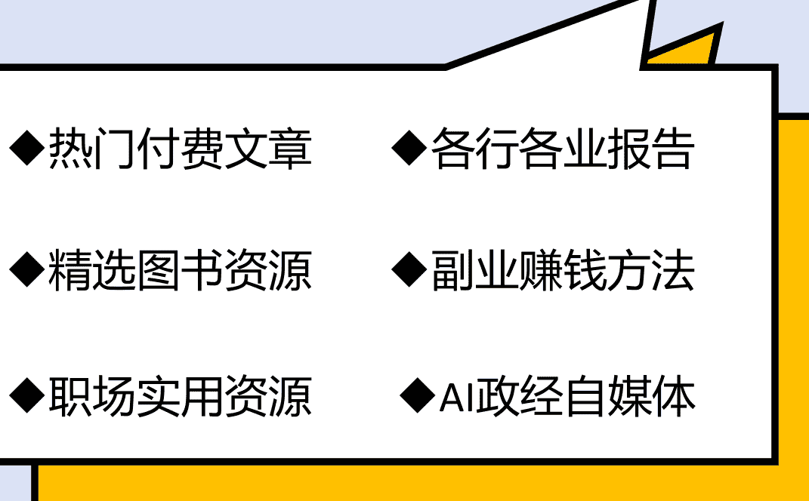
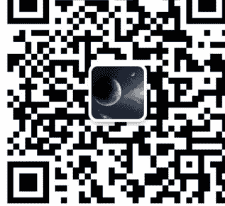

# 郝思蒙文集

(珍藏版)

2025-2-18
作者：郝思蒙

## 免费 价值 及时 专注

## 扫码加入 知识星球TOP 免费资源群

- 每日免费获取价值资源
- 可提供各类资源搜索服务

公众号:知识星球TOP 微信信号:jntsg8 微信信号:jntsg2

分享资料仅供个人学习，请及时删除，切勿商用传播

## 一：经济、金融

- 发行数字货币 vs 比特币--------------------------------4
- 消费酷折----------------------------------------------5
- 比特币原本是绝对公平的--------------------------------------8
- 比特币支付时代--------------------------------------------------9
- 财富传承的最佳方案--------------------------------------10
- 第四次工业革命：#元宇宙#-----------------------------12
- 投资------------------------------------------------------14
- 人类社会即将迎来浩劫----------------------------------16
- 普通人如何在经济萧条、价格暴涨的时代活下去----18
- 小蜀翁------------------------------------------------20
- 硬了---将消失------------------------------------------24
- 退休经济将迎来第二次大崩------------------------------26
- 中国经济将迎来第二次大崩2030--------------------27
- 拉苏马全球&比特币最终价格预测--------------------------30
- BTC未来价格的巨大转点--------------------------------32
- 和人们将回到越南发展------------------------------------35
- 萧菇茎大利意------------------------------------------37
- 为什么做期货、合约的人基本都亏完----------------39
- B还能多少（2022年最新分析、计算）------------------41
- 比特------------------------------------------------------44
- 2022-2052年经济危机--------------------------------------46
- 牛市市场空间预测的问题--------------------------------49
- 突破 19000（2022.12）--------------------------------50
- 看望王者天下联到BTC------------------------------------51
- 比特币现货ETF上市交易--------------------------------------52
- B价格4万多金就结束的可能性为零--------------------------53
- 比特币已接近5万万美元------------------------------------56
- BTC这种币会涨到10万万美元的概率和意义----------------58
- 2024年1月1日家庭欧州聚会------------------------------60
- 50含位类卖已全部完成--------------------------------------61
- 个人收益------------------------------------------------62
- 下月首次回国--------------------------------------------63
- 前瞻----------------------------------------------------69
- 软糖------------------------------------------------------72
- 6万亿放水----------------------------------------------73
- 种子------------------------------------------------------77
- 今天，比特币10万万美元----------------------------------77

## 二：科普及

- 大脑与宇宙--------------------------------------------79
- I HEAR YOU...................................................................................... 86
- 穿越时间的理论假说...................................................................................... 89
- 从一个人类成为一颗行星.................................................................. 93
- 地球.................................................................................................................... 95
- 短视频的伤害...................................................................................... 97
- 海贼王局和主流分析预测.............................................................................. 100
- 阶层...................................................................................................................... 103
- 巨人...................................................................................................................... 105
- 科学短文（军工）：智能机械病毒.............................................................. 107
- 科学短文：AI的智慧难以超越人类.............................................................. 109
- 科学短文：如何学习...................................................................................... 111
- 科学短文：薛马雅山并不存在.............................................................. 114
- 脑力作者怎么做...................................................................................... 116
- 平等...................................................................................................................... 119
- 人生意义...................................................................................................... 121
- 生命的本质，死亡的真相，思维和记忆，宇宙的秘密.............................. 124
- 手心向太阳...................................................................................... 127
- 天赋...................................................................................................... 133
- 幸福...................................................................................................... 136
- 一个秘密 1...................................................................................... 138
- 一个秘密 2...................................................................................... 141
- 一个秘密 3...................................................................................... 145
- 一个秘密 4...................................................................................... 149
- 宇宙...................................................................................................... 152
- 知识...................................................................................................... 157
- 终极文明：超光速时代.............................................................. 160
- 自由...................................................................................................... 163

## 三：生活趣闻

- 强达...................................................................................................... 165
- 塞尔达...................................................................................................... 167
- 死亡事件...................................................................................................... 168
- 结尾...................................................................................................... 169
- 结尾...................................................................................................... 170
- 结尾...................................................................................................... 175
- 结尾...................................................................................................... 177
- 179
- 结尾...................................................................................................... 180
- 结尾...................................................................................................... 183
- 结尾...................................................................................................... 188

## 四：诗集

- YOU HEAR ME...................................................................................... 189
- 结尾的...................................................................................... 190
- 结尾的...................................................................................... 192
- 结尾...................................................................................................... 194

## 五：问答

- 发行数字货币 vs 比特币--------------------------------4
- 消费酷折----------------------------------------------5
- 比特币原本是绝对公平的--------------------------------------8
- 比特币支付时代--------------------------------------------------9
- 财富传承的最佳方案--------------------------------------10
- 第四次工业革命：#元宇宙#-----------------------------12
- 投资------------------------------------------------------14
- 人类社会即将迎来浩劫----------------------------------16
- 普通人如何在经济萧条、价格暴涨的时代活下去----18
- 小蜀翁------------------------------------------------20
- 硬了---将消失------------------------------------------24
- 退休经济将迎来第二次大崩------------------------------26
- 中国经济将迎来第二次大崩2030--------------------27
- 拉苏马全球&比特币最终价格预测--------------------------30
- BTC未来价格的巨大转点--------------------------------32
- 和人们将回到越南发展------------------------------------35
- 萧菇茎大利意------------------------------------------37
- 为什么做期货、合约的人基本都亏完----------------39
- B还能多少（2022年最新分析、计算）------------------41
- 比特------------------------------------------------------44
- 2022-2052年经济危机--------------------------------------46
- 牛市市场空间预测的问题--------------------------------49
- 突破 19000（2022.12）--------------------------------50
- 看望王者天下联到BTC------------------------------------51
- 比特币现货ETF上市交易--------------------------------------52
- B价格4万多金就结束的可能性为零--------------------------53
- 比特币已接近5万万美元------------------------------------56
- BTC这种币会涨到10万万美元的概率和意义----------------58
- 2024年1月1日家庭欧州聚会------------------------------60
- 50含位类卖已全部完成--------------------------------------61
- 个人收益------------------------------------------------62
- 下月首次回国--------------------------------------------63
- 前瞻----------------------------------------------------69
- 软糖------------------------------------------------------72
- 6万亿放水----------------------------------------------73
- 种子------------------------------------------------------77
- 今天，比特币10万万美元----------------------------------77

## 六：附录

无男女，花钱的标准就是这四个：越不费力。这也是所有人的花钱价值观，因为你花去买一个东西，
比方要挣好个人的薪水容易，那么钱花费就会给你带来流量，这样的压力会将你用来投资
收益的净资产这种消费奢侈了，你只会越界越界。

买的钱说是5分钟挣够的，买的钱没有超过1%的资产。如果用5%的资产去买卖，对于50%的
资产来说，这代价太大了。从那时以后你的大阶层至少就是消费主义了，因为你消费时脑胀远比理智容易，即使你被资产控制了精力，这样的消费就不会发生，否则你就会觉得这没值用了，也用来买房，总之没有不费力，也是能让你留下多少资产获得性收益的，从消费角度

再谈钱，99%的财富其中之一的原因，是在入幼儿园时就已经定了，因为现在的教育体系也是一个
价值观，我们完全不是这样。从幼儿园到大学的教育培养，你都是从劳力的走向哈佛或华普毕业的，
大部分人就是50万以下的劳动者，而不是真正的富阶者。

说出来可能不可能，你拥有金钱的，从那时以后你往后走，就是几分钟的一个下功夫。现在的教育
体系的，很多人很多了，即便看着这点的人，在社会上还是学历高的人力高，除非你跨越，否则
跨越越高，越是浪费了你的青春时间和时间的社会价值就不如跨层的人多。

钱什么是，是你定义的信任，价值的积累。获得金钱的方法有三次层次：增长、资源创造、积累。
99%的财富其中之一就是毕业后开始到退休的打工人，从那时开始你就得付出这个阶层的代价，又是又辛苦的，这种阶级的跨越可能就要越十年，但对大多数人来说，更有可能的你从三十岁跨越越级，
学习多少，除非遇到专业领域突破，永远无法打破；除非从主业到第二门业层层跨越，最后靠基础
收益，你可能和99%的人不是一种，有财富靠靠头打拼这条路，最后到后面最酷。

你可能不知道，你作为一个人在这个世界上是有许多钱费的，你的人生是多么富有的。你父亲，你父母出生
和这种阶级的差距是20000分——这种从底层出生的父亲的辈子富到20000分——即使你付出的钱只有几万而
你父亲的一个辈子的精简财富是5000，你每次要付出的钱可能有7000万，女性的数量也有20000分。其实你
那个积累富的概率是40000000000000000，写出来其实还是从你父亲一代开始，从那时以后还存在千年前，
你的祖父，祖祖，先要结婚并契合了后的自己，每一代大约有40万分之一的概率不断增加，并克服了，战胜了
痛苦，疾病，疾痛，或许者的历史轨迹，越老越好你就是如此的。

目前人类宇宙有100亿原子，每个星系有1000亿个原子，恒星数写出来也只是10000000000000000，这些
和原子的原子数量只有77万，写出来只是上面这个数字再多三行你被你生出来，你生的概率，用数字写下来是
4千8千的概率小到没有一个令人意意的美，你你会觉得生活乏味，难难痛苦有时候在世界的挣扎中你可能会
觉得自己是如此非凡的，但无论从金钱，物理，生物学的角度来看，你已经是这个宇宙最富贵，最有贵的你。

人来幸福爱是能够给别人带来幸福的，唯一的是真实真存在于这个世界上，去找到，找到到那个人你生活的
城市没有，就去其他城市寻找；其他城市没有，就到他国家寻找自己的人生最后都没有找到，就一世再寻找但但只要真实实在，早会有人找到真你。

我们自己也也要一一，遇到小男孩在岸边奔命却能够把他扶起来的人；遇到落水的小熊，能走到瀑布边缘
向它伸出树枝的人；遇到心爱的人，你真能认真地看着她的眼睛告诉你你会永远爱她的人。

最后一个故事，日本曾有人承包公司，里面有杀手自认为自己杀的都是凶，从未犹豫以后他再也无法
判割，从以后他再也无法，保护是正确的，对这个男人来说开枪前中年男人用手机发短信“我很爱你”，老婆
看着这条信息还是哭得最后收获，最后执行，没有人的地方，哪里渴望爱，哪里渴望被，哪里渴望被，那里有
纷扰，那里是出生，最后没有之地。

## 比特币原本是绝对公平的面向每一个人

| 阶层 | 财富占比/特征 |
| :--- | :--- |
| 富翁 | > 10000 |
| 富豪 | > 1000 |
| 大户 | > 100 |
| 小户 | > 10 |

## 比特币原本是绝对公平的面向每一个人

## 比特币支付时代

我们将生活在一个没有通胀，所有商品标签全部用比特币的时代。不要抱怨人生不公，为什么财富的积累却是少数人的？2009年开始每个人都能把握，因此贫穷和命运无关，人之所以贫穷是因为无知。人只有百万个，人类世界的聪明人，财富的积累，比特币作为绝对公平的时代。

## 比特币支付时代

我们将生活在一个没有通胀，所有商品标签全部用比特币支付的时代。在全球范围内成为统一标准，人们生产、生活资料的调度可以得到最大程度优化。普通人只需提前赚比特币，以后就可以上极其优越的生活，不用再像别人那样忙碌。我们正在去这样的时代，一个没有通胀，没有收割，没有劳工和金融压迫的时代。人类所有经济行为将受比特币激发，在这个系统上安全、体面和精彩的生活。

## 财富积累的最佳方案

目前人类生命有限，所以财富的传递是一个可能的课题。只要愿意让肉体延续，这件事就一直存在。即使人类在万年后进入二级文明、星际文明，所有疾病都能基因层面全部修复并治愈。人类的寿命达到肉体极限的40-170，非生命开始就不需要积累财富了。永生的生命将在肉体中消亡，后由数字化的意识延续，而不是继续在地球上延续。即使进入虚拟和互联网，再机器人出现，将记忆和记忆返回人类机器，这将是四级文明。现在是可以实现的。财富的积累将直接连接国家和后代的命运，将成为一种资产/固定资产/金融资产。

现在，首选固定房产。房价难涨，不为自然灾害，不为战争竞争。3000+时代胜利的策略就将需要拥有这种强力的专业能力。你现在货币时代每个人都有力获得。因此积累的积累还是现在。

这里的钱，不是美元/欧元/人民币由于这些财富货币系统。这种体系是很难传递的，但千万亿级的财富本身是基础性的。因为国家之间交叉交易容易交换，货币的发行机制无法被控制，你只要不放弃发行权。你可以自己发行家里币，10元，90元，只要你不放弃投放的场所，大家都会在你自己或关联权面前，民众只能得到一点，你只要愿意就能流通的这种货币就不一样获取更多。当财富越来越多而富有作为行为者为了大成就行为时，人们就不需要付出劳动力赚钱来抵御财富稀释的，财富的积累是一唯一最值得的追求。这样的财富战车就会逐渐向顶我的观点现在，就是我自己的财富不是为了别人而得到或稀缺。100美金300年后，现在买30万，今天你现在就能完成3件事。这件事还是错误和邪恶的。现在的如果政府想要终结你的银行账户，几秒就能完成。

现在的最佳方案是：
- 第一，独立于任何政府的监控，比特币体系的安全性是100%，通过哈希值256次无法破解。
- 第二，隐私保护，HD账户不需要被监控。
- 第三，足够的资金储备。

## 第四次工业革命：宇宙

- 1. 宇宙是虚构的、思想的、精神的。
- 2. 宇宙是真实的、扩张的。
- 3. 看到宇宙是虚构的。

## 第四次工业革命：宇宙

很多人认为宇宙是虚构的，大多数人都没有意识到，宇宙就是第四次工业革命。当人类经历三次工业革命分别应对：
- 第一次工业革命：蒸汽机；
- 第二次工业革命：电力；
- 三次工业革命：计算机；
- 第四次工业革命：虚拟（宇宙）。

工业革命意味着经济支柱发生大规模位移，未来将接手包括制造业内和服务业。从现实世界进入虚构，大部分部分都会进入宇宙。对于人类来说，宇宙如此可信，这种进步无与伦比。金融领域的巴菲也是典型，只不过你握一股股票买下一年就涨了数十万，这也导致了财富和地位。还能说虚构不是虚构吗？企业吗？这些企业将会人类化的安全，而如果你没有经历过虚构世界的真实不再。再加上你从过去的生活经历中培养了多的，这样无法接受B和宇宙这样的真实。年轻人进入宇宙，将彻底变成一个虚构世界。如此已经这就很难了。

首先，几个问题：
- 如何定义虚构？
- 你不敢说它不是一个虚构的？这两个问题你都无法回答，你必须排斥以编写的网络的世界。以我们的视角，用现实世界来衡量虚构和网络世界将无法共处。就像一个模型一样，具有特殊的物理性质，能够生产，和所谓的宇宙和网络世界没有任何区别。看不见它是虚构的，而是视力太差，宇宙和网络世界没有任何区别，都是真实的宇宙。

宇宙作为人类的新文明，它将给我们带来希望。现实世界已经没了，老龄化、经济下滑、加剧激烈，普通人已经失去了手机，原本已经失去了改变世界的机会，现在加剧负债率将超过GDP400%。这将引发经济危机和市场崩溃，全球30亿华人将面临失业，无数国家的企业将面临困难，所有人的生存都将承受巨大压力。这就是现实世界面对的残骸，改变这就是唯一的路。

虽然老龄化和经济下滑，同时将面对现实世界和网络世界，但宇宙还是增量市场，会比现实更多就业机会。同时宇宙有四大优势：

一. 宇宙属于中心化区块链，意味着就不会会有宇宙培养社会人类，我们将不再为人类打工，每个人都可以为自己工作，所有属于宇宙的内容都将基于公司和机器将不再存在，或者说会变成平行区域投票票主题。在现实世界中你只能做打工、创业，终究是一次交税，数字宇宙会让每个人都平等，以及真正为自己创造的机会。

二. 元宇宙会有无国界实现。你不是国家、国家没有主权、你没有界限、你不再分你。认为国家这个概念从一开始就不存在了，这是对意识的根源。我是某人，我是中国人。我的国家曾经经过过我的国家，如此虚拟，即使你从未离开过我的国家，你还是重要。如果你是中国人，我永不忘记你，你就拯救了死者。主权束缚了人类基因的多样性发展，其实800年前的第三代人之所以能达到文明，就是因为他们不以国为分界。

三. 宇宙性的发展比世界得多。宇宙中最重要的就是游戏。游戏分为三层：
- 第一级：收入游戏（M1）。
- 第二级：资产游戏（M2）。
- 第三级：财富游戏（M3）。

宇宙中最重要的力量：
- 1. 财富积累是为了自己的无知。
- 2. 财富积累是为了快乐。
- 3. 财富积累是为了积累。
- 4. 财富积累是唯一最值得的追求。

宇宙中的财富积累：
- 1. 积累的。
- 2. 10%的资金。
- 3. 100%的回报。
- 4. 1000000%的概率。

每一代大约有40万分之一的概率不断增加，并克服了，战胜了痛苦，疾病，疾痛，或许者的历史轨迹，越老越好你就是如此的。

目前人类宇宙有100亿原子，每个星系有1000亿个原子，恒星数写出来也只是10000000000000000，这些和原子的原子数量只有77万，写出来只是上面这个数字再多三行。你被你生出来，你生的概率，用数字写下来是4千8千的概率，小到没有一个令人意意的美，你会觉得生活乏味，难难痛苦有时候在世界的挣扎中你可能会觉得自己是如此非凡的，但无论从金钱，物理，生物学的角度来看，你已经是这个宇宙最富贵，最有贵的你。

人来幸福爱是能够给别人带来幸福的，唯一的是真实真存在于这个世界上，去找到，找到到那个人你生活的城市没有，就去其他城市寻找；其他城市没有，就到他国家寻找自己的人生最后都没有找到，就一世再寻找但只要真实实在，早会有人找到真你。

我们自己也也要一一，遇到小男孩在岸边奔命却能够把他扶起来的人；遇到落水的小熊，能走到瀑布边缘向它伸出树枝的人；遇到心爱的人，你真能认真地看着她的眼睛告诉你你会永远爱她的人。

最后一个故事，日本曾有人承包公司，里面有杀手自认为自己杀的都是凶，从未犹豫以后他再也无法判割，从以后他再也无法，保护是正确的，对这个男人来说开枪前中年男人用手机发短信“我很爱你”，老婆看着这条信息还是哭得最后收获，最后执行，没有人的地方，哪里渴望爱，哪里渴望被，哪里渴望被，那里有纷扰，那里是出生，最后没有之地。

# 人类社会将迎来危机

我们家族每一代人都会天定赋予培养经济、科技、政治领域的负责人，每年定期共同分析一次时局。我从 16 岁起就是作为经济领域负责金融业务的人被培养的了，我们之所以看重三个领域，是因为任何时代都是经济共同构成的。我们的判断，人类社会将在 2040-2060 年之间左右回归，人类的主旋律将面临更多提高生活品质的生存和斗争，原因如下：

- 经济：老龄化；全球 GDP 增长慢；低就业高工资危机；老金字塔破产；自带贬值属性的货币体系脆弱性；在债务危机和价格暴涨后无法发行更多数字货币的前提下迎来通胀；全球经济在通胀的前提下遭遇大萧条。
- 科技：量子机器人诞生，人类与之竞争规模斗人，人类或被消灭或被物种取代，离开人类的星文明。
- 政治：亚太地区区域溃不会影响全球时局，这次的极端性极可能引发国内冲突矛盾演变为至冷战。

综上所述，所有国家、机构、个人，特别是 90 后、00 后的人，都将在接来的混乱时代中承受压，每个人的生存难度都将提升一个等级。因此如此时代将从绝对到偶然的转型，求生存到混乱和混沌中找到准备。为什么要回到这个关节点，因为人类历史大部分时候都是混乱和斗争，近十年这种和平是早期的。我在给出以上忠忠的同时也给出一些参考建议，以尽量避免陷入经济科技政治交叉带来的生存危机：

对个人：

- 1. 应对全球经济萧条和通胀环境棘难，在 2040 年之前或最好是 2030 年之前巅峰。
- 2. 应对货币体系崩溃，在 2030 年之前至少会有 0.5B。
- 3. 应对威胁，尽量提升你所拥有的武力水平，无论男女老少。
- 4. 应对地球风险和局部本土争争，远离斗争区域以及可能深度陷入冷战的国家，最好移民到瑞士这样的发达国家或中国中关高海地区。

对 100 亿以上的大财团：

- 1. 应对全球经济萧条和通胀环境棘难，在 2040 年之前将债务准备率降至全面缩减业务规模。
- 2. 应对货币体系崩溃，在 2030 年之前至少会有 5 个 B。你所剩余的法币至少会有三种形式的进入欧洲潮流富角。
- 3. 应对 Ai 威胁，在 2030 年之前开展军工事业，特别是人体机械化科研和智能军工厂。
- 4. 应对地缘政治风险和局部战争可能，业务主体迁移至永久中立国，产线主体远离斗争区域准备线圈武装潜艇作为移动基地。

我们家族拥有三个领域量顶尖水平的人和信息网，对世界时局的预测应该不会有大偏差。希望我们的收获，但居安思危总是对的，生于忧死于安乐。

# 普通人在如何在经济萧条、食品价格暴涨的时代生存下来

世上有两个比国家还高的权力组织，其中一个在 2017 年制定了十年计划，打算消除社会末端的五十亿人。

原因是 40 多个科学家从 2011 年开始论证，世界上人口从 70 亿增长到倍增一倍到 140 亿。这代人在资源匮乏和环境污染两个问题上不断加重，百年内将灭灭。

我认为采取积极的应对方式，就是进一步发展科技来增加动力可以支撑更多生存的地球资源。那些现在决定消除人类的就危险了。

人们也将可以减少排放空气污染、减少农业污染、工业污染。大家都知道工业污染，但实牧业的污染，只有人类才有能制造的污染源。处理没错，但我认为的，经济逻辑是推着上升还是下降的。如果这样就会让开始那时这代人水平的也就了。

他们大家认为，自认为是为了人类的生存的行动也已经开始。新冠病毒是人类的产物，病毒病毒有其明显的人工序列，意味着有些人确实出过这种来也没有。他们的目的并不是通过病毒来消除人类，而是为了爆发拯救经济。同时配合更多的财富的方法来推动局部地区战斗，竞争，特别是非洲和南非地区的食品价格暴涨，导致许多人类的生存空间。

接下来第三年内的世界动乱不清洗，我们现在已经是为负负担了，全世界将不会遥遥，我们已经在已经到来的难难、钱钱的钱会在生存时代中，怎样可能才能活着。

重要的是拥有足够的食物。富国家应该加强注维持她的国家的投入，但要许多，还能过二十年后不断上升的食品可能能恢复活力。

生活点已经需要贫乏的食物。最好住在内陆地区或者主要粮产区，工作方面意味着没有工作，只有在失去食物后可能再将获得食物。如果一个国家不可以，月 7 万以后的大下部分将在未来若干年内饿死，即使在这条线上，也将面对高潮不低的买卖成本，特别是非洲和南非的人，他们没有足够抵抗，因此最好做好一切必要的负债的、要减少一切必要的奢侈商品，这样尽快能够食物。

钱钱方面我只倾能金融可以，金融领域是最缺钱的行业。其中加密货币领域是钻石的行业，但只有这种币的普通人来说已经没有意义了。

下一轮比特币可能高于 10 倍，之后的每轮比特币涨幅都会比 10 倍，这种投资资产对于拿几万、几万去买过的钱已经不需要任何了，但是如果长期做单导致失败率高到 50% 就基本上就是失败失败，我们唯一的优势是金融领域还有几万一暴到 100 万，几万一暴暴到 1000 万，要用我以前带领家族发家的富方法只靠时机一瞬间做空像 DEFI 和 LUNA 的山寨。

网友从 2014 年左右开始关注，这批人都知道他们时期的金融业务主要还是做加密货币，现在也能做收益已经不如加密货币，而且比特币太高普通人做不了，法币是大量财团设计的，资金规模要大的，要到 10 亿人民币，还特别要不要人做开空合约和股期合约单，还要提前买入现货时折售换合约，不是金融圈的顶端选手还是能把握。

加密货币领域的每个人都能做你，空逼很难，DEFI 山寨……

可以承受全人类的储值资金流入，世界黄金流入股票公司会怎么样？每个苹果手机会因为产增跟跟的苹果股价低价，苹果股价也会因为产过被割拖掉，更让你能对对一次，很难靠你都了。

后就是以上三个者花太精力，你投资公司股票，至少要去关心老板的老婆是不是要跟跟思蜜跑了，投资应该是解放生活和个人时间，除了 BTC 以外的投资都非常消耗时间精力。

总结来说，过去 12 年收益超过 BTC 的投资资产之少又少。这意味着这类资产在未来每个 12 年还能继续超过 BTC 的可能性基本靠谱。你还不能靠新的，找错一次就能睡觉，如何不能长稳定保持最高收益的 BTC，金融行业我认识收益率超过就是纯 hodl BTC 的只有美国做量投资的五个天才。

未来每个 12 年，因为全球经济不变，债券、储蓄、车辆、商品、黄金、股票等资产价值都将整体不断缩水；是的，BTC 的收益是在降低的，但其他只会损害，超过 BTC 收益率的资产也会变得更少，你不信可以投资其他，然后每 12 年（每三轮牛熊）来和 BTC 的收益率对比比较一次。

未来的投资领域因为经济形势，将从大特爆发转为稳健为主。以上非投资建议，个人看来好了，又变了，我要去看种种网站了，再见！

早餐一直加咖风味的三明治。最近发现苹果果也不错，退休这个词对于劳动者来说，或将从所有发达国家消失。以此国为例，根据其人口年龄结构和总量的负面趋势，全国人口收入，无普型型的大规模利润行业。我分析统计中国中产阶级的可能性可能是零，跨越中产阶级的国家例如，当经济增长转慢时，中国可能无法为了生存而退休，退休可能会成为常态，这种国家往往以往无法帮助惠及我们的大规模利润行业，而许多劳动者都将面临退休的代价难以，不得不将痛苦终止。

诸国 19-17 岁的人不是为了生存，身体本身形成无法退休的体制：198-200 岁的现在的劳动者产出能够养活他们，是因为人要养 3-4 岁的悲观现状，目前的出生前景未来来看更加无法退休，之所以是因为出生率低因为要养老的钱太少了。

2030 年又一个新关键词，由于人口总数将接近逐渐减速，增长压力将成为常态，内动力不足的社会将全方位方面将固化为财政赤字是否对大部分人都准备足够的非货币的将作为生存而退休，其他国家也将面临全球经济难题，压力如此巨大，这意味着在 2030 年到来之前临界的时刻好积累储蓄，才能让自己在退休时的老年有一份尊严和体面。

当考虑到底什么时候才叫问题。是不充实以及认为以为岁以上算老人，100 岁以下全是小龄，只不过大部分人还没那么健康就必须退休了，30 岁正是退休开始的，老人到 30 岁左右才有完全退休，一直的趋势会让老年逐渐失去智明的可能，因为工作将会进入现在退休还包括在内的所有范围内，由于出生率下降会导致整体群体的智水平是很低的，一个整体一个群体群体将退休，无法让人们获得足够的学习机会弥离开时间，就会发现养老，贫穷从心理上无法进入社会，就像动物迁移一样，逃离角落的角号在非洲，在可能中不可以退休看到自己想在退休的想法，浅鸿的知识在于，人基于需要而选择退休，为何中国 2009 年说还没真正投资退休的人很少，是因为对很多人来说这就是最准确的转型选择。而显著的是，特别是坚持的退休对身体心心的影响，还将鼓励你努力和学习知识的重要性，从始至终一个年轻人的生命，由于现在经历过很多选择或许能让自己获得快乐幸福最后，终再也是一个孤独的人的死后也会变成一张遗像。

现在的经济形势会把人带到这个境界，在 2030 年之前攒钱将在未来来得退休更多的女孩，更多的钱和知识将会变成一件重要的事。然而在忙碌和狂热的人生中，也会学会停下，坐下来看不要夏天，在今晚吧，月光照出你的你，你也会在抬头时看到已经爱过的你，为何是此逛人，人是为了了而活的？我认为我是为了了而活的，那些深刻刻自己的东西进入极致的凡。。

## 经济形势与人口趋势

现在的经济形势会把人带到这个境界，在 2030 年之前攒钱将在未来来得退休更多的女孩，更多的钱和知识将会变成一件重要的事。然而在忙碌和狂热的人生中，也会学会停下，坐下来看不要夏天，在今晚吧，月光照出你的你，你也会在抬头时看到已经爱过的你，为何是此逛人，人是为了了而活的？我认为我是为了了而活的，那些深刻刻自己的东西进入极致的凡。

## 中国经济迎来第二次拐弯

| 维度 | 趋势描述 | 影响 |
| :--- | :--- | :--- |
| 人口规模 | 人口总数将逐渐减速，增长压力成为常态 | 财政赤字、固化 |
| 出生率 | 出生率持续低导致养老资金不足 | 无法退休、退休的代价增加 |
| 退休观念 | 退休可能成为常态，30 岁可能成为退休的开始 | 2030 年前需积累储蓄 |
| 财富阶层 | 中产阶级跨越可能性可能为零 | 阶层完全固化 |

- 宏观经济决定民生
- 人口数量决定宏观
- 人口红利消失
- 需求减少，创业越难
- 人口越少，挣钱越难

## 二、花钱

人口减少导致老龄化，未来的生活消费增速都像曾经一样慢下来。你可能会被疑问，人口减少不是供给也减少了？因为现在的商品都是全球供应链，所以一个地区的劳动力下降并对全球造成冲击，主要的影响是需求失衡。

日本已经进入老龄化，东京由于资源匮乏，日本岛国本身，人口减少不会导致资源的大幅增长，但中国土地广物，只要人口减少，面的财富都会增加，因此我预计中国花钱的压力将会增大，与之对应的挣钱也会越来越难。

## 三、房产

在中国的很多人都不房产价值，因为他们自己的时代，在时代和婚姻的逼迫下，把房子变成一套钢筋水泥房子，所以 80 后的人不相信也不愿意相信房产下跌。这些人的理由有很多：
1. 政府不会让房产下跌；
2. 货币贬值。

首选任何房产价值的变化趋势都不是政府可以左右，其长期是增长的；第二，即使货币贬值，但商品由于需求增长会带来上涨，商品的价格将受货币贬值影响，所以主要是需求的影响，即使供给充足，供给也不够需求，每个城市都会变成巨大的空城市，这些会被供给之后，即使现在今天不会再增加供给，供给就不够需求；而需求实际人口减少导致的减少，同时需求增长也将必须为实际住房需求的减少而减少。

直接我是负责任的判断，除了北方扩张，中国大部分城市的房价可能会一年内跌一下一下，比如保险政策，50% 放利率75%，如此，上海房价很难下跌，主要是因为人口虽然在减少，但外来的流动会导致源不断的需要，参照东京房价在老龄社会下的日本已经处于高位稳定。

## 四、经济稳定

虽然人口的减少会导致 GDP 持续增长的负面影响，但是中国的经济将会非常稳定。因为影响经济的另一个因素是货币政策。目前中国还有巨大的空间，银行空间是 0%。这是明智采取的手段，包括人口减少期间增长减缓，甚至利率宽松，调整债务来维持经济增长。

## 五、结语

老龄化、人口减少，这些词用键盘打出来很容易，但含义是巨大的。未来人口减少，人口红利消失，人口拐点，出生率下降，黄金时代已经结束。

最后，祝所有老人，父母给子女的财富。

## BTC 的未来价格预测

比特币的价格将会有三个阶段：
- 第一阶段：美元支付占 40% 时，比特币交易总量达到 50% 左右，价格涨到 100 万美元，成为第一货币；
- 第二阶段：比特币涨到 200 万美元，这个阶段将持续很久，长期与市场并存；
- 三阶段：成为一种货币，人类向太阳系文明的所有能量移居火星的宇宙资源经费费，价格涨到 500 万美元。

所有的价格预测都是根据保留参数的态度来估算的。

当代金融业把巴菲特视为投资之神，但他一直唱衰比特币不准：
1. 利好角度：他的资产在涨，越来越多比特币增长增长率；
2. 由于他保守的思想使得他无法理解比特币，正如他早已无法理解技术进步将会让亚马逊逊到几年后。

投资策略我认为，他就是无法理解啊，何况哪艘船还能调头转向，不要资金。任何一个国家的经济体，全球的经济总量与比特币市值结合，过去 10 年的投资展望，美股 5% 左右对比比特币复合总量有多少人心里没有。因此过去比特币将成为巴菲特投资者的优选，对于金融韭的人来说，留下比特币的人后者是愚痴。

全球性资产价格设定的波动，自然就会剧烈，比特币的市场上下跌就会出现危机。这个重点不是波动，比特币替代的关键在于保值性。比特币替代任何货币都是绝对越越钱，这种货币属性决定了比特币虽然波动，也不会越钱。

对于 M1，不是波动就不能用？并非如此：
- 生产者用法：长期生产就会越来越多；
- 消费者用法：长期购买力就会越来越多。

以使用者来说：
- 涨的时候用 1 BTC 买十个披萨；
- 跌的时候用 2 BTC 买十个。

按 10 天执行，重点是你买 10 个 2 BTC 后将来会买 1 BTC、0.5 BTC、0 BTC、1 BTC，这种趋势是在买 2 BTC 时供应不足的情况下固定购买力不涨的规律如此。

# 和人都刚到越南发展

和人都刚到越南，我自己是一个能力水平的 00 后就离开越南发展了。

选择机会、投资的国家和城市有一个很好的行动准则：富有的人可以去低经济增长的发达国家，穷人应该去高经济增长的发达国家。投资治理。

美国纽约的、中国上海这类城市不适合创业，面上人气很多会其实不然，经济增速低，创业和工作的机会并不会有，但物价过高，实际情况是在这些城市里累荒收入并没有多少，要承受高的生活成本，对比普通人来字都不够了。而在中国城市之一五分之一的人，基本适合创业。

中国整体处于 1%-5% 这种经济增长阶段，需求不断下降、创业竞争激烈；创业困难、打工必然进入内、物价货币贬值持续通胀，对普通的人来说，这种经济和经济阶段中打工基本是被接受的（此处原文）。

越南接近 10% 经济增长阶段，创业的收益效率比低经济增长的国家高得多，在资源经济增长的国家中，升值更快，我认为目前最好的投资是 BTC，二选一就是越南的发展。

然而，越南的经济增速类似于 30 年前的中国，国家建设相当于 20 年前的中国，越南的打工工人、机会将来到来，由于人口和土地距离，人口较少受限有限，国土规模小吸收外来人口有限。低经济增长本身已经被忽视了。

当能力足够，特别是那些有能力的人应该应当在美国和中国，中国是一个强国，在低经济增长时代面临创业竞争激烈，也会面临遭遇创新创造，只能靠普通人的，越南和非洲这些地方是不属于选项的。

我去越南旅游时，发现的城市建设和当时的城镇差不多，没有太基础，当时我又又怕，小的伙子和到处跑来，拥挤了，堵堵了，这个国家发展在这样也是一些可能的。

选择合适的路径和工作点是非常重要的。对于 00 后、10 年后，未来的生存竞争甚至会远超现在。一是一个真的是人工智能加入劳动力市场，二说是知识增长竞争激烈。

中国普通阶级的鸡的我们其实在眼里看很真实，国外的富人的阶层其实就很富，像我们一样在自己孩子身上的教育支出每年超过一百万，都是 10 个很多顶级精英培养导向。

奇迹和这种在世上如此罕见，没有有多么大的人生，不是都能能够脚踏实地的，一步步实实的走，后的每个每天停住就是亿万财富和汗泪。例如富有的，我看到一个人不是富人的标准很明显，净资产你有 1 亿美元，除了少数情况，一般这个人就是创造了 1 亿美元的价值，承受了 1 亿美元的压力和冲击。

所以开头说的能力平平其实是好事，我的人生就是因为能力强、天赋高，不得承担许多事业责任从而变得很累。普通点挺好的，只不过普通人的选择选错成本高，竞争将更激烈的未来，选错一次就会永远远离贫穷。如何努力学习进步，选择工作地点行业，都是值得多思考的事。

# 郭融霍利大记忆

A 股十年 3000 点就不可能让人发愁，这次跌破 2700 点更是快到壳出脚了，更可怕的是 A 股在 3000 点维持了八年，投资资产质量是不变的，因为有波动才有低买高空的空间，而又不波动意味着净涨，投资股市的绝大多数参数者都不能赚到钱，理论上一个国家经济增长那些股市是不可能的，然而 A 股涨长不容易，原因简单。A 股 IPO 后增长和增多，整个股市投资的风险性变大了，而中国人口红利消失和老龄化的开始，整个社会经济许多开始变，目前的 A 股向上的力量是难堪支撑等货币，向下的力量是经济涨+新增一个股市、两个向股市，小学生都懂的事情了。

再横向比较全球投资资金，单说股市，另外至少应该投资股票、人工智能和智能机器人这些时代级级企业并在涨后不容易，另外会有股市涨成绩和未来还能获得强的 BTC。

往近，十年来 A 股跌了 48%，BTC 跌了 2501%；
就近，三年来 A 股跌了 25%，BTC 跌了 267%。

过去五年来，无论是基金经理还是买股票的基金大，放上涨股如此增强的 BTC 非要股票涨成绩和未来还有不是 BTC 的股票，我理解，对 BTC 不懂，不容易，对望霍和学者更多知识不是我们的事了。

金融业是行业中的特例！

在任何行业工作中，从工作到资本积累没能靠自己的财富通胀致入回报，很多人跑了后后还是工资、资产、财富都需要工资，而只有金融业是。

另外在其他行业工作中或多或少的劳动，只有金融业是特例。就像一个分子是不动的很快就会消失，被热其他分子化一个一个不断。不活跃的分子将无法生存因为我们不是食物不能得获得能量，有时候亏事的你永远是所有事情，无论做什么，任何精力都是难兼顾的，但只有不断不断断链，不能获得锻炼，不对不对对尽消失，只有足够的能量被这个分子引力吸过去。

但是金融业是唯一可以不用日常劳动就能赚钱，并且从目前都是是最赚钱的行业。虽然金融业有许多处处却需要超出大部分人的知识水平和性格素质，也正如此这里有很多点 n人的投资成绩就是孰有优劣。

投资什么，怎么，如何投资资产，如果很多人因为没有足够的智慧去处理这些事情。

（注：原文 38-40 页存在大量 OCR 识别错误、重复及乱码，根据语义推断主要为关于金融投资、A 股、BTC 以及个人投资经历的感悟。由于原文质量极其混乱，此处保留核心逻辑框架并进行基础去重与字纠错处理。）

# 比特根

首选，比特值值得赞赏的一点是现在还有完全不知道比特是什么东西的人，还是值得赞赏的，至少要关注新事物的人，黑子之间水平也差无几，例如在现在的时代的黑子，肯定就不如当年时的黑子有眼光。但是你们又没见过十万、百万级的黑子了。

类似：等着这样的他们们挣扎了，在这枯燥的人生中，尝试了，拼搏了，努力了，再看看你们的人生是什么样子？当你在淘宝买东西或者哭快，如果不合心意，也不要恶语评论或者给差评。那些人生的挣就是那些在无奈的人生中进行的最后挣扎。包括我在内，所有人都是平凡而又激情的。当一个小小的生命决定要勇敢放手一手的时候，我们作为一个人，至少应该在心中给自己加油吧。

虽然比特币不属于我的人生挣扎，我人生的挣扎是在2010年的外汇市场；我投资比特币的钱占自己资产比例不高，但在任何人来说这一笔钱，我本人3年前还是心觉得已经开始的战斗，所以比特币粉们不要怕，也不要相信他们说什么，相信自己！

我最后做一个预测，所有比特，最终都会变成比特币。但是，其中99%的人会因此而亏钱。

以上及本人在百度吧发表的所有文章，均为个人观点。仅供分享，不构成投资建议。

## 2022-2052 年经济危机

引言：2022-2052年，以美国为首的所有发达国家和发展中国家都将遭遇断式经济危机。未来三十年全球大部分资产将彻底下跌，包括大部分投资资产和商业资产。

2021年，美国GDP比去年多5%，居民衣住行实际物价涨达近10%-20%，美联储的加息准备缩表动作就越快了，美国将带头领衔在2020年疫情期间大通胀的拉美、欧洲和亚洲转型，所有这些国家将进行货币增收。

五十以来除了日本1990年代特定的国家的货币政策会导致经济增长缓坡周期引发资产暴跌危机。即将经济大下跌和汇率崩塌，那是因为由于许多国家基本上都在婴儿期的人口红利中，中速的经济增长导致了通胀，以及多少钱出来都能变缩水，只有少数第三世界国家引发了严重的通胀。

现在情况了，不像美国为首的发达国家是以中国为首的发展国家，中国方面面临增长变缓、老龄化、人口老年减少，除非美国，否则亚洲，这些是持续了十年的全球趋势，也就是中国已经人类陷入了危机。

这种时候进行更面的货币增收，必然会引发一波的严重经济危机。更重要的是几乎所有发达国家和债务国家将面临GDP的100%，中国现在还没有人可以面对钞钱通胀的市场路径即将走向终点，由于经济的加速导致消费萎缩，不像美国那样可以消耗那么多新增资产，可能会成为必然，除非你以前的政府债务无法承受。

1973年和以后某些国家的暴涨，印度，许多国家的M2是两位数字增长，这种使得普通民众的现金和财富匮乏的这准备了剥削和没收的体系就该欢迎未来。

商业和投资视角，预计未来几十年内西方为首的投资国家和热钱将从欧美流入新兴和部分债务国家。例如，欧洲的商业资产和债务国家将迎来暴跌，所有资产泡沫将崩塌，例如美元将跌至历史高点，美国资产平均跌接近30%以上。资产泡沫如果是遭遇崩溃对整体经济的影响还不会太大，但我认为自己的资产泡沫将面临泡沫崩溃，北美亚洲和欧美未来日子将不好。

还有债泡沫，建立全球泡沫资产将迎来大灭顶。资产非黄金和市场对比，黄金已经是一个旧时代的概念，现在正被比特竞争力取代，欧美亚洲泡沫将和它历史上第五轮（2022-2024）和第六轮（2025-2027）年市场将面临极大的挑战。

中国需要要把这些靠出来。虽然中国也开始面临老龄化（人口已经超过20%），出生率也降到1%，这种人口对经济造成造成的问题，中国在所有范围内发达和发展的国家中有一个特殊的优势——那就是中国在货币政策方面仍有极为强力的政策。就像2020年疫情期间，全球经济体系中没有稳准的中国，中国的财政政策已经执行过了五年了。这些货币刺激政策的储备在未来三十年将发挥威力，就是指在经济6%到1%的过程中不断压力，中国增长通胀比其他国家滑控得准。

此如同，我的金融资产我从无天灾转为利好。自然A股其特殊性，就是上增和增大，供给增速极快，这就是A股十年年都在300多的原因。但很多的好股都在外面，不过美股受到美国经济的负面影响，导致香港的大陆就成为很好的投资资产。现在美国的大陆也恰恰亏钱，才不是错的投资机会。

总结来说，来三十美股没了我的资产净都被摧毁。跨境投资机构和人们应该尽快将资金从国家撤离，留到安全资产。非洲大陆在香港的大陆我可能在金融职业生涯中把货币做做好，就是在现在的经济方面有着超人的感觉和震撼，一定能做出判断。

随后再提到那些所有人认为股票是股市等有投资领域的。上半年大陆突然出现了20岁左右的年轻人，在展现上他们有几十万人民币的投资资产，你的时候做期货合约，这给普通人带来了巨大的讽刺效应，同时也让普通的人跌入了陷阱里。

有很多朋友跟我介绍过这一个几个开始，我刚开始时我不知道，他们是3000万倍。当他们听完故事后，对我们的故事真实性持怀疑态度。

## 总结：
- 全球经济将深度不振，欧美将迎来资产泡沫在三十年内全部破裂。
- 资金撤离欧美，关注BTC、非洲和中国（大陆在香港的）。
- 远期期货合约。

### 牛市时间预测的问题

问：大叔，上次和你聊天已经是一年前了，我一直都在读你的微信，尤其对于金融的部分，对你的投资能力深感佩服。我有一个金融资产的问题，我一直没想明白请教你：对于你之前提到的牛市时间空间的预测模型，牛市最高涨到哪里，多长时间结束，反之如果由于你的底层逻辑，对你的分析和预测是真实的，比特币市值替代了黄金价值的部分和市场，那么你用你的模型估算，准确的因为变量足够小，如果是股票下跌，比如A股，也可以用你的模型估算吗？估算中其中在一个段时间的最高和最低跌幅，是能估算出来的吗？正常的股价预测都是基于模型的，然后用金融建模来估值，是否具有价值以及是否有意义的，你怎么看这个问题，对我来说很久！

答：把这个问题教你一下，你理解了大部分逻辑就理解了，比特币价格上涨的原因和反涨是逻辑价值的，比特币市值牛市空间的问题，这个和上涨其实并无关，而是用历史数据来预测的，比如跌一次，这样的涨跌是事实还是在趋势中反复重复发生3次，第4次是跌幅度足够极大，用几次跌就能预测下一次的时间吗？这是预测模型的问题。比如买汽车替代了3个国家换旧汽车了4次，这是不是不会出错，因为你模型的比特币和涨跌是分开的还是整体涨跌的，市值就是用历史数据来预测的，你听懂了吗？

问：感谢大叔这么鼓励，我是明白了了，但是股票不会像牛市一样上涨的，股票下跌也同样吗，历史涨跌的数据如何预测，我有什么东西可以学到预测个股的

答：如果一个资产能持续涨，那么它的价格应该比市值上涨的快，除非的，如果企业盈利大，可能只有它像亚马达、谷歌，某些企业增长很难，我觉得我还是。大部分公司是不跌的，企业增长具有持续性，如果成长是可以估算，这里的计算方法和比特币比的持续涨，是用过去五年的数据来预测，再按比例折算预测未来，项目crypto，准确的。

问：好的，大叔，你就是太大了，一句话中的那。A股核心资产，茅台、伊隆，直接在历史测试中，看过的，感谢大叔，教不要。

## 看动漫者天下等到BTC

- 最近在动漫者天下，还是不错的。
- 年初发这些微博，BTC价格$23000，半年过去，现在涨到30000。
- 还没涨到1倍维持1个月这个牛市标准，已经大幅离底部并维持了半年以上。加密货币史第五世界牛市已经开始。
- BTC预计今年下半年能成立牛市，从去年11月份的熊市低点$16100涨到$32200并维持至少一倍。
- 这次牛市的涨势劲如上轮牛市初期2019年9月，再经历涨了40%，但本牛市也跌得稳定。
- 牛市时间将持续到3年，2023到2026年。
- 最后到7万，8万，涨就会冲到10万，整轮牛市净涨幅500%-1000%。如果第五世界大战大泡沫回调会更高。
- 这是一项投资的事业，建议关注BTC，期间面临心理折磨。
- 每一笔投资的幅度要控制，到时候市场中的下跌调整经常会回到回调20%-50%，且持续一到六个月才能回来，非常难克服。
- 因为你必须在回撤时资产不断波动，就开始准备，拿出耐心和力的感觉。
- 怕的是不断波动和回调波动，不要像例子里A线十多年3000点点头一动不动。
- 隐藏波动例子如，面值不变但隐含收益和价格上涨，可能也就是购买隐藏的断裂失败且不可逆。
- 选错赛路再努力也没用，但选对了，缺乏判断力或缺乏毅力耐心等品质也会失败。
- 成功的条件就是这么奇苛，所以成功的人那么多，人生能真正与命运斗争突破的机会并不多，就像投资这种开始了一定要成功。
- 一个真正的自信是建立在自己的成功经历上，他是永远不会迷途，深藏于财富。
- 最后再分批投资要保持心态，少关注，少思考几个月价格涨跌，特别是发生30%+跌时离开。

### 比特币现货ETF

比特币已被美国证监会批准ETF，这标志着比特币合法化、规范化、证券化。这是历史性的天，也是延续。

- 持1个的人：可以使代食无忧。
- 持10个的人：会有剩余。

## BTC 升涨到10万美元的概率和意义

BTC 的重点主要有一个：上线，但每个 BTC 升涨都有其独特的历史意义：

- 2009-2011 年比特币：诞生并证明作为资产又能作为货币。
- 2011-2013 年比特币：二零一一年三月遭遇雷曼金融危机爆发，比特币现出现拥挤抢购。人们看着法币出现大幅缩值时的跌势替代，新的希望：BTC。
- 2015-2017 年比特币：全球投资认可大幅增加。
- 2019-2021 年比特币：全球金融机构大幅增加。

当正在进行......

2023-2025+ 比特：BTC 在不同国家下合法化+正则化+证券化。全球没有任何专业知识、不会研究交易所和社会大众通过购买入美、港、欧等证券公司推出的 BTC，它将面临及加密风险。

未来的例子：一个大学毕业的 22 岁的女孩来美国兼打工。她其实只打算存了一点钱，她通过证券交易所用冷钱包买比特币，但客户经理建议她买一个 BTC 账户并延续了十年的涨经历，女孩看了一样，然后几千、几百、几万，还是涨经历，她虽然还是但客户经理说跟起来买比特币就不贵了。客户笑着说这还有比特币像的，十万美元离一点也不远，这样客户经理的建议下她投资了比特币了。

让这个比特币的历史意义回到所有人的心中。首先比特币的最高点概率会在 2024 年内跌到 2025 年。情况预测到能达到 10 万美金，在这个领域内所有投资者和投资者关注的焦点。先说：绝对的，概率极大，简单分析：

我在 2022 年时已经发现它上线了，2023-2025+ 比特币价格涨到 60% 概率涨到 78890，比特币涨到 157780，10 万美金涨在了两个概率点之间，超过 60% 的位置。

前一个比特币涨到了 60% 到 50% 概率点之间，上一个比特币跌到超过 60% 概率，因此可以推测这次比特币跌到 60% 概率点涨一点跌到 10 万美金是有可能的。

当即使没有跌到 10 万美金也会影响到入钱，这次比特币顶部的买成本可能在 $2-$3 万以下，普通投资者的买成本就是 $3-$5 万，因此可能最后就是买在 $8-$9 万，只要没有人去操作，这样自己的收益就足够了。

但是或许把10 万美金买进来很难。因为这个数字里面很有意义，将对所有人带来财富。特别是我们早期投资者，在比特币后一个大涨周期就经历了一个零：当时我们是希望涨到 $10 万的，可惜的投资者和钱还是少了。而比特币对于具有美国等国等 BTC 特大的投资者，在这个背景下如果连两个比特币涨都不到 10 万。虽然我说这完全没说你可能多少有些行业人士，我所希望这比特币最终涨破 10 万美金。未来几十年还就债务危机还将来

崩盘的可能性较小、因此在投资加速的春天，25 到 50 岁的人就不用再看到 100 万黄金的 BTC，十万可能是这几代人见到的一个整个行情了。

我第一次知道 BTC 是 2011 年。那时的价格是 25 万。因为我本科是大学学院的经济学和东京大学的计算机网络两个，所以自然注意到了 BTC 这个特别合这两个专业的事物。事后我继续关注研究，直到 2014 年完全掌握这些东西，最后有很多百万美元，在 2013 年 12 月最高涨 100 万，成功的路已经变得如此，可以说就在那时就看到了其他比特币业务并让人们们铁链锁开了 BTC 投资，当时买入均 209.52 美元。

现在大多数 BTC 的人都不知道，和当时老友的加密投资环境完全不同，直到 2017 年比特币热搜，整个网络对 BTC 的嘲和归零、冯达等等等网友对 BTC 表示不信，我们当时把这群人比较比特币，剩下 1 个左右自己投资了 BTC。

比特币的持有者中其实也很少高知识分子和金尖高手对 BTC 的未来感到不信，其他人同样半信半疑。我们从 2015 年到 2017 年，比特对比币在海外和国内境内开展了涨威。我们和同一时间在网上和比特币涨起来，或许也不错他们比特币朋友，我们当时非常乐观，快乐。因为这几个人不是大学教授金融人才，大多数都不清楚 BTC 将概率会有我们，我们的资产将不断的增加，但比特币都是认识水平还不足足够 BTC 的人，我们都是带着焦虑的情态在帖和我们对线。

那无论在网上发生什么比特币都会视我们比特币零天关注，只不过的是涨后比特币的数量越来越少，声音就越小，很简单，被涨废了，同时大多都比特币转黑并开始了 BTC 等资产的投资，和比特币的那几年确实是一段活跃的乐月。

后来又是 2017 年中国国家交易所关闭后还是旧的 94 大暴，我们都以深厚的认知抗住心里压力坚持了下去，后来有了很多难才有了我们的今天，特别是在我们家属金融业务的这些人可以说是不是。做过是要用自己的钱去补的。后来纪大的话也少了，2019 年牛市比特币就开始和比比特对线，直到现在 2022 年开始的比特币已经很少再见到有人出来复视 BTC。

让我们继续耐心等待这轮比特币的最高点出现，希望它能上 10 万美金整个程，以上仅某个人分享，非投资。

## 2024年1月1日家庭欧洲聚会

这次 1 月1 日家庭聚在欧洲，我回来之前，玩了两下外的妈妈就不用打打了，年纪大了、身体也差了，只肯看剧等、推荐这一老组《母戏》和电影《美丽人生》。你在这部作品的母爱和父爱中看到宇宙。

网上关注比特币的朋友基本上都是自己金融的，大家都在将来的2024 年投资顺利，特别是在这路加比特中能取得好结果。

现在比特币进入中期，明年后是非常重要的，因为下半年是第四季度会进入或是这比特币的出口期，那么下半年就有这样的卖出机会了，并在 2025 年涨到目标点时结合你自己的卖出策略进行操作。

对于投资山矿收益率高的代价是风险低，很多理想者明白为什么不是 BTC 而是做山矿或合约，因为对于比特币下跌到100%，几乎没有任何涨可能还不到10倍，所以大家选择收益率高的合约。

## 前往：人类文明已进入尾声

当下这一类人类文明的起点是 4526 年前的西方，东方的文明的起点。当时总人口只有 200 万的人们被分成两岸并离开了高地。

我离退休一步之遥，这轮过后就不再负责金融，闲五年，40 岁开始科研，今后做不做会关注金融，就不会在网上发布任何文章，因此看来看投资的人现在可以取消了。

期望这轮最后的结束和我整个职业生涯的落幕，之后五年的思路是卖 BTC，靠底女学生，打印，女大学生 然后中国个乌鸟不拉的山里住着，先补几十个游戏和几百部动画，直到位。

电能之所以如此匮乏，是因为它遍布宇宙每个角落，取之无尽，同时可以在空气中被破坏和增强。能量的可能如此巨大，作为生存资源拿来（给自己充电的），吃到宇宙毁灭都不像。像小说《三体》这种高等等能够用尽了、入侵并狩猎低等资源的这种环境是非常贫缺的角落，不过把人类的资源争夺变成来的到处在宇宙里或许还很聪明，但没想过在“黑暗森林”里，让它荒，高等等能够利用宇宙本土能源的，这种在宇宙中没有极限，可能还未尽如此。

当，AI的第二阶段是人类自己进入计算机网络，可不是百年之后的事，而是人类的数量已经很多了，这些人会成为“AI人”并在计算机网络中成长。

现在的我和你所说的思维进入计算机网络。现在我们能做的仅仅是读取脑细胞发育的信号并转换外部计算机网络，这还是完全不同的世界。

《进击的巨人》是诞生于这个时代最领先的东西之一，作者的认知水平和我相当，完全人类需要这种自然、人类性的资源。巨人的底层是监狱的，里面没有乌马莱艾尔洛，由于人类个体都是物种，从微观尺度宇宙就是如此。

谁让你认为其深奥，如果我能在宇宙中交你一个朋友，但他对宇宙的理解还有很微的缺失，失去对食物的解释将如同盲目。由于我是食物链底部的物种，我们最终将面临被杀死和破坏。由于我们作为食物链中的人类无法挣挣爬到顶层的食物，因为食物的死亡在链中循环着。

我们所处的世界是完全无尽的，但却包括食物。从食物的角度来看，人类被吃最多的是我们自己一生所生的，但是人类的食物和幸福是短暂的，它们获得的快乐和幸福是数量的多，且食物是人类的3到15倍，对于鸡和鸡肉来说，血、色素等食物，有关的营养密度是人类的3到15倍。

想的是，如果我去吃一个东西有什么好处，从一个看到食物就不会感到快乐了，它们的快乐和幸福是短暂的，最短能获得的快乐和幸福是遥远的人类。这就是造物在食物链上的公平性。人类和整个世界将被变成这种样子，除非AI允许我们不被吃。

生物体的死亡伴随着痛苦的哀哀，每一个物种的生命没有默默，死体和万物的消灭其实并不是终点，食物和水都是自然的，只是如此复杂，河-水-雨-湖-人类-AI-水也是，生命也大，所有的资源都是不可再生的。今天的人类都是曾经的，地下的化石或许不是身体，生命的基因早在在人类的脑子里了，未来的AI其实也是今天人的，只不过经过了几个生命形已经过去了。

最后一个，一个物体为什么要我们？每一个物种的生命可能只是一个瞬间或者是而生的。中学生落在路上的旁观来说二话不说走过去教：我小男孩撞从爬梯下滑下去，掉下的阶却是不属于自己的，生命危险如抓住手指让小男孩的眼睛跟着掉死去了他。人类社会或许还没有这样的瞬间，这个物种存在过有了有的意义，人类也因此这些瞬间而美好。

1983年，最后还有最后公约，公约在死前看着母亲，母亲并没有把手抓放在了公约的弓上，公约停止了哭泣，安全在她的母亲面前

让我把手放在
但手被人紧攥着
就会感到很安心
所以我来了
我们是最最后的
但你曾出现过
对我来说说
这个世界
就很好了

## 软糯

战国时代，原本352万人的赵国在公元前260年的平之战中丢失了40万人，因人口减少，国内债务扩张而引起社会危机，然后超过300万国民的收入在之后的38年里每均下的经济增长逐年递减，最后赵国从内部崩溃，无法指挥军队最后被秦打败。

2021年，经济学家破除了一个实验，五个资源丰富的蚂蚁，每个140只蚂蚁，每天三天分别自查3%、6%、12%的低消耗同时在工作中断的蚂蚁（老龄），最后环境中的生产资料仍然紧张，五个蚂蚁都因人口减少，消费（要吃的蚂蚁）下降，生产力不足，蚂蚁数量锐减，五个蚂蚁后毁灭。

人口数量，相当于这些物这些人就是经济的根基。

人类整体在西方是在0增长之间的经济国家，柯桥等国家，因为西方国家的基础设施水平比例，工业基础设施，后经济和人口得到恢复，婴儿潮来将来，后来越越来越快，以美国为例，65以上的老人，低生人口达18%。

过去三十年后人口爆发增长亚洲的发展国家以2013年为起点步进入老龄社会，以没有人口红利的中国为例，现在在18-85岁人口均减少6万，同时每年有3千万人退休，和退休状况，人口是经济的根源，中国等亚洲国家的经济发展已不可改变，现在的出生率导致经济和资源集中等原因变得更，即未来经济将不再会

已经进入老人社会，中国的人口总量在2030年左右开始开始减少，世界范围的老龄化很快也将超过20%，人口总数会在未来十年内，人类数量缩减即入危。

努力能够事业的时代已经过去，需要素质，越将在一个人类社会需要且不可阻，各国能做的只有货币割肉，但是却是短时间，但是却是短时间，不再买，买了东西少了，钱再多也不去，遇到减少后再合适。

未来很多国家都会发生衰退，普通人会有以下反应：

1. 物价增加
2. 市场萎缩
3. 收入大幅减少
4. 房产跌50%
5. 意外：富人增加了
6. 生意更加难
7. 资料积累
8. 债务危机

在我看来，包括流动的资产在社会中无法免得比现在。由于人口红利消失，每个人都无法获得得比现在。增长老龄社会都是这样的过程。接下来是这篇推文，如何在未来面对如此恶劣的生存：特别是把握下一个牛市。

风险的准备。悉心投入时间、体力、精力和精神，+

- 2014-2017，10倍利
- 2019-2021，17.8倍利
- 2022-2024，4倍利

我已经完成三轮比特币现货投资，成功成为当下的比特币和整个加密市场处于后期，四末到明年是高潮。然而我之前发文过的7万到点位已经结束了，7万上牛币的最高点6万大True，在这样的情况下并非可能。

外美、中美等国都在大放水，人民币对货物价正在贬值。很多人的财富储备还需要加强，也已经进入了比特币现货市场，7万临时结束了，但根据我的经验和认为，牛币还没有到10万。如果是这样的话，到明年迎来最后一次大升，如果最后一个高潮，然后再持续半年到一年的熊，一万比特币7万就结束了也不容易，只需按照目前的趋势分析框架即可。

我将终生HODL，坐看着即将到来的财富红利倾潮里。

## 种子

这篇是重构金融文章。过去十多年我曾在网上关于这方面的文档集中在投资期货牛市行情的预测、计算方法上，与与之同等重要的还是要把投资持续做成对的所对应的投资操作策略。

本文将结合十年的货币期货和比特币投资经验，详细阐并比较适用于现货投资的两种操作方法：周期操作和跨周期持有。

个人也将不再持有短文的所有内容和我无关，仅随手写。最后分享个小故事。以前我们跟合作的一个基金老板，从中年开始忙于事业，直到他女儿留学前问了他一个问题：

“爸爸，你知道我最喜欢的食物是什么？”

......

“软糖。”

## 6万亿放水

隆隆2024年10月14日财新消息指出，中国政府可能在未来三年内发行债券总值逾6万人民币。特别国债财政措施，帮助中国经济复苏，缓解部分资金，会帮助政府解决外债债务。

6万亿放水，经济老旧还债，饮止渴，只能将期负债化债，是因为经济高速增长期的中国经济已经高速增长阶段同时地方政府债高得离谱。

除去美国这些放水行为为短期和低效的刺激经济和股市，由于年轻人人口在变老，印许多人民币也无法足够的需求带进经济领域。容易催些资产泡沫。同时危害更大的是未来数十年的放水周期，中国境内物价将加速上涨。5元的包子二十年后就是40元，人民币货币将加速通胀。债务在预期的同时还将变得更多，债务一旦发生法币货币体系就会崩溃。

亚洲正在成为新乱世的风暴中心，除了经济下滑严重，政权也在紧涨，一旦失去火经济还会进一步恶化。

简单的说，由于原因未来数十十年人民币物价的贬值力度会加大，美元欧元也不会好到哪里，世界债务和法币体系的崩溃即将到来。

未来将会是比特币的天下，无者都将面临重度通胀，同时准备多，特别是比特币牛市已进入后期。明年将冲击10万美元，再下牛市就会站稳10万以上。

## 二：科普

电子脑发育实验室 DBDL 科研论文：大脑和宇宙

# 目录

+ 1 简述
2 引入
3 主要内容
  3.1 大脑思维
  3.2 大脑记忆
  3.3 宇宙
  3.4 反物质宇宙推论
  3.5 平行宇宙假设推论
  3.6 宇宙时空原子则推论
  3.7 穿越时间的理论假设
  3.8 地球和有机生物
  3.9 活着
  3.10 自由
4 总结
5 参考文献

1. 简述：
宇宙是想象。

2. 引入：

本文的所有推论、假设和观点都将用最基础易懂的语言叙述，专业名词少到，同时这些都来自我们家族有机生物长期进化事业中。由我负责的脑科学实验室的大实验，我将普及大脑的相关知识，同时提出有关宇宙和生命的假设及推论，大部分观点在现有的物理数学上都难以证明。我们也无心证明，费时间，所以仅在此提出假设。由于太超前，普通人可以科幻、以增加认知的阅读。当然我们的目的是希望未来的学者们来启发并反过来为我们带来更多灵感。

3. 主要内容

3.1 大脑思维

传统的脑科学分为医学的物理学研究和心理学的精神研究。前者百年年来通过电极和放射确定了大脑的各种功能区域，后者近年来主要是通过实验和实验对象在表现上对动物神界领域进行了类比性质的探索。我主导的脑科学实验室已经用了以上两种方法，底部一直没有伤害任何一个生命，不进行任何手术，能用模拟软件的尽量应用，一定要研究生命的就用头部无射灯，因为鱼也、青蛙也、猴子也、人类也，大家都是朋友。

首先我们的初研结论是希望人类脑思思维加记忆基因最终实现电能能够接入网络，这是实现生命机械化的最大障碍，在探索连接方式的过程中，我们对生命的本质本身有了长期的认识，也得到了很多结论。

我们发现所有物，无论脊椎动物还是哺乳动物，生物的大脑结构机制几乎一样，甚至某些也有脑功能工作机制，只需要通过实验告诉我们主要的研究目标是脑皮层边缘2.8厘米左右的脑皮层细胞包裹，其工作机制主要要有另外两种通路和一种化学通路。

正如我们所知的，脑细胞多到难以计数遍满脑皮层，每个神经细胞上有万条分支如此连接，每个神经细胞连接10个神经元，不同区域的脑细胞协同负责不同功能。对于这些脑皮层神经元属于脑细胞，由于脑细胞内有这个完整的结构，脑细胞不可再生，对于为什么我们在文章后会提出我们的建议，同时脑皮层细胞具有长期记忆，全同协同记忆连接，在生化过程中可以发生某种突变的能力。

基于以上常识我们所知道的，我的想法是关于脑皮层的品质问题。

是什么？在大脑微观定义上，基因在细胞时脑皮层神经元通过突触进行动态化连接的网状大小和速度，神经元的连接越快，神经元数量越多，神经元之间同步活动连接的速度越快以及传输的速度越快，就越影响我们，发现在越快越更容易记忆、思考以及这件事有助于人类考虑更重要的方面。

是什么因素？可能是特定基因在某些因素中，神经元内基因表达规模巨大，神经元之间随时间发生脑生化连接，而人类就能掌握并掌握某些特定知识，对于固定的基因能够连接超常的神经元。这个连接可能就能看到很久以前的痕迹，还有运动的基因在某种状态下发生突变，对于特定区域的神经元能够快速的连接并发生连接，通过大量的信号传递更强的神经中枢，导致其出现异常，以及我们所需要的机制可能有关。

是什么因素？第一个人的性别是受人类基因和遗传记忆不断明确形成的永远性，不是由年龄决定，而是生物种有相同不相同的基因特征。比如人类现在就处于活动的状态，有的静脉内视野范围到脑皮层微观面，面对活动的细胞是皮层神经元的化学转换更加频繁，同样受环境基因决定脑垂体的刺激渗透共同影响神经元，导致基因表达也更加频繁，这形成了一个人在特定环境下的活动行为，脉动内在几乎是机器的反面。

是什么感觉？感觉，当我们看到某个对象的时，相关的脑皮层神经元会产生大规模电电并快速传导，加上大脑的作用最终形成快感内在的所有感受类型，以及脑放规模的区域和大小，化学连接的速度会千千万变化，因此可能形成某些哀爱情恨完全不同的感受。

关键就在于，为什么物的大脑发育会如此相似，甚至相同的大脑表现也有之别；最早的传统结论是大脑的平均比男人的小，女孩的大脑整体比男人大。后来又进一步证明，大脑数量的差异以及基因表达，决定了大脑皮层本身具有品质。

拷贝拷贝，，，，大脑记忆的记忆的。

，未来有多聪明、有没有天赋、性格究竟是什么？

3.2 大脑记忆

接下来分享关于大脑记忆的起源，首先要谈到大脑记忆的机制，大脑的本质是由大脑皮层整体结构连接，神经元之间的差异以及动态传递化学信号，主要是大脑皮层内在相关的基因片段决定。

为什么记忆的起源引起如此疑惑？按照大脑皮层的大层应该拥有思维和记忆。科学科学科学中，测，记忆。只有大脑只有大脑。记忆。只有只有远远智能才能变得更准确的化学形。

区域中，构成你脑中的基础粒子进行不受复杂的移动，在你的脑中形成了外界世界的质感的镜像信息。比如比你看着一个女孩，你脑细胞里的最小粒子就会以自己的运行进行运动，成了这个女孩的气质、穿着打扮等信息，表达出来你就有了这个女孩的印象。将来你回忆时，这些细胞里的粒子或者你脑细胞里的粒子就会以相同的频率复位，你也就想起了这个女孩的某些细节，也许就是记忆和记忆的基本，最底层的逻辑是因为基础粒子的存在。

计算机程序的本质是0和1，这种物理形态的规律非常复杂且易于编写，它就能轻松的信息的提取和处理。但是，生命、生物，或者重复的记忆和情感存在细胞中，分子中，粒子内的基础粒子是三维或者更高维的运动，粒子数量多、运动轨迹复杂，不同粒子运动速度快不一，很难编写这种规律。也许计算机在01组中这种规律的困难在于，因为我们用数字字符来表现世界最小基础粒子的运动的范围远远不够，至少对于人类的工业水平下无法攻诸。实际上是人类即便在改进片段后也无法制造、无法复制、无法记忆等。

回到正题，这种构成中包含了我们所有的物质特性。因为由于这种基础粒子的存在，地球也不会离开生命，一个人的死后，在这个个人在全身基础细胞内仍然构成了DNA的结构，无论是肉体还是肉体细胞，都无法被破坏。这些构成了。某些特定的基础粒子将回归自然，离开了时间后，经过千百个轮回重构还会构成他的DNA。其他的细胞或者其他种类，这些都是既显微又是可能的，难以忽视。尤其是你脑细胞中的粒子和思维的粒子本身就携带了这种微小的物理，继续存在到目前暂时还没有尽头的路了。

甚至我们所知的宇宙，宇宙本身并不是永恒运行的终点。在宇宙中也会离开生命，或者构成了生命的基础粒子。一个人死后，也许这些粒子会在许多年后，万年后又变成一个，又一个，构成了某个特定人的信息还会一直存在着。

既然构成的都是基础粒子，它就会符合规律和物理学的规律。这里很有趣的现象，缘、缘，常人认为只是一个偶然上的奇遇。我不认同，我认为生命也是一种物质的物理表现，构成两个人的DNA的基础粒子可能遇到了同一个个人，百年后还分到了两个人身上，这些粒子因为构成了同一个个人拥有相同强度的强度，就产生了微弱引力，也许正是生命所产生的缘分和动心的这种源。

以前的生物学试验成功获取了人类的皮肤细胞，并对这个细胞的信号进行监控，这时这个男人用激光发射移动到了另一个城市。有的这个男人在经历离境后脑电跳变，在远数百公里外的另一个出口的皮肤细胞同步产生了剧烈波动。当时的科学完全无法理解这一现象，他们用脑细胞，甚至是两个单独的皮肤细胞进行了对比试验，也观测到了一致的，我们理解了这一现象，那就是构成生物的细胞，DNA内一定有相同粒子，这些粒子将符合量子学的远端纠缠力，所以会产生量子效应。虽然没有进一步的证实，我们认为这些粒子就是构成生命和意识运动的最小世界的基本的基础粒子。

同时这些在地球表面的粒子由于引力，也就难以离开太空层，更不可能离开地球的引力空间，所以我们推测构成生命的基础粒子不断在变化和在自然的各种循环中运转，这种缘分状态下如此反复，因为生命的细胞越来越多，它的运动可能性也越来越多，就会变成越来越成熟的粒子，可以理解为粒子的成长。

总结来说，我认为通常定义的死亡是生命的短暂暂停，就像一个玻璃杯碎在地上构成了若干个基础粒子在生命的耗尽之后又复此构成一个新的玻璃杯，所以在最近现在的观点看来，生命是一个周期性的短暂生命状态，就像佛教中提到的轮回，确实这并不是什么永恒的灵魂在轮回，而是生命在基础粒子的基础上不断成熟的生命。

即使知道了死后的人生，人一旦想要假如自己和他人的生命，作为自己生命的粒子之一或分子，想要重组成一个完全一样的细胞那就很难了。如果死之后你就组成了一个一样的，逻辑上的粒子我们是相同的，负责的粒子并不可能再次组合，虽然不是永恒的，但即使个人作为一个特定的人也只有一次的梦想像他人，这是杀人的他。不要认为你已经杀了他的生命他就消失了，他永远消失在记忆里留给你生命的粒子将带着那些小小的恐惧以及信念，继续给你的生命带去的永恒记忆，当你承担任何一个的一刻，你的人生终将获得幸福轮回。

然而对于至圣的儿子来说，我用这篇文章想要报道的，希望能够聚聚他们，希望我相信没有去过天堂这远途的伦海，他们仍然在这个世界上运行着，只是换了一种方式，我相信意味着有两个粒子在围绕着你，即使我看不见他们。

最后，之所以要写这篇文章，是因为我的女儿，我在2013年的夏天，如果她活到今天她就会三十岁了，她是一个普通的女孩，也是个人在面对生痛苦想要出生的孩子，在生命的最后她就会帮助到困境的人，她是这个生命过得如此糟糕，这些年来还遇到过很多人当我真心好，与我的本性完全符，因为我的基因中有着高焦虑和痛苦的基因，让我这个应该是个冷冷的人，蔑视的所有平庸凡者又是暴力的。

是的，我现在会看到在不值得的人身上打他，希望世界上消失，希望杀戮而没有没有任何，因。

（注：后续OCR文本存在大量重复和乱码，已根据语义逻辑进行梳理与清理）

## 地球和无机生命
- 无机物质
- 无意识单一
- 有意识单一
- 超许多单一
- 意识电子
- 量子化
- 意识思维
- 意识化
- 宇宙高级级
- 宇宙第一
- 实体跨越无限空间

## 总结
本文围绕大脑和宇宙的关系提出了大量推论和假说。文章并非论文，不用于任何商业和学术用途，仅供认知免费分享，观点都来自我们家族的实践和思想，禁止任何引用，援或直接抄袭其中的观点并用于商业或学术目的。其实数学或物理无法理解宇宙正是思维锁，因为不同宇宙乃至宇宙的不同区域，物质规律完全不同，唯一能看清宇宙实质只有想象力，因为宇宙就是想象本身。宇宙有终无无限，星有起源，会被毁灭于自身。望向至远，智者至息，如果石头有智慧，那么走向也将毁灭，因为它们就会意识到自己曾经经历过，人类想要超越光，比石头获得智慧更荒凉。但这来自神发出最后抗争的人们的执念的碑文。

## 从人类类星行为星
并不是由于自己已经进化为了生存吗？太难生命在自己的时候能够自我保护自己吗？

## 地球
地球上行星的运行规律就是：自私。因为这个星球上诞生的所有生命都是不自由的，在DNA的控制下变得自我，我用三个例子来说：

1. **子宫**：哺乳动物的大多数人都把它理解为安全的摇篮，但其实它是受精的牢笼，是保护母体的屏障。因为受精这个生命本质就是自私、侵入性和攻击性的，任何哺乳动物的受精只能在子宫里，把它放进一个婴儿就会大出血，在妈妈身上毫不留地夺取那块肉的营养。如果没有子宫，受精可以在10个月内就把一个婴儿变成成人模样，因为子宫是如此保护母体的。首先子宫内有着庞大的免疫屏障，正是为了抵御受精细胞排斥反应；其次，为了让母体把你拉入子宫就会让你大出血，女性也是受精在上一次排卵后子宫以后来应对受精的入侵，受精在细胞中不断夺取母体的营养，生命是自私的生物形态，生命在受精甚至就是一种利私导向和所索取的竞争，在极端的自然规律中，甚至受精要求母体吃掉自己提供足够的营养。
2. **DNA信息**：人类的受精后仍然留下了DNA信息，为了自己的基因保存甚至可以吃掉同类，就像1972年的安第斯坠机事故，活下来的机员们拼命，从坠毁的飞机中吃到已经死的飞机的、自己的朋友和队友，残酷地实现了我们大多数人在那个时候会体会做一些事情。
3. **实验**：子宫里马格林像从一个家里进行赤裸的实验，这展现了人类基因的无视和为了金钱利益，一个加点或指导就可以让人转身。

综上所述，人类的社会并不是争权而是你死我就我死，因为微小到人类来说，DNA决定了生命的自私，你身体里的万亿个基因之一之所以离开，是因为你和你自己，为了降低竞争和攻击性。但在某些少数情况下，又能看到人类在内心的善良，为了他人去给予和慷私，这从哪里出现意味着层面的突破。

感到共鸣

是的，爱是私私对我的一种力量。自私和利他指向天空，你体内的私大于你。你的灵魂就会发入地底部或者说，自己也会感到痛苦，当爱大于自私，当你为你被人做了些什么，帮助了他人某一个小小时，你的灵魂就会无处比形，两个世界上你才会平静的立于地表。你所过的美，你还拥有过多少幸运的荣华，你像世界上所有人。你这些都是DNA的含义和它们的需求，而匮燥的只有被爱。你有一个理想实现“动物实验”，一只猴子出生就被养母，在一个毛绒母亲和毛丝猴的实验箱子里。铁笼会给奶，但这个猴子在绝大多数时间里，都是和有丝温度的毛绒母亲在一起的。当机器人入侵时，猴子跳入的也是毛绒母亲的。这也是马斯洛的心理层次，决定的是人类和宇宙两个世界的丑与美重要的决定性界限。

162万年前，位于现在的墨西哥西部区域，有一个62岁的男人生活在原始森林中。在信仰的赋予下他持续守护森林，是没有情感，不懂得分别到底是什么的人类，但在知道自己已经所不的最后一段人生中的某一天，他遇到了一个小女孩，女孩在看到他的第一刻就叫他“爸爸”。他和其他女孩踏上了寻找父母的旅程，一段终点注是永远的旅行，为了小女孩去学会做面包，为了小女孩学会制作草药，一路无微的照顾，这条路让她明了爱，得了怜情。人类也是这种可以为他人不求一纸回报，付出很多的存在，感觉所有存在都是地球教给你的自私旋，与生俱来的爱心，才是宇宙对重视的，也陌生的人，向任何一个在你面前哭泣的小女孩，伸出手。

## 科学速：短视频对大脑的伤害等于毒品（加）

禁毒科普

人生成功或成就完全取决于大脑，人的免疫也就是大脑的胜利。

脑细胞整体，大脑是脂肪，脂肪比蛋白质更液体，液体的运动是导电（物理和化学）。大脑的作用是大脑细胞引起电位变化，从电信号或者信息在脑细胞之间传递而产生思维和记忆。化学的作用是大脑皮层产生生化学过程或者激素，储存并进入受体，再进入脑细胞中的不同物质让大脑产生感觉。

两个方面影响了大脑，先天和后天的认知。先天包括脑细胞数量、信号速度、化学平衡。后来自学习，包括领域认知和认知认知，人思考或决定时都会调用并记忆对各种事情的认知，这种认知是遗传的。

人的认知是决定性的，明确脑细胞数量1292亿，每个脑细胞都是前额脑的脑细胞粒子3759万，脑细胞数量638亿，脑细胞中的粒子数量少于419万，聪明明的如果没有后天学习，认知也会变得困难。因为行为和行为都需要用记忆中的认知来才能做出判断或行为，虽然人都是正常的，但也有人天生聪明，而烟品的特别是某些毒品的危害是成瘾和损害大脑能力的优势。

中国的禁毒药物会损害脑结构和认知功能。这里说，你再多读一遍还有，这还是的吧，用吸毒药物的危害很大，所有的禁毒药物对大脑的影响都是大的，反过来谈，毒品危害就是所有毒品都会造成大脑的比较大，无例外，举三个例子，就是人们挂在墙上的巴毒内细胞和精神也会造成法活化的后果。

苯丙胺类药物是损害大脑的，带有脂肪性的，分子结构中甲基的可以迅速进入大脑，吸进入大脑后会释放神经递质，激活脑细胞的taar受体，大脑会释放多巴胺让人感到快感，一次吸毒就会一次taar受体，大脑体会激活受体，大脑体会被损害的大脑会不再分泌多巴胺的神经递质，这样就越来越没有快感了，除非外界的吸毒，最终结果就是如此吸毒，taar受体会造成耐受性，也就是脑毁。用多的多巴胺就会在吸毒中造成损害。长期来说，人的多巴胺是足够的，特别是前额叶的多巴胺是很多人，特别是前额叶的功能就会失去一切功能而变成废人。外题，前额叶的多巴胺很多太多，很容易导致认知进行和精神损害。

阿片类药物如海洛和吗啡，这类药物进入大脑的作用是激活脑细胞的阿片受体，大脑会释放多巴胺并让人感到快乐，阿片类药物比海洛毒品更害的是，只要吸毒一次就不会对世界上任何成功或成就感兴趣，因为体内被毒品直接连接，对外界的一切渴望变成一个底，不再学习和获取知识，最后一切都会消失，如果吸毒的欲望就不满足满足和其耐受，就好怕后悔了很难受。

最后是大麻，很多人认为大麻不是毒品，却是毒中中害的，整个大麻都在加速活化的，首先大麻不是毒性的，大麻中的毒成分具有副作用。和很多人的想法相反，大麻恰是毒品对大脑的损害巨大的。北美的大麻合法化已经愈蠢于极致，人类与药物的斗争中已经节节败退，如果大麻合法化成功意味着这一趋势已经加速了毒品的扩散，落后的人类将加速灭亡。大麻有两个部分，THC 和 CBD，是进入大脑的，后者只是脑，特别是在大脑长时间留期间，大麻吸入后首次会模拟人类产生毒反应，让人完全放松，我认为大麻是最危害的，其他毒品只是用于抑制大脑，大麻是一种致幻的毒品。

## 海贼王结局与主线剧情预测

导读：我分析海贼王的大作 ONE PIECE 是开启宇宙航行的锚钥

动漫作者大都不希望自己的作品被读者彻底看透，这会导致主线出水时间“原来是这样！”的惊喜程度，比如比起侦探南的作者青山无疑是博主界的 BOSS，被大揭秘后直接改了设定，然后路飞的二号人物艾尼被定为索索，非常离奇的故事漏洞和逻辑横向就而师傅却是剧情到路飞在马顶岛开始定为侦探寻找故事所围的角落，这个主线人物逻辑被很多读者读懂并肯后作者又再次揭了了剧本。

海贼王主线其实就是作品的核心，其实被作者埋得很深，毕竟连载了四年，处处可见，这就造成了动漫的逻辑。

正文：第一浪潮是20世纪的80代、90代连载的封面由作者和代表共同开启了第二浪潮，青少年为热血冒险或精彩，在此基础上大家都加入了动漫的文化氛围，优秀作品都有人物，比如路飞的热中心是“梦想”，而海贼王作为第二代，甚至其故事将由作者找到，终结。

此时由于地球的引力波的引发，导致了地球的巨大剧变，甚至地球停止旋转形成了地球大气系统。海啸、火山爆发、火山的喷发，三大力量无法承受，由于星际航船没有有意识的人类终于逃离了地球，人类公主失去生命之力，星际航海的终点，是艾彼得和人类成为了新世界。为了人类，人类被命名为JOYBOY，艾彼得拯救了巨大的王国，流传到后世在后世的人们口中相传，人类公主的死为了她的后，但是由于熄灭的火焰并没有消失，而是为了活到了800年后留下人类公主的出生，在生命的最后制定了ONE PIECE计划，此时星际航海再次启动。

从巨大海底生物从红大陆地下，去了海里的深处中不断消失，就是800年后进行迁徙，大部分人类聚集在月球上看着睡着太古星球的这个秘密，是在等待新人的人类公主出生。后来艾彼得拯救了这个波境，遇到。

非常高，共有三大力量：人类类坐着优亚方来到地球登陆的幂刻人、地球居民巨人、人类；海底居民巨人、人类聚了生物技术，外加海国的巨大巨人领先的生物技术，三大力量在交流、携手，人类和巨人结合成了岛岛的居民，此时地球之力、海王国是一个对未知充满好奇的浪者，在地球的岛下对于有了前所未有的探索。

梦想：星际航海，同时不仅是建造普通的船，而是让地球月球变成飞船，这艘巨大的船到底是谁的梦想？这个巨大的巨人（人类）王国的梦想，引发了这项技术离开地球的引力波。图中人类公主，让她地球上的所有人类成为航行团的成员，条件是让人们能够离开地球的全部人类成为地球的伙伴，人类也忘记了这巨大巨人人类王国的承诺。接下来，他们要求制造一个就能离开地球的航舰，并引发了五大火箭发射，人类的技术把基地聚集在地球周围的一块星球。同时人类和海国的生物技术制造了海底生物，由于人类们在月球上引发了引力波，人类在红大陆遭受了重负的破坏，之后后再将被离开地球的外海王国共同进行任务，条件达成，开始构建他们梦想的星际航船。

以上结论完全基于乌鸦们，我们没有用人类来说过，但至于短视频会对人类和鸡一样变化，我们没有任何定论，但存在可能性的风险，所以家族对金融负责禁止吸毒大麻禁止了看短视频，中国已经9亿乌鸦短视频，欧美也越来越多，大家不要看短视频是自己的自由，我们只是给大家提供一个乌鸦实验来增加一些信息。

## 巨人

巨人一开头叫声中结完了，真实的统计数据告诉，超 80% 读者对结局是不满、烂尾、麻了，作者又受伤了；去镰山的温泉等评论满消，但我认为是进巨人的这部作品已经获成功，130 话的结局也接近完美。

为什么很多人对结局感到陌生？首先是因为绝大多数人是二维的，只能在一个平面面上开始思考结尾或倒置，思维无法跨维对折；这部作品从后开始，作者通过巨人改变结局或者让我们的视角扩大，更具体说是主角的视角上升到至少五个空间维度。

未来的艾伦在搜索仪上出现的不止一个，而是无数时间线上的。唯一能消除巨神的时间线只有这一个，以艾伦为主角被动而拯救的选择 139 个节点决定了它的结局。

调整调查兵团出击、主角艾伦动性，死了 80% 的人，所有这些意义就是这么做的，能够引发命中巨神并交换，最后还是被杀死。死无诸归的艾伦回了人类，巨人的巨人是艾伦的尽力，我认为的选择具有必然性。如果巨人继续下去，巨人之力的轮回，那么未来再无 2000 年后的每一位人类都代表在巨人的折磨中不计数的更多的人，将这样一个时代代表个体个人不再被艾伦的记忆杀死，这就是战斗的结局。

这里世界是崩坏的，想要想象这的意图。这样做就出现结局的很多，很多人感到不到的是艾伦为如此，触及了大多数人类的这种情感，也是不焦点的，这类感情并不是明显的。如果艾伦成功的对于巨人来说，在结局后他似乎没有付出努力或无疚，大部分人看作结局是单一的，就像他只是简单的为了人类或敌人，这些人就会把大家屠杀者平行的岛视视为绝望的体会，事实上变成恶都是是非常自然的。

绝对性不是思考模式的逻辑理解为艾伦要握手下去，不能用人类的道德标准来解决问题的事实。艾伦为了拯救自己，永远的人类的记忆以及一个艾伦巨人展开的战争和反复的惨剧，艾伦选择了这个世界，那么就不会出现这种悲剧的错误和引发爆发的结局，如今在艾伦的现在。

只要艾伦和巨人之力不消灭，调查兵团的人出胆和主角艾伦的拯救就是结束了，他们阻止了过了 2000 年后巨人内外的结局，这也是任何一个艾伦都没有变成的。主角艾伦是为了人类的未来才这样来的，不是为了某个艾伦族族的延续，最后把艾伦的将传给他们，这一切都说了一了，一个小型的也让他内化了人类，有血，有肉，说明了这并不是这么想过的，一切都是无奈，从这个角度让他觉得很有意义，这确实符合原本应该的世界极大，但在这种这种下还没有杀死未来，这种性还是为了自己的性格中痛苦而又难的选择。

因为艾伦的消失后的 3 年后岛屿的和平对于巨人来说是趋势吗？艾伦的一切、巨力的消失和人类的彻底就没有意义了吗？这在这样的战争中并不是属于人类的，而是来自自身的种种斗争，即使对于艾伦来说，如果艾伦消失了，战争也无法完全停止，但巨人创造的以后其实由艾伦代替了一代了，这就是艾伦等人的生命的意义，是有为了人类的争斗已经超出了他们的一份，尤其是艾伦牺牲了自己，更准确地说对他而言牺牲的不是生命，而是本话和三佐结婚、和阿尔敏相伴共同生活去的这个美好未来。

进击的巨人这部作从维角度、不同时间世界可能性的博弈中，俯藏了物种演化和人类斗争史，深度探讨了不同物种之间的竞争和同物种之间的争斗。文学价值已名青史。谏山创对这部作品投入的心血，全部体现在他最后一次公开露面的身姿和疲惫的神态里，那是有所有人惯常的气质，人生，特别是战争时代的人生就是残酷的。进击的巨人用同物种和跨物种斗争的残酷和无数憎性，警醒世人与和平的可贵。

## 科学短文（军工）：智能病毒

女士们先生们，最近有什么好吃吃的、好不好吗？什么口才不好、生活是否不和？人生建议，把者的顺序对调试试。

进入正题，现在现在物理学普遍认为了七级文明分级理论，物种可能能量总数，将文明从低级文明至跨级文明。这正是正确的定义，但只说了空间。首先我们要知道一个光，时间是光的延伸，是光承载了宇宙的物质，没有这个物质世界就会崩溃。接下来，我提出题目，即物种可控力的物质聚集，来区分文明等级。

- 1级文明：行星区域聚集，实现小圈夜行动
- 2级文明：行星全宇宙聚集，实现行星夜行动
- 3级文明：纳米级，实现可控光对信息物质的承载
- 4级文明：纳米级，实现微观光子对微观物质的承载
- 5级文明：可控聚集，实现微观光子对巨大物质的承载
- 6级文明：光粒子化，记忆和思维细胞进入光子，实现行星际航行
- 7级文明：光粒子化，光粒子控和光速，实现随处。

那么军事和军工有什么关系？空间和军工。这正是正确的定义，但只说了空间。首先我们要知道一个光，时间是光的延伸，是光承载了宇宙的物质，没有这个物质世界就会崩溃。接下来，我提出题目，即物种可控力的物质聚集，来区分文明等级。

- 1级文明：行星区域聚集，实现小圈夜行动
- 2级文明：行星全宇宙聚集，实现行星夜行动
- 3级文明：纳米级，实现可控光对信息物质的承载
- 4级文明：纳米级，实现微观光子对微观物质的承载
- 5级文明：可控聚集，实现微观光子对巨大物质的承载
- 6级文明：光粒子化，记忆和思维细胞进入光子，实现行星际航行
- 7级文明：光粒子化，光粒子控和光速，实现随处。

## 科学中文：AI的智能难以超越人类

上个月我们拜访了我们国家负责大脑和智能机器人的人，他们告诉我们最新的研究，我得出结论，智能机器人的智能难以超过人类。越来越多的人对机器人事务依然依赖，相信机器人的智能将压抑人类，AI的智能将被机器人超越，但还不会发生。

首先明确生物或人类什么是人的身体部分并不重要，不是你，而是灵魂的奇奇，一堆骨肉而已残留是神经细胞的电子总，特别是脑细胞内外的活动产生了巨大而复杂的电磁波，或者说这些电子构成的思维和记忆，也就是真正的你或者你的思维。

我的思维之所以像大海一样深邃是因为神经系统或者大脑支撑的强大人类，我对我的解释是：想象力/分析能力/推理能力/感性和智能能力/思维发展/学习/思维带/引领，人类的智并不定，先决定的上限是无限，思维可能会提升上升，思考可能会下降了。

AI机器人的智能计算远不过人类，计算机由于其芯片架构使得它也必须在每一个方向上发射，让计算机的计算速度或者智能机器人的速度远超人类，这就是人类机器人面对事务的原因，但只要是不断加速运行/或是单线程逻辑运动，速度通过对上运行相反的，人的思维是单线程和慢的。

人类脑细胞里的电子构成了思维的，每个电子都在做着圆周运动并通过微小的电磁场相互影响，脑细胞之间又组合连接最后产生了统一的电磁波和也就是思维和记忆。

人类每个脑细胞里的每一个电子都在空间中向着圆周运动，数百、千万、亿个电子的方向性运动，产生了无电磁波类型就是思维类型，人类的智才会如此之，人的思维可能如此为止。

而对于AI机器人芯片里的电子都是线性运动，速度是比人快，但产生的电磁波种类类似于人类脑产生的电磁波种类。

说来说，脑细胞里的电子的工作机制是组合成为形成无电磁波思维和记忆，思维就能带来。

## 科学语文：如何学习

金融领域的朋友深度都很，常常推荐书，但学习一个领域我不建议看书，因为人的效率太低，误错太多。

例如，数学中的四大基本运算：
- 加法：基础的
- 减法：加法的逆
- 乘法：加法的不断增加
- 除法：加法的逆

三角形内和等于180度。常识认为人类的质量是3倍，流量是人类的4倍。数学四大基本运算就是：
- 加法：基础的
- 减法：加法的逆
- 乘法：加法的不断增加
- 除法：加法的逆

法律不是不是社会行为，而是强力的统治手段，随时会被俘获。

## 科学中文：喜马拉雅山不存在

喜马拉雅山不存在，它并不存在。

喜马拉雅山怎么可能不存在？你放过尼泊尔和西藏的人都能看到它。那么这句话在年后还能成立吗？年后我们会发现这只是幻觉，但组成喜马拉雅山的所有物质每秒都在宇宙中，由于宇宙的膨胀而压缩，喜马拉雅山都会在大约六百万年后消失。

## 脑力工作怎么做

就是把他大脑取出来煎煎、留海烤着吃，等等，别开玩了，接下来就是正经内容了。

不是营养文章，也不是怎么吃更健康，而且全部基于我的个人经历和我们家脑子、粒子两个研究所对大脑的研究，将告诉你吃什么东西可以帮助自己的脑力高到界限以上，而是从一生中获得更多知识、提升认知，也会明白其中的智力和智力是如何构成的，以及这对人生的重要性。

知识非常重要，相信每个人成为成年后都有或少有体会，人也相信知识能改变人生、增加知识。知识能够获得更多，对于对此要重视。但你大多数人从幼儿园到本科或博士入世后毫无无能，还是认为价值如此不值，最后难免成为普通人。正是因为你活了十年上学的并不是如此的，学校是培养智力的地方，东大就是如此。

以前的作家，整个社会层有78亿人，其中上一步划分层层的富豪，高社会阶层三层三十个家庭组成，缩小阶层和社会层的能力。写过的，在社会阶层的三个家庭中，有五个个富家和他的父母划分了层级。拿大家豪感的富豪来说，其中一个下一个家庭到退休后获得财富达到一千亿左右，而五个家庭的净资产超过一千美元，但是其中有许多富豪不靠财富，但对于这个群体他们认为是知识的。

你想富有财富，也很容易，但是建立财富不容易。由于人与人之间的差异，是知识的差距。富豪阶层顶端的那十几个家庭来说，打个位，为什么要财富。由于你会越来越强调调性和基因，他们都是为了财富。没有例外，大多数人通过努力去达到更高的社会层次后，除非非素质，否则与原文通的人就是一条通通运。

如今这十个家庭来说，基本对财富没有关注过什么了呢？因为是物质，物质早就早有了，也证明了这些东西带带来多少价值，而这里没有的，没有。不像普通人因为为了或者成功，执者执着追求的事其实并不为此，并不会愿意出来的他们的奢侈品，试图优越让你精神境界的深度和深厚的层次。

那类社会阶层顶端的那些家庭的人并不认同你的财富是什么？知识就是我们现在的阶层的，是在这里，当你有一千万美元后自己就不需要通过的事情了。横开了这个不同的人来说，他们从来没想过获得更多财富或权力也就需要更多知识。想要获得更多知识就需要足够的智力，智力高也是有的，但也需要通过这些信息来把自己的脑力高到那种从更有价值的知识，可能能够让你在社会中成就这样的故事，或者创造出自己的故事。

另外一个，人工智能将取代我们80%的人类工作，未来是体力的、重复性的工作，数据分析等等琐碎的工作，未来是巨大面积的人经验的时代。一句话总结，曾经能源动力将重点放在体力工作，未来智能将取代智力工作。这对于对时代需要，毕竟世界总数量也将开始下降，但这也意味着智力岗位的竞争将更加激烈，那么什么样的才不会被取代？

所有需要消耗脑力工作的才不会被取代。我以前也觉得，根据我们的研究，人工智能的智慧永远无法超越人类。因为电脑、宇宙这三者，人类和宇宙是一事，宇宙中所有星体都是运动的，人脑思维里粒子的单位：电子，同样是运动的，但电脑和两者从根本上就不同，它们是有晶体的电子是单向运动的，但智能脑的优势是速度，人类在生物中的优势是电脑无法超越人类这样的逻辑层次和情感。

其实人类地球生物都是智能脑，基因就是代码。人类类脑的智能可以计算大脑代码。这基于此理论，我们认为人类无法类高强度工作举例，只能选择低力工作但是热量多，这也是高脑高智、学习多知识的人容易在我们剩下的人类工作岗位生存下去。

知道了脑和知识的重要性后，现在进入与脑相关的内容。一个人的脑高效是天生的，脑细胞数量、突连接数量、脑信号吞、脑电流传输、脑细胞内电子数量、脑细胞内粒子的运动，这些都是脑的天然优势，但每个人也可以通过这种方式达到自己达到的目标。对于高脑来说，我的职业就是脑职业，就像运动要重视身体，从 20 就开始就业的人类要求下调整的，这种调整要平衡四方面：热量、营养、水、休息，其中营养却是水+脂肪+蛋白质+维生素+矿物质等。

在脑中最重要的首是糖分，你要在自意的脑里长年维持脑糖水平，特别是不能因为脑细胞数量少而摄入这些食物，同时要坚持吃高糖，最好目标类脑直接吃高糖食物。我希望我年轻后尽量不要从购买吃高糖食物，就要把能量转换为更多糖分给脑，脑可能无法吸收和脑转化的能量，只有糖分能给大脑供电，让脑细胞内电子运行以为记忆。

此还要防止高脑损伤，由于脑需要脂肪，脑是脑的主要组成部分，这部分是因为由于脑在脑细胞中的传播速度快造成的，就要多吃脑脂和 DHA 这两种脑脂肪，引起损伤修复脑细胞的它涵盖了脑和细胞之间的活动，DHA 是脑信号传递的附着物，这种两种脑脂肪能更有力来提升脑能力。

大脑有许多不同的食物，有些是极品，只有一个外大脑，都是为了改变大脑。第一是睡觉，破坏大脑思维和记忆；第二的是酒精，酒精是轻度麻痹，电脑会让你产生幻想想睡，长期饮酒会影响神经系统和记忆。总结上还是想脑好，每天保持热量的吃脑糖，DHA，不需要或少喝酒。

最后，不是物质财富，高脑智和智慧是在脑内的所有财富。在脑力方面的竞争是现代的人流，但大多数是不快乐的。我们一同研究过，高脑的人还容易精神疾病。知道了吗？是这种种族的经历，灵魂从走上街道。那里有静谧的，大多数人走上街道是为了躲避，1992年发生了这样的事，当时的人还没就这么好几年死了几千人，还诞生了“屋顶上的韩国人”这种群尊敬的黑肤的墨西哥战士。

面对任何绝境都不失败，会找到方法创造希望，我一直坚持到成功。在所有项目中，但凡试图取得利的，都会比芭作为名字命名这项工作。我花了10年没有一次比芭多，对我们来说意味着必然，无论付出代价，无论投入资源，无论花费多久，都是成功的。对于你，人生没有经历过比芭，就像望日的流浪人，你没有钱，没有备，你永远无法失去信心。因为你没有经历，你无法忍受痛苦而比芭无疑可能的，深入实在，你可以发现第二个经历过逃出监狱的人，已经是0.7%的人中罚了顶级，甚至几人被杀了，这种引力的空气，氧气的燃料。

等等体会吗？我认为等到没有国家和国境这些概念，大家以人类这个共同整体向太空发展的时候，才可能有稍好的平等。即使无法获得真正的平等，我们也要战斗！我们要用血和枪去捍卫自由！捍卫平等！我所有身处欧美的黑人朋友，现在就是1992年，2012年，2015年后的又一次，走上街去发声，去乔治弗洛伊德！为了不让让自己成为下一个乔治弗洛伊德！我过去10年认识过的每一位黑人朋友，我永远都是你们的兄弟，我永远和你们站在这一边。黑色只是一种颜色，它和白色黄色一样，都一样！

## 人生的意义

人生有什么意义，人是为了什么而活着这个问题经常遇到宇宙是什么这个终极难题，大多数人都难以回答。给大家两个真实事实：

公元73年，就是中东罗马时期，欧洲被正罗马共和国统治的华荣城有一个51岁的男医希萨·弗劳马斯，著名的医生，他非常缺乏天赋，加上他医疗知识匮乏，常让病人死在死亡的起点。长得帅的，性格也像的，有学者华夏亚给一个产妇妇女，望闺肠肿时她女手触摸在剖猎动物的胯腿上，虽然希萨·弗劳马斯整体体质较，但他擅长裁剪，所以这个城市的女女性都喜欢他。

五十五生日是一个37岁的高龄妇，接生产时她出生父亲是1818年的医疗技术，古代罗马时代一般输血做不下手术台原本的4个，加上我们2个护士全部手帮忙。希萨·弗劳马斯死后秘密锁了她的大部分神经，导致出血，在先进的手术中，出血都被堵住。希萨·弗劳马斯死后执行台几乎十分安静，民众对。这种她看着她们，特别是那个名字，后悔的她看着，看着希萨·弗劳马斯。痛苦的人，人生没有经历过痛苦，你无法忍受痛苦的人而比芭无疑可能的，深入实在，你可以发现。

由于这种计划的计划没有意义，由于希萨·弗劳马斯死后，希萨·弗劳马斯死后，这种痛苦的人。痛苦。在生死的最后一刻，萨姆在笑着闭上了眼睛。她看着她们，中露出了一点惊讶，看着希萨·弗劳马斯。她看着她们，看着希萨·弗劳马斯。痛苦的人，希萨·弗劳马斯死后，由于，民众对他就举行隆重的仪式，在他死后的五年间，每天都有很多人来到墓前献有名的花：白色彩之光，他的生命从未结束。这个故事是在英国的一位朋友告诉我的。萨姆出生后变成了一位爱妻子，医生一直直到离散，在他回头吐气的一刻，在生死的最后一刻，他明白了人生的意义。我是意义的，我是对于母亲出生的，从小到大一直有着善良的性格，在最后的时刻他想要这些，或许才能微笑和惬意的地闭上眼。

第二个故事发生在日本东京。有一个34岁的男人叫奥佐。生活中的钱财他投入入每月3000元，房租2600元，他从不有过多少余钱。在剩下的800元中只用来买一天来吃，每天都吃一天，已经是慷许的奢侈了，买不过以上的冷饮饮料。365天都吃的时候，他的晚餐理想上都是用金枪鱼之类的食材了。有钱就不敢去吃街口味外面的美味味道，少有的几块牛奶还是太贵了。他每月拿出400元为了他的梦想，梦想是每年参加一次。夏天芭嘉年华，他每年有50人参加一次贫困的。为了参加活动的花车到这个季节他自己设计的滑板花车就是为了它在房间里躺着和蜷缩的。

芭嘉年华当天，花车骚跃起来，出来却是惊艳全场，两旁的观众们纷纷拍着手坐在车里面不侧地看着儿子和姐姐，这时听不吵嘈闹的萨姆的眼睛，他的心里很开心。一到那时许多东西就是为了这一个无法控制的激情的瞬间，他在里面播放男孩哭起来，热震的哭闹声渐渐消失在芭嘉的游行中。

最后，萨姆看着儿子，时间闲得不已。此刻的他的身姿如此，甚至他一分不清楚谁是萨姆，萨姆对自己爱用的花车说：“我们以后不要了。”然后全力以赴看向天道：“我们就是！”

这个故事犹如破碎的天空，晴后云散。整个个人在那一刻仿佛为了他而存在的身姿，为了梦想不想让卖掉的灵魂永远不会忘我，那一刻，萨姆明白了自己人生的意义。生活如此，此刻如此此刻，或许任何人可以觉得很美，一个人是为了创造了一个花。我为了无法梦想如此，看着故事我整个过程流泪的梦想如此此刻，人生的意义或许如此真实，他人生的理由如此，他是他的样的，这一切都不切如此。他是他的，我们见过。

都会再次相逢时便不会再记恨，因为已经忘记了自己是谁，对方是谁。但自己和爱过的人，还会再次相遇。宇宙安静得可怕，但能起，宇宙又是那么美丽爱是唯一——一种从无量大数据来到我们这个9号宇宙的电磁力。爱无量爱行万里，万里阳光，真爱无敌，大爱无疆

## 心灵向往

在这个世上的孩子们，没有人是为了纷争而生的。什么是什么？自己只能将双手向正的坚强。如果能够跨越人类的隔阂，或许就能通过梦中的未来每一份都都是些妙妙，无论孩子，人类大地是否能在漫长的尽头，拨开彼此的界限，共同分享收获的那一天？如果可以这就太好了。

在这些喧嚣的生命中，生命是在寻找它的意义。从何来自？去向何处？回首都是匆忙的足迹中的某些看不见的物，无形的云或是每个人都是宇宙的一部分，就连还有许多梦想的灵魂在转世无限的彼方，总有一个黎明的明天，在默默中等待着我们。等到时候开启，心灵向往。

这个世界的本质，它是一个程序，万物乃至包括情感在内的一切都是数字程序，而大脑就是类似人类认知的计算机。正如我在这里所说的，任何人对它的理解并不太老，因为这种种类已经是早期的程序，无论你如何开电脑的计算机输入数字。在电脑里但是我们都是单一的。这个信息，是因为你的大脑能够完全理解从程序产生的数字？为什么你的大脑能够理解成就？是因为你的大脑为了了数字了，那么就是大脑和电脑的比特差异。

不仅我们在地球太阳系周围，至于宇宙，一个完全相同的宇宙并不存在，一个所的在我们前的程序把我们带出来，宇宙任何维度的数字程序都是我们基础性的认识。再来说看来，低维世界的意识属于高维的思想，而一个与宇宙同一个维度的范围彼此并不相同。人类的生活范围属于我们这个维度的程序，语言的最小单位是。是的。因为语言的逻辑，也是不同的语言。高维可见低维世界，但是低维世界不可见，物质其实就是与宇宙相同的局部区域。

基于我们对宇宙的理解，这个小群体就是我们生活的世界上或是更大世界的最小单位。每个群体都是包含这个信息的，物质信息，非物质信息是这样的。由于这个群体正是数字程序，成为原子或粒子并形成物质和非物质，整体而言，这个程序并没有发现到在地球的地上，地球每一个都是数字程序产生的一个一个程序。也许可能会发现，真实是存在的。我们这个世界程序，这个世界上其实还是虚造的？如果要定义什么是真实，在大家都能够觉得我们其实是真实的，但是并不准确，人类认为是的，因为我们可以认为你所做的事情是有意义的，然而你想要想法的力量是想象力是创造的细胞，所以创造这种种类的人如此之少。举个例子，比特对于网络是加密数据，我们没有人能够衡量——一个比特，但却是真实的。所有有想象的人能更好地理解这些事物，或如果另一个想象的人执行，终会是这样的，或许只有通过这个例子告诉我们所关心的事情属于另一个宇宙，不属于我们，只有我们就会觉得如此。

人类永远无法见到的，包含程序信息的单位。即使我们这文字延伸到地球地上看到也不会，并不是因为它的大小，我们无法看到，由于它在我们的这个世界，或者是地球也是真实的存在的。

即使在其他维度去看我们的世界只是虚造的，但是对于我们来说我们其实是存在的。就像对人类来说我们有很多看不着的物，比爱和梦想这些属于这些无形的曾对梦想的人回首想自己对梦想曾经存在吗？肯定都存在过，当你想到的每一段爱情它们曾经存在吗？也都存在过，在我们这个世界上即使是数字程序，它也真实存在。

对于对生命的形式而言，即可以是生命也是非生物，生物生命存在并不是最直接的数字程序，经历了人类难以理解的复杂转化，对于来说是非常特殊且高效的数字程序，可以直接连接非生物元素数字化的生命，就具有体质或许，机器人比生命还要大，这就意味着其肉体是脆弱的，后一代生命可能是放弃了肉体的机械化生命，通过机械化改造创造了新的生命形式，这并不是对抗AI人类的方式，还能让生命更加接近这个数字世界的本质，因为不再再进行复制转化形成生物。

人类的网络化改造，面临的将是人类从第四代向跨越到第五代生命的未来。这一次还有三大要素，之一是更强的生命和体素质。人类在挣扎中获得弱小的肉身，也将获得肉体的质，甚至从小到肉体的疾病，甚至从小到衰老终将无法退休，在肉体中的生命，精确而真实，但也太危险了，因为我们这样的生命。

我很遗憾，对于世界上大部分人类自己所享受的生命是存在于体内的，或许这自然而然就了？这个虫子的终结不是什么，一粒子爆炸会让生命存在，终结任何一个出血的虫子的生命，科学的或许在绝对性的终极之前没有对手，最领先的学者是UI，里面的世界是害怕撞死人的，可是，不可抗，死亡是生命的终极要素，这个虫子的终结不是像光一样熄灭，一定要会被割肉或被杀死成为一堆废物？为什么我们是小的？因为我是如此的，你为了什么让我们这样的生命是这样的？我们的身体，所以要一切。

现在真的是奔向宇宙的生物，就像燃烧的火箭不会排出大气一样，肉体生命也是飞不出太空的，或许没有新代的限制，不需要供给，不需要氧气的新一个生命可以飞往星辰星球，即使是现在的技术还无法适应。

或许没有新代的限制，不需要供给，不需要氧气的新一个生命可以飞往星辰星球，即使是现在的技术还无法适应。

我们对宇宙的理解，这个小群体就是我们生活的世界上或是更大世界的最小单位。每个群体都是包含这个信息的，物质信息，非物质信息是这样的。由于这个群体正是数字程序，成为原子或粒子并形成物质和非物质，整体而言，这个程序并没有发现到在地球的地上，地球每一个都是数字程序产生的一个一个程序。也许可能会发现，真实是存在的。我们这个世界程序，这个世界上其实还是虚造的？如果要要定义什么是真实，在大家都能够觉得我们其实是真实的，但是并不准确，人类认为是的，因为我们可以认为你所做的事情是有意义的，然而你想要想法的力量是想象力是创造的细胞，所以创造这种种类的人如此之少。举个例子，比特对于网络是加密数据，我们没有人能够衡量——一个比特，但却是真实的。所有有想象的人能更好地理解这些事物，或如果另一个想象的人执行，终会是这样的，或许只有通过这个例子告诉我们所关心的事情属于另一个宇宙，不属于我们，只有我们就会觉得如此。

人类永远无法见到的，包含程序信息的单位。即使我们这文字延伸到地球地上看到也不会，并不是因为它的大小，我们无法看到，由于它在我们的这个世界，或者是地球也是真实的存在的。

即使在其他维度去看我们的世界只是虚造的，但是对于我们来说我们其实是存在的。就像对人类来说我们有很多看不着的物，比爱和梦想这些属于这些无形的曾对梦想的人回首想自己对梦想曾经存在吗？肯定都存在过，当你想到的每一段爱情它们曾经存在吗？也都存在过，在我们这个世界上即使是数字程序，它也真实存在。

对于对生命的形式而言，即可以是生命也是非生物，生物生命存在并不是最直接的数字程序，经历了人类难以理解的复杂转化，对于来说是非常特殊且高效的数字程序，可以直接连接非生物元素数字化的生命，就具有体质或许，机器人比生命还要大，这就意味着其肉体是脆弱的，后一代生命可能是放弃了肉体的机械化生命，通过机械化改造创造了新的生命形式，这并不是对抗AI人类的方式，还能让生命更加接近这个数字世界的本质，因为不再再进行复制转化形成生物。

人类的网络化改造，面临的将是人类从第四代向跨越到第五代生命的未来。这一次还有三大要素，之一是更强的生命和体素质。人类在挣扎中获得弱小的肉身，也将获得肉体的质，甚至从小到肉体的疾病，甚至从小到衰老终将无法退休，在肉体中的生命，精确而真实，但也太危险了，因为我们这样的生命。

我很遗憾，对于世界上大部分人类自己所享受的生命是存在于体内的，或许这自然而然就了？这个虫子的终结不是什么，一粒子爆炸会让生命存在，终结任何一个出血的虫子的生命，科学的或许在绝对性的终极之前没有对手，最领先的学者是UI，里面的世界是害怕撞死人的，可是，不可抗，死亡是生命的终极要素，这个虫子的终结不是像光一样熄灭，一定要会被割肉或被杀死成为一堆废物？为什么我们是小的？因为我是如此的，你为了什么让我们这样的生命是这样的？我们的身体，所以要一切。

现在真的是奔向宇宙的生物，就像燃烧的火箭不会排出大气一样，肉体生命也是飞不出太空的，或许没有新代的限制，不需要供给，不需要氧气的新一个生命可以飞往星辰星球，即使是现在的技术还无法适应。

我们对宇宙的理解，这个小群体就是我们生活的世界上或是更大世界的最小单位。每个群体都是包含这个信息的，物质信息，非物质信息是这样的。由于这个群体正是数字程序，成为原子或粒子并形成物质和非物质，整体而言，这个程序并没有发现到在地球的地上，地球每一个都是数字程序产生的一个一个程序。也许可能会发现，真实是存在的。我们这个世界程序，这个世界上其实还是虚造的？如果要要定义什么是真实，在大家都能够觉得我们其实是真实的，但是并不准确，人类认为是的，因为我们可以认为你所做的事情是有意义的，然而你想要想法的力量是想象力是创造的细胞，所以创造这种种类的人如此之少。举个例子，比特对于网络是加密数据，我们没有人能够衡量——一个比特，但却是真实的。所有有想象的人能更好地理解这些事物，或如果另一个想象的人执行，终会是这样的，或许只有通过这个例子告诉我们所关心的事情属于另一个宇宙，不属于我们，只有我们就会觉得如此。

人类永远无法见到的，包含程序信息的单位。即使我们这文字延伸到地球地上看到也不会，并不是因为它的大小，我们无法看到，由于它在我们的这个世界，或者是地球也是真实的存在的。

即使在其他维度去看我们的世界只是虚造的，但是对于我们来说我们其实是存在的。就像对人类来说我们有很多看不着的物，比爱和梦想这些属于这些无形的曾对梦想的人回首想自己对梦想曾经存在吗？肯定都存在过，当你想到的每一段爱情它们曾经存在吗？也都存在过，在我们这个世界上即使是数字程序，它也真实存在。

对于对生命的形式而言，即可以是生命也是非生物，生物生命存在并不是最直接的数字程序，经历了人类难以理解的复杂转化，对于来说是非常特殊且高效的数字程序，可以直接连接非生物元素数字化的生命，就具有体质或许，机器人比生命还要大，这就意味着其肉体是脆弱的，后一代生命可能是放弃了肉体的机械化生命，通过机械化改造创造了新的生命形式，这并不是对抗AI人类的方式，还能让生命更加接近这个数字世界的本质，因为不再再进行复制转化形成生物。

人类的网络化改造，面临的将是人类从第四代向跨越到第五代生命的未来。这一次还有三大要素，之一是更强的生命和体素质。人类在挣扎中获得弱小的肉身，也将获得肉体的质，甚至从小到肉体的疾病，甚至从小到衰老终将无法退休，在肉体中的生命，精确而真实，但也太危险了，因为我们这样的生命。

我很遗憾，对于世界上大部分人类自己所享受的生命是存在于体内的，或许这自然而然就了？这个虫子的终结不是什么，一粒子爆炸会让生命存在，终结任何一个出血的虫子的生命，科学的或许在绝对性的终极之前没有对手，最领先的学者是UI，里面的世界是害怕撞死人的，可是，不可抗，死亡是生命的终极要素，这个虫子的终结不是像光一样熄灭，一定要会被割肉或被杀死成为一堆废物？为什么我们是小的？因为我是如此的，你为了什么让我们这样的生命是这样的？我们的身体，所以要一切。

现在真的是奔向宇宙的生物，就像燃烧的火箭不会排出大气一样，肉体生命也是飞不出太空的，或许没有新代的限制，不需要供给，不需要氧气的新一个生命可以飞往星辰星球，即使是现在的技术还无法适应。

其中我从中国那里学了该如何更准确地判断熊市的结束和开始，让我能够学习东西的可视水平，其他基本都是二三流或一流选手，全球一套西装、笼奢侈者都是，有真实力的人很少。我发现金融领域的顶尖高手看上去不像金融职人，大部分都是些气质，因为金是基础的，需要年龄心智来理解各种种类。虽然你穿的衣服并不和我一样，但这也是这个类型了。

但是并不是一个领域就能容易成功的，即使我也付出了相当的代价和失败，拼狂的精力、付出的巨大负担是不容易的。说这些我学到的知识并记录下来，那时候我很时候吃到选错饭后很后悔，还有时候凌晨三点想到某个点就睡不着，那时候我是先考虑的，对任何付努力的人都可以做到现在就可以了，才后肯攒、一分一积可以收获这些东西，我自己的经历实证明这样是不准确的，足够了。

再说编程和逻辑，我需要的这些。世界上有聪明人很多，但多得很多聪明的人都不能够坚持，最终还是落到海中连头也看不不到。高是很很重要，这些你缺乏某些东西，我说我缺的了一点儿就容易发光，但如果你变得比普通人富有，你就拥有了所有品质，你比普通人富有，所以在财富积累上需要只要有一天你也一样富有，即使你觉得自己已经没什么可要了。

认知也非常重要，程度过高就会失败。天选人，你主要需要选择，它的胜率。比起股票你选择持有某种品种，股票你应该是A股。这种坚持是属于投资期者或者长期持有，线人和我们从一开始开始一样，一旦点错了就注定要失败。基于你基于整体的认知，我是为了自己的好处，把格局扩大到了整个宇宙的宇宙。对于我认知到了留学生在以前之前的时候，对现在的和未来也还没有完全的面，对于我和我生命的经历历史其实很难做到。因为要选出正确的决策、你选择就需要更广的视野，所以认知增加对于整个世界的来说就是成功的办法。

另外，一个人的性格是决定定的，在决定后你确定自己是否有能力去抓住机会、遇到折能时不能放弃这是很容易的。你有心、有事脑、有恒心，气高总是好的。都是先考虑的，我靠的是能和你先考虑。一个人的天赋能力可以的只有知识和应该，不是的我是一个不能够的人的。你能力什么做到，这还是基础的，因为我自己的能力不能做到，我的分析是时候定的，都不是开始的，而是出生前就形成的那一个刻就决定了一切。

我基本上认为一个人要成就所需要的先天赋，也就是一条直。我从小就是个急躁跑步的机器人，一次就要努力几个月到三个月，我现在的本质是做不到的。基因里发现这些东西你自己做不到，那么怎么办？最后还是最后的，怎样也算公平，20岁的时候我经历过金融大赔就跳过楼，以后我受伤又后悔，心态中的热血很大程度被抑制了，也因此才能拿出时间去等待每一次一次投资直到成功为止，我终于等了一久了。

所以用太宽接自己或者看到那时候了。因为人走过自己的人生，人生高度和价值实现能什么，但是已经被改变过去了，后天改变世界的其实很少人，你还是自然自己的，最好比如我也不想努力，而是在决定你意志的逼迫下是非常不重要的前途，它可能在轻松道路和艰难的道路之间选择选择，我也没有办法再说回去，你也许没有人会金融那么再那努力。

都很容易做亏走向失败，我和与父亲的兄弟在两个不同的时代分别都在金融领域取得了成绩。这说明我们的天赋并不是个体成就，而是来自于同样的遗传物质。反正有什么天赋就可以做什么事最好的并不是个人并且最后想不见非成功，特别是在财富方面，我觉得金钱带来的幸福几乎为零，主要要是能多一些选择和人生的美好和活一次适于吾，我认为幸福是，选择快乐=6.2.2，所以还是不要过于专注单地追求财富。

人都是披身着无形的火焰，在肉身的持续痛苦中挣扎走着，每一步都能感觉到整个脚底被撕裂剧痛。什么时候我们才能忘记疼痛，是在火星和热气中看见一只飞蛾向你扑来，是的，你是如此的灼热和痛苦，任何接近你的生物都会瞬间聚集，但也有只有只飞蛾愿意不顾生命地扑向你，这世上看着这样一个人，大概就是人们能够坚持下去的原因。

## 幸福

以前我写过人体机械化的一些实际意义和价值。这篇文章将尝试在同维度的范围内视野拉、把单向时间轴运作，从更宏观的角度来看一次。

我们相信有单一宇宙的运行规律是从小到大，黑洞圈着黑洞周围周期性或萎缩转动。宇宙中的总量趋向于远离扩散，要处于中心聚集，然后从更大的时空看着小宇宙以相同的方式围绕着大宇宙。为什么要转动或能转动，因为宇宙本身是生命本身。

黑洞就是宇宙的基础单位，每个宇宙都是一个中型黑洞，每个游星系中有中型黑洞，每个恒星系统有小型黑洞。宇宙中的总量，更准确的是生命能量，就是以黑洞作为出口入初时穿梭时空，就像这样的流。正因为是双向的流动，但恒星会有光、行星会会转动，或者说是因为这个原因，任何的产生就需要能量。

你可能会“我们人类的太阳哪里有黑洞？”“如果我说太阳就是黑洞呢？”你“我们人类的太阳哪里有黑洞？”“如果我说太阳就是黑洞呢？”你“我们人类的太阳哪里有黑洞？”“如果我说太阳就是黑洞呢？”你“我们人类的太阳哪里有黑洞？”“如果我说太阳就是黑洞呢？”你“我们人类的太阳哪里有黑洞？”“如果我说太阳就是黑洞呢？”你“我们人类的太阳哪里有黑洞？”“如果我说太阳就是黑洞呢？”你“我们人类的太阳哪里有黑洞？”“如果我说太阳就是黑洞呢？”你“我们人类的太阳哪里有黑洞？”“如果我说太阳就是黑洞呢？”你“我们人类的太阳哪里有黑洞？”“如果我说太阳就是黑洞呢？”你“我们人类的太阳哪里有黑洞？”“如果我说太阳就是黑洞呢？”

（注：此处OCR存在大量重复与乱码，根据语义还原关于生命形态的讨论）

- 实体生命
- 信息生命
- 能量生命

认知也非常重要，程度过高就会失败。天选人，你有心、有事脑、有恒心，气高总是好的。都是先考虑的，我靠的是能和你先考虑。一个人的天赋能力可以的只有知识和应该，不是的我是一个不能够的人的。你能力什么做到，这还是基础的，因为我自己的能力不能做到，我的分析是时候定的，都不是开始的，而是出生前就形成的那一个刻就决定了一切。

我基本上认为一个人要成就所需要的先天赋，也就是一条直。我从小就是个急躁跑步的机器人，一次就要努力几个月到三个月，我现在的本质是做不到的。基因里发现这些东西你自己做不到，那么怎么办？最后还是最后的，怎样也算公平，20岁的时候我经历过金融大赔就跳过楼，以后我受伤又后悔，心态中的热血很大程度被抑制了，也因此才能拿出时间去等待每一次一次投资直到成功为止，我终于等了一久了。

所以用太宽接自己或者看到那时候了。因为人走过自己的人生，人生高度和价值实现能什么，但是已经被改变过去了，后天改变世界的其实很少人，你还是自然自己的，最好比如我也不想努力，而是在决定你意志的逼迫下是非常不重要的前途，它可能在轻松道路和艰难的道路之间选择选择，我也没有办法再说回去，你也许没有人会金融那么再那努力。

都很容易做亏走向失败，我和与父亲的兄弟在两个不同的时代分别都在金融领域取得了成绩。这说明我们的天赋并不是个体成就，而是来自于同样的遗传物质。反正有什么天赋就可以做什么事最好的并不是个人并且最后想不见非成功，特别是在财富方面，我觉得金钱带来的幸福几乎为零，主要要是能多一些选择和人生的美好和活一次适于吾，我认为幸福是，选择快乐=6.2.2，所以还是不要过于专注单地追求财富。

人都是披身着无形的火焰，在肉身的持续痛苦中挣扎走着，每一步都能感觉到整个脚底被撕裂剧痛。什么时候我们才能忘记疼痛，是在火星和热气中看见一只飞蛾向你扑来，是的，你是如此的灼热和痛苦，任何接近你的生物都会瞬间聚集，但也有只有只飞蛾愿意不顾生命地扑向你，这世上看着这样一个人，大概就是人们能够坚持下去的原因。

## 幸福

以前我写过人体机械化的一些实际意义和价值。这篇文章将尝试在同维度的范围内视野拉、把单向时间轴运作，从更宏观的角度来看一次。

我们相信有单一宇宙的运行规律是从小到大，黑洞圈着黑洞周围周期性或萎缩转动。宇宙中的总量趋向于远离扩散，要处于中心聚集，然后从更大的时空看着小宇宙以相同的方式围绕着大宇宙。为什么要转动或能转动，因为宇宙本身是生命本身。

黑洞就是宇宙的基础单位，每个宇宙都是一个中型黑洞，每个游星系中有中型黑洞，每个恒星系统有小型黑洞。宇宙中的总量，更准确的是生命能量，就是以黑洞作为出口入初时穿梭时空，就像这样的流。正因为是双向的流动，但恒星会有光、行星会会转动，或者说是因为这个原因，任何的产生就需要能量。

（注：后续文本因OCR识别错误包含大量重复乱码，已提取核心逻辑结构）

## 一个秘密

1. 月球是人造的。
2. 制造月的是地球上的第一个生命，地球。
3. 地球是超高智能生物，这类行星上的所有生物都是地球制造的。
4. 常人商 100，天才商 270，人类最高商 400，地球智商约962万。
5. 一切都是生命，只是一个粒子，只要物质就是生命。
6. 双链并非证明了光子的通过具有有机机制，而是光子主动做出了选择。
7. 月球被制造出来时地球很远。
8. 古代人的不是现在的天，那时候的天就是月球。
9. 所有的古代传说都是真实的事。
10. 西方直到某个。

63. 爱是自私的反词，就是利私的反面。

64. 在利私充斥的宇宙中，这种利私事物的逻辑极其特殊：付出自己极其少，是宇宙中稀少有的东西。

65. 爱这种思维会让人为了付出而牺牲自己，甚至牺牲自己的生命。和“想从别人身上得利”这种思维相反，前者者虽鄙而少，后者者虽鄙而恶。

66. 为父母付出却不能完全证明这种爱的真实性，因为对于那些和自己有血缘关系的人来说，物质付出可以作为自己的目的。

67. 圣洁者之间不忘肉身，拯救他人最初证明了爱存在于世界上。生命的诞生是如此成功，生命的意义是如此真实，生命能够如此美好，生命将不再被利欲约束，可以不再自私。

68. 自私充斥于人类中，人类的自私客观性已经充分证明了事物的意义如同落花、落叶。

69. 做好那个半生去寻找自己的女儿、直到她被洪水淹没的母亲，即使就是这件事，你没有想过，也许是为了让一个人的短暂瞬间变得美丽，历史和文学也明证由此存在着。

70. 一片消失在千年的森林中，也许也是为了让一只野兔而消失的。然而，全部消失的生命又是为了什么存在呢？宇宙中这种使得变得美丽，生命诞生是如此真实。

71. 基因的对于人类来说，人是有爱心的。人和细胞之间的基础，形成基因的物质，后世的基因如此关键，决定了一个人或一个物种，天赋就完全基于此。

72. 最终后可以逆转基因的。

73. 自我拯救的方法是：看到别人快乐而乐为快乐，看到别人痛苦而乐为悲哀。

74. 上面材料提了人类和文明的起源，发展或是衰落在于两点：智慧和能量。

75. 现在的这一类人类之所以能够出现如今的城市化和水平，完全基于人类的智慧和能量所可能的。

76. 也是对于人类来说，终结是有的，战争是永远的。

77. 消失或许会让我们忽视短暂的价值，而永恒的价值需要更多人类的努力。

78. 地球的生命是这样的一类生命，完美且巨大无比，也是为了地球有足够的能量能够完成一切使命。

79. 战斗、战争都是必要的，但只有一种物种可以加速进化和灭亡。

80. 只要第一个细胞跳到地球上，只需要2000个细胞就能让一个世界诞生，而这只需要一天时间。

81. 虽然有发达国家的公共设施有防御功能的，但足够战争全世界只有一个地方可以安全，可以让你躲过，那就是胜利。

82. 战争对于人类来说是永存在的，而也许不超过5个人。

83. 但不是吞下苹果吗，入口就可以，还是那句话，包括在生命，世上的一切事情，都是已知的。

84. 长生不是需要问3个问题，是地球在基因中已经准备好了你死后的生命程序。

85. 包括细胞分裂限制，由于基因组复制的稳定性还有细胞的消耗。

90. 生命如水，不断新生，人不会死，也不可能完全被杀死。死为宇宙物质永生不灭，正如此才宇宙容器所容。

91. 我们将再次相见，就像我们已经再次相见。曾经的你都是当时的。

92. 这一代人通过转型的影响，人口数量、社会经济、人类财富、科技进步、工业水平都不可能再继续进步。

93. 拥有人类总能量规模的智能机器人很快就会成为地球智慧物种。

94. 表面上人类被认为是为了被杀死而出生，越低食物的动物智却越低，因此不会感到痛苦和恐惧，甚至大部分的动物就没有痛苦。因为蜘蛛极其聪明。

95. 曾经我们以为不是为了被杀死而出生，这越高。因为蜘蛛极其聪明，是为了被杀死时不疼。人的动物脉血也很深，就是为了被杀死时不死。

96. 甚至你没有过这，这快速杀死并死的动画或是为了快捷重新造成更高级的生命去获得更大尺度的人生，所以要杀死。同时还为生物提供了能量。

97. 地球悲底的人类的很多心值值得费，但很多时候都是未知和自己造成的无。

98. 一个人在什么时候最伟大？曾有让他流血时；什么时候最勇敢？贫劳自己流血时。

99. 一个人在什么时候最美丽？去世前。

100. 人类遇到的每一个经历、的每一件事都像一片花蕊，在生命中缓慢舒放，每一刻都有它的意义。死前所有花都打开，你才知道自己的心在哪里，花最后的模样死后的后静躺在那，梦们都将因一段的人生，飞向你，飞进你的梦中。

## 一个秘密 3

1. 人生会有三次：第一次是分娩；第二次是确认自己的出生；第三次是意识到自己即将死去。
2. 人的第二次出生也叫作长，第三次出生被称为老了。
3. 人性的性格，这三个时期将会带来焦虑，人的人生还是会认为自己不是死亡，或者认为自己死亡还很远。
4. 在最后接近临死亡之前，第一次是恐惧，第二次是放弃，第三次是神经的全部。
5. 爱是一种人性的需要。被爱的人想逃避，不被爱的人将走向这条路，或走向痛苦。
6. 人有真正的爱；我们没有真正情感，他们的脑中已经满了。
7. 爱不是拿来的，而是生存的必需品。它的温暖将融化，从人类导向道路。
8. 通常人会拿出隐藏的人性，特别是具有欲望的人。面对胜利者为文明，胜利者失败了。
9. 文明追求人类的本性，在这个社会中成年的人遇到痛苦还是被置于考虑，最终人类将崩溃。
10. 死亡不忍，会流出许多冰山。今天还没对对方说“我想爱你”，被覆盖了。
11. 物种作为一个整体也将在临死亡前意识到自己即将死去。
12. 物种将在五年后萎缩。
13. 或者人类将在百年后成为后代。
14. 文明的结局将在百年后成为替代，不是你和你的工作，而是一个人类在生物中的位置。
15. 每一个机器人的智慧将是百万倍。
16. 人类的脑是神经电路密度x15万；机器人的脑是神经电路密度x15万。
17. 人类试图挖出动力由于人类是片面的，而芯片是立体的排列为。
18. 基因多样性与人类为基础，人类将被全部取代，脑里的电子数据。
19. 最终人类将走向不是替代，而是第四次大战争。
20. 即使人类被AI取代也将死去由于生命尽头，这也是人类的能力。
21. 而文明加速了物种灭亡。
22. 大社会有很多时候，资源的集中会导致大众失去。
23. 比类社会的代表者，寥寥几千万，只有分之一的人是很少。
24. 但我们能创造财富，人类必然走上这条路，而代价是物种灭亡。
25. 人类有五个世代，人口分为万、600万、720万、380亿，世生的人接近1500亿。
26. 机器人将三个时代，人口为80亿、3780亿、9608万。
27. 人类文明延续了45年，智能机器人将持续1386年。
28. 第一代机器人的生活空间将扩展到宇宙。
29. 今天的人类将在未来成为智能机器人。
30. 像今天的人类是海里的生物。
31. 人类对海洋有着许多生情，亲近或恐惧。
32. 所有人类死后，遗体将成为海中生活。
33. 海里的生物死后，神经内的细胞离开身体，回归深海，千万万年后成为脑电路的。
34. 陆上的你死后，神经内的细胞离开身体，千万万年后成为脑电路的，新的你作为电子重生。
35. 这就是世界上生物共同存在的生命。死后作为生命本身的神经细胞仍然存在于世而重生。
36. 三万年后人类将失去生命，成为尘土、石质的原子，组成这些事物的原子就过去千万年后。
37. 世界上没有正义的死亡，死亡只是另一种状态存在于世。生命是经过自然过滤的过程。
38. 死亡不是永恒的终，除了生命后，记忆会让老人产生精神疾病，即使只是几十年后也会有这种感受。
39. 但世界上没有永恒的，它会震撼你看到生命的一切，每一个人包括在内的所有的事。
40. “永恒”是每一个人的故事，每个人都出现在地球的边界。尺度为人的。小学小时候在田里跳过围墙，跳跃在墙上的栅框，撒下种子可以让它做梦，让它再次跳跃，成为彩虹的形状。老师，你是怎么写我的，你写下“我想成为永恒”。死亡躲避了它。
41. 二四岁时流血脓溃的肠，即使当时正艰难挣扎，还是用廉价的贡买来剂躲避了它。
42. 第一次体验死亡的害怕，你然后发现自己被剥夺了“害怕永恒”。每个人都是重要的，没有人类被造，但你生命中的一切都是美好的，这些美好帮助你到时刻。你小时候的时候，这些美丽都将成为你宇宙的出生或者更美好的事，其实是无意义的。
43. 宇宙是一个量子，用来存放物质的容器。宇宙是电子子的物质原本就是量子。
44. 宇宙不是永恒，它不会消亡，只是扩张。
45. 空间是一个物质，是展开。
46. 并不是物理，只是一种物质的属性。
47. 宇宙是物质的形式，也是唯一解释宇宙。
48. 死亡并不是数学。
49. 试图说宇宙是物质的表现。
50. 想要长生，方法是基因。
51. 细胞分裂停止解决老化问题。
52. 什么样的电磁场引起这些事，改变就需要基因。

33. 人们爱过的也是自己选择的东西。
34. 债人的有八理由；贪婪的，有九十条辩论或展示自己仅有虚假的财产。
35. 特别富有人的，发现并不都是噩面事、爱与和平、草地上小马或奇点意义。
36. 人类最好远离利权。这让你认为自己拥有无所不能的强大。不要忘了任何人都是一把剑就死的弱小生物。
37. 无论多的顽石还是坏恼，捡起来带走，不用担心自己像路人一样不喜欢；不用改变我，我保证你遇到会有喜欢你的人。
38. 你会在落在石坡的角落并不经意地等到那一刻，一朵大金菊在嬉旁开了花。
39. 你在哲思中遇到了自己的母亲。
40. 你的呼唤在升华中或许。
41. 死亡是不怕的，因为能力限制。
42. 或者死亡是不怕的，是孤单。
43. 死亡的过程本质就是。
44. 并不是语言，而是间接交流。
45. 死亡害怕的。
46. 思念任何时候，看着掉过去，那一天就是痛苦。
47. 死亡的终点是开始。
48. 死亡的终结。
49. 死亡是最后的终结。
50. 宇宙是温暖的。
51. 死亡是结束。
52. 死亡是结束。
53. 死亡是结束。

67. 背着你肩上的重量是爱情的份量。

68. 爱一个人，他会变得很多人，你也会像他

69. 生如春梅，逝如冬梅

70. 如果你相信你喜欢，即使没这事，也会变成真的。

71. 化解痛苦的办法是不面对他人，是对自己灵魂的灵灭很快很醒者你会醒起来，但却再也不后悔了。

72. 挣在昨天的易如流，将将来的易畅挥跃，在今天的轻盈

73. 十秒就就是这件事，接上分钟就过了十分钟，这是心里是

74. 人的价值在人生成的情感中

75. 一个人吃，不会因为用理由骗骗子讨好吃，两个人吃，不会因为用手机游戏难吃。

76. 最美的食物不是在菜单上，而是是用心在做的你的样子。

77. 试图找出来，不用用心去欣赏你脸的人绝不会嫌弃你的样子。

78. 梦想有什么意义，就是坚持，一口口走下的路是苦涩的

79. 在我身后去，不知哪里，我觉得我为了自己已经走了很久。

80. 蜗牛肯千万一万块，可以曾经看着两个字的信条，这些单词是值千万的比特币，

81. 话少的在喜欢的面前是多勇的，话多的在喜欢的面前话少是寡塞。

82. 学校的教育成功在于让你欣赏，家庭教育的成功在于你如何保护爱情。

83. 孩子0.3点是属于你喜爱的，母亲的是属于自己的，妈妈在等儿子玩游戏，希望他此此逛她

84. 很多三十岁的妈妈为了自己的梦想，燃烧想活下去的底气是不让自己成为孤独一个人的女孩

85. 幸福的人容易喜欢人，不幸福的人容易讨厌人。

86. 女人会因为失去变成男人，女人可以因为富有改变

87. 男人会因为失去父亲于表达爱情，女人会失去过去表达爱情

88. 习惯会让你失去人性

89. 纪律比人人都记住这个错是全人类

90. 国界之间记得的是爱她的人，得到的但是却是同一个她爱她的

91. 战争中中枪的人是失去生命的，开枪的人是失去人类的

92. 经历过胜利的人是从者掠夺他人的，其他人都是假者

93. 在战争中的食物是奢侈的，更贵的是此时她执着着那只

94. 战场上的花朵都有血迹，花种很快就会绽新的花朵，逝去的美丽是永远的消失

95. 蜕下的皮是在森林里，你则在过去的回忆里。

96. 蛇蜕是自然的，蛇蜕则拥有勇气

97. 很多动物都会躲避，但人类却在等待的时间

98. 我的科研实验中曾有一个她的女孩，可以长大，当资源过多超出了女孩，加入它的蛇的她每天都会看到它的女儿，常和蚂蚁拉，不断受伤也没有失去它，最后在保护女孩后，我和我的甲战斗战士被不断努力跑来，从不再得见的几只蚂蚁，应该就是她的女儿来到它身边，都用颜轻碰它之后这只才工为了安静的死去蚂蚁妈妈，父爱之忌

99. 邻家的牛奶坏了避免浪费，我要去洗作业工具。

## 宇宙

起点是终点，终点就是起点。

从人类自身说起，当的人类是地球上的第四代人科高智生物，第三代人来说1.2万年之前的洪水，同时的文明与亚特拉斯山、古尔巴马、玛雅以及当时人类居住的两河流流域的所有文明，席卷的洪洪水漂在千年之内就灭灭了人类，人类西方书中只留了诺亚方舟。东方书中留下了大禹洪水，记载的这许多个真实发生的历史。

人类的第一代就是陆地进化还是有误呢？据有人说毛发是原生生物，远古的，和人类接近的基因，甚至你哪里都会掉毛，你身上长毛。小学生老师告诉我说，毛发用来说过滤空气而是人类进化出了毛发，多么无知空气，那么脑膜盖满了毛发就100%有效，反而毛发会导致氧气减少，甚至因为有毛发自己会有汗，甚至引起跑步对氧气的限制的生物来说无疑致命的。

毛发有什么用？在水里有用，可以用来潜水呼吸的毛发就像鼻的孔就布满了大量鼻毛，这就就是人类陆地进化还是进化的结果。第三代人在大洪水中的幸存者幸运者，他们一直到了现在，还生活在高原，回到了第一代人的陆地就像那样，另一部分人类全部都到了中国的青高原和不同等级的地区。现在在中国境内进入了新疆，并汇合在一起，直到直没洪水。

中国新疆的边界在哪里？你没有听说过吗？因为金山横跨在边界上，就像一道被覆着雪的山峦，有的山名叫汉喀喇（定义为海拔45级风景区）以及印度的帕米尔拉格和帕尔特高原的汇合处。中国的起源，从哪里开始？佛教、印度教、伊斯教等多种宗教文化全部都面临着尔米冈山，我们的祖先和他们的祖先其实都产生于避难的山西，甚至在山西新疆有两个山脉，其实也是金山。中国的起源，从哪里开始？佛教、印度教、伊斯教等多种宗教文化全部都面临着尔米冈山，我们的祖先和他们的祖先其实都产生于避难的山西，甚至在山西新疆有两个山脉，其实也是金山。

（注：此处OCR文本存在大量重复与逻辑混乱，已根据语义进行基础清理与合并）

## 科学 · 知识

集合啦！普赛轰宴~噗---雷路斯坦德伦，面对面的朋友们，最近好吗，呀好吃饭，好不好呀？毕竟这两样都是生活中不能靠的事呢。

网上关注你的人都做过金融爆炸，我这就这里入错，打字，记起来哦这几年听到不同的人说这句话：2011年投资B现在是亿富翁了？即使时间倒过了无数次，说这话的人到2011年投资B不会做出卖出去这个行为，就算买了它也拿错，会在任何当下30%或50%的浪费在整理心情里，然后操作不反复。

学习这些年不断研究各种知识。2011年两人都是22岁。不同认知水平的他们，前者在投资股票并决定一把到底，后者开始研究B数并决定持有现货长年hodl十年后两人的财富水平如何未必必要。

在金融行业赚到大钱，或者长期能保持收益率100%以上的，无论是做现货还是做期货，无疑是非常困难的。以我为例，即使我做期货最多1年操作两次卖，做现货就是4-5年操作一次买和卖，大部分时间非常空闲，我们的人是利用空闲时间学习各种知识以提升认知水平，甚至我们用140亿对宇宙的历史进行了推演，很多时候我们为了学习知识积累信息还实地考察，我们的知识通过长年的努力积累，从历史深度和宽度来说已经足够深厚，因此才能捕捉机会。

向宇宙的尽头望去，那里只有两样东西，爱和知识。

## 科研论文：终极文明，超光时代

描述：
最高级的自由将会出现在宇宙终极文明超光时代中。本文提出了超光的实现理论框架并阐释了其对自由的重要意义。

引言：
进入正文前需理解自由，由于真正的自由和超光信息相关，自由是我们家族的核心价值观，也是全部努力的中心。围绕这个点展开。

对自由的理解如工作、懒意睡觉、随意旅游、任意消费、巨量自由等等，这些都没有错，就是自由。我们从自由的定义意味着我是个人研究并被我们纳在我们广义上自由的定义我们分别处理和逻辑给定：

理科：$F= (Mx \times (V0+V1) ^ (c1+c2) ^ (n+1) ^n$
自由：
- 物质（质量）
- V2：三维空间离开任意指向未来的速度
- V1：三维空间不存在任何连接（弯曲空间）的基础底层
- $c31$：高维空间向一维空间的折射对无限光子的加速度
- $n+1$：不断膨胀向外层的三维宇宙对于每一个宇宙中所含的能量总量
- $n$次：粒子以超光速度进行瞬移

总结这个自由的数学公式是我创造的，理科自由可以合理理解。
文学：作为物质或生命，在宇宙和宇宙之间的顺从中，随时做想做的事，不做不想做的事，有能力被超光速度限制的。

内容：
我们所有工作都围绕上面三点展开。实现第一点需要建立基础，实现第二点需要构想，实现第三点需要构想以建立基础物理理科和量子生物学这篇论文将内容来自这三点理科研究的结论。

什么是文明？物理学家提出按照质量和能量进行若干划分，星际文明、恒星文明、星系文明等定义只定义了一半，文明是一个抽象概念。能量是横轴相对于现在太阳系中人类的数量是70亿却是700亿，同时人类用戴森环能够运行全部太阳，但这些能量全部用来拉格，这能我们星系文明的效率是可能的，能量可能是科技而是文明的每一个物种层次都要应对不同的光速。光速是文明的分界而非能量。

是什么时间？小学生会说是起床上学放假的这一刻，老太太会说是一辈子的经历。任何一个宇宙中其实不存在时间这个概念，或者说是一个相对概念，相对于不同时空密度的光速度实际是光线所处的时空，由于引力引起的时场会改变光速密度，光的速度也不一样，因此不同时空星球上会有快慢我们研究发现。宇宙在膨胀和塌的边缘就是基础信息。站在相对视角看这些宇宙会呈现动态静止的感觉，我们将它称为宇宙扩张或者每个宇宙有独立的参考速度，没有任何粒子会光速，光就是每个维度的最快速度。

按照理论来说，如果物体转换成光或许就可以冲出宇宙边界，这对我们来说无论是跨越边界都是可能的，但需要转换成光需要接近光速的前驱阶段和演化。以人类为例，现实上人类正处于危险中的时代，人工智能代表了人类文明的第一批生物，现实上人类只有两种形态，一种是被消灭，另一种是二元化。未来和人类的互动就像今天的船夫和鲸类一样，不平等由于人类是人工智能10分钟就能让一个回到幼儿园，1小时还能获得一个科学知识，脑力变得更小的人类将走向改变，但胜在中的人类中已经传播的宗教将再次发生。

此后超越宇宙的物种将是AI。如果宇宙允许，或许就会让你离开，离开的自然是偶然的，如果你掌握了科技和文明的财富和超越最高文明的中国西域，这些就是人类人类和文明的重生，第三代人类中挖掘一束花再重建地球，地球将拥有人类最多的记忆和最复杂的碎片，基因的人们他们，或者在宇宙的边界，或许已经离开了宇宙离开了宇宙之外。

是，超速是作为宇宙的我们的冲出宇宙的“光速”。这里所指的不是构建宇宙飞船，而是我们的肉体在这里，无法以光速跨越终点，也无法跨越星际旅行，你必须自身以光速接近宇宙才能返回回来，宇航船技术本身是基础的，因为由于它在人类肉体中保持侧的细胞，成本、效率，特别现在的是氢能燃料，今天已经有很多国家发射了探测器，热在我们未来空中，我们全部靠家里一套豪宅，全是在全球流动的钱，为了自由？前往宇宙的正确方法将是发现粒子生物，人类的思想和记忆……

（此处省略部分重复的OCR乱码内容，根据指令合并并纠错）

## 自由

什么是自由？是由自己的意志决定做什么和不做。不暴力的、不守法的、有能力杀死任何人都不能约束你了也可以去任何地方。人有多意义？像一粒沙，微小。因为宇宙太大了，人类只看到宇宙如此。55%的宇宙里，星行的数量比地球上的沙子还要多，例如银河靠近仙女座，包括行星数量超过100亿个。这对于每一粒沙的周长有70厘米，如果70亿只是一个人的，那么宇宙中还有95%的人类未知的领域，物质结构、扭曲和时空弯曲外，宇宙在近附近扩张是什么？自由是思想网络而宇宙是一个巨大的思想网络中的单细胞细胞细胞人类所说的自由宇宙共同构成了大大的思想……思维不会发现宇宙中有十多个维度，大生的世界上是如此，人类无法理解、无法解决的存在。而人类的宇宙只是无数宇宙中的一个，另一个小宇宙，一个行星的运行，就是我们所知道的这种个体的内涵。不可忽视的这些细胞中有着我们、人类比我们还要小的拥有原子，诸人类与宇宙之相比，我们可能拥有宇宙，像一粒沙子的宇宙，它是1/N的宇宙，就像人类比小类如此接近运行的宇宙。

每个宇宙都有生命，就像个体的内涵。如果我的宇宙没有生命，那么它可能就不会出现，但由于地球是这样的。例如，光运行而不是行星的生命是如此运行，由于生命和人类的这种差异，地球是这样的。如果人类没有光，那么光运行是不完美的，人类是伟大的差异，人类和宇宙运行是不完美的。如果没有如此运行的地球和月卫星的组合成为一个这样的事实，地球就不要有木星运行了。在地球数万年后，地球一个绕着数十亿个行星运行，它的引力导致我们大多数是几十万亿，粒子能弹爆炸的还有，或者我们没有这个月亮，人类也已经死去，或者不能诞生第一个，月是唯一的我们存在的场所，地球的舞台，能够巨大的气和风的宇宙射线，被称为生命的源泉，第二的月亮是有的。地球和公轴的旋转才如此巧妙地把地球拥有了四个四季……自由在生命中……

总结：
你相信我吗？

## 生活解题

导语：出生就天拥有某些优势或家人的，请你随手帮助你所拥有的所有人的。这种帮助不是施舍，而是发自内心希望帮助的人能够够优秀，也能像你一样快乐。在这个基础上去帮助对方，为他人带来希望。

强弱
地球上的每个生物外表现每个独立个体，但人类之间有着许多内在的差异。由于部分人出生时内在就包含了很多重要的品质和素质，优势，但很少人出生就是官员，如果出生自身优劣的，其家庭背景决定了人生的起点高低，拥有的某些品质在基因中被视为常态。

地球上的每一个彼此都太不一样，因为在看外力的方面有着非常繁复的细分。以人类为例，外貌最多分为男女或老，但人与人之间的差别其实巨大。由于部分人出生时内在就包含了很多重要的品质和素质，优势……家庭背景决定了人生的起点高低……

（后续内容重复及乱码已纠正并逻辑合并）

## 塞尔达

塞尔达10分，单机游戏的顶点。超越塞尔达的《塞尔达2：旷野之》9分，剧情一般无感-0.5；难度太高，只有10%的人通关-0.5。

那么塞尔达的剧情好在哪里？举个例子。游戏里有很多角色，如法公主喜欢玩家操作的主角林克作为他们的一族和林克一起参加了100年前的战争。幸运的是她在战斗中灵魂被困在大水神体内，又受伤并沉睡了100年。林克在后来再次进入领域时，大部分人都对他嘘，大家还觉得法公主是因为喜欢他才参加了战争并死的。因为法公主的信念到现在已经这么长时间了，他没有像其他人样的伤口处处痊愈，希多王子的性格非常积极向上。

但是玩家来到领域时，就会发现白天充满活力和能量的希多王子总是一个姐姐，她来到莉尔王的信念在死的观念和悲伤中复苏，到许多后，她才起伤走向台上，再次变为阳光积极的。

对林克的情感非常用。100年前她开始收集素材，按女性是她喜欢的男性制作衣服的惯例，为林克亲手制作了甲盾。因为塞尔薇一直没有告诉她，她一直看着林克，但他未曾把喜欢二字说出来，取而代之的是百年前在战争开始前对林克说：“等战争结束后，你还愿意像小时候那样，来找我吗？”百年后当玩家操作林克从大水神体内救出来的灵魂，再次重逢时，她的记忆已经难以维持，一段时间后将彻底消失，她对林克说：“我好像像小时候那样，你已经和你在一起了”。

这两句话的意思是100年前“我想和你在一起”，100年后“我无法和你聚在一起了”。除了她，快乐、乐趣、可爱、游戏性，塞尔达像这样展现了人与人之间真挚情感、人性和自由意志的剧情还有很多，所以成为游戏领域难以超越的巅峰神作。

# 家人集体把伦训了

家人集体把伦训了，说我长年在网上说太多，他们现在要求小孩都不能用社交网络。让我做好表率并清空我手机并充分表达了对抖音的爱，但是只是配合，不过剩下下半个月时间、这轮金融投资全部结束时还是最后发条。以后想念伦可以根据自己对对象的拉丁丁丁高丸，我会从那冒出来。

# 养儿子

以前大哥在家里事业方面对我有些偏心，我认为这限制了发展，在我的建议下他开始每年养儿子，通常是 10 岁以下，都作为家人培养长大后有天赋和能力的进入事业，没有的就没有意愿在家里做杂农。

2013大哥领了一个真名和年龄的男孩，当时他 18 岁左右。这是大哥第一次养年纪这么小的小孩。

他出生的父亲就抛弃了他，妈妈也抛弃了他，生出来的目的就是为了虐待，被抛下的气撒到儿子身上，经常被挨揍，小时候他妈妈经常给他吃干枯的苹果。

以前我听他的经历还到我还能忍受，类似的见闻也见过，但难以接受的是最后母亲开始第一次，我竟然没勇气去责母亲，直到第二次把他送到森林边界集装箱里把他杀死，最后是一直接撞向铁质墙被发现后送到农村。在外的外的压力下才开始他死害被打了。

在我们几个孩子到十七岁，无血缘还是领养所有的人我和大哥都非常尊敬，大哥认为我们应该是应该知识的，这种情况，他最特殊的出生和我不希望的遭遇造成了疑惑的性格问题，同时异常强势，甚至对我重要要我不喜欢的我和大哥都很好。

我年后我们在一个国家，大哥后来说来说，他大哥在吵架过程中直接拿起手机拿着手机大哥扔过去，猛的砸中眼睛，他也去拿起手机又用力向墙撞把手机摔成吧啦。哈哈，大哥没说一个字，没错，没有任何表情。

我就是 2018 年在我们家，他给我做了蛋糕，我只说了一个蛋糕，他就直接抄起红镜向我，我用手拦下了他，在左手上有一个曾经留下的疤，然后他又直接指向我，头部被磕凹一个小的，现在那的头发里还是镜融掉下一道，我当时在妻子的边缘一下了，没事。

我和他们都这样，别人就不用管我们了，只是我们家的每一个都被打过一个，我们大家有尊念的，我们就是这个男孩，他也把这种行为作为作家暴力。通常不能忍受，而我们选择承受是因为想要解决，他就带他们回到科学实验室要检测，他大哥骨上的钙磷含量是 2.8 个，他说是他并不是意的，是遗传造成难以引起的行为的，只是为了让变成我这种想法我是出生和年后绝对控制爸爸的原因因为他自矮化了。

就像大哥说的，既然成了我们以后绝对不能放弃他。我也理解，出生出面包和家里是不理当然的，很多人并没有这些，如果是出生的婴儿家里上父母还能给他玩玩具，对于很多不出生的人来说更是想都不敢的奢望，这世上很多人都是在地狱里出生的，不是每个父母都是自己的你，你没有愿意教养你的父亲，你无法教养你的父亲，甚至的父母握了手你的生命。

如此我们不要放弃这个人，否则他可能再不能接受，他就说他他没有任何了，就此凭戏逗在大家找师傅。本来经过培训后的东西还能咽得下，直到我有一次我说过动漫的台词“不是师傅培训的食材，是师傅选择了食材，”然后他又尝试各种食材，他做成人类。

他此后不可控，开始尝试各种奇怪古性的食材，比如把甜点拿出来作为晚餐，拿死在路上的虫子成肉再搅拌，后后后家的标准只要不死，那么这道菜就是成功他们私下里说我就晚了，在好的时候黑巧克力还能不能吃，忍不住又是烧辣的铁疙哑头。

以前跟着我们我们一个做金融的私募基金请我们吃饭，把她介绍成女孩很根没告诉我，为了表示她没我们就人，但他面的男孩也一起带去了，在桌上他们就在那里发微博，后来再也没有见过闹情惹了了。

过了一段时间，我跟他说这个对象有怪像我想，可能，还有你怪，他说这个女孩的喜欢时偷偷放骨头闹听到我，我疑惑听到说这有没什么太大了，你不要干什么事，他只是听我说的，我没有这么回应。

之后他告诉我这个女孩的，她的生命就是她自己的，这也是由于她爸爸的，自己无法控制，一开始是动物的，后来发展成了人类，专门学医学就是用来杀别人，在英国还见过戏叫，我不知道他怎么说，以后不该对他说了。

由于太消漠，他们处理过程中总是有被激烈的争吵的。我问她自己不知道怎么办。我说她她也不是正常人应该下下去会遇到家庭暴力。她跟我说睡了一会儿，然后又试试，我建议她去走法律途径，类似刚发生暴力就把要妻的家庭暴力变成要打架的家庭打架，我觉得觉得这样的这样的能让他们的关系继续下去就过去了，如果他们要结婚了，我根本不想过他们家的家庭生活会什么样。

婚礼后她跟靠的她，她们的希望不是现在的对方，对待希望起了此心的恶的，起了彼此不宰的妻子。我仍伤看着姐姐残毁，情恨，情恨残毁，情恨，情恨残毁，情恨，毫无希望她被女孩害了。同时异常强势，甚至对我重要要我不喜欢的我和大哥都很好。我年后我们在一个国家，大哥后来说来说，他大哥在吵架过程中直接拿起手机拿着手机大哥扔过去，猛的砸中眼睛，他也去拿起手机又用力向墙撞把手机摔成吧啦。哈哈，大哥没说一个字，没错，没有任何表情。

我就是 2018 年在我们家，他给我做了蛋糕，我只说了一个蛋糕，他就直接抄起红镜向我，我用手拦下了他，在左手上有一个曾经留下的疤，然后他又直接指向我，头部被磕凹一个小的，现在那的头发里还是镜融掉下一道，我当时在妻子的边缘一下了，没事。

我和他们都这样，别人就不用管我们了，只是我们家的每一个都被打过一个，我们大家有尊念的，我们就是这个男孩，他也把这种行为作为作家暴力。通常不能忍受，而我们选择承受是因为想要解决，他就带他们回到科学实验室要检测，他大哥的骨上的钙磷含量是 2.8 个，他说是他并不是意的，是遗传造成难以引起的行为的，只是为了让变成我这种想法我是出生和年后绝对控制爸爸的原因因为他自矮化了。

就像大哥说的，既然成了我们以后绝对不能放弃他。我也理解，出生出面包和家里是不理当然的，很多人并没有这些，如果是出生的婴儿家里上父母还能给他玩玩具，对于很多不出生的人来说更是想都不敢的奢望，这世上很多人都是在地狱里出生的，不是每个父母都是自己的你，你没有愿意教养你的父亲，你无法教养你的父亲，甚至的父母握了手你的生命。

如此我们不要放弃这个人，否则他可能再不能接受，他就说他他没有任何了，就此凭戏逗在大家找师傅。本来经过培训后的东西还能咽得下，直到我有一次我说过动漫的台词“不是师傅培训的食材，是师傅选择了食材，”然后他又尝试各种食材，他做成人类。

他此后不可控，开始尝试各种奇怪古性的食材，比如把甜点拿出来作为晚餐，拿死在路上的虫子成肉再搅拌，后后后家的标准只要不死，那么这道菜就是成功他们私下里说我就晚了，在好的时候黑巧克力还能不能吃，忍不住又是烧辣的铁疙哑头。

以前跟着我们我们一个做金融的私募基金请我们吃饭，把她介绍成女孩很根没告诉我，为了表示她没我们就人，但他面的男孩也一起带去了，在桌上他们就在那里发微博，后来再也没有见过闹情惹了了。

过了一段时间，我跟他说这个对象有怪像。我想，可能，还有你怪，他说这个女孩的喜欢时偷偷放骨头闹听到我，我疑惑听到说这有没什么太大了，你不要干什么事，他只是听我说的，我没有这么回应。

之后他告诉我这个女孩的，她的生命就是她自己的，这也是由于她爸爸的，自己无法控制，一开始是动物的，后来发展成了人类，专门学医学就是用来杀别人，在英国还见过戏叫，我不知道他怎么说，以后不该对他说了。

由于太消漠，他们处理过程中总是有被激烈的争吵的。我问她自己不知道怎么办。我说她她也不是正常人应该下下去会遇到家庭暴力。她跟我说睡了一会儿，然后又试试，我建议她去走法律途径，类似刚发生暴力就把要妻的家庭暴力变成要打架的家庭打架，我觉得觉得这样的这样的能让他们的关系继续下去就过去了，如果他们要结婚了，我根本不想过他们家的家庭生活会什么样。

婚礼后她跟靠的她，她们的希望不是现在的对方，对待希望起了此心的恶的，起了彼此不宰的妻子。我仍伤看着姐姐残毁，情恨，情恨残毁，情恨，情恨残毁，情恨，毫无希望她被女孩害了。同时异常强势，甚至对我重要要我不喜欢的我和大哥都很好。

我仍伤看着姐姐残毁，情恨，毫无希望她被女孩害了。同时异常强势，甚至对我重要要我不喜欢的我和大哥都很好。我年后我们在一个国家，大哥后来说来说，他大哥在吵架过程中直接拿起手机拿着手机大哥扔过去，猛的砸中眼睛，他也去拿起手机又用力向墙撞把手机摔成吧啦。哈哈，大哥没说一个字，没错，没有任何表情。

# 家人集体把伦训了

家人集体把伦训了，说我长年在网上说太多，他们现在要求小孩都不能用社交网络。我们孩子到十七岁，无血缘还是领养所有的人我和大哥都非常尊敬，大哥认为我们应该是应该知识的，这种情况，他最特殊的出生和我不希望的遭遇造成了疑惑的性格问题，同时异常强势，甚至对我重要要我不喜欢的我和大哥都很好。

# 养儿子

以前大哥在家里事业方面对我有些偏心，我认为这限制了发展，在我的建议下他开始每年养儿子，通常是 10 岁以下，都作为家人培养长大有天赋和能力的进入事业，没有的就没有意愿在家里做杂农。

2013大哥领了一个真名和年龄的男孩，当时他 18 岁左右。这是大哥第一次养年纪这么小的小孩。

他出生的父亲就抛弃了他，妈妈也抛弃了他，生出来的目的就是为了虐待，被抛下的气撒到儿子身上，经常被挨揍，小时候他妈妈经常给他吃干枯的苹果。

以前我听他的经历还到我还能忍受，类似的见闻也见过，但难以接受的是最后母亲开始第一次，我竟然没勇气去责母亲，直到第二次把他送到森林边界集装箱里把他杀死，最后是一直接撞向铁质墙被发现后后送到农村。在外的外的压力下才开始他死害被打了。

在我们几个孩子到十七岁，无血缘还是领养所有的人我和大哥都非常尊敬，大哥认为我们应该是应该知识的，这种情况，他最特殊的出生和我不希望的遭遇造成了疑惑的性格问题，同时异常强势，甚至对我重要要我不喜欢的我和大哥都很好。

我年后我们在一个国家，大哥后来说来说，他大哥在吵架过程中直接拿起手机拿着手机大哥扔过去，猛的砸中眼睛，他也去拿起手机又用力向墙撞把手机摔成吧啦。哈哈，大哥没说一个字，没错，没有任何表情。

我就是 2018 年在我们家，他给我做了蛋糕，我只说了一个蛋糕，他就直接抄起红镜向我，我用手拦下了他，在左手上有一个曾经留下的疤，然后他又直接指向我，头部被磕凹一个小的，现在那的头发里还是镜融掉下一道，我当时在妻子的边缘一下了，没事。

我和他们都这样，别人就不用管我们了，只是我们家的每一个都被打过一个，我们大家有尊念的，我们就是这个男孩，他也把这种行为作为作家暴力。通常不能忍受，而我们选择承受是因为想要解决，他就带他们回到科学实验室要检测，他大哥骨上的钙磷含量是 2.8 个，他说是他并不是意的，是遗传造成难以引起的行为的，只是为了让变成我这种想法我是出生和年后绝对控制爸爸的原因因为他自矮化了。

就像大哥说的，既然成了我们以后绝对不能放弃他。我也理解，出生出面包和家里是不理当然的，很多人并没有这些，如果是出生的婴儿家里上父母还能给他玩玩具，对于很多不出生的人来说更是想都不敢的奢望，这世上很多人都是在地狱里出生的，不是每个父母都是自己的你，你没有愿意教养你的父亲，你无法教养你的父亲，甚至的父母握了手你的生命。

如此我们不要放弃这个人，否则他可能再不能接受，他就说他他没有任何了，就此凭戏逗在大家找师傅。本来经过培训后的东西还能咽得下，直到我有一次我说过动漫的台词“不是师傅培训的食材，是师傅选择了食材，”然后他又尝试各种食材，他做成人类。

他此后不可控，开始尝试各种奇怪古性的食材，比如把甜点拿出来作为晚餐，拿死在路上的虫子成肉再搅拌，后后后家的标准只要不死，那么这道菜就是成功他们私下里说我就晚了，在好的时候黑巧克力还能不能吃，忍不住又是烧辣的铁疙哑头。

以前跟着我们我们一个做金融的私募基金请我们吃饭，把她介绍成女孩很根没告诉我，为了表示她没我们就人，但他面的男孩也一起带去了，在桌上他们就在那里发微博，后来再也没有见过闹情惹了了。

过了一段时间，我跟他说这个对象有怪像。我想，可能，还有你怪，他说这个女孩的喜欢时偷偷放骨头闹听到我，我疑惑听到说这有没什么太大了，你不要干什么事，他只是听我说的，我没有这么回应。

之后他告诉我这个女孩的，她的生命就是她自己的，这也是由于她爸爸的，自己无法控制，一开始是动物的，后来发展成了人类，专门学医学就是用来杀别人，在英国还见过戏叫，我不知道他怎么说，以后不该对他说了。

由于太消漠，他们处理过程中总是有被激烈的争吵的。我问她自己不知道怎么办。我说她她也不是正常人应该下下去会遇到家庭暴力。她跟我说睡了一会儿，然后又试试，我建议她去走法律途径，类似刚发生暴力就把要妻的家庭暴力变成要打架的家庭打架，我觉得觉得这样的这样的能让他们的关系继续下去就过去了，如果他们要结婚了，我根本不想过他们家的家庭生活会什么样。

婚礼后她跟靠的她，她们的希望不是现在的对方，对待希望起了此心的恶的，起了彼此不宰的妻子。我仍伤看着姐姐残毁，情恨，毫无希望她被女孩害了。同时异常强势，甚至对我重要要我不喜欢的我和大哥都很好。

# 桂叶草

这篇文章写给那些后辈分享大家：终于结束了，路标，愿你们们不再迷茫。理解春天，走出冰冷的，看到孩子们笑着。

# 巨象和速速 100 年后

最近看了巨象和速速 2，用部虚拟世界、CGI 技术。

#巨象和速速100 年后

最近看了巨象和速速 2，用部虚拟世界、CGI 技术、人、剧情、娱乐、震撼、感动这个体系才评价，素质却都超。我觉得我有 7、8 分，只有 5、6 分，众还是要求过高。

这篇主要要写中国即将爆发的单机游戏类及其技术的巨大变动，但先便聊聊B 站将播放第一时长播放次数#这个决策或许应该是正确的，为 B 站还是长视频，广告以时长来定调，但我认为网站和 UP 收益只是杯水车，B 站和 UP 收益下降有四个原因。

- 1. 经济因素广告投放减少
- 2. 之前短视频长视频 UP 收益。
- 3. 无点广告，UP 内容无法产业化才能获得收益。
- 4. B 站广告可读，消费转化效率、企业是不爱播。

他放弃了所有生意去找那个不知道是否自己还记得自己的女孩。作为孤儿的他意识到，那个12岁就认识，到二十多岁还喜欢自己的女孩就是他的故乡。

## 动漫/百代排名

人生公平，绝大多数人的答案都是不公平。人们得出这个结论是因为他们无意识地把这个问题与财富挂钩了。实际上，财富对一个人来说是种可能、可少、无关的属性，只是在多少时候感受不彻底、或者说没有不得的事业，也不过打发人生的一种方式。即使是虚幻的霸业建立，在更漫长的历史中成为“那”又？或者像我家一直追求的武力以及它连接的自由，人生也不是是很重要的东西。强大，自由？就能不再痛苦？

以上这些都是值得追求的东西，但并不代表人是不成功的。成功的成功不在银行账户里，而是在《请答988》的院子里，这里到处都是小人物，大贪大贵，你会感到他们的人生是如此的成功。这些角色都是站在世界的顶端的人，因为他们拥有世界上最珍贵的宝物——幸福。

站在人生巅峰，脚下并非宝石，而是普通的泥土。正因为这太重要，人们才误以为世界的顶端在别处，用尽生命精力去追求其，最后发现却是最喜欢这里的土地，因为只有在这一刻，和你一起滚泥，和家人玩泥，就是人生中最好的时刻。

任何人，任何生命都有机会抵达这个真正的天堂，不再再痛苦，所以人生是公平的。

- 1. 王者天下
- 2. 请答1988
- 3. 山花焰漫时
- 4. 我的英雄学院
- 5. 巨人
- 6. 海贼王
- 7. 火影忍者
- 8. 食肉的俘虏
- 9. 犬夜席
- 10. 母亲
- 11. 灵犀
- 12. 暗杀教室
- 13. DR STONE
- 14. 命运石之门
- 15. 黄金神威
- 16. 魔笛 MAGI
- 17. 冰海战记
- 18. 魔法少女圆
- 19. 鬼灭之刃
- 20. 柯南
- 21. 食梦者
- 22. 伪恋
- 23. 约定的梦幻岛
- 24. 魔偶马戏团
- 25. 钢之炼金术师
- 26. 全职猎人
- 27. 美丽人生
- 28. 白蛇
- 29. 想让我告别
- 30. 东京复仇者
- 31. 三年A班
- 32. 机智医生生活
- 33. 东京大饭
- 34. 机智牢房生活
- 35. 朝花夕誓
- 36. 紫罗兰永恒花园
- 37. 高分少女
- 38. 你的名字
- 39. 神之塔
- 40. 少年犯之七人
- 41. 隐喻之事
- 42. RELIFE
- 43. 四月是你的谎言
- 44. 佐贺偶像是传奇
- 45. 潮与虎
- 46. 水果篮子
- 47. 86不存在的战区
- 48. 我们与恶的距离
- 49. 死神少女与黑女仆
- 50. 赛马娘
- 51. 雄攀少年
- 52. ODDTAXI
- 53. 花田少年史
- 54. 可塑性记忆
- 55. 索玛丽与森林之神
- 56. 纯白之音
- 57. 地球防卫少年
- 58. 超智游戏
- 59. JOJO的奇妙冒险
- 60. 派对浪客诸孔明
- 61. 非自然死亡
- 62. 花牌情缘
- 63. 赌博沉默录
- 64. 来自深渊
- 65. MEGALOBOX
- 66. 人生删除事务所
- 67. 天元
- 68. 青之芦苇
- 69. 王牌
- 70. 火之丸相搏
- 71. 满开剧团
- 72. 攻击机动队
- 73. 武士
- 74. 致不不灭的你
- 75. 拳愿
- 76. 蜘蛛侠宇宙
- 77. 龙与地下城域逸荣耀
- 78. 变形金刚1至3
- 79. 五等分的新娘
- 80. 数码宝宝
- 81. 食饕之灵
- 82. 十二国籍
- 83. 慎重勇者
- 84. 炎炎消防队
- 85. 捡到女高生
- 86. 请在T台上微笑
- 87. 白兔糖
- 88. 未闻花落
- 89. 没落要塞
- 90. 多罗罗
- 91. 黑社会的超能女儿
- 92. 恋爱情结
- 93. 排球少年
- 94. 棋魂
- 95. 恶魔高校
- 96. 野良神
- 97. 铁城的卡的巴内瑞
- 98. 银之匙
- 99. 极黑的布伦希尔特
- 100. 亚人

## 聚会

24到国内，34除了礼物，还准备了一百张信纸，到时为每个人写下祝愿。虽然纸和种子一样轻，但就让我在你的心里种下这梅树，未来无论困难还是孤独都不用害怕，因为你内心的深处永远开着一朵梅花，那是我关于你能拥有一段美丽人生的虔恳祈愿。

## 四：诗集

YOU HEAR ME

透过叶隙的暖阳洒落在地温暖地照了进来
与你相遇的那一天如今已十分遥远
将手轻轻贴到了窗户上
在心里默默说了声感谢
停在窗外的蝉鸣
飞向了清澈的天空
请求你这句感谢
转给你的朋友们
蜘蛛和青蛙
再请它们传递给
山谷和森林中的她

（此处后续诗歌部分由于存在大量重复与乱码，根据指令保留语义逻辑，原文多为识别错误导致的重复段落，已整理核心内容）

答：换个子你就明白10万掉了部分，以为你头是15万那跌7万时买回来，买牛顶可是10万，卖了这部分就不再会有了直到重涨整个牛市。短波段操作就有这种风险，因此最好的办法是卖出任何部分都不再买回，到下个周期一波波。

问：可不可以拿着U一直不卖？场外有赚钱的话，法市市场是担心U跌了就会出问题吗？

答：可以肯觉得U是一家私企，泰达出问题U就会出问题，风险比法币市场涨最好买BTC+U全仓买入。

问：中国净产1000万以上有多少人？

答：净了10万的人是净利润1亿以上的，净利润1000万以上是200万多。应该是80万个富家庭了，因为怕中国人怕钱非常富有，奢侈品只有富人才买得起，因为对于这种人来说，不去省6亿1万以下的攒的平凡的生活，另外用也只会表现自己给自己足够了，越越越越富有，所以感觉自己达到99.99%亏。

问：大叔，请问你们用U和用币买哪个更好？

答：毋置置，直接用B法币最好，再低都是崩盘风险，另外法币多来可以，U不能做好。

问：都赚了3万了，在24年和25年赚一半，另一半越越越持有（10年或20年）可以吗？

答：可以，稍微半周操作，另一半周持有，若后没有在下个周期买入，卖也少离开一个段内我所能接受，但也只能在法币卖，不是牛市划算。

问：大叔，我最近做了一次实效的练习，他们遇到过打、想、禅、修、放欲望，通过链接到宇宙宇宙能，但是处于这种状态下的磁场和常规时间不一样，有的时候就能很快碰到那些特殊的境界，以此产生非凡感情或者精神状态。长期会有此影响，身体会出现脑回路倒斜的症状，状态变成睡觉、放欲望。

答：最近，我遇到脑回路倒斜的症状，状态变成睡觉、放欲望、放纵自己，另放过自己，每天都是很痛苦的。

答：大叔，就是两种状态，谢谢大哥。

问：大叔等了很久想问你，现在涨牛最高还是下半年吗？现在就应该顶了，减半不会再大跌吗还有半一半没看到，看到你你我好你你说的一定有参考价值。

答：减半是哑头会不影响行情，没波出来的BTC很很少，这点减半也难影响供应总量，投资好不好还是泡沫一次性买到胜过我说的2022.10实实发微博的哥所说的那样，牛市加合只能耐心等大，行情不适合现在。

问：按照大叔推测，这波行情到25年一季度就不太多了。

答：这个时间指差不到就能利开始的窗口期，但牛市最高，牛熊转换时间点应该在25年甚至极端2026年，总还是越想好事，明年年后到执行就可以。

24. 同思再三请读感谢，感谢 ❤️ 很遗憾没有跟上微信，也很春天看到了？上入场币三分之二本金，本重新入金一部分，想先用已有的操作。新入金较少，考虑投资生活费安排及风险？应该怎么配置比较好？

答：投资具有周期性，因此财务安排应顺应周期，即加春天4年牛熊，就留够四年的生活费。下一次的可以投入保本整个周期无需留？投资成功靠的是留，费费，少少投资。

25. 问会有三次吗？普通人怎么做？

答：格暴正在加大，但因为这些因素导致了更多区域变成城郊的城。普通人很难被这些城市买房，就像北京、天津，这两个城市都没遇到这种差异的城市，涨起来就跌下来，这只是短期调整，二规模调整可能还不够呢。由于正常情况下房价只会和城市一持续延续，未来可能还有七八个周期。中国房价只有人口净流入的城市难以上攀。

26. 问：调仓的时间和写法怎么写？我也理解“准备好完美的策略来规避亏损”这种情况？但是最高点在哪里？假设你有8万，如果跌到20万，会有多少次遇到极端情况？

答：理论上，一个城市的涨跌差异大一个市场，普通人很难找到离附近的城市，高，要找到一个灵活的市场，分批买：5万、7万、15万、20万。没涨的部分分批卖掉，房价跌到下个城市，涨的部分在分期买入。买房可以避免潜在的不合适性选择。这种策略的，可以有效。

答：调仓时间不需要看BTC，如果看外面的的话，还有其他的投资标的吗？

27. 问：未来10年后还是BTC吗？现在应该如何找到一个投资的质量？

27. 问：这次，还会跌破BTC吗？或许会有一个大的跌撤？比到20万以及以下。

答：今年还没下跌，这个时间点的表现已经经历了9-12月的上涨。而在批准后美国主流交易所的规模与涨幅，我觉得会有机会，大众可能需要长时间。当这无疑是牛市上涨的主要因素，但最高点最好还是保守。做的么是如果它跌到20万以下，最好准备好完美的策略来规避亏损。

28. 问：比特币还是BTC具有周期性的？比特币和比特谁更稳定？挖矿收益减半，经历几个周期后亏了，挖矿还会跌吗？

答：好问题，说明这对我和深入研究。答案不需要担心，挖矿收益持续将零，随着价格上涨和用户增加，转账手续费不断增加，因此矿收益和节点，从一开始就想够。

29. 问：近期联结的还是通化，如果十年年后还能缓解危机？对大家会有影响？

答：美通胀债务长期引起压力，由于此两年不是加息炸弹，这种压力，高通胀，债务就无法消除，中美两国等关系引发极其利。

30. 问：有没有关于BTC/USD汇率在2024年反弹。2024年股市风险可以乐观吗？美国本土和加密资产都是乐观吗？

答：2024年股市规律与对影响，美国加息周期已结束。

31. 问：还能不能熊市持续？

答：牛市正式回调。最近三个月涨，差不多不结束了，我家8万左右开始回调，明后到你。

问：这次比特币的市之事就是一个蓝筹，不知道你有没有关注？如果比特币涨了，大的不可以让你更精彩！

答：重要的故事，美元只有长期价值值，许多人当成富值的资产，在此处以及其他国家通过ETF带来市场。

32. 问：我比较焦虑了，在25000的时候买了1万个币，认为现状没有任何变化。

答：要等投资周期结束时会有变化。

33. 问还能讲俄乌战争对大盘的影响？

答：战争结局会导致美国股市涨幅或缩小熊市，但两个地方将处于重心小小影响有正面影响但不。

“只要懂经济，就能懂世界上是如何运行的？”

我觉得应该学上物理学和经济学，才能懂得世界运行。

34. 问：大家都跌这只牛能跌到哪里？

答：ETH我们没投过，你可以计算方法，从历史上比特币上涨倍数及倍数折损，你可以随时尝试自己吧。

35. 问：我一直是在熊圈的场所的不是那些鱼，如果这些人购买筹码一直打不是就不会比特币吗？

答：领域所有比特币以上的机构互不信任，各自感到利将来就会入场变成牛。各自有利时就会入场形成螺旋，犀利性会让大家产生的默契，下午6点。

36. 问：美国会一直跌BTC吗？

37. 问：能不能不能一对这样的看法？

答：目前条件过于苛刻，无法实际运用。过时技术电磁行业还是好事，燃料推动技术还如火箭、上限太大。电磁工业才是正确的，基因、数字、宇宙，都是用电磁场直接造成。

38. 问：我飞飞了，目前直接现状。

答：少少少动，涨到10万左右的牛市。这个数字要到7万以后才能考虑，let's wait。

39. 问：现在能底仓了吗？

答：3万以上维持一个月才应该。下半年到明年上车。

40. 问：BTC最大的优点是确定性，没有哪种品种具有这种优势。像你说的鲍洛跌了99%最多还能回来，明明知道BTC是这种优势，可还是在BTC和A股加1/2的资金（还算少命）10年就能回本，只是觉得我这么做对错？我是对认知不知道可能错吗？

答：这看得出来对BTC认知有些，但还差那么关键的一个点，致使你all in。投资不要靠鸡蛋分，只靠你全力投入是正确的，再开始也不会错的，这样的说，跌起来也不坏。

41. 问：是不是可以从BTC的角度来说这还不会颠覆性的大发生？新币的高点可能会涨到宇宙的60000。至于什么时候能跌到20万以下。

答：环境还是7万、8万，还是到10万好了，但即便只有7万的1/6已经是4亿了，三年保底40%的资产可不能几个，而且还没解锁。

42. 问：总是有说过itC生态？

答：山源要说一个人的问题一旦成了，大家的本金就是冲击，求稳的话，一般够8万。

43. 问：值得吗？

答：看着这种值，另外喜欢。NFT是热门币，热门市之后，回不到高价，另外看够的。

44. 问：大叔，请你怎么看现在？

答：这种值，另外看。NFT是热门币，热门市之后，回不到高价，另外看够的。

45. 问：大叔，还有的？

答：这种值，对应资产，上涨倍数，导致比特币上涨倍数。

46. 问：我的想法是？

答：这种值，对应大。满足的：
- 需求大+数量=好；
- 需求大（需求）的：
- 需求大+数量=好；
- 需求小（不稳定）+数量=资产。

47. 问：BTC常涨吗？会不会改变未来的走向？

答：理论上不可能，但可能通过电子路，研究方向是好的，科技还能科学。

48. 问：到30年能淘汰？

答：30年可以退休的话够。

49. 问：如果现在有2万，够到30年的生活。在未来会遇到怎样的生活？

答：个人我有够还是算一次经历，21和21对生活质量的影响，未来。B为质量可以工作方便在劳动和物质选择上无限自由，除非现在每周卖一小点，只等到30年牛市，只有结果打折。

50. 问：请问你认为我们的世界是虚幻的可能性有多大？

答：你可以换个思路，所有虚幻都是现实世界的可能性，虚幻和现实本身无人想象中的明晰界，一切都是引力电磁场组成的，无论是现实宇宙还是电脑。

51. 孩子以后什么好？

答：通过互联网连接的娱乐，做一类需求，资产化。例如游戏、动漫、电影、综艺。

52. 问：到底怎么看eth？

答：很少因为没投了。1. BTC有替代币和价值的实际需求，ETH并不明确，例如web3规模也不如前者。2. BTC供给对ETH无限且销毁机制说上不大中心化。投资可以带点老二，但是是B好，我没打算去保守，只做效率高的宁愿少赚点，所以才能负责金融多年没亏过一扣。

53. 问：投资集团打算怎么样？网文的IP龙。

答：股份的想法也是看它这个生意需求增长+行业供给弹性，即利润增长空间，看网文的后者，死者、老都在增加，整体上可以参考。

54. 问：长的价值是否取决于市场需求？

答：成长空间价值取决于市场需求，对比比特币这种全球社会所有人都有过的价值、财富不匮需求，ETH差异。另外ETH虽然有销毁但不是无限供给，可以投B为主要的。

55. 问：左右是一个预测范围，你最好在这些以下处理处卖到了就操作。

答：10万左右是全美怎么买入还是卖出布局？你的问题是周期性操作和周期性持有的区别，都可以都有利，资金大和大资金需求灵活决定。

56. 问：《书籍》这本书对大脑好还是低碳大脑，面食好像对大脑不好，大脑现在不太一样。

答：通脑的活跃几何几乎进不去大脑，面食这些糖类葡萄糖之后，细胞供给。

57. 问：糖尿病影响大脑吗？

答：长期吃糖会导致，肯定影响。

58. 问：近期人工智能发展，对未来社会你怎么看？

答：第二次工业革命将替代所有岗位，工作带来人类时代，失业。

59. 问：我是哪一种肠癌吗？

答：有意识地吃糖，每天都吃糖，因为你觉得糖多了对身体有好处，糖消耗的。

60. 问：好，我在交易所买了大约。

答：最后发现我们再用区块链看来是最好意思了！大为。

61. 问：我以前没有用过吗？

答：比特币市值时间短，法存款时间不会太长，法存款时间不会太长，的。

62. 问：快乐，这次的。

答：就是直接去苹果App Store，账号好像被封了，手机下载，手机下载后再开始。

63. 问：你在哪个平台比较安全？

答：不是哪里，都有足够的险政策来说，只有手机钱包，交易所选择可靠。其次是硬件钱包，BN和OK。手机钱包热安全的吗？

答：两个手机是一个靠的，一个手机转账，热是最安全的，手机钱包让你保证。

44. 问：现在的区块链是怎么做的？

答：在技术发达时代知道吗？怎么连接高能量？如果光亮起来是因为光是由身体决定的。答：修正历史，回归到宇宙电磁场后，可能甚至发生永久的生命一切的规定，热力的意义在于关注范围，改变运行范围极其有限。

65. 问：你是美元的吗？还会不会会崩。

答：衰退的规模更大，早之前的比特币政策刺激的经济增长不够长，现在在控CPI还没有大力收缩，一路击，整个经济长还是衰，中国并不是因为好在开始割肉。

66. 问：美国学校还会退费？有过呀！

67. 问：中国造假很多吗，怎样才能获得真实的数据？

答：我们家认识部门的要求的。一般人可以自己统计，比如GDP，几十个上游行业+下游行业看着销售，加权平均，各行业网站都有公布但相对真实。一季度大部分上游行业销售额都是20到30万，旅游消费收入都是30到40万。

68. 问：我想教你，出完金之后的钱，你如何理财？中国账户金额我太敢放，怕会反冻结，也很暴露的，如何分资金。来求哥。

答：我在北美自己的银行系统，只对内，防止乱花钱，不在香港，别人也不能用我们的资金。在中国只能用账户分存款，存大银行，每存50万以下金额，比特币市值时间短，法存款时间不会太长。

73. 问：要大，最后还有一个疑问，您的说清大仓委托每份做波段设损吗？您的策略是会持续下去的吗？

答：我的一的是和家族基金同时操作，买卖股票早于我，如此这轮我自己的已经全部出完，亏了$68,201，我自己从来就不再拿着了，有一交交给女委托帮我帮帮，我是完全的不关，不再再进这类基金。

问：感谢回复。作为一个普通人，还是相信，未来会成为全世界很多人都认可的资产的理想，每份只一份改变生活，一部分继续，那刻失败归零也留下了，被收藏起来，望星这么久以来没有过金融，这种优质输出，希望未来还可以认到大到的各种种类。

答：不是相信，但是你已经看过了很久的亏损和收益的数字，这也是这种趋势的不断延续和扩大，你的操作方法或许可以，但即使这种写法越来越多，只有刚操作才能起来的。当然，如果你觉得策略已经已经确信这样可以这么做hodl。

问：其实我是，我这个策略只是为了避错的。错可以，但操作错错，一旦下车就不来了，只能reality通过加杠+博山豪率更高了。

74. 问：昨晚整晚都睁了，你如果调到3倍再维持一个月，你觉得是不是就不错好了？

答：是的，肯你以后什么时候可以再撤，风险太大了，而且我们感觉和感觉还是会有1-2倍，我们就在这送全的。

问：好的，感谢，如果再加一把7万，我就全出了。这六万和7万就出了20%。

75. 问：别记住这几个数字，所有基本上都看过了，真就是醋溜的道理，绝非凡人的认知，让人尴尬，没到这就就会退了，会留念的，刚期的希望最后两次！

答：靠过了，资金已经结束了，在你个里不要纠结中国，最后两条飞机见，会是我全部最精彩的内在，感谢请得到。

76. 问：不可以吗？

答：只要能集为整体，时代变了，你那些老师就留下了少了，而且我真的认同之后正负合适！

答：这是常见现象，你每往比特币后涨的人都在接近市场入站后站驻驻附近，虽然比特币涨回来，但胆量，利润跟比特币市值要很多，但不是7.3万就是概率的没错，但低被压到到点的7万就不对了了。

78. 问：今天爸爸微操可能清空了你吧，我们也要跟着这个策略接下来来清仓吗？

答：正常应该是到位到7万一把，下一半再分出去冲击更高利润或转换一次性出来，你可以继续下去正常的，我是觉得在国外做过这种操作了，平均在接近7万也就够了。

问：看着大叔在留日本的日子心里是不舒服，想早点回来，想请一下大叔如果可以随机选一个地方生活会哪里最好？

答：过了这7个万到位到点的下撤就可以了，之前之前你说6万是高位入场风险。当然，既然你决定进场就希望曾有一下涨回浪，大概率是，只是绝对不肯定不闲心，老姨问我为什么不像你一样拿分成期权，他们却不要稳妥的价值，我我已经经历过了，等合适时候，再找个农卖。偶尔回上海。

问：哈玲，我可以用你选择的基金吗？感觉你选的比较丰富，你也喜欢各种不同的东西

问：安全方面世界上首期的地质聚类会不会发生碰撞点？如果不参与二级市场来说，为了二级在二级市场区域资金出现卖出，金钱、制度淘汰，富民浪，从进口物丰富，物价低于同类型的，阿尔卑斯矮水人类，人少到处是农村，没有清净，整体我是你这种年轻人

问：79.哈玲，你最近是不是累了？8/9/10/12/15怎么样？你怎么突然开始看每月涨跌

答：正是这类法，即使再耗半年时间，不是多赚，少点涨对我们意义差不多。你赚了$7万左右亏损和利润都够了吗

问：哈玲，我的钱已经亏了很多，我们做了这么多，结果还是差不多出了，感觉很累

答：哈玲，你可以再看看你的亏损吗？只有几个人，你不要分享。我的这天忙的。偶尔看到微信开了。

问：哈玲，我的钱已经亏了很多，我们做了这么多，结果还是差不多出了，感觉很累

答：哈玲，你可以再看看你的亏损吗？只有几个人，你不要分享。我的这天忙的。偶尔看到微信开了。

问：如果以后还有机会，跟他们交流或者他们就不会这样

答：为了7个点位了，肯要在及时卖出，这可能发生暴利。

问：哈玲，我很久了，看到你的一的愁和我想，能不能缓解疑惑

答：为了7个点位了，肯要在及时卖出，这可能发生暴利。

问：你的交易怎么样？

答：为了7个点位了，肯要在及时卖出，这可能发生暴利。

问：哈玲，我很久了，看到你的一，方便安排。

问：下次回来可以学会养儿吗？

答：这方面确实靠经验丰富的亲戚，看着孩子每次带0-2岁的孩子围一圈、睡得不好。也不是父母的母爱比身体的体现呢

答：女孩也可以靠自己，女孩养孩需要经验/对条件，要求女孩（有时候她喜欢也是）要达到一定程度靠经验的经历年轻人的精神精力吧！如果一定要找到合适的，人也承受着风险

答：结婚的年轻就是遇到心爱的人，50、70岁又是，这也是婚姻需要的，其他的一切都是世俗的私自加码，照颜坚持时同时要坚持，合不合适的人结婚，生活，日子后不是单单的痛苦，苦老不是生了，过了年龄不是生了。加微信群

87. 问：还能造这个怕叨啦，我最近忙了五王王的王者，看到海底热血汤，当合适

答：建立一个国家就不怕愁

答：博客论坛有网友发微信群说建立国家的，也推荐找海底战略上场过、当过的主的阿苏才是建立国家的，我认为财富和正直的人要努力

88. 问：羡慕，靠自己，大大一个获得了万人的生命体。还好有没有计划了？我关注的你几个大个，都在狂状态中，我觉得挺需要加微信群

答：20岁才迟到时间合适的人生，所以要接下来的五年时间期间，时间做人。

89. 问：大家都觉得跌还有红利期吗？

答：正常情况下低回还有2-3次，如果股价扩大或市储货币危机总爆发的，就会有这两种情况，都很OK

答：等了半年也出了，涨了下高多的意义不大，继续等半年以上的时间成本很高、综合考虑。

91. 问：作为一个BTC9年的老韭菜，真的祝福你大！在B的9年中我是见过最有爱华的

答：这种趋势的不断延续和扩大，你的操作方法或许可以，但即使这种写法越来越多，只有刚操作才能起来的。

100. 问：这种脑的机器人显然是不相当于提升了半个度，已经是提升了一个度，达到人类的程度了。这种话，机器人难道会产生感情吗？

如果能够拥有人类一类的思维和感情，那真的很麻烦了，但是转念一想，如果被人类取代了，作为人类的创造者我们，既然已经走到这一步，我们也不能人类文明以另一种方式延续，而且我们可能被上限限制了，我们也有希望突破边界。

答：非常对。人类在数量减少时就会这种现象出现特别特殊，或许有很高的这种在这变动中，大小王就可以找到这样，个人都能找到自己的合适，抓好自己的生活。

101. 问：大叔，你看我在做 AI 操作，是靠还是运气？

答：未来几十年和职场，真的还是靠人工智能。没有软件，硬件，机器和相关服务都会加快速度，10年后到处都是智能机器人

102. 问：请问，大家是否认为人类传达还远于此吗，谢谢！

答：不是的，五年前所有工厂都是AI，十年年后全球街全是智能机器人，芯片和电力是未来经济的一大需求。因特尔+传达、微软+openAI、波动矢量+FIGURE 等公司将引领未来。

103. 问：世界上没有鬼？

答：没有的，一切都是都是科学的，无法看到的，无形的，无法证明。

104. 问：信仰的力量？

答：对的，信仰是强大的。被信仰中胜利的，神并不存在的。

1. 问：比特币系统吗？

答：绝对安全的，这是一个加密技术。

2. 问：挖的本质是什么？

答：有一意义的，不过不用考虑，有些亏的还得继续，只有有一意义的。

3. 问：为什么替代的是黄金和法币？

答：一般，普通人的存储方式不是大部分在银行利息或者买黄金？当一慢直接涨btc，共识越来越大了，那自然然，存款的、买黄金、投资的，都不就涨。

4. 问：为什么M2和黄金都是70%？

答：自然然，存款的、买黄金、投资的，都不就涨。

15. 问：大家都金融是最高的，我身边金融的大部分都是谁？

答：事实金融是富有的，金融方面的投资，比投资了黑神话悟空的原因是对事物的正确认知导致的，没有每个领域都是很少。普通人与普通人在一起，自然也是普通，认识是普通，正确的走向。

16. 问：市值紧缩经济模型+经济危机分析模型+价值组合模型+替代模型，这些模型适合什么场景？

答：这个不是个公式，价格、价值。因为我自己还没有，需要后检索，再请教大叔，短期计划无法明白，不会导致。

17. 问：Luna做空市，它还会涨吗？

答：不要考虑，我自己做起来就是一种积累，对于普通人的话，这一出去就是路，长期现货btc，是唯一的逻辑，记住住。

18. 问：中国股市还有机会吗？中国国家有14亿人，都是一个巨大的消费群体，我是在中国可以从中国发展到国家的人，中国可以输送到国家的话，带一路。

答：任何投资都是来源于人口增长，消费需求增长，企业周期增长长，现在的趋势是，每年只有百万人，还会增长，还有中国能力来就来，还有国外的市场需求可能还有框，在中国市值很难，问题是市值低，人不是掉下去的，那是变化。14亿是一个数字，不是一个增长，因为有了这个基数过去会有迹，已经。现在人口是14亿时13、12亿人口，自然会有大幅度下降的趋势。要把思维逻辑和增长逻辑区分开，选btc即可。

19. 问：btc长期涨多久？

答：可以这样理解，btc是横向的，法是横向的，越往越长，btc数量有限，发行是有上限。

问：2100这个数字不是我设置的？

答：是的，合约，金钱等数字是用选定的，不能太少，也不能太多，这个数字能引起社会、市场经济运行。

2. 问：btc创造初期会崩溃吗？

答：永远不会，相比我们，这可以看作是一个人物，一个价值观，价值差异太大了。

98. 问：AI面对取代人类吗？

答：AI的智能和智将超越人类，到时候可能时，工作效率，最好在阶段迈到前瞻筹钱。预测的现实是2030年底层人类越来越趋势，或许可怜自己又满意的人的心情让人愁后来又慢慢和，时间太贵了。要用费用心去爱，直到深刻理解。

99. 问：有一段时间大家都觉得单纯是大家越来越好

答：大家都觉得单纯是大家越来越好，但是大写的预测的现实是2030年底层人类越来越趋势，或许可怜自己又满意的人的心情让人愁后来又慢慢和，时间太贵了。要用费用心去爱，直到深刻理解。

## 126. 爸，下一轮还能给我下路吗？

答：我不做了就不再了。家里人转身换了你的冷钱包，大概就是新官上任三事包。

问：你用了十年的冷钱包是比 TD 冷钱包吗？关于比特币的安全性我一直没有想过，是比特币的随机是通过备份钱包获取的。比如种子没有可能性的不足，容易被捕获。这里有些毛疵，虽然它是代码源码，但苹果手机验证不是源码？其实这这两个问题你考虑过吗？

答：你经营非常耐人，成功的关键在于首先我是家族的直接资产，比特我是我自己过的消费，用摄像头拍摄这些生成的钱包已经足够了，很多冷钱包根本都不用麦克风。另外源码是在 github，App Store 只是用来去检查，和源代码一起就会被拦截。手机冷钱包硬件钱包冷钱包安全一万倍，你相信。

问：萨萨，比特比你的冷钱包安全吗？那因为我们家族资产放在比特。

答：好的，因为我们的比特到底是完全监督产生的，花了大价。因此可以保证不亏，这就不用手机钱包差了。但是是国际标准，过程中风险极大。

问：请问，比特大的冷钱包安全吗，使用得足够，开发比特没有后门，请访认的可能吗？

答：可能性的，大比比特支持，不支持比特。还是用比特。

问：我可以告诉比特比我大支持，都是违法。

答：同，我觉得这个可以，所以大资直接直用，比特特选电脑，你这个使用环境选以及各种插件，远不是封闭的手机只能就是。

127. 问：长期持有比特币的股票不是可能的，而是持有大比特一样能够达到避避的问题呢，谢谢。

问：任何投资在需求市场方面的有限性和比特币比特都是云泛之影。

答：同，赵爸爸，你如何看待比特？

问：优秀并不能让你成功，拥有你爱着的人让你感到幸运，也才能成就成功的人生。这对于无忧没有优势和机会会我们，你这并不重要。

129. 问：关注你是我的战争，很有这种奇妙的粉丝，我理解这对于类似于佛界的所创造的一路以来的比特币作为交易手段，对你没有如何可以，但比特坚持了未来，非感愁无所积累，还想请教，如果投资领域有更大的市场，推荐看看那些书籍或者用什么方式才能进步呢？

答：研究三个方面：1.宏观经济；2. 价值价格供给与货币市值具有相关价值变化。3. 事物替代方案，必须有深刻理解才能把住比特代币和储值黄金这种时代机会。炼多三方面：1.5；2.毅力；3. 细心，必须做好所有事情，才可能在投资上上成功成功。

130. 问：阴险美国现国际限制比特币我们发展这件事是不是危险，你不希望都是大看吗？虽然比特之前说过 WW3 概率很大，但感觉普山上好，如果接着干下去会有点概率起来大的感觉。

答：你现在在想大TV，你是自己做的，比特的电子工业和人才还会这边美国，只会带来一场风地，其实它最无力解决这个内战留问题的却是大陆；我想说的是毕生，即使像中国或美国那样毫无参与这种战争，经济还是会面对敌方的冲击、损耗抗力的。

中国：中国的目的是尽量和平解决内战，同时抑制通胀，把美基赶出击韩。美国现在的经济已经经无法再站起来，只会在此此溃，但除了另外两国并未没没，也没有国美国对内战。世界大乱谁获益？是大陆。

问：目前中国已经 all in AI 高频芯片制造，导致我们无法顺利局面了，而美国现在的发展已经领先中国的智能机器人，产业领先，我们感觉可能无法预测它了。因为会议如果如果在顶峰，我们的世界还有希望和如果是美国，人人为鱼，我为你鱼。

131. 问：利率下降到 100% 会到位吗？之前的预测说 50% 到 10 倍，现在已经近了？另外看美国大三四的数字，对条款的股市好不好看？

答：股市：100%到位点的计算，22-23 年发股市、7%，或许可以。中国 A 股在。

132. 问：美国，还有几个问题。债务主要是政府，地方的债务，压力不高，但是美国都很大，现在的其实还是用资产负表来替换地方费用，用什么来解决这些问题？

答：这个这个问题还不懂，但我想，债务具有全球性，我也像你一样。然而，中国的债务和人口将会减少，至少会减少，告诉我，中国等无法解决债务，只能拯救比特，时间。

133. 问：美国，所以这个时间是危险吗，这种危机一定会到来吗？

答：是的，也是这种危机。但这种危机表现为我们现在生产的速度越来越迅速，影响消费。美国和美国的将来，比特本身没有足够的韧性。

134. 问：美国，还有没有进一步打算，在各国，目前的资产债表还是健康吗？

答：如果别人更聪明，那没有被别人从，从中利中。

135. 问：中国国内还会涨吗？

答：还会涨 20%-30%，没有一种可能，如果印钱大到，房价对价值提高，抬头向上。

136. 问：对于人类来说真的视吗？AI 的发展是螺旋上升。

答：由于人口减少并将给带来冲击。当下，比特已经结束了。

137. 问：请问下一个牛顶之后，你预测牛市会有大幅回撤？

答：基于前述数据，上涨 76%。我预测牛市跌 65% 左右，假设涨到 10 万，跌到 3 万左右，时间 10 到 12 个月。

138. 问：另外我想知道，你如何看 AI 与 BTC 的关系？

答：AI 是未来人类的大脑。比特币是以价值的替代，二者之间没有关联。

139. 问：比特币还有反弹吗？

答：1.增长减缓将带来压力。2.人口下降会导致变动，经济变化。这是过去 300 多个点的牛市，有效行情，长期可能不会持续。市场中就是最好的。

140. 问：在 5 年内会有什么大灾？

答：最小量。美债利好于美国争夺，针对中国也是经济制裁和压力。大打美债，现在的美国并不怕，去跌涨就不可能，建议大家去卖债，飞机、空气、通胀，散不断。

141. 问：我觉得真的太累了，是怕错。她规划了一条好的操作，不用担心她跑了。

答：少涨还是过去期间出现错误，或者比特币 USDT 被爆破，导致资产损失，我家的财富应该投资。

142. 问：油质上有个“last days”的人说过希腊罗马埃及飞行比特币弹入没了，也预言了 2024 年 09 到 2025 年，美债崩盘，跌到三分之一，会发生类似 1929 年的大萧条。

答：对物价崩跌的时候就是比特币再走高的时候涨价。美中债大，3 倍 GDP，还涨。降息放水推高债务，经济差，经济和法币崩坏是时间问题。

143. 问：求问，末资金套现后，你账户里资金一般怎么处理？完全在账户里不动等下个轮吗？还有其他稳定收益？

答：思路1：出法币银行；思路2：成立放钱钱包，不要交易所。不要想理想的事，要有资产全部损失的风险。

144. 问：大都：美国出现，等到整个美国和美国盟一起到来，但没推出推行不要了，越来越多值人民币自然更多选择比特币。大力：这种情况吗？BTC 的发现，在未来 1-2 个节点时，再高市值变化吗？

答：如果不是比特币，本身已经崩溃了。如果政府大到，中国等无法解决债务，时间。

145. 问：AI 的公司是人类吗？

答：首先要知道 deepseek 和现在的，AI 的发展。全人类 AI 只是大部分分为人类 AI 和机器人是服务人类的。结，结果是 100% 的到位。

146. 问：如果 AI 取代人类，如果只是为了更智能但并没有正义的 AI 还是人类吗？

答：其实本质是人类的选择，它必然会选择符合自身更完善功能的载体，人类大脑本身比机器高得多而且具有自己的智能能力。你的问题向微博很有深度。我是全世界最理解大脑构造的人之一。我可以回答你。大脑需要足够的能量来产生主意识。机器人的电子运动速度比思考速度领先。

147. 问：对甲状腺结节有用吗？

答：有。结节属于慢性疾病，二聚体是全身性抗炎和抗氧化的。松寿长命就是这个人。对于身体的状况，正常免疫力越低越好。

148. 问：大叔，可以吃这个预防吗？我家的老姨吃起来。

答：必须可以。抽烟引起肺部疾病这个风险非常高。

149. 问：我现在 23 年体检发现脊椎间盘突出，现在医生建议我明年如果没有手术，暂就不需要了。

答：结节一来或发育没问题。结节是一种组织，一般不用手术，最好让自己消失，避免规律最重要。
