# #2025-5-8，股票市场。

2025年05月08日 20:41

公募新规生效，公募开始入沪深300权重。成交量，2025年成交量创新高。

## 1、整体情况

1) 行情活跃要更多加留意：pep458

市场全面活跃。行业板块驱动，沪深300只有16只股票涨，从来看，个股特征爆发，军工航天等20余板块涨。盘面上，市场热点运动，个股涨多少，市场涨380只股票，从来看，军工特征爆发、航天飞行等当日领涨，AI组件板块爆发，沃活跃，ST板块表现活跃，ST等近50股涨。下方面，PEEK材料概念板块缓慢调整，低钢铁材料涨10%，板块方面，军工稍高活跃连接，数据接口，CPO等板块缓慢领涨，PEEK材料、农业、H、黄金等板块震幅，截至收量，涨幅0.26%，深指涨幅1.65。

| 时间 | 当日上涨数量 (同日相比) | 增减 (同日相比) | 下跌股票数量 (同日相比) | 增减 (同日相比) | 中位涨幅 | 平均跌幅 | 平均涨幅 | 中位跌幅 | 万指全A等当日涨幅 (同日相比) |
| :--- | :--- | :--- | :--- | :--- | :--- | :--- | :--- | :--- | :--- |
| 2025/5/7 | 3293 | 49 | 1875 | 512 | 0.38% | -2.18% | 0.76% | -0.05% | 0.50% |
| 2025/5/8 | 3839 | 546 | 1367 | 524 | 0.31% | -0.81% | 1.07% | 0.31% | 0.68% |

2) 截至目前，24以前来个股情况

| 时间 | 上涨股票数量 | 增减 (同日相比) | 下跌股票数量 | 平均涨幅 | 增减 (同日相比) | 中位跌幅 | 万指全A当日涨幅 (同日相比) |
| :--- | :--- | :--- | :--- | :--- | :--- | :--- | :--- |
| 2025/5/7 | 2611 | 49 | 2748 | 8.53% | 0.79% | -0.96% | 0.70% |
| 2025/5/8 | 2682 | 71 | 2678 | 9.58% | 1.05% | 0.00% | 0.96% |

3) 等权全A回指数

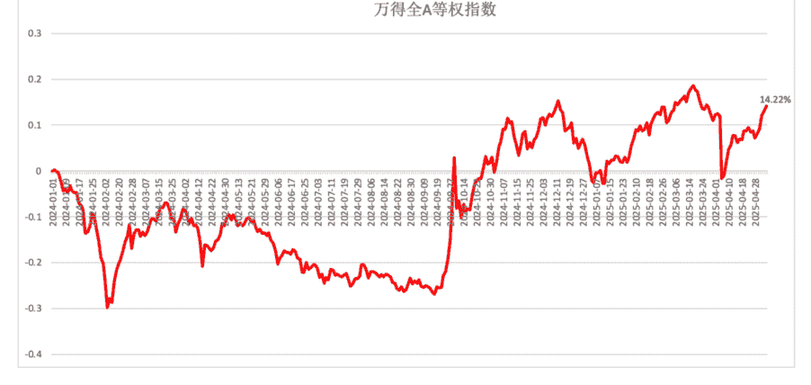

4) 跃水三指数

加微信jntsg2，免费资料群

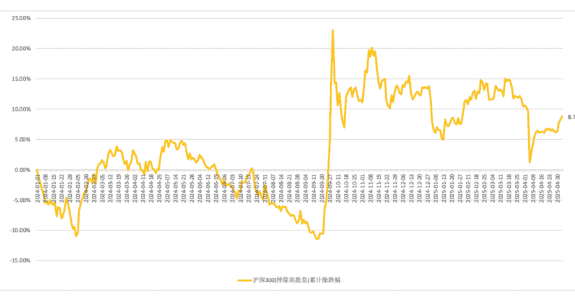

### 5) 出海马20指数

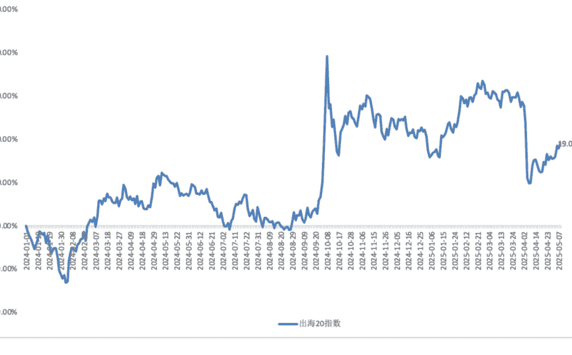

### 6) 红利20指数

微信:jntsg8 微信:jntsg2

免费进资料群

加微信jntsg2，免费进资料群

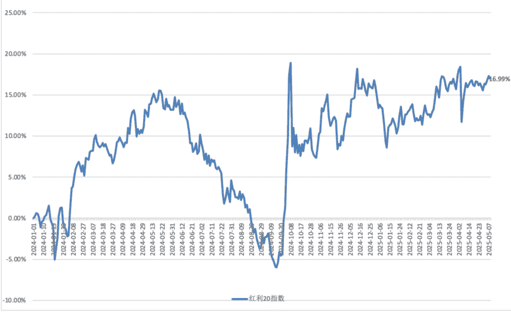

7) 降息20指数更多文章加: pep458

### 降息20

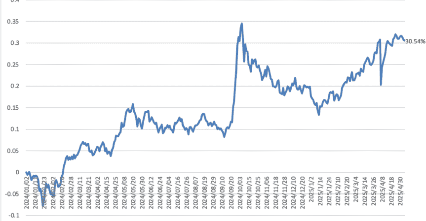

2. “在无人同津时”长线组合收益与持有（A级）

#### 1) 收益情况

| 2025/5/8 | 成立至今涨幅 | 2025年至今 | 2024年至今 | 五月涨幅 | 今日涨幅 |
| :--- | :--- | :--- | :--- | :--- | :--- |
| 买入在无人同津时 (成立于2016.12.22) | 391.74% | 6.78% | 45.88% | 2.18% | 0.21% |
| 沪深300 | 16.43% | -2.08% | 12.29% | 2.18% | 0.56% |

加微信 nsg2, 免费进资料群

#### 2) 合持率与参与

| 市值(亿元) | 股权(%) | 现价 | 今日涨跌幅(%) | 24周来涨跌幅(%) |
| :--- | :--- | :--- | :--- | :--- |
| 东方财富银行 | 14989 | 0.21% | 45.88% |
| 中信银行 | 128 | 5.35% | 13.78% |
| 国网电力 | 1129 | 5.19% | 14.44% |
| 中华电力 | 1024 | 5.16% | 109.44% |
| 招银行 | 936 | 5.15% | 53.07% |
| 保险财经 | 333 | 5.13% | 18.79% |
| 京业证券 | 227 | 5.04% | 37.64% |
| 山东矿业 | 147 | 4.97% | 22.00% |
| 京发银行 | 1513 | 4.96% | 37.64% |
| 国电电力 | 1833 | 4.92% | 22.46% |
| 南方物资 | 199 | 4.92% | 22.46% |
| 东方保险 | 560 | 4.92% | 19.27% |
| 华夏银行 | 413 | 4.92% | 74.32% |
| 上海 | 1732 | 4.78% | 9.28% |
| 中国安电 | 491 | 4.77% | 21.67% |
| 中国交信 | 277 | 4.67% | 54.67% |
| 中国信邮 | 1771 | 4.43% | 23.89% |
| 广发基金 | 217 | 4.39% | 31.15% |
| 广产建筑 | 455 | 4.36% | 7.42% |
| 30年国债(附债) | 639 | 3.96% | 15.13% |
| 万华化学 | 1741 | 3.71% | 70.05% |
| 东方财富(清算) | - | - | 13.82% |
| 秋天润(清算) | - | - | 18.28% |
| 潍华银行(清算) | - | - | - |
| 10年国债(清算) | - | - | 210.89% |
| 30年国债ETF(清算) | - | - | 112.76% |
| 海信聚类(清算) | - | - | 28.20% |

#### 3) 相对于账户的超额收益

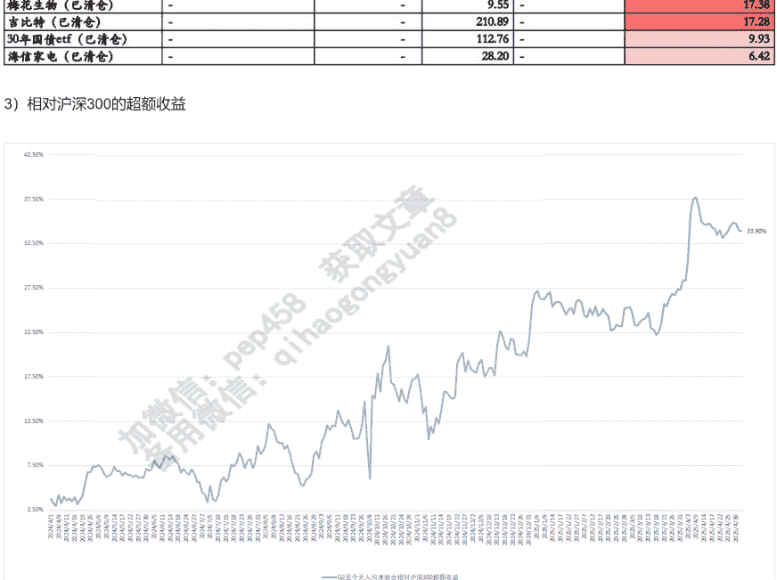

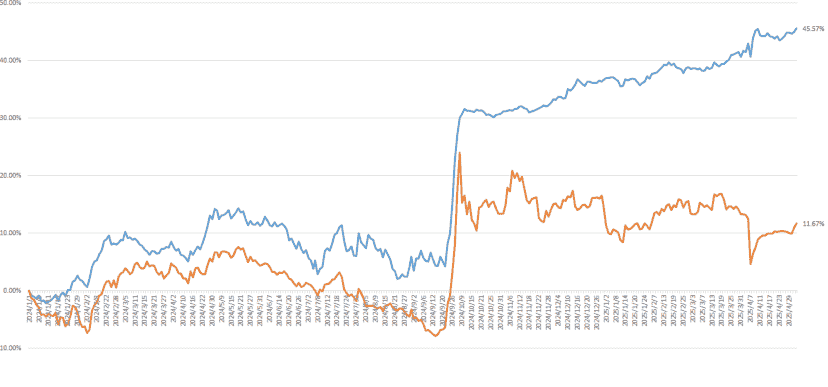

## 3、“卖在人声鼎沸时”长线持与涨跌（港股）

| 2025/5/8 | 流通量(亿) | 市盈率(%) | 持仓金额 | 今日涨幅(%) | 24年至今涨跌情况(%) |
| :--- | :--- | :--- | :--- | :--- | :--- |
| 贵人基金 | 10,216.37 | 100.00 | - | 0.31% | 19.63% |
| 东方基金经理 | 53.29 | 17.40 | 1,601 | -0.86% | 15.43% |
| 中信建 | 177 | 10.56 | 5,015 | 0.74% | 6.83% |
| 中信瑞 | 7,438 | 9.58 | 16,680 | -0.12% | -0.58% |
| 中华石油 | 295 | 6.76 | 14,890 | 0.51% | 5.26% |
| 中银银行 | 121 | 5.05 | 5,671 | 1.02% | 6.71% |
| 石药业 | 99 | 4.49 | 3,150 | -0.33% | -3.81% |
| 中广电力 | 275 | - | - | 0.61% | -2.27% |
| 华泰证券 | 509 | 4.49 | - | 1.15% | -7.95% |
| 华夏基金 | 546 | 4.12 | - | - | -6.73% |
| 其他 | 311 | 4.38 | - | 5.34% | -7.30% |
| 百亿市值 | - | - | - | 0.05% | 49.52% |
| 嘉泰基金 | - | - | - | - | 29.80% |
| 汇丰 | - | - | 82.55% | - | 21.37% |
| 融顺 | - | - | 392.72% | - | 24.22% |
| 国泰 | - | - | 414.40% | - | 19.22% |
| 腾讯控股 | - | - | 32.70% | - | 9.70% |
| 阿里巴巴国际 | - | - | 6.10% | - | 5.74% |
| 华夏 | - | - | 34.89% | - | 4.40% |
| 中国中信 | - | - | 3.32% | - | 4.07% |
| 国泰 | - | - | 25.90% | - | 3.73% |
| 南方基金 | - | - | 68.09% | - | 1.89% |

加微信jntsg2，免费进资料群

## 4. 热点

### 1) 高波行业

| 代码 | 股票名称 | 流市值(亿元) | 涨幅 | 涨跌幅(%) | 成交(亿元) | 连续涨天(天) |
| :--- | :--- | :--- | :--- | :--- | :--- | :--- |
| 002859 | *ST万绪 | 27.80 | 9.93% | | 4.97 | | 9 |
| 002200 | *ST华源 | 15.88 | 8.64% | | 5.01 | | 7 |
| 000655 | *ST蓝A | 39.63 | 9.94% | | 9.99 | | 6 |
| 001886 | *ST海航 | 29.83 | 11.66% | | 5.03 | | 5 |
| 000951 | *ST星海 | 11.93 | 3.69% | | 5.13 | | 5 |
| 688030 | *ST中航 | 52.26 | 10.08% | | 20.05 | | 4 |
| 006030 | *ST中航 | 42.01 | 3.19% | | 10.00 | | 4 |
| 000588 | *ST华胜 | 108.88 | 10.56% | | 10.01 | | 14.48 | 3 |
| 002730 | *ST亚科 | 66.16 | 19.12% | | 10.01 | | 6.08 | 3 |
| 001336 | *ST润河 | 12.86 | 47.12% | | 10.01 | | 1.73 | 3 |

### 2) 景行业

| 代码 | 股票名称 | 流市值(亿元) | 涨幅 | 涨跌幅(%) | 成交(亿元) | 连续涨天(天) |
| :--- | :--- | :--- | :--- | :--- | :--- | :--- |
| 001635 | *ST润谊 | 99.54 | 13.68% | | 9.97 | | 4 |
| 002564 | *ST华新 | 114.51 | 10.54% | | 20.04 | | 1 |
| 003768 | *ST中莱 | 219.58 | 23.57% | | 9.99 | | 1 |
| 005955 | *ST中航 | 99.51 | 10.76% | | 20.95 | | 1 |
| 000816 | *ST华能 | 30.13 | 5.55% | | 20.01 | | 2 |
| 003979 | *ST大华 | 82.22 | 40.09% | | 20.10 | | 2 |
| 000190 | *ST金瑞 | 90.72 | 10.10% | | 17.12 | | 1 |
| 001996 | *ST润丰 | 213.30 | 23.93% | | 10.02 | | 1 |
| 002111 | *ST华能 | 55.11 | 18.06% | | 20.06 | | 1 |
| 006952 | *ST光润 | 108.48 | 27.15% | | 10.01 | | 3 |
| 002265 | *ST建业 | 99.69 | 24.00% | | 10.01 | | 1 |

## 5. 热点主推

### 1) 指数成交比

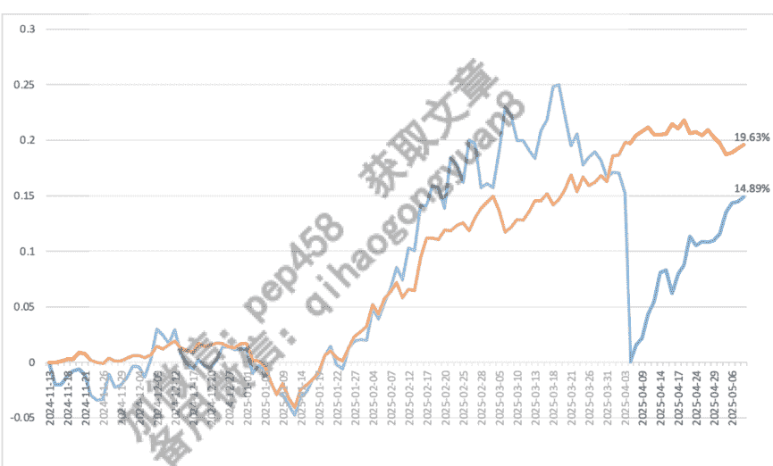

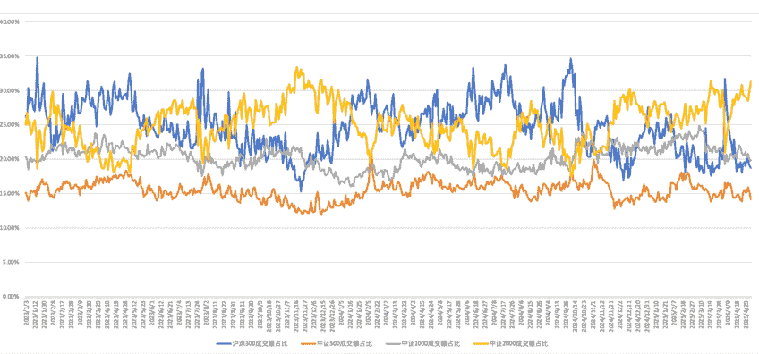

### 2) TMT和红利低波占比

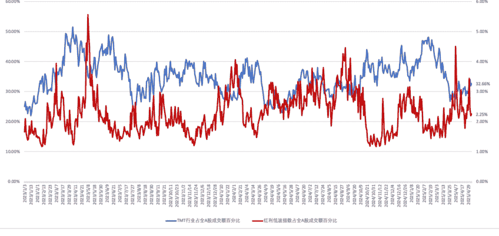

### 6. 沪深300期指波动率

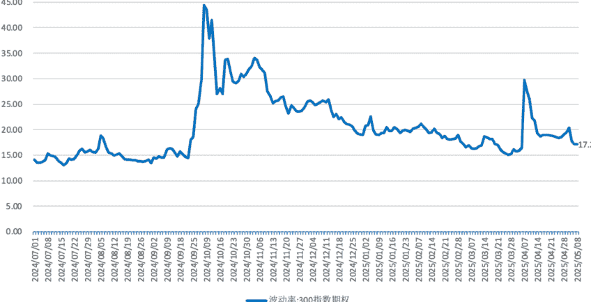

## 7. 杠杆与利率

### 1) 融资资金

加微信int5g2，免费进资料群

| 最新日期 | 2023/5/7 |
| :--- | :--- |
| 收盘价 | 17,073.93 |
| 涨跌幅(百分比) | 59.93 |
| 25年最高点(位) | 852.47 |

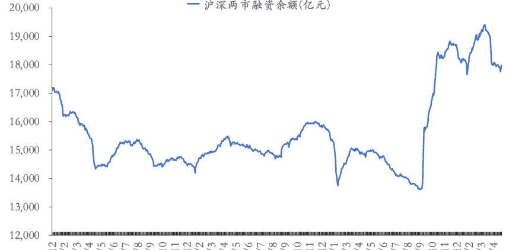

### 2) 挂保比例

数据暂未更新，更多文章加微：

> 中国：pep458
加微微信：qihagongyuan8
备用微信：qihagongyuan2

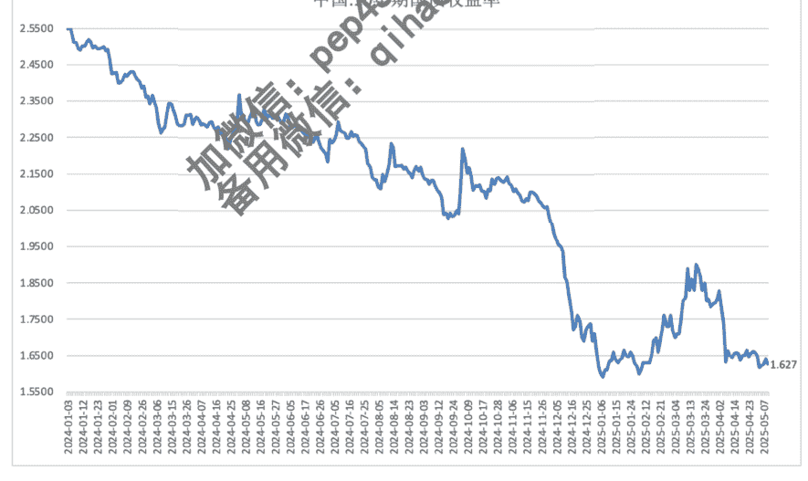

### 4) 南华黑色色系指数

加微信jnts2，免费进资料群

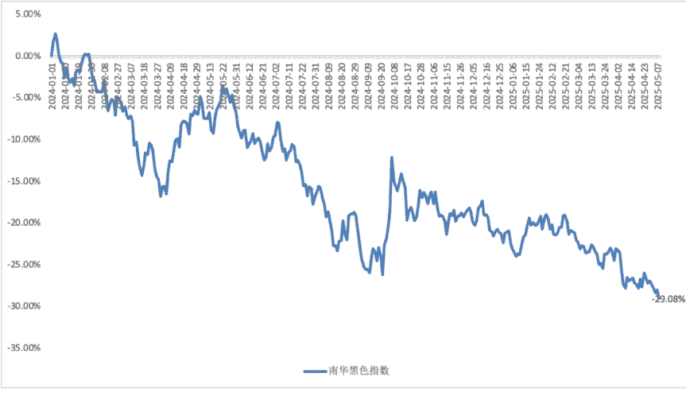

### 5) et资金

加微信intsg2，免费进资料群

| 净利润(亿元) | 净利润增长(%) | 营运资金(亿元) | 净流入资金(亿元) | 科创净流入(亿元) |
| :--- | :--- | :--- | :--- | :--- |
| 2023/1 | 142.96 | 98.97 | 48.16 | 178.93 | 37.17 |
| 2023/2 | 135.52 | 84.98 | 50.44 | 118.51 | 112.10 |
| 2023/3 | 79.40 | -39.31 | -4.43 | 81.21 | -20.68 |
| 2023/4 | 47.31 | -41.06 | 17.59 | -82.52 | -20.62 |
| 2023/5 | 28.65 | 11.06 | 17.59 | 23.30 | -35.55 |
| 2023/6 | -63.92 | -38.71 | -25.21 | -82.52 | -20.62 |
| 2023/7 | 28.54 | -24.65 | -19.48 | -24.05 | -20.62 |
| 2023/8 | 65.35 | 43.86 | 21.49 | 114.49 | 8.30 |
| 2023/9 | 9.03 | -35.51 | -5.77 | 37.98 | -9.26 |
| 2023/10 | 20.90 | 26.84 | 6.74 | 40.70 | -13.18 |
| 2023/11 | 189.20 | 21.71 | 2.17 | 65.58 | 31.21 |
| 2023/12 | 26.98 | -23.19 | -18.91 | 26.19 | 5.11 |
| 2023/13 | -14.27 | -94.27 | -23.74 | -8.33 | -1.21 |
| 2023/14 | -48.55 | -30.26 | -17.08 | -70.18 | -24.55 |
| 2023/15 | 13.19 | -19.53 | 14.53 | 23.10 | -17.77 |
| 2023/16 | 63.78 | 45.80 | 21.58 | 89.35 | 18.13 |
| 2023/17 | 32.82 | 30.43 | 2.39 | 80.61 | -13.73 |
| 2023/18 | 18.54 | 33.64 | 8.96 | 76.05 | -27.05 |
| 2023/19 | -43.80 | -48.26 | -4.46 | -52.93 | -49.55 |
| 2023/20 | -67.92 | -47.45 | -20.06 | -24.85 | -55.16 |
| 2023/21 | 268.10 | 93.38 | -10.57 | 104.25 | 10.34 |
| 2023/22 | 135.92 | -93.09 | -42.68 | -189.84 | -44.94 |
| 2023/23 | 54.15 | 33.30 | 14.68 | 54.30 | 34.93 |
| 2023/24 | 41.12 | -22.95 | -70.87 | -37.92 | -37.32 |
| 2023/25 | -24.26 | -12.16 | -12.01 | -49.54 | -11.60 |
| 2023/26 | -62.10 | -42.12 | 19.54 | -68.15 | -24.68 |
| 2023/27 | -56.24 | -48.64 | -75.59 | -127.69 | -34.90 |
| 2023/28 | 33.43 | 24.71 | 8.72 | 17.48 | 14.42 |
| 2023/29 | 102.64 | -78.77 | -23.87 | -108.17 | -54.76 |
| 2023/30 | -77.17 | -53.43 | -52.85 | -123.75 | -110.17 |
| 2023/31 | -70.10 | -53.83 | -16.26 | -49.98 | -81.94 |
| 2023/32 | 192.28 | -113.59 | -72.91 | -109.39 | |
| 2023/33 | -25.08 | -26.00 | 14.57 | -24.67 | -95.74 | -24.69 |
| 2023/34 | 46.66 | 19.95 | 27.91 | 14.40 | |
| 2023/35 | 106.16 | 56.31 | 49.85 | 127.66 | 13.91 |
| 2023/36 | 80.07 | 40.31 | 14.01 | -9.48 | |
| 2023/37 | -30.25 | -30.34 | 0.09 | -28.79 | -106.18 |
| 2023/38 | -22.19 | -20.43 | -0.35 | -105.99 | -102.16 |
| 2023/39 | 63.08 | -27.76 | 21.51 | 73.98 | 2.16 |
| 2023/40 | -10.57 | -28.51 | 17.94 | -40.91 | 5.93 |
| 2023/41 | -43.80 | -31.53 | -12.67 | -136.62 | 26.39 |
| 2023/42 | 300.15 | 18.74 | 41.62 | 61.38 | 14.46 |
| 2023/43 | 2.72 | -3.49 | 6.21 | -6.81 | -33.21 |
| 2023/44 | -13.15 | -8.04 | -5.10 | 35.57 | 8.11 |
| 2023/45 | -1.80 | -0.98 | -27.76 | -48.07 | -12.04 |
| 2023/46 | -28.31 | -11.20 | 14.41 | -148.49 | -24.31 |
| 2023/47 | 7.10 | -33.37 | -10.47 | -10.85 | 11.56 |
| 2023/48 | -19.77 | -11.88 | -38.69 | -60.50 | 6.12 |
| 2023/49 | 75.66 | 44.52 | 27.03 | 51.27 | 24.32 |
| 2023/50 | 47.11 | 25.41 | 27.10 | 37.94 | 7.00 |
| 2023/51 | 17.66 | 5.00 | 12.66 | 48.02 | 15.05 |
| 2023/52 | 7.00 | -6.54 | 19.96 | 28.87 | 46.65 |
| 2023/53 | -26.39 | -24.77 | 16.61 | -17.64 | -16.01 |
| 2023/54 | 31.13 | 25.52 | 5.64 | 53.80 | 5.80 |
| 2023/55 | 95.87 | 45.63 | 49.34 | 96.29 | 7.79 |
| 2023/56 | 4.53 | -5.22 | 0.71 | 6.07 | 11.18 |
| 2023/57 | 61.42 | -46.50 | 5.24 | 62.50 | 12.54 |
| 2023/58 | 33.43 | 24.71 | 8.72 | 17.48 | 14.42 |
| 2023/59 | 102.64 | -78.77 | -23.87 | -108.17 | -54.76 |
| 2023/60 | -77.17 | -53.43 | -52.85 | -123.75 | -110.17 |
| 2023/61 | -70.10 | -53.83 | -16.26 | -49.98 | -81.94 |
| 2023/62 | 192.28 | -113.59 | -72.91 | -109.39 | |
| 2023/63 | -25.08 | -26.00 | 14.57 | -24.67 | -95.74 | -24.69 |

## 6) 市场(深圳)成交量变化

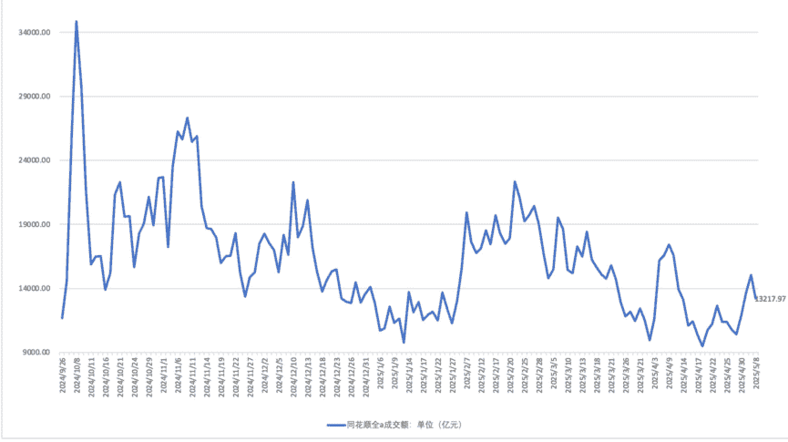

## 7) 市值20亿以下股票的趋势图

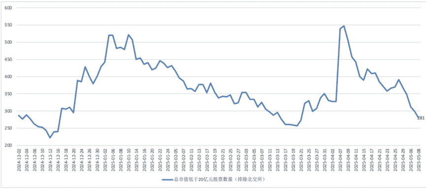

## 8) 南向资金趋势图更多文章加微信：pep458

加微信jntsg2，免费进资料群

## 初步判断

- 1. 公募基金考核的新规发布，未来很多公募基金的业绩基比较标准，将会对标沪300中，公募持有的银行，非金融等比例仍较高，远低于沪300成分比例，因为，今天有个股大涨。

- 2. 创业板大涨，主要由于宁德和军工板块发力，宁德作为公募重仓股，还将将在港股IPO。目前的消息是，宁德的备备非常频繁。计划IPO的规模为50亿美元，折价比例相当，5%左右。

- 3. 军工板块大涨是因为在市场后冲，在市场利好释放后，军工可能有继续涨预期。

- 4. 今天成交领涨，沪300权重回升，但整体成交速度加快，中证2000成交量上限，超过了今年最高水平。市场的震宽深度加大，可能回调风险增大。

- 5. 科技行情一大利空，就是公募基金获配了科技，在未来的沪300基准要求之下，可能导致低科技比重。

- 6. 港股回调后，更值得关注的是南下趋势延续，以往今天雷血雪冰的暴跌，中芯和腾讯的回调。再次调整后，港股的发生变化。

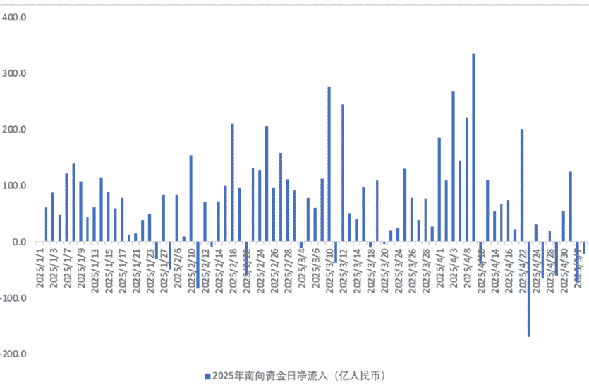

## 扫码加入 知识星球TOP 免费资源群

公众号: 知识星球

- 每日免费获取高价值资源
- 可提供各类资源投服务

免费
价值

- ◆热门收费文章 ◆各行各类报告
◆精选图书资源 ◆副业变钱方法
◆职场实用资源 ◆AI政经自媒体

微信:jntsp8

及时
专注
分享资料仅供个人学习，请及时删除，勿用于传播

微信:jntsp2

