# A 股长期组合，刷新新高。

港股加仓美债至 20%，初步完成既定计划。

## 1， 整体情况 微信号:jntsg8

微信号:jntsg2

### 1) 行情概述

市场全天震荡调整，三大指数涨跌不一。大指数走势分化，微盘股指数涨超 2%再创新高。沪深两市全天成交额 1.09 万，较上个交易日增量 30.7 亿。盘面上，市场热点较为杂乱，个股涨多跌少，全市场超 3500 个个股上涨，逾百股涨超 9%。高位股继续资金追捧，中毅达等等股涨停。从板块来看，加微信jntsg2 免费进资料群看，并购重组及 ST 集团大涨，光智科技等多股涨停。港口股再度走强，南京港等涨停。大消费股开展反弹，食品、美容、宠物等方向走强，巴比食品等涨停。下跌方面，机器人概念迎来调整，龙溪股份等多数股跌超 5%。板块方面，港口、ST板块、并购重组、食品等板块涨幅居前，人形机器人、小金属、白酒、保险等板块跌幅居前。截至收盘，沪指涨 0.00%，深证指跌 0.08%，创业板指跌 0.33%。

| 时间 | 当日上涨数量 | 当日涨幅(同上交易日) | 当日下跌数量 | 当日跌幅(同上交易日) | 中位涨幅 | 中位跌幅(同上交易日) | 平均涨幅 | 平均跌幅(同上交易日) | 万股级当日涨幅 |
| :--- | :--- | :--- | :--- | :--- | :--- | :--- | :--- | :--- | :--- |
| 2025/5/16 | 3002 | 1595 | 2187 | -1669 | 0.20% | 1.15% | 0.54% | 1.32% | -0.03% |
| 2025/5/19 | 3566 | 564 | 1696 | -491 | 0.62% | 0.42% | 0.97% | 0.43% | 0.17% |

### 2) 截至当日，24 年以来来个股情况

更多文章: pep458

微微信：jntsg2，免费进资料群群

| 上海股票数量 | 增减(上次交易日) | 下跌股票数量 | 增减(上次交易日) | 股票平均涨幅 | 增减(上次交易日) | 中位涨幅 | 增减(上次交易日) |
| :--- | :--- | :--- | :--- | :--- | :--- | :--- | :--- |
| 2025/05/16 | 2685 | 31 | 2709 | 27 | 8.48% | 8.45% | -0.22% | -0.27% |
| 2025/05/19 | 2750 | 85 | 2607 | -102 | 10.51% | 1.05% | 0.75% | 0.96% |

## 3)等权 A 指数

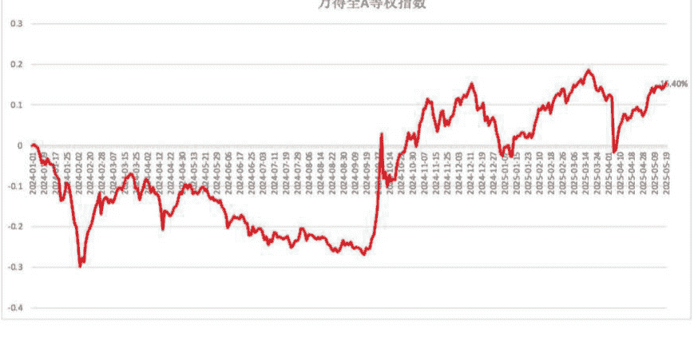

## 4)脱水 300 指数

微信公众号:jntsg8 微信:jntsg2

加微信jntsg2，免费进资料群群*

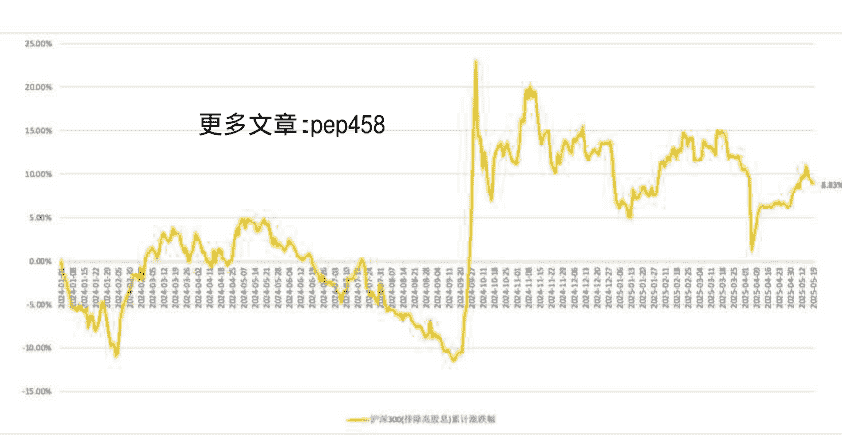

### 5) mini 盘等权指数

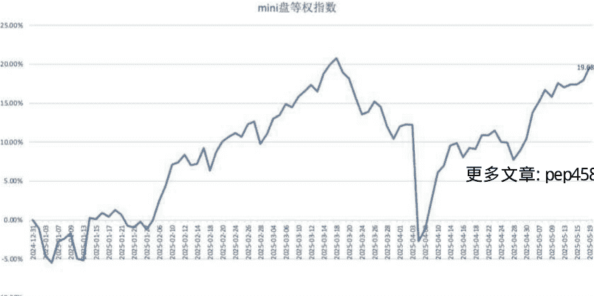

### 6) 出海 20 指数

加微信jntsg2，免费进资料群群

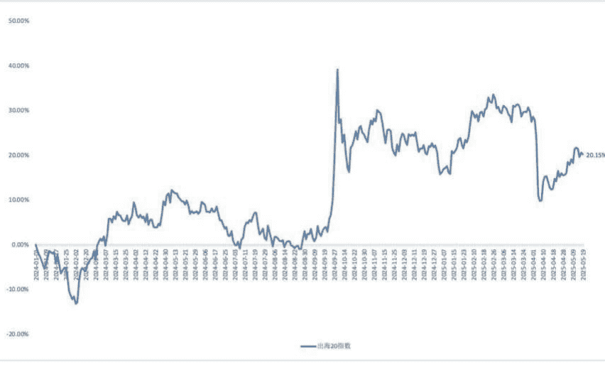

### 7) 红利 20 指数

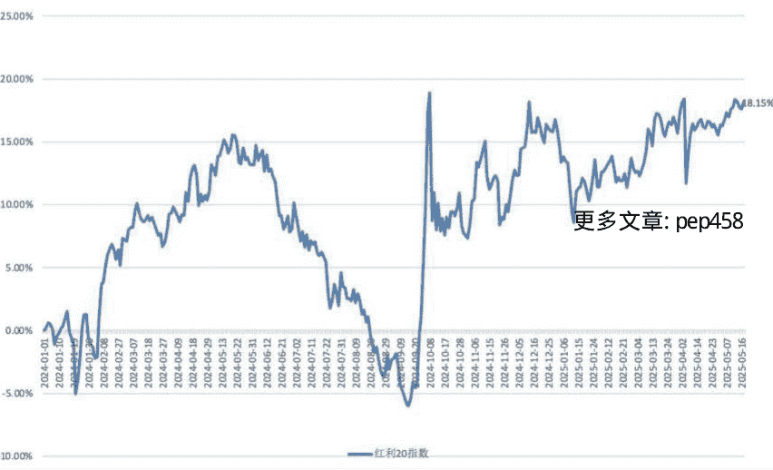

更多文章: pep458

加微信jnts2, 免费资料群

### 8) 降息 20 指数

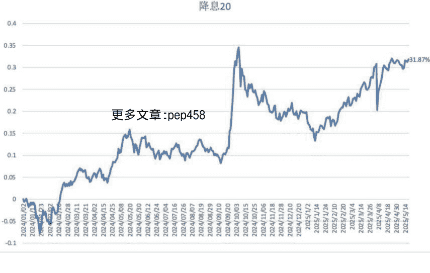

# 2, “买在无人问津时”长线组合收益与持（A股)

### 1) 收益情况

加微信jntsg2，免费进资料群 ＊*

## ## 组合持仓与仓位

| 2025/5/19 | 成至今涨幅 | 2024年至今 | 五月涨幅 | 今日涨幅 |
| :--- | :--- | :--- | :--- | :--- |
| 业在无人问津时（成立于2016.12.21） | 395.58% | 7.61% | 47.02% | 1.64% | 0.70% |
| 沪深300 | 17.17% | -1.47% | 13.00% | 2.83% | -0.31% |

| 2025/5/19 | 市值(亿元) | 权重(%) | 持仓 | 五月涨幅(%) | 24年累计涨幅(%) |
| :--- | :--- | :--- | :--- | :--- | :--- |
| 贵州茅台 | 556 | 10.00% | 53.07% | 0.54% | 47.03% |
| 国电电力 | 1154 | 5.26% | 14.45% | 0.26% | 7.12% |
| 新材料 | 121 | 5.23% | 13.78% | 1.59% | 10.03% |
| 贵州云酒 | 237 | 5.23% | 18.1% | 1.1% | 6.22% |
| 招商银行 | 332 | 5.13% | 18.79% | 0.10% | 4.15% |
| 华润电力 | 1778 | 4.97% | 54.32% | 2.65% | 6.47% |
| 中文医药 | | 4.88% | 22.89% | 1.06% | 5.64% |
| 国有矿 | 1495 | 4.86% | 37.64% | -0.05% | 4.04% |
| 山东能源 | 145 | 4.79% | 7.00% | -0.10% | -4.23% |
| 新财经 | 549 | 4.78% | 19.20% | 0.15% | -0.19% |
| 北华机 | 491 | 4.77% | 22.10% | -0.17% | -2.22% |
| 贵州茅台 | | 4.64% | 57.40% | 0.70% | 0.01% |
| 贵州云水 | 1796 | 4.64% | 9.89% | 0.85% | -0.34% |
| 中信邮 | 217 | 4.38% | 33.28% | -1.23% | -3.84% |
| 广发在线 | 169 | 4.30% | 31.65% | -0.68% | -5.40% |
| 招商银行 | 67 | 3.99% | 38.81% | 0.25% | -6.47% |
| | | 9.16% | | | -0.23% |
| 亚元(亿仓) | | 13.82% | | | 52.00% |
| 复星(亿仓) | | 14.28% | | | 23.40% |
| 花生(亿仓) | | 9.55% | | | 17.38% |
| 此货币(亿仓) | | 215.99% | | | 17.38% |
| 300深(亿仓) | | 112.76% | | | 9.93% |
| 德邦银行(亿仓) | | 28.20% | | | 6.42% |
| 中信证券(亿仓) | | 109.44% | | | 4.24% |
| 万科生物(亿仓) | | 70.05% | | | -17.77% |

### 3) 相对沪深 300 的超额收益

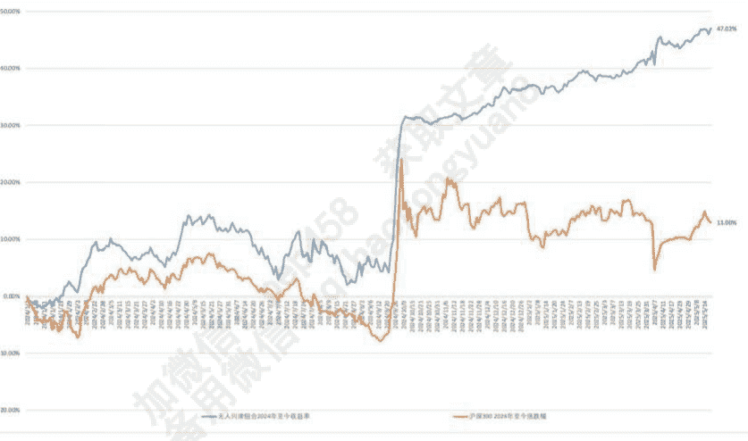

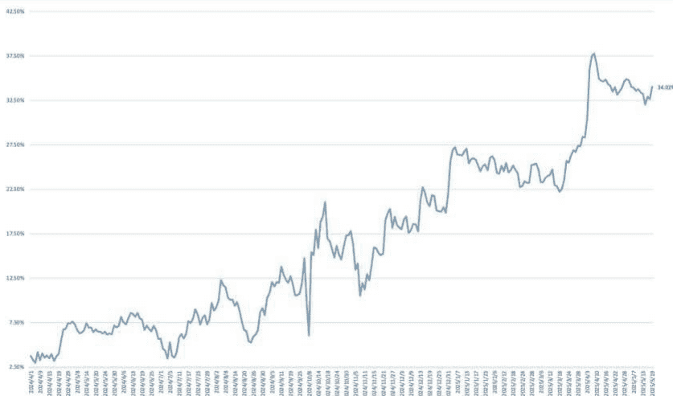

## 3、“卖在人声鼎沸处”长线组合持仓与收益（港股）

| 2023/5/19 | 涨幅(亿元) | 收益率(%) | 升幅(%) | 今日涨跌幅(%) | 24日累计跌幅(%) |
| :--- | :--- | :--- | :--- | :--- | :--- |
| 贵在人声鼎沸 | - | 100.00% | - | 0.28% | 20.34% |
| 腾讯控股20 | 7 | 19.76% | 67.27% | -1.83% | -1.00% |
| 华网硬件组件 | - | 53% | 19.36% | 1.23% | 12.23% |
| 中信海洋 | 174 | 10.32% | 5.05% | 0.38% | 5.07% |
| 中华电力 | 7,789 | 5.01% | 15.92% | -0.20% | 5.84% |
| 中医药联业 | 289 | 4.68% | 2.33% | 1.58% | 9.52% |
| 中银电力 | 112 | 4.61% | 1.47% | -0.67% | -0.67% |
| 华美气 | 519 | 4.56% | 23.90% | -0.67% | -4.07% |
| 京东健康 | 87 | 4.54% | - | 2.08% | -6.35% |
| 腾讯控股 | 256 | 4.62% | 6.30% | -3.30% | -4.67% |
| 华夏国际 | 317 | 4.44% | 5.34% | 1.82% | -5.42% |
| | | | | 95.20% | 48.92% |
| 州（乙链） | | | | | 70.05% |
| 康民（乙链） | | | | | 27.27% |
| 华润（乙链） | | | | | 24.22% |
| 阿贝尔（乙链） | | | | | 82.55% |
| 越（乙链） | | | | | 39.72% |
| 锦路（乙链） | | | | | 21.76% |
| 瑞（乙链） | | | | | 41.60% |
| 中国医药（乙链） | | | | | 68.70% |
| 丰华（乙链） | | | | | 24.89% |
| 中国医药（乙链） | | | | | 6.63% |
| 贵州医药（乙链） | | | | | 25.50% |
| 南京医药（乙链） | | | | | 1.89% |

### 4、热点列表

### 1) 高排行

| 日期 | 证券名称 | 涨跌幅% | 成交 | 成交额(亿) | 活跃人数(万) |
| :--- | :--- | :--- | :--- | :--- | :--- |
| 2023/05/12 | 华嘉医疗 | 9.31% | 39.48 | 4.96 | 0.91 |
| 2023/05/12 | 成飞股份 | 14.63% | 34.66 | 10.00 | 9 |
| 2023/05/12 | 润华医药 | 8.25% | 17.06 | 10.16 | 7 |
| 2023/05/12 | 苏州云 | 7.73% | 18.21 | 10.07 | 5 |
| 2023/05/12 | 宁源科技 | 14.25% | 21.11 | 9.37 | 5 |
| 2023/05/12 | 华华 | 34.67% | 22.51 | 4.95 | 4 |
| 2023/05/12 | 联创 | 17.06% | 13.56 | 4.99 | 4 |
| 2023/05/12 | 新创设计 | 34.68% | 12.36 | 9.96 | 3 |
| 2023/05/12 | 景瑞 | 41.55% | 10.37 | 9.97 | 3 |
| 2023/05/12 | 特丽 | 10.67% | 5.52 | 4.55 | 3 |

### 2) 宽度排行

### 成交金额

| 证券 | 成交额 | 涨跌幅 | 成交占比(%) | 成交额(亿元) | 涨停次数(次) |
| :--- | :--- | :--- | :--- | :--- | :--- |
| 000016 | 华西银行 | 128.68 | -11.2% | 15.04% | 25.63 | 0 |
| 002190 | 成发集团 | 141.63 | 39.48% | 10.00% | 25.19 | 2 |
| 601938 | 中国信邮 | 88.13 | -5.32% | 8.82% | 23.93 | 0 |
| 004751 | 中朗股份 | 56.77 | 4.35% | 10.13% | 22.30 | 2 |
| 300750 | 宁德时代 | 58.54 | -3.95% | 5.85% | 20.20 | 0 |
| 600618 | 中广股份 | 113.85 | -2.12% | 9.99% | 18.77 | 2 |
| 601939 | 工商银行 | 107.11 | 10.7% | 8.71% | 17.39 | 0 |
| 002472 | 无线股份 | 92.86 | 8.7% | 10.04% | 15.33 | 1 |
| 002852 | 东方中信 | 87.11 | 37.07% | 10.01% | 13.29 | 2 |
| 600519 | 庆源电力 | 137.45 | 8.15% | 10.04% | 12.82 | 1 |

### 5, 风格主

### 1) 指数成交占比

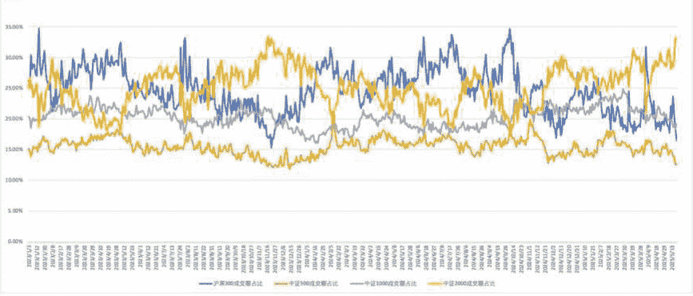

### 2) TMT和红利低波成交占比

加微信jntsg2，免费进资料群群

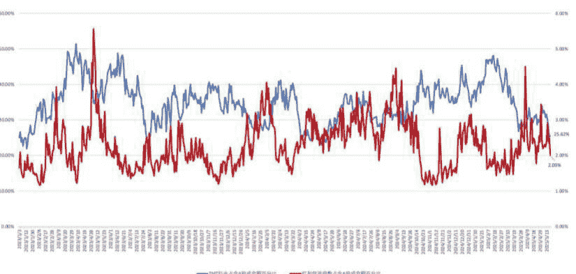

### 6、 沪深 300 期指波动率

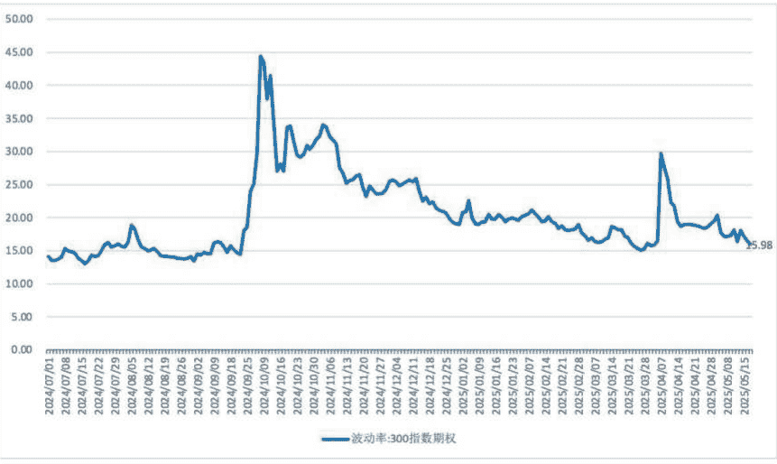

### 7，杠杆与利率

### 1)融资资金

| 截至日期 | | |
| :--- | :--- | :--- |
| 2023/3/14 | 沪深月末(亿元) | 17946.57 |
| 23年新增贷款(亿元) | 838.51 | |

### 2)担保比例

### 3) 十年国债收益

### 5) etf资金

| 股票型申购(亿元) | 沪市型申购(亿元) | 深市型申购(亿元) | 科创板ETF(亿元) |
| :--- | :--- | :--- | :--- | :--- |
| 2025/4/1 | -4.53 | -5.23 | 0.71 | 11.18 |
| 2025/4/2 | 47.29 | 31.24 | 16.06 | 45.90 |
| 2025/4/3 | 89.08 | 33.25 | 55.83 | 84.24 |
| 2025/4/7 | 355.17 | 218.08 | 144.29 | 742.30 |
| 2025/4/8 | 381.44 | 277.68 | 103.75 | 1062.95 |
| 2025/4/9 | 71.04 | 20.81 | 50.23 | 121.57 |
| 2025/4/10 | -1.93 | 3.42 | -5.35 | -25.72 |
| 2025/4/11 | -48.59 | -35.36 | -13.22 | -63.08 |
| 2025/4/14 | -47.19 | -34.17 | -13.02 | -98.32 |
| 2025/4/15 | 14.11 | 26.93 | -12.83 | 68.05 |
| 2025/4/16 | 71.31 | 54.67 | 16.63 | 271.81 |
| 2025/4/17 | -30.22 | -16.29 | -13.92 | 22.75 |
| 2025/4/18 | 26.27 | 38.37 | -12.09 | 97.80 |
| 2025/4/21 | -43.30 | -24.03 | -19.26 | -32.15 |
| 2025/4/22 | -22.70 | -25.56 | 3.06 | -51.89 |
| 2025/4/23 | 0.51 | 4.16 | -3.65 | | |
| 2025/4/24 | 25.59 | 13.50 | 12.09 | 18.99 |
| 2025/4/25 | 9.46 | 14.12 | -4.65 | -11.24 |
| 2025/4/28 | -39.47 | -20.26 | -19.21 | -61.93 |
| 2025/4/29 | -23.84 | -6.89 | -16.95 | -18.51 |
| 2025/4/30 | -44.11 | -25.82 | -18.30 | -50.39 |
| 2025/5/6 | -0.09 | -3.88 | -3.97 | 4.80 |
| 2025/5/7 | -26.27 | -20.96 | -5.31 | -56.29 |
| 2025/5/8 | -20.61 | -3.78 | -16.83 | -16.83 |

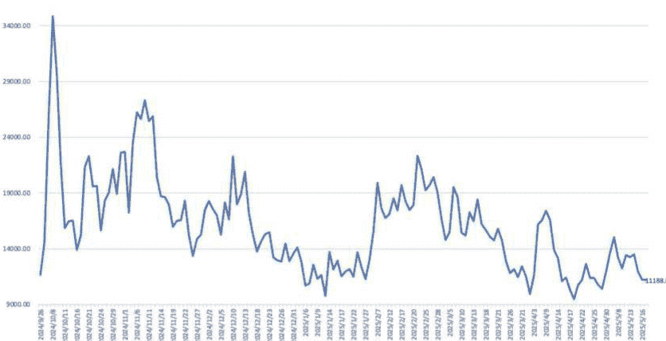

### 7) 市值 20 亿以下股票的趋势图

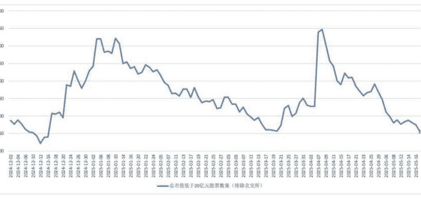

### 8) 南向资金趋势图

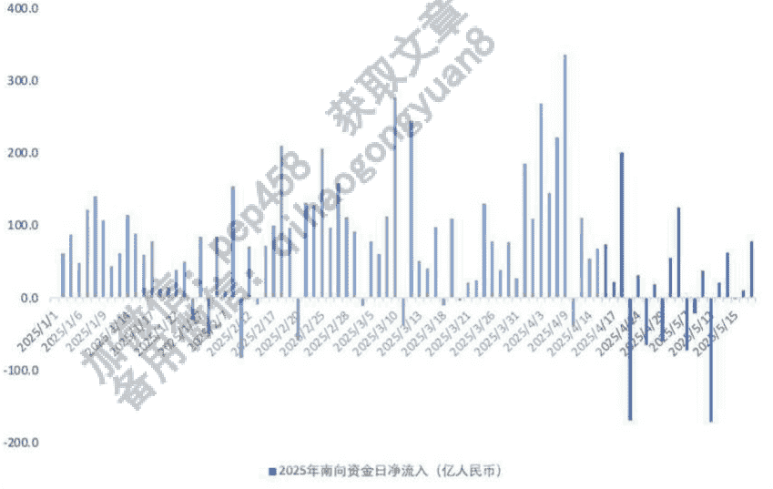

### 8、初步判断

1) 今天发布了 mini 盘等权重指数。用来观察市场的资金流动，尤其是下沉式内耗。之后，

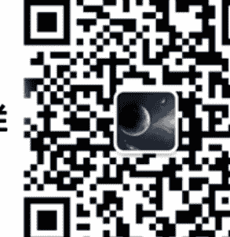

2) 今天我们 A 组合创下历史新高。主要是因为 4 月建仓的股票大涨，以及电力板块的持续上涨。

3) 港股方面，按照计划，建仓了 20%的美债。

4) 今天国债大涨。主要是因为非常拉跨的 4 月经济数据，以及财政部下场做市，提振市场信心。另外，明天正式宣告降息，也有一定的影响。

5) 今天市场实际上交易了 4 月的数据。基础面相关的板块明显下跌。资金进一步下沉。短线资金抱团 mini 盘妖股，st 板集中炒作，而量化继续介入 3800 以外的 mini 盘小票。

6) 美国资产方面，因为下调了美债评级，以及关税豁免过半，开始遭遇股债汇三杀。所以，今天美债才会给到这样的位置。

7) 我们认为，A 股接下来会持续这个下沉的过程，直到小盘抱团已经达到了极限。从而开始下跌。后续，如果遇到某个利空，会借此重新洗牌，从而完成一个大循环。不过这次，抱团的时间可能会更久一点。因为本次，市场杠杆的压力不大，筹码结构相对 3-4 月更加健康。
