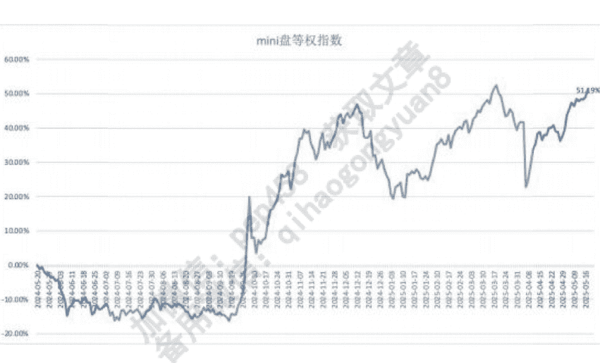
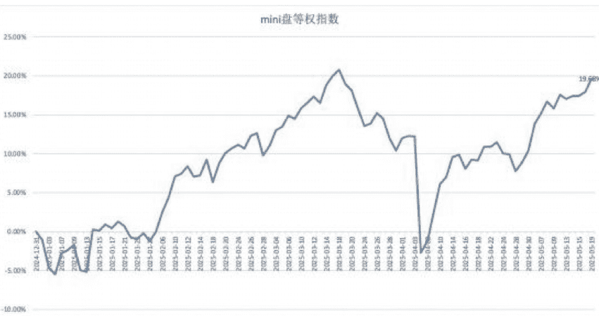
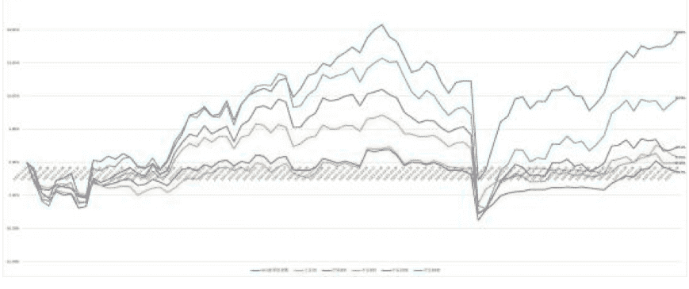
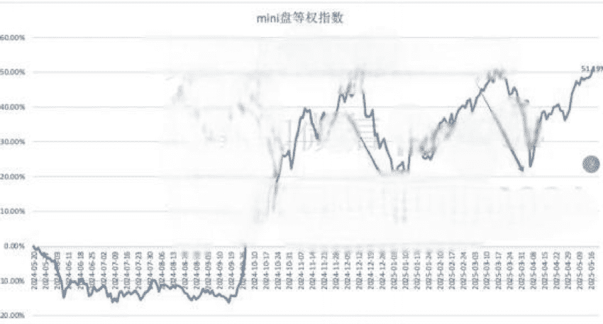

# 今天，我们正式发布一个新指标，mini盘等指数。

发布这个指标的原因是，跟市场的变化。

我们认为，随着市场的内卷、进一步的加剧，传统的大盘、中盘、小盘，已经无法刻画整个市场的交易。但，我们能看到微盘股指数，又无法准确表现出真正微盘的走势。

这是因为微盘股编制逻辑是选取市场最小500只市值的股票，并且每天调仓。由于这个指数在每天高抛低吸，因此，必然会不断新高。

实际上，市场上有大量的股票，既不是沪深 300、中证 500，也不是中证 1000、中证 2000，也不是微盘股。

市场有 5000 多股票，A800+中证 1000+中证 2000，也才 3800 只股票而已。

于是，我们把这 3800 只以外的股票，统一编制成一个指数，并且等权。形成一个新的指数，我们称之为 mini 盘指数。

这个指数，最近一年的走势如下：

今年以来的走势如下:

自从 4 月以来，mini 盘等权重指数重吊所有的指数。

为什么会出现这种情况呢？

答案就是内卷。

原因是这样的。当市场的成交额开始逐渐降低，但市场并没有明显的利空之后，大量的资金都在追超额而做努力。

其中，两种力量内卷的最严重。

- 第一种，量化。
- 第二种，短线资金。尤其是超短。

这两种资金，都不约同的采取一种战术，做市值下沉。

这个过程是：中证 500 超额难做，就做中证 1000，1000 难做就做 2000，2000 也做不出来了，就做 mini 盘。

微信:jsg8
微信:jsg2
免费进资料群

这就会让资金不断的进行市值下移。而越是小市值的股票，相同资金刺激的力度就越强。于是，形成反身性。mini 盘就会走来越越好。

那么，mini 盘可以永远上涨吗？

不能。因为抱团到极致，就一定会崩塌。所以 mini 盘一定会定时进行踩踏。

# 924 行情之后，mini 盘有两次踩踏。

第一次，今年元旦前后。从 12 月中到 1 月中。

第二次，今年清明节前后。

这两次踩踏，跌幅都在 25 个点左右。

这两踩踏，都带着大盘下杀。且不得不逼国家队入场救市。

踩踏本身进行了一波清洗。再加上国家队入救市，市场类似于多了一波增量资金。于是，就重复了上述过程。

在国家队不救市的情况下，连续踩踏，一定会爆发普遍性的危机，那样就不是 25 个点的跌幅，可能是 50 个点的跌幅。

但问题在于，每次国家队都救市。救市之后，市场再重复这个过程。

五月份以来，市场的情绪其实持续回落。而且经济也在持续向下。这就让基本面更相关的沪深 300 举步维艰。从而大大加速了内卷。

我们昨天一直说的下沉，实际上指的是这种资金抱团 mini 盘的现象。

从目前的位置来说，mini 盘已经接近下一次抱团瓦解的高度，但还有一定的空间。

我们认为，A 股不会有新鲜事。等到这波抱团瓦解之后，一定会再次上演推导式重来的过程。

微信公众号：jntsg8 免费进资料群
微信公众号：jntsg2

最终的结果也是：mini 盘抱团瓦解——市场踩踏，个股暴跌——指数向下，流动性危机——国家队场，注入流动性——市场普涨，进行修复——修复完成，资金下沉——mini 盘集中抱团——mini 盘抱团瓦解。

对我们来说，把握这个过程，就能比较好的把握市场的动态，从而做到不以物喜，不以己悲，能够根据市场的情绪节奏，更好的安排自己的投资节奏。

| 扫码加入 知识星球TOP 免费资源群 |
| :--- |
| 免费 | ✓ 每日免费获取高价值资源 ✓ 可提供各类资源搜索服务 |
| 价值 | ◆热门付费文章 ◆各行业业务报告 ◆精选图书资源 ◆副业赚钱方法 |
| 关注 | ◆职场实用资源 ◆AI政经自媒体 |

