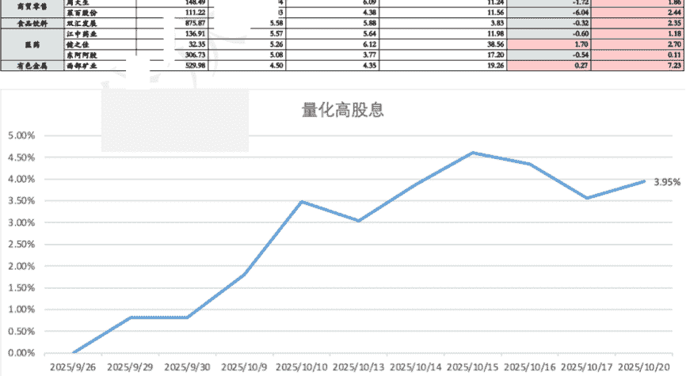

# 2025-10-20, 三大 20 指数与高股息精选轮(成分股与当日表现)

# 1. 红利 20 指数。
调整时间：成分股季度调仓。权重每日更新。
调整方式：主观+量化。

| 指数名称 | 权重(%) | 上周涨幅(%) | 本周涨幅(%) | 上月涨幅(%) | 上月跌幅(%) | 当季涨幅(%) | 当季跌幅(%) |
| :--- | :--- | :--- | :--- | :--- | :--- | :--- | :--- |
| 沪深300 | 9.98 | 2.58 | 3.12 | 0.59 | -0.07 | 4.17 | -1.24 |
| 上证50 | 11.83 | 2.38 | 3.76 | 0.15 | -0.45 | 5.49 | -1.34 |
| 中证1000 | 14.75 | 3.30 | 4.48 | 0.00 | -0.52 | 2.70 | -1.21 |
| 沪深600 | 19.40 | 2.96 | 3.33 | 0.12 | -0.33 | 2.68 | -0.23 |
| 中证500 | 20.27 | 3.13 | 4.71 | -0.21 | -0.68 | -2.88 | -0.21 |
| 创板50 | 24.50 | 4.79 | 7.14 | -0.94 | -1.85 | 12.53 | -0.43 |
| 红利50 | 10.12 | 2.56 | 3.98 | 0.30 | -0.18 | 10.22 | -0.56 |
| 红利100 | 13.38 | 3.13 | 4.10 | 0.16 | -0.15 | 7.75 | -0.91 |
| 中证红利 | 13.10 | 3.32 | 4.33 | 0.22 | -0.14 | 11.23 | -0.96 |
| 沪深红利 | 15.12 | 3.32 | 4.32 | 0.22 | -0.14 | 11.23 | -0.96 |
| 深证红利 | 15.12 | 3.32 | 4.32 | 0.22 | -0.14 | 11.23 | -0.96 |
| 上证红利 | 15.12 | 3.32 | 4.32 | 0.22 | -0.14 | 11.23 | -0.96 |
| 低波红利 | 10.12 | 2.56 | 3.98 | 0.30 | -0.18 | 8.22 | -0.56 |
| 高股红利 | 13.38 | 3.13 | 4.10 | 0.16 | -0.15 | 7.75 | -0.91 |
| 价值红利 | 15.12 | 3.32 | 4.32 | 0.22 | -0.14 | 11.23 | -0.96 |

# 2. 出海 20 指数。
调整时间：成分股季度调仓。权重每日更新。
调整方式：主观+量化。

| 指数名称 | 权重(%) | 上周涨幅(%) | 本周涨幅(%) | 上月涨幅(%) | 上月跌幅(%) | 当季涨幅(%) | 当季跌幅(%) |
| :--- | :--- | :--- | :--- | :--- | :--- | :--- | :--- |
| 沪深300 | 9.98 | 2.58 | 3.12 | 0.59 | -0.07 | 4.17 | -1.24 |
| 上证50 | 11.83 | 2.38 | 3.76 | 0.15 | -0.45 | 5.49 | -1.34 |
| 中证1000 | 14.75 | 3.30 | 4.48 | 0.00 | -0.52 | 2.70 | -1.21 |
| 沪深600 | 19.40 | 2.96 | 3.33 | 0.12 | -0.33 | 2.68 | -0.23 |
| 中证500 | 20.27 | 3.13 | 4.71 | -0.21 | -0.68 | -2.88 | -0.21 |
| 创板50 | 24.50 | 4.79 | 7.14 | -0.94 | -1.85 | 12.53 | -0.43 |
| 红利50 | 10.12 | 2.56 | 3.98 | 0.30 | -0.18 | 10.22 | -0.56 |
| 红利100 | 13.38 | 3.13 | 4.10 | 0.16 | -0.15 | 7.75 | -0.91 |
| 中证红利 | 13.10 | 3.32 | 4.33 | 0.22 | -0.14 | 11.23 | -0.96 |
| 沪深红利 | 15.12 | 3.32 | 4.32 | 0.22 | -0.14 | 11.23 | -0.96 |
| 深证红利 | 15.12 | 3.32 | 4.32 | 0.22 | -0.14 | 11.23 | -0.96 |
| 上证红利 | 15.12 | 3.32 | 4.32 | 0.22 | -0.14 | 11.23 | -0.96 |
| 低波红利 | 10.12 | 2.56 | 3.98 | 0.30 | -0.18 | 8.22 | -0.56 |
| 高股红利 | 13.38 | 3.13 | 4.10 | 0.16 | -0.15 | 7.75 | -0.91 |

# 3. 降息 20 指数。
调整时间：成分股季度调仓。权重每月。
调整方式：主观。

| 类别 | 权重(基准) | 2023年6月(实际) | 2023年5月(实际) | 上半年超申基准(%) | 收益率(%) | 中证收益率(%) | 上六超申收益率(%) |
| :--- | :--- | :--- | :--- | :--- | :--- | :--- | :--- |
| 白酒 | 贵州茅台(中证) | 11902.43 | 9.81 | 5.49 | 5.00 | 11.31 | 3.27 |
| 五粮液酒(中证) | 7740.58 | 8.48 | 5.49 | 5.00 | 8.3 | 1.25 |
| 医药(中证) | 7183.82 | 9.48 | 5.49 | 5.00 | 5.55 | 0.21 | 0.34 |
| 芯片(中证) | 1237.34 | 12.01 | 5.49 | 5.00 | -0.68 | -0.21 | -0.47 |
| 食品(中证) | 1133.45 | 12.49 | 5.49 | 5.00 | -5.38 | -1.56 | -3.82 |
| 汽车(中证) | 1055.12 | 11.38 | 5.49 | 5.00 | 9.42 | 3.17 | 6.25 |
| 机械(中证) | 1022.47 | 9.02 | 5.49 | 5.00 | -1.31 | -0.69 | -0.32 |
| 银行(中证) | 3355.55 | 9.42 | 5.49 | 5.00 | 7.26 | 1.37 | 5.89 |
| 科技(中证) | 3044.52 | 23.38 | 5.49 | 5.00 | 16.67 | 10.44 | 12.23 |
| 交通(中证) | 2855.55 | 24.48 | 5.49 | 5.00 | 23.57 | 15.53 | 18.04 |
| 电子(中证) | 3161.17 | 12.17 | 5.49 | 5.00 | 4.65 | 2.18 | 2.52 |
| 证券(中证) | 2555.55 | 13.48 | 5.49 | 5.00 | -0.03 | -0.12 | -0.15 |
| 消费(中证) | 2538.30 | 43.49 | 5.49 | 5.00 | -12.65 | -8.43 | -10.43 |
| 能源(中证) | 3555.55 | 44.49 | 5.49 | 5.00 | -30.63 | -20.63 | -24.63 |
| 农业(中证) | 3355.55 | 10.00 | 5.49 | 5.00 | 7.28 | 3.51 | 5.89 |
| 护用品(中证) | 6002.47 | 10.12 | 5.49 | 5.00 | 7.26 | 1.37 | 5.89 |

# 4. 高价值精选。
调整时间：成分股季度调仓。权重每月。
调整方式：量化。

| 类别 | 权重(基准) | 2023年6月(实际) | 2023年5月(实际) | 上半年超申基准(%) | 收益率(%) | 中证收益率(%) | 上六超申收益率(%) |
| :--- | :--- | :--- | :--- | :--- | :--- | :--- | :--- |
| 白酒 | 贵州茅台(中证) | 11902.43 | 9.81 | 5.49 | 5.00 | 11.31 | 3.27 |
| 五粮液酒(中证) | 7740.58 | 8.48 | 5.49 | 5.00 | 8.3 | 1.25 |
| 医药(中证) | 7183.82 | 9.48 | 5.49 | 5.00 | 5.55 | 0.21 | 0.34 |
| 芯片(中证) | 1237.34 | 12.01 | 5.49 | 5.00 | -0.68 | -0.21 | -0.47 |
| 食品(中证) | 1133.45 | 12.49 | 5.49 | 5.00 | -5.38 | -1.56 | -3.82 |
| 汽车(中证) | 1055.12 | 11.38 | 5.49 | 5.00 | 9.42 | 3.17 | 6.25 |
| 机械(中证) | 1022.47 | 9.02 | 5.49 | 5.00 | -1.31 | -0.69 | -0.32 |
| 银行(中证) | 3355.55 | 9.42 | 5.49 | 5.00 | 7.26 | 1.37 | 5.89 |
| 科技(中证) | 3044.52 | 23.38 | 5.49 | 5.00 | 16.67 | 10.44 | 12.23 |
| 交通(中证) | 2855.55 | 24.48 | 5.49 | 5.00 | 23.57 | 15.53 | 18.04 |
| 电子(中证) | 3161.17 | 12.17 | 5.49 | 5.00 | 4.65 | 2.18 | 2.52 |
| 证券(中证) | 2555.55 | 13.48 | 5.49 | 5.00 | -0.03 | -0.12 | -0.15 |
| 消费(中证) | 2538.30 | 43.49 | 5.49 | 5.00 | -12.65 | -8.43 | -10.43 |
| 能源(中证) | 3555.55 | 44.49 | 5.49 | 5.00 | -30.63 | -20.63 | -24.63 |
| 农业(中证) | 3355.55 | 10.00 | 5.49 | 5.00 | 7.28 | 3.51 | 5.89 |
| 护用品(中证) | 6002.47 | 10.12 | 5.49 | 5.00 | 7.26 | 1.37 | 5.89 |

微信top28688，进资资料群
