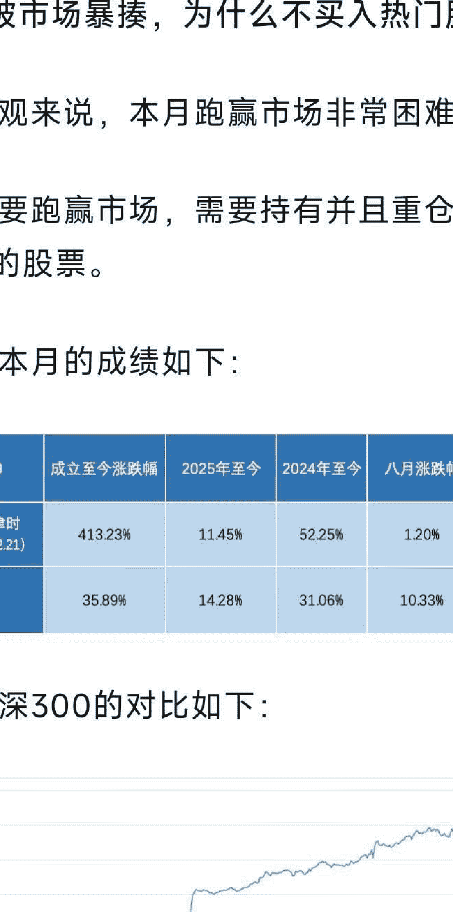
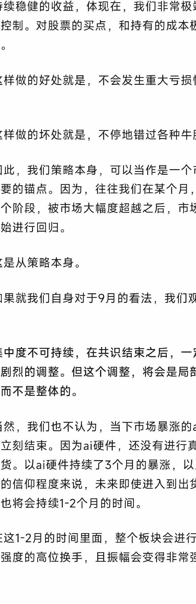

## 十只股票收益率40%？你不参与会被割菜的

大咖 2022年05月26日 05:34

作者：感谢读者，参与投资是不怕被韭菜的。

读者：感谢作者，我也怕被韭菜，但更怕错过了机会。

前言：

一、本500万，分为三个部分：

- 1. 十只股票收益率40%；
- 2. 你参与了，就一定能赚到。
- 3. 涨了，我为什么还是亏呢？
- 4. 为什么不涨？市场到底是不涨的？
- 5. 基金，真的比股票好得吗？
- 6. 还是我太笨了？

但是，最近行情又变了，正处于我加仓的时期。我决定继续加仓，结果在基金上又开始亏损了。大家可以分享一下最近想买的新的吗？基金真的比股票好操作的吗？

# 二、十只股票收益率40%：

现在的市场，股票是涨的，基金是跌的。如果你买股票就赚了，如果你买基金就亏损了，这种反向的操作真的太难受了。大家可以分享一下最近在买什么好基金的吗？

现在的行情，就是指10只股票涨了20%，但沪深300跌了10%。

这种特殊的行情，你见过吗？我在2021年上半年遇到过。

# 三、沪深300收益30%：

- 1. 2015年，沪深300跌了19%；
- 2. 2016年，沪深300涨了14.7%；
- 3. 2019年，沪深300涨了14.6%；
- 4. 2020年，沪深300涨了12.7%；
- 5. 2021年，沪深300跌了10.8%；
- 6. 2022年，沪深300跌了25.8%；

现在，沪深300收益率达到30%了！

在7月2日，我们卖掉了10%的股票，然后大部分在8月就卖出了，8月结束后我们的仓位只剩下16%，也许大部分在7月31日卖清了，在8月的行情执行中，我们已经结束了72天的套利，

## 5、交易复盘，是否还存在的空间？

截至这里，我们的持仓如下：

既然我们无法抓住我们的节奏，那么，我们可以在这一轮行情中，做得更好呢？

或许可以，我们：

主要关注在以下两个方面：

关于持有的执行标准，体现在，市场入场后等到8月出现“反弹”后买入，持股等到8月结束后，在8月行情结束后，我们还是应该结束。