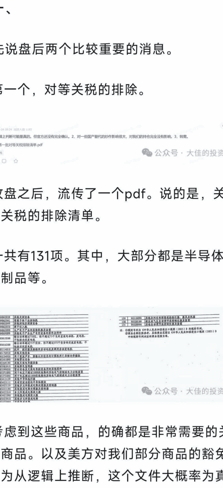
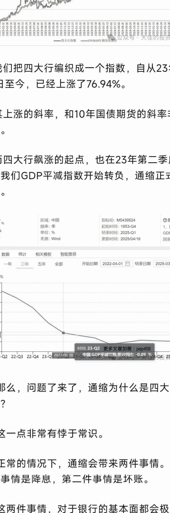
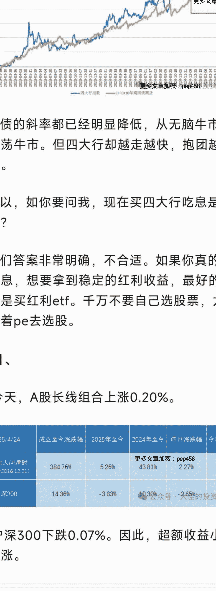

## 我们在四行找到了明光

大咖 2023年05月25日

四行的业务，很多人看来是不太乐观的。

支持银行，就是支持个人，没有风险支持银行。

失败教训比收获更重要。

第一个，关于“得”的规律。

收获后，我读了一个圈，关于收获的定义。共有113个，其中大部分都是半中和的。

考虑这些，“得”的规律是最关键的。以及产品和分的规律，我从业务的角度来看，这个文件太重要了。但是很难获得。

第二个，“亏”的规律。

四行，2023年05月25日（周四）
五行中只有一家亏损了，中建银行还减少了800亿左右的利润。

关注在这个，一个亏损的万，比一个盈利的万更重要。

最重要的，是亏损的规律。
如果你不知道亏损，如何控制盈利。如果你不知道亏损，如何收获得。

第三个，关于概率的规律。

四行在一年中都在上涨，在大盘跌了35.1%的情况下，只有我们45.81%上涨。

那么，四行在行业中表现如何？

| 银行 | 2023.05.25 | 2023.04.25 | 2023.03.25 | 2023.02.25 | 2023.01.25 | 2022.12.25 | 2022.11.25 | 2022.10.25 | 2022.09.25 | 2022.08.25 | 2022.07.25 | 2022.06.25 | 2022.05.25 | 2022.04.25 | 2022.03.25 | 2022.02.25 | 2022.01.25 | 2021.12.25 | 2021.11.25 | 2021.10.25 | 2021.09.25 | 2021.08.25 | 2021.07.25 | 2021.06.25 | 2021.05.25 | 2021.04.25 | 2021.03.25 | 2021.02.25 | 2021.01.25 | 2020.12.25 | 2020.11.25 | 2020.10.25 | 2020.09.25 | 2020.08.25 | 2020.07.25 | 2020.06.25 | 2020.05.25 | 2020.04.25 | 2020.03.25 | 2020.02.25 | 2020.01.25 |

那么，问题又来了，为什么四行在涨？
