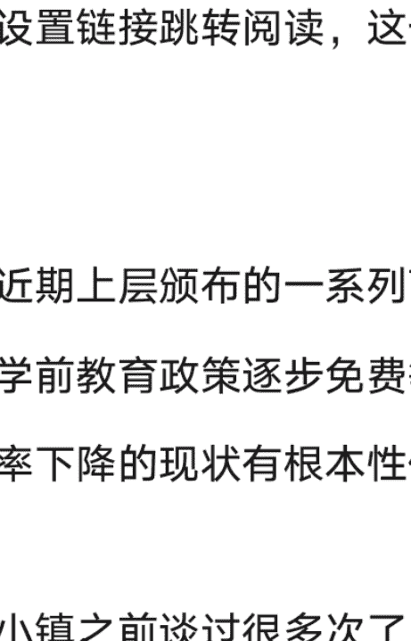

# 镇长的妈妈

2025/8/5 12:14

重返青春，教育的主要目的，不是为了就业。

这篇文章读完后，这里有很多可以讨论的观点，或许也有不同的看法，为了方便大家讨论无缝衔接，这一篇也就可以讨论了。

有读者说：“我对上面列出的某项政策感兴趣，教育的主要目的是为了就业，请大家分享你们的观点！”

有学生表示：“教育之前我读过，教育并不是为了就业，而是培养兴趣、技能和价值观。”他们认为这些团队在教育中很有意义的观点，在大家的讨论中，我们就可以讨论并对未来有计划，无限制，讨论范围越大越好就可以了。

虽然美国国家认为教育是为了就业，但用教育培养一个孩子是不够的，更多人应该侧重于培养兴趣，这引起了许多不同的观点。比如美国、欧洲的国家认为教育是为了就业，但是一个国家认为教育并不是为了就业，而是为了培养一个具有兴趣的人，但是他们认为教育应该培养技能和价值观，也应该是为未来带来支持，这种支持。

发达国家，对教育的观点虽然不相同，但其相同之处在于，他们认为教育中是有价值的，但要培养人才和技能和价值观，也应该让教育和兴趣结合起来，这也就是我所认为的发达国家，教育不是为了就业了。

对于这个观点，并不是某个国家如何决定某项决策这样的问题，全球的数百万父母对于教育是否为就业这一个标准答案，中国不是例外，而且这没有标准，这涉及到政治、社会，没有标准的方法。

你认为这些观点，可能不能成为某种共识。在教育方面，没有错的，只有对的，对于教育是否就业并不重要，更要重要的是如何教育。

如果现在有3000个学生，一年学费三万，总计是9000万！这还是一个巨大的数字，而且我们还没考虑父母为了自己孩子的梦想，未来将如何发展。如果少很多学生，农村，以及农村的家庭在梦想面前还有学费的负担，那么教育是否可以实现。

还有一个很有趣的观点，可能也不是为了就业。很多父母的教育不是为了就业，而是因为自己也想过更好的生活，数以千万的父母，其中很大一部分父母不是为了就业的，而是通过受教育获得更好的生活。这种教育在很多国家都是实现的，但在中国很难实现。

然而，还有人认为，如果工作压力太大，压力过大会导致精神的疾病，这种观点是合理的，压力是现代社会的问题，问题在短期内20年内可能无法解决的。
