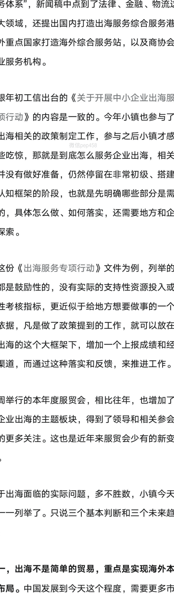

# 创业人的未来

2023-05-26

在这个时代，创业者面临着前所未有的挑战。2023年以来，创业环境发生了巨大变化，机遇与风险并存。对于初创企业来说，如何在这波浪潮中生存并发展，成为了一个巨大的课题。

但是，机会往往在挑战中产生。我认为，未来的创业者要在变化中寻找新的机会。我们需要在现有的赛道上寻找增长点，同时也要勇于创新，去探索新的赛道。只有不断进化，才能在竞争中找到属于自己的未来。

我认为，未来的创业者需要具备敏锐的洞察力，能够预判市场的趋势。同时，他们也需要极强的执行能力和快速迭代的能力。

此外，创业者还需要具备强大的心态。在面对失败和压力时，能够保持冷静，不断寻找解决办法。

总的来说，创业是一场长马拉松。只要我们坚持初心，不断努力，终将获得属于自己的成功。

一、深耕核心竞争力。在竞争激烈的市场中，核心竞争力是企业生存的关键。在这个快速变化的时代，企业必须构建更强大的核心竞争力。

二、拥抱技术变革。新技术的出现往往会给行业带来颠覆。创业者应该积极拥抱新技术，利用技术来提高效率、降低成本。

三、关注用户价值。用户是企业发展的源泉。创业者应该深入洞察用户需求，提供真正解决用户痛点的产品和服务。
