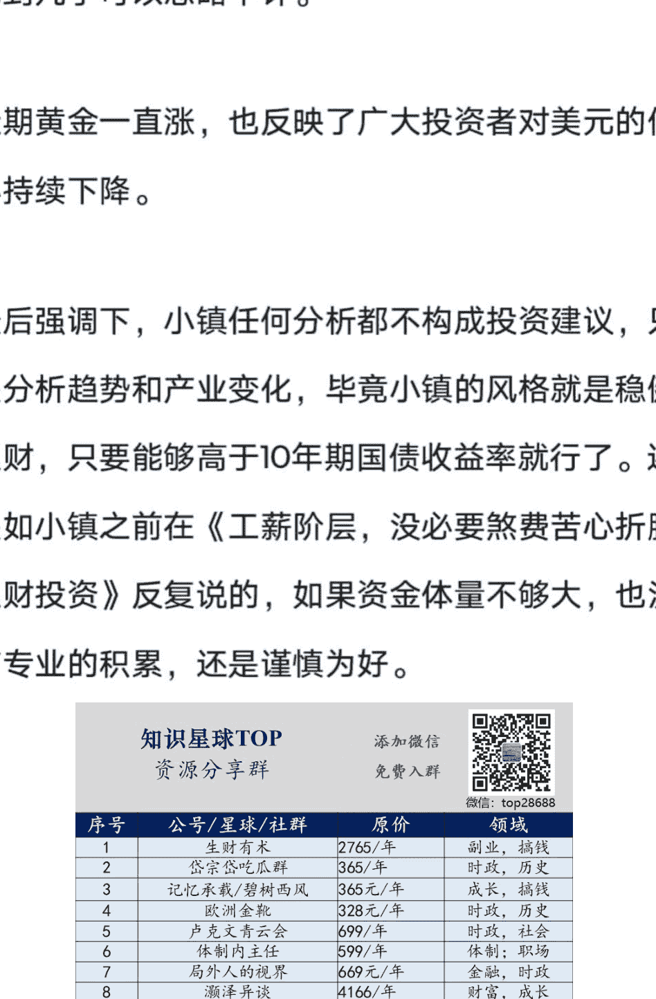

# 负责人的主题

2023-07-22

负责人们：“AI模型将是未来最核心的机遇”，AI企业：不必担心，大机会将让每一个优秀的企业都有机会。但是，这并不是一蹴而就就能获得成功，而是需要从失败中不断学习。”

但是要注意，在浪潮来临时，并不是每个人都能分到一杯。只有那些敏锐洞察到机会并做好准备的人，才能在浪潮中脱颖而出。

OpenAI发布GPT-4后，国内企业也纷纷发布了自己的模型，引发了百模大战的局面。

然而，在这场激烈的竞争中，中国企业真的有胜算吗？专家认为，OpenAI在算力、数据、人才等方面，已经领先了中国企业至少一个代差。

在GPT-4发布后，OpenAI又推出了GPT-4 API，让开发者能够探索大模型的应用边界。与此同时，中国AI企业也在努力提升追赶速度。

虽然在基础模型上，OpenAI处于领先地位，但中国企业并非完全没有机会。专家认为，中国企业在应用落地、商业化方面可能具有优势。

但是，中国企业在追赶过程中也面临着巨大的挑战。在算力、数据、人才等方面，中国企业依然存在明显的短板。

在算力方面，OpenAI拥有数万块H100芯片，而中国企业由于出口限制，很难获得最先进的芯片。

在数据方面，OpenAI拥有海量的英文高质量数据，而中国企业虽然拥有丰富的中文数据，但在高质量数据的积累上仍待加强。

在人才方面，OpenAI汇聚了全球顶尖的AI科学家，而中国企业在顶尖人才的储备上仍然存在短板。

尽管如此，中国企业依然认为有自己的机会。中国拥有最丰富的应用场景，这为大模型的落地提供了良好的土壤。

例如，在智能制造、智能医疗、智能教育等领域，中国企业可以开发出更具针对性的解决方案。

此外，中国强大的互联网基础设施和庞大的用户群体，也为大模型的训练和迭代提供了巨大的支持。

总之，AI大模型的竞争才刚刚开始。中国企业只要找准定位，发挥好优势，就能在竞争中占有一席。

面对AI浪潮的来袭，挑战与机遇并存。中国企业能否在这场激烈的全球竞争中脱颖而出，开辟出属于自己的未来？

来自：更多阅读
