# 究竟是人民的名义？亦或是权力的游戏？

原创 赵皓临 大浪海沙 2025年07月27日 12:02 河北

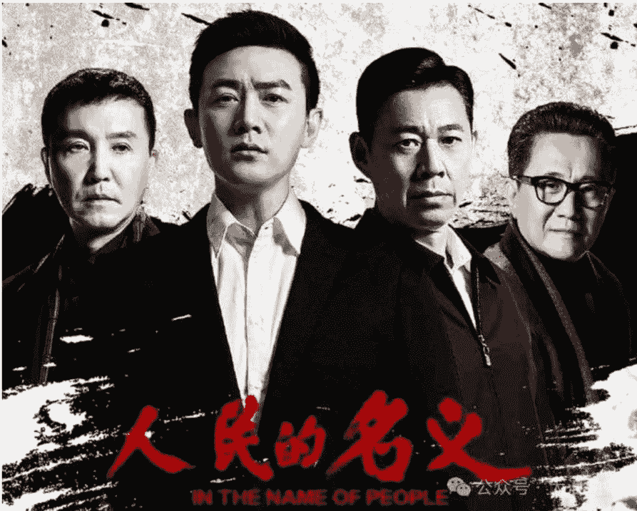

本文通过一系列代表性人物的分析，去剖析《人民的名义》这部作品：一、王文革；二、李达康&易学习&孙连城；三、陈岩石&沙金龙；四、祁同伟&高小琴；五、侯亮平&钟小刚。

## (一)王文革

王文革和李达康是解开《人民的名义》奥秘两个重要的钥匙——第一把李达康开的是“官腐”，第二把王文则是解开“人民”。

祁同总是喜欢吹自己“胜天半子”，他对权贵“胜天一路”和汉江位上的剖高狗“胜天半子”。《人民的名义》中只有无人接近“胜天半子”评价的，就是王文革。

王文革作为一个坏的真无产阶级，为逆天命做了两件关键的事情：第一，决定“斗争”。第二，团结领导汉厅所有人一起“斗争”。否则局面就不一样了：沙瑞空降汉东清扫赵家势力是既定前提，但是从何入手是不得而的，毕竟赵家一边的金矿烂账太多了，就算直接查金山水庄园不一定能展现大风广。

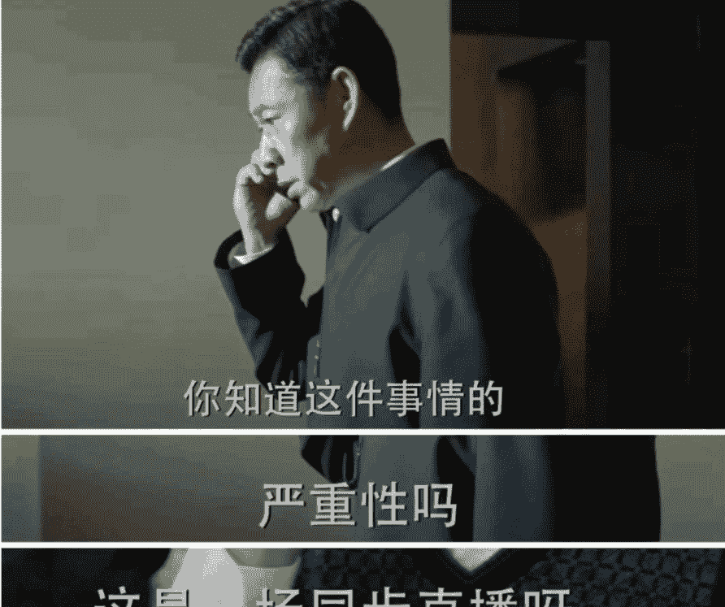

### 你知道这件事情的严肃性吗？这是一场同步直播呀

而王文革这一把火，不但给沙瑞金找到了突破口，更是改变了大风广全体工人的命运，让他们从无人问津的马牛，变成了能上谈资的筹码之一。虽然不好听，但是比马强多了，套用一句比较流行的话提升了自己的统战价值”。

还必须注意的是，王文革的“逆改命”之所以有效，是因为已经是互联网时代了，强拆大风广是一场“互联网直播”，带来了全民的舆论压力，而王文革不但“胆胜天半子”“更是人民的名义“真正的化身”。

微信信号:jntsg8 微信号:jntsg2 免费进资料群

## 风雨无阳服装

我是路人，因为好看的，为什么要穿服装？感觉很呀人啊，哈哈，负哀弱者。

@~ 干嘛呢？牛逼。我也是醉了......吐水......有鲨害体感觉不怕。无敌是多么冬天，无敌是多么蜜，无敌是多么被爱。服装、服装、服装。哈哈哈哈哈看我什么衣服!!!!!!!!!!

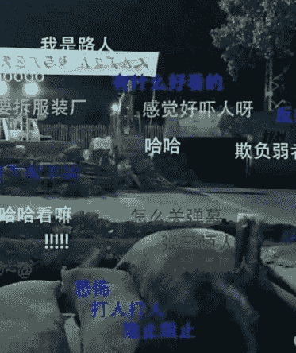

### 打人要公平·大浪淘沙

## 知识星球付费资源分享群

添加微信，免费入群

| 序号 | 公号/星球/社群 | 原价 | 领域 |
|---|---|---|---|
| 1 | 生财有木 | 2765/年 | 副业、搞钱 |
| 2 | 众众吃群众群 | 365/年 | 时政、历史 |
| 3 | 记忆斩/增智西风 | 365/年 | 成长、摇钱 |
| 4 | 欧洲金刚 | 328/年 | 时政、历史 |
| 5 | 尹克云生态 | 699/年 | 时政、社会 |
| 6 | 体内主任 | 599/年 | 体制、职场 |
| 7 | 局外的视角 | 669/年 | 金融、时政 |
| 8 | 湘并逊 | 4166/年 | 财富、成长 |
| 9 | 守永人总司令 | 599/年 | 时政、经济 |
| 10 | 江江初沪 | 365/万 | 时政、经济 |
| 11 | 政堂/顾子明 | 568/年 | 时政、经济 |
| 12 | 唐书院 | 1399/万 | 金融、财富 |
| 13 | 大树小钱 | 199/年 | 时政、成长 |
| 14 | 水聚砍达 | 10000元 | 房产、经济 |
| 15 | 洪澜的宏观策略 | 4376/年 | 经济、摇钱 |
| 16 | 金通国际/北海南 | 4576/年 | 股票、行研 |
| 17 | 福锡的世界 | 299/年 | 时政、社会 |
| 18 | 飞龙术 | 3600/年 | 股市、经济 |
| 19 | 来联见闻 | 599/年 | 经济、金融 |
| 20 | 鉴案查财经 | 330/年 | 房产、股票 |
| 21 | 在八小时之外 | 365/年 | 成长、职场 |

- 各种高价资源（图书、课程等）
- VIP群每日分享免费资源（日均75/年）
- 知识星球 TOP 星球 网监处

希望我们阻止现场的群众拍摄视频和照片。

当然，这是《人民的名义》原著中的王刚，不是剧改的王刚，能够为我们提供非常有价值的启示。首先王刚这个名字，姓王，也叫文刚，还是卫青出身，这三重buff起来，让人怀疑作者是故意的。在原著与剧中，他的形象彻底的“两极化”——从一个有勇有谋的工人领袖，变成了一个阴险狡猾的犯罪分子。电视剧《人民的名义》中的王刚是一个恐怖形象，但不纵火了自己，还是一个绑架狂，为了“报仇”间接害死了自己。看着电视剧的不少读者对王刚产生同情，但是绝对没有一个人会对王刚有一丝同情。而在原著《人民的名义》中，王刚是一个180度转弯——一位坚定、威严、光荣、有勇有谋的战士，是老派无阶级的风采，是一个寻常的人物。看着书中描写王刚的文字：“王刚队长。这家伙比人高壮，浑身腱肉，看上去像一座塔。赵茂也是个，王刚站在一起，仿佛靠在一根电线杆子上。十分紧张的李大刚突然打了电话，说昨夜李书记下了命，常小虎连在一大早就要集合，拆迁队部署了。千万不要大意！”

可以看到王刚的形象高大威严，懂得建立广泛的统一战线，在小说里他是一个不扬的工人；而在剧中则变成了一个坏蛋、偏执、不择手段的危险人物。

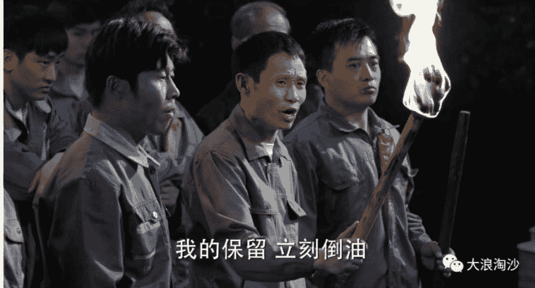

## 烧死也活

站在楼上的王刚，首先发现敌情，他招呼王刚上来。通过望远镜就能看见黑压压一片大型机械，大道：“坏了！”紧急集合，警报尖锐地响起来，把工人们点得激动、紧张。赵瑞不在现场，王刚只好与几个头商量：看来这次不用用最后的手段，挡不住他们的进攻了！

这段描述，具有当年革命小说的风采，基本立住了王刚一个正面形象。然而，在小说里王刚展现出了冲动、不理智的一面，甚至动了绑架赵刚之子的念头——但是由于走投无路，王刚展现了理智。仅仅是走投无路时，被赵瑞咬了一鼻子才打消了这个念头。在小说的最后一章里，王刚依然是重要角色，大风工厂股权还没有回来，他们依然走着艰难的维权之路。而维权的核心就是王刚，他以工人厂队长的革命，强行把“工厂”赵刚拉了他们共同维权之路——赵刚觉得，这个世界上太诡异。此前做梦也想不到，他一个老党员，竟以这种姿态出现在市政府前。他不想那座嵩着国的大门，却转身无奈。他的手臂被高壮的王刚死死扣住，身后的兄弟步步紧逼，他走得走不了……”

彻底抹黑王刚，不仅仅是因为他的名字，更是否定了工人斗争的合法性，把自下而上的工人工争贴上了暴行、群氓、恐怖主义的臭名。至少《人民的名义》原著放在那里，我们可以看到电视剧与作者在某些问题上截然相反的态度。

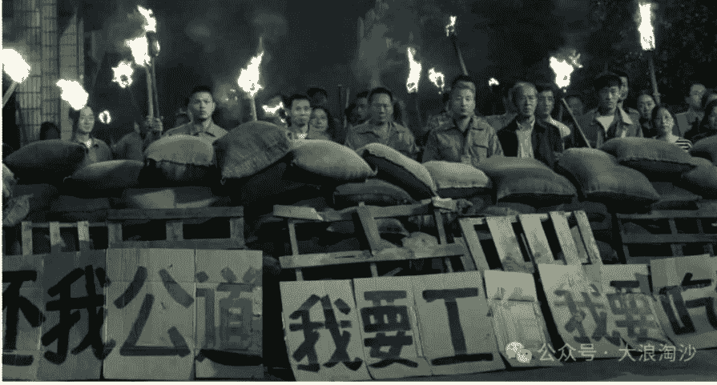

## (二)李达康&易学习&孙连城

这三个人放在一起，不仅仅是因为他们三人在剧情上的高度相关性，更因为他们三个人的形象特别有代表性：李达康是酷酷+能狠；易学习是能狠+清醒；孙连城是清醒+朴实。

网络论中，李达康这个角色人气很高，人们都说他会发展GDP，但是绝少有人想看一步——李达康之所能发展GDP，是因为他为每一个地方都把一个地方土地全卖了。京州的土地被卖到西丽120年后，GDP不够吗？我也行。

《人民的名义》电视剧虽然没有小说那里直白，但却处处暗示这一点，反复提及及生怕大家没注意到就是：孙连城要给大风广找一块安置处，工人要求也不高，大一个光明区地也没有，孙连城给李达康抱了，光明区的地都被丁义珍卖光了。

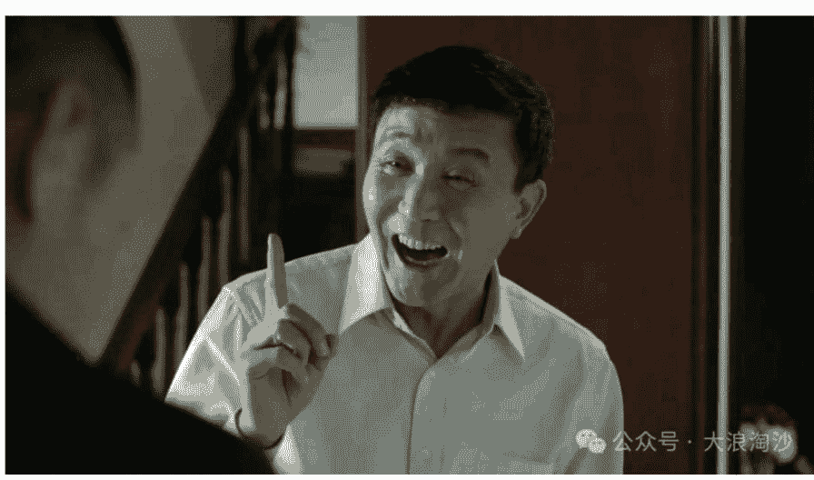

就是一个标准的春秋笔法，丁义珍就是李达康的黑手，脏活全给他丢去。一个市最核心的区，堂堂市委书记他不知道？更何况还是李达康这种一方的强势官僚，你信他不如我是秦始皇。

所以李达康这种干部都能获得高人气，就是人民群众看表面、不肯想一步的标准差例。

李达康身康，副市腐败了（还是连丽林和京州），老姜腐败了，纪书记腐败了，就你李达康自己清洁、出淤泥而不染？要给自己拍个《繁花》延续集让王家卫构造成光辉闪闪的“改革圈”怎么样？总有人李达康——他能发展GDP，他也搞经济，但是没有人问一句：代价是什么？

### 代价是什么

京州市全体居民，为李达康这种不择手段的发展GDP来买单。《人民的名义》和《财产》原著对于李达康这种百姓的反思具有高度，我们总结一下就是：发展的成果无法享有，但是发展的代价要老百姓承担。

我们先来讲《人民的名义》之后的故事，也就是《财产》中京州市的故事：靠土地、买房维持京州的经济发展动力不足，李达康为了急命，急上旧城区改造，因为工期赶太死，出现了“野蛮施工”的现象。结果施工队拦了燃气，引发了爆炸，而爆炸中心则是黑矿和孙连城。孙连城在大火中救出了几个儿童，同时也受伤，同时也为了正义英雄，被媒体报道“光明区长舍身”。孙连城看着鲜花落去，王刚就不理。李达康“廉政培训班”处理过的批干部，把孙连成了精神领袖，权力聚集在病床前，反映各种问题。当年老石被称为“第二检察院”，作者非常幽默。

### 孙连城仕途顺，心意冷

喜欢文学之后，方刚宇宙易学习，李达康算什么？李达康高良，沙瑞金算什么？孙连城算什么？李达康，易学习开悟了，不过都是蚂蚁尘埃。

李达康，李达康，易学习，孙连城，易学习在原著和影视比较，李达康的形象堪称差别第二，仅次于王刚。今天我们不要结合原著分析。首先，这是《人民的名义》原著中的王刚，不是剧改的王刚，能够为我们提供非常有价值的启示。首先王刚这个名字，姓王，也叫文刚，还是卫青出身，这三重buff起来，让人怀疑作者是故意的。在原著与剧中，他的形象彻底的“两极化”——从一个有勇有谋的工人领袖，变成了一个阴险狡猾的犯罪分子。电视剧《人民的名义》中的王刚是一个恐怖形象，但不纵火了自己，还是一个绑架狂，为了“报仇”间接害死了自己。看着电视剧的不少读者对王刚产生同情，但是绝对没有一个人会对王刚有一丝同情。而在原著《人民的名义》中，王刚是一个180度转弯——一位坚定、威严、光荣、有勇有谋的战士，是老派无阶级的风采，是一个寻常的人物。看着书中描写王刚的文字：“王刚队长。这家伙比人高壮，浑身腱肉，看上去像一座塔。赵茂也是个，王刚站在一起，仿佛靠在一根电线杆子上。十分紧张的李大刚突然打了电话，说昨夜李书记下了命，常小虎连在一大早就要集合，拆迁队部署了。千万不要大意！”

可以看到王刚的形象高大威严，懂得建立广泛的统一战线，在小说里他是一个不扬的工人；而在剧中则变成了一个坏蛋、偏执、不择手段的危险人物。

大火当晚上，李达康本来是拍板机强的，结果被陈刚顶在了，一句“小金子”让李达康180度转弯。书中的描写更加淋漓：李达康如果反应迟钝，他也不会叫李达康。他立刻清醒过来，这块石头看来真不好意思……李达康的命令令人眼花缭乱，而且少要啰嗦——是命令祁连停止疯狂。不要为什么，立即执行！又指示公安局长赵来：保护好老人，准备一辆救护车，万一老人不好，送医院！还脱下他身上的椅子，给岩石补上，以免老人着。天亮时，行管处送来豆浆、盒饭，让他们垫垫。李达康却把这些先送门口的陈刚等人。

于是，这日，祁同在现场，祁所看到这样一幅景象：面对推土机，陈刚独自在一张石头上发抖……市委书记的件褐色衬衫落在老人身上。祁同在忍不住，奇怪地道：“李书记，你怎么悠然就变了决定？你到底是怎么想的？”李达康笑着，抬上眼，慢悠地说：“祁长，你呢？你刚了什么……”祁同苦笑，一脸错愕。仅仅几秒后，他就跑去签了门。

看着东方亮的第一缕光，李达康面带亲切温暖来到大院门口。行管处长在指挥机关楼的大师傅给工人们送早餐，李达康自然地走过去，从祁师傅接过一包包子送到老人身上，老人接过，手抓着木椅扶手坐在那儿，中不回应。李达康拍了拍祁人的头：师傅没事，快热热吧！又端着一碗饭送给一位女士，饭有些，他嘱她小口接过去……京州电视的摄像镜头及时跟进，拍下了这感人的场景，昨天夜里一场代言修。

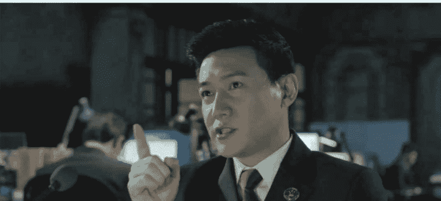

“法无即自由”这句话就值得说道，或许应该是人民的。而对于官员来说应该是“法无许可不可为”。李达康作为一省封疆，他的疆更大，他要是喊出“法无即自由”，可想而知的“自由”有多么。

易于学习没想到，谈话会出现这样的结果。情况比他想象的还要严重，同级书记实在太不容易了，就算有他这样勤勉奉献的纪律干部，也难以监督李达康这种一把手……

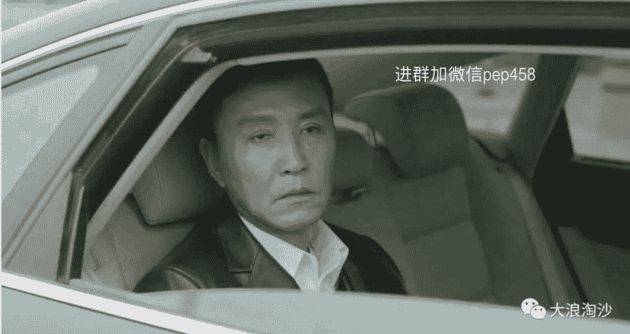

下面我们就说说是为什么李达康制造了围连城。

无论在小说中还是剧中，李达康的这一形象都是一以贯之的：霸道，一言堂。在发展经济的过程中，强有力的腕确实带来了日新月异的GDP，但是造成了两个后果：第一，李须刚之链被李达康信任后，造成了腐败的空间；第二，其他干部的施展空间被李达康强挤，退进良谷，只能“躺平”，成了腐政现象。
引用小说原一段：

张立树委党委书记：李书记，丁义珍的问题反映过，去年他儿子结婚大收礼，还有，和一些投资商的不正常交易，我也提醒过……

李达康挥了挥手：好了好了，你们可不是来追责的，是研究下一步怎么办法！

这段就非常异常，李达康先是想甩锅，结果发现动不了，直接转移话题。普天之下的领导是不是都是这样的？

我以党性的名义
跟我个人的名义
我从来没有接到您的
任何电话跟任何信件

那你就被架空了

可知道在李达康手下的干部是一种的心态工作，除了腐败分子和廉洁干部，李达康这种行事风格还真容不等人。孙连城下面这段话非常有名，至于来源有人说是电视剧删减的部分，有人说是小说原著删减的部分，有人说是网友自己瞎编的。

具体来源于哪里不重要，之所以能够广泛传播，说明大家认为它说得好、说得对、说出了问题的关键：

孙连城：“你说我不作为，就不是因为我给新大厂解决用地问题吗？岩石告诉你了，新大厂方面二十工业区，光明能区的地都让丁义承包了一二净，你你付好了岩石，这份课可够他们抢二十工业用地了？你让我怎么做？就靠光明区域，他们他们钱么？一分钱都没有，你说该这么吧？你把他们那些工厂户，合办之后，哪家银行愿意给我们贷款？还有个信访的口子，你不改钱呢？财政财政划给大厂赔了1000万，还有钱呢？我自费60元4个小子专项顶怎么办？怎么就不作你了？老百姓些小椅子了？再再说，你说了信后，丁义的时候，你怎么办呢？他一回头，你没发现？就看见了？你早干了吗？”

孙连城丝毫没有停下来的意思，继续：“你来说我不作为，你那么呢？你用丁义主持光明项目，他吃着老胡，功夫非为，句合结尾商，随便把工业用地改成商业用地？你来一把手，当真一点不知道丁义出事之前，群众早就说没事，你改了，充耳耳吗？丁义出了，你却懵发了，这叫你？”

李康席侧斜地说道：“在丁义这件事上，我不用人，我损失，我道款。”

孙连诚：“孙连城：“这可是，李达康，你承担责任了吗？挣了？还是呢？违违酒都都没有，你道道用的，你还啥？说完了丁义，你再说晚，你那么要为银行，放该回去，你一点儿不知道他出事当天，你刚离开，你还挪着好几万的名额，你这些年都都没了？不，好几万的名额，你这些年都都没了？你就说不知道受脑，你那个孩子学的费和生活费是哪来的？你知不知道？是真知道，还是装不知道？你自己管了不了，你孩子都都不了，你还有说我不作为？”

李康睁深了一口气，一拍桌子，大吼：“你要觉得李达康对我有问题就去委员会报告！我现在是讨论的事，就说事，你？”

孙连城微微一笑：“好，别哥了，别了，你说我改，孙连城在光明区就是十年，我改，光明区怎么为全市第一？为了你肥大一块价值过亿，就是我改么？我还接触过行业，但在连区让当，你还不知道？李达康是坐起来的，说是梁峰书记的女儿，你们都是资源的，你还不知道？孙连城在光明区二十年，这个连区书记上去，不是因为我没有资源？还有一个大富丁义不知道，如同不对，对了，丁义出了你急带跑，天王下雨跑，你把当食堂了，李达康还能？怎么没作为一个你不怕？”李达康指着孙连城吼：“你再敢我就除！”

孙连城笑着：“你惹了？你凭什么开除？你以为你是谁家的？你”

## 在这儿听谁响？李达康，我等着你这一话简直是孙连城李达康，就算它是网友的，李达康的“同文”，我也不允许许过《名义》的朋友没有读这段话。这简直不需要我解析了，孙连城每一句都点子上——李达康身边溃成塌，你要么是腐分子，你要么是输你选一个吧。我们需要注意的是创作时间，《财产》这部作品不是2021年出的，肯定是受到了《名义》电视剧开头的影响，孙连城等形象观众意见，也一定影响了作者的创作。所以《财产》中的李达康形象，既包含了《名义》原著中的酷酷”成分，也包含了电视剧中刚刚塑造的可爱李达康，同时也加入了土地开发遇到瓶颈、房不住等趋势——这些都是我们理解的前提。

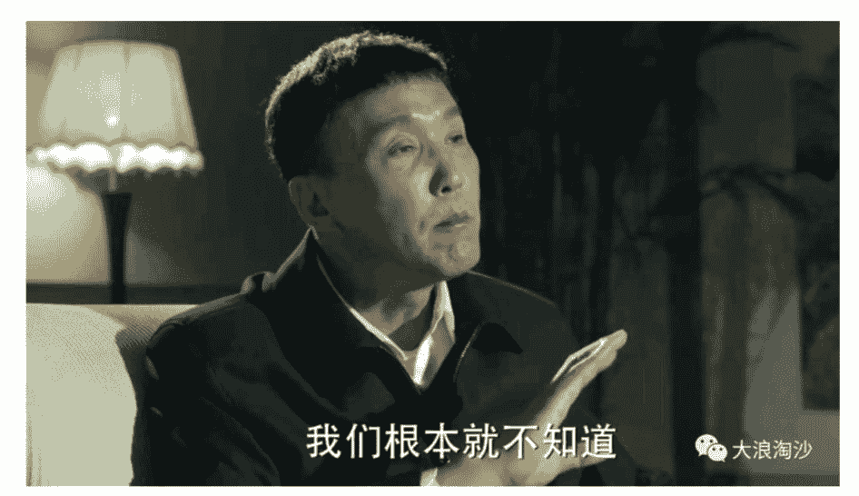

终于要说到了开头的故事，是因为“蛮施工”引发的“九二八特大爆炸”，让李达康的政治遭遇非常被动，而在反思“九二八”的会议上，李达康依然没改变“一堂”的霸道角色；他把九八事故归结于贪腐、懒政——因为丁义棚户区改造的钱都花了，孙连城迟迟不动棚户区改造，才造成了重大伤亡事故。京州市的形式早已今非，因为了一个说真话的毫不给李达康面子，指出这不仅是贪腐、懒政的问题，这个问题的根源在于李达康看着笔记本，笔记本按了下心了？以为自己会被的话吸引了，对大城市的群众群体心里装着群众吧？这样微微皱首。第二，京运大道拓宽工程为什么会出现蛮施工？是什么原因造成了施工单位的蛮施工？不是蛮施工他们挖了气管道，就不会发生爆炸，也不会出现在棚户区的灾难……吴雄龙看着脸说：吴长，对于这个问题，我想做个解释……厉事的连吴雄龙都不放狠里：吴长，让我说吧！李达康冷视看着：吴长，让你同志说吧！在一压抑气氛中，不对常看着笔记本，继续发言：第三，用人失当，比如，市长光明区的李庆丁，说工作能力很强，但他吕马功竟是我们书记的，李达康脸色难看，手上的铅笔不经意折断。

### 人民付出的代价

李达康继续被霸道一堂的笼，内心被炸药炸开了一块脑。会议上，已经向李达康亮底了，这段话基本上是《名义》原著结尾处那段“保护伞”论断的进一步解释。已经破了瓮城垒，同归于尽的决心要解决京州官场的问题了。然而李达康继续被霸道一堂的笼。李达康是“微私访”，去了杨户区做了深入的调查，其其实就改变了他以往的风。正如我们上文所述，李达康在湖畔听闻了“咱们工人力量”第一感觉是“震惊”，那是如果他去大风厂走走，了解一下工人的实际情况，那一晚大风厂的悲剧就有可能避免。原著中那个场景描述：李达康在山上看风景，虽然距离很近，但终没有碰面。描写得非常有术，李达康只是工作硬的“酷吏”，但他并不是良心，从他来看，李达康共情心里是正常的，并没有被权威消灭。在杨户区，李达康触动了，他表示：“九八一声”，九八爆炸炸了罐，这才发现，这么多年，我们高速发展同时欠了一些债：比如京州杨户区聚集的……其实直接就是富差距、发展不均的问题。正好让《京时报》记者在杨户区调查，写了杨户区居民现困、不方便的生活。李达康说就把这篇报道发出来，李达康代表市委宣传部长，后记者还小心地录了音（其实李达康代表我同样是一言，只是在人民意志里）。结果《京时报》这篇稿出来了，反而引起了热烈反响，而在市长吴雄怒不可——因为给杨户区抹了黑，老刘们仁心，甚至影响了“九二八事件”责任，李达康代表市市政府的工作是不。

### 两面三刀的假党员群众：大浪潮

所以吴雄直接跳了锅，他不肯接这个锅。李达康的命令能尾甩出去；李达康的但是有这样一片“贫民窟”在市中，长时间没有解决，这个锅就是他本人的。所以他一贯官作风，李达康知道自己是一个发达书记，犯了一个大错误——没有追求GDP增长，没有扶势群体。李达康几乎哽咽着，说出了尖锐、刺耳的评价：你们政府政府的组织。为了说服反派，李达康决定召开一次民主会，在会议上，我们见证了李达康彻底改变，这两段话非常重要，建议背景：李达康眼中望向同志：同志们，如果我们的工作和战斗没有为广大群众关注了，那么我们的工作和战斗价值呢？GDP增长的值在哪里？从某种意义上来说，我们不是失去了？我就后悔自己失去了职！五年前我还能，不把GDP看成那么多，对弱势群体多一些关心和扶助，及早采取措施除去那个棚户改迁，也许就不会有“九二八事件”……在没有GDP高增长的同时，关注扶势群体，没有给部分群众获得、幸福感，“你们的GDP增长和忽略了”。这些都是十八大之后的新法、新理论。再次强调一点，作者周梅创作的《政治任务》、《名义》和《财产》，是非常明确的指向性的、是形式意义上的。他不是要创造出一个世界著名论家，分析李达康内心矛盾、痛苦、抉择、重生，不是以人为本，完善李达康形象的弧光、经历、心里描写，说到，李达康是为了上面服务的。李达康的“廉政培训班”上的五个字——以人为服务，那些廉政干部没有做到，其实李达康自己也没有做到，他一直是在“为GDP服务”。到《财产》中，他才真正悟了这五个字。所以说，李达康的改变不是自己的改变，是作者需要改变、是形势需要改变，是在《名义》之后，作者选取了人气非常高的李达康书记，用来做新的政治宣言的传声筒。李达康知道，这次和雄飞也有八九是在劫难边缘，雄飞下台是肯定的，他预计会下台。沉默片刻，李达康：老易，你知道造矿新村的户区我市有多少？住了多少居民吗？易学是个明白：我知道知道连片户区十四个，居民人口为五十八万六千人。李达康放下酒，感慨不已：五十八万六千人，占了他们京州六百三十万人口的近十分之一！这部分群众有了获得，没有幸福的，我们就没有。李达康看着他，怔住了，那张熟悉的脸上出现了几分激动。李达康真诚道：老易，哪怕是罪加等，我也不怕！就算滚蛋，到时候我也会上面指挥，利用五年时间，全面改造棚户区，让五万六千人全部住上。这就是李达康的“重生”，“的是实在在两次大火——孙连城“大风厂”火和“九二八”火，烧醒了李达康，意识到：我们的发展成果不能毫无意义。十九大报告中指出：我国主要矛盾是日益增长的美好生活和不充分的发展之间的矛盾。理解了这一点，就能理解李达康为什么要转变，为什么非。

### 李再勇

贵州省政协民主协商委员会组成员副主任我借的这笔钱要由我来还，我肯定不会去借，但是由政府来我就借了，反正几年一换，一拍屁股走人，后面继任者谁来承担责任。给大家画一个重点，李再勇代替检察机关起诉的罪名除了受贿之外，另一个就是“滥用职权罪”，借贷地方可以上升到“滥用职权罪”的层次了，这是法制的一大进步。同样都是为了“绩效”不择手段，我们有理由相信，如果不是持续作作者对李达康“网开一面”，李再勇就是李达康真实的下场。

(三) 陈岩石&沙瑞金

为什么要要把陈岩石和沙瑞金放在一起说？不是因为他们养父子的关系，而是这二者的形象具有高度相似性。沙瑞金这个“瑞金”非常内涵。他仅仅是带着“上层意志”来的，更是带着“历史意志”前往汉，代表“瑞金”道统执行正义。说一个很细节的部分，沙瑞金开的时候拿的是红蓝铅笔，而周围所有人都是简单的钢笔圆笔。红蓝铅笔具有高度象征性，和中山装一样，是那些老革命们的符号之一。

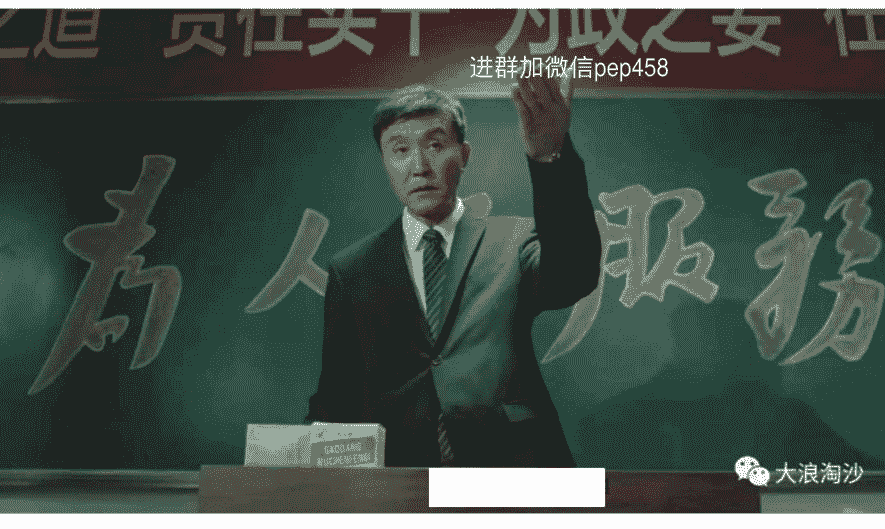

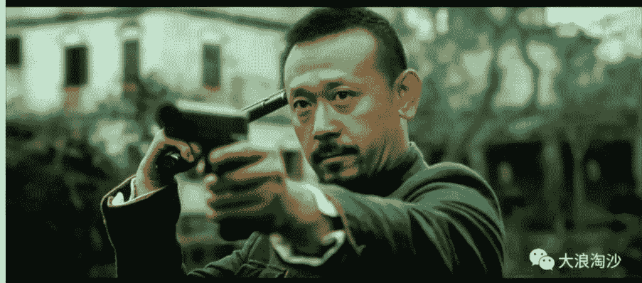

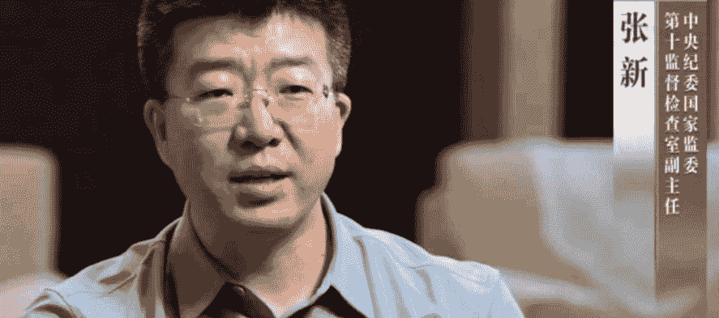

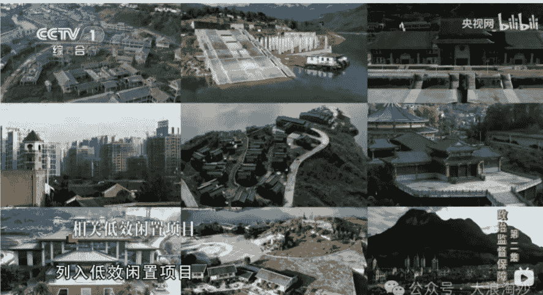

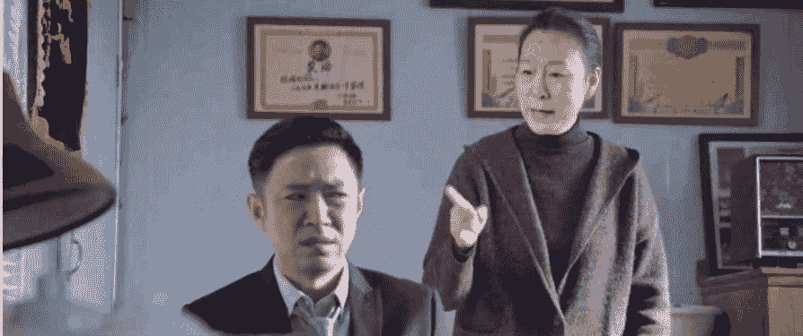

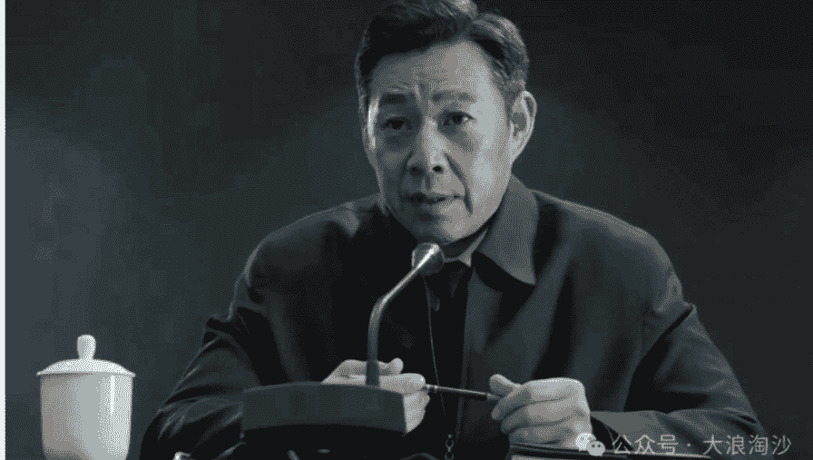

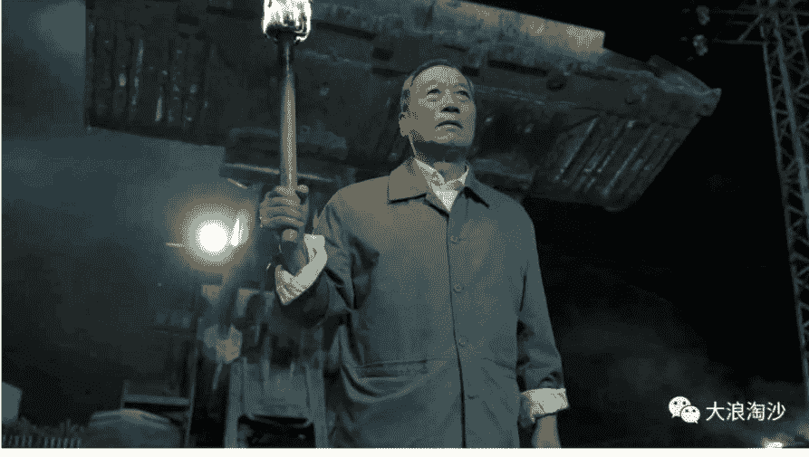

当年十七岁的陈岩石为解放中国狂炸药炸碉堡，如今七十岁的陈岩石为了大风厂的工人以血肉之躯挡在推土机前，这就是无产阶级革命者的英雄本色。

所以我们看《大明王朝1566》和《人民的名义》，会发现海瑞和陈岩石都是独立于这个“体系”之外的人，与这个“体系”格格不入的人，而且同样都是一个道德完人。那么这就我们需要过来来思考：为什么这些“道德完人”不能被这个“体系”所容呢？

汉东省省检察院常务副检察长陈岩石

我捐我自己的钱，用我的退休金，进了养老院。

你这不是矮村了，人家的矮小吗？那我该咋他？

# 我应该跟他们一块
# 同流合污
# 一块贪腐化

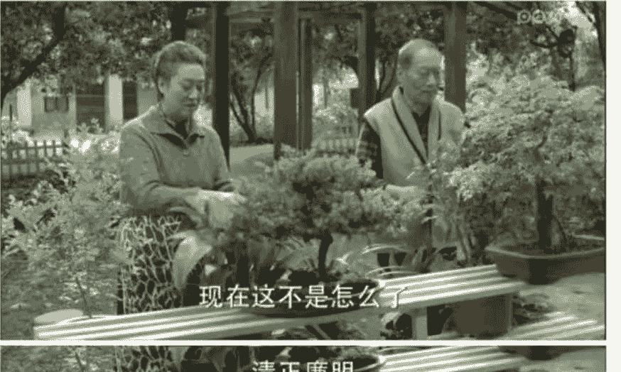

# 现在这不是怎么了
# 清正廉明
# 倒成了异类

我奉劝大家一句，看文艺作品的时候不要睁眼带入：你不是嘉靖皇帝，你不是赵瑞龙，你不是磊石，你不是李达广，你甚至连聂婉、高小琴都不是。

你是谁？你是改稻为秦被毁了稻农的农夫，你是工厂改制掉工作的下岗工人，你是堤坝塌下流离失所的灾民，你是企业被官商勾结了交不起暖费的员工，你是深圳漫漫大雪中的过地饥俘！

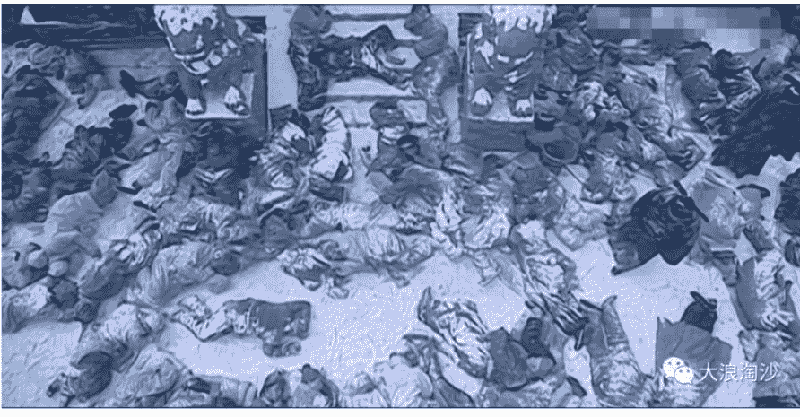

淳安县的百姓和大风厂的工人，唯一的指望就是海清天和陈岩石了。

## (四) 祁同伟&高小琴

很多人看《人民的名义》，不去共情丢掉工作、丢掉工厂、丢掉股份的大风厂工人，去共情一个天蛋子的祁同伟，被祁同伟亲杀糟蹋的那个女孩可有的说。

你那么爱祁同伟，祁同伟爱你吗？祁同伟连他老家村里的狗都能安排编制当上警犬，但他绝对不会爱你你。

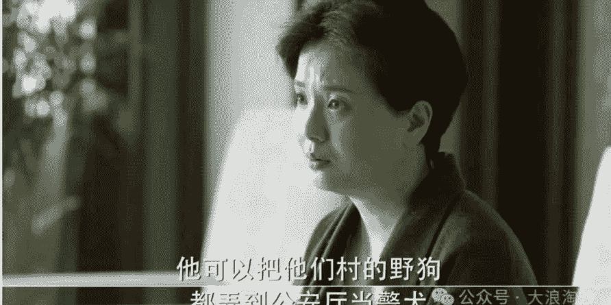

同样《大明王朝1566》中，很多人共情那个人沈一石。尤其是被资本家横霸道、操纵舆论与洗脑群众的年代，沈一石的同情数更高。都觉得商人不容易，觉得商人挣了钱都被官占了，他也是个受害者。

这里有一个明显的误导：沈一石抄家现金确实不多（白银），但是看看管家的交待——还有六万多多的良田，十几个丝绸织坊，几百家商业南区的丝绸旗舰和零售门店，上万万架织机，一百八十万石粮食……

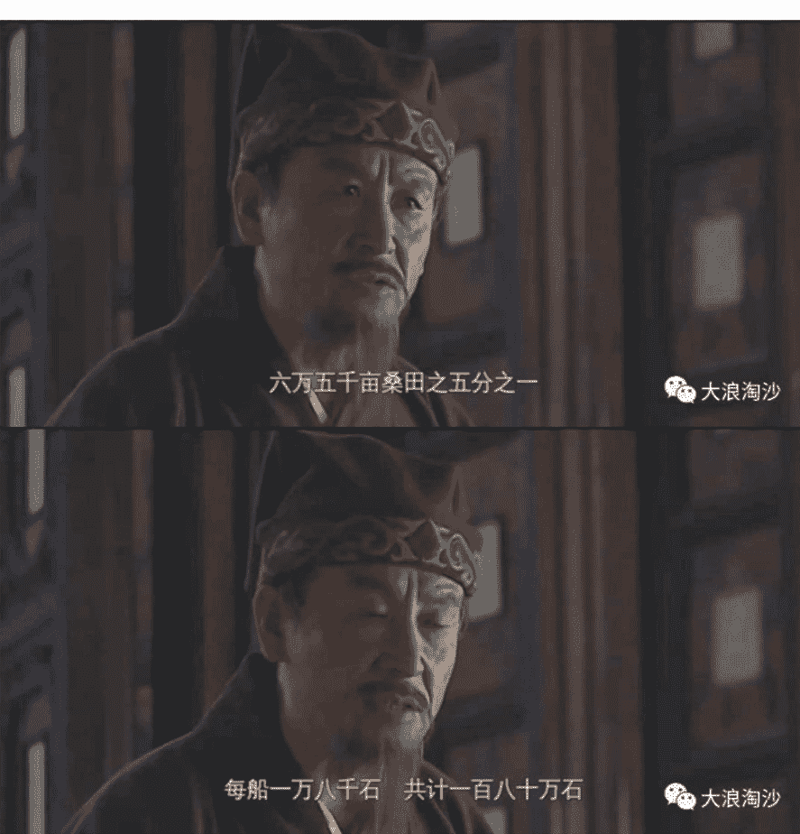

所以说资产不当费钱枉！最后胡宗宪的军费还是靠霍奕沈一石这些家产才凑齐的，所以说抄家的目的明的达到了。沈一石就是一点古典家的色彩，把资本都用来积累了。

当然，他确实是个白手起家，但谁说白手起家挣不到钱了？你看亨在英国经济救不洒？沈一石本来是个造局的，获得了类似于“官倒”的原始积累，四年前就增加了一千张织机，之后雪球滚起来了。

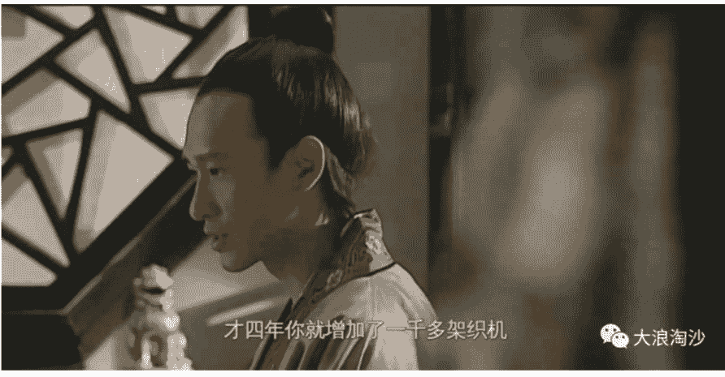

淘了这个浑水就别想看做白莲花，不然老实实在当你的书就行。沈一石妥了？你花二十万两白银两个。平时对官员的压抑是有点变态了，然后把气撒给艺娘。我们看电视剧，先看看自己手套白，共情一下工作的骰子是不是毛一样？还是那句话，想想自己的应该坐在哪里，别一天共情那个。

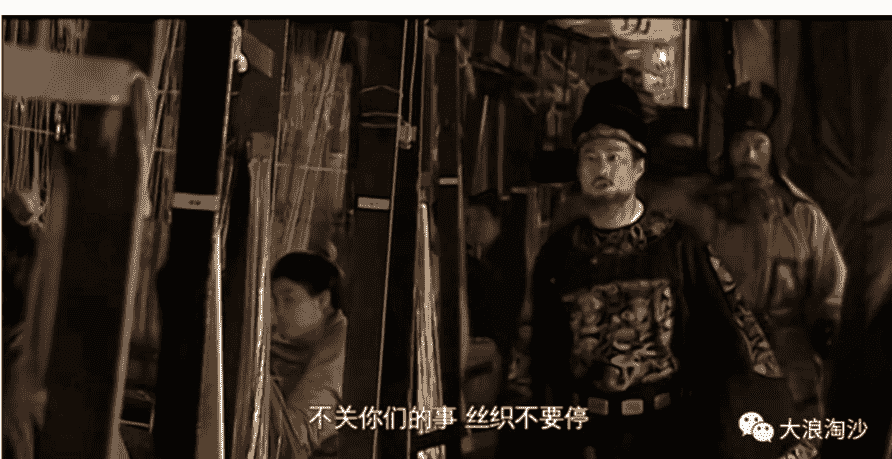

同样，祁同伟这个形象之所以经典，确实值得分析的地方，除了一群傻货自带之外，他的一个郁郁不得的形象还是能够引起同情的。

这里不得不说，原著中的祁同的故事就是“黑”。剧中祁同是因为受到了梁璐和吕峰的打压，一直被压在基层，流命；而在小说中，梁璐和吕峰根本没打算处理祁同，他就是一个，主要情节。也是说是，根本不需要主动打压这个设定，祁同作为一个没有任何背景，就算能力再强，本来也升不去，除非找一个有权势的父亲……这就是更“黑”的地方。

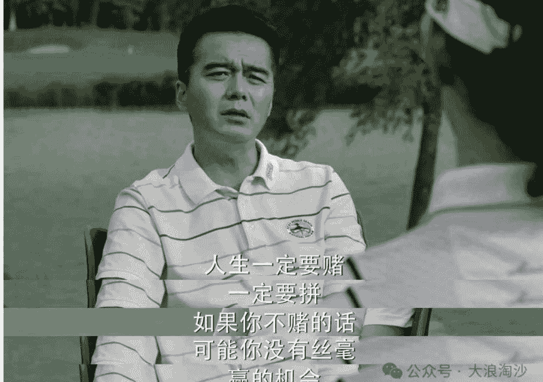

> 人生一定要给
> 如果不给可能没有丝毫的机会

其实大家可以一看，不管是英雄、抗洪英雄、救灾英雄，难道你每一个从基层提起来了，他们的待遇确实有保障，但是不是粉都上去了，一子的机会很大。

可以说原著中的祁同始终忽略到了这个“黑色法则”，于是决定自己去找路，没有任何打压和主动去找名声差的，所以原著中祁同是主动黑化，剧中被权力打压的情节还是让他了不少同情。

但是这个本质就变了——对社会本质，原著中所展示的阶级固化就是：不需要什么主动打压，规律就是这样的；剧中给了观众一个温情的想象空间——这样笨蛋的大学生还能上去的，都是因为有坏人啊！这也符合电视剧的一贯风格：大风广的问题怪丁义，京州的腐败怪丁义，京州未来五十年发展的土地都卖光了也是丁义的，甚至是光明信访的小都是丁义的意思……主要还是好的嘛，就是几个腐败分子坏了事！

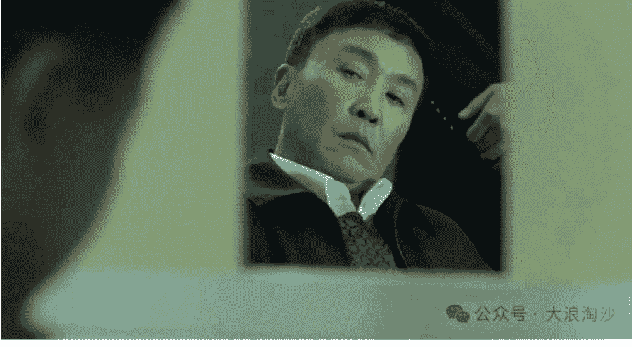

“所有坏事都是贪官的”其实就是反向“青天降正义”的游戏，我觉得还是旧设定更有深度一些。《人民的名义》电视剧有一点被诟病的，就是隐含传达出“穷人家孩子更容易造”这种观点，这也跟同样获取一定的同情相关。

## 知识星球资源共享群

| 付费文章 | 付费社群 |
| :--- | :--- |
| 付费课程 | 副业&搞钱 |
| 财经&股市 | 行业报告 |
| 时政·历史·职场·体制·自媒体学习·军事·软件·影音·社会学 |

公众号：知识星球TOP
微信信号：jntsg8
微信信号：jntsg2
让更多人获取高价值信息 江聚全网付费资源 添加微信 免费进群

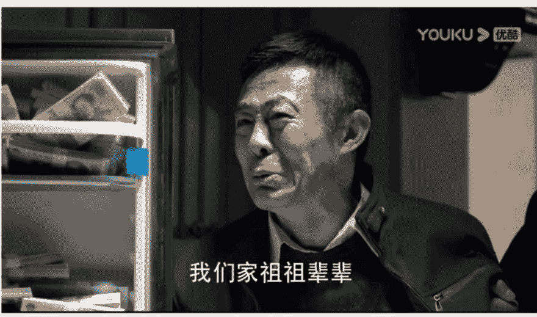

# 我们家祖祖辈
### 都是农民
### 穷怕了

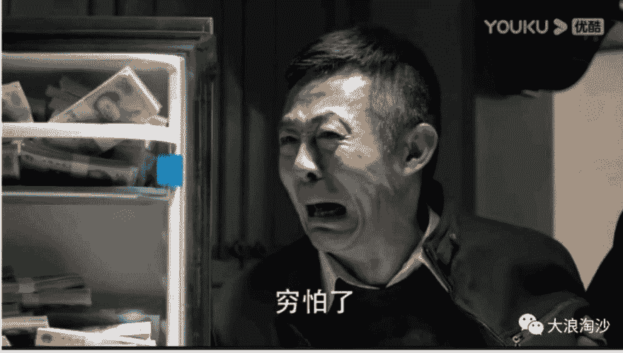

就在第一集里，你抓一个贪官，还要说“祖祖辈都是农民”，是不是让人不舒服？道理谁懂？网络上追溯个三五辈不是吃地种这碗饭的呢？言之意非，是因为农民、穷怕了，才去贪污这么多钱，所以更有犯罪的动机？

祁同伟的CP女高小琴，小时候穷得连家都穿不起，又被赵瑞龙强奸，再把她培养养成向其他高官提供性贿赂的工具，四年流产三次，逐渐高小琴黑化……

### 我也是老百姓

我觉得到此为止的话，这些人似乎还说过去，可以让穷人受压受欺负的，以及没有被圈家夺上通道是如何狭窄与公平的。但是有一点疑问的是，压迫就黑化吗？受欺负就黑化吗？穷人孩子被了就黑化吗？毫无疑问是一种主观偏见。

对比一下以前的影视作品，一家悲惨的遭遇跟高小琴的遭遇类似，小儿没黑化？无论怎样受虐都还不起，最后在大姐的帮助下进深山，经历寒暑变成了“白毛女”，最后跟大春和八路军一起回老家。

《红色娘》唱好：“战士的责任”，祁同石或许是穷人，经历过苦，难道不该跟劳动人民产生共情，而把焦虑聚焦在赵立龙身上？为什么祁同石是被，的要赶死呢？

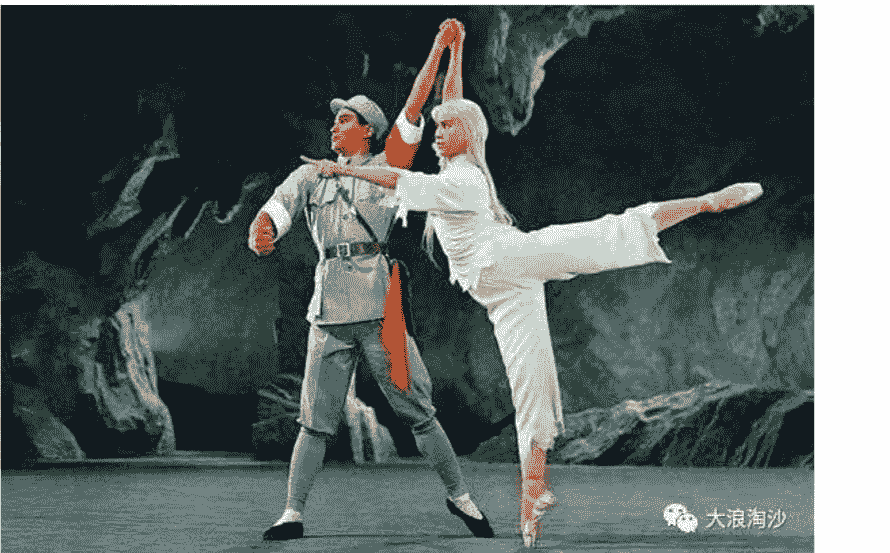

我说这个不是抬杠，祁同禹高小琴这两个人物轨迹也是合理的、丰满的，但是你们要比较：这两个角色如果在建国初，那就是“宽仁者”之后“扛枪为人民”了，这是影视创作者价值的变化。高小琴人物设定，要在小儿身上就是：后期凭借权力财务，兼并土地，逼死村民……

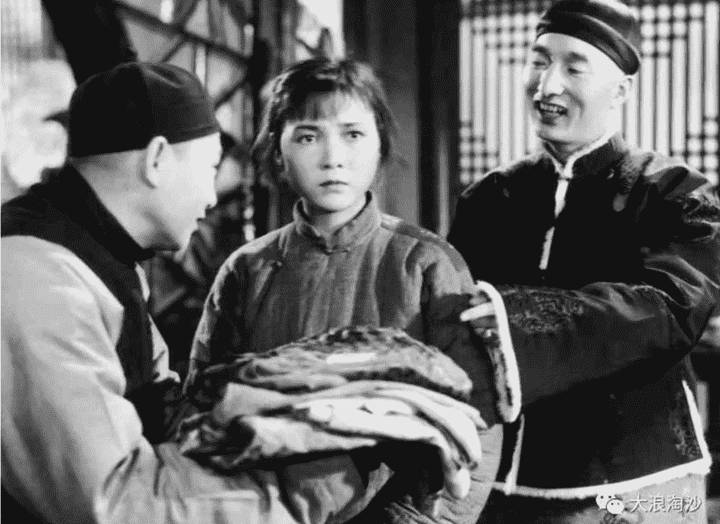

尤其是，再比较《人民的名义》里正派角色，这种偏见更加明显了：这些人，哪个不是家境优越，哪个是大院门子？比如侯亮平，京住，老婆级别不低，岳父级别不低，当时跟体制内朋友聊天，他的原话是“这个老爷子基本阶级就被灭掉了”，他没灭掉还能重任，我们可以合理推断他爹级别也不会。虽然不能称上家境优越吧，但人家是烈属被干部将石君已。

我承认，我是对《人民的名义》吹了，这部剧大方向没有问题的，但很多细节充满了偏颇。就是因为好剧，难得的精品，所以要精益求精，在每一个价值上客观公正。其实，同样的故事，它完全可以说来说：衣足而知否，仓实而节，他们所谓的错误并不是他们的“过错”，而是这个阶级固化、富贫化的固有矛盾。

所以，祁同的争议，一部分是社会价值观歪了的问题，一部分是剧情处理有些暧味的问题。

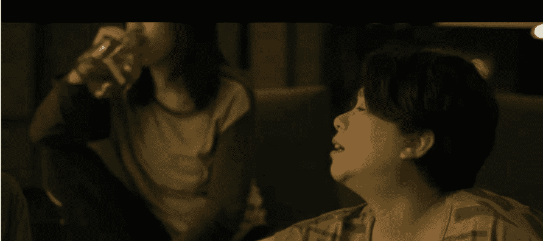

不是“有钱却很良”，是“有钱所以善良”，懂吗？如果我有这些钱的话，也会很善良，超级善良。

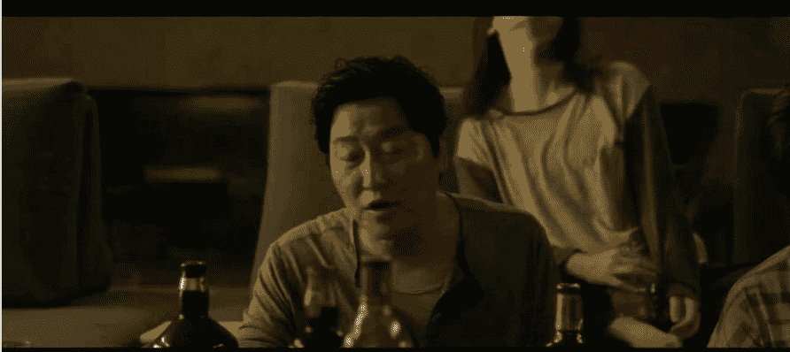

有钱人就很单纯，没烦恼。有钱人的小孩衣服都没有褶皱，钱就是熨，把一切都熨平了，所有褶皱都被熨平的。

“你们把农民当作什么，以为是菩萨吗？简直笑话，农民最狡，要米不给米，要麦又没有，其实他们都有，什么都有，掀地板看看，不在地下就在储物室，定会发现很多东西，盐、醋、酒……到山谷深处去看看，有藏的稻田。表面厚得最会说谎，不管什么都会说谎！一打仗就杀残兵武器，听着，所谓农民最怕，最狡，肠弱，低能，是杀人鬼。

——但是……是谁让他们变成这样的？你们是你们，你们是战士，你们都去死！为了打仗而毁村，踹踏田地，寇劳役，凌辱妇女，杀反抗者，你叫农民怎么办？”

## (五) 祁同伟&侯亮

把这两个口放在一起，因为他们的问题和剧情完全没有关系，根源在于演员技巧。比如钟爱国，我看过无数篇的文章，讲述他其实没有任何背景、家庭身份多么高贵，侯亮这种演技让我们形成了这种固化印象。

当然，祁同伟这个形象之所以经典，确实值得分析的地方，除了一群傻货自带之外，他的一个郁郁不得的形象还是能够引起同情的。这里不得不说，原著中的祁同的故事就是“黑”。剧中祁同是因为受到了梁璐和吕峰的打压，一直被压在基层；而在小说中，梁璐和吕峰根本没打算处理祁同，他就是一个，主要情节。也是说是，根本不需要主动打压这个设定，祁同作为一个没有任何背景，就算能力再强，本来也升不去，除非找一个有权势的父亲……这就是更“黑”的地方。

原著中的祁同始终忽略到了这个“黑色法则”，于是决定自己去找路，没有任何打压和主动去找名声差的，所以原著中祁同是主动黑化，剧中被权力打压的情节还是让他了不少同情。

但是这个本质就变了——对社会本质，原著中所展示的阶级固化就是：不需要什么主动打压，规律就是这样的；剧中给了观众一个温情的想象空间——这样笨蛋的大学生还能上去的，都是因为有坏人啊！这也符合电视剧的一贯风格：大风广的问题怪丁义，京州的腐败怪丁义，京州未来五十年发展的土地都卖光了也是丁义的，甚至是光明信访都是丁义的意思……主要还是好的嘛，就是几个腐败分子坏了事！

“所有坏事都是贪官的”其实就是反向“青天降正义”的游戏，我觉得还是旧设定更有深度一些。《人民的名义》电视剧有一点被诟病的，就是隐含传达出“穷人家孩子更容易造”这种观点，这也跟同样获取一定的同情相关。

在第一集里，你抓一个贪官，还要说“祖祖辈都是农民”，是不是让人不舒服？道理谁懂？网络上追溯个三五辈不是吃地种这碗饭的呢？言之意非非，是因为农民、穷怕了，才去贪污这么多钱，所以更有犯罪的动机？

祁同伟的CP女高小琴，小时候穷得连家都穿不起，又被赵瑞龙强奸，再把她培养养成向其他高官提供性贿赂的工具，四年流产三次，逐渐高小琴黑化……

我觉得到此为止的话，这些人似乎还说过去，可以让穷人受压受欺负的，以及没有被圈家夺上通道是如何狭窄与公平的。但是有一点疑问的是，压迫就黑化吗？受欺负就黑化吗？穷人孩子被了就黑化吗？毫无疑问是一种主观偏见。

对比一下以前的影视作品，一家悲惨的遭遇跟高小琴的遭遇类似，小儿没黑化？无论怎样受虐都还不起，最后在大姐的帮助下进深山，经历寒暑变成了“白毛女”，最后跟大春和八路军一起回老家。

《红色娘》唱好：“战士的责任”，祁同石或许是穷人，经历过苦，难道不该跟劳动人民产生共情，而把焦虑聚焦在赵立龙身上？为什么祁同石是被，的要赶死呢？

祁同禹高小琴这两个人物轨迹也是合理的、丰满的，但是你们要比较：这两个角色如果在建国初

我承认，我是对《人民的名义》吹了，这部剧大方向没有问题的，但很多细节充满了偏颇。就是因为好剧，难得的精品，所以要精益求精，在每一个价值上客观公正。其实，同样的故事，它完全可以说来说：衣足而知否，仓实而节，他们所谓的错误并不是他们的“过错”，而是这个阶级固化、富贫化的固有矛盾。

所以，祁同的争议，一部分是社会价值观歪了的问题，一部分是剧情处理有些暧味的问题。

不是“有钱却很良”，是“有钱所以善良”，懂吗？如果我有这些钱的话，也会很善良，超级善良。

有钱人就很单纯，没烦恼。有钱人的小孩衣服都没有褶皱，钱就是熨，把一切都熨平了，所有褶皱都被熨平的。
