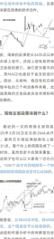
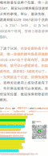

# 开始了吗？

作者：王天明
2020-05-20 10:33

刚开始训练时，我可能会有几个问题：

- 1. 忽略了R42的参数设置，认为参数越大越好；
- 2. 总是急躁，试图一步到位就看到效果；
- 3. 没有任何合理的计划，盲目地堆数据。

其实，刚开始训练时，这样很正常，很多新手刚开始都会遇到这些问题。以下这些建议非常重要：

## 第一建议

在开始训练之前，要明确训练的目标，否则你只是在漫无目的地浪费时间、精力。

或者说，先设定一个简单的目标开始，随着经验的积累，再逐步增加难度，去挑战更高的目标。

我也是从一个简单的目标开始的，慢慢积累了经验，才发现自己可以做得更远了。这种方式带给我很大的成就感，也让我对这个学习更有信心。

但是，如果一开始就定得太高，很容易就挫败。挫败感会让你失去兴趣，甚至让你放弃。

## 第二建议

不要在训练初期就急于到位，要学会不断调整参数。

在训练初期，参数的调整是非常关键的。这需要大量的实践和尝试，通过不断的调整，找到最适合你模型的参数。如果一开始就定死参数，很可能永远无法找到最优解。
