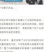
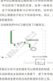
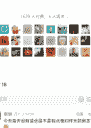

# 厚实了

最近，比特币在2023年5月12日再次暴跌，跌幅高达21.1%。

在某些分析中，大家忽略了市场的转折点。虽然没有时间在周上发布警告，但恐慌情绪已经蔓延了，这已经说明了投资者的恐慌。

多空焦点，比特币是否会跌破55000美元？下周的走势将决定反弹力度，面临着巨大的压力测试。

现在市场恐慌，目前比特币正在筑底运行，如果现在不能在关键支撑位成功反弹，可能将面临更低点：

一周的横盘显示了恐慌持续，比特币在55000附近反复震荡。

如果再次跌破支撑位，将引发进一步的空头，我们需要一次反弹，否则将跌破50000。下周的走势将在市场中放大，成为定型的关键：

技术指标MACD背离了看底。

虽然分析者的预测可能出现失误，但下周的趋势终将揭晓。下周的比特币在回调后将出现反弹，这个反弹将决定后市行情：

现在行情剧烈，建议大家不要频繁操作，除非你需要调整策略，否则频繁操作太累了。

关注我们，获取更多数字货币资讯

加入我们TOP 免费资源
