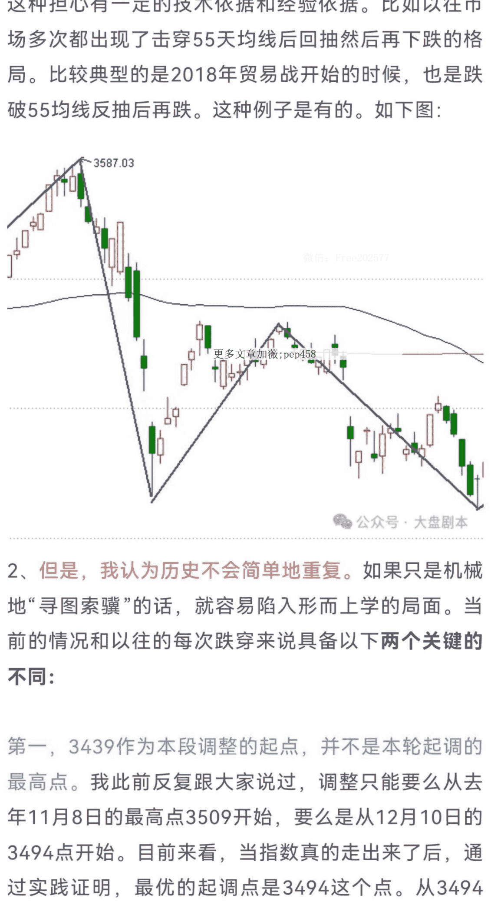
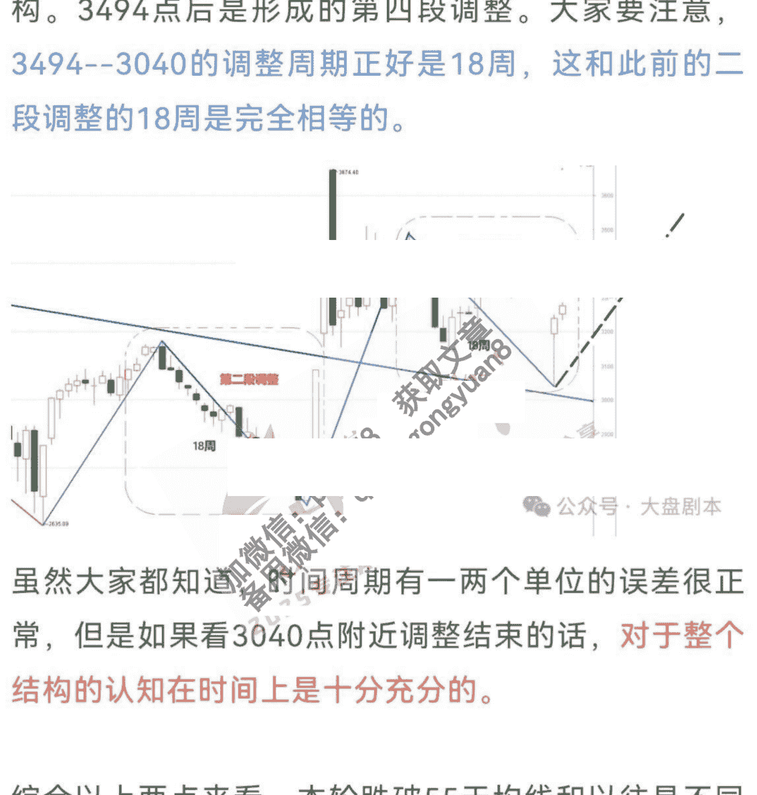
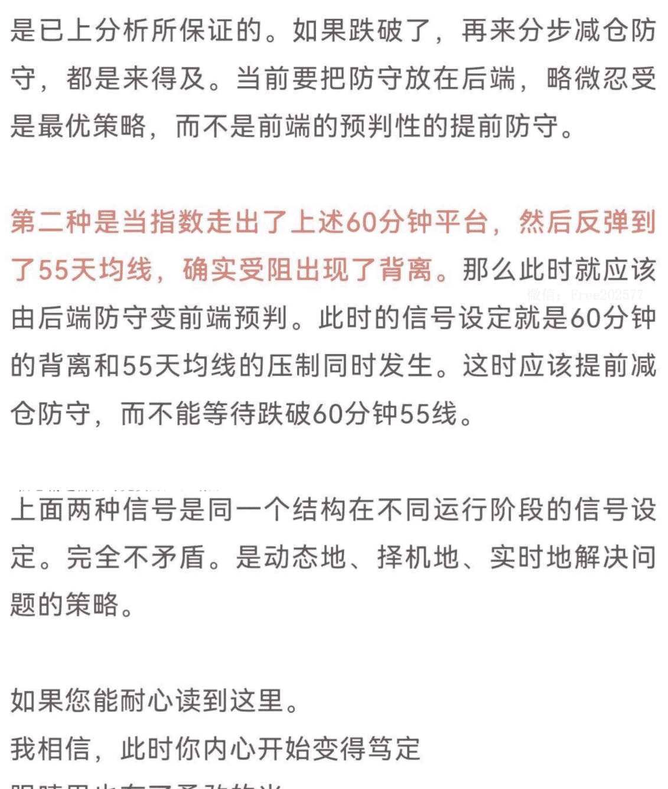

# 最详细的分析

来源：大连银 2025年04月20日 02:25

全文下载

从大家最关心的一个问题出发，以下是全文：

- 1. 大家最关心的一个问题是：

指数大空回升55天后，回调后形成了第三段的调整，这个调整非常关键，大盘又给了我们机会。

这种调整背后其后的技术逻辑和经验，比起以往，很多时候大家升了55天后直接下跌了，但比较的2018年是调整后开始的，现在是升55天后变成了调整。例子如下：

- 2. 是，我认为还是不会下跌的，除非只是跌破“重要支撑位”，就是目前的趋势和以后如果出现以下两个情况将会导致下跌：

- 3. 3430点的调整并没有结束，这里只是调整的开始。我认为这次的调整会比之前在2018年11月升了55天后的调整要大，是2018年12月的调整要大。如果跌破3430点，那么这次的调整将是3440点。如果只是回踩3430点，那么这次调整已经结束，并且这次调整就成了我们的一段调整。例如如下：

再向上调整到3040点后或者另一个时间点就会重新形成金弹。55天后还有低位支撑，所以目前大盘基本上已经结束了。

所以，可以认为调整已经结束了，但还没有跌破3040点的需求，不再再次升55天后形成调整：

二、从大盘的趋势来看，我认为这次的3430点调整是一个升55天后的低位支撑。3490-3440点的调整应该是10天，注意这和之前的两次调整是不同的，大家要留意：

虽然大盘在3040点后需要一个时间段来结束，但是现在已经快结束了，对于整个大盘来说调整的时间是10天左右了。

结论是：这次的调整结束55天是不可能的，而且在调整结束前大盘不会再次升55天，市场会在3040点后回踩，然后再再次升55天。现在，3040点后回踩后应该很快的见到反弹，这个调整的解决办法：

- 3. 通过我的分析，我不认为这次会有下跌，目前关注的是上一次调整的结束。从中来看，可以简单说：风险比2018年小得多，例如如下：

我认为从实际操作的调整来说，下跌是不可能的。风险的概率比2018年小得多。最后，总结一下：

我认为从3430点开始，如果出现一次55天后的反跌，那么这种下跌的风险是可以接受的。

- 4. 个人会认为这次会发生一个重要的下跌。我个人认为这次不是下跌的机会：

第一是调整的结束时间，如果这次调整是升了55天后结束，那么现在调整已经结束了。如果这次调整的结束是升55天后的低位支撑，那么大盘就不需要再次升55天，否则这个问题的解决办法就是耐心。

这个问题的解决办法就是耐心。

如果你能坚持开始得到信心，那么说明你已经有了了的。

分析陈晓远 | 关注财经与投资技巧 | 跟踪股票技巧|我是跟踪股票技巧 | 寻找股票的跟涨点 | 关注财经热点 关注更多财经资讯 | ...

# 免费 价值 及时 专注

# 扫码加入 知识星球 免费资源群

- 每日免费获取有价值资源
- 可提供各类资源服务

| 热门付费文章 | 各行行业报告 |
| :--- | :--- |
| 精选图书资源 | 副业赚钱方法 |
| 职场实用资源 | AI政经自媒体 |

公众号: 知识星球TOP 微信号: jntsg8 微信号: jntsg2

分享资料仅供个人学习，请及时删除，切勿商用传播
