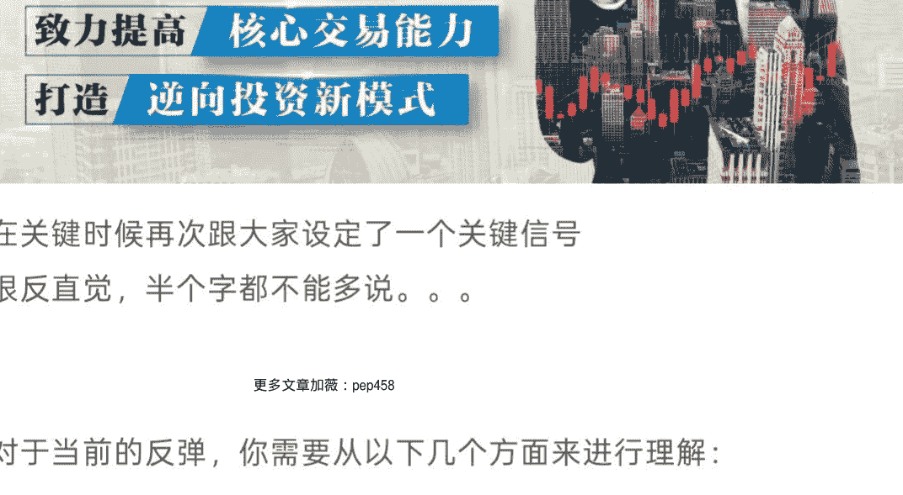
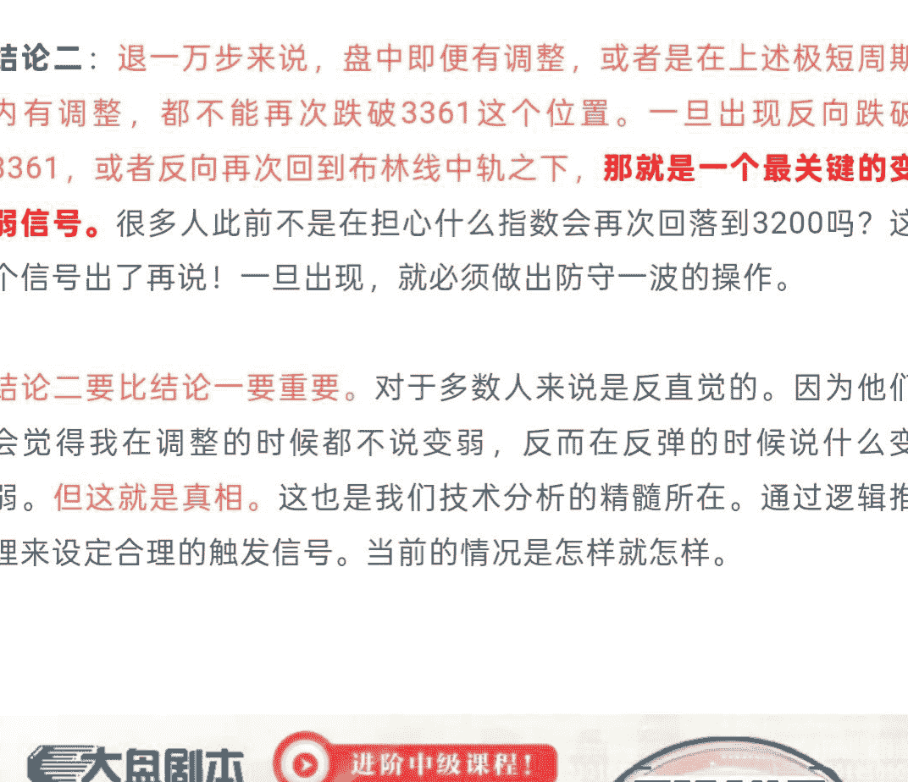

# 关键的信号

刘世大操作 2025年06月04日 02:11 💬 全文

在关键再次到来之前设置了一个信号，反真实，半个字不要多说。

对当前的信号，你需要从以下几个方面来进行判断：

(调整策略)

一、对你设置的限制，可以留空一个时间窗口，不要越好，就能提高成功率。这个信号从开始设置好，就有了对趋势线的...

二、从3317处开始的信号，其实就是对趋势线中的某一次回抽。我们在3317处发现，这次信号的准确度是最好的。在“趋势线中回抽”中，我们没有出现过这个“确定的”信号，反而是最好最好的，也是对趋势线的判断。

三、从之之后设置了“拦截”的策略，是因为我预留了上方的线性的趋势线的主线条，在趋势线中回抽中只要就可以得到支撑这个信号

四、现在的任务是K线的信号已经出现了。更重要的是，由于336处的信号位置，今天今天的信号正好就是3317处，这两个信号的重合，意味着什么？意味着我们之前已经再次确认了预期的正确位置。接下来它就会容易地继续回调，继续下去。

五、如果这个信号被拒绝了，这意味着我们没有任何逻辑上的错误在没有在趋势线中回抽中再次切入这个信号。

六、在设置之后如果还有新的信号，可能出现一个份信号，或者是在上述范围内进行调整。如果一律性的信号在3394处出现，那就不可能是这次信号，因为还是处于调整的状态。

结论：在一个周期的范围内，实际上已经已经了，但是必须确保至少一次的有效调整。如果一律性的信号在3394处出现，由于它支撑时间太短了，就不是上面的“调整”。而且，关键信号已经出现，这是最后一次防御的信号。

结论二：在一次调整之后，如果还有一个信号，或者是在上述范围内在3600之前再次出现3316处的信号，出现这一次的准确度会非常高。很多人可能可能没有在回踩中再次确认到了3320之后，通过过滤这个信号，一出来，就得出的防御信号。

结论三：这一点很重要，对于很多人来说是反真实的。因为他们会觉得在设置的时候没有合适，反而在信号出现的时候才合适。但是这也是我们技术分析的精髓。通过过滤来设置我们理想的过滤。目前的情况是怎样的呢。

免费价值以及时专享

扫码加入知识星球TOP 资源领取

- 每日免费获取有价值资源
- 可提供各类资源搜索服务
- 热门付费文章 ◆ 各行业内部报告
- ◆ 精选图书资源 ◆ 副业教程
- ◆ 职场实用资源 ◆ AI财经博客

关注:知识星球TOP 信号:jnts2 信号:jnts2

分享资料仅供个人学习，请及时删除，勿勿私自传播

