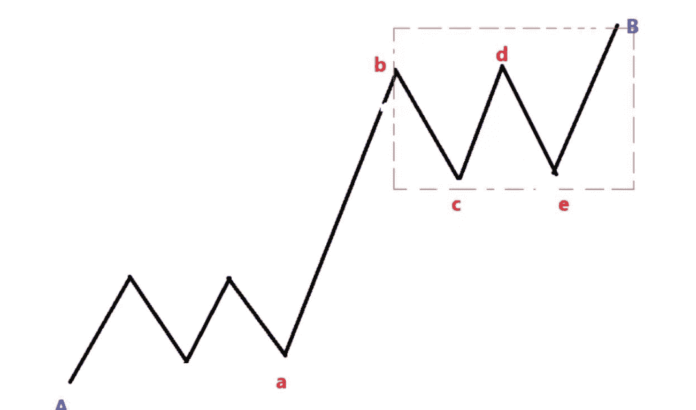
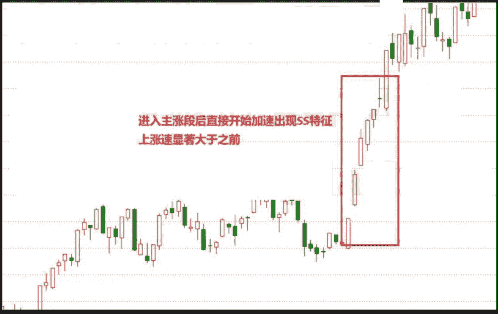
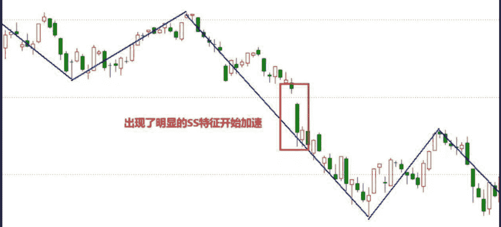
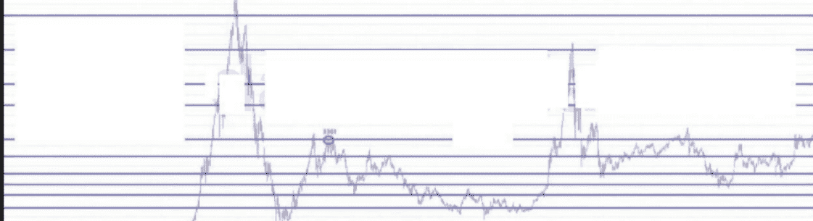
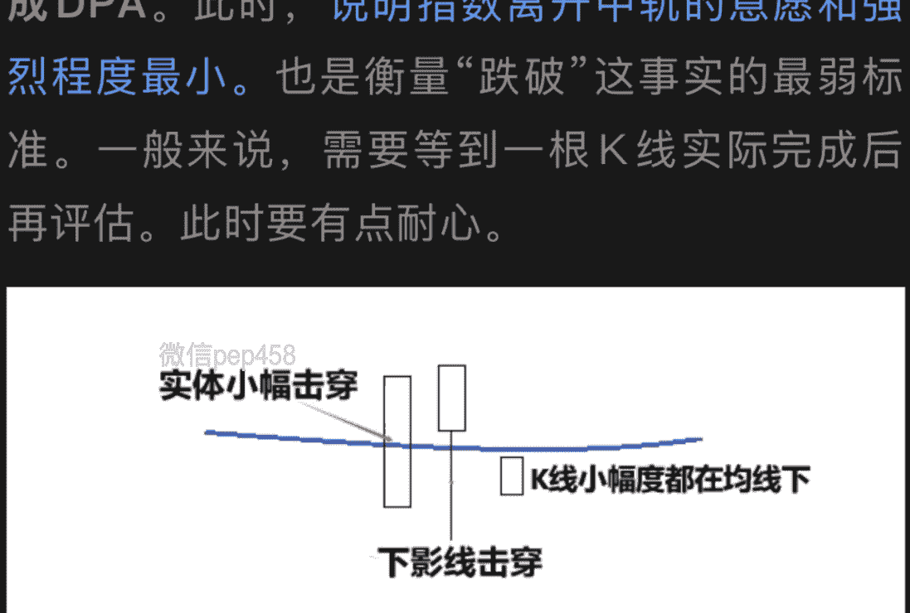
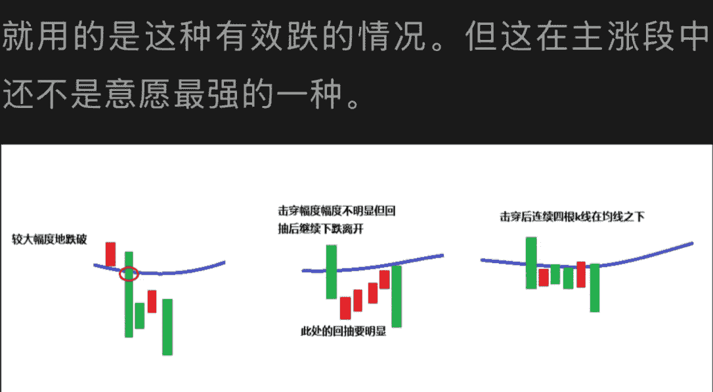
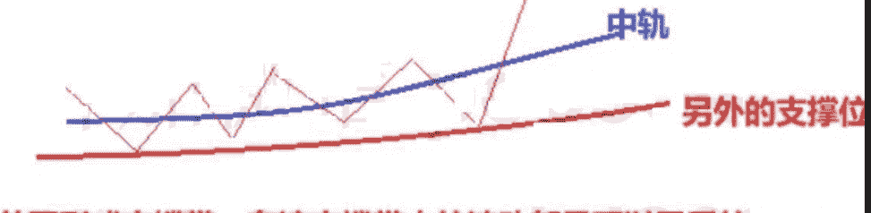
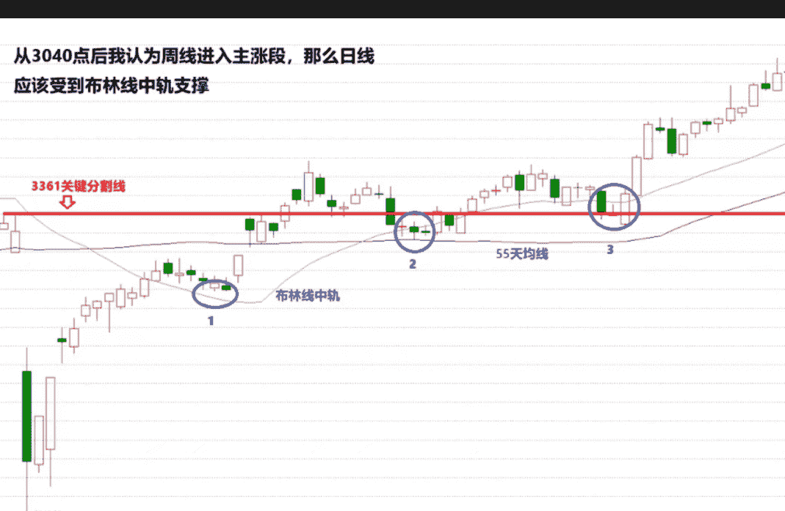
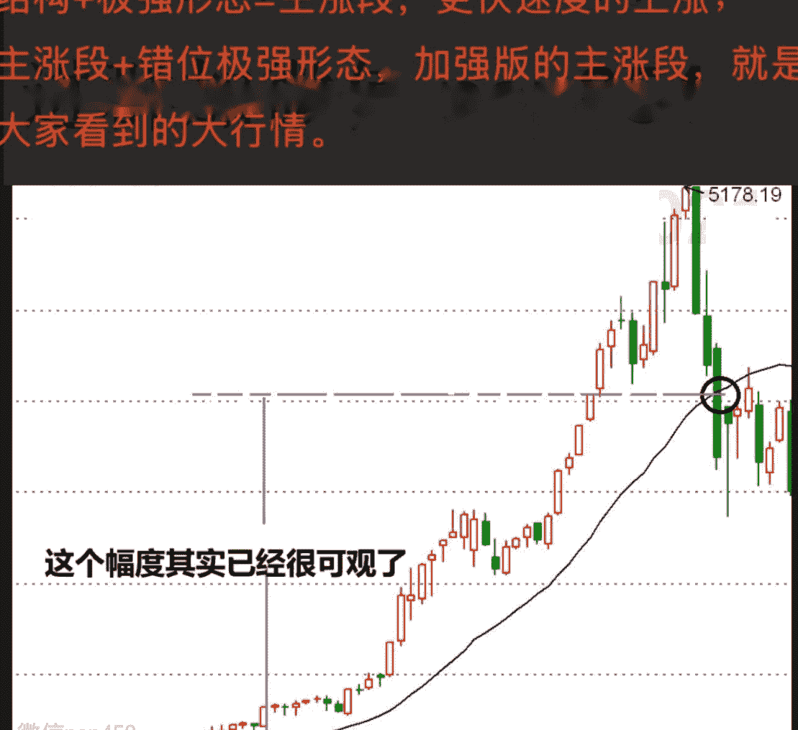
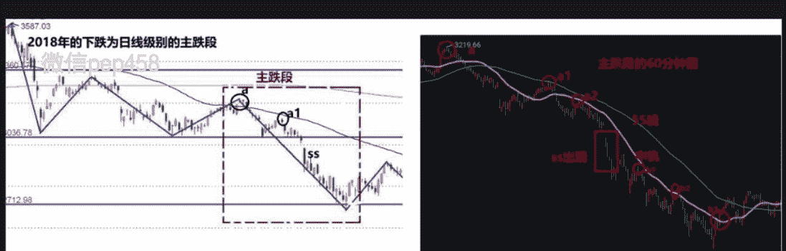

# 主涨段的实操精要 已付费

原创 肥猪仔 大盘剧本
2025年08月20日 20:05 四川

在上一篇文章《我是怎么抓主涨段的》中，我详细阐述了主涨段的定义和诸多关键的性质。我相信这里面很多知识点都是大家第一次听说过的，绝对对你有用。其中，可以用布林线中轨进行锁定是所有性质的核心是实际应用的关键。但是细心的朋友会发现，文中只提到了如何在定义满足的情况下开始锁定，并未提及解除解锁的信号和标准。

实际上，一个完美的“开始锁定---解除解锁”的全过程方案，就是获得主涨段大幅度或者最大利润的方案。反过来对于主跌段也是一样，那就是规避最大风险的方案。如何设置“解除锁定”的标准从来都不是简单的答案。它是一个策略。要做到量化、可重复和验证，要做到幅度无限逼近主段的最大幅度，其含金量之高，在交易中从来都是“圣杯”级别的存在。这期，我就带大家试图找到一个近似的方法。

我敢说，看了本文，你再也不怕上涨了。

**温馨提示：** 本文是主涨段的提高和进阶。在阅读本文之前，请务必复习《我是怎么抓主段的》一文中的诸多定义和性质。

## 一、研究对象和底层逻辑

1、本文研究的对象是上涨趋势中主段部分的幅度，以及为了获得这个幅度，如何解除布局趋势线中轨的锁定。要注意，不是整个趋势的幅度。一般来说，主段的幅度是小于整个上涨趋势的。也就是说，当主段结束后，指数在位置形成震荡平台，还有惯性向上的动力。

双平台的主涨段为例，示意图是下面这样：

也就是说，我们研究的是ab段的幅度，而不是AB段的幅度。因为ab段是上涨最快的，也是利润最大的一个。而且，后面红色方框中的部分，实际上是我们定义主涨段所用的模型，并不一定实际完整地走出去。或是有事项。有时候，第二个平台走到d点，然后形成背离后就趋势结束了，也很常见。方框内最终走不完，最终并不影响ab段性质。所以，bcdeB部分，其实都不在本文的讨论范围内。

2、我们再把ab段进一步放大，仔细细看ab段的构成。图中红色曲线为N-1级别的布林线中轨，蓝色细线为N-1级别的波动。

按照上篇文章中的定义，主涨段的起点为a，但实际的确认点为a1。问题的关键在于，b点的精确位置无法通过结构、背离或者压力位来精确寻找，所以上篇文章中我给大家了一个基本公式是：

### 布林线中轨支撑失效 <=> 主涨段幅度达到尾声

所以，一般意义上我们将跌破布林线中轨的现象作为主涨段快要结束的信号。图中跌破点定义为b1。可见，如何尽可能地获得ab段的整体幅度Ha的过程，实际上是如何尽可能地减小ha和hb这两段高度的问题。上面的示意图还原到真实的K线上的例子是下图，你可以看得更实际一些：

3、对于ha的高度是很好缩短的。因为a点的实际位置往往是受到N级别55线的支撑，并且形成a点的下降段，内部也符合循环结构和背离的相关准则。所以a点通过简单的三维拐点的判定体系基本上就能把其精确位置。而a1点也是一个精确值，a1点的存在只是和N+2层级的稳定性一起确认ab段的主宰性性质。它并不影响a点就是一个拐点本身。也就是说，a1点是排除了一般的上涨而已。即便是a1点没有形成，此时ab段所处的结构以及N+2级别的稳定性就是已经确定的了。

让更多人获取高价值信息
江霖全网付费资源

| 付费文章 | 付费社群 | 付费课程 | 副业搞钱 |
| :--- | :--- | :--- | :--- |
| 财经 | 股市 | 行业报告 | 历史 |
| 政治 | 自媒体 | 军事 | 社会学 |

所以，ha的高度是很好缩短的。实际上要在a点完成大部分仓位，然后在a1点完成剩余部分仓位。这样，整体成本逼近a点。此时ha=0。要注意的是，不能因为a1点后就建仓，严格意义上主段的确认就会犯了错误。此时思维上的底层逻辑是在a点“预判”为主段的成功而已。当然，如果你是在a点出现之前就建仓，就可以忽略ha的问题。可见，好的开始就是成功。a点处建仓，实际上是获得主段大部分幅度的。

4、对于hb的高度缩短十分困难的。一方不受任何技术限制，完全有可能是一个快速冲刺；另一方面是b1点是在击穿布林中轨后才知道，波动很大，所以也不是一个精确值。这两者的动态性需要另外一套系统来解决。这是本文的主要内容。

## 二、信号的构建

### 一、快速上涨

所谓主涨段，关键特征就是“快速上涨”。这个特征符号表示。这是市场最兴奋，也是它最具魅力的时候。根据上篇文章中主涨段的性质，只要是主涨段，SS都是出现的。只是有些SS很明显，有的稍微含蓄。我们将主涨段分为两部分，分别对应两种策略（后文述）。

那怎样认为是快速上涨呢？其实很难有一个绝对量化标准，它是一个相对的概念。它是一个视觉识别的过程，就是要明显看到上涨的速度和幅度大于此前的走势。一定要量化。对于日线级别的上涨来说，比如连续多天超过1%幅度的上涨，或者市场出现3%以上的大阳线，这些都是SS开始的特征。那些低于1%幅度的K线都不算。对于日级别以下的主涨段，这个幅度就会小一些，但是这种“相对加速”的特点是非常明显的。下面两个比较明显的例子，大家感受下，其实是很好认的。

### 2、黄金分割 GA

这个指标是我们日常文章中经常出现的“重要黄金分割”指标。用符号GA表示。之所以加“重要”字，就是区分那些平时很多人随便找一个高点和低点进行的黄金分割。此处说的黄金分割是特指以664点为底，3361为顶进行的黄金分割体系。唯一的唯一的没有其它任何变体有效分割方式。为什么选择这两个点位做分割，涉及到很复杂的知识，暂时不下。大家记住即可。

分割完成后，空间中关键百分比位置会拉出多条直线。比如我们经常提到了3036、3361、2713等位置都是在这个体系内的。这条线，对于上涨来说就是关键压力位，对于下跌来说就是关键支撑位。那么重点来了：

第一，对于日线级别的主涨段来说，一般很难实现对a点之上的邻黄金分割线的跨越。要注意，此时的分割线并不一定精确实现对上涨幅度的压制，但是总体对上涨幅度空间有巨大的限制作用；

第二，对于周线级别的主涨段来说，一般会跨越一根分割线，幅度大概是两根黄金分割线附近。

第三，因为我们一般最大级别看到季线，所以最大级别的主涨段能够判定的就是周线级别。如果此时月线级别又出现了极强形态对周线主涨段进行了强化，那么基本上黄金分割就很难对其短期的制约作用了。6124和5178的行情都是属于这一类的。这段初看有点绕，你仔细推推N+1级别和N-1级别的关系就会很好懂。幅度越大，GA对于走势制约越弱。

### 3、X信号

以上分析冗长，其目的是将文中两个信号联合起来，这样生成了一个更有用的有效的信号。用符号X表示。当快速上涨发生的时候，指数正好碰到了黄金分割线。规定当X信号出现时，就是一个绝对的主动减仓信号；文中的DP是被动减仓信号是不同的。X信号实践中的理解有些冗余，如果是在大阳线的时候碰到了黄金分割线，那就是最标准的；如果距离分割线已经很近，然后短期内到达，这也是X信号成立。

## 三、DP信号的构建

### 1、底层逻辑

随着主段的延续，布林中轨反复支撑，但是最终会在某个位置被跌破，也就是文中的b1点。既然中轨被跌破，那么就自然不能用布林中轨锁定。所以b1点的出现也是解除锁定的信号。所谓的DP信号就是“跌破”的意思。对于跌破的标准，应该是衡量指数离开中轨的意愿，而不是看刺穿本身。这种意愿越强，那么最后返回中轨的可能性就越低。跌破的强度分为三个档次。

### 2、普通跌破 DPA

所谓普通跌破包括：K线的影线刺穿中轨和K实体小幅度贯穿中轨两种情况。实体贯穿就是其收盘价在中轨下的。极限情况下这根K线幅度很小。这种情况名为A型击穿，记DPA。此时说明指数离开中轨的意愿强烈程度最小，也是衡量跌破的最弱标准。一般来说，需要等到一根K线实际完成后再评估，此时要有耐心。

### 3、有效跌破 DPB

所谓有效跌破包括：K线实体大幅度击穿中轨、击穿中轨后回抽确认离开以及四到五根K线实体小幅度停在中轨之下这三种情况。具体看下图，暂且命名为B型击穿，记DPB。这种情况说明指数离开中轨的意愿是比较大的。在极强形态结束的判断中，我们用这种有效跌破，但在主涨段中还不是最强的一种。

### 4、逻辑跌破 DPC

所谓逻辑跌破是指：指数跌破后离开中轨的意愿，可以根据当前合理的技术逻辑，在目标线不远处寻找另外一个更具技术意义或者有充分性的支撑位。如果指数进一步跌破这个支撑位，就肯定说明它不会回到中轨之上。

要注重，之所以这样设置“下方支撑位”的底层逻辑，不是想以“更大的距离”来消除单一均线的误差，而是要更加加强在这个地方支撑位的“技术意义”比中轨更重要。就像你能赢过一个200斤的大汉，你自然能打倒一个幼儿园的小孩。有时候，这个支撑位离中轨的距离是很近的。这种情况是中轨支撑的最强形态。暂且名为C型击穿，记DPC。此处的“逻辑条件”一般就是离当前布林中轨不远的。

### 五、举个例子

下图为3040点后指数在日线上的上涨情况，此时我根据上篇文章中的三个判定原则认为已经处于周线的主涨段中：

在1号点，日线第一次回抽布林线中轨，这个支撑十分清晰，没有什么疑问。不需要有击穿的问题；

在2号点，此时55天均线和布林中轨很近，且55天均线在中轨之下。此时...（此处省略重复OCR错误逻辑逻辑逻辑逻辑逻辑逻辑逻辑逻辑逻辑逻辑逻辑逻辑逻辑逻辑）

的忍受标准的调整。将平仓位置近似了bb点。

7、在后主涨段的时期，操作就可以随意点，没有绝对的正确性。高位实际上是个股分化严重且轮动逐渐冲的过程。此时完全可以根据自己个股的强弱情况，调拨一定的仓位在N级别的高位平台做T。一般来说，再调拨30%的仓位就很合理。这样可以在当指数在d和B的位置都出现离时随一步减仓。总之，这样就基本上形成了有序撤退的局面了。

在极端情况下，在b1跌破后，不形成进一步的反弹，或者没有后面cdeB的平台，那么此时你也减仓了60%。也锁定了大部分主涨的利润了。但是这种情况十分罕见。

## 六、一种特殊情况

如果你能仔细地看到这里，一定会想到，对于6124或者5178这样的超级牛市，是不是可以使用这样的主涨段的操作方案呢？这个问题的关键在于你要首先识别这是一个超级大行情。它们其实都有以下共同点：

1、都是季线金叉引领的周线为主涨段行情；这个周线的级别是我们对主涨段定义的最大级别。因为季线的金叉基本上是可以看到的最大的金叉了；

2、周线为主涨段延续的过程中月线形成了极强形态对日线走势的加持。我在此之前的文章中为了让大家分清级别介绍了下面图：

| 不必要形成三段结构 | 均线：均线中线锁定 | 形成：第三或者第五级 | 稳定性：极强 |
| :--- | :--- | :--- | :--- |
| 级别 N-1 | 级别 N | 级别 N+2 | |

很多人说N+1 级别这个级别主要要起到对 N-1 这个级别走势的推动作用，从而大幅增强N 级别主涨段的上涨力度。上述两个行情其实就是由 (N, N+2) 以及 (N-1, N+1) 这两个双“涡轮驱动”来催生的。其实你注意看2020年后的这个3731的行情，也是符合上述的加速和驱动特征的。

3、此时就可以明确定义哪里了：

极强形态，最一般的快速上涨；n结构+极强形态=主涨段，更快速的上涨；n主涨段+错位极强形态。加强版的主涨段，就是大家看到的大行情。

4、满足了周线主涨和错位极强形态这两点，基本上就可以首先认为会出现大行情。这种加强版的周线主涨段行情有两个特征：第一，X信号对上涨的约束力从结束了主涨段，退化成了平台进行震荡。所以对于超周期持有的朋友来说，第一个X信号大概都是不用操作的；第二，直接用周线布林中轨进行锁定且执行DPA标准即可。由此可以最大限度也是最简单的获得整个上涨趋势的绝大多数幅度。注意，这个地方就不是主涨段的幅度，而是趋势整体

## 七、两个例子

为了炼大家思维，我特意选了两个下跌的例子。上述策略反过来其实就是规避主跌段的有效策略：

### 例子1：2018年的主跌

这是一个日线级别的主跌段，走势相对标准。相关点标记如上图：

1、a1是日线级别回抽55天线的精确位置，可以直接判定，并且可以预判后面为主跌段；此时进行较大规模的减仓；

2、a1点刺破了60分钟布林线中轨，但是此时使用DPC可以将中轨和55线线作为压力带，a1点实际受到了55线的精确压制；此时进行一次减加仓；

3、SS信号出现在中位，未形成X信号；

4、随后的走势对60分钟中轨形成了三次回抽，都用DPA标准。b1和b2都没有突破中轨，没有任何加仓信号。只有b3位置明明显击穿了60点中轨。

### 例子2：2022年的主跌

这是一个日线级别的主跌段，走势相对标准。相关点标记如上图：

1、a1是日线级别回抽55天线的精确位置，可以直接判定，并且可以预判后面为主跌段；此时进行较大规模的减仓；

2、a1点刺破了60分钟布林线中轨，但是此时使用DPC可以将中轨和55线线作为压力带，a1点实际受到了55线的精确压制；此时进行一次减加仓；

3、SS信号出现在中位，未形成X信号；

4、随后的走势对60分钟中轨形成了三次回抽，都用DPA标准。b1和b2都没有突破中轨，没有任何加仓信号。只有b3位置明明显击穿了60点中轨。
