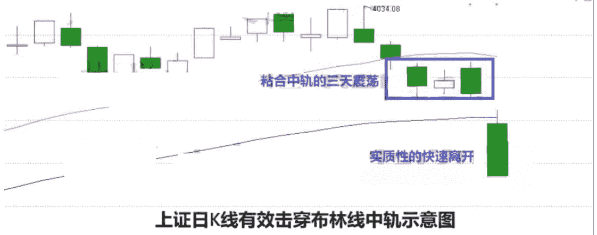
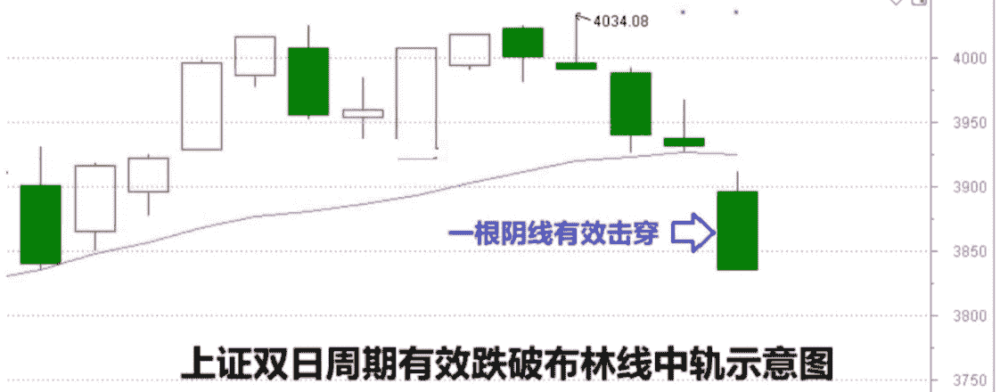
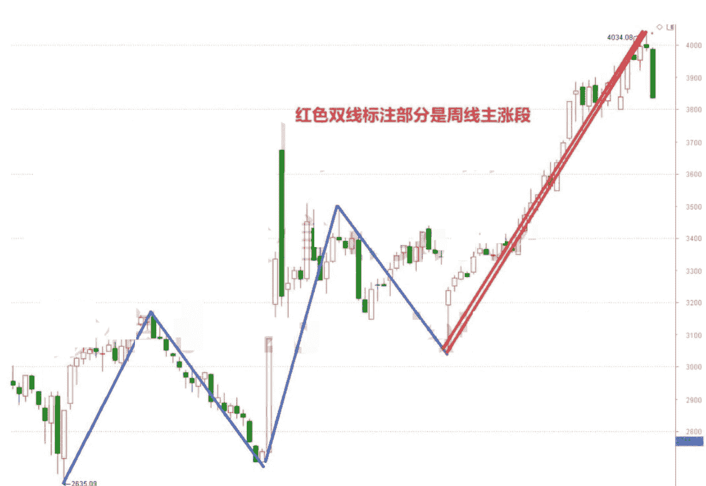
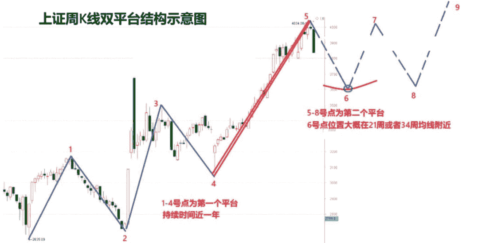

# 调整的所有秘密

2025-11-23 商品介绍

暂无评分 去评分

关注公众号

## 一、基本定性

本周的几天调整和从3040点上涨来的所有的震荡调整都有明显的区别。之前的只能算是“回抽”，而这周是完全有效地跌破了日线的布林线中轨，才是真正的“调整”。形态是非常清晰的，周二到周四的三根K线是略微跌破中轨的震荡，现在是否有点怀念这“片刻宁静”？周五的阴线是快速离开。这是完全有效跌破的经典判断。

全符合有效突破的经典判据。

如果你更技术一点，看的是双日周期，那结论是同样的。显然，一根大幅幅的阴线，直接完成了对双日周期布林线中轨的有效跌破。

因此，无论是从单日还是双日周期的逻辑上看，本周的下跌都进一步确认了4034点就是从3040点上涨以来周线主段的最高点。也就是说，周线的主涨段在4034点位置就已经结束了。可以仔细细看后面这个周图，红色双线标注位置是周线为主段：

大家要注意：

1. 结束的是红色双线部分的快速上涨段。而不是从2635点开始的周线上涨趋势。上涨趋势没有结束；
2. 这个结论我是在4034点形成之前就跟大家反复预判了。而本周的下跌只是后端进一步的佐证和完成验证闭环而已。

所以，从4034点后的调整的基本性就是：

一个周线上涨趋势进行过程中的正常回落。是区分此前周线为主段的一个周线级别的调整段。是主涨段结束后的结构性需求。

这个定性的描述看似废话，但其重要性就在于，不能看着调整来势汹汹就将其过分拔高月线级别的调整或者是上涨趋势的终结，又或者是盲目乐观，低估了调整的威力，将其误解成日线级别的“回抽”。

过高和过低的估计都是不对的，因为没有任何逻辑和信号来支撑。它就是一个周线级别的调整。周线级别的调整至少应该持续4-5周的时间量级。这点是要首先明确的。

## 二、结构上的定量

一看剧本的朋友都知道，从2635点以后的上涨趋势，我一直在用周线的双平台结构来进行描述。在3040点主涨段出现之前，这个描述都是预判性质，但是这个主涨段出现后，这种双平台结构的变化可能性就逐渐缩小了。换句话来说就是，3040点后的主涨段进一步在后端佐证了此前预设双平台结构的正确性。

那么根据双平台结构的基本性质。当前的调整在结构上高位“第二个平台”开始构建的第一个下降段，即图中的56段，随后还要经历周线上的反弹，下图中的67段，然后再次回落，即78段，然后再创新高的过程。

从这个结构模型中，可以得到以下四个关键的定量结论：

1. 5-8的高位震荡平台其技术意义和1-4的低位平台是对称的。实际中，5-8第二个平台的震荡往往呈现出时间上略微缩短，也就是说1-4的低位平台持续了，而当前的高位平台时间上要缩短；
2. 我们当前处于56段的调整中。56段的技术意义和此前12段调整相当。所以整体来说，调整的空间是在400点左右的量级。一般来说，6号点的精确位置可以是布林线中轨附近的任一位置。考虑到前面12段调整是400点，并且本周调整就跌了200点。但这不能想定，而是要根据实际走势来修正。
3. 周线中轨即便不是最终的6号点，其调整也会形成强力的支撑作用；
4. 67段的向上反弹是整个高位平台的核心。在整个三段结构中，只有7号点的位置是固定的。相对于5号点，可以创新高。因为5号点正好是关键分割400点的位置。这种情况下，7号点创造了新高，那么很有可能运行到400点中间的某个位置。67段的潜在反弹幅度很大。

我们之所以叫大家提前减仓，就是为了尽可能规避56段的调整，然后以最好的成本来博67段创新。

## 三、对于56段更细致分析

1. 有以上两点定性和量的准备，对于56段的调整大概就有这样一个印象：调整是一个较低速度和较低幅度的调整，并不是趋势性的转折。本周市场用了一个星期的时间跌了200点，这并不是说明后面的调整要向下加速，相反，从下周开始的走势应该是要有明确且明显的调整速。要达到这个的目的，可以是先反弹形成震荡来消耗时间，也可以是下跌速度变小，然后形成日线反弹。总之，不会出现所说的“惯性”加速下跌。这是最基本的判断。

2. 56段作为一个周线调整，其内在结构要求是内部至少需要形成三段、至多需要形成五段的日线结构。不管是三段还是五段下跌结构，主要的下跌“冲击”就是在第一段和最后一段。

考虑到文中周线中轨会产生明显的支撑作用。我们可以理想地将56段调整划三个日线阶段：第一波冲击，4034到周线布林中轨以后，形成一个日线级别的反弹，反弹形成三段都是可以的；第二波冲击，反弹的高点再向3600点附近调整。我们目前处于第一波冲击的末期，周线中轨下周预计到3800点附近。

3. 从上面理想的标准模型来看，在此之后的反弹是在下跌过程中最有短线操作空间的。对于前期减仓完成且具备技术分析素养的朋友来说，一个完美的操作方案莫过于周线中轨附近逐步加仓，反弹后减仓，再到3600点附近完成回补。这个操作站在预测模型的角度有点“完美”。看似简单，实际操作起来对于新手并不友好。所以，对于大多数的朋友来说，反而应该执行“后200点逐渐加仓”的策略。你可以选择在冲击1的3800点附近分步加仓，然后到冲击2的3700点附近再分步加仓。最终确保3600点附近完成9成左右的仓位。中间的震荡能T则T，不能就算了。这个“傻瓜策略”可能才更符合大多数人的实际情况。

## 四、排除短线最差情况

上述策略我们在去年5月到9月的调整中，也就是12段的调整，同样采用过。按此操作的朋友基本上都坐上了去年9月份的爆炸性上涨。但是这是理论模型，我们实际操作是要在这个模型框架内解决实际情况，排除最差情况，确保市场是按照这个框架运行。

按照上面的框架，显然，下周完全可能会出现“第一次的加仓机会”。而要排除的“最差情况”只有一个：确保当前的下跌逻辑被终结。

周五之所以形成如此大的下跌幅度，原因是因为有两个下跌逻辑形成了共振：

逻辑1：60分钟第三段的主跌段打破这个60分钟主跌段的技术信号就是15分钟的反弹要突破布林中轨。要注意的是，下周。

逻辑2：60分钟主跌段。

