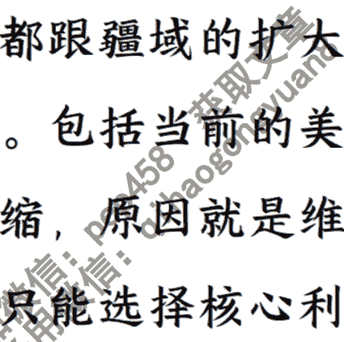
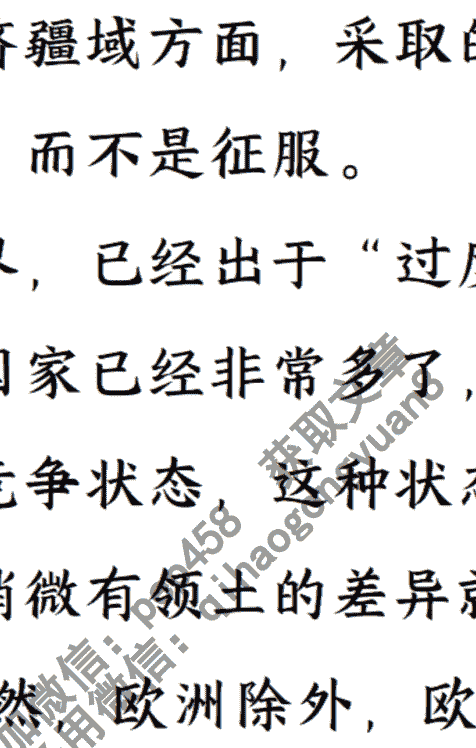

# 加微信：pep45免费获取文章

# 即将登场（大能仅学明）

# 大英国汉复莱202503

| 费用 | 365天 | 165天 |
|---|---|---|
| 优惠 | 298元 | 165元 |

注册网址：xxx.com
输入优惠码：pep45
微信号：yangongyuan

- 免费获取所有课程资源和文档（省 365元）
- 免费获取所有课程资源和文档（省 165元）
- 免费获取所有课程资源和文档（省 89元）
- 免费获取所有课程资源和文档（省 59元）
- 免费获取所有课程资源和文档（省 39元）
- 免费获取所有课程资源和文档（省 19元）

可购买更多精讲讲义、高清视频课程（省 1237元）
可购买更多精讲讲义、高清视频课程（省 899元）
可购买更多精讲讲义、高清视频课程（省 599元）

回到明朝是一个现实的选择，但是也是一个需要克制的选择。这需要从理论的眼光来看待，更需要哲学的眼光来看待。以下内容“小伙伴”可见。

## (一)国家的疆域

国家的疆域是什么

国家的疆域包含了两层意思：一层意思是地理概念，这是一个国家之所以形成国家的地理集合，是地理空间的概念。另一层意思是政治概念，这是一个国家宗教的合集，意味着这个政治集合对于国家的认同。

国家的疆域不是一成不变的。往往是殖民主义的兴起，大量的民族国家出现，整个世界的疆域大小变化变得非常敏感。美国这样扩张领域的做法，一定会在整个世界上留下阴影，这会带来不可逆转的反噬，一定体会。

疆域和国土不能等同。疆域往往大于国土，扩张领域只是其中的一种做法。由于民族国家的崛起，导致大家对领土极其敏感，但是对于疆域，大家却没有太深刻的领会能力，因为属于疆域的部分。

回到明朝，并不是我们的领回到，而是疆域。疆域往往为两个部分：第一部分是领土性疆域，剩余部分包括领海、海空，也是关注度最高的。第二部分是非领土性疆域，这部分非常复杂，但是可以大致分为几类：一类是没有深领土是有益的区域，例如深海采集区、南极北极、太空等等；二类是国家利益覆盖的区域，特别是经济利益所在的区域。

一个国家的疆域，往往决定了国家的形态，是一个陆权还是海权或者陆海兼备的国家等等。

历史的发展中，我们只能认为俄国作为陆权的极致的英国、美国作为海权的极致，我们作为海陆兼备的极致，基本上都是各自类型的范本。英国更彻底一些，英国在扩张过程中疆域是扩大的，衰落的时候，疆域也是收缩的。

这里首席还要提醒一点，一个崛起的过程往往是300年左右，衰落的过程往往也是300年，比如英国，如今仍然在衰落的过程中。美国目前是将衰未衰，我们是将强未强，俄国则是衰落中出现了中兴。

但是维持疆域是很困难的一件事，任何国家的兴盛跟疆域的扩张、维持、缩小有关关系。包括当时的美国，美国正在战略收缩，圈就是维持了核心利益以维持，这一战之前之前的英国是一模一样的。

维持疆域往往有四个方面的因素：第一就是战争。疆域特别是领土的扩张需要战争，不是白无故扩大的，疆域的缩小，往往也是战争的失败造成的。故敌对对于疆域的观感，往往会造成战争，这是国家竞争的常态。第二就是宗教。比较典型的南斯拉夫和非洲，尚未形成现代国家的概念，还是停留在宗教的概念里，往往会造成领土的不断分裂。

第三就是意识形态。比如东德和西德，虽然合并了，但是一个德国，仍然是两个国家的体系，至今还没有完全统一，造成德国至今都无法再次崛起（这是德国至今都非常沉寂的根本原因，因为没有实现统一）。

第四就是透支国力。对于边疆过度开发和使用。比较典型就是唐朝，力量全部散在边疆地区，导致中央无人保卫，过度透支国力，使得县花一现。

疆的核心在中央领域，而问题的演变往往在边疆。边疆距离中央，但是会瞬间崩塌，因为这是信心和决心体现的过程。

美国人的边疆，东部在日本一线，西部在中东一线，中央是空虚的，但是没有人能打到美国的中央，这让他恃无恐。

我们的边疆，极其复杂，周围的所有国家跟我们都有竞争关系，这是亚欧大陆的常态，所以也不奇怪。俄人的边疆，也差不多，当前的俄版图就是它力量的极限，苦苦支撑已经是非常不容易。保卫中央领域是每个国家自然需要的。

首问大家一个问题：如果我们选WW或者印度、开战，首要防卫的是哪里？
- 只有首都都是防御的。
- 反过来，我们要进攻日本、哪里？
- 同样，我们跟印度、作战，首先进攻的是哪里（或者是首都）。
- 同样，我们跟日本、印度，重点是哪里（城市、港口、基地等等，最核心的首都）。

当前大国之间的战争本质上是代理人战争，实质上都是所谓的发展权。我们是一个民族看待问题的实际上，清朝对疆域进行了划分，清朝之前，疆土徘徊在400毫米等水量决定的北方农牧交带；后期过了400毫米降雨带，将疆土稳定向西北。

以前以唐时代，国力时拓西北；康熙时代后，将疆土延伸至中亚草原，至今多年，没有丢失这片土地。虽然有过多次反复，但还是农牧交错带，将疆土实在在了伊河流和喀什尔地区。

我们当前的观点要突破传统疆域的概念，进一步将疆域拓展到海洋和岭域。

这一章又是康熙征后，反复争的新局面。 (二)制衡为主，征服为辅

大家都在说，严肃的说，如作为领土予以征服，这是透支国力的情况；如果是作为制衡，则是有可能的。我们国家的核心竞争力是制造业，占全球30%左右，是美国、日本、德国和韩国的总和，我们占9%。特别是疫情以来，我们充分认识到我们的竞争力其实是世界上最便宜的。随后我们希望形成价格、质量制造业。未来20年，制造业变成又便宜又好，而且我们希望能够维持30%比例不变。

但是我们也有短板，最大的短板就是资源都在海外，资源稍微变化，就影响我们的效率。因此在这个过程中，拓展疆域的核心应该是经济领域方面，采取手法应该是制衡，而不是征服。

当前的世界，已经处于“过度饱和”的状态，国家非常多了，相互之间都处于竞争状态，这种状态是非常紧迫的，稍有领土的差异就容易出现问题（当然欧洲除外，欧洲的整体素质不如经过了社会主义洗礼的非洲）。

在这种情况下，领土的变化往往牵一而动，只有制衡才能解决问题，不战而屈兵是战争的最高境界。比来说，印尼的天生矛盾，印尼跟我们的三角备状态，这种状态让我们如何记忆澳洲的领土呢？这不是将印尼推向澳洲。

加微：pep458免费获取文章

阻断我们的海上利益，美国英国都能做到的事吗？同样的故事在缅甸也能发生，我们再次去插手缅甸，分裂这个从明朝末年就已经比较完备的国家吗？这是典型的将缅甸向印度怀里。理论界一个案例是讲到“改土归流”之前，明朝进攻缅甸北部的灌川国，当时灌川国不服明朝，朝廷出兵灭了它，结果打破了缅甸南北力量的平衡，南边的缅甸人北进，灭掉了汉人，基本形态形成今天缅甸的版图，汉人再也没有办法插手缅甸。不能因为一时的崛起，就破坏区域的利益平衡。我们的核心是一些小国家：比如海岛国家、非洲国家等，这些在所有大国的边缘之外，也是我们的核心区，这样的国家有利于我们制衡的成本，也不容易打破平衡。要知道，疆域扩展中，每逾越一类地理障碍，就意味着进入了一个新的环境地带。

回顾我们国家的历史，疆域与土地地上的社会组织、政权、意识形态、种族相应，而将散处在各地的松散群聚集在一个政权之中、整合在共同土壤下的力量，不仅是一个政治和军事事件，文化认同具有更重要的意义。跨越地理环境，将疆域的整合推向到经济生活方式完全不同的地区，应是政治、军事与文化的合力。而同化非族类的人群，需要500年至1000年的时间，除非我们有强大的洗脑能力，无法完成同化；一个案例就是香港，1997年后到现在，仍然不服管辖，难度很大，需要时间。如果我们只是简单的征服，而不能消掉这些利益，很快也会丢掉，进而进入战略收缩和最后的瓦。中国历史上，在疆域治理上体现了德化的做法，一种包容文化的体现出来，也是先进的华夏文化历代王朝对疆域实行安抚、怀柔、易俗、崇学等举措，体现了此类特征。最后是通过“恩威教”“广布教育”“互市通”等策略，使核心区与边缘区渐成一体。

这是理想状态，即便是这样也会消耗国力，因为我们需要投入大量的教育、物质资源为了发展，我们必须迈出这一步，必须有很强的驱动。我们参与制衡，基本上都是边缘国家，国内已经有了不同的社会认知，彼此都有冲突，由此带来的结果看不到发展的希望，需求非常迫切。

第一，实行“人类命运共同体”概念，实质上针对各个国家、地区、个人存在的经济、政治、文化等种种差异，求同存异，强调不同形态、传统、发展水平、制度等差异。第二，促进使命畅通，推动它们走向现代化，但在现代化的过程中，赋予它们一体的意识。第三，普及通用语言这个世界上最有信息的文字，从精神上维护统一的感受。

加微信：pep458免费获取信息精选（原价459）包括以下内容：
- 吃瓜群众实文档复刻对话（原价365元/年）
- 子名私享（江南文化文章，原价568元/年）
- 米征观【作者米莉】（原价599元/年）
- 欧洲金会员专属文章（原价328元/年）
- 转五幻内函（原价400元/年）
- 卢克文云读书专属文章（原价699元/年）
- 豪莱特知识星球（原价3310元/年）
- 逍霸的梦想知识星球（原价299元/年）
- 今日财富金榜【独家新闻（原价1498元/年）
- 杨世光在金樽（原价2200元/年）
- 森森莉知识星球（原价1600元/年）
- 涯沫还付费文章（持续更新）
- 可马上畅阅读全套音频和书精藏无损版（原价2.3万）
- 邵虚陈民国、史帝铭、不理解的MAO（原价599元/年）
- 卢克克克星知识星球（原价268元/年）
- 额外获赠：薛麟元微信付费专享，更多资源下不去了...

免费内容赠送历史文章：
- 守护者知识星球、捷玲、魔王知识星球、星球财富星球、有术知识星球、三八花文集
- 创绘笔记、达远通知识星球、财财富星球、雪果花老头等
- 大为标题、李莉梅、江宁、呼峰、上海等等免费文章、系统等等等合一V文章免费
- 西风付费文章、老瑞、在八小时之外、外人的世界、提升计划、作者（每月限2000元的免费）

信息精选，原年费459元，免费包含以上内容。
