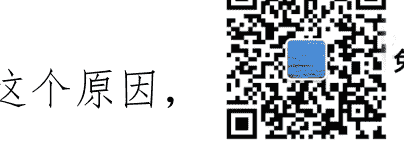

## 奉旨泄密的特朗普访华

发布时间：2025年7月2日

涉及特93阅兵访华的内容，上周在微信里面是直接被吞了发不出来的，但是周日随着日本共同社的“奉旨”泄密，事情变得可以半公开的讨论了，标志着对这次接待，中方已经准备好了。

跟特朗普上台之初，通过媒体放风邀请老板参加登基典礼，以及后续邀请老板参加日王生日宴会类似，都是为了最终能够成事而造势，是非常真诚的邀请对方参加，并愿意为了这场庆典支付巨大的利益。

也正是因为这笔巨大的弹性经费，加微信信号jnts2，免费进资料群 ✨

在特正式拒绝参加之前，中方不会拒绝大部分美方提出的经济诉求（参考《43|乐观的中中美谈判推进》）。只要特肯来，这些承诺都会兑现，但如果不来，那这些就会收回。

他们延续拜登时代围堵兔子（中国）是在倒反天庭，特、普普等人将组成新雅尔塔体系（参考《44|新雅尔塔三皇的经济周期》）。他们延续拜登时代围堵兔子是在倒反天庭，中欧、中日韩、中印、中澳等关系迅速回暖。

微信号jntsg2
微信号jntsg2

免费进资料群

也正是因为这个原因，无论瑞士还是伦敦，双方谈的都非常的好的。兔子让美国经济赚麻了，加微信jntsg2，免费进资料群。

美国也能让兔子政治赚麻了，双方能够各取所需。而伴随兔子近期开启中欧、中日韩、中印外交，我们就需要释放出特朗普访华的信息，虽然这么会着巨大的风险。但是能便于美国在近期的外事工作中拨云见棘，所以共同释放消息也就非常合理，毕竟日本就是美国起家的基本盘。

## 延伸阅读

### 王义将访问欧盟总部、德国、法国并举行有关高级别对话
来源：新华社2025年6月27日
外交发言人27日宣布：应欧盟外交与安全政策高级代表卡拉斯、德国外长瓦德国富、法国外长巴洛邀请，中共中央局委员、外交部长王义将于6月30日至7月6日访问欧盟总部并举行十三轮中欧高级战略对话，访问德国并举行第八轮中德外交与安全战略对话，访问法国举行中法外长会谈并出席中法高级人文交流机制新一次会议。在布鲁塞尔期间，王义还将比利利时首相韦弗、副首相兼外交大臣雷沃分别会见、会谈。

### 海关总署公告2025年第140号（关于有条件恢复日本部分地区水产品进口的公告）
来源：海关总署2025年6月29日
在持续开展针对日本福岛核污染水排海的长期国际监测和中国独立取样监测结果未见异常，日本政府承诺保障输华水产品质量安全的前提下，根据我国食品安全法律和世界贸易组织《实施卫生与植物卫生措施协定》有关原则，为维护消费者合法权益，中方决定有条件恢复日本部分地区水产品（含食用海水动物，下同）进口。

### 外交部新闻（2025年7月1日）
来源：外交部2025年7月1日
2025年6月30日外交部例行记者会：
彭博社记者：回到刚才关于北京将于9月举行阅兵的问题，共同社报道称，中方计划邀请美国总统特朗普出席。发言人能否否证实？能否提供更多细则？
毛声：我刚才提到，上周国新办的记者会介绍了抗战胜利80周年纪念活动邀请外国领导人的情况和安排。你的具体问题，我目前没有可以提供的信息。
END
加微信信号jntsg2，免费进资料群

---

## “幽灵”与“达摩克利斯之剑”上

发布专栏：知几共话

废墟之下，云端之上，流言真孰假？

2025年6月23日，美国国防情报披露的一份报告显示：美军空袭伊朗核设施虽然造成破坏，但并未像美国总统特朗普公开宣称的那样“彻底摧毁”伊朗的核能力。

伊朗原子组织24日表示：伊朗核项目在遭到以色列和美国军事打击后仍能够继续运转。

两相矛盾如此：霍王对外坚称“彻底摧毁”，伊朗则公开表态要继续开展核项目。那么伊朗的核设施到底有没有被实质性重创？

另一方面，被美国大加宣扬的参与本次打击的B-2“幽灵”隐形炸机，究竟有着怎样的特性？它的维修与保养又体现着怎样的工程理念？

微信公众号jnts2，免费进资料群

伊朗现在明确表态要继续开展核计划，看起来美意的轰炸并没有完全推毁他们的核设施。

（下文内容逻辑：美意的轰炸并没有完全推毁他们的核设施。伊朗的工程水平尚不足以支持把核设施隐藏在800米的地底，但即便如此，现在的深度也让他们保留了部分物质，为之核计划延续了火种。而执行此次任务的B-2，其维修与保养逻辑与新型号的有明显的区别。）

（注：原文OCR文本存在大量乱码和重复字符，此处已根据语义逻辑进行梳顺。）
