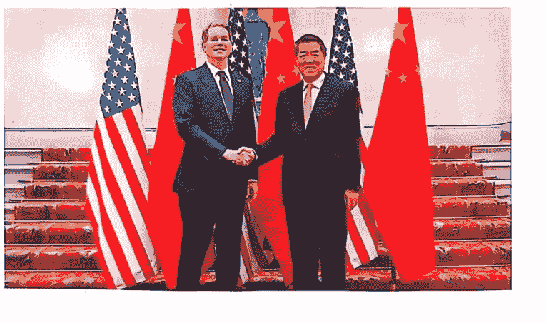
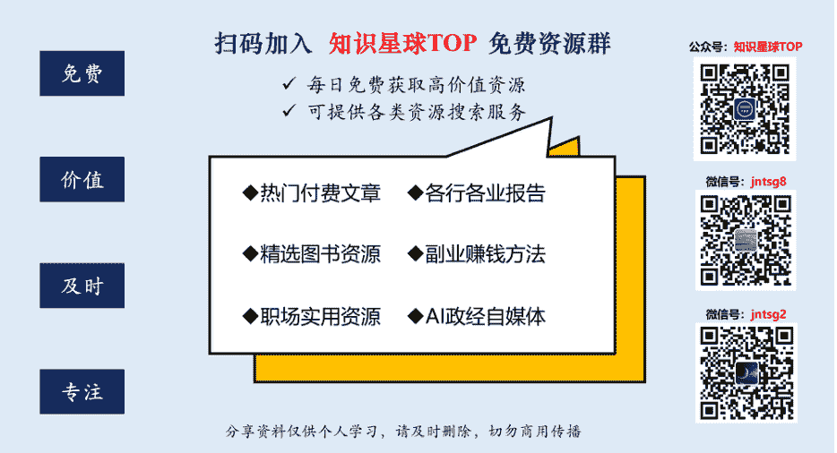

# 子明私享汇250612: 特朗普的TACO AGAIN

发布专栏: 知乎共话

微信信号:jntsg8

微信信号:jntsg2 免费进阶资料群

懂王撑住了面子，就要还给我们里子。

全球瞩目的中美伦会落下了帷幕。
2025年6月11日，中国商务部国际贸易谈判代表副部长李成钢表示：在中美贸易磋商机制首次会议上，双方进行了专业的、理性的深入、坦诚的沟通，中美谈判代表就缓解经济紧张局势达成“框架协议”，延长世界上最大经济体上上个月达成的贸易休战，并将提交新框架给两国领导，作为最终批准。

加微信jntsg2，进阶分享群

泽连斯基的背刺、马斯克的变节……特朗普在经历了种种不顺后，顶着巨大压力向我们这位“老朋友”投来了期许的目光。而我们在长远利益的考量下也愿意与懂王达成合作。

经过两天的努力，在世界上空中的中美贸易战云正在逐渐散去，大家又可以继续“赢”下去了。

这次谈判好像又一次超预期了，有什么事情促使双方这么顺利地达成协议？

应该主要来自于懂王那边的压力。

嗯，懂王那边承受的压力肯定要更大一些。在这一轮磋商之前，特朗普那边发生了两件事情，让他少了许多谈判筹码。

一件是泽连斯基突然袭击俄罗斯，导致俄乌战争又要继续。这给特朗普插了个大钉子，他需要我们在俄乌问题上加码团结。

另外一个是马斯克突然翻脸，公开和他割裂。让大家更害怕特朗普的3.0。当特朗普没有了任期优势，许多国家对待海湖协议的签署意愿自然也会下降，一推再拖。

国内都出现了他意料之外的事情，懂王最近是挺不顺的。

接二连三暴雷暴露他对国内的掌控力不足吧。这势必会导致国际社会的信心大减，其他国家对美谈判中也不会那么配合了。

泽连斯基的突袭让特朗普失去了跟普京联手的可能，马克的炮轰让他失去了硅谷资本的全力支持，甚至可能间接送掉他的3.0之路。

所以这次中美磋商又会是一个新的 TACO（注①），特朗普一边高喊着自己“赢麻了”，一边在谈判中给我们让利，让我们配合他演好这一戏。

但是现在看美方公开的说法，好像他们并没有指望我们帮忙的意图。

这个逻辑其实很简单，大国之间要想要成功，一定是一侧重于面子，另一侧重于里子，这一次很明显是我们拿了里子，懂拿了面子。

子明：这一次我们的里子会什么呢?不会是“统一”吧？这也太心急了。站在老板的角度，现在还在刚加上微信好友，要开始极限拉扯的阶段。

子明：是啊，父母都没有意见呢，哪能把孩子名字都想好了。“统一”任重道远，但其他一定会有实质性的进展。

子明：举个例子，五月的日内瓦会谈，中美仅仅是约在一起喝咖啡，而这一次在伦敦会谈，就需要大家回家拿身份证了。这就是直接拿拿拿身份证的孙猴了吗？

是的，因为这次的协议是需要两国首签签署的，内容肯定会比日内协议要深入得多。至于“孩子”姓什么的问题，大家都还没现在想解决它还有点操之过急，现阶段的协议就是各取所需，相互解决一下彼此最关的利益需求。

子明：# 加微信jntsg2 进资料分享群

这轮谈妥之后，中美关系短期内应该会走向缓和了。

协议如果落实了，就会因为共同利益得到一程度的缓和。进群微信jntsg2 不过双方彼此欢，两国利益都获得了一定的满足之后，恰恰就是要重新审视对方、评估潜在威胁的时候了。

子明：2025年6月12日14:28

注①TACO: Trump Always Chickens Out (特朗普总是退缩的)。

中美五月会看起来一样，特朗普的“盟友”和“战友”又给我们送来了惊喜。“里子”还是“面子”，对于此刻的霍王来说并没有多少选择的余地。

加微信jntsg2 进资料分享群

用“面子”来保住剩余的“里子”是他当下最实际的考量，而我们恰能借此良机，寻求自身发展的更大空间。

# END

加码加入 知识星球TOP 免费资源群

分享资料仅供个人学习，请及时删除，切勿商用传播

加微信jntsg2，进阶资料分享群
